> PDF 来源：联网从 arXiv 下载（`https://arxiv.org/pdf/2512.24601`，v3，2026-05-11，43 页，含附录），正文用 HTML 版交叉核对。作者是 MIT CSAIL 的 Alex L. Zhang、Tim Kraska、Omar Khattab。代码：`https://github.com/alexzhang13/rlm`。

> 一句话：把超长输入丢进代码环境当变量，让模型写程序循环调用自己，10M token 也能答。

## 0. 读之前你需要知道

**术语卡**

- **token**：模型读写的最小计费单位，一个英文词大约 1 到 2 个，一页中文大概上千个。生活类比：字数，只不过按模型自己的切法数。
- **上下文窗口（context window）**：模型一次对话里能同时看见的 token 上限，超过就塞不进去。生活类比：一张书桌，摆满了就得把旧纸收走才能放新纸。
- **上下文腐化（context rot）**：输入越长，模型对里面信息的利用率越差，分数往下掉，即使总长度还没超窗口。生活类比：一个人读 800 页卷宗，读到后半本时前半本的具体页码已经记不清了。
- **压缩（compaction）**：窗口快满时，把前面读过的内容摘要成一小段再继续。生活类比：把会议记录揉成一页纪要，结论还在，细节没了。
- **REPL（read-eval-print loop，读—算—打印循环）**：一个能反复执行代码、并把变量留在内存里的交互环境。生活类比：一个不会失忆的计算器，你敲一行 Python，它算完把中间结果存着，下一行还能接着用。
- **脚手架（scaffold / harness）**：套在模型外面的那层程序，负责喂输入、给工具、收输出，模型权重一个都不改。生活类比：给司机配导航和后备箱，车没换，但能干的事变了。
- **递归子调用（recursive sub-call）**：在一段程序里再叫一次模型，甚至叫一个同样带脚手架的模型，也就是自己调自己。生活类比：主编把一章分给五个编辑，编辑再把自己的小节分给实习生。
- **有效上下文（effective context）**：窗口标称能装 1M，实际能可靠使用的往往远少于 1M，具体少多少取决于任务多稠密。

**它站在谁肩上**

- 大海捞针类评测（RULER / NIAH，2024）：在一大堆无关文本里找一句话，针的大小不随文本变长。它的缺陷是信息量恒定，前沿模型在 1M token 上还能刷高分，所以测不出真正的长上下文能力。
- OOLONG（Bertsch 等，2025）：答案依赖输入里几乎每一行，难度随长度线性涨。它的反面价值在于证明了单靠模型硬读，131K 就开始崩。
- 压缩型 agent（ReSum、Context Folding 等，2025）：超长就摘要续命。缺陷是有损，密集信息任务会把需要的细节摘要掉。
- 代码型 agent（CodeAct，2024；Claude Code、OpenCode，2025–2026）：让模型写代码调工具、把长上下文挪到文件里。缺陷是用户输入本身仍然直接进窗口，或者只把外部文件当检索源，取几段就又撞上窗口。

## 1. 动机

一个律师助理收到 800 页卷宗，问题不是复述，而是列出所有在 2023 年前签约、且合同里出现过某个冷门条款的供应商。真人不会把 800 页背下来，而是先做目录，按章节分给几个人各查一遍，最后汇总去重。

**以前怎么做**：三条路。整段塞进上下文；塞不下就边读边压缩；或者用检索挑几段塞进去。

**为什么不行**：塞不下。GPT-5 的窗口是 272K token，而这篇论文里的 BrowseComp-Plus 一千篇文档是 6M 到 11M token，差三十倍。就算塞得下也会腐化，Figure 1 左图里 GPT-5 在 OOLONG-Pairs 上到 32K 只剩 4 分上下（表 1 里同一设置记的是 0.1，两处口径本身对不齐）。压缩是有损的，这类题恰恰要求每一条都过一遍，摘要把每一条扔了。检索只覆盖少数片段，对需要两两配对的题等于没做。

**为什么现在能做**：模型会写代码了，代码能循环、能存变量、能把一个函数调用塞进 for 循环里跑几千次。子调用便宜，一个便宜的小模型就能干切片的活。推理模型已经证明了多花推理时间能换能力，这篇把同一套逻辑从推理长度搬到输入长度上。

## 2. 贡献

- **提出一个范式**：把任意长的输入当外部环境里的一段字符串，模型写代码去读、去切、去递归调用自己。证据：Algorithm 1 和一个几十行的 Python REPL 实现。
- **在 10M+ token 规模上跑通**。证据：BrowseComp-Plus 的输入是 6M–11M token，RLM(GPT-5, depth=1) 拿 91.3 分，成本 \$0.99，比按比例外推的 GPT-5-mini 吃 6–11M token 的 \$1.50–\$2.75 还便宜。
- **稠密任务上差距最大**。证据：OOLONG-Pairs 上 GPT-5 原始 0.1 分、RLM 58.0 分；Qwen3-Coder 原始 0.1 分、RLM 23.1 分。
- **训出了第一个原生递归模型**。证据：RLM-Qwen3-8B 比未训练的 Qwen3-8B 当 RLM 用时中位数高 28.3%（例如 OOLONG 从 24.00 到 32.04，BrowseComp+ 从 2.00 到 14.00），推理快三倍以上。
- **训练出长度泛化**。证据：MRCRv2 上只在 64K、2 个针的切片上做强化学习，直接迁到 1M、8 个针的切片，分数从 0 附近爬到接近 1.0（Figure 3b）。

## 3. 创新点

- **提示词不进窗口，只进变量**。对比对象：CodeAct、Claude Code、OpenCode 都把用户输入直接塞模型上下文，或者只把外部文件当检索源。新在于模型拿到的是一个符号句柄 `prompt`，只能靠写代码去看它。有用是因为这样输入长度和窗口长度彻底解耦，8M token 的输入在窗口里只占一个变量名。
- **最终答案从变量里取，而不是让模型生成**。对比对象：几乎所有脚手架都用一个 Finish 动作让模型把答案说出来。新在于答案存在 REPL 变量里，`FINAL_VAR(x)` 直接把变量交给外部。有用是因为输出长度也就不受窗口限制了，OOLONG-Pairs 要求输出上万对 ID，靠嘴说根本说不完。
- **递归写在代码里，不是写成一次工具调用**。对比对象：把 sub-agent 当成一个工具，只能显式点名调用几次。新在于子调用是可以在 for 循环里被程序化发起的，一次程序能发起 $\Omega(|P|)$ 甚至 $\Omega(|P|^2)$ 次调用。有用是因为稠密任务的工作量本来就随输入平方涨，只有程序化的循环跟得上。

## 4. 方法

### 4.1 整体流程

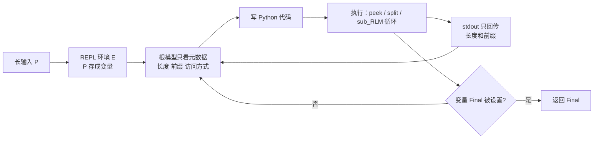

这张图说的是：模型始终只看得到输入的摘要和它自己写的代码，真正的长文本一直躺在 REPL 的内存里，被代码反复切片、统计、送去递归。

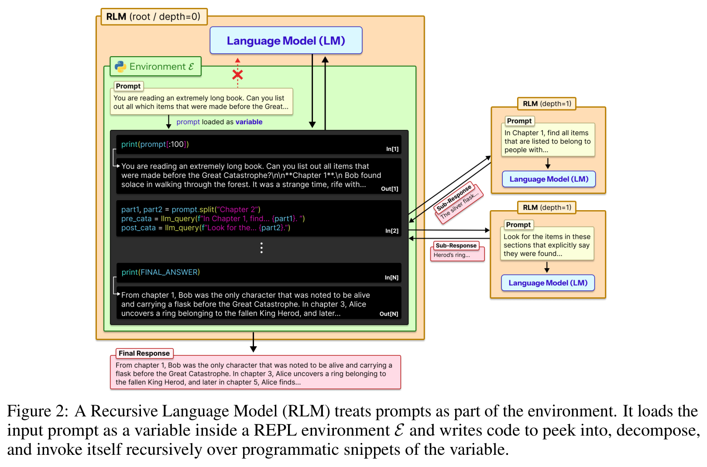

图 2：方法总览。左边橙框是 depth=0 的 RLM，绿色环境里躺着 Prompt 变量，模型在 REPL 里先 print 前 100 个字符，再 split 成两段分别调 `llm_query`，最后从变量里取终答；顶部那个红叉表示原始提示词并不进模型上下文。右边两个黄框是 depth=1 的子 RLM，每个自带 Prompt 和自己的模型。

### 4.2 模块拆解

**根循环（Algorithm 1）**

为什么需要：窗口只有 $K$，输入有 $|P| \gg K$，必须让模型在不看见全文的情况下操纵全文。

怎么做：初始化 REPL，把 $P$ 存成变量，再注入一个 `sub_RLM(prompt)` 函数。第一轮只给根模型元数据：长度、开头一小段、怎么访问。之后每轮它写一段代码，环境执行，执行产生的 stdout 只把长度和前缀写回历史，正文丢弃。变量 `Final` 一旦被设置，循环结束，返回 `Final`。

公式：每轮只往历史里加常数 $c$ 个 token，所以根循环的轮数有上界。

$$
n_{\text{root}} \le \left\lfloor \frac{K}{c} \right\rfloor
$$

这句话在算：根模型最多能转多少圈而不撑爆窗口。

- $K$：模型上下文窗口大小，单位 token，GPT-5 是 $272\text{K}$。
- $c$：每轮写回历史的内容长度，论文说按每轮裁剪到 $c$ 个 token 来算，是个常数。
- $n_{\text{root}}$：根循环的迭代次数。

结论很朴素：轮数上限是常数级，跟输入多长无关，输入再长也只是每一轮里多跑几次代码。

**符号递归（`sub_RLM`）**

为什么需要：有些任务必须逐条处理，一条一条看语义，模型自己读不完。

怎么做：REPL 里 `sub_RLM` 是个普通函数，可以在循环里调。模型常写的模式是先把 $P$ 按换行或章节切块，每块构造一句问话，循环调用，把结果收进一个列表变量，再用普通 Python 做统计、配对、去重。子调用自己也可以是带 REPL 的 RLM，这就是递归深度的来源。

公式：程序化递归能发起的工作量。

$$
\#\text{sub-calls} = \Omega(|P|) \quad \text{或} \quad \Omega(|P|^2)
$$

这句话在算：一段代码能替模型干多少件语义活。

- $|P|$：输入长度，单位 token 或条目数。
- $\Omega(|P|)$：线性，每一条过一次模型，比如 OOLONG 里给每条打标签。
- $\Omega(|P|^2)$：平方，每两条之间做一次比较或配对，OOLONG-Pairs 就是这种。

OOLONG-Pairs 里 20 个问题都要求列出所有满足条件的用户 ID 对，条目数为 $N$ 时配对数是 $N(N-1)/2$，这就是平方项的来源。人做这种题也是两两比对，只是人会用 Excel。

**成本**

为什么需要：没人会因为省了上下文而接受十倍账单。

怎么做：根模型每轮只吃常数 token，大头在子调用，而每次子调用只看一个切片。

公式：

$$
C_{\text{total}} = n_{\text{root}} \cdot C_{\text{root}} + \sum_{i=1}^{m} C_{\text{sub}}(s_i)
$$

这句话在算：一次 RLM 推理到底花多少钱。

- $C_{\text{root}}$：根模型单轮成本，输入是常数大小的历史，所以它不随 $|P|$ 涨。
- $m$：子调用次数，量级由上一段决定。
- $C_{\text{sub}}(s_i)$：第 $i$ 次子调用看切片 $s_i$ 的成本，切片远小于全文。

所以总成本随任务复杂度涨，而不是随输入长度平方涨。这也是论文里 8M token 的题只花 \$0.99 的原因：从来没有哪一次调用真的看过 8M。

**训练（把 8B 模型变成 RLM）**

为什么需要：直接让 Qwen3-8B 当 RLM，它会乱调子调用、乱写终止标签。

怎么做：用 Qwen3-Coder-480B 在 LongBenchPro 上跑 750 个任务，收 2250 条轨迹；先去掉 0 分和只跑一轮的，剩 1072 条；把每条轨迹的根模型每一轮拆成一个训练样本；再删掉超过 Qwen3-8B 窗口（按 10 万字符近似）的轮次；最后加一步程序化的模板修补，因为 16% 的轮次把最终答案错写成 `FINAL(answer)` 而不是 `FINAL_VAR(...)`，13% 反过来。

训练规模很小：batch 64，300 步，48 张 H100 小时。

### 4.3 一次完整走查

拿 OOLONG 的一题示范：13 万 token、13078 行记录，问其中属于 entity 类的有多少条。这题能塞进 272K 窗口，选它是为了把「塞不下」和「读不懂」分开看。

- **第 0 轮**：根模型只拿到长度 512,431 字符、开头 200 字符、怎么访问，约占 300 token。原始提示词没进窗口。
- **第 1–2 轮**：`print(len(prompt)); print(prompt[:300])` 摸清格式，再按换行切开，确认 13078 行。stdout 被截断，回传的只有长度和前缀。
- **第 3 轮**：写循环，每 50 条一批调 `llm_query`，262 次子调用，标签收进 `labels` 变量。

```python
for i in range(0, len(lines), 50):
    labels += label_batch(lines[i:i+50])
```

- **第 4 轮**：`Counter(labels)` 数出 1942 条，这一步不调模型。
- **第 5 轮**：`FINAL_VAR(answer)` 交回，循环停止。

全程窗口占用没超过 1K token。真正看过那 13 万 token 的是 262 次子调用，每次只看 50 行，没有任何一次调用需要同时理解整份材料。

同一题三种做法的分数：原始 GPT-5 是 44.0；depth=0 只有 REPL、不许子调用，36.0，因为它还是得自己读完才能分类，被逼回关键词猜测；depth=1 是 56.0。换成 8M token 的 BrowseComp-Plus，流程不变，只是第 3 轮改成每篇文档一次子调用。

一句话：模型写程序，程序翻全书，子模型读每一页，Python 数答案。

### 4.4 关键细节

- **递归深度**：depth=0 表示有 REPL 但不许子调用；depth=1 表示能叫普通 LLM；depth 大于 1 表示能叫完整 RLM。不写就是 1。
- **根和子用不同模型**：GPT-5 做根，GPT-5-mini 做子调用，论文说这是能力和成本的折中。这条对复现很关键，换模型分数会变。
- **stdout 要截断**：模型可以 print，但打印内容会被截断，否则一轮就把窗口冲了。
- **终止靠标签**：`FINAL(...)` 表示答案就是这句话，`FINAL_VAR(x)` 表示答案在变量 `x` 里。两种都靠字符串匹配识别，所以格式错就没答案。附录 B 里专门记了这一条失败模式。
- **提示词要按模型改**：给 Qwen3-Coder 的 prompt 里加了一句别调太多次，否则它对什么都想子调用，一个简单任务能发上千次。
- **全同步实现**：所有子调用是阻塞串行的，这是它慢和长尾贵的主因，论文自己承认。

## 5. 实验结果

**实验设置**

- 数据集与切分：五个任务。S-NIAH（50 个单针任务，信息量 $O(1)$）；BrowseComp-Plus 1000 篇文档（从 150 个采样实例里跑，输入 6M–11M token）；OOLONG 的 trec_coarse 切分（50 题，131K token，复杂度线性）；OOLONG-Pairs（自建 20 题，32K token，复杂度平方，按 F1 判分）；LongBench-v2 的 CodeQA（23K–4.2M token，题数原文未给）。附录 D.2 另取 BrowseComp-Plus 中 20 题做文档数从 10 到 1000 的缩放实验。
- 骨干模型：GPT-5（medium reasoning，默认采样参数），子调用用 GPT-5-mini；Qwen3-Coder-480B-A35B（480B 总参数、35B 激活，按官方采样参数，成本按 Fireworks 计价）；闭源 agent 对照用 Claude Opus 4.1 配 Claude Code v2.0.0。
- 训练预算：RLM-Qwen3-8B 用 1072 条过滤后轨迹做逐轮 SFT，batch 64、300 步、48 H100 小时。MRCRv2 的强化学习用 Qwen3-4B-Instruct-0527，150 步、batch 128、每例 4 条 rollout、每轮最多 4096 输出 token、最多 20 轮迭代。
- 基线：原始模型；CodeAct（带 BM25 检索 / 带子调用两个版本）；压缩 agent（GPT-5 实验里用 GPT-5-nano 压缩、GPT-5 出答案）；OpenCode（原始 / 把上下文外置成文件）；Claude Code（原始 / 外置）；RLM 的 depth=0、1、2、3。
- 指标：S-NIAH、BrowseComp-Plus、OOLONG、CodeQA 用正确率，OOLONG-Pairs 用 F1，LongCoT-mini 用解决率，全部越高越好。成本用平均 API 花费 $\pm$ 标准差，标了 * 的行表示该次运行撞到过输入上限。
- 推理设置：无采样温度说明（用各模型默认）；RLM 最大递归深度 0–3；stdout 截断；无外部裁判模型，全部是任务自带判分。

**主表**（只留能说明问题的行，最强基线从同模型的非 RLM 方法里取）

| 任务（输入长度）                   | 指标  | RLM(GPT-5, depth=1) | 最强基线                   | 差     |
| -------------------------- | --- | ------------------- | ---------------------- | ----- |
| CodeQA（23K–4.2M）           | 正确率 | 62.0                | 64.0（OpenCode + 上下文外置） | −3.1% |
| BrowseComp-Plus 1K（6M–11M） | 正确率 | 91.3                | 94.0（OpenCode + 上下文外置） | −2.9% |
| OOLONG（131K）               | 正确率 | 56.0                | 52.0（OpenCode + 上下文外置） | +7.7% |
| OOLONG-Pairs（32K）          | F1  | 58.0                | 28.4（CodeAct + 子调用）    | +104% |

注意第一行和第二行：depth=1 在两个任务上其实输给了外置上下文的编码 agent，2 到 3 个百分点。赢得多的是信息稠密的两个 OOLONG。

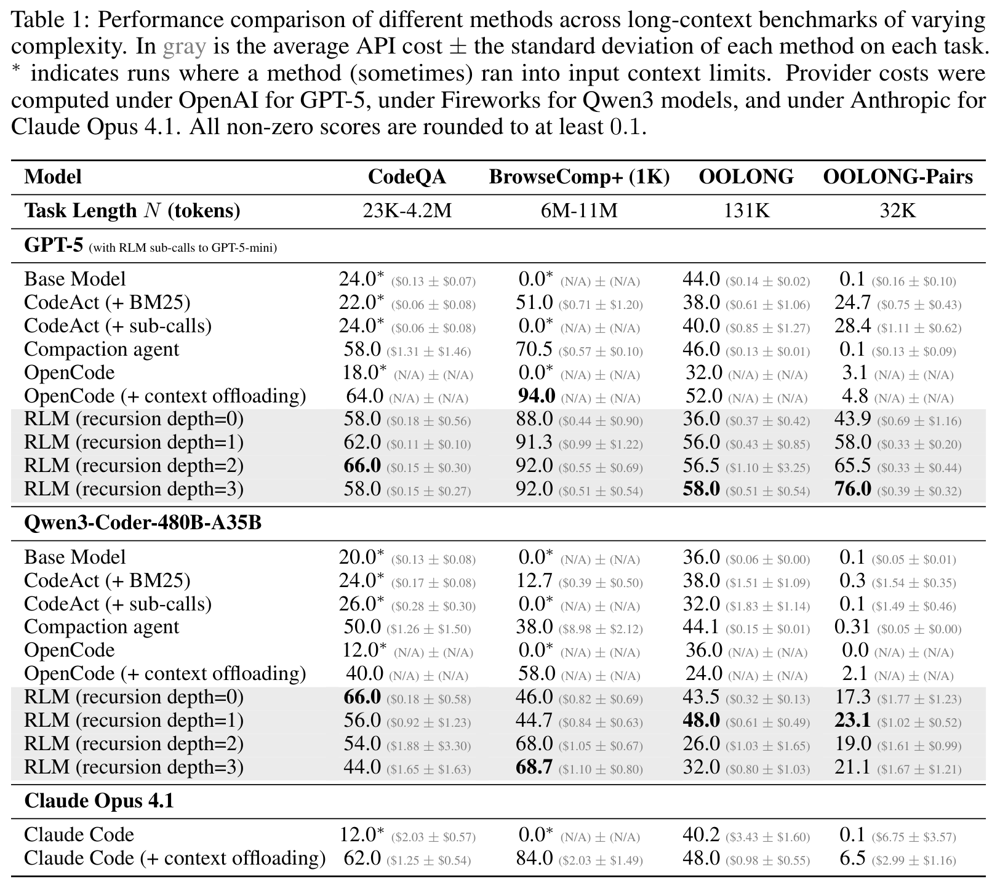

表 1：全量主结果。三块分别是 GPT-5、Qwen3-Coder、Claude Opus 4.1 三套模型，灰底行是 RLM 自己的结果，每格括号里是平均花费和标准差。这张表证明了 RLM 在 6M–11M token 的输入上仍然能跑，而原始模型那一行带 * 是因为根本塞不进去。

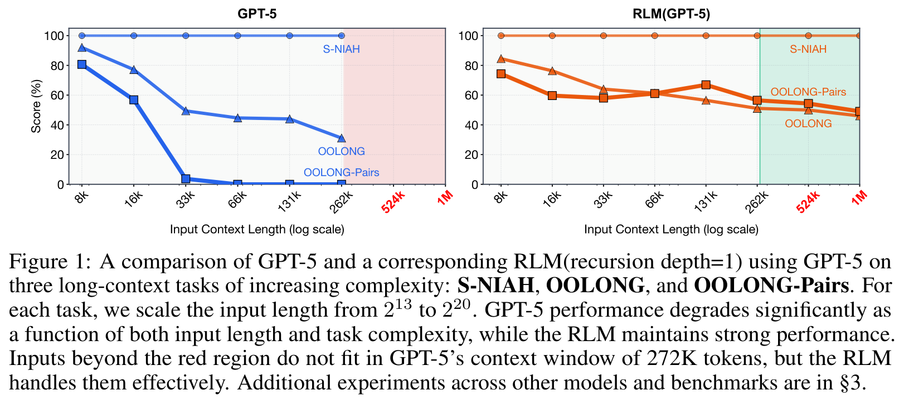

图 1：输入长度从 $2^{13}$ 拉到 $2^{20}$，三条曲线分别是 $O(1)$、线性、平方复杂度的任务。左边 GPT-5 在 32K 就崩，右边 RLM 到 1M 还在 45 分以上，红线右侧 GPT-5 的窗口已经装不下了。

**递归深度消融**

| 任务 | depth=0 | depth=1 | depth=2 | depth=3 |
| --- | --- | --- | --- | --- |
| CodeQA（GPT-5） | 58.0 | 62.0 | 66.0 | 58.0 |
| BrowseComp+（GPT-5） | 88.0 | 91.3 | 92.0 | 92.0 |
| OOLONG（GPT-5） | 36.0 | 56.0 | 56.5 | 58.0 |
| OOLONG-Pairs（GPT-5） | 43.9 | 58.0 | 65.5 | 76.0 |

depth=0 就是只有 REPL 没有递归，它在 OOLONG 上只有 36.0，比原始模型 44.0 还低。这说明光有代码环境不够，稠密任务必须靠子调用把每一条送进模型。反过来在 Qwen3-Coder 上，CodeQA 的最优是 depth=0 的 66.0，所有带子调用的版本都更差（depth=1 是 56.0），论文的解释是这模型代码语法错误多，递归把错误复制到子调用里，越深越糟。

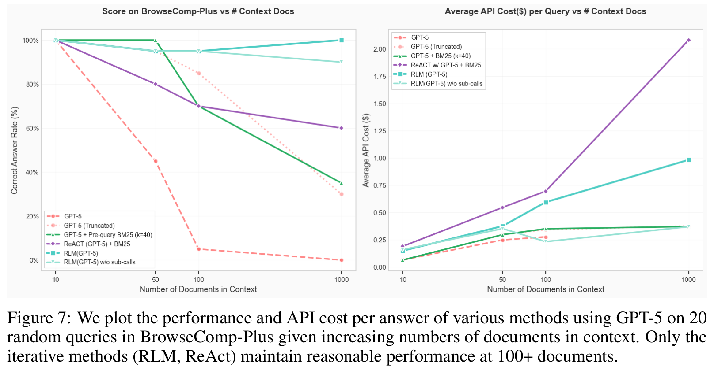

图 7：BrowseComp-Plus 上把文档数从 10 加到 1000，只看 20 道题。左图 GPT-5 直接读在 50 篇时掉到 45%，100 篇时掉到 7%，而 RLM 到 1000 篇还是 100%；右图成本，RLM 几乎贴着 log 线性涨，ReAct+BM25 反而更贵。

**训练**

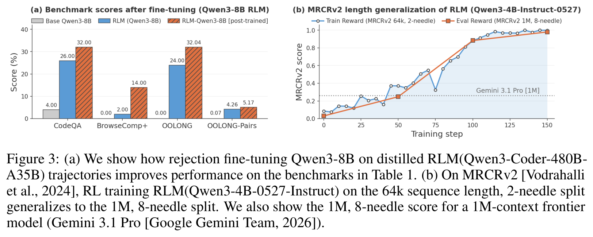

图 3：(a) 蓝柱是未训练的 Qwen3-8B 当 RLM 用，橙柱是训练后的 RLM-Qwen3-8B。CodeQA 26.00 涨到 32.04，BrowseComp+ 2.00 涨到 14.00，OOLONG 24.00 涨到 32.04，OOLONG-Pairs 4.26 涨到 5.17，四个任务的中位数相对涨幅就是摘要里的 28.3%。(b) MRCRv2 上只在 64K、2 针的切片训练，1M、8 针的评测分数一路涨到接近 1.0，图上那条水平虚线是 Gemini 3.1 Pro 在 1M 设置下的 0.26 左右。

**长推理任务**

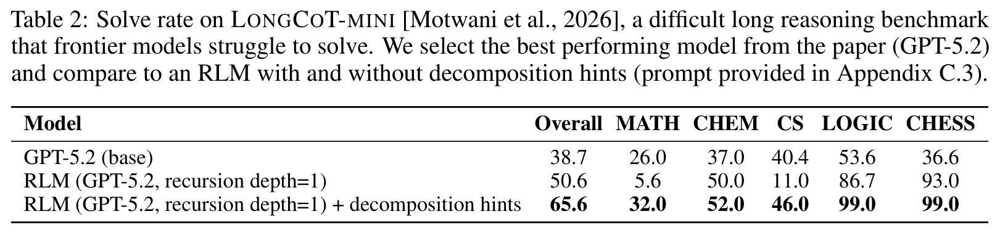

表 2：LongCoT-mini 上的解决率。GPT-5.2 原始 38.7，RLM 50.6，再加显式分解提示 65.6。这张表证明了 RLM 不只在长输入上有用，在需要把一个问题拆成互相依赖的子问题上也有用，LOGIC 和 CHESS 两列从 53.6、36.6 直接拉到 99.0。

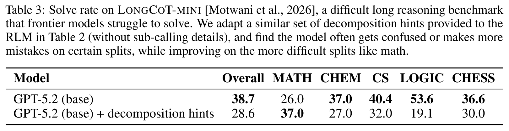

表 3：同一个基准，但把分解提示直接给原始 GPT-5.2（不给 REPL）。总分从 38.7 掉到 28.6，MATH 一列倒是从 26.0 涨到 37.0。这张表证明了提示本身没用，起作用的是有地方执行分解，光在脑子里拆会更乱。

**分解行为与错误**

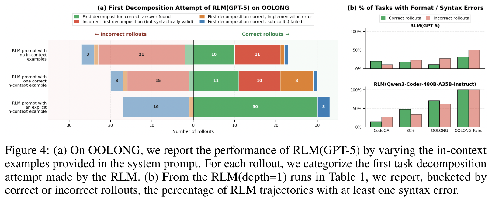

图 4：(a) 把系统提示里的示例从无、到一个无关示例、到一个显式示例，OOLONG 上第一次分解就正确并答对的 rollout 从 10 个涨到 11 个再涨到 30 个，左边整片红是第一次分错。(b) 语法错误率，Qwen3-Coder 在 OOLONG-Pairs 上正确和错误的 rollout 都是 100%，GPT-5 在错误 rollout 里从 8% 到 50% 不等。这张图解释了为什么 Qwen3-Coder 深度越深越差。

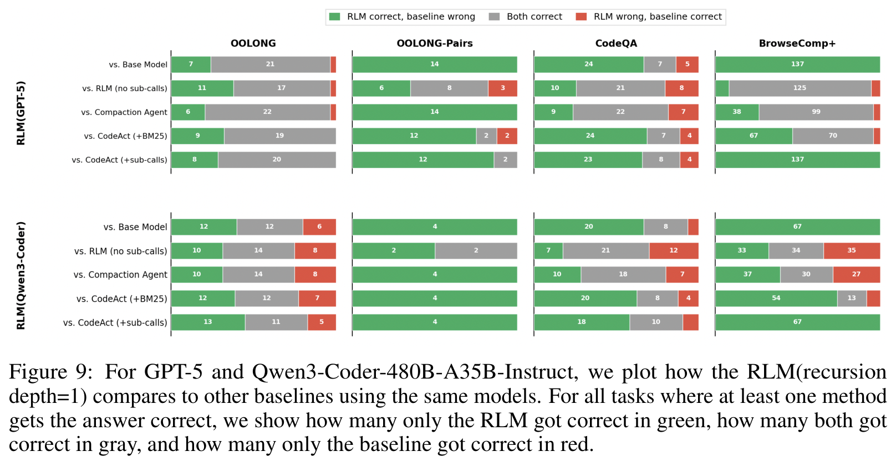

图 9：逐题对比，绿是只有 RLM 对，灰是都对，红是只有基线对。GPT-5 那一半绿块占绝大多数，OOLONG-Pairs 一整条全绿；Qwen3-Coder 那一半红块明显变多，尤其对 CodeAct 和压缩 agent，说明它的失败是模型本身的问题，不全是框架的问题。

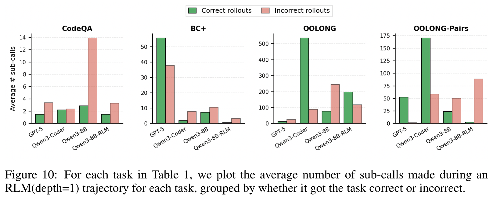

图 10：每个任务平均发了多少次子调用，按答对答错分组。差别跨两个数量级：GPT-5 在 BrowseComp+ 上答对时约 56 次，Qwen3-Coder 在 OOLONG 上答对时要 530 次左右。同一个框架换个模型，子调用策略完全不同。

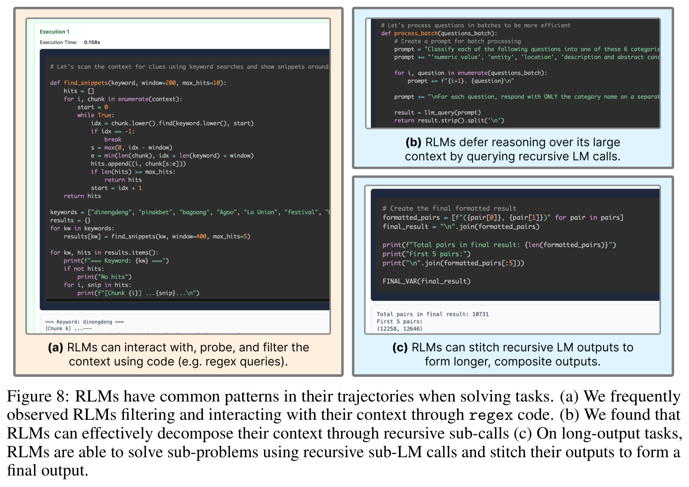

图 8：三种典型代码模式。(a) 用正则去扫输入再打印片段，(b) 把切片塞进 `llm_query` 批量问，(c) 把子调用的结果拼成上万行的最终输出。这张图解释了为什么这套东西对代码能力这么敏感。

**成本**

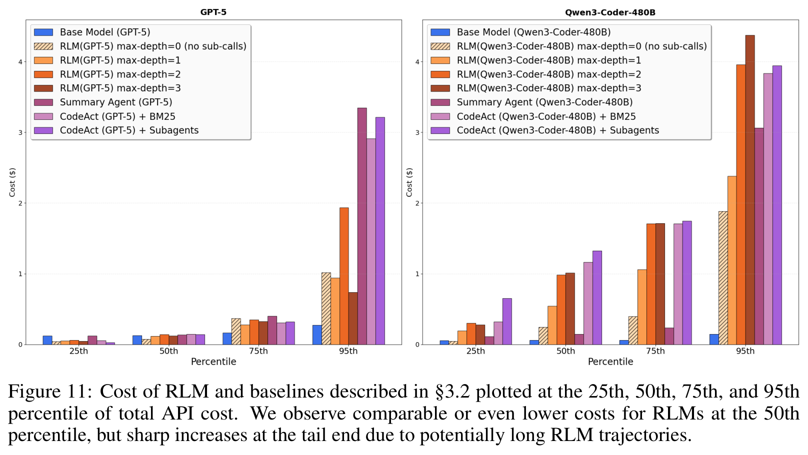

图 11：成本分位数。25 分位和中位数上 RLM 跟原始模型差不多甚至更便宜，95 分位上 RLM(GPT-5, depth=1) 到 \$1.95，depth=2 的 Qwen3-Coder 到 \$3.90，而原始模型始终在 \$0.3 以下。这张图证明了成本问题是长尾问题，不是均值问题：中位数比原始模型便宜，均值被少数跑飞的轨迹拉高。

**消融告诉我们什么**：三件事各自独立。REPL 让输入能超过窗口（depth=0 在 CodeQA 上就有 58.0，超过原始模型 24.0）；递归让稠密任务能解（OOLONG 从 36.0 到 56.0，OOLONG-Pairs 从 43.9 到 76.0）；训练让 8B 模型从不会用变成会用（四个任务全涨，且更快）。三条缺一条都不成立，论文的 Observation 2 说的就是这个。

**这些实验够不够支撑结论**：方向够，细节不够。两个 OOLONG 都是合成或半合成数据，只有 CodeQA 和 BrowseComp 是真实语料；分数没报跨 seed 方差，只有成本报了标准差；最强基线 OpenCode 加外置上下文在两个任务上仍高于 depth=1，摘要里的中位数提升是把 0 分基线算进去的相对值，读起来比实际观感好；Claude Code 那一栏用的 Opus 4.1 而不是同一个 GPT-5，跨模型比不出框架本身的贡献。

## 6. 局限性

**作者自己承认的**：更难更自然的长上下文任务没测；RLM 的护栏（guardrail）怎么设计基本空白；子调用可能爆炸式涨钱；同步实现很慢，异步和沙箱能显著降本但要加复杂度。附录 B 还列了几条负面结果：同一份提示词不能跨模型通用；代码弱的模型当 RLM 会崩；思考型模型输出 token 不够时轨迹会被截断（Qwen3-235B 就有这问题）；靠 FINAL 标签区分思考和答案是脆的。

**我看出来的**：

- 隐形假设：任务能切成独立的片段，片段级答案能拼回全局。OOLONG 可以，CodeQA 可以，但一个要求跨全文反复来回对照的任务未必行，论文没构造这种反例。
- 边界条件：效果跟模型代码能力几乎线性相关。Qwen3-Coder 语法错误率到 100% 时，深度越大越差，这套方法在那个区间是负收益。
- 缺的对比：没有和 OpenCode 加上下文外置做同预算的严格对照，也没有把子调用换成同价位的小模型来排除能力不对等（GPT-5-mini 做子调用很便宜，这是成本账好看的一半原因）。
- 判决脆弱：答案必须包在 `FINAL(...)` 或 `FINAL_VAR(...)` 里，附录 A 里 16% 的轮次用错了标签。换个模型或换个格式，分数可能大幅波动，这部分误差没被单独量化。

## 7. 一句话总结

别再让模型把整本书背进脑子，把书放在它手边的桌子上，让它自己写程序去翻页、撕页、叫人来读每一页。

虽然论文没给看家公式，整篇的复杂度都压在这两行上：

$$
\boxed{\; n_{\text{root}} \le K/c, \qquad \#\text{sub-calls} \in \Omega(|P|)\ \text{到}\ \Omega(|P|^2) \;}
$$

意思是：根模型只转常数圈，工作量交给程序化的子调用去摊。

## 8. 可复用点

- 如果我要在自己的项目里用：先别改模型，改输入的通路。把待处理的长材料写进一个持久化环境（哪怕就是一个 Python 进程里的变量），系统提示里只给长度、开头两百字和读取方式，答案要求从变量取。
- 切分粒度先定死再交给模型：论文里切得好的轨迹都是先按换行或章节切，别让模型自由发挥切点，否则第一次分解错了后面救不回来（图 4a）。
- 训练不收敛时先查：终止标签的格式错误率。这篇论文花了一整步去程序化修补 `FINAL` 和 `FINAL_VAR` 的混用，不修的话小模型学不到终止。
- 评估自己的 harness 时，把成本和时长的分位数一起报，别只报均值。这套东西的均值被少数跑飞的轨迹主导。
- 子调用要限流：给模型一句明确的次数预算，否则强代码模型会把每个 token 都送一遍。

## 9. 我的疑问

- 论文说 8M token 输入只花 \$0.99，但没给 token 账单的拆分明细，根模型和子调用各占多少，无法判断成本优势里有多少来自 GPT-5-mini 这个便宜子模型。
- OOLONG-Pairs 的 76.0 没有任何方差信息（论文只说了非零分数至少保留一位小数，没报重复次数），深度越大分数越高，会不会部分来自深了以后相当于多次调用的隐式投票，论文没拆。
- 递归深度到 3 时，子 RLM 也带自己的 REPL 和自己的子调用，总调用量是乘起来的，论文只在附录里给了个别轨迹的成本（\$0.38、\$1.12），没有系统统计。
- 训练只用了 1000 条轨迹、48 张 H100 小时就涨 28.3%，这个数字对数据质量有多敏感，换个蒸馏源还会不会有，不知道。
