> PDF 来源：本机 Zotero 库（Han 等 - 2026 - VISTA A Visual Harness for Reasoning in an Interactive World.pdf），arXiv:2610.02200v1，1 Oct 2026。

> 一句话：给多模态模型配一套只看图、还能随时回看历史任意一帧任意一角的工具壳，它在交互式视觉游戏上追平程序合成方法。

## 0. 读之前你需要知道

**术语卡**

- **harness（工具壳）**：套在模型外的一层代码，负责喂观测、给工具、收动作，模型本身一个参数都不改。生活类比：模型是司机，harness 是后视镜；车没换，但有没有后视镜决定你敢不敢倒车入库。
- **VLM（视觉语言模型，vision-language model）**：同时能读图和读文字的模型。生活类比：一个既看得懂照片又看得懂说明书的师傅。
- **token**：模型计费与占位的最小单位，一段文字或一小块图像都折算成若干 token。生活类比：快递按重量收费，token 就是模型的计费重量。
- **上下文（context）**：模型一次对话里能同时看见的全部内容，有硬上限。生活类比：一张书桌，摆满了就得把旧纸收走。
- **上下文压缩（compaction）**：桌子满了以后把旧纸揉成一张摘要。生活类比：会议纪要，细节没了但结论还在。
- **ARC-AGI-3**：一套交互式视觉小游戏，规则和目标都不告诉你，只能靠试。生活类比：被扔进一个没有说明书的房间，只能靠按按钮猜每个按钮干什么。
- **RHAE（Relative Human Action Efficiency，相对人类动作效率）**：拿你的动作数跟第一次玩的人比，越少越高。生活类比：同样通关，谁按的按钮少谁赢。
- **程序合成（program synthesis）**：让模型把环境规则写成一段可执行的程序，再跑程序来规划。生活类比：先画一张准确地图再走路，而不是边走边摸。

**它站在谁肩上**

- ARC-AGI-1（2019）与 ARC-AGI-2（2025）：静态的输入输出网格谜题，只考推理不考交互。不够的地方是把世界当成一张不会动的图。
- 程序合成类 ARC-AGI-3 解法（Schema、Retrodict、Tycho，2026）：先让模型把环境抽象成符号程序，再在程序上搜索。不够的地方是环境一复杂，用显式程序描述状态转移和目标就写不动了。
- 视觉型 GUI agent（SeeClick 2024、UI-TARS 2025、OpenCUA 2025）：直接看截图点鼠标。不够的地方是大多只保留有界的视觉上下文，历史一长只能压缩或丢弃。
- 通用游戏 agent（SIMA、SIMA 2、Cradle、Game-TARS）：能直接看画面跨环境玩。不够的地方同样在长程记忆：过去要么只存压缩摘要，要么选择性丢弃。

## 1. 动机

想象你被关进一间没有窗户的屋子，屋里有一台老式收音机和一个灯泡。没人告诉你旋钮是干什么的。你唯一能做的，是拧一下，看灯泡怎么变，再拧一下。拧错十次，你可能只学会了一个旋钮。

这就是 ARC-AGI-3 要考的东西：陌生世界里规则和目标全藏着，只能靠动作和观察一点点猜。作者说这件事人类做得自然，人工智能做得不像样。

**以前怎么做**：主流做法把画面压成文本。64×64 的画面变成 64 行 0 到 15 的数字，喂给语言模型。再进一步，让模型把这些数字抽象成一段可执行程序，当作世界模型，在程序里搜索下一步。这套路线在 ARC-AGI-3 上确实打到了接近满分：Retrodict 99.86，Tycho 100.00。

**为什么不行**：靠程序描述世界，前提是你能用符号把状态、转移规则、目标条件都写干净。游戏越花哨，这个前提越脆。作者的反问是：既然多模态模型本来就会看图，为什么要把图先翻译成一堆数字，再让它从数字里把图重建一遍。

还有第二层问题，更隐蔽。现有视觉模型对每张图只编码一次，编码完原始像素就丢了。可模型在编码的那一刻，并不知道后面哪块细节会变关键。当时够用的表征，三步之后可能正缺那一个像素。

**为什么现在能做**：三个条件凑齐了。多模态模型的视觉先验够强，能直接从渲染图认出物体和空间关系；长上下文加原生压缩，能把几十分钟的交互塞进一次会话；工具调用接口成熟，模型可以主动索要某一块画面，而不是被动等喂。

图 1 把三种设计并排画了出来。

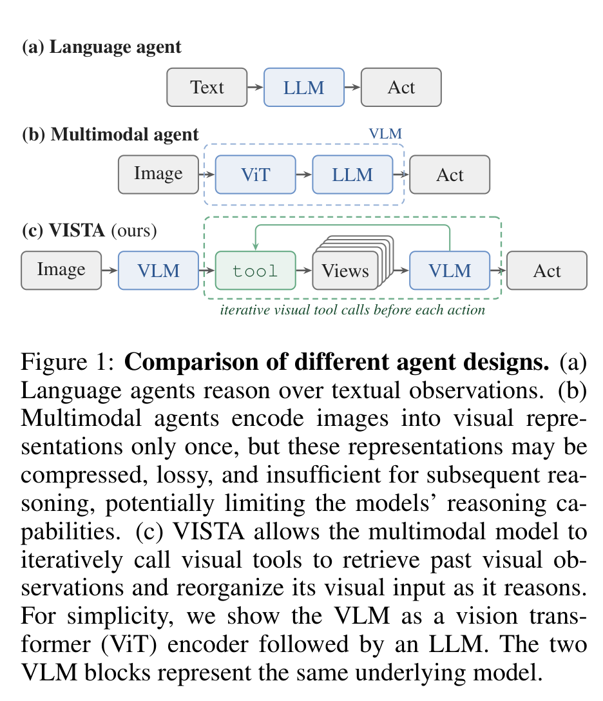

图 1：这张图证明了差别只在观测进了模型之后还能不能被重新组织。(a) 语言 agent 只能读文本；(b) 多模态 agent 把图编码一次，编码结果可能已经是有损的，后面没法重来；(c) VISTA 让模型在每次行动前反复调视觉工具，把过去的画面拉回来重新组一遍输入。

## 2. 贡献

- **不写程序也能满分**。证据：Claude Opus 5.0 配 VISTA 在 ARC-AGI-3 的 25 个公开游戏上拿到 RHAE 100.00，是作者所知第一个不用程序合成达到满分的系统（表 1）。
- **动作比人还少**。证据：同样 25 个游戏共 7,302 个动作，比首次游玩的人类参考 17,135 少 57.4%，总动作比 0.43 倍（表 2）。
- **换模型还成立**。证据：GPT-5.6 Sol 拿 99.00；开源权重的 GLM-5.3 Flash 320B 从官方实现的 1.89 拉到 66.93（图 8）。
- **换环境也成立**。证据：同一套壳几乎不改就迁移到 GameWorld、AI GameStore、BabyVision，三项都超过同模型的官方最小壳，GameWorld 和 AI GameStore 还超过人类新手或人类中位数（图 11）。
- **能拆出是哪一块在起作用**。证据：六级递进消融从 13.33 走到 99.00，最大一跳在加视觉记忆与检视那一步，70.05 跳到 94.10（图 5）。

这五条合起来像什么？像给一个本来视力就很好的司机装上了后视镜、行车记录仪和放大镜。车没换，发动机没调，成绩单变了。

## 3. 创新点

- **把观测从文本网格换成渲染图，并把省下的 token 还给推理**。对比对象：官方实现和多数程序合成方案都用文本网格。有用是因为一张 512×512 的图约 308 个图像 token，而一张 64×64 的文本网格约 4,000 个 token；一次请求带七帧，就是 2.2K 对 28K token 的量级差（附录 A.2）。
- **无损视觉记忆，而不是压缩记忆**。对比对象：SIMA、Cradle、Game-TARS 这类只保留有界视觉上下文或历史摘要的做法。有用是因为编码时无法预知未来需要什么细节，只有把原始帧全留着，才可能在需要时补上。
- **把检视做成模型自己发起的动作，且强制附上问题**。对比对象：固定分辨率喂图、由外部决定看哪里的做法。有用是因为 inspect 的接口要求模型先写下这一眼要回答什么，看什么由图决定，不由壳决定。
- **把显式注意力搬到交互历史上**。对比对象：模型内部的自注意力只作用于当前上下文里的 token，且随上下文压缩而失真。有用是因为这套记忆独立于上下文存在，模型可以在任意一轮把任意一帧拉回来，形成一种外部化、可寻址的注意力。

打个比方：以前是给模型看别人写好的战报，现在是给它看可以逐帧拖动的录像，而且拖动条在它自己手里。

## 4. 方法

### 4.1 整体流程

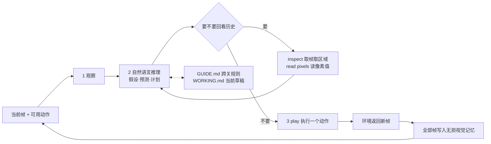

这张图说的是：一轮游戏里只有 play 那一步花掉一次动作配额，中间想看多少次历史、写多少次笔记都免费。

论文里对应的原图是图 3。

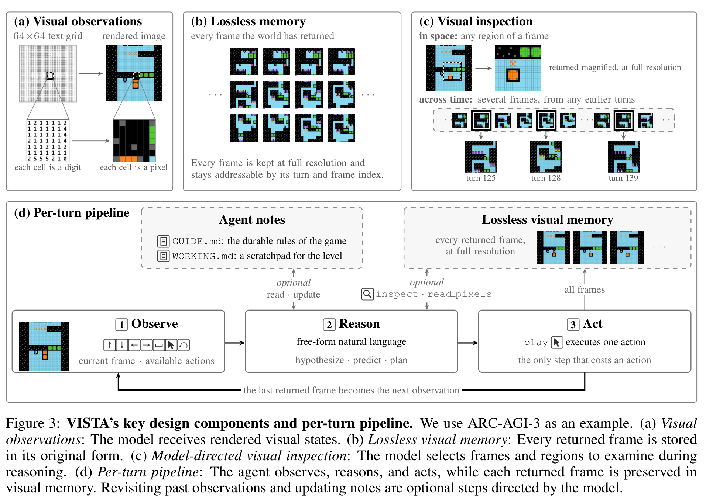

图 3：这张图证明了三个部件各自是什么、以及一轮里怎么串。(a) 同一个游戏状态，左边是 64×64 文本网格里的数字，右边是渲染出来的图；(d) 说明 observe、reason、act 三步里只有 act 花动作，回看和记笔记是可选的免费步骤。

再贴一张真实轨迹。

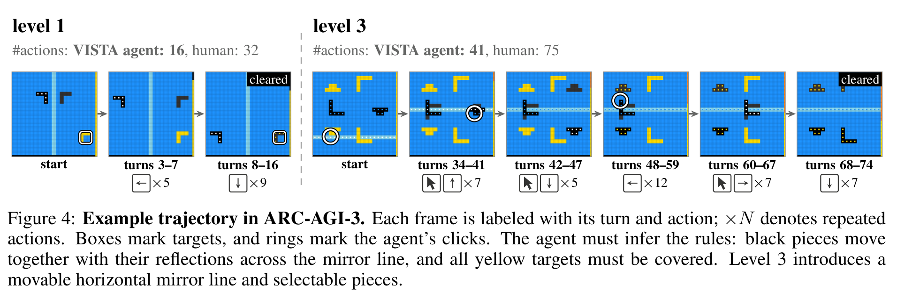

图 4：这张图证明了它不是靠一次性想明白，而是靠反复试。第 1 关 16 个动作，人类 32 个；第 3 关 41 个动作，人类 75 个。左侧同一关里 agent 用 ×5 和 ×9 的重复动作推同一块拼图，说明它在用低代价的重复动作探规则。

### 4.2 模块拆解

**视觉观测（visual observation）**

为什么需要：文本网格把颜色变成数字。数字里没有形状、没有邻近关系、没有谁挡住谁，模型的视觉先验在这条路上完全用不上。

怎么做：环境返回的 64×64 帧做 8 倍最近邻放大成 512×512 的 PNG，直接作为图像输入。

**无损视觉记忆（lossless visual memory）**

为什么需要：游戏一次动作可能返回六帧动画，真正的因果往往藏在中间那两帧里。只留最后一帧，等于把过程删了。

怎么做：环境返回的每一帧都按轮次和帧号编号存下来，全分辨率，整场交互任何时刻都可取。

**检视（visual inspection）与像素读取（read pixels）**

为什么需要：512×512 里一个 4 像素见方的标记，模型看不清朝向。看不清就得放大，还得能指定放大哪一块。

怎么做：inspect 接受一个问题和若干视图，每个视图由帧号加矩形区域定义，返回放大后的图。read pixels 把选定区域切成若干格，直接读出每格颜色编号，返回数字列表。

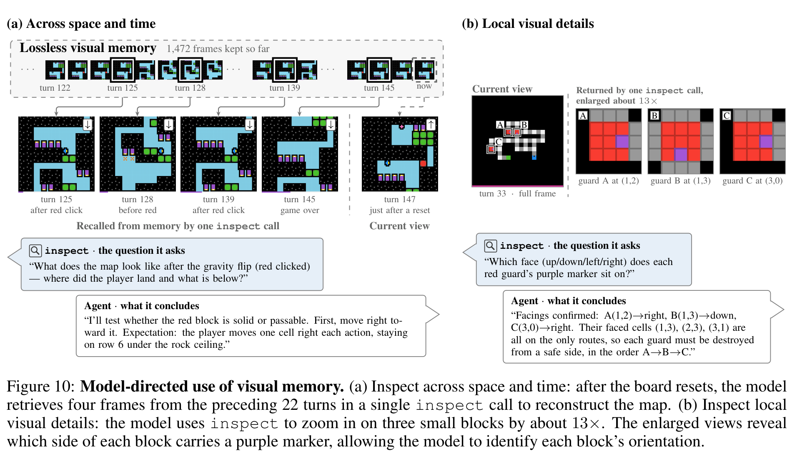

图 10：这张图证明了检视的两种用法都是模型自己发起的、且都为了回答一个具体问题。(a) 棋盘重置后，模型一次 inspect 把前 22 轮里的四帧一起调回来，重建整张地图。(b) 模型把三个小方块放大到约 13 倍，才看清每块上紫色标记贴在哪一面，从而定出守卫朝向。

**双档笔记**

为什么需要：上下文会被压缩，压缩后细节消失。但规则和当前计划不能跟着细节一起消失。

怎么做：GUIDE.md 存跨关卡、跨会话都成立的规则；WORKING.md 存当前这一关的临时状态和计划，跨重置和上下文重启保留，过关时清空。上下文快满时，agent 先把交接摘要写进 WORKING.md，再在新上下文里继续。

**工具接口**

为什么单独说：因为边界在这里。允许改变环境的只有一个函数。

$$
\text{play} : (\text{action},\, x,\, y) \;\longmapsto\; (\text{final frame},\ n,\ \text{available actions})
$$

先说这个函数在干什么：执行一个动作，返回最后一帧、这一轮返回了几帧、以及下一步还能做什么。

- $\text{action}$：动作编号，取值由环境定义；ARC-AGI-3 里是 RESET 和 ACTION1 到 ACTION7，其中 ACTION6 是点击坐标 $(x,y)$
- $x, y$：点击坐标，只对点击类动作有意义
- final frame：这一轮返回的最后一帧，它自动成为下一轮的观测
- $n$：这一轮一共返回了几帧，中间帧全部进视觉记忆
- available actions：下一步还能选哪些动作

其余工具 inspect、read pixels、history、read_guide、write_guide、read_working、write_working、save_compact_checkpoint 都不改变环境。所有工具调用走结构化函数调用，模型在正文里写的文字不能触发工具执行（附录 A.4）。

这套东西像一个闭架书库加借书单：一本书都不扔（无损记忆），哪一本被调出来由读者填单子（检视），管理员只负责跑腿（控制器）。

### 4.3 关键细节

- **动作与时间上限**：Opus 5.0 和 GPT-5.6 Sol 每局 2,000 个动作，GLM-5.3 Flash 320B 每局 3,000 个。每局 48 小时的时长上限写在附录 A.2 的消融协议里。官方实现原本是每段 5 倍人类基线加 12 小时总时长。
- **上下文**：默认 200K token。快到顶时控制器暂停普通工具使用，等 agent 存好继续所需的状态再开新上下文。
- **提示词极短**：ARC-AGI-3 的提示词只有五句，要求是动作尽量少、维护一个可修改的游戏模型、每次 play 前先说预期、play 后说所有可见变化、长期规则写进 GUIDE.md、WORKING.md 当草稿纸（附录 A.5）。
- **一局一个 agent**：整局只有一个 agent 在跑，中途压缩重开，但不换 agent。
- **沙箱**：agent 跑在无环境凭证的沙箱容器里。Claude Code 里通过 MCP 服务暴露工具并关掉所有内置工具，Codex 里直接注册同一套工具。

## 5. 实验结果

**实验设置**

- 数据集与切分：ARC-AGI-3 的 25 个公开游戏，每局多关卡，规则和目标都不给。不划分训练测试，因为整套方法没有训练环节。人类参考来自 486 名普通公众，每个游戏 10 人首次游玩，无任务说明，软限时 20 分钟、硬限时 30 分钟，且至少两人独立通关的游戏才被纳入。泛化实验用 GameWorld 的 34 个浏览器游戏 170 个任务、AI GameStore 的 10 个公开浏览器游戏、BabyVision 的 39 个视觉追踪题（20 个迷宫加 19 个连线条）。
- 骨干模型：Claude Opus 5.0 走 Claude Code CLI，推理强度 extra-high；GPT-5.6 Sol 走 Codex CLI，强度 max；开源权重 GLM-5.3 Flash 320B 也走 Codex CLI，动作上限放到 3,000。全部闭源权重，无微调。
- 训练预算：原文未给。这套方法不训练任何参数，也没有训练预算这一项。
- 基线：官方最小 harness 配同一模型；系统层面还对比程序合成路线的 Schema、ewma_sv v1.6、Retrodict、Tycho。自家消融是配置 (i) 到 (vi) 的六级递进。
- 指标：RHAE，越高越好，1.15 倍封顶，同时报总动作数。GameWorld 报成功率 SR 与进度 PG；AI GameStore 报人类中位数归一化到 100 后的几何平均；BabyVision 报准确率，用精确匹配加 LLM 裁判，跑挂的算错。
- 推理设置：默认 200K 上下文、512×512 PNG（64×64 的 8 倍最近邻放大）。温度等采样参数原文未给。

RHAE 怎么算值得单独说，因为它决定了分数能不能信。

$$
S_{\ell,g} = \min\!\left(1.15,\ \left(\frac{h_{\ell,g}}{a_{\ell,g}}\right)^{2}\right)
$$

先说这个式子算什么：一关里用人类动作数除以你的动作数，平方，最多给到 1.15 倍。

- $a_{\ell,g}$：你在游戏 $g$ 第 $\ell$ 关用的动作数
- $h_{\ell,g}$：首次游玩且通关了该关的人类玩家里动作数的上中位数
- 平方：动作数少一半，分数拿到 4 倍，效率被放大
- $1.15$：上限，做得再省也不额外给分
- 没通关的关卡记 0 分

整局再按关卡权重合起来：

$$
S_{g} = \min\!\left(\frac{\sum_{\ell=1}^{k} w_\ell}{\sum_{\ell=1}^{n} w_\ell},\ \frac{\sum_{\ell=1}^{n} w_\ell S_{\ell,g}}{\sum_{\ell=1}^{n} w_\ell}\right)
$$

先说这个式子算什么：括号里后半段是加权平均分，前半段是通关进度造成的封顶，两者取小。

- $w_\ell = \ell$：第几关就给几倍权重，后面的关更值钱
- $n$：这一局一共几关
- $k$：实际通关了几关
- 第一个括号：只打通前三关，分数最多就是前三关权重占总权重的比例
- 取小：既不许靠前几关刷高平均分，也不许用通关进度替代质量

最后 25 个游戏的 $S_g$ 平均乘 100。

**主表**

| 系统 | 用了程序合成 | 模型 | 推理强度 | RHAE |
| --- | --- | --- | --- | --- |
| 官方实现 | 否 | GPT-5.6 Sol | max | 13.33 |
| 官方实现 | 否 | Opus 5.0 | high | 40.68 |
| Schema | 是 | GPT-5.6 Sol | xhigh → max | 95.35 |
| ewma_sv v1.6 | 是 | GPT-5.6 Sol | xhigh | 98.97 |
| Retrodict | 是 | GPT-5.6 Sol | max | 99.86 |
| Tycho | 是 | GPT-5.6 Sol | max | 100.00 |
| **VISTA** | **否** | GPT-5.6 Sol | max | 99.00 |
| **VISTA** | **否** | Opus 5.0 | xhigh | **100.00** |

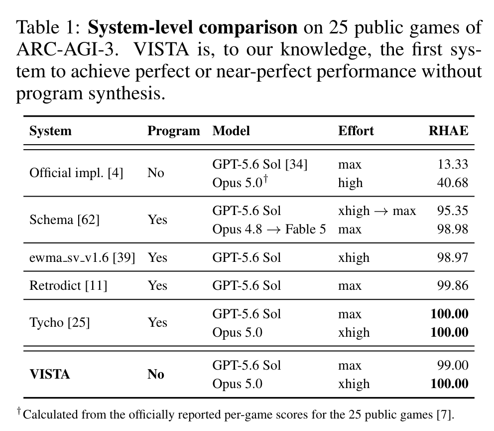

表 1：这张表证明了不用程序合成也能到满分，VISTA 是唯一一行程序合成写 No 又拿到 100.00 的。注意 40.68 那个数带脚注，是按官方公布的逐游戏分数重算出来的，不是官方直接报的整局分。

逐游戏看更狠。

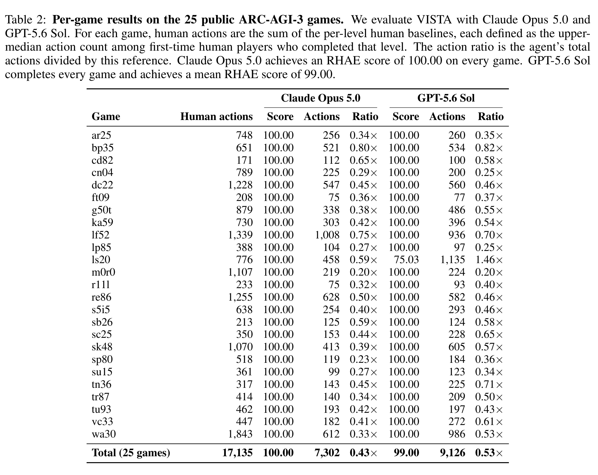

表 2：这张表证明了 100.00 不是四舍五入，而是 25 个游戏每一个都 100.00，动作比在 0.20 倍到 0.80 倍之间。唯一的失手是 GPT-5.6 Sol 在 ls20 上打了 1.46 倍人类动作，那一个游戏只有 75.03 分。

**消融：六级递进**

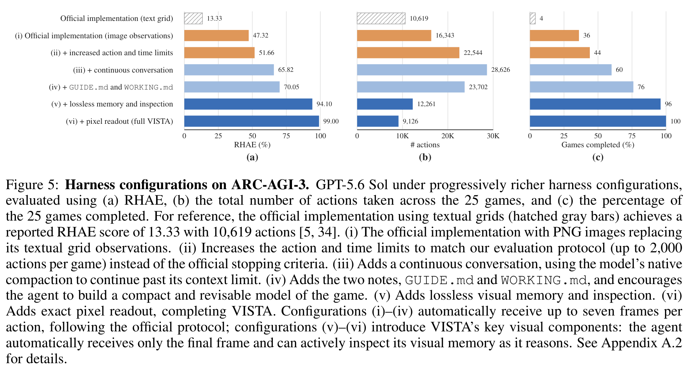

图 5：这张图证明了收益不是均摊的。前四步加起来只从 13.33 走到 70.05；加视觉记忆与检视那一步，RHAE 从 70.05 跳到 94.10，动作数从 23,702 掉到 12,261，完成率从 76% 到 96%。最后加像素读取再补 4.9 分，把完成率顶到 100%。

| 配置 | 加了什么 | RHAE | 总动作 | 完成率 |
| --- | --- | --- | --- | --- |
| 官方 | 文本网格 | 13.33 | 10,619 | 4% |
| (i) | 换成图像观测 | 47.32 | 16,343 | 36% |
| (ii) | 放宽动作与时间上限 | 51.66 | 22,544 | 44% |
| (iii) | 连续会话加原生压缩 | 65.82 | 28,626 | 60% |
| (iv) | 加 GUIDE.md 与 WORKING.md | 70.05 | 23,702 | 76% |
| (v) | 加无损视觉记忆与检视 | 94.10 | 12,261 | 96% |
| (vi) | 加像素读取（完整 VISTA） | 99.00 | 9,126 | 100% |

第 (i) 级的动作数反而比官方多，作者的解释是这一级很多局撞到动作或时间上限才停，完成率只有 36% 说明它没打完，动作数被上限截断了，不能当成效率指标读。这一点很关键：只看动作数会误判。

**图还是文本，谁更省**

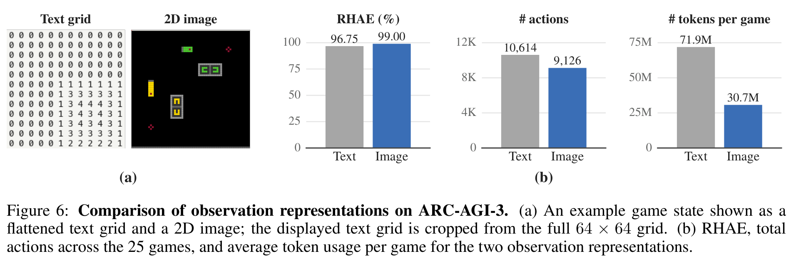

图 6：这张图证明了换图主要不是为了分数，是为了成本。RHAE 只从 96.75 涨到 99.00，但每局 token 从 71.9M 掉到 30.7M，掉了一半多；动作数从 10,614 降到 9,126。

一个 64×64 网格约 4,000 个 token，一张 512×512 的图约 308 个图像 token，差十几倍。省下来的上下文留给推理，这是作者对第一级就能从 13.33 跳到 47.32 的解释。原文用的词是 hypothesize，也就是说这是推断，没有实测分解。

**两个旋钮：上下文长度与图像分辨率**

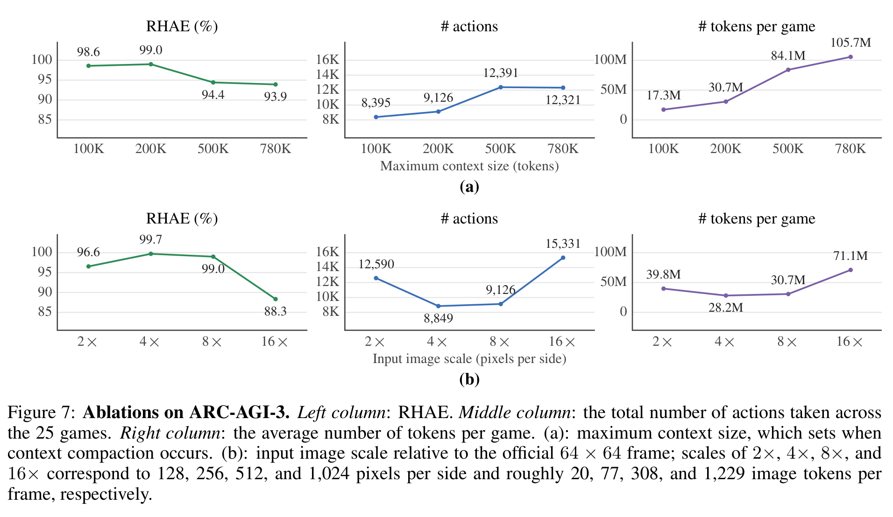

图 7：这张图证明了两个旋钮的最优位置都不在最大处。(a) 上下文 200K 是顶点 99.0，加到 780K 分数反而掉到 93.9，每局 token 从 30.7M 涨到 105.7M；降到 100K 只掉 0.4 分，token 砍到 17.3M。(b) 分辨率 4 倍时 RHAE 最高 99.7，默认 8 倍是 99.0，16 倍掉到 88.3 且 token 涨到 71.1M。

这两张合起来说明一件事：这套壳不会因为给得多而更好。历史给太多，模型要在噪声里找信号；分辨率给太高，额外的图像 token 只是占着上下文不干活。

**换模型：开源权重**

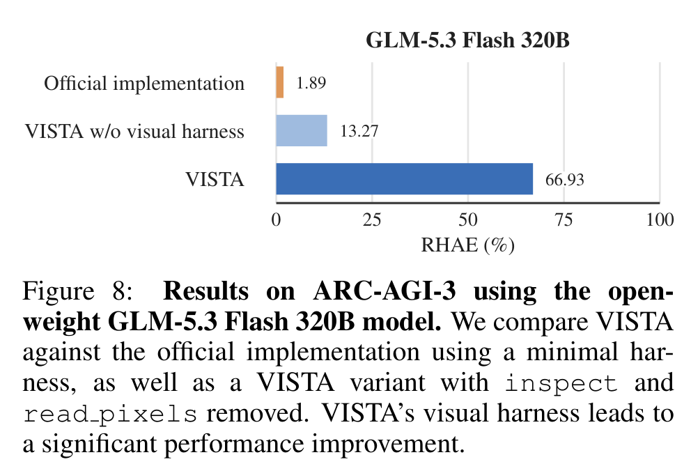

图 8：这张图证明了增益来自壳而不是某个闭源模型的运气。同一个 GLM-5.3 Flash 320B，官方壳只有 1.89，保留连续会话和笔记但去掉视觉工具是 13.27，加回 inspect 和 read pixels 变成 66.93。

**换渲染：3D**

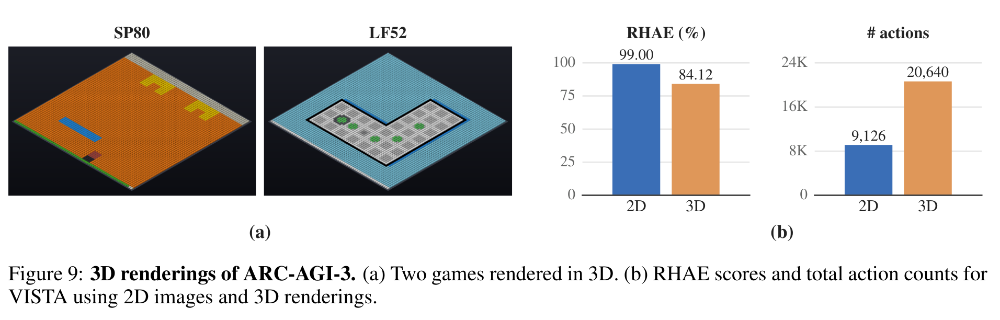

图 9：这张图证明了它对视觉表征的变化有韧性，但代价明确。(a) 同样的游戏做成 3D 等距视角；(b) RHAE 从 99.00 掉到 84.12，动作从 9,126 涨到 20,640，翻了一倍多。

**跨环境迁移**

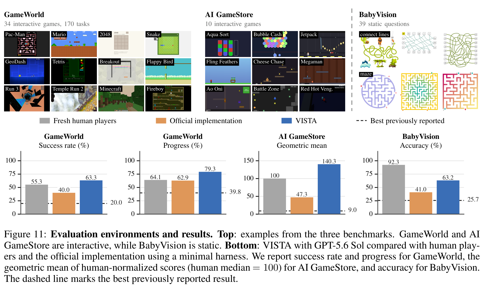

图 11：这张图证明了同一套壳不改结构就跨了三种环境。GameWorld 成功率 63.3 对官方 40.0 和人类新手 55.3，进度 79.3 对 62.9 和 64.1；AI GameStore 几何平均 140.3，人类中位数是 100，官方是 47.3；BabyVision 准确率 63.2 对官方 41.0，人类 92.3。

BabyVision 这一列最值得注意：没有交互、没有历史，一个静态图加一个问题。VISTA 在这里还能从 41.0 涨到 63.2，说明检视的价值不依赖时间维度，只看空间维度也成立。

**跑三次的波动**

ARC-AGI-3 上 GPT-5.6 Sol 三次是 99.00、98.90、99.23，均值 99.04，标准差 0.17。GameWorld 成功率 63.33 ± 2.37，进度 79.30 ± 2.14。BabyVision 63.23 ± 3.00。AI GameStore 三次是 119.99、148.58、140.06，波动明显最大；作者按官方多轮协议先在每个游戏上平均原始分再归一化，没有直接平均三个总分。

读这些图表像看体检报告：总分之外，每项指标各说明一个器官，总分的饱和掩盖了单项差异。

**这些实验够不够支撑结论**

支撑得住的部分：不用程序合成能到满分，有两条独立证据，闭源的 Opus 5.0 和开源的 GLM-5.3 Flash 都有大幅提升，而且六级消融把每一级的贡献量化了。

撑不住的部分：全部评测都在公开集上。作者在第 6 节承认，这些模型发布晚于这些基准，无法排除游戏已在训练数据里；ARC-AGI-3 的私有集没有跑。另外人类参考的构造有口径问题：要求至少两人独立通关该游戏才纳入，这会把人类基线抬到偏强的位置，从而让 RHAE 更容易被顶高。这一条是我的推断，不是作者的结论。

## 6. 局限性

**作者自己承认的**

- 模型的既有能力仍是成功的关键因素，VISTA 只是把能力诱发出来的简单方式。
- 模型发布时间晚于公开基准，无法排除这些游戏已在训练数据中；作者认为在 ARC-AGI-3 私有集这类新游戏上评测才是更强的检验。

**我看出来的**

- 隐形假设一：环境必须可回放、逐帧可寻址。无损记忆建立在每一帧都能按轮次和帧号重新取回这个前提上。真实世界里你没法把三秒前那一帧重新调出来，摄像头只给一次。这条假设把方法锁在游戏、浏览器、模拟器这类可重放环境里。
- 隐形假设二：模型自己知道什么时候该看历史。整套机制里没有任何检索策略学习，看什么、看几次、什么时候看，全由模型当场判断。判断力不足时，无损记忆就是一堆没被打开的存档。作者用提示词软约束（每次 play 前说预期、后说变化），但那是提示词，不是机制。
- 边界条件：无损记忆不压缩，成本随历史线性涨。图 7(a) 里 780K 上下文对应 105.7M token 每局，200K 只要 30.7M。游戏一局长度有上限，真实任务没有。
- 缺的对比：没有和训练过的游戏 agent 比（SIMA 2、Game-TARS 这类），也没有和专门为长程记忆设计的检索式方案比。表 1 里程序合成那几行是并发的他人工作，不是同一次实验里跑出来的，口径不完全统一。

把这些合起来看，像把整间屋子的监控录像全存下来却没装检索系统，出了事只能靠人一遍遍拖进度条。VISTA 的赌注是模型比人更会拖这条进度条。

## 7. 一句话总结

把模型的眼睛从一张固定大小的快照，换成一整卷随时能倒回去的胶片。分数没暴涨，是因为模型本来就会看，只是之前没人给它倒带的权力。

## 8. 可复用点

- 如果我要在自己的项目里用：先把观测存全。凡是环境返回的东西，中间帧、动画、日志、工具原始输出，都按索引存一份原样的，别在编码那一刻替未来做压缩决策。这一条不需要改模型，只改工程。
- 如果我要给自己的 agent 加检视工具：接口里强制带 question 字段。让模型在调工具前先写下这一眼要回答什么。像医生开检查单必须写临床问题，写不出来就别开。
- 如果我的上下文老被压爆：抄双档笔记。一份存跨任务不变的规则（GUIDE），一份存当前任务的临时状态（WORKING），压缩前把交接摘要写进后者，新上下文只带这两份文件加当前观测。
- 训练不收敛时先查：先别急着调学习率，先把观测表示换一遍。这篇里从文本网格换成渲染图，光这一步就把 RHAE 从 13.33 拉到 47.32，而且 token 还省了。
- 调分辨率、上下文这类旋钮时：别默认往大调。图 7(b) 里 16 倍分辨率比 4 倍低 11.4 分，token 还多一倍多。先扫一遍找拐点。

## 9. 我的疑问

- 检视完全靠模型自觉。如果强制它每 N 轮必须回看一次，分数会更高还是更低？这篇没有这一组。
- RHAE 的平方项和 1.15 倍封顶，会不会让某个动作数区间的改进被过度奖励？25 个游戏的动作比从 0.20 到 0.80 跨了四倍，但都是 100.00，说明这个指标在顶部分辨率已经饱和。
- 表 1 里 Tycho 也是 100.00，走的是程序合成路线。两条路线在满分点打平，那成本差多少？论文只给了 VISTA 的动作数，没给程序合成那几家的 token 或动作消耗，这一点没法比。
- 3D 渲染掉到 84.12，是认物体变难还是多花动作试探几何？论文没拆。
- BabyVision 上人类 92.3 对 VISTA 63.2，差 29 分。差在哪一类题上？论文只报两个子类合并的准确率，没有分题型。
- 这几个问题像刚提了新车：说明书给了油耗，没给续航曲线的拐点。
