> 一句话：把"去找、去写、跳过、收手"这四件事交给一个模型一起学，再用一个打分模型给每一步打过程分。

## 0. 读之前你需要知道

**术语卡**

- **检索（retrieval）**：从记忆库里按查询条件挑出相关片段。生活类比：在图书馆按书目索引把三本书从书架取下来。
- **记忆构建（memory construction）**：把取下来的原始材料整理成一小叠干净笔记。生活类比：把三本书里的相关段落抄到便利贴上。
- **工作记忆（working memory，记作 $W_t$）**：真正会被塞进模型上下文的那一小叠笔记。生活类比：桌上摊开的那几张便利贴，桌面就这么大，摊不下更多。
- **策略（policy，记作 $\pi_\theta$）**：给定当前局面，决定下一步做什么的模型。生活类比：司机看路况决定踩油门还是刹车。
- **过程奖励（process reward）**：不只判断最后答案对不对，而是给过程中的每一步打分。生活类比：老师不只给期末总评，还给每道作业题单独批注。
- **DAPO**：一种强化学习算法，用同一道题采样多条轨迹、组内比较谁好谁坏来更新策略。生活类比：同一道菜让厨师做八遍，挑出明显更好的那版去学。
- **DPO（Direct Preference Optimization）**：直接用"哪份回答更好"的偏好对来训练模型，不需要另外训一个价值网络。生活类比：不教你准则，直接给你看两份作文和老师选的那份。
- **RRF（Reciprocal Rank Fusion）**：把多个检索器的排名倒数相加得到综合排名。生活类比：四个评委各自给选手排名，把名次的倒数加起来算总分。

**它站在谁肩上**

- RAG、REALM（2020）：确立了"先检索外部证据再生成"这条路线，但检索器和生成器是两块分开的零件，检索多少条、什么时候停都靠人定。
- MemGPT、Mem0、MemoryOS、A-Mem（2023–2026）：给模型配了长期记忆仓库，替它决定存什么、怎么组织。这些系统的流程是写死的：先摘要、再抽取、再入库，人先画好流程图。
- Search-R1（2025）：用强化学习教模型怎么发检索查询，是"只管检索"这一路的代表。
- Mem-α（2025）：用强化学习教模型什么时候插入、更新、合并记忆条目，是"只管建库"这一路的代表。
- Mem-T（2026）：把建库和后续检索接起来，用后面检索的结果回头评价前面的建库决策。它已经进程级了，但反馈还是落在某个特定阶段上。

## 1. 动机

想象你帮朋友查"上次一起去露营，帐篷是谁带的"。你打开三年的聊天记录，一边翻一边在便签上写：先写"2023 年 5 月去过大峡谷"，再写"帐篷是老王带的"。翻到某一条时你觉得够了，停下来回答。翻的过程中你其实同时在干四件事：决定接下来搜什么词、决定哪句值得抄、决定哪条没用直接跳过、决定什么时候收手。

**以前怎么做**：现有系统把这四件事拆给不同模块。检索模块只管"搜什么"，构建模块只管"写什么、合并什么"，停止与否常常是规则——比如检索三轮就停。训练的时候也一样，Search-R1 只训检索那一段，Mem-α 只训建库那一段。

**为什么不行**：拆开之后，两段没有共同的记分牌。检索模块不知道它取回来的东西会不会被写进笔记，构建模块也不知道它写下的笔记会不会被后面用到。于是出现两种情况。一是没法协调：检索模块觉得还有料可以捞，构建模块觉得已经够了，谁说了算没有依据。二是奖励只看终点：最终答案对了就给分，可同样答对的轨迹，有的靠三句精准证据，有的捞了二十条噪声碰巧蒙对，这两种轨迹拿一样的分，模型学不到"少捞点、捞准点"。

**为什么现在能做**：一是现在的开源模型（论文用 Qwen3 系列）已经能稳定地按 JSON 格式输出工具调用，把"搜/写/跳过/停"变成四个可执行的动作；二是过程奖励模型这条路被数学推理社区验证过，只要能把每一步的好坏写成规则或者让强模型打分，就能给中间步骤提供监督；三是 DAPO 这类算法让"同一道题采样八条轨迹、组内比优劣"在工程上跑得起来。

## 2. 贡献

- **把四类记忆动作收进同一个决策循环**。证据：第 3.3 节把记忆交互写成一个有限步马尔可夫决策过程，动作空间就是 $\{\text{search}, \text{add}, \text{skip}, \text{stop}\}$，状态是"问题 + 当前笔记 + 最新候选"。
- **做出一套能给每一步打分的奖励模型**。证据：第 3.4 节先用证据覆盖规则造监督信号做 SFT，再用轨迹级 DPO 对齐，最后输出每一步的语义质量分。
- **提出 PA-DAPO，把动作级分数聚成轨迹奖励**。证据：第 3.5 节的式 (4) 先在动作类型内部取平均、再跨类型平均，避免高频的 search 淹没低频但决定性的 stop。
- **在三个长上下文记忆基准上超过静态记忆系统与 RL 训练的记忆智能体**。证据：LoCoMo 总 F1 61.0（最强基线 Mem-T 58.7），MemoryAgentBench 九任务平均 74.7（最强基线 FineMem 66.4），PersonaMem 总体 69.2（最强基线 A-MEM 65.3）。
- **给出成本上的解耦**。证据：事件库一次建好，查询时只做有界次数的检索，token 消耗上检索降 79.9%、构建降 73.8%。

## 3. 创新点

- **新在哪：共享证据状态**。对比对象：Search-R1（只有检索状态）、Mem-α（只有记忆条目状态）。有用是因为：检索到的候选、已写下的笔记、停止的时机放在同一个状态里，才能用同一把尺子衡量"继续搜"和"现在就写"哪个更值。
- **新在哪：一个奖励模型给四类异构动作打同一套分**。对比对象：Fine-Mem、TrustMem 在某个特定阶段给局部反馈；Mem-T 用后续检索结果反推前面建库的好坏。有用是因为：打分器看到完整轨迹上下文再评当前步，能分辨"引用对了但把两件事混在一起"这种答案对、过程错的情况。
- **新在哪：按动作类型平衡的轨迹奖励**。对比对象：常规 RL 直接把所有步骤的分平均，或者只用最终答案对错。有用是因为：一条轨迹里 search 可能出现五六次，stop 只出现一次，直接平均会让 stop 的分数被稀释；先类内平均再类间平均，等于给每个动作类型一票。
- **新在哪：事件库的四视图融合检索**。对比对象：固定长度切块的 RAG。有用是因为：对话按轮切会切断事件边界，四种视图（原文、摘要、可为该事件回答的假想问题、事件短语）分别覆盖字面、语义、查询意图三种线索，实测覆盖了 97.03% 的问题–证据对。

## 4. 方法

### 4.1 整体流程

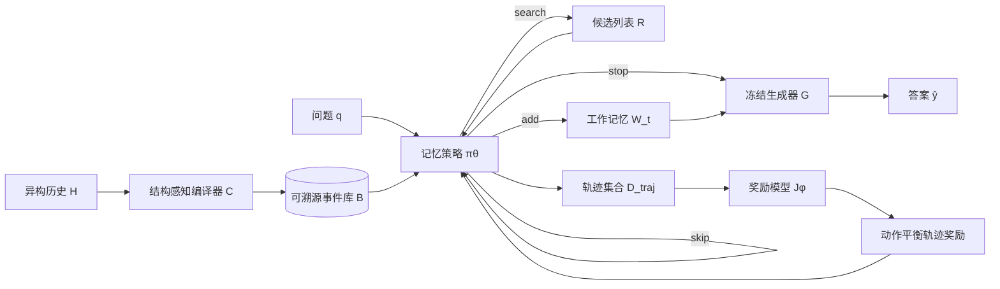

这张图说的是：历史先被编译成事件库，策略在"问题 + 笔记 + 候选"这个状态上做四选一的决策，走完一条轨迹后由奖励模型逐步打分，分数聚合成一个数，再拿去更新策略。

### 4.2 模块拆解

**模块一：可溯源多视图事件库（Traceable Multi-View Event Bank）**

为什么需要：多头对话按轮切、文档按固定长度切，都会把一件完整的事劈成两半。切坏之后，写进笔记的片段和原文对不上号，后面既没法核对来源，也没法用"证据有没有被覆盖"来算规则分。

怎么做：先用编译器 $C$ 沿话题切换处把历史切成事件，每个事件生成四个视图，并保留一个来源定位符。

公式：每个事件的定义与检索打分分别是

$$
e_m = \big(\{x_m^v\}_{v\in V},\ \ell_m\big),\qquad V=\{\text{raw},\text{sum},\text{anc},\text{phr}\},\qquad \ell_m=(n,\,i_{\text{start}},\,i_{\text{end}})
$$

$$
\text{score}(e_m\mid u_t)=\sum_{v\in V}\frac{1}{\kappa+\text{rank}_v(e_m\mid u_t)}
$$

第一条在说"一个事件长什么样"，第二条在说"一次查询给事件打多少分"。

- $e_m$：第 $m$ 个事件，共 $M$ 个。
- $x_m^{\text{raw}}$：原文视图，保留措辞细节；$x_m^{\text{sum}}$：摘要视图，概括整件事；$x_m^{\text{anc}}$：查询锚点视图，写成"这个事件能回答的假想问题"；$x_m^{\text{phr}}$：事件短语视图，一句低噪声的语义标签。
- $\ell_m=(n,i_{\text{start}},i_{\text{end}})$：来源定位符，指向第 $n$ 个源单元的第 $i_{\text{start}}$ 到 $i_{\text{end}}$ 个 token。
- $u_t$：策略在第 $t$ 步发出的检索查询。
- $\text{rank}_v(e_m\mid u_t)$：在视图 $v$ 的排序里，事件 $e_m$ 排第几名，从 1 开始。
- $\kappa>0$：平滑常数，防止排名靠前的项把分数拉爆。

四个视图用的检索器不同：摘要视图和事件短语视图走向量检索，查询锚点视图走 BM25，原文视图两者混合。每次检索返回 $K_{\text{ret}}$ 个候选，候选带着定位符一起进状态。

**模块二：证据状态转移建模（Evidence-State Transition Modeling）**

为什么需要：答案的证据常常散落在历史的不同角落，一次检索捞不全。需要允许"搜一批、看情况、再搜一批"，同时禁止非法动作，比如还没检索就往笔记里写。

怎么做：把交互写成一个有限步的马尔可夫决策过程。每个状态包含问题、当前工作记忆、最新候选，另外带一个"当前是决策模式还是抽取模式"的标记。决策模式下只能选 search 或 stop；检索之后进入抽取模式，只能选 add 或 skip。四个动作按下面的规则确定性地改写状态。

公式：

$$
z_{t+1}=F(z_t,a_t;B)=
\begin{cases}
(q,\ W_t,\ R(u_t)) & c_t=\text{search}\\
(q,\ W_t\oplus[n_t],\ R_t) & c_t=\text{add}\\
(q,\ W_t,\ ()) & c_t=\text{skip}\\
(q,\ W_t,\ R_t) & c_t=\text{stop}
\end{cases}
$$

这个式子在说"做了某个动作之后，局面变成什么样"。

- $z_t=(q,W_t,R_t,m_t)$：第 $t$ 步的证据状态，$q$ 是问题，$W_t$ 是当前工作记忆，$R_t$ 是最新候选列表，$m_t\in\{\text{decide},\text{extract}\}$ 是当前模式。
- $a_t$：第 $t$ 步的动作，$c_t=\text{type}(a_t)$ 是它的动作类型。
- $u_t$：search 动作发出的查询，$R(u_t)$ 是它检索回来的候选。
- $n_t$：add 动作写下的那条笔记，$\oplus$ 表示追加到工作记忆末尾。
- $()$：空候选列表，表示 skip 之后候选被清掉。
- $T_{\max}$：最大交互步数，论文设成 8。选 stop 或走满 $T_{\max}$ 就结束，最后的 $W_T$ 交给冻结的生成器出答案。

**模块三：统一奖励建模（Unified Reward Modeling）**

为什么需要：只看最终答案对错，无法指出哪一步操作让轨迹变得有用。而且四类动作好坏的标准不一样：search 看"有没有捞到还缺的证据"，add 看"写进去的有没有来源支撑"，skip 看"该捞的是不是被丢掉了"，stop 看"笔记够不够答题"。

怎么做：分两阶段训一个生成式奖励模型 $J_\phi$（Qwen3-8B + LoRA）。第一阶段用规则造分做 SFT：拿金标准证据跨度 $E^\star$ 和来源投影函数 $\text{Src}(\cdot)$ 算出"这一步新暴露了多少还缺的证据"，据此给每一步一个规则分。第二阶段用轨迹级 DPO 对齐：把整条轨迹喂给一个会推理的强模型（DeepSeek-V4-Flash），让它逐步给分，把它的分数当 chosen、规则分当 rejected。

公式：

$$
\mathcal{L}_{\text{SFT}}(\phi)=-\frac{1}{\sum_b L_b^{\text{RM}}}\sum_b\sum_t \log p_\phi\!\left(v^{\text{rule}}_{b,t}\mid x_b,\ v^{\text{rule}}_{b,<t}\right)
$$

$$
\mathcal{L}_{\text{DPO}}(\phi)=-\mathbb{E}\left[\log\sigma\!\left(\beta\log\frac{p_\phi(v^+\mid x)}{p_{\phi_{\text{ref}}}(v^+\mid x)}-\beta\log\frac{p_\phi(v^-\mid x)}{p_{\phi_{\text{ref}}}(v^-\mid x)}\right)\right]
$$

第一条在说"让奖励模型逐字复现规则分序列"，第二条在说"让奖励模型更偏向强模型给的分、更远离规则分"。

- $x_b=\text{Serialize}(y^\star,E^\star,\tau)$：第 $b$ 条样本，把参考答案、金标准证据、整条轨迹序列化成一串文本。
- $v^{\text{rule}}_{b,t}$：第 $b$ 条样本第 $t$ 步的规则分，是 SFT 的监督目标。
- $v^{\text{rule}}_{b,<t}$：同一条样本里第 $t$ 步之前已经输出的分，自回归只能看前面。
- $L_b^{\text{RM}}$：目标 token 长度，用来做长度归一化。
- $v^+_b$：强模型带思维链给出的分序列（chosen）；$v^-_b$：规则分序列（rejected）。
- $\phi_{\text{ref}}$：DPO 里冻结的参考模型；$\beta>0$：偏好强度，论文取 0.1。
- $\sigma$：sigmoid 函数。

规则分怎么算，论文给的是三条覆盖关系：第 $t$ 步还没被覆盖的金证据 $E_t^{\text{miss}}=E^\star\setminus\text{Src}(W_t)$；search 新暴露的 $E_t^{\text{miss}}\cap\text{Src}(R(u_t))$；add 新写进去的 $E_t^{\text{miss}}\cap\text{Src}(n_t)$。具体阈值与分段，论文只写了"按动作类型的确定性规则"，并强调优先保召回、其次保精度。

**模块四：过程对齐的策略优化（Process-Aligned Policy Optimization，PA-DAPO）**

为什么需要：有了每步的分，还要把它变成一个能更新策略的标量。这里有两个坑：一是不同动作出现频次差很多，二是一条轨迹里步数不同，直接平均会让长轨迹被稀释。

怎么做：先在动作类型内部平均，得到该类动作的平均分；再把每类分数用上下界归一化到 $[0,1]$；最后对轨迹里出现过的动作类型取平均。

公式：

$$
R_{\text{AiO}}(\tau)=\frac{1}{|\mathcal{A}(\tau)|}\sum_{c\in\mathcal{A}(\tau)} g_c\big(\bar r_c(\tau)\big),\qquad \bar r_c(\tau)=\frac{1}{|I_c(\tau)|}\sum_{t\in I_c(\tau)}\hat r_t
$$

这个式子在说"一条轨迹得多少分"。

- $I_c(\tau)=\{t:c_t=c\}$：轨迹里第 $c$ 类动作出现的步号集合。
- $\bar r_c(\tau)$：该类动作的分数均值，$\hat r_t$ 是奖励模型给第 $t$ 步的分。
- $g_c(r)=(r-r_c^{\text{lo}})/(r_c^{\text{hi}}-r_c^{\text{lo}})$：用该类动作的上下界把分数压到 $[0,1]$；论文取 $r_c^{\text{lo}}=1$、$r_c^{\text{hi}}=100$，对四类动作一致。
- $\mathcal{A}(\tau)$：这条轨迹里出现过的动作类型集合，$|\mathcal{A}(\tau)|$ 是它的元素个数。

拿到轨迹奖励后，用 PA-DAPO 更新策略：同一道题采样 $G=8$ 条轨迹，用组内均值和标准差算相对优势，再套带裁剪的重要性比。

$$
J_{\text{PA-DAPO}}(\theta)=\mathbb{E}\left[\frac{\sum_j\sum_k\sum_t\Gamma_{j,k,t}(\theta)}{\sum_j\sum_k L_{j,k}}\right],\qquad \sigma>0
$$

$$
\Gamma_{j,k,t}(\theta)=\min\!\big(\rho_{j,k,t}\hat A_j,\ \text{clip}(\rho_{j,k,t},1-\epsilon_{\text{low}},1+\epsilon_{\text{high}})\hat A_j\big)
$$

- $j$：组内第 $j$ 条轨迹，$k$：轨迹里第 $k$ 个动作步，$t$：该步第 $t$ 个 token。
- $\rho_{j,k,t}(\theta)=\pi_\theta(o_{j,k,t}\mid h_{j,k,t})/\pi_{\theta_{\text{old}}}(o_{j,k,t}\mid h_{j,k,t})$：新老策略在同一个 token 上的概率比。
- $\hat A_j=(R_j-\mu)/\sigma$：组内相对优势，$\mu$、$\sigma$ 是同组奖励的均值和标准差。
- $\epsilon_{\text{low}}$、$\epsilon_{\text{high}}$：裁剪上下界，分开设，允许优势为正时多走一点。
- 分母 $\sum_j\sum_k L_{j,k}$：所有轨迹所有动作步的 token 总数，按 token 数做归一化。
- $\sigma>0$：只保留组内奖励有波动的题，奖励全一样的题梯度为零，直接过滤掉。

跟原版 DAPO 的差别写得很清楚：损失的下标从"组、token"两层扩展到"组、动作、token"三层。我的理解是，这样归一化能对齐到动作步而不是被长动作的 token 数带着走。

### 4.3 关键细节

- 编译器 $C$ 和奖励模型 $J_\phi$ 都是 Qwen3-8B；策略 $\pi_\theta$ 是 Qwen3-4B；向量模型是 BGE-M3，和 BM25 混用。
- 训练配置：$K_{\text{ret}}=10$，$T_{\max}=8$；奖励模型 SFT 2 个 epoch、batch 8、学习率 $1\times10^{-4}$，LoRA 的 rank/alpha/dropout 为 32/64/0.05；DPO 1 个 epoch、batch 8、学习率 $2\times10^{-6}$、$\beta=0.1$；策略用 LoRA、学习率 $2\times10^{-5}$、rank/alpha 为 32/64。
- 奖励模型的训练数据来自策略自己的 rollout：先用 BGE-M3 相似度滤掉低质和近重复样本，再用层次聚类提高多样性，每题最多留 10 条代表轨迹，最终得到 1,248 条证据锚定的 SFT 样本（150 题、4,162 个可打分步）。DPO 阶段保留"与规则分相差一个质量档"的样本，得到 358 个偏好对（296 条轨迹、102 题）。人工抽查 100 步，与 DeepSeek-V4-Flash 的一致性 ICC = 0.87。
- 证据抽取的观测预算 10,240 token；答案模型也是 Qwen3-4B，且在 LoCoMo 训练划分上微调过，推理时开思维链模式。
- 测试集划分照抄 MEM-T：LoCoMo 按 1:1:8 切训练/验证/测试。这一点很重要，因为训练只用了 LoCoMo，MemoryAgentBench 是彻底的分布外评测。

## 5. 实验结果

**实验设置**

- 数据集与切分：LoCoMo（长对话记忆，四类问题：Multi-hop、Temporal、Open-domain、Single-hop；按 1:1:8 切分，训练只在这份数据上做）。MemoryAgentBench（九个任务，覆盖 Accurate Retrieval、Test-Time Learning、Long-Range Understanding 三种能力；作为分布外泛化检验）。PersonaMem（动态用户画像，五个维度：Rec.、Gen.、Evol.、Reason、Reco.）。
- 骨干模型：Qwen3-8B 做事件编译器与奖励模型，Qwen3-4B 做记忆策略与答案生成，检索用 BGE-M3 与 BM25。
- 训练预算：单机 8 张 NVIDIA A6000（各 40 GB），batch size 8；奖励模型 SFT 2 epoch + DPO 1 epoch，策略用 PA-DAPO、每题采样 8 条轨迹。总训练步数原文未给，图 11 的横轴只画到约 110 步。
- 基线：三组共约 20 个系统。①参考组：Long-Context、RAG；②Agent Memory Harness：MemGPT、MemoryBank、Mem0、MemoryOS、LightMem、A-Mem、GAM、Zep、LangMem、EverMemOS、Emotional RAG；③RL 训练组：MEM1、MemAgent、Mem-T、AtomMem、Mem-α、FineMem、TrustMem。作者没有单独给自己加消融基线，消融放在表 2。
- 指标：LoCoMo 报 F1 与 BLEU-1（B1），按四类问题分别报再加总体；MemoryAgentBench 每个任务用该任务自带的评分（图中标 [AR]、[TTL]、[LRU]），另给九任务平均；PersonaMem 报五个维度和总体分。诊断用 Recall / Precision（证据覆盖）与 Pearson / Spearman（奖励分与证据指标的相关性）。
- 推理设置：$K_{\text{ret}}=10$，$T_{\max}=8$，观测预算 10,240 token，答案模型开思维链；温度、top-p、最大生成长度原文未给。

主表（提炼版，只留能说明问题的行）：

| 数据集 / 任务 | 指标 | 本文 | 最强基线 | 提升 |
| --- | --- | --- | --- | --- |
| LoCoMo 总体 | F1 | 61.0 | 58.7（Mem-T） | +2.3 |
| LoCoMo 总体 | B1 | 55.0 | 52.6（Mem-T） | +2.4 |
| LoCoMo Multi-hop | F1 | 47.1 | 45.1（Mem-T） | +2.0 |
| LoCoMo Temporal | F1 | 66.0 | 65.1（Mem-T） | +0.9 |
| LoCoMo Open-domain | F1 | 33.7 | 33.0（Mem-T） | +0.7 |
| LoCoMo Single-hop | F1 | 67.0 | 63.8（Mem-T） | +3.2 |
| MemoryAgentBench 九任务平均 | 任务分 | 74.7 | 66.4（FineMem） | +8.3 |
| PersonaMem 总体 | 总分 | 69.2 | 65.3（A-MEM） | +3.9 |

**原文实验图**

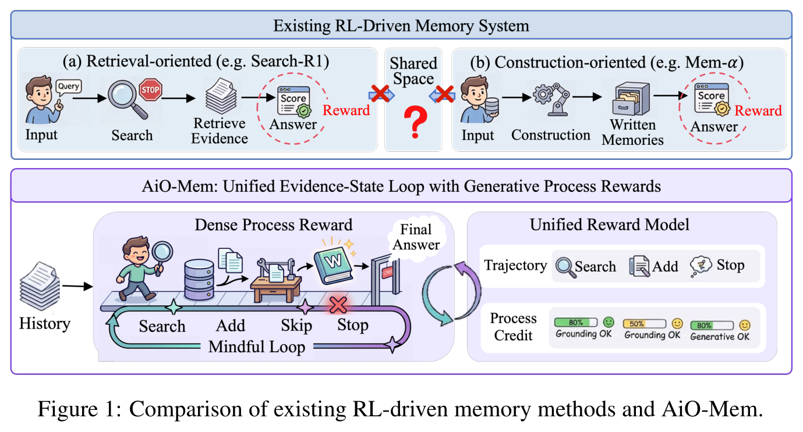

图 1：上半部分是两种老路——只管检索（Search-R1 那一路）和只管构建（Mem-α 那一路），中间打了个问号，标出它们没有共享的记分空间；下半部分把四个动作画成一条回路，奖励模型在回路上逐步给"过程信用"。这张图是我读这篇论文的第一张地图。

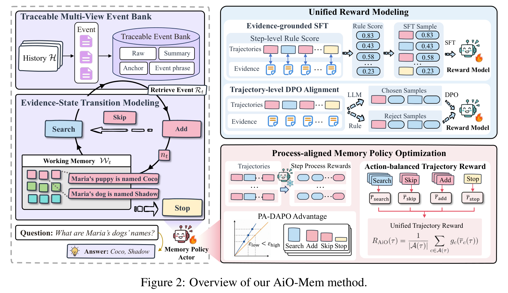

图 2：左侧是事件库与状态转移，右侧是奖励模型的两段训练和 PA-DAPO 的聚合。看图时注意两处：右侧"Evidence-grounded SFT"用规则分当标签，"Trajectory-level DPO Alignment"用 LLM 分当 chosen、规则分当 rejected；右下角那个式子就是式 (4)，四个动作各自先取均值再统一平均。

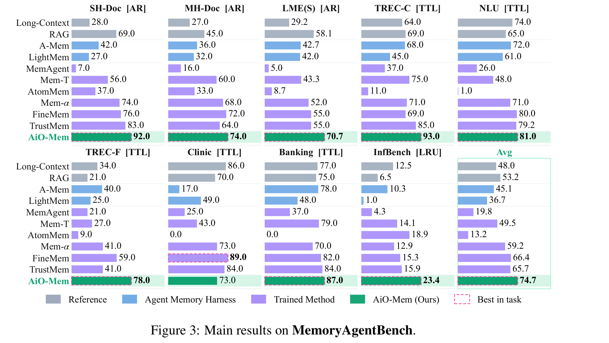

图 3：MemoryAgentBench 的九任务全貌。这张图能看出比平均分更细的东西：AiO-Mem 在 SH-Doc（92.0）、TREC-C（93.0）、Banking（87.0）三个任务上是全场最高，但在 Clinic 上只有 73.0，输给 FineMem 的 89.0 和 Long-Context 的 86.0；NLU 上是 81.0 对 FineMem 的 80.0，只赢 1 分。也就是说 74.7 的平均分里，优势主要集中在需要多步找证据的任务上，在单轮分类式任务上它并不占优。

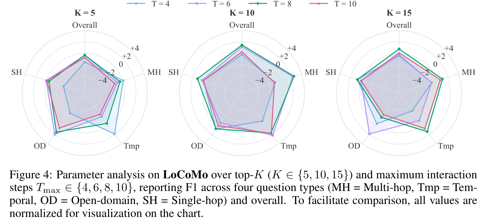

图 4：雷达图，三块面板分别是 $K=5,10,15$，每条边是一个问题类型，半径是相对基准的 F1 偏差，四个颜色是 $T_{\max}\in\{4,6,8,10\}$。看图的方式是找"最外圈的那条线在哪个面板里最外"：$K=10$、$T_{\max}=8$（绿色）在 Overall 与 MH 两个方向上同时最外，说明这一档不是靠某一类题型换来的。注意原文明确说"所有数值做了归一化以便在图上比较"，所以只能读相对高低，不能读绝对值。

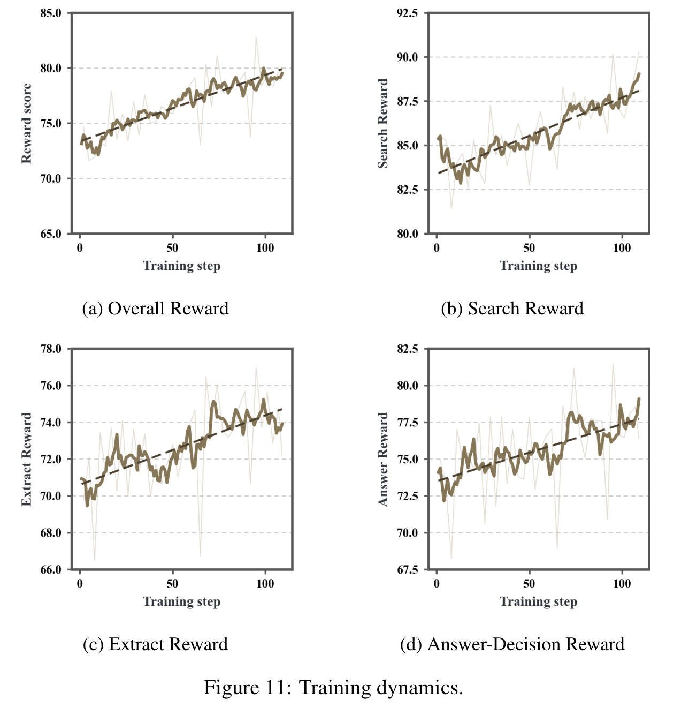

图 11：训练曲线，四个面板分别是 Overall、Search、Extract、Answer-Decision 的奖励。浅色是原始值、深色是平滑值、虚线是趋势线。图上能看出两件事：四条曲线都是上升的，说明不是只有一段在涨；但抖动幅度很大，Search 那条在 0 到 20 步之间先跌到 82 附近再爬回来，说明奖励模型的打分本身有噪声。

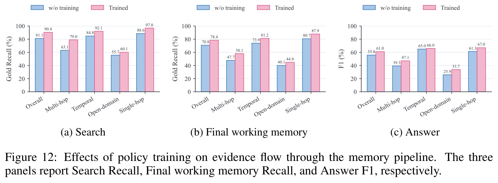

图 12：训练前后三段管线的证据流。Search 阶段的 gold recall 从 81.1 升到 90.4，最终工作记忆的 gold recall 从 70.8 升到 78.4，答案 F1 从 55.8 升到 61.0。这张图的价值在于把增益拆到了三段：检索阶段多捞了 9.3 个点，但写进笔记之后只剩 7.6 个点，说明"捞到"和"写进去"之间还有损耗；从 7.6 个点的记忆增益到 5.2 个点的 F1 增益，又是一层损耗。

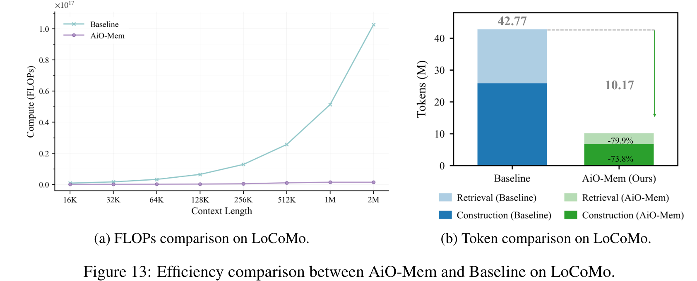

图 13：左图是 FLOPs 随上下文长度的变化，基线在 1M 之后陡涨、到 2M 时超过 $1.0\times10^{17}$，AiO-Mem 基本贴着零轴；右图是 token 消耗，42.77M 降到 10.17M。这张图证明的是"成本不随历史长度线性涨"，但注意它的横轴是上下文长度，不是历史里的事件数。

**原文实验表**

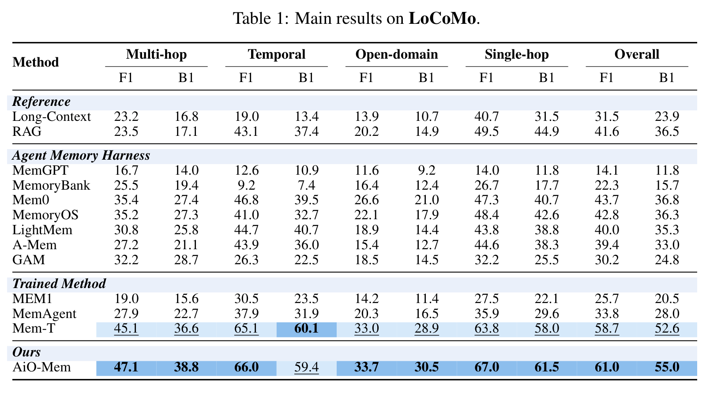

表 1：LoCoMo 主结果。文字表里我抽了四类问题的 F1，原表还有 B1 和每个基线。读原表时注意一个细节：Mem-T 在 Temporal 的 B1 上是 60.1，加粗标为最佳，比 AiO-Mem 的 59.4 高 0.7——这是本文唯一一个被加粗抢走的小格。

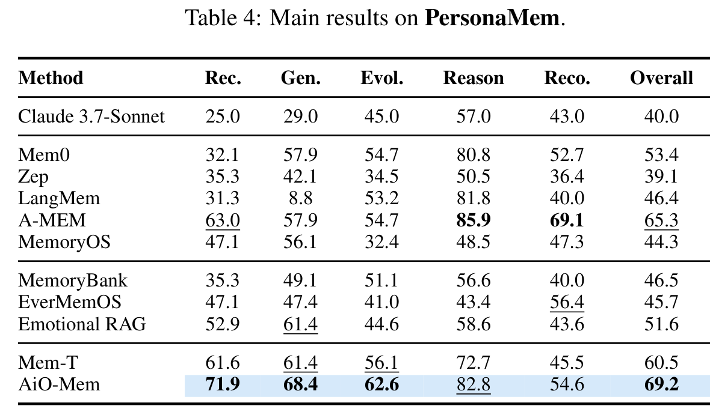

表 4：PersonaMem 主结果。这张表里有本文输得最明显的两格：Reason 82.8 对 A-MEM 的 85.9，Reco. 54.6 对 A-MEM 的 69.1。作者在正文里只写了"总体最强、超出 3.9 分"，没有讨论这两格。

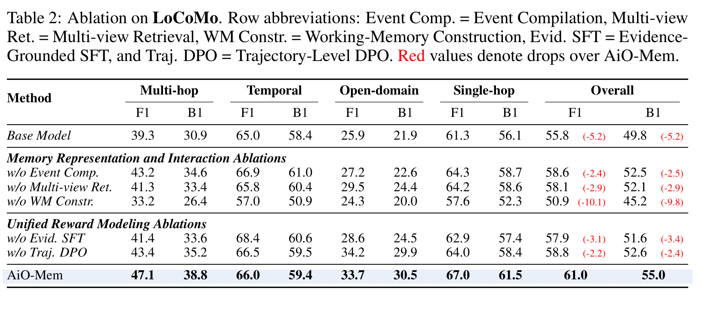

表 2：LoCoMo 上的消融。红字是相对完整模型的下降。数值我单独列在下面一段，因为这张表的信息量主要在降幅的大小顺序上。

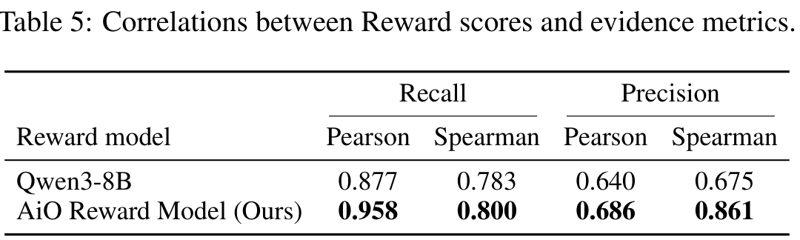

表 5：奖励模型分数与证据指标的相关性。训练后与 Recall 的 Pearson 从 0.877 升到 0.958，与 Precision 的 Spearman 从 0.675 升到 0.861。这张表是"过程奖励确实在评证据质量"的直接证据，但它只说明相关性，不说明因果。

**消融告诉我们什么**

按总体 F1 的降幅排序：去掉工作记忆构建降 10.1（50.9），不训练直接用基座降 5.2（55.8），去掉证据锚定 SFT 降 3.1（57.9），去掉多视图检索降 2.9（58.1），去掉事件编译降 2.4（58.6），去掉轨迹级 DPO 降 2.2（58.8）。

这里有三个值得注意的地方。第一，降幅最大的是工作记忆构建，而不是任何训练组件，说明"把候选变成笔记"这个动作本身贡献最大。第二，两个奖励模型组件的降幅（3.1 和 2.2）加起来接近基座与完整模型之间的差距（5.2），意味着这套过程奖励确实是主要增益来源，而不是锦上添花。第三，去掉轨迹级 DPO 之后 Open-domain 反而从 33.7 升到 34.2，是唯一一个反向的格子，说明这一步在开放域上没帮上忙。

**这些实验够不够支撑结论**

支撑得住的部分：主结果跨三个基准、九个任务，且 MemoryAgentBench 是分布外，泛化这条结论有支撑；消融的降幅顺序和作者的设计意图一致；成本那张图与复杂度推导对得上。

支撑不够的部分：第一，没有和"同样用 Qwen3-4B 做策略、但只用最终答案奖励训练"的对照组，所以分不清增益来自过程奖励还是来自"多训了一个 LoCoMo 上的 RL"；第二，Table 1 中 Mem-T 的训练数据与切分和本文相同，但两者的奖励信号不同、基座是否相同原文没交代清楚；第三，所有实验都在英文对话记忆上做，没有中文或其他语言；第四，方差没有报，单次运行的 2 到 3 个点差异是否稳定，看不出来。

## 6. 局限性

**作者自己承认的**：算力成本一节只讨论了随历史长度的节省，没有讨论奖励模型训练本身的开销；AI 使用声明里写明用 LLM 生成数据、用 LLM 当裁判评估轨迹；伦理声明提到保留可溯源事件会提高敏感信息被不当访问的风险，错误或有偏的历史会被检索并传播到后续回答。

**我看出来的**：

- 隐形假设：这套方法要成立，必须默认每个问题都有一份**金标准证据跨度** $E^\star$。规则分全靠 $E^\star$ 算，SFT 的监督目标也靠它。换到没有标注的真实场景，第一阶段的训练数据就没了。论文没有讨论用弱监督替代 $E^\star$ 会掉多少。
- 隐形假设：必须默认"证据能被切成事件"且"事件的原始文本足够回答问题"。事件库由 Qwen3-8B 编译一次就冻结，如果历史在评测期间继续增长，或者某个事件的原文太长、被观测预算截断，这套流程没有回退机制。
- 边界条件：动作空间只有四种，没有 update 和 merge。遇到"同一条事实后来被更正"的场景（比如先说住在 A 城、后来说搬到 B 城），策略只能再 add 一条新笔记，两条互相矛盾的笔记会同时留在工作记忆里，没有任何机制去消解。PersonaMem 的 Evol.（偏好演化）维度只拿到 62.6，我推测和这个缺失有关，但原文没有做这个分析，这是我的推断。
- 边界条件：奖励模型的上限就是 DeepSeek-V4-Flash 的判断力。第二阶段 DPO 的 chosen 全部来自它，规则分当 rejected。也就是说这套方法本质上是把外部强模型的过程判断蒸馏进一个 8B 奖励模型，再拿它去训 4B 策略。强模型看不见的错误，这里一个也学不到。
- 缺的对比：没有"规则分单独用"和"LLM 分单独用"的对照，只有"两阶段都去掉"和"只去掉第二阶段"两种，所以分不清第二阶段到底带来了多少独立贡献（表 2 里 2.2 这个数还包含了 SFT 已经打好的底子）。
- 适用范围：MemoryAgentBench 上的表现说明它在需要多步找证据的任务上强，在 Clinic（73.0 对 89.0）和 NLU（81.0 对 80.0）这类单轮分类任务上不占优。如果下游主要是这类任务，这套多步策略是纯开销。

## 7. 一句话总结

以前是两个人分头干活、各拿各的工钱，现在把活并给一个人，按每一步干得好不好发钱。类比：以前装修是水电工和油漆工各签各的合同，墙刷得好不好没人管水电走得通不通；现在是一个工头从头包到尾，每一步都当场验收。

核心公式：

$$
\boxed{R_{\text{AiO}}(\tau)=\frac{1}{|\mathcal{A}(\tau)|}\sum_{c\in\mathcal{A}(\tau)} g_c\!\left(\frac{1}{|I_c(\tau)|}\sum_{t\in I_c(\tau)}\hat r_t\right)}
$$

## 8. 可复用点

- 如果我要在自己的项目里用：先别急着上 RL。把"按动作类型先平均、再跨类型平均"这条聚合规则单独拿出来，套到任何有多种动作类型的 agent 训练上，一行代码就能改，能立刻解决"高频动作淹没低频关键动作"的问题。
- 如果我要训一个过程奖励模型：抄它的两段式。第一阶段一定要有可计算的规则分兜底（哪怕是粗的），否则 SFT 没有稳定标签；第二阶段再用强模型的偏好去纠正规则分的盲区。两段之间的数据筛选条件也可以抄——只留"与规则分相差一个质量档"的样本，这样学到的才是规则分看不见的东西。
- 如果我要做长历史记忆：事件库这个"编译一次、查询时只做有界检索"的结构值得抄，它把成本从"随历史长度线性增长"变成"随交互步数增长"。前提是历史不再变化，如果历史会持续写入，得另外设计增量编译。
- 训练不收敛时先查：策略的搜索步是否被奖励模型的噪声吃掉。图 11 里 Search 奖励在前期先跌后升，如果直接拿原始奖励去更新，早期的负梯度会把策略推离有效检索行为。

## 9. 我的疑问

- 附录 D.4 说"因此把 $K_{\text{ret}}=20$ 设为证据覆盖与上下文开销之间的实际平衡点"，但主实验与 C.2 的配置都是 $K_{\text{ret}}=10$。到底是哪个？如果 20 更好，主表为什么不用？
- 训练只用了 LoCoMo（150 题、1,248 条 SFT 样本），却在 MemoryAgentBench 上平均高 8.3 分。这种跨域提升是怎么来的？是过程奖励本身可迁移，还是 Qwen3-4B 基座在这些任务上本来就强、只差一个"会停下来"的习惯？论文没有给基座在 MemoryAgentBench 上的零样本数字（表 2 的 Base Model 只有 LoCoMo 的 55.8）。
- 答案模型在 LoCoMo 上按训练划分微调过，MemoryAgentBench 与 PersonaMem 上是否也微调？如果没微调，三个基准的答案模型就不是同一个，主结果的横向可比性要打折扣。原文在 C.2 只写了"用 Qwen3-4B 做答案模型（LoCoMo 上在我们的训练划分上微调）"。
- 表 2 里去掉轨迹级 DPO 之后 Open-domain 反而涨了 0.5，作者没解释。是噪声还是 DPO 在开放域上把奖励模型带偏了？
- 动作空间缺 update / merge，这一点作者在局限性里没提。如果历史里存在事实更正，当前设计怎么处理矛盾笔记？论文的案例（图 5 的 b）讨论的是时间关系混淆，不是事实更正。
