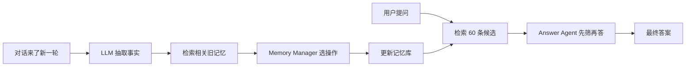

> 一句话：让大模型自己学着决定该记住什么、该改哪条、该扔哪条，唯一老师就是答案对不对。

## 0. 读之前你需要知道

**术语卡**

- **上下文窗口**：模型一次能读进去的字数上限。生活类比：一张书桌，桌面就那么大，摆满了新资料只能挤掉旧的。
- **外部记忆库**：放在模型外面的一堆文本条目，需要时按相似度查出来拼回提示词。类比：桌子旁边的文件柜。
- **检索增强生成（RAG）**：先翻资料再回答。类比：开卷考试，先查书再落笔。
- **强化学习（RL）**：不告诉模型每一步该怎么做，只在最后给一个分数，让它自己试错。类比：训狗握手，做对了给零食，做错了没有。
- **策略（policy）**：模型面对某个输入时，给各个动作分配的概率。类比：一个人走到岔路口的习惯走法。
- **奖励（reward）**：一个数字，越大越好。本文只有 0 和 1。
- **优势（advantage）**：这次动作比平均水平好多少，用来决定该加强还是削弱。
- **PPO / GRPO**：两种拿奖励更新策略的算法。PPO 额外训一个价值网络当基准，再裁剪更新幅度；GRPO 不训价值网络，同一道题采样一组答案互相比排名。类比：PPO 请教练估你这次能考几分，GRPO 让你连考 8 次，按这 8 次的相对名次给奖励。
- **监督微调（SFT）**：拿标准答案直接教。类比：抄答案，抄得到形，抄不到为什么。
- **精确匹配（EM）**：预测答案和标准答案字符串完全对上才算对。

**它站在谁肩上**

- MemGPT（2023）：把记忆分成工作区和长期区，用固定规则决定什么时候换入换出。规则是人写的，不会随着任务变好。
- Mem0（2025）：把记忆操作收敛成 ADD、UPDATE、DELETE、NOOP 四个动作，但动作由模型照着提示词直接选，没有任何信号告诉它选错了。
- MemoryOS（2025）：把记忆当成操作系统来管读写。同样是工程规则驱动。
- Search-R1（2025）：用最终答案对错当奖励，训练模型自己决定什么时候搜、搜什么。本文把同样的思路从搜索引擎挪到记忆库上。

## 1. 动机

生活场景：一个人搬家三年，箱子里塞了几百张纸条。现在要找去年谁借过他的电钻，只能把整箱倒出来一张张看。翻到十张写着电钻的，其中八张是邻居在聊装修。人扫一眼就能把这八张扔掉，模型的注意力被这八张占满，答出来的东西就开始跑偏。

**以前怎么做**：给模型外挂一个记忆库，回答前按相似度捞一批条目，全部拼进提示词。写记忆那一侧让模型照着提示词规则决定新增、修改还是删除。

**为什么不行**：读这一侧，捞多了是噪声，捞少了漏关键信息，模型没有能力判断哪条该留。写这一侧更糟，模型会把不矛盾的信息当成矛盾。论文 Figure 1 的例子：用户先说养了一只狗 Buddy，后来说又养了一只狗 Scout，没训练过的模型直接删掉前一条再新增后一条，记忆碎成两半。正确做法是两条并成一条 UPDATE。

**为什么现在能做**：奖励能自动算。多会话问答的答案短，字符串比对就能给出 0 或 1，不需要人工标注。另一半是算法成熟，GRPO 这类不需要价值网络的 RL 在 2025 年被一批工作验证过，几张 H100 就能跑。

## 2. 贡献

- **把记忆管理变成 RL 问题**。证据：写侧一个 Memory Manager，读侧一个 Answer Agent，两边都只用最终答案对错当奖励训练，不再靠提示词规则。
- **主结果**。证据：LLaMA-3.1-8B 上 LoCoMo 总体 F1 45.02、BLEU-1 37.51、LLM-as-a-Judge 62.74，对论文标为最强基线的 MemoryOS 的 35.04 / 27.99 / 48.20，相对提升 28.5% / 34.0% / 30.2%。
- **样本效率**。证据：训练集只有 152 个问答对，LoCoMo 按 1:1:8 切成 152 / 81 / 1307。
- **零样本迁移**。证据：只在 LoCoMo 上训练，直接去测 MSC 和 LongMemEval，两个骨干都有提升。
- **规模性**。证据：Qwen-2.5 的 3B、7B、14B 三个尺寸上，PPO 和 GRPO 都超过各自底座。3B 的 J 从 19.46 提到 57.92，14B 的 J 从 50.80 提到 65.26（PPO）。

这五条连起来是一件事：以前的记忆系统像一位照着员工手册办事的档案员，手册没写到的情形他就瞎猜；现在不写手册了，直接看他整理完档案之后考试成绩，不及格就调整他的整理习惯。

## 3. 创新点

- **新在哪：记忆操作由奖励驱动，不由提示词驱动**。对比对象：Mem0 和 MemGPT 都是零样本按规则选操作。有用是因为：ADD 和 UPDATE 的边界靠规则写不清楚，只能靠下游答没答对反馈回来。
- **新在哪：读侧也学一次，学的动作是先筛再答**。对比对象：原生 RAG 把检索结果原样塞进去，或者外挂一个重排模型。有用是因为：筛这一步变成模型自己的行为，不用额外跑一个重排器，延迟更低。
- **新在哪：两个 agent 分开训**。对比对象：端到端多智能体 RL。有用是因为：奖励极稀疏，一次操作只改动一条记忆，最后只回一个 0 或 1，联合训练时说不清谁该负责，拆开至少让每一边的奖励归属明确。
- **新在哪：用冻结的 Answer Agent 给 Manager 当尺子**。对比对象：给记忆操作单独设计奖励，比如条目覆盖率、语义相似度。有用是因为：直接优化最终目标，绕开代理指标和真实目标对不齐的老问题。

打个比方：这几条没有换尺子，也没换考卷，换的是学习方式。以前是照着别人的答卷抄，现在是让学生自己反复考，错了用分数找原因。

## 4. 方法

### 4.1 整体流程

一句话解释这张图：上半条是写侧，每来一轮对话就把记忆库整理一次；下半条是读侧，拿到问题先从库里捞 60 条，挑完再答。两条线共用同一个记忆库，写侧的质量决定读侧能捞到什么。

### 4.2 模块拆解

**Memory Manager（写侧）**

为什么需要：记忆库不是只进不出的仓库。同一件事换个说法再提一次，该合并；说法冲突了，该替换；无关的，不该占位置。这几件事没有标准答案可抄，只能靠结果反馈学。

怎么做：从当前这轮对话里抽出一段值得记的事实 $x$，去记忆库里捞出相关的旧条目 $M_{\text{old}}$，把两者一起喂给模型。模型要输出一个操作和一段新文本，系统照着改库。

公式一，策略采样：

$$
(o, m') \sim \pi_\theta(\cdot \mid x, M_{\text{old}})
$$

这个式子在说：给定新事实和旧记忆，模型按自己的概率分布挑一个操作，同时写出操作后的文本。

- $x$：从当前轮抽出来的事实，一段自然语言，几十个字。
- $M_{\text{old}}$：记忆库里和 $x$ 相关的旧条目，若干条。
- $o$：离散动作，取值集合是 $\{\text{ADD}, \text{UPDATE}, \text{DELETE}, \text{NOOP}\}$，四个里选一个。
- $m'$：操作之后这条记忆的新文本，长度不固定。ADD 时是新增内容，UPDATE 时是合并后的内容。
- $\pi_\theta$：带参数 $\theta$ 的策略，这里就是语言模型本身。

公式二，奖励：

$$
R_{\text{answer}} = \mathrm{EM}(y_{\text{pred}}, y_{\text{gold}})
$$

这个式子在说：把改好的记忆库交给冻结的 Answer Agent 回答那道绑定的问题，答对给 1，答错给 0。

- $y_{\text{pred}}$：冻结的 Answer Agent 在改过的记忆库上生成的答案。
- $y_{\text{gold}}$：标准答案。
- $\mathrm{EM}$：字符串完全一致返回 1，否则返回 0。取值只能是 $\{0,1\}$。

公式三，PPO 目标（更新 Manager 用）：

$$
J(\theta) = \mathbb{E}\left[\min\left(\rho_\theta A,\ \mathrm{clip}(\rho_\theta, 1-\epsilon, 1+\epsilon)A\right)\right]
$$

这个式子在说：让这次更新只往前走一小步，走太远就砍掉梯度。

- $\rho_\theta = \dfrac{\pi_\theta(o,m' \mid x, M_{\text{old}})}{\pi_{\text{old}}(o,m' \mid x, M_{\text{old}})}$：重要性比，新策略给这个动作的概率除以采样时旧策略给的概率，无量纲，围绕 1 波动。
- $A$：优势，由 $R_{\text{answer}}$ 估计出来的标量，正数表示这次比平均好。
- $\epsilon$：裁剪半径，把比值限制在 $[1-\epsilon, 1+\epsilon]$ 之间。论文没有给具体数值。
- $\min$：取两项里小的那个。策略变差时梯度自动关掉，防止越训越崩。

公式四，GRPO 目标（另一个可选训练器）：

$$
J(\theta) = \mathbb{E}\left[\frac{1}{G}\sum_{i=1}^{G}\rho_\theta^{(i)} A_i - \beta \, D_{\mathrm{KL}}\left[\pi_\theta \,\|\, \pi_{\text{ref}}\right]\right], \qquad A_i = \frac{r_i - \mathrm{mean}(r)}{\mathrm{std}(r)}
$$

这个式子在说：同一个状态下采一组动作，按这组内部的相对名次分配奖励，再减去一个防止跑偏的惩罚。

- $G$：一个状态上采多少个候选操作。论文没有给具体数值。
- $r_i$：第 $i$ 个候选执行后 answer agent 的 EM 分，取值 0 或 1。
- $r$：这一组的奖励向量 $\{r_1, \dots, r_G\}$。
- $A_i$：组内标准化后的优势，均值 0、标准差 1，无量纲。全对或全错时标准差为 0，这组就没有学习信号。
- $\rho_\theta^{(i)}$：第 $i$ 个候选的重要性比，算法同公式三。
- $\beta$：KL 惩罚系数。
- $\pi_{\text{ref}}$：参考策略，通常是训练前的模型，用来把新策略拴住。

**Answer Agent（读侧）**

为什么需要：60 条候选里通常只有一两条有用，其余是同一段对话里被检索误伤的近邻。全塞进去等于让人抱着 60 份简历进面试间。

怎么做：把问题、两个说话人各自 30 条记忆一起拼进提示词，模型先输出它认为相关的记忆，再输出答案。注意这里的记忆蒸馏（memory distillation）只是筛选，和知识蒸馏没有关系，只是借了这个词。

公式五：

$$
y \sim \pi_\theta(\cdot \mid q, M_{\text{ret}})
$$

这个式子在说：给定问题和检索到的记忆，模型生成一段答案序列。

- $q$：问题文本，一句话。
- $M_{\text{ret}}$：检索出来的 60 条候选记忆，两个说话人各 30 条。
- $y$：生成的答案 token 序列，最长 2048。
- 训练奖励同样是 $\mathrm{EM}(y_{\text{pred}}, y_{\text{gold}})$。

### 4.3 关键细节

- **训练数据怎么造**：用 GPT-4o-mini 按时间顺序给每一轮对话建一个当时可见的记忆快照，再把快照、当前轮、绑定到这一轮的问题拼成一个样本。这里有个数字对不上：正文写用前 24 轮建快照，附录 Algorithm 1 写的是前 50 轮。
- **检索规模固定**：每个问题的 60 条候选 = 每个说话人取 top 30。检索预算是常数，不随问题难度变。
- **超参**：PPO 的 actor 学习率 $1\times10^{-6}$，critic $1\times10^{-5}$，常数 warmup；GRPO 只训 actor。总 batch 128，每卡 micro-batch 2，4 张 H100 80GB（14B 要 8 张）。提示词上限 4096 token，响应上限 2048。训练温度 1.0 做探索，测试用贪心。训练框架 VERL。
- **两个 agent 顺序训**：训 Manager 时 Answer Agent 冻结，只当打分器；训 Answer Agent 时 Manager 固定。论文的说法是分开训能避开归因歧义。
- **Memory-SFT 这个消融很重要**：同样架构、同样数据，把 RL 换成从 GPT-5 生成的轨迹上做行为克隆。它决定了 RL 到底比模仿强多少，后面第 6 节会用到。

## 5. 实验结果

LoCoMo 总体分数（三个指标都是越高越好，单位是分）：

| 数据集 / 任务                      | 指标     | 本文          | 最强基线              | 提升    |
| ----------------------------- | ------ | ----------- | ----------------- | ----- |
| LoCoMo（LLaMA-3.1-8B）          | F1     | 45.02（GRPO） | 42.81（Memory-SFT） | +2.21 |
| LoCoMo（LLaMA-3.1-8B）          | BLEU-1 | 37.51（GRPO） | 32.98（Memory-SFT） | +4.53 |
| LoCoMo（LLaMA-3.1-8B）          | J      | 62.74（GRPO） | 58.76（Memory-SFT） | +3.98 |
| LoCoMo（Qwen-2.5-7B）           | F1     | 43.14（GRPO） | 39.51（Memory-SFT） | +3.63 |
| LoCoMo（Qwen-2.5-7B）           | BLEU-1 | 36.44（GRPO） | 30.84（Memory-SFT） | +5.60 |
| LoCoMo（Qwen-2.5-7B）           | J      | 61.51（GRPO） | 61.13（Memory-SFT） | +0.38 |
| LongMemEval 零样本（LLaMA-3.1-8B） | F1     | 45.20（GRPO） | 43.89（Memory-SFT） | +1.31 |
| LongMemEval 零样本（Qwen-2.5-7B）  | F1     | 46.70（GRPO） | 43.16（Memory-SFT） | +3.54 |

表里我把最强基线换成了表内实际最强的那个，不是论文正文点名的那一个，原因在下一节。

**消融告诉我们什么**

消融像拆车：拔掉一个零件再上路跑一圈，掉多少速度就是那个零件的贡献。

- **写侧确实在起作用**。去掉 RL 训过的 Manager（LLaMA-3.1-8B，PPO）：41.0 / 32.9 / 57.5 掉到 34.5 / 28.1 / 49.0；GRPO 掉到 37.5 / 30.6 / 52.9。三个指标一起掉，说明不是单点抖动。
- **读侧的作用和指标有关**。去掉 RL 训过的 Answer Agent：PPO 32.5 / 24.6 / 59.4，GRPO 33.0 / 24.9 / 59.9。注意 PPO 这一行的 J 反而比完整管线高（59.4 对 57.5），F1 却低一大截。同一个现象在 Table 2 里更直白：拿 J 当奖励训练，J 冲到 63.58，F1 只有 33.69。说明 J 偏好长答案，F1 偏好短答案，两个指标在奖励方向上打架。
- **筛选这一步单独有效**。不蒸馏到蒸馏，GRPO 从 41.0 / 34.4 / 60.1 提到 45.0 / 37.5 / 62.7。
- **写侧质量能放大读侧收益**。把 Manager 从 LLaMA-3.1-8B 换成 GPT-4o-mini，Answer Agent 的 F1 增益从 +10.10 涨到 +19.72，J 增益从 +5.05 涨到 +15.76。
- **GRPO 起步快**。训练曲线上 GRPO 前期收敛更快，最终两者的奖励水平接近。

**这些实验够不够支撑结论**

够的部分：写侧和读侧各自有用，两个骨干、四个尺寸上都成立，零样本换数据集也成立。这四条站得住。

不够的部分：论文没有给操作层面的统计，也就是说不出模型究竟学会了什么，只能给两个案例；LongMemEval 只用了 oracle 版本；MSC 只有一个柱状图。

## 6. 局限性

**作者自己承认的**

- 只测对话类数据集，扩到多模态会引入本工作范围外的问题。
- 两个 agent 分开训是为了在稀疏奖励下保稳定，代价是流程不直接。端到端多智能体 RL 留作未来工作。

**我看出来的**

下面几条是我读表时记下的疑点，属于我的判断，不是论文结论。

- **相对提升的基准选得偏弱**。摘要里 28% F1、34% BLEU-1、30% J 是对 MemoryOS 算的（45.02 / 35.04 减一正好 28.5%），但表里更硬的对手是他们自己的 Memory-SFT，三个指标都高于 MemoryOS。对 SFT 的真实差距是 +2.21 / +4.53 / +3.98 分，相对只有 +5.2% / +13.7% / +6.8%。Qwen-2.5-7B 上 J 更是只高 0.38。换句话说，架构、提示词、数据这些非 RL 的部分拿到了大部分收益，RL 的增量集中在 F1 和 BLEU-1，也就是答得更短、更像原句。选软柿子当参照，百分比自然好看。
- **摘要里的对比对象写错了**。摘要说 28% 是对最有竞争力的 Mem0 算的，可 45.02 对 30.41 是 48%，对不上。数字实际对应 MemoryOS。
- **没有操作层面的统计**。全篇没有 ADD / UPDATE / DELETE / NOOP 各自的选中比例，也没有误删率、无效更新率，只有附录两个案例。写侧到底学到了什么，读者只能靠故事想象。
- **建库成本没算进延迟**。延迟分析把 Manager、检索、Answer Agent 分开测（Manager 在 LLaMA 上 p50 约 2 秒，检索 p50 不到 0.35 秒，GRPO 版 Answer Agent p50 0.34 秒、p95 0.67 秒，底座是 0.65 / 3.07 秒），但一场 600 轮的对话要调 600 次 Manager，端到端建库的总时间和总成本没有给。
- **60 条候选是硬上限**。如果正确证据压根没被检索进这 60 条，筛选再准也救不回来。论文没报检索召回率，也没把检索预算当变量扫一遍。
- **LongMemEval 用 oracle 版本**。oracle 通常意味着证据已经给到位，这个基准测的主要是答案生成，而不是本文主张的记忆管理。用它证明泛化，说服力打了折。
- **三个数据集里有一个没有数字**。MSC 只出现在 Figure 4 的柱状图里，没有表。
- **裁判模型没写**。J 用一个单独的 LLM 打 CORRECT / WRONG，附录只给了 prompt，没说是哪个模型、什么规模。
- **基线是自己重实现的**。Mem0、A-Mem、MemoryOS 都在相同骨干上重跑，重实现调参到什么程度没有交代。

## 7. 一句话总结

把记忆库交给一个用考试分数训出来的图书管理员：新书该上架、旧卡片该改、重复的该扔，他自己看着办；找书的人也不再抱着整箱卡片进考场，先挑两张带进去。

核心公式：

$$
\boxed{\;J(\theta) = \mathbb{E}\left[\min\left(\rho_\theta A,\ \mathrm{clip}(\rho_\theta, 1-\epsilon, 1+\epsilon)A\right)\right],\quad A = A\big(R_{\text{answer}}\big),\quad R_{\text{answer}} = \mathrm{EM}\big(y_{\text{pred}}(M'),\ y_{\text{gold}}\big)\;}
$$

这套写法把两件事压在一行里：$M'$ 是按 $(o,m')$ 改过的记忆库，$y_{\text{pred}}(M')$ 是冻结的 Answer Agent 在这个库上给出的答案，它和标准答案对不对决定奖励；策略更新本身是带裁剪的 PPO。

## 8. 可复用点

- 如果我要在自己的项目里用：把 ADD / UPDATE / DELETE 的判定从提示词规则换成一个小模型，奖励直接用下游任务的 0 或 1 分。先冻结下游模型只拿它算奖励，别让两边一起动。
- 开工前先量一个数：正确证据出现在 top-k 里的比例。这个数决定筛选最多还能救回多少；按我的经验，低到七成就该先修检索，别急着训。
- 训练不收敛时先查奖励分布。本文的前提是答案短、EM 能区分对错。开放域长答案上 EM 会退化成几乎全 0，这时换 J 或 token 级 F1 当奖励，但要预期答案变长、F1 掉（Table 2 就是这个教训）。
- 想省延迟就把筛选做进模型，别外挂重排器。论文测到重排器精度收益小、延迟开销大。
- 做消融时留一个 SFT 对照。它能算出 RL 的真实增量，本文少了这一步，主结果的相对提升就虚了。

## 9. 我的疑问

- 论文说自己是 first RL framework for memory-augmented LLMs。我印象里 2025 年已经出现用 RL 训练长上下文记忆改写的工作，related work 里没有把它们列出来对比，novelty 的边界在哪？
- Manager 的奖励是冻结的 Answer Agent 给的，可是流程是先训 Manager、再拿固定的 Manager 训 Answer Agent。Answer Agent 换代以后，Manager 学到的东西还是最优的吗？
- 两个案例里 UPDATE 的合并文本是模型自己重写的，会不会把原文细节改坏？全文没有忠实性检查。
- 记忆库有上限吗？对话再长，条目一直加，检索质量会不会随库变大而退化？
- 152 个训练样本覆盖了四种操作吗？如果某一种操作在这 152 个样本里从没被奖励过，模型还会选它吗？

