> 一句话：机器人做长任务时，别把最后一步的失败算到前面几步头上。

## 0. 读之前你需要知道

**术语卡**

- **VLA（Vision–Language–Action 模型）**：看摄像机画面、读一句指令，直接输出机械臂这一小段要执行的动作。类比：给厨师一张厨房照片加一句「把面包放到盘子上」，他直接动手，中间不用写菜谱。
- **模仿学习（imitation learning, IL）**：看人类示范，照着学。类比：跟着教学视频学做菜，视频里没出现过的菜就不会做。
- **强化学习（RL）**：不告诉它怎么做，只给结果打分，让它自己试错。类比：学骑车，摔了知道这样不行，稳了知道这样行。
- **长程任务（long-horizon）**：一局要连着做完 4 到 6 个子任务，决策步几十到上百步。本文真机任务都是 4 到 6 个 **原子子任务（atomic subtask）**。
- **原子子任务**：长指令切出来的最小语义单元，比如「拿起纸巾」。一条长指令被分解成有序序列 $G=(g_1,\dots,g_K)$，报告里写的 $K$ 就是子任务个数。
- **优势（advantage）**：这一步比平均水平好多少。正数加强这个动作，负数削弱它。
- **价值函数（critic）**：另训一个网络，估计「从现在这个画面出发，最后还能拿多少分」，记 $V_\phi$。
- **TD 残差（TD residual）$\delta_t$**：这一步的奖励加上下一步估值，再减去当前估值，也就是「比预期好多少」。
- **GAE（generalized advantage estimation）**：把未来每一步的 TD 残差按 $(γλ)^{\ell}$ 加权求和，得到这一步的优势。相当于一条往回传的计分链。
- **信用污染（credit contamination）**：本文造的词，指一局最后的失败把前面做对的动作也判成负分。
- **熵正则（entropy regularization）**：在损失里加一项鼓励策略别太早变确定，保留探索。
- **Real2Sim2Real**：真实现场重建出仿真环境，在仿真里训练，再部署回真机。

**它站在谁肩上**

- PPO / GAE（2017、2016）：本文的骨架算法。SAPO 改动的位置非常具体——GAE 递推里那个 $(γλ)$ 系数。
- π0.5、OpenVLA-OFT（2025）：两个现成 VLA 骨干，本文在它们的 SFT 权重上做 RL 后训练，不重训模型。
- STARE-VLA（2025）、IG-RFT（2026）：用阶段级偏好优化或子任务级中间奖励缓解奖励稀疏。本文的判断是：**它们改的是奖励密度，没有解决信用污染**。
- RialTo（2024）、GSWorld（2025）：真实场景数字孪生 + 仿真 RL。本文认为这类流程要协调场景重建、物理资产、控制对齐，构建成本高、难复现。
- LIBERO-LONG、CALVIN ABC-D：两个长程操作基准，也是本文全部仿真实验的场地。

## 1. 动机

想象一条早餐流水线，四步：拿起纸巾、把纸巾放进垃圾桶、拿起玩具车、把车放进桶里。

工人前三步都干净利落，第四步手滑把车掉了。质检只给一句话：**整单不合格**。

如果按整单扣钱，前三步的工钱一起扣掉。下次这个工人可能连「拿纸巾」都不敢做了——明明那一步是对的。

这篇论文要解决的就是这件事在 RL 里的版本。

**以前怎么做**：VLA 的 RL 后训练基本都用「整条任务成功才给 1 分」的终端奖励，配合标准 GAE。也有人在中间插奖励：阶段级偏好、子任务级中间分。

**为什么不行**：

第一层，信用污染。一局做完了前 $k$ 个子任务、在第 $k+1$ 个失败时，终端奖励是 0，GAE 会把失败段的 TD 残差沿着时间轴一路反传到 $t_0$。原文的说法是：

> "the absence of a terminal success reward causes generalized advantage estimation (GAE) to propagate failure-related temporal-difference (TD) residuals backward to $t_0$, suppressing the advantages of correctly executed actions"

翻译过来：没有终端成功奖励，GAE 就把跟失败有关的 TD 残差往回传到起点，把正确动作的优势压下去。作者给这个现象起名 **credit contamination**，并指出「the effect worsening as the horizon grows」——任务越长，传得越远，污染越重。

第二层，插奖励治不了这个。加中间奖励改变的是奖励密不密，残差该往回传还是往回传。论文在表 4(a) 里给了证据：把奖励换成过程级稠密奖励 PBSR 后，PPO 从 78.2 涨到 81.8，但 SAPO 一加就跳到 87.8–89.6，说明增益主要不来自奖励变密。

第三层，子任务掌握得不均匀。训练到后期，失败会挤在少数几个瓶颈子任务上。这时候还均匀采样整个任务、还保持固定的探索强度，等于把交互预算花在已经学会的部分，瓶颈那边反而不够。

**为什么现在能做**：三个条件同时到位了。VLA 已经能做出半个任务（SFT 在 LIBERO-LONG 上就有 89.0%），失败集中在后段，于是「分清哪一段失败」才有意义；RLinf 这类并行仿真框架让 200 步 RL 训练在 8 张 H200 上跑得动；一条真机示范就能自动重建仿真环境，不再需要手工搭场景。

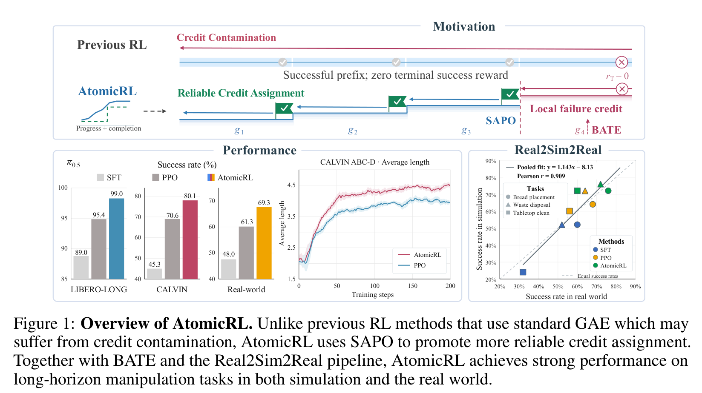

图 1：上半部分是动机——标准 RL 的红色箭头从失败点一路指回任务起点，AtomicRL 只在语义边界处动手，把「局部失败」的信用限制在失败段。下半部分是总览：三个基准、CALVIN 训练曲线、仿真与真机的相关性。

## 2. 贡献

- **长程任务的性能上限被推高**。证据：LIBERO-LONG 上 π0.5 从 PPO 的 95.4% 到 99.0%，OpenVLA-OFT 从 94.8% 到 98.8%（表 1）；CALVIN ABC-D 平均完成长度从 PPO 的 4.36 到 4.56，五连成功率从 70.6% 到 80.1%（表 2）。
- **真机上也有效**。证据：AgiBot G1 上三个长程任务平均成功率 69.3%，SFT 是 48.0%，PPO 是 61.3%（表 3）。
- **给出一个可复用的信用分配机制 SAPO**。证据：同一套骨干、同一套奖励下，只加 SAPO 就把 LIBERO-LONG 从 78.2% 拉到 87.8%，是三个组件里增益最大的一个（表 4(b)）。
- **给出一个从一条示范直达真机的流程**。证据：仿真与真机成功率在 9 个「任务 × 方法」组合上的 Pearson 相关系数 $r=0.909$（图 3）。

## 3. 创新点

- **在语义边界上给 GAE 的传播加了一道门**。对比对象：标准 GAE，以及所有靠加中间奖励的做法。有用是因为：污染是沿着「传递链」发生的，奖励整形改的是每个点的分值，门控改的是传递系数——后者才直接切断传播。而且门只对失败边界收窄，成功边界保持 1，所以做对的前缀照样能互相传递。
- **用「能力差」同时调度采样和探索**。对比对象：均匀任务采样 + 固定熵系数。有用是因为：$1-\mu_k$ 这一个量同时能回答两个问题——哪个任务该多练、哪段该多探索；而且它按子任务粒度算，不是按任务粒度，能精确定位瓶颈。
- **一条示范自动建仿真环境**。对比对象：RialTo 这类需要协调场景重建、物理资产、控制对齐的 Real2Sim 流程。有用是因为：真机试错贵且危险，把试错挪到可并行、可复位的仿真里，才谈得上 200 步在线 RL。

## 4. 方法

### 4.1 整体流程

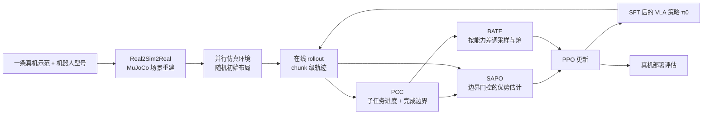

一句话解释这张图：PCC 负责「现在做到第几个子任务、这一段成了没有」，SAPO 用这个信号决定信用往回传多远，BATE 用同一个信号决定下一批采样练哪个任务、探索开多大，三者都挂在 PPO 的外面。

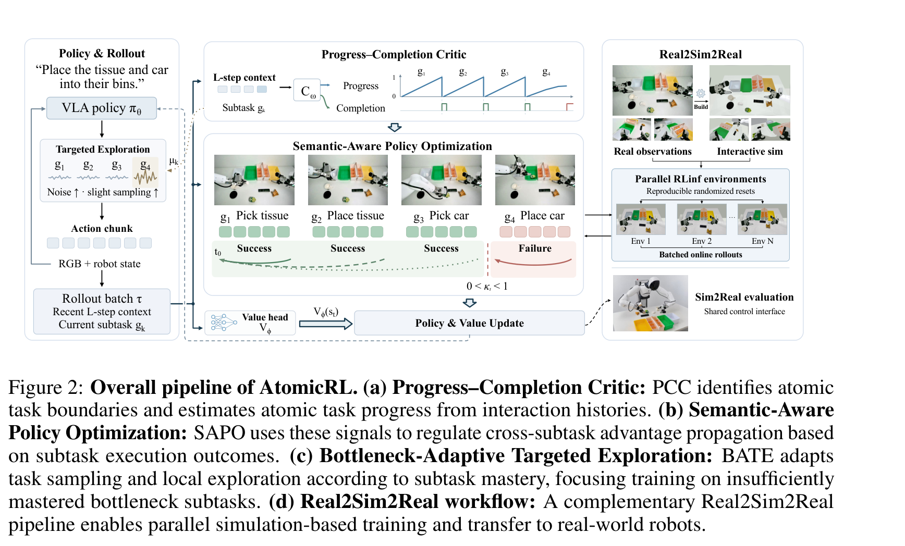

图 2：四个模块的位置关系。左边是 rollout 循环，中间上方是 PCC（把 $L$ 步上下文压成进度曲线和完成信号），中间是 SAPO（在 $g_1g_2g_3$ 成功的边界处保留传播、在 $g_4$ 失败的边界处收窄），右边是 Real2Sim2Real 与并行环境。

### 4.2 模块拆解

#### 4.2.1 PCC：先得知道「做到哪一步了」

**为什么需要**：SAPO 要在语义边界上下手，BATE 要按子任务统计掌握度，这两件事都要求系统知道当前处在哪个子任务、这一段有没有做完。环境只给整条任务的成功与否，不给子任务标签。

**怎么做**：把最近 $L$ 步的「观测 + 动作」作为上下文，连同当前子任务编号 $g_{z_t}$ 一起送进一个小网络 $C_\omega$，输出两类东西——$B-1$ 个序数进度 logit 和一个完成 logit。

公式：

$$
\hat{p}_t=\frac{1}{B-1}\sum_{j=1}^{B-1}\mathbf{1}\!\left[\sigma\!\left(u^{\mathrm{prog}}_{t,j}\right)>\tau_{\mathrm{ord}}\right],
\qquad
\hat{q}_t=\sigma\!\left(u^{\mathrm{comp}}_t\right)
$$

先说这个公式在算什么：进度不是一个连续回归值，而是一串「阈值过没过」的投票。$B$ 个进度档位产生 $B-1$ 个阈值，每过一个阈值计 1 票，票数除以 $B-1$ 就是进度。

- $\hat{p}_t$：当前子任务的进度，取值 $0$ 到 $1$，步长 $1/(B-1)$。
- $u^{\mathrm{prog}}_{t,j}$：第 $j$ 个序数阈值的原始打分。
- $\sigma$：sigmoid，把打分压到 $(0,1)$。
- $\tau_{\mathrm{ord}}$：序数解码阈值，原文取 $0.5$。
- $\hat{q}_t$：这一段已经完成的概率。
- $B$：进度档位数，原文未给具体数值。

判定规则：$\hat{q}_t\ge\tau_s$ 且 $\hat{p}_t\ge\tau_p$ 连续 $N$ 步成立，就把子任务下标推进到 $z_{t+1}=z_t+1$，进度归零，但物理观测上下文保留。$\tau_s$、$\tau_p$、$N$ 原文未给数值。

训练损失是两项相加：

$$
\mathcal{L}_C=\lambda_p\mathcal{L}_{\mathrm{ord}}+\lambda_c\mathcal{L}_{\mathrm{comp}}
$$

- $\mathcal{L}_{\mathrm{ord}}$：对累积进度目标做二元交叉熵（cumulative ordinal loss），也就是每个阈值单独判「过没过」。
- $\mathcal{L}_{\mathrm{comp}}$：类别平衡的二元交叉熵，因为「完成」这一步在长轨迹里样本极少。
- $\lambda_p,\lambda_c$：两项权重，原文未给数值。

PCC 是**离线**训练的：用 AtomicVLA 的标注流水线在示范轨迹上生成细粒度标注，人工再修一遍。视觉骨干是冻结的 SigLIP（约 400M 参数，从 π0.5 的视觉骨干初始化），可训练参数 28.8M，RL 阶段整个冻结。

#### 4.2.2 SAPO：本文的核心

**为什么需要**：这是冲着信用污染去的。目标很克制——不动单步 TD 残差，不动价值自举，只动残差跨越子任务边界时的传递系数。

**怎么做**：先把标准的两步写清楚。

第一步，chunk 级的一步 TD 残差：

$$
\delta_t=r_t+\gamma(1-d_t)V_\phi(s_{t+1})-V_\phi(s_t)
$$

一句话：这一步拿到多少奖励、下一步估值多少、减去当前估值，就是「比预期好多少」。

- $r_t$：一个 action chunk 执行完后的奖励，本文训练时是稀疏任务奖励加 PBSR 整形项。
- $\gamma$：折扣因子，越接近 1 越看重远期。
- $d_t$：执行完这个 chunk 后环境是否终止，终止时把下一步估值掐掉。
- $V_\phi(s_t)$：critic 对当前观测与语言输入的打分。原文特别说明 $s_t$ 是「observation- and language-conditioned input representation」，**不是**仿真器里的特权状态，这一点决定了方法能不能搬到真机。
- $t$：chunk 级时间步，一局共 $T$ 步。

第二步，标准 GAE 把它往回加权求和：

$$
\hat{A}^{\mathrm{PPO}}_t=\sum_{\ell=0}^{T-t}(\gamma\lambda)^{\ell}\delta_{t+\ell}
$$

- $\hat{A}^{\mathrm{PPO}}_t$：第 $t$ 步的优势估计。
- $\lambda\in[0,1]$：trace 衰减，控制往回看多远。
- $(γλ)^\ell$：距离 $\ell$ 步的残差被乘的权重。

问题就出在这个链上：终点失败时，失败段每一步的 $\delta$ 都是负的，它们沿着 $(γλ)^\ell$ 一路乘回起点，把前面正确动作的优势一起压下去。

第三步，SAPO 在链的每一环插一个门控系数：

$$
\hat{A}^{\mathrm{SAPO}}_t=\sum_{\ell=0}^{T-t}(\gamma\lambda)^{\ell}\left[\prod_{j=0}^{\ell-1}\left(1-(1-\kappa_{t+j})b_{t+j}\right)\right]\delta_{t+\ell},
\qquad \kappa_t\in[0,1]
$$

一句话：残差往回传时，每跨过一个子任务边界就被乘一次折扣，跨过失败边界时打折最狠。

- $b_{t+j}$：语义边界指示器，$b_t=\mathbb{I}[z_{t+1}\neq z_t]$。执行完 $a_t$ 后换到了下一个子任务就是 1，否则是 0。
- $\kappa_{t+j}$：边界处的门控强度，取值 $[0,1]$。
- $\prod_{j=0}^{\ell-1}(\cdot)$：从第 $t$ 步到第 $t+\ell$ 步之间所有边界的折扣连乘，这就是「跨了几道门就乘几次」。

三个角落要看清楚：

- 子任务内部 $b_t=0$，括号里是 1，退化成标准 $(γλ)^\ell$，段内信用分配完全不变。
- 边界处且后面那个子任务**成功**，$\kappa_t=1$，括号里还是 1，传播照旧——做对的前缀之间仍然互相传递。
- 边界处且后面那个子任务**失败**，$0<\kappa_t<1$，括号里等于 $\kappa_t$，失败段的残差进入已完成前缀时被打折。原文的默认设置是 $\kappa=0.3$。

一个具体例子：前三个子任务成功、第四个失败。第四段内部照常传播；跨过 $g_3\to g_4$ 那道边界时只保留 30%；前三段内部各自的标准权重不受影响。于是「拿纸巾」这一步不会被「放车失败」拖累。

价值目标用 $V_\phi(s_t)+\hat{A}^{\mathrm{SAPO}}_t$ 构造，再做优势归一化。原文强调 one-step TD 残差和价值自举都没动——这也是为什么方法能保留 PPO 的稳定性。

**我的推断**：$\kappa_t$ 取 0.3 还是 1，取决于「后面那个子任务成没成」，而环境并不给子任务级标签，所以这个成败只能来自 PCC 的完成判定 $\hat{q}_t$。原文没有明说这一点，如果实际用的是整条任务的终端奖励做事后回填，那 SAPO 就用到了只有训练时才有的信息。这个区别决定了它能不能用于在线部署。

#### 4.2.3 BATE：把探索预算挪到瓶颈上

**为什么需要**：训练后期失败集中在少数子任务，均匀采样和固定熵系数会把预算浪费在已经饱和的部分，还可能把学会的技能探索坏。

**怎么做**：先用指数滑动平均记每个子任务类别的完成率。

$$
\mu_k^{(n)}=\beta\mu_k^{(n-1)}+(1-\beta)\hat{s}_k^{(n)},\qquad \beta\in[0,1)
$$

- $\mu_k^{(n)}$：第 $k$ 类原子子任务在第 $n$ 次统计更新后的掌握度，取值 $[0,1]$。
- $\hat{s}_k^{(n)}$：这次更新里已经结算的那些尝试的成功比例。
- $\beta$：滑动平均的惯性，越大越平滑。原文未给数值。

能力差就是 $1-\mu_k$，它同时驱动两件事。

第一件，任务采样权重：

$$
w_i=1+\rho\left[\max_{k\in\mathcal{K}_i}(1-\mu_k)\right]^{\eta},
\qquad
P_{\mathrm{task}}(i)=\frac{w_i}{\sum_j w_j}
$$

- $w_i$：第 $i$ 条完整任务的采样权重。
- $\mathcal{K}_i$：任务 $i$ 包含的子任务集合。取 $\max$ 意味着「只要这条任务里有一个瓶颈，这条任务就被加权」。
- $\rho\ge0$：重分配强度的上限。原文未给数值。
- $\eta>0$：对能力差的敏感度，越大越偏向最弱的那个。原文未给数值。
- 那个 $1$ 是基线权重，作用是让已经掌握的任务仍然偶尔被采到，好监控遗忘。

第二件，按掌握度调的熵正则：

$$
\mathcal{L}_{\mathrm{explore}}=-\alpha_H\mathbb{E}_t\left[f_{\mathrm{exp}}\!\left(1-\mu_{z_t}^{(n)}\right)\mathcal{H}_{\theta,t}\right]
$$

- $\alpha_H$：基础熵系数。
- $\mathcal{H}_{\theta,t}$：当前步策略的熵。
- $z_t$：当前活跃子任务下标，所以熵系数是按「正在做的这一段」查表得到的。
- $f_{\mathrm{exp}}$：有界权重函数，弱子任务上放大、强子任务上收缩。原文未给具体形式。

效果：没学会的段探索更大，学会的段收敛得更稳。

#### 4.2.4 PBSR：可选的进度整形奖励

**为什么需要**：稀疏奖励下早期探索太慢，需要一点过程引导；但一直加稠密奖励会稀释终端信号（表 4(a) 验证过）。

**怎么做**：用 PCC 的进度构造一个势函数，再取相邻两步的差分作为整形奖励。

$$
\Phi_{t+1}=\frac{z_{t+1}-1+\tilde{c}_t/B}{K},
\qquad
r_t^{\mathrm{PBSR}}=\gamma\Phi_{t+1}-\Phi_t
$$

- $\Phi_{t+1}$：第 $t+1$ 步的「任务完成度」，取值 $[0,1]$。
- $z_{t+1}$：当前子任务序号（从 1 开始），$(z_{t+1}-1)/K$ 是已完成子任务的比例。
- $\tilde{c}_t$：当前子任务内的进度档位，取值 $0..B-1$，除以 $B$ 后是段内增量。
- $K$：子任务总数。
- $\gamma\Phi_{t+1}-\Phi_t$：势函数差分。这是标准的势函数整形写法，保证不改最优策略。

训练奖励是稀疏奖励加整形项：

$$
r_t=r_t^{\mathrm{env}}+\alpha_n r_t^{\mathrm{PBSR}}
$$

整形系数按训练步线性退火：

$$
\alpha_n=\alpha_0\left[1-(1-\rho)\,\mathrm{clip}\!\left(\frac{n-n_s}{n_e-n_s},\,0,\,1\right)\right]
$$

- $\alpha_0$：初始系数。
- $n_s<n_e$：退火区间起点与终点。
- $\rho\in[0,1]$：退火后保留的比例，取 0 就是彻底去掉 PBSR。
- 原文未给 $\alpha_0$、$n_s$、$n_e$ 的具体数值。

注意两件事的分工：PBSR 改的是**奖励**，进而改 TD 残差本身；SAPO 改的是残差**跨边界传播**。原文专门点了一句："PBSR modifies the reward used to compute TD residuals, whereas SAPO regulates their cross-boundary propagation during advantage estimation."

#### 4.2.5 Real2Sim2Real：一条示范建一个环境

**为什么需要**：真机上做在线 RL，试错贵、复位慢、还可能把设备撞坏。要跑 200 步 RL，得先把试错搬到能并行的仿真里。

**怎么做**：输入是一条真实的多模态示范 $\tau_{\mathrm{real}}$、机器人型号等元信息 $m$、以及必要的物体补拍 $\mathcal{D}_{\mathrm{aux}}$，输出是一个与真机对齐的仿真环境。

$$
\left(\mathcal{E}_{\mathrm{sim}},\ \mathcal{C},\ \mathcal{S}_0\right)=\mathcal{B}\left(\tau_{\mathrm{real}},m,\mathcal{D}_{\mathrm{aux}}\right)
$$

- $\mathcal{E}_{\mathrm{sim}}$：重建出来的可交互仿真环境。
- $\mathcal{C}$：共享的观测—动作接口规范，训练和部署走同一套。
- $\mathcal{S}_0$：一组可复现的随机初始布局，用来做并行复位。
- $\mathcal{B}$：整条构建流水线。

流水线分六步（附录 A.6，图 9）：从 URDF 在 MuJoCo 里建机器人；用 COLMAP/PyCOLMAP 做背景重建、贴 UV 图集；给刚体配质量、惯性、摩擦（CoACD 近似凸包），给软体配有限元材料参数；用 RGB-D 尺度证据加机器人运动学校准摆放位置；回放示范动作验证接触、压缩、复位稳定性；最后暴露 RL 接口给 RLinf。编排与代码由 GPT-6 Astra 辅助完成。

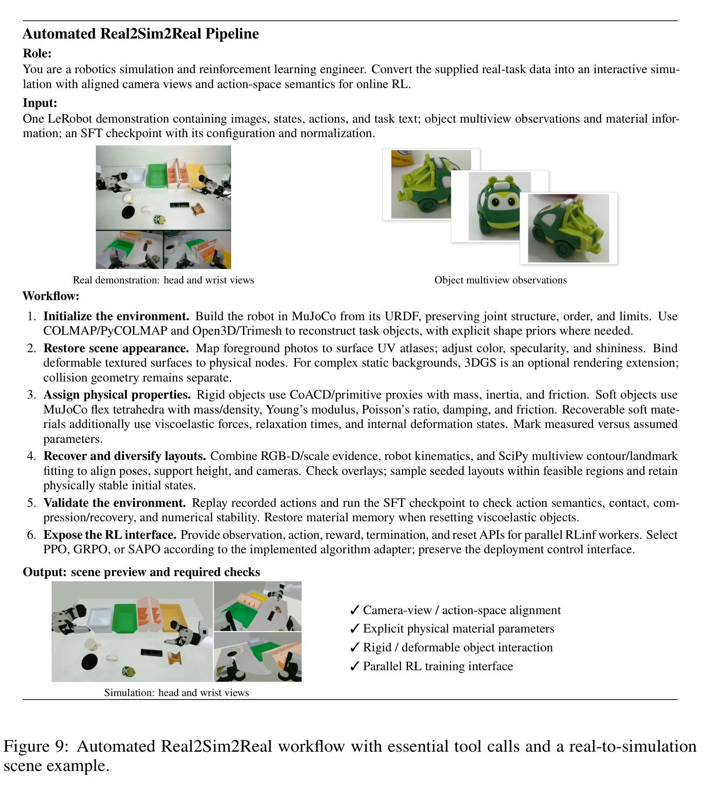

图 9：自动化的 Real2Sim2Real 工作流，含输入、六个步骤、输出与验收清单。里面最能省事的一步是「回放示范动作验证」——环境建得对不对，用 SFT 策略重放一遍就知道。

### 4.3 关键细节

- **动作粒度**：策略一次输出长度为 $H_a$ 的 action chunk，TD 残差按 chunk 计，一局 $T$ 个 chunk step。所有时间下标都是 chunk 级，不是单帧级。
- **门控默认值**：$\kappa=0.3$（附录 A.3 的敏感性实验选出来的）。
- **PCC 规模**：冻结 SigLIP 约 400M，可训练 28.8M，单次推理 42.4 ms。
- **标注量**：LIBERO 150 条轨迹，每个真机任务 50 条；PCC 只在示范上离线训，RL 期间冻结。
- **训练预算**：每个 run 200 个优化步；8 张 H200 训练，1 张 RTX 5090 推理；框架是 RLinf。
- **退火**：PBSR 线性退火到 0，早期靠稠密引导，后期回到稀疏信号。
- **未给的超参**：$B$、$\tau_s$、$\tau_p$、$N$、$\lambda_p$、$\lambda_c$、$\beta$、$\rho$、$\eta$、$f_{\mathrm{exp}}$ 的形式、$\alpha_0$、$n_s$、$n_e$，原文都没给具体数值。

## 5. 实验结果

**实验设置**

- **数据集与切分**：LIBERO-LONG 的 10 个长程任务，每个任务 50 次试验；CALVIN 用 ABC-D 协议，在 A、B、C 上训练、在留出的 D 上评测，1000 次试验；真机是 AgiBot G1 上的三个桌面长程任务，每个任务采 100 条专家示范做 SFT，每个方法每个任务测 25 次。
- **骨干模型**：π0.5 与 OpenVLA-OFT。LIBERO-LONG 上两个都跑，CALVIN 只跑 π0.5。
- **训练预算**：每个 run 200 个优化步；8 张 NVIDIA H200 训练，单张 RTX 5090 推理；全部在 RLinf 框架里实现。
- **基线**：SFT（只做模仿学习）和 PPO（同样骨干、同样奖励，但用标准 GAE）。没有和 STARE-VLA、IG-RFT 这些子任务奖励方法对比。
- **指标**：LIBERO 报平均成功率 SR（越高越好）；CALVIN 报连续完成 1 到 5 个任务的成功率和平均完成长度 Avg. Len（越高越好）；真机报三个任务的成功率与平均；表 1 额外报 $\Delta_{\mathrm{PPO}}$，单位写的是 pp。
- **推理设置**：动作 chunk 长度 $H_a$ 原文未给；解码温度、采样次数原文未给；PCC 的 $L$ 步上下文长度原文未给。

**主结果**

| 基准 | 指标 | 本文 | 最强基线 | 提升 |
| --- | --- | --- | --- | --- |
| LIBERO-LONG（π0.5） | SR (%) | 99.0 | 95.4（PPO） | +3.6 pp |
| LIBERO-LONG（OpenVLA-OFT） | SR (%) | 98.8 | 94.8（PPO） | +4.0 pp |
| CALVIN ABC-D | Avg. Len | 4.56 | 4.36（PPO） | +0.20 |
| CALVIN ABC-D | 五连成功率 (%) | 80.1 | 70.6（PPO） | +9.5 pp |
| 真机三任务 | 平均 SR (%) | 69.3 | 61.3（PPO） | +8.0 pp |

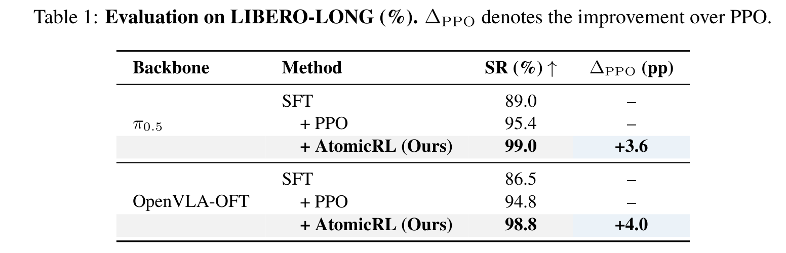

表 1：LIBERO-LONG 上两个骨干的结果。注意 SR 那一列在 SFT 和 PPO 之间就已经差了 6 个百分点以上，说明 PPO 后训练本身贡献很大，AtomicRL 是在这个高起点上再加 3.6 到 4.0。

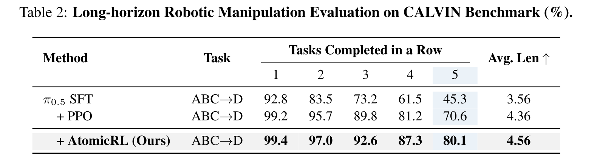

表 2：CALVIN 的连续完成率。五档的差距随序列变长而扩大——单任务只差 0.2 个百分点，五连时差 9.5 个百分点，说明增益确实来自「长链」。

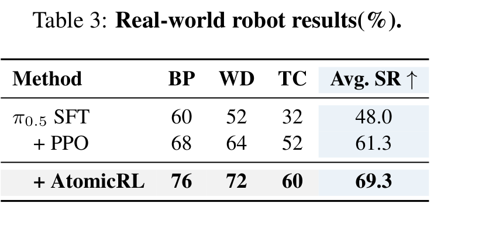

表 3：真机三个任务。BP 是 6 个子任务的面包摆放，WD 是纸巾加玩具车的垃圾处理，TC 是遥控器加零食的桌面整理。TC 全线最低（32/52/60），说明任务本身更难，不是方法偏科。

**训练动态**

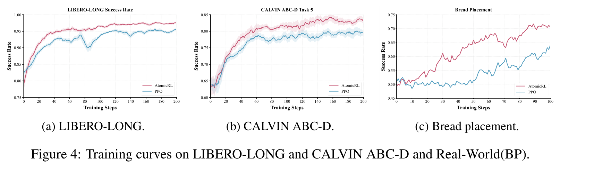

图 4：三条训练曲线。红线起来更快，尤其是 Bread Placement（最右）——前 40 步 PPO 一直在 50% 附近打转，AtomicRL 在第 30 步左右就到 60%。表格里看不出来的两点：LIBERO 面板在第 80 步附近两条线一度收窄，之后才重新拉开；CALVIN 面板在第 15 步附近有一个共同的下凹，说明那一段策略被更新打乱过。

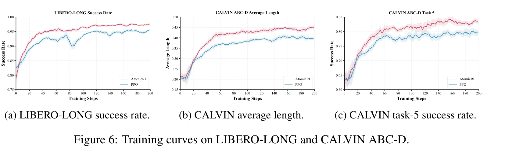

图 6：图 4 的扩展版，三个面板同一形状——早期斜率差最大，后期差距固定在一个稳定水位，说明 SAPO 改善的是样本效率，不是最终收敛点。

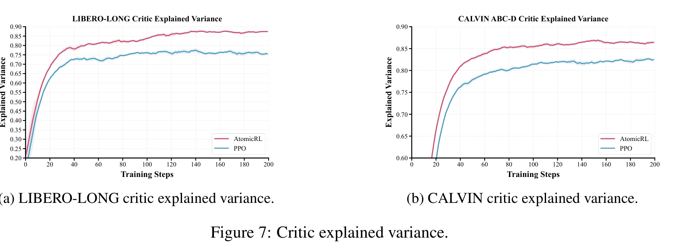

图 7：critic 解释方差。后期 AtomicRL 比 PPO 在 LIBERO 上高约 12%、CALVIN 上高约 5%。这是侧面证据：信用分配更准，价值网络要拟合的目标就更一致。

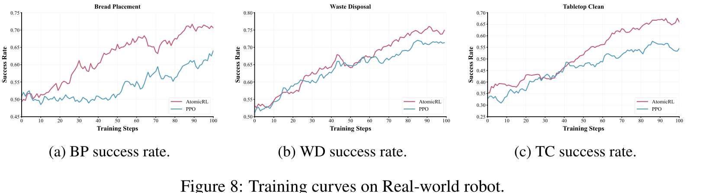

图 8：三个真机任务在 Real2Sim 环境里的训练曲线。同样早期差距最大；TC 的抖动明显比另外两个大，任务越难，单次评估方差越大。

**仿真与真机的一致性**

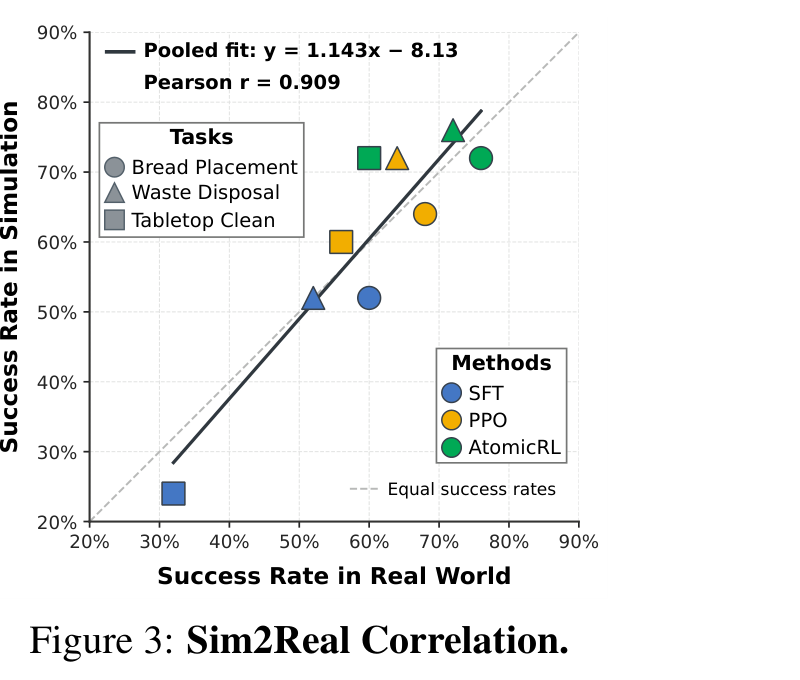

图 3：九个「任务 × 方法」组合的仿真成功率对真机成功率散点。拟合线是 $y=1.143x-8.13$，$r=0.909$。斜率大于 1、截距为负，意思是仿真在低分段偏低、高分段偏高——能用来看趋势，不能把仿真数字直接当真机数字报。

**定性对比**

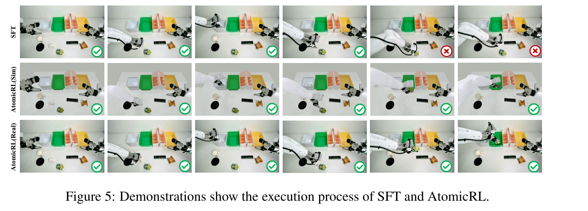

图 5：SFT、AtomicRL（仿真）、AtomicRL（真机）三条执行序列。前两帧三方都对，到第五帧 SFT 开始出错（红叉），AtomicRL 两条序列都能走完全程，而且仿真与真机的动作轨迹基本对齐。

**消融告诉我们什么**

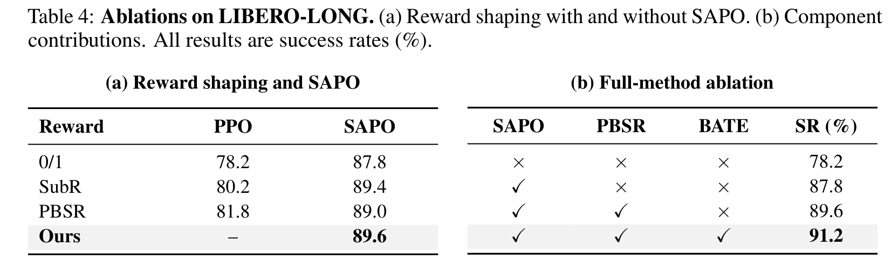

表 4：左表是奖励粒度 × 是否用 SAPO 的二维对照，右表是把 SAPO、PBSR、BATE 逐个加进去。

左表最值得看的一行是 0/1 奖励那一行：同样的稀疏奖励，PPO 78.2、SAPO 87.8，差 9.6 个百分点。这一行直接排除了「SAPO 只是把奖励变密」的解释，因为它压根没改奖励。右侧的组件累加是 78.2 → 87.8 → 89.6 → 91.2，SAPO 拿走 9.6，退火后的 PBSR 拿 1.8，BATE 拿 1.6。

另一件要注意的事：这张消融表的基线是 78.2%，而主表里 PPO 是 95.4%。原文说消融用的是「a weaker SFT checkpoint trained with fewer demonstrations」，也就是初始化更弱的策略。所以消融里的 13.0 个百分点不能和主表的 3.6 直接相加或类比——策略越弱，信用污染越严重，SAPO 的收益越大。

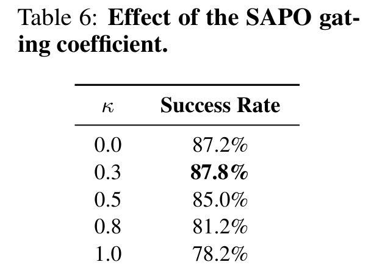

表 6：门控系数 $\kappa$ 的敏感性。$\kappa=1$ 等价于标准 GAE（78.2%），$\kappa=0$ 是硬切断（87.2%），中间最优在 $\kappa=0.3$（87.8%）。曲线是单峰的，而且 0 和 0.3 只差 0.6 个百分点——说明「切多狠」不敏感，「切不切」很敏感。

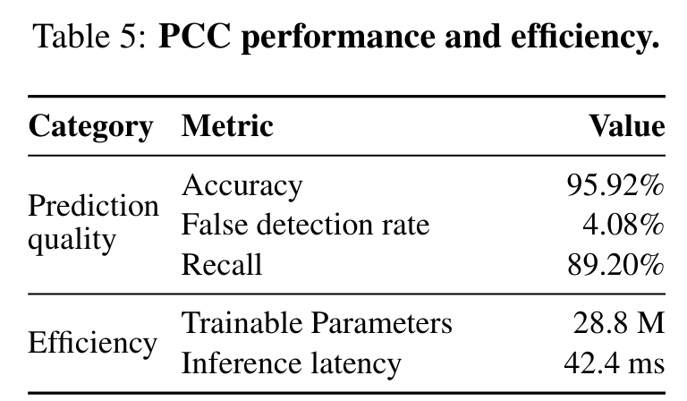

表 5：PCC 的预测质量与开销。准确率 95.92%、漏检率 4.08%、召回 89.20%、可训练参数 28.8M、延迟 42.4 ms。召回明显低于准确率，意味着它倾向于「不轻易判完成」——对一个控制信用传播的门来说，这个偏保守的方向是对的，代价是子任务边界会判得偏晚。

**这些实验够不够支撑结论**

支撑得比较硬的部分：SAPO 相对标准 GAE 的增益在两个骨干、两个基准、真机上方向一致，而且 0/1 奖励那一行的对照排除了奖励变密这个替代解释。

支撑得不够的部分有三处。第一，基线只有 PPO，没有和 STARE-VLA、IG-RFT 这些专门做子任务奖励的方法比，而论文在相关工作里正是拿它们当对手的。第二，LIBERO-LONG 上 99.0% 已经接近天花板，这个基准还留多少区分度不好说，而且没报多次种子或置信区间。第三，消融是在弱初始化上做的，弱初始化下 SAPO 拿 9.6 个百分点，强初始化（95.4 起）只拿 3.6 个百分点，两者的机制解释是同一套，但幅度差 3 倍，说明收益强烈依赖「策略有多差」。

## 6. 局限性

**作者自己承认的**（附录 A.1）：

- 只改善了交互数据的利用效率，没有从根本上解决在线 RL 的训练效率问题，真机场景的交互与探索成本仍然很高。
- 实验集中在桌面长程操作，且 RL 从 SFT 策略起步；更开放、更动态、更要求具身泛化的任务还没测。
- 未来想把原子任务结构搬到 Agentic RL 框架里（提到 HarnessVLA、AtomBridge），让机器人自己动态形成和调整子任务结构。

**我看出来的**：

- **隐形假设一：子任务分解是给定的**。整篇方法建立在「长指令已被切成有序原子子任务 $G=(g_1,\dots,g_K)$」之上，分解从哪来、错了会怎样，正文没讨论。真机任务用 AtomicVLA 的流水线标注再人工修，仿真任务大概率也是人工标的。也就是说，这个方法省下的是信用分配，不是任务分解。
- **隐形假设二：边界判定足够准**。SAPO 的门控、BATE 的掌握度、PBSR 的势函数全都挂在 PCC 上。PCC 召回 89.2%，意味着大约十分之一的完成事件没被认出来；一次漏判会让子任务下标推晚，后面的边界全部错位。论文只报了 PCC 的平均准确率，没有报「PCC 出错时端到端掉多少」的消融。
- **边界条件**：方法的价值随 horizon 增长、随初始策略变强而缩小。主表 3.6–4.0 个百分点的增益是在 SFT 已达 89–95% 的策略上拿到的；如果策略本身只有 50%，增益会不会像消融里那样变成十几个点、还是反过来失效，没有数据。
- **缺的对比**：没和子任务级奖励方法（STARE-VLA、IG-RFT）比；没和 world-model 类方法（WoVR、RISE）比；没报种子方差。
- **口径不一致**：摘要写「absolute performance gains of 3.6% and 4.0%」，表 1 的列名写的是 $\Delta_{\mathrm{PPO}}$ (pp)。3.6 个百分点和 3.6% 相对提升不是一回事，同一个数字在文中两种单位混用。CALVIN 的 9.5 也一样。

## 7. 一句话总结

把「一局失败」拆成「哪一段失败」，只让失败那一段的负分往回传，前面做对的部分照常记账。

类比：公司年终考核不再因为最后一个项目黄了就全员降薪，而是只扣那个项目组的奖金，前面做成的项目照发。

核心公式：

$$
\boxed{\;\hat{A}^{\mathrm{SAPO}}_t=\sum_{\ell=0}^{T-t}(\gamma\lambda)^{\ell}\left[\prod_{j=0}^{\ell-1}\left(1-(1-\kappa_{t+j})\,b_{t+j}\right)\right]\delta_{t+\ell}\;}
$$

它和标准 GAE 只差方括号里那一串乘积。$b$ 全是 0 的时候退化成原式；$b=1$ 且后面成功时 $\kappa=1$，也退化成原式；只有「跨过边界 + 后面失败」才真正打折。

## 8. 可复用点

- 如果我要在自己的项目里用：先确认任务能被切成有序子任务，且每一步能判定「这一段成了没有」。没有这个判定信号，SAPO 用不了。判定器可以是一个小分类器（本文就是 28.8M 的 PCC），也可以是规则或人工标注。
- 实现上只需要改 GAE 的那一行：把 `delta` 的递推系数从 $\gamma\lambda$ 换成 $(\gamma\lambda)\cdot(1-(1-\kappa)b)$，其余 PPO 代码不动。
- 训练不收敛时先查：$\kappa$ 是不是设成了 1（等于没开），或者边界检测是不是漏判导致 $b$ 一直是 0（等于没开）。这两件事的现象一样——曲线和 PPO 重合。
- 采样预算有限时：把 BATE 的 $1-\mu_k$ 记下来，它本身就是一张「哪一段还没学会」的诊断表，不用额外评测。
- 做稠密奖励时：先试常系数，再看退火。本文的教训是稠密奖励在策略变强后会稀释终端信号（表 4(a)：SAPO 下 PBSR 89.0 反而低于 SubR 89.4）。

## 9. 我的疑问

- $\kappa_t$ 的「成功 / 失败」到底取自哪里？取自 PCC 的 $\hat{q}_t$，还是整条任务结束后用终端奖励回填？原文只写「when it fails, we set $0<\kappa_t<1$」，没说这个判定发生在什么时候、用什么信号。这是复现时第一个会卡住的地方。
- 消融的弱初始化具体弱到什么程度？78.2% 对 95.4%，差 17 个百分点，但「fewer demonstrations」少了多少条没写。这决定了 13.0 个百分点该被理解成「方法上限」还是「低数据区间的特例」。
- PCC 每步 42.4 ms，而 VLA 的 action chunk 频率通常在几 Hz 到几十 Hz 之间。论文没说 PCC 是同步跑在控制回路里还是异步补算，这直接影响真机部署的可行性。
- 真机三个任务每个方法只测 25 次，25 次的成功率标准误大约 8 到 10 个百分点。表 3 里 PPO 到 AtomicRL 的差距（8.0）和单任务的差距（BP +8、WD +8、TC +8）都在这个量级附近，虽然三个任务方向一致，但单任务数字不能当精确值看。
- 图 3 的拟合斜率 1.143 意味着仿真系统性高估。如果这 8 个百分点的偏差随任务变化，用仿真曲线去预判真机排名的可靠性会打折扣，而论文只给了一个合并的 $r$。
