> 一句话：把知道结果之后回看哪一步最关键，变成一道用比值就能算完的算术题。

## 0. 读之前你需要知道

**术语卡**

- **强化学习（RL）**：不告诉模型每一步该怎么做，只在最后给一个分数，让它自己试错。生活类比：教小孩骑车，摔了说不许、稳了说对，中间怎么蹬脚从来没人讲。
- **轨迹（rollout）**：让模型在环境里从头跑到尾的一次完整记录，记下每步看到什么、做了什么。长程指一局要走几十步，本文三个环境的轨迹上限都是 $T=50$。类比：一局游戏的回放录像。
- **信用分配（credit assignment）**：一局只有一个总分，要把它拆到每一步头上，决定哪步该奖、哪步该罚。类比：装修队完工，客户只撂一句验收通过或不合格，工头要拿这一句话给十个工人发奖金。
- **优势（advantage）**：这一步比平均水平好多少，正数加强、负数削弱。
- **GRPO**：不训价值网络，同一道题采样一组轨迹，用组内相对名次当优势，一条轨迹里所有步共享同一个数。
- **价值函数（critic）**：额外一个网络，估计从当前状态出发能拿多少分。在 LLM 尺度上训它又贵又抖。
- **后见分布（hindsight distribution）**：在已经知道这局成功的前提下，状态 $s$ 上采取动作 $a$ 的概率，记 $h(a\mid s,G)$。类比：知道球队赢了，再回头统计赢球的比赛里谁传球最多。
- **行为策略（behavior policy）**：产生这批轨迹的旧策略，记作 $q$，训练时它就是上一步的模型权重。
- **重要性比值**：新分布除旧分布，衡量一个动作在两套分布下的相对受宠程度。
- **势函数（potential）**：给每个状态定一个分数，用相邻两步分数之差当这一步的奖励。类比：爬山时每步的海拔升高量。

**它站在谁肩上**

- PPO（2017）：用学出来的 critic 估每步好坏，稳但要多训一个价值网络，稀疏奖励下尤其难训。
- GRPO（2024）：砍掉 critic，一组 8 条轨迹互比，把轨迹总分平摊给每一步。代价是一步做对和一步做错拿到一样的数。
- GiGPO（2025）：把不同轨迹里出现过的相同状态对齐，比较同一状态下不同动作各自导向的结局。本文最直接的前身之一。
- HCA（2019）：提出用后见分布与行为策略的比值分配信用，理论上干净，但要额外学一个后见分布。
- HCAPO（2026）：把 HCA 搬进 LLM，用一次以结果为条件的策略前向近似后见分布。代价是每次训练多跑一遍完整推理。
- GraphGPO（2026）：把一组轨迹拼成图，拿最短路进度当步级奖励。
- Ng 等（1999）：基于势的奖励塑形，说明奖励只要写成势函数之差，最优策略不变。

## 1. 动机

装修队接了单大活，十天干完。客户不给过程打分，只撂一句：验收通过，或者不合格。工头手里就这一句话，可队里十个工人，谁刷墙、谁铺砖、谁接水管，每一步都记在工单上。工头要拿这一句话拆出十份奖金。

**以前怎么做**：最省事是全队平分，通过了人人有奖，不合格人人挨罚。这就是 GRPO，一条轨迹里所有动作共享同一个轨迹级优势。再细一点是看后续证据：同一个房间两个工人做了不同动作，谁后面的活干得更顺就给谁加分，这是 GiGPO；或者在大图上算谁离终点更近，这是 GraphGPO。

**为什么不行**：平分的问题摆在明面上，混在里面的错误动作也跟着领赏。看后续证据的问题是它只朝前看。这单没通过不等于每个工人都干错了，很可能前九步全对，最后一步把水管接反。反过来，通过了的队伍里也可能有人偷偷省了一道工序。图 1(c) 画的就是这件事：失败那条轨迹上被红框圈出的动作，恰恰是后续成功率最高的那一步。

理论上真正干净的办法叫后见信用分配（HCA）：不看后续发生了什么，反过来问一句——在已经知道这单成功的前提下，这个动作出现的概率会不会变大？变大该奖，变小该罚。麻烦在于这个条件概率没有现成算法能算出来。旧办法是额外训一个模型去拟合它，或者像 HCAPO 那样把结果拼进提示词、让策略模型再完整前向一遍。图 1(b) 显示这一遍要多花约 10 秒，是全场最慢的。

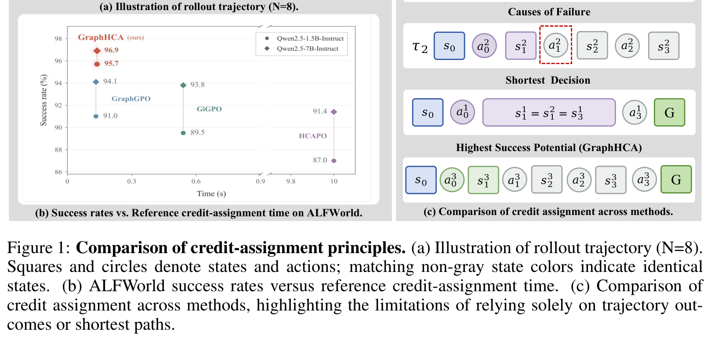

图 1：这张图证明了旧办法的两难。(b) 横轴是算一次步级信用要多久、纵轴是 ALFWorld 成功率：GraphHCA、GraphGPO、GiGPO 都挤在 1 秒以内，HCAPO 因为多跑一遍结果条件前向单独落在 10 秒、成功率还最低，便宜和准在这张图上直接对立。(c) 用三行示意该给哪一步记功：失败轨迹里被红框圈出的动作恰恰是后继成功率最高的那一步，最短路准则会挑中另一条绕开的链路。

**为什么现在能做**：作者发现，在这类只有成功/失败两种结局、且环境每一步都确定性的任务里，这个后见比值根本不用估。用一次贝叶斯公式就能写成闭式，最后只剩两个数相除：后继状态的成功率，除以当前状态的成功率。原文没说为什么以前没人这么写。我的判断是：HCA 的原始形式要求在动作空间上显式建模后见分布，而自然语言动作空间是组合爆炸的，大家默认只能拿模型去近似。

## 2. 贡献

- **后见信用有闭式解**。在结局二值、转移确定的任务上，HCA 的后见比值等于后继状态与当前状态的成功率之比，把一个分布估计问题压成每个状态一个标量。证据：命题 4.1 与式 (7)。
- **不用模型就能在图估出来**。一组轨迹拼成迁移图、合并相同状态，用带折扣的期望回传求不动点，任意有向图（含环）都收敛且唯一，不需要 critic、后见模型或额外前向。证据：命题 4.2 与附录 B.2。
- **三个环境一致提升**。ALFWorld、WebShop、6×6 Sokoban 上，两个 LLM 尺寸加一个 VLM 设定全部最优。ALFWorld 上比 GRPO 高最多 24.6 分，比最强步级基线高最多 4.7 分。证据：表 1、表 2。

## 3. 创新点

- **把估分布换成估标量**。对比对象是 HCA 与 HCAPO。有用是因为动作空间是一整句自然语言，要拟合一个定义在句子上面的分布几乎不可能准；而每个状态一个成功率是个标量，能用采样直接数出来。
- **回传用期望，不用最短路**。对比对象是 GraphGPO 的最短路进度。有用是因为两条路可能一样长，但一条常年塌方、一条畅通。最短路给这两条路同样的分，期望按实际走通频率给分。表 3 把这条区别单独隔离出来验证了。
- **引入传播折扣，让回传在有环图上也有唯一解**。对比对象是朴素的无折扣图回传。有用是因为状态一合并，时间下标就丢了，无折扣回传对绕远路不收费，有环时还可能压根没有唯一解。打折之后回传成了压缩映射，一定有唯一不动点。

## 4. 方法

### 4.1 整体流程

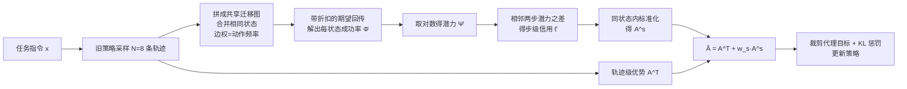

这张图说的是：一条流水线从采样到出梯度，唯一新增的零件是中间那张图和它上面的回传，其余部分和 GRPO 完全一样。

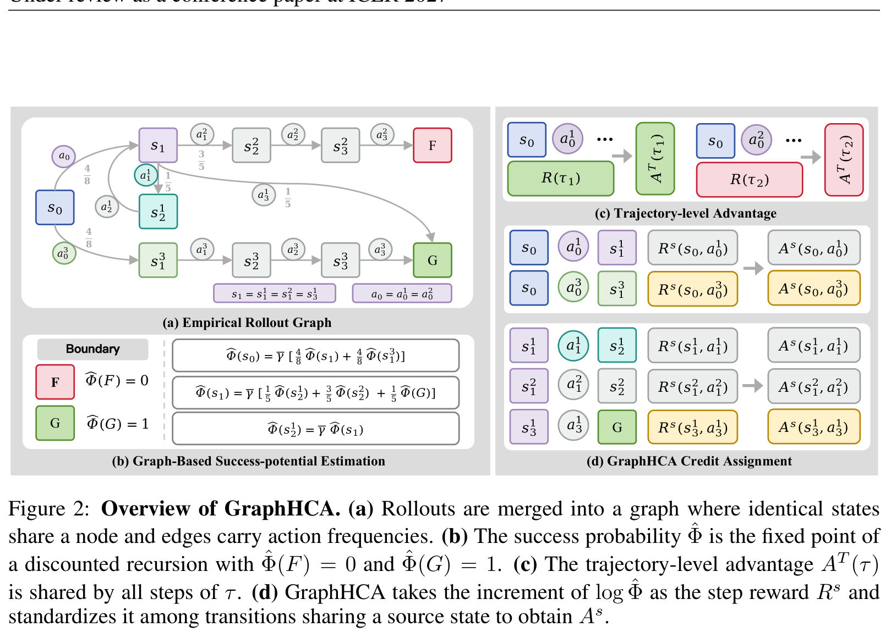

图 2：这张图把流水线画全了。(a) 一组轨迹并成一张图，相同状态只留一个节点，边上标着这条边被走过几次；(b) 在这张图上迭代式 (9) 直到 $\hat\Phi$ 收敛，左边是边界条件、右边是三条回传方程；(c) 轨迹级优势按整条轨迹的成败给，同一轨迹里所有步拿同一个数；(d) 步级信用取 $\log\hat\Phi$ 的增量，再在同一出发状态的动作之间标准化。

### 4.2 模块拆解

#### 4.2.1 从贝叶斯到闭式比值

**为什么需要**：HCA 的信用写在比值 $\rho=h(a\mid s,G)/q(a\mid s)$ 里，$h$ 是后见分布。直接估 $h$ 要在动作空间上建一个模型，这正是本文要绕开的坑。

**怎么做**：先把条件从任意未来状态收到成功事件 $G$ 上，套一次贝叶斯公式；再用确定性转移把动作换成它的唯一后继状态；最后取对数，比值变成两个对数潜力之差。

公式一，后见后验的贝叶斯展开。它算的是：知道成功之后，动作 $a$ 在状态 $s$ 上的概率怎么由普通策略概率和成功率拼出来。

$$
h(a\mid s,G)=q(a\mid s)\,\frac{P(G\mid s,a)}{P(G\mid s)},\qquad P(G\mid s)=\sum_a q(a\mid s)P(G\mid s,a)
$$

- $q(a\mid s)$：旧策略在状态 $s$ 选动作 $a$ 的概率，值域 $[0,1]$，就是采样时用的那个分布。
- $P(G\mid s)$：从状态 $s$ 出发最终落进目标集合的概率，一个标量，值域 $[0,1]$。
- $P(G\mid s,a)$：在 $s$ 先做 $a$ 之后最终成功的概率。

公式二，把动作换成后继状态。它算的是成功率满足的那个边际关系。

$$
\Phi(s)=\sum_a q(a\mid s)\,\Phi(s'_a)=\mathbb{E}_{a\sim q}\big[\Phi(s'_a)\big],\qquad \Phi(s)=1\ (s\in\mathcal{G}),\quad \Phi(s)=0\ (s\in\mathcal{F})
$$

- $\Phi(s)$：状态 $s$ 的成功率，本文叫成功潜力，就是 $P(G\mid s)$。
- $s'_a=f(s,a)$：在确定性转移下，动作 $a$ 唯一确定的后继状态。
- $\mathcal{G}$、$\mathcal{F}$：终点里的成功集合与失败集合。到成功状态成功率是 1，到失败状态是 0。

这一步的关键替换是 $P(G\mid s,a)=\Phi(s'_a)$：转移确定，所以做了动作 $a$ 之后的位置是死的；再加上状态充分性假设（同一个状态不管怎么走到这里、第几步走到，后续成功率都一样），动作的影响完全被后继状态吸收。

公式三，闭式比值。它算的是 HCA 那个比值到底等于什么。

$$
\rho(s,a)=\frac{h(a\mid s,G)}{q(a\mid s)}=\frac{P(G\mid s,a)}{P(G\mid s)}=\frac{\Phi(s'_a)}{\Phi(s)}
$$

- $\rho(s,a)$：动作 $a$ 在成功条件下的相对受宠程度，大于 1 说明它在成功条件下更常见。
- 右边两项都是标量，所以整个比值不需要任何模型，只要知道两个状态的成功率。

取对数就是实际用的步级信用：

$$
\ell(s,a)=\Psi(s'_a)-\Psi(s),\qquad \Psi(s)=\log\max\{\Phi(s),\epsilon\}
$$

- $\Psi(s)$：对数尺度的成功潜力。
- $\epsilon\in(0,1)$：数值地板，默认 $10^{-2}$，只为了防止 $\Phi=0$ 时取对数发散，不改变原来的成功率。
- $\ell(s,a)$：这一步的信用，地板不起作用时严格等于 $\log\rho$。

直觉可以画出来：把每个状态想成山上的一个位置，$\Psi$ 是海拔。这一步的功劳就是海拔升高了多少，走上坡为正，走下坡为负。所有步加起来正好等于终点海拔减起点海拔，即 $\sum_t\ell(s_t,a_t)=\Psi(s_T)-\Psi(s_0)$，中间怎么绕都抵消掉——论文附录 B.1 的式 (29) 写的就是这个望远镜求和。

#### 4.2.2 在图上的折扣递归估计

**为什么需要**：式 (6) 要求对所有动作求期望，可采样只能看到被走到的那些边。一组 8 条轨迹在同一个状态上平均只示范一两个动作，单条轨迹更是只有一个后继，没法直接算期望。

**怎么做**：借鉴 GraphGPO 的做法，把一组轨迹拼成一张共享迁移图，相同环境状态并成一个节点，边上的权重是经验动作频率 $\hat q(a\mid s)=n(s,a)/n(s)$。然后在这张图上迭代一个带折扣的期望回传。

$$
\hat\Phi(s)=\bar\gamma\,\mathbb{E}_{a\sim\hat q}\big[\hat\Phi(s'_a)\big],\qquad \bar\gamma\in(0,1)
$$

- $\hat\Phi(s)$：图上估出来的成功率。
- $\hat q(a\mid s)$：经验动作频率，由访问计数 $n(s,a)/n(s)$ 得到。
- $\bar\gamma$：传播折扣，默认 0.95。注意它不是任务本身的折扣，而是人为加的，用来补回状态合并时丢掉的路程感。
- 边界条件 $\hat\Phi=1$ 在 $\mathcal{G}$ 上、$=0$ 在 $\mathcal{F}$ 上。

为什么非要这个折扣：状态一合并，同一个状态在轨迹里出现三次也只算一个节点，时间下标没了。无折扣回传于是对绕远路不收费——多绕十步到达同一个状态，分数一模一样；有环时甚至可能没有唯一解。取 $\bar\gamma<1$ 之后回传算子是 $\bar\gamma$-压缩，由巴拿赫不动点定理，从任意初值出发都几何收敛到唯一不动点（命题 4.2）。这个不动点有明确含义：在图上按经验策略随机游走，以 $\bar\gamma^{\kappa}$ 折价、在 $\kappa$ 步首次撞上终止集时的期望成功，即 $\hat\Phi(s)=\mathbb{E}_{\hat q}[\bar\gamma^{\kappa}\mathbf{1}\{s_\kappa\in\mathcal{G}\}]$。

因为走一步至少打一次折，内部节点的 $\hat\Phi\le\bar\gamma$，因此 $\hat\Psi\in[\log\epsilon,0]$，步级信用天然有界：

$$
\hat\ell(s,a)=\hat\Psi(s'_a)-\hat\Psi(s)\in\big[-\log(1/\epsilon),\ \log(1/\epsilon)\big]
$$

- $\hat\ell$：图上算出的原始步级信用。$\epsilon=10^{-2}$ 时绝对值不超过约 4.6，不会出现一个离群值把整批梯度带飞。

#### 4.2.3 标准化与组合目标

**为什么需要**：$\hat\ell$ 的绝对值受 $\bar\gamma$、$\epsilon$ 和图深影响，直接当奖励用尺度会漂；而同一状态出发的若干动作天然构成一组可比的候选。

**怎么做**：把 $\hat\ell$ 当这一步的奖励 $R^s$，在同一状态出发的那组迁移 $B_s$ 里做标准化；再和轨迹级优势相加；最后走裁剪代理目标加参考 KL 惩罚。

$$
A^s(s_t,a_t)=\frac{R^s(s_t,a_t)-\mu_{B_{s_t}}}{\sigma_{B_{s_t}}}
$$

- $B_{s_t}$：8 条轨迹里所有从 $s_t$ 出发的迁移构成的组。
- $\mu_{B}$、$\sigma_{B}$：这组奖励的均值与标准差。
- 单元素组和零方差组直接置 0，避免除零。标准化是单调变换，不打乱同一状态下各动作按后继潜力排出来的次序。

$$
\hat A_t=A^T(\tau)+w_s\,A^s(s_t,a_t),\qquad w_s\ge 0
$$

- $A^T(\tau)$：轨迹级优势，就是 GRPO 那个把整条轨迹的回报减均值除标准差，同一条轨迹里所有步共享。$R(\tau)=\mathbf{1}[s_T\in\mathcal{G}]$。
- $w_s$：稠密项权重，默认 1。置 0 时整个方法精确退回 GRPO。

$$
\mathcal{J}(\theta)=\mathbb{E}\Big[\frac{1}{\sum_i T_i}\sum_{i=1}^{N}\sum_t \min\big(\varrho_{i,t}\hat A_{i,t},\ \mathrm{clip}(\varrho_{i,t},1-\varepsilon,1+\varepsilon)\hat A_{i,t}\big)\Big]-\beta\,\mathrm{KL}\big(\pi_\theta\,\|\,\pi_{\mathrm{ref}}\big)
$$

- $\varrho_{i,t}=\pi_\theta(a_{i,t}\mid s_{i,t})/\pi_{\theta_{\mathrm{old}}}(a_{i,t}\mid s_{i,t})$：重要性比值。
- $\varepsilon$：裁剪半径。原文在这里用的也是符号 $\varepsilon$，和数值地板撞了名，只能靠上下文区分。
- $\beta$：KL 惩罚系数。原文未给具体取值。
- $T_i$：第 $i$ 条轨迹的长度，按 token 数取平均。

两个优势项是互补关系而不是替代关系：$A^T$ 把更新锚在任务是否成功上，并且在单元素状态（$A^s=0$）仍然有定义；$A^s$ 在轨迹内部把信用拉开。表 4 把这一条单独验证了。

### 4.3 关键细节

- 三个自有权重：传播折扣 $\bar\gamma=0.95$、数值地板 $\epsilon=1\times10^{-2}$、稠密项权重 $w_s=1$。三个都在附录 D.2 单独扫过，见下一节的表 4 到表 6。
- 其余训练与推理设置和 GRPO 完全一致，见下一节。
- 图上回传的代价可以忽略：图构建 0.028 秒，步级优势计算 0.110 秒，两项加起来占单轮训练时间的 0.062%。

## 5. 实验结果

**实验设置**

- 数据集与切分：ALFWorld 3,827 个任务实例，六个子任务类别（Pick、Clean、Cool、Look、Heat、Pick2）；WebShop 超过 110 万个真实商品页、约 12,000 条人写指令；Sokoban 用 6×6 配置。训练集与测试集怎么切分，原文未给。
- 骨干模型：Qwen2.5-1.5B-Instruct、Qwen2.5-7B-Instruct，视觉侧用 Qwen2.5-VL-3B-Instruct。
- 训练预算：150 个更新步，组大小 8，学习率 $1\times10^{-6}$，1.5B 与 VL-3B 用 4 张 A100 80G、7B 用 8 张 A100 80G。每步用多少个任务、batch 多大，原文未给。
- 基线：prompting 组有 GPT-4o、Gemini-2.5-Pro、原生 Qwen2.5、ReAct、Reflexion；RL 组有 PPO、RLOO、GRPO、EMPG、GiGPO、HCAPO、GraphGPO。其中 GiGPO、HCAPO、GraphGPO 是作者自己加的最近对照，与本文只差步级信用怎么来的。
- 指标：ALFWorld 报成功率；WebShop 报任务分与成功率；Sokoban 报成功率。都是百分数、越高越好，所有 RL 方法跑三个随机种子。
- 推理设置：记忆保留最近两步，`<think>` 后接 `<action>`，轨迹上限 50 步。温度、最大生成长度、每任务评测多少局，原文未给。

| 数据集 / 任务 | 指标 | 本文 | 最强基线 | 提升 |
| --- | --- | --- | --- | --- |
| ALFWorld（1.5B） | 总成功率 | 95.7 | 91.0（GraphGPO） | +4.7 |
| ALFWorld（1.5B） | Look 子任务 | 89.9 | 76.2（EMPG） | +13.7 |
| ALFWorld（7B） | 总成功率 | 96.9 | 94.1（GraphGPO） | +2.8 |
| WebShop（1.5B） | 任务分 | 89.3 | 88.1（GraphGPO） | +1.2 |
| WebShop（1.5B） | 成功率 | 81.3 | 81.3（GraphGPO） | 0.0 |
| WebShop（7B） | 成功率 | 82.4 | 82.0（GraphGPO） | +0.4 |
| Sokoban（VL-3B） | 成功率 | 84.0 | 81.6（GraphGPO） | +2.4 |

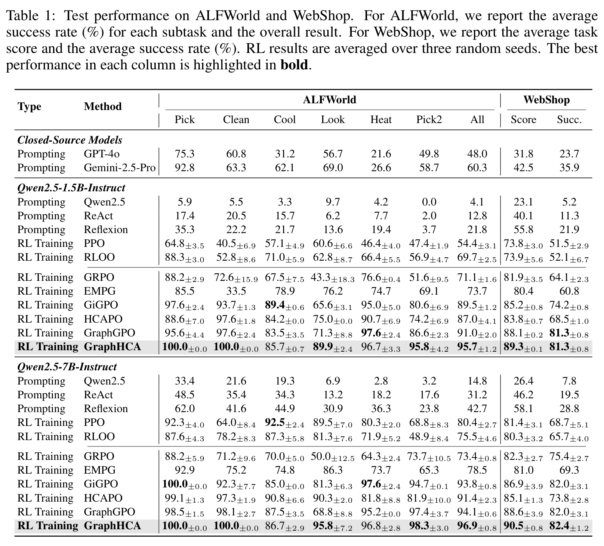

表 1：这张表证明了本文在两个模型尺寸的整体成功率与 WebShop 两项指标上都是最好或并列最好，对最强步级基线的领先 1.5B 是 4.7 分、7B 收窄到 2.8 分——说明增益在，但基座变强会被吃掉一部分。

几个文字表看不出的地方：1.5B 的 Look 子任务上，本文 89.9 对 GraphGPO 的 71.3、GiGPO 的 65.6，差距远大于总分的差距。作者把这一点归因于 Look 与 Pick2 是步数最长的两类任务，信用链条越长，稠密信用越值钱。相反 Cool 与 Heat 这类接近饱和的子任务（基线 80 以上）基本打平，甚至 1.5B 的 Cool 只有 85.7、低于 GiGPO 的 89.4——增益集中在没做满的地方。

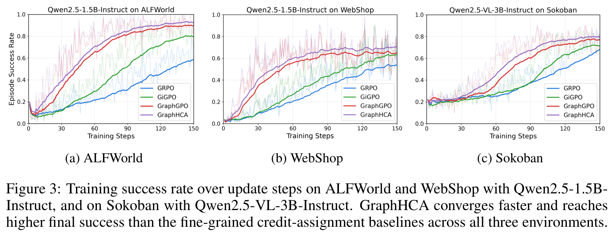

图 3：这张图证明了增益不是终点巧合，而是整条训练曲线都在上面——三条曲线里紫色的 GraphHCA 从早期就领先并最先离开平台期，作者说它达到 GRPO 最终成功率只需要约三分之一的步数。

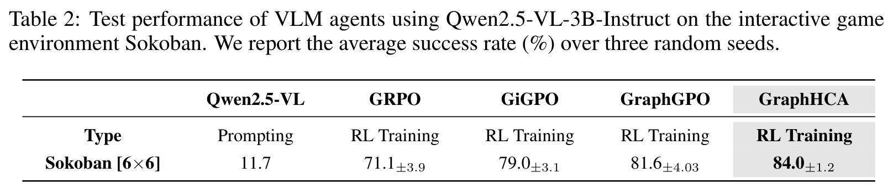

表 2：这张表证明了方法不依赖纯文本观测：把棋盘渲染成图片、换成视觉语言模型之后仍然有效，而且种子间标准差 1.2 是所有 RL 基线里最低的。

Sokoban 上的增益来源在图 3(c) 里看得很清楚：前 20 个更新步四个方法都卡在 0.2 左右的成功率，GraphHCA 第一个跳出去，之后领先幅度一直保持到训练结束。这个环境和文本环境的关键差别是推箱子不可逆，箱子被推到墙角整局就废，所以对早期那一步的信用判断更敏感。

**消融告诉我们什么**

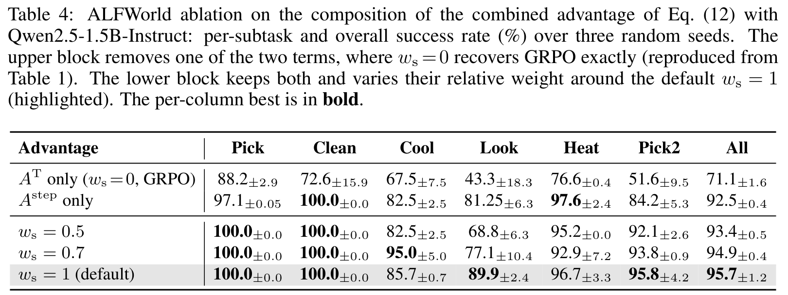

表 4：这张表证明了两项优势是互补而不是互相包含——只留轨迹级（$w_s=0$，即 GRPO）掉到 71.1，只留步级是 92.5，两者都要才是 95.7。

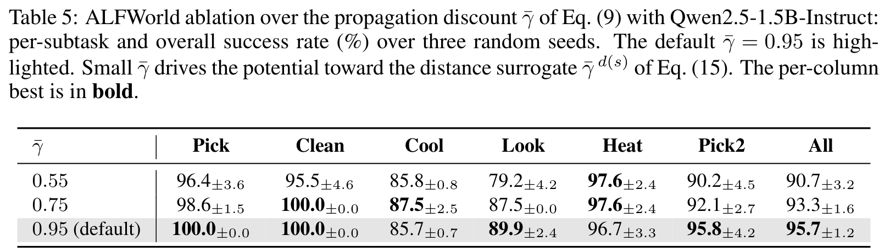

表 5：这张表证明了传播折扣不能太小。$\bar\gamma=0.55$ 只有 90.7，抬到 0.75 是 93.3，0.95 是 95.7。作者的解释是折扣越狠，路程长短越压过成功率差异，短而不可靠的路线会赢过长而可靠的路线。

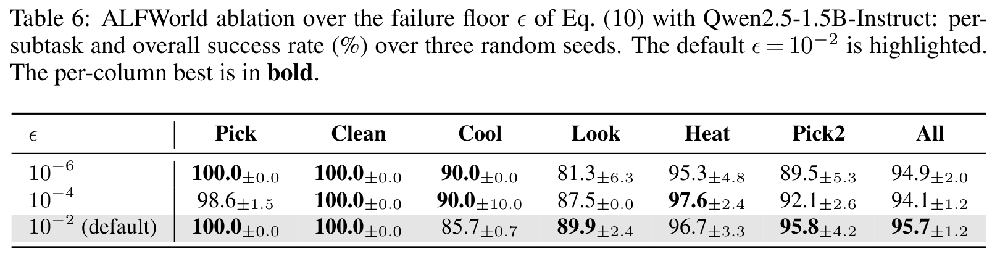

表 6：这张表证明了数值地板基本不敏感，$10^{-6}$ 到 $10^{-2}$ 之间总分只在 94.1 到 95.7 之间晃，幅度和种子方差同量级，说明它只是一个数值保险而不是要调的超参。

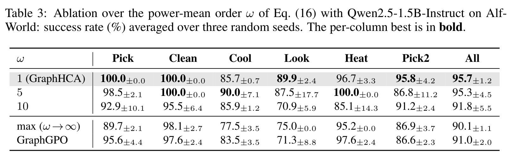

表 3：这张表是全文最关键的一张消融。把式 (9) 里的期望换成幂平均（$\omega=1$ 就是原来的期望，$\omega\to\infty$ 就是取最大），在完全相同的训练管线里观察。分数从 95.7 一路掉到 95.3、91.8、90.1，而纯粹的 GraphGPO 是 91.0——取最大的版本几乎正好落回 GraphGPO 的水平，这就在实验上坐实了命题 4.4 的说法：两种方法的差别就是一次回传用了两种聚合方式。

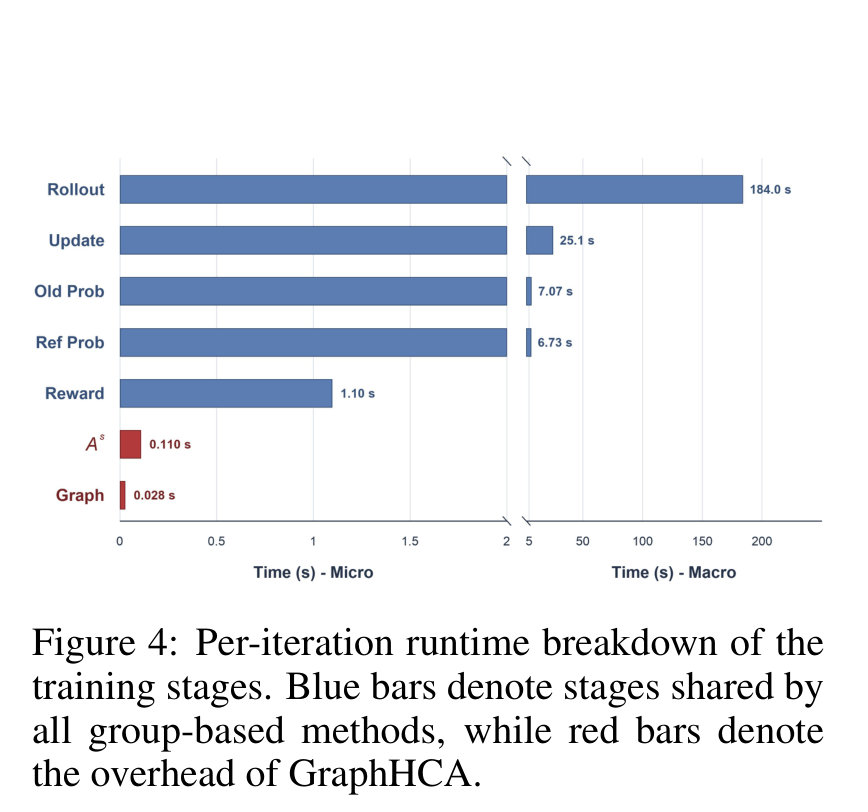

图 4：这张图证明了新增开销可以忽略。蓝色是 GRPO 也要付的钱（采样 184.0 秒、更新 25.1 秒），红色是本文独有的两项（步级优势 0.110 秒、图构建 0.028 秒），红色加起来只占单轮的 0.062%。

**这些实验够不够支撑结论**：支撑闭式解够，支撑普适性不够。三个环境全是确定性转移加二值末端奖励，正好落在推导成立的前提里，没有反例环境。图 1(b) 的时间对比是作者自测，只给相对位置不给测量方法。种子方差在部分格子上很大（1.5B 的 GRPO 在 Clean 上是 $72.6\pm15.9$），单格数字的置信区间并不窄。

## 6. 局限性

**作者自己承认的**：推导要求转移确定、结局二值、状态充分（同一状态后续成功率与历史无关）；传播折扣 $\bar\gamma$ 不是从任务目标里继承的，是人为加的，为了让状态合并后还留一点路程感；$\hat\Phi$ 是把不同历史、不同剩余步数的访问混在一起折价的经验近似，不是真的 $\Phi$。

**我看出来的**：

- 隐形假设：要成立，必须默认状态能干净地判定相等。ALFWorld 的文本观测可以字符串比对，Sokoban 的渲染图却要靠像素级一致才算同一状态，这一步怎么做的原文没写。判定错了，图就拼错，回传全歪。
- 边界条件：只对终端目标任务成立。如果奖励是连续分（WebShop 的任务分），或者转移带随机性（真实网页会变、真实工具会报错），式 (7) 的闭式一步就断。
- 缺的对比：没有和过程奖励模型（PRM）比，也没有和带 critic 的稠密方法在同一算力下比；三种子不足以分辨 1 分以内的差别，而 WebShop 成功率上本文与 GraphGPO 完全打平，这一格实际上没有证据。
- 属于我的推断：原始信用 $\ell$ 是势函数之差，望远镜求和后只剩端点，本身不改变最优策略；但式 (11) 的同状态标准化破坏了这个结构，再叠到 $A^T$ 上已经不是基于势的塑形。另外 $\hat\Phi$ 是旧策略 $q$ 下的成功率，每更新一次就过时一点且没有重要性修正，作者只说这是经验近似，没量化它 150 步的影响。

## 7. 一句话总结

不用请专家估分，只要在记工表上给每个工位算一个通过率，谁让通过率涨得多谁就拿奖金。类比：看完比赛录像再给每个镜头打分，而不是开赛前先请个解说员预测。

核心公式：

$$
\boxed{\rho(s,a)=\frac{h(a\mid s,G)}{q(a\mid s)}=\frac{\Phi(s'_a)}{\Phi(s)},\qquad \ell(s,a)=\log\Phi(s'_a)-\log\Phi(s)}
$$

## 8. 可复用点

- 如果我要在自己的项目里用：先确认环境是不是确定性转移、奖励是不是二值。两条都满足，就把一组 rollout 按观测哈希拼成图，直接套式 (9) 的 $\bar\gamma=0.95$ 回传，别先急着训 critic。
- 状态合并的键要显式设计。文本环境用观测字符串加可交互对象列表，图像环境至少要把渲染分辨率、颜色通道归一化，否则相同状态会被判成不同节点，图会碎成一堆短链。
- 训练不收敛时先查：$\bar\gamma$ 是不是设得太小。表 5 里 0.55 与 0.95 差了 5 分，这一项对应的正是预算里算不出来的东西——绕远路的代价。
- 想省掉额外前向却还想要后见信号的场景（在线 RL、超长 horizon），这套闭式化比 HCAPO 的额外一遍便宜两个数量级。

## 9. 我的疑问

- 状态相等的判定到底怎么做的？Sokoban 的渲染图如果有抗锯齿抖动，像素比对会失效，但论文完全没有交代。
- 图是在一组 8 条轨迹内部拼的，还是跨任务、跨更新步累积的？从算法 1 看是每组内部重建，那么图很小、覆盖很浅，为什么还能估出稳定的 $\hat\Phi$？
- 命题 4.3 说 $\mathbb{E}_q[\ell]=-\mathrm{KL}(q\|h)\le 0$，行为策略下平均信用是负的。那式 (11) 标准化之后为什么还能当正向奖励用？这个负偏置在训练里怎么被吸收，论文没讲。
- 式 (13) 的裁剪半径和式 (10) 的数值地板共用了 $\varepsilon$，表 6 又把 $10^{-2}$ 叫 $\epsilon$，这处符号复用是有意还是笔误？
- $A^T$ 与 $A^s$ 量纲不同——一个是整条轨迹共享的标准化回报，一个是同状态组内标准化的奖励差，两者凭什么尺度可比？$w_s=1$ 是调出来的还是拍的？
