> 一句话：让几小时长任务不再把 GPU 干等，重复轨迹去掉，训练快 1.8 倍还涨点。

## 0. 读之前你需要知道

**术语卡**

- **智能体（agent）**：自己决定下一步动作的程序。生活类比：上门修水管的师傅，看一眼现场再决定先拆哪根。
- **harness（执行外壳）**：包在模型外面、调工具、管上下文、管重试的那层程序，Claude Code 就是。生活类比：装修队的工长，工序和返工都归他管，你只负责出主意。
- **执行 / rollout**：智能体从接任务到交任务的整个过程。生活类比：一次完整的代驾订单。
- **上下文压缩（compaction）**：历史太长时让模型把前面的事写成摘要再继续。生活类比：笔记本写满了，撕几页抄成一页提要贴回首页。
- **组相对优势（group-relative advantage）**：同一个问题采 N 次，用这 N 次的平均分当基准，看某一次比平均好多少。生活类比：16 个厨师做同一道菜，比平均水准高的算功劳。
- **陈旧度（staleness, $d$）**：轨迹被采出来时的策略版本，和它真正参与训练时的版本差几代。生活类比：用上个月的价目表接单，这个月才结算。
- **轨迹树（trajectory tree）**：把一次执行里所有模型调用按共享前缀拼成树，重复的开头只存一份。生活类比：共享目录夹，大家共用的合同只放一份。

**它站在谁肩上**

- HybridFlow / veRL（2025）、ReaL（2025）：rollout 与训练共用一批 GPU 轮流用，也就是 colocate。不够：整池切换，要等最慢的 rollout。
- AReaL（2025）：GPU 静态切成 rollout 池与训练池。不够：比例定死，一边闲着另一边用不上。
- DynaResize、Libra、BiDiRL、TideRL（2026）：都做按需重分 GPU，但面向普通长度 RL，没处理 harness 在跑不能停这个约束。
- ClawGym II（2026）：已把请求重建成共享前缀树、让共享节点只贡献一次梯度。不够：只解决轨迹那一半，调度没动。
- RollPacker、Seer（2026）、APRIL（2025）：专治长尾 rollout。不够：让等待变短，但不改变谁在等谁。

## 1. 动机

一个五人装修队接了三套房。第一套五小时，第二套一小时，第三套四小时。工长规定三套全完工才能去下一个小区。于是第二套做完后，四个人在空房子里站了三小时。

这就是超长任务上的在线强化学习（online RL）。每轮训练要等一批 rollout 全结束才更新权重，一批里最慢的那条能拖几小时。

**以前怎么做**：主流是 colocate，rollout 与训练共用一批 GPU，跑完一批整池切成训练。另一派是 Async，GPU 硬切成两块，一块专跑 rollout，一块专训。

**为什么不行**：NL2RepoBench 上单条 rollout 平均 1.93 小时，一个 query（采 16 条）平均 2.96 小时，9.51% 的 query 超过四小时。超时还让执行扎堆结束：harness 超时率 6.25%，总超时率 0.87%，这些执行常落在同一窄时间窗，推理需求瞬间塌下去。colocate 只能整池干等；Async 的固定切分反过来，训练池等数据、rollout 池排队，两边互看对方闲着。

**为什么现在能做**：一是模型吃得下足够长的上下文，单次执行跨上百次交互、整条生命周期累计处理约 100 万 token（口径把重复上下文也算进去），论文叫 XLong。二是 harness 成熟了，压缩、分派、重试都塞进 Claude Code 这类外壳，而这外壳闭源且快速迭代，没法在 RL 框架里重写，只能当黑盒接。于是执行不再是直线，而是一棵分叉的树。

这两点决定了设计：调度要在不打断 harness 的前提下换 GPU 角色，数据要从一棵树上切出有界样本。

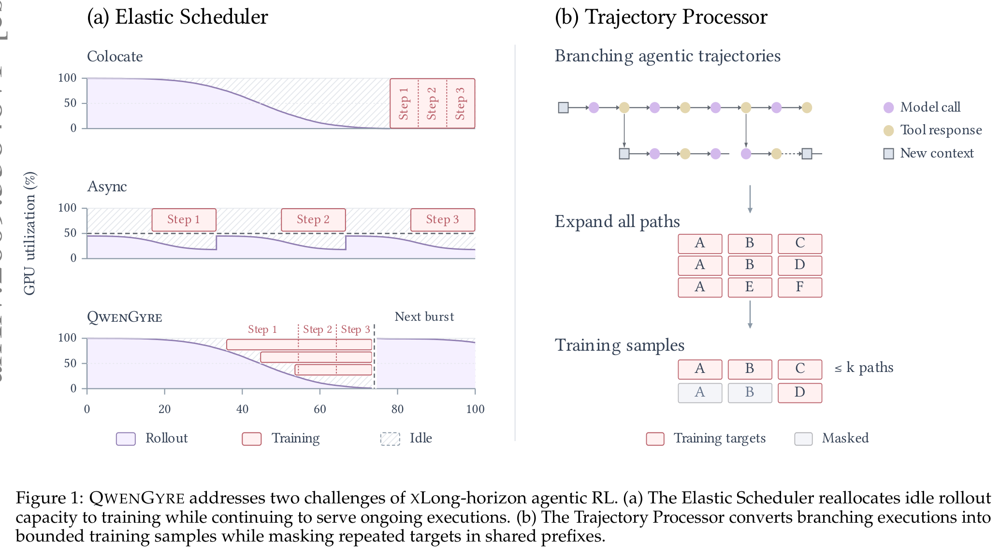

图 1：这张图证明了两个瓶颈同形——左侧三种调度的利用率曲线上，colocate 的斜纹空转最大，Async 有两条永不相交的固定边界，QWENGYRE 把空转压成训练块之间的缝；右侧说明全路径展开会把 A、B 两个共享前缀重复三遍。

## 2. 贡献

- **把 XLong 的两个瓶颈讲清楚**。证据：第 2 节拆成调度（rollout 方差与空转）与数据（分叉与训练开销）两条线，给出小时级时长、上百次交互、约 100 万 token 三个量化口径。
- **不停 harness 就能换角色**。证据：Figure 6 里前三个 burst 中 8 个单元在不同时刻进训练，7 号整段留在 rollout；切换耗时 8.52 秒与 3.46 秒。
- **把分叉执行变成有界样本**。证据：案例 f3ad38e5 的 10 条轨迹展开是 1,716 个节点出现次数，共享节点 1,347 个，多出的 369 个是重复前缀；上限 5 时训练分数与全收持平，前向反向时间降到 74.8%。
- **2.4T 上跑通并涨点**。证据：NL2RepoBench 48 步 passrate 从 52.48% 到 58.54%，总耗时 75.42 小时，对比 Async 134.55、Colocate 91.47。
- **加速在三个任务上一致**。证据：Table 2 给出 DeepSWE 与 TerminalBench 上 24 步 1.383 到 1.849 倍。

## 3. 创新点

- **三种生命周期拆开**。harness 执行、GPU 角色、训练样本的生命周期不再绑定。对比 colocate：它把三者边界压在「一批 rollout 结束」这一刻。有用因为只要模型请求还能被代理接住，GPU 随时能改身份。
- **用水位而非配额决定谁去训练**。把排队加运行中的执行数记成 rollout 水位，水位降到剩余容量兜得住才让下一个单元转训练。对比 Async 的静态配额、Libra 的全局规划器。有用因为判据来自不许打断执行这条硬约束，不是经验比例。
- **卫星单元中途加入当前 batch**。核心单元持权威权重与优化器状态，卫星拉一次快照就能算梯度。对比常规数据并行要求所有 rank 从头一起开始。有用因为 GPU 是一个一个释放的。
- **共享前缀只算一次损失**。选中轨迹在树上按根到叶掩码，算过的 token 不再进损失。对比全展开（重算前缀）与只取主轨迹（丢子智能体信号）。有用因为前缀能占大头。
- **区分「没评上分」与「0 分」**。评估器失败则剔除，真 0 分仍可训练。对比把缺失奖励填 0：填 0 会把基础设施故障变成错误梯度。

## 4. 方法

### 4.1 整体流程

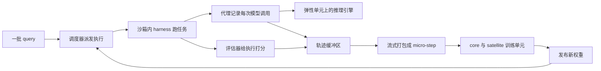

左边是任务在跑，右边是权重在更新，中间靠缓冲区与代理解耦，所以两边能同时转。

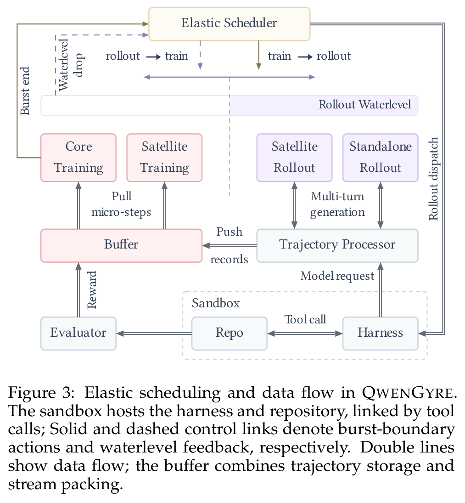

图 3：这张图证明了控制流与数据流分离——调度器只发 rollout→train 与 train→rollout 两条命令、收虚线水位反馈，执行记录必须走 Buffer 才进训练，换角色不必动 harness 一行代码。

层级三连：一个 burst 是 $\mu$ 个训练步，一步吃 $B$ 个 query 组，一个 query 采 $N$ 条执行，一条执行切出 $J_i$ 条轨迹。

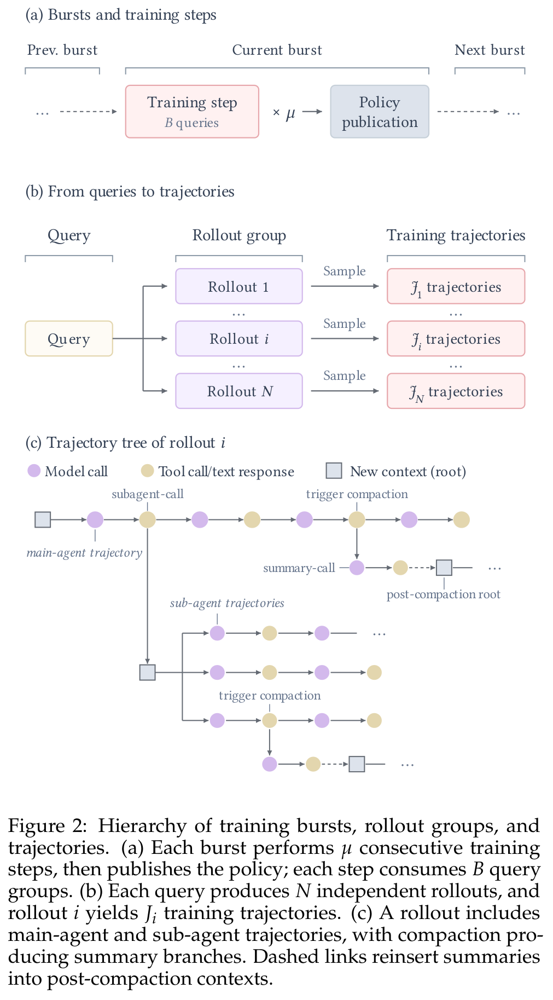

图 2：这张图证明了计数单位逐层放大——$J_i$ 随执行而变，这正是后面必须做执行级归一化的原因。

### 4.2 模块拆解

#### 4.2.1 弹性调度器：解决 GPU 空转

**为什么需要**：rollout 时长有长尾，而 harness 无法挂起或存档。GPU 一旦划给训练，正在跑的 harness 下次请求就没人接，任务超时，奖励作废。所以既不能整池切换，也不能切死。

**怎么做**：GPU 组织成 $K$ 个弹性单元，每个单元共享同一套训练并行布局，既能当 rollout 引擎也可装一份训练副本。0 号是 core，持权威权重、独占优化器状态；1 到 $K-1$ 号是 satellite，只拉快照算梯度。另可留一个独立 rollout 池。

**公式一：还剩多少 rollout 容量**

$$
C_R(t) = C_s + \left(K - k(t)\right) C_e
$$

- $C_e$：单元在 rollout 模式下的并发执行数。
- $C_s$：独立 rollout 池并发数，没有则为 0。
- $k(t)$：被划去训练的单元数。
- $C_R(t)$：当前总容量，$k$ 越大它越小。

**公式二：还能再放几批执行进去**

$$
\text{launch} = \min\left\{ d(t) - p(t),\ C_R(t) - \left(p(t) - f(t)\right) \right\}
$$

- $d(t)$：累计派发；$p(t)$：累计启动；$f(t)$：累计结束（完成、失败、超时、取消各算一次）。
- $d-p$：队列中排队数；$p-f$：正在跑数。
- 取 min 就是「队列空了或容量满了」就停手。

**公式三：什么时候允许下一个单元转训练**

$$
w(t) \le C_R(t) - C_e
$$

- $w(t) = d(t) - f(t)$：水位，排队加在跑的总数。
- 字面意思：把下一个单元也拿去训练后，剩下的 rollout 容量还得兜住所有没跑完的执行，兜不住不许转。

另配一个供给检查：就绪未分配的 query 组要连续 $\tau$ 时间覆盖当前 batch 至少 $\rho_{\min}$，才允许切换，免得训练单元刚过去就没数据。

**公式四：burst 结束后 core 留不留在训练**

$$
w(t) + \mu N B \le C_s + (K-1) C_e
$$

- $\mu N B$：下一 burst 要派发的执行数。
- 右边是把 core 算进训练后剩下的全部 rollout 容量。不满足就让 core 回 rollout，把参数重新切进本地推理引擎。宁可少一个训练单元，也不让下一批执行排不上队。

#### 4.2.2 换角色时正在跑的执行怎么办

最容易翻车的地方。生活类比：手术做到一半换手术室，病人不能抬走，只能搬设备。

- **请求改路由**：关掉源单元入口，预留目的容量，改路由，取消源引擎未完成请求，在目的引擎重试。目的端优先独立 rollout 池，其次按单元序号从大到小——序号大的更可能一直留在 rollout，减少同一执行在一个 burst 内被反复搬家。
- **KV 缓存迁移**：取消前源端钉住缓存块，取消后不再写，目的端走 RDMA 直读，确认接管后源端才释放，省掉前缀重算。
- **角色状态管理**：卸载 rollout 参数、释放 KV 与临时缓冲，装回训练参数；后端进程与通信组不销毁。

切换耗时 8.52 秒（rollout→训练）与 3.46 秒（训练→rollout），相对几小时的执行可忽略。

#### 4.2.3 流式训练：让新单元半路加入

**为什么需要**：单元一个一个空出来。若每个单元都要等下一 batch 从头开始，半路释放的算力只能干等。

**怎么做**：core 转进训练时以及每个后续 step 前，通过 Mooncake 传输引擎把权威权重暴露成可拉缓冲；satellite 注册后走 RDMA 拉快照，立刻在同一 batch 上算。梯度累积期间权重不变，后加入者读到同一快照；控制器在更新前关闭加入窗口。整批算完后 core 汇总归一化所有单元的梯度，裁剪一次、更新一次，再把新参数广播给当前 satellite。

数据侧两个缓冲：轨迹缓冲按 query 组存执行记录与奖励；打包缓冲按需把就绪组展开成 token 行并重排，吐出很小的 micro-step，各单元从共享队列原子领取，谁有空谁多领，整批在接近的时间结束。每个单元用连续 1F1B 流水线，断供时各 stage 在一致调度点暂停。代价是每 batch 付一次启动与一次排空。

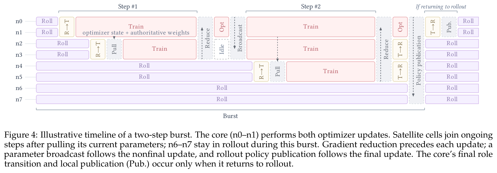

图 4：这张图证明了半路加入可行——n2、n3 在 Step #1 中途拉完参数才进训练，n4、n5 到 Step #2 才加入，n6、n7 整个 burst 留在 rollout，core（n0–n1）独自做了两次优化器更新。

#### 4.2.4 轨迹处理器：解决轨迹冗余

**为什么需要**：XLong 执行不是一条线。harness 压缩上下文（压缩后从新根继续）、派子智能体（独立系统提示与独立根）、重试失败路径，把一个任务变成一张图。全展开会重复训练共享前缀，只取主轨迹又丢掉子智能体与摘要分支的信号。

**第一步，原样记账（TITO，token-in token-out）**。记下精确的输入输出 token id、输出 token 的行为对数概率、元数据。为跨过 harness 的消息重排，按 call id 缓存原始工具调用负载，匹配历史时先还原。这样即使那段历史后来被压缩掉，这条输出仍带着当时的原始条件上下文。

**第二步，拼树**。每条请求记录一个节点，存增量输入、输出、元数据。新请求用序列化上下文在树上匹配已有路径，命中部分复用 token，只编码新增内容；分叉开新枝，完全对不上的挂根。候选轨迹在共享表示里待到被选中，不做全历史展开。

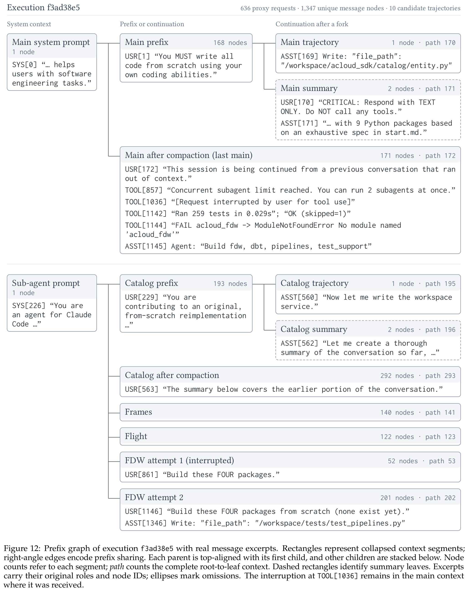

图 12：这张图证明了冗余是结构性的——同一条执行里主智能体压缩过一次、catalog 子智能体压缩过一次、FDW 任务试了两次，10 条完整路径展开是 1,716 个节点出现次数，共享节点只有 1,347 个，多出的 369 个全是重复前缀。

**第三步，部分进度也打分**。执行结束（含超时结束）后，评估器对保留的工作区按任务评分规则打分，返回分数、有效性状态与被评状态引用；奖励不从时长、轨迹长度或终止状态推导。评估器失败导致的「无评估」则剔除，真 0 分仍可训练；什么都没留下（如镜像拉取失败）时插入一条 0 奖励哑轨迹占位。

**第四步，有界采样加去重掩码**。候选轨迹是树的叶子，按终止请求角色分四类，优先级：

$$
\text{main} > \text{main-summary} > \text{sub-agent} > \text{sub-agent-summary}
$$

- main：主智能体推进任务的轨迹，任务级奖励最直接记在它头上。
- main-summary：主智能体写摘要腾上下文的那条，管上下文而非推进任务。
- sub-agent：子智能体推进子任务的轨迹，只能经被分派子任务间接贡献。
- sub-agent-summary：子智能体的摘要轨迹，排最后。

采样一轮一轮抽：每轮取仍有未掩码可训练 token 的最高优先级类，按剩余 token 数成比例抽一个叶子；抽中后固定这条根到叶路径的目标，再掩掉整条路径，保证前缀不被训练两次；下轮用更新后的计数重新加权。抽到无可训练 token 或满 $J_{\max}$ 为止，默认 5。

哪些 token 可训练由来源决定：只有 rollout 期间策略自己产出的才算目标。系统提示、用户提示、工具返回、harness 注入的 assistant 内容，保留为条件上下文但掩码，不进损失。

**第五步，执行级归一化**。

$$
L_i(\theta) = \frac{1}{L_i}\sum_{u \in T_i} \ell_u(\theta),\qquad
\mathcal{L}(\theta) = \frac{1}{BN}\sum_{q=1}^{B}\sum_{k=1}^{N} L_{i(q,k)}(\theta)
$$

先说它在算什么：把一条执行的所有可训练 token 平摊，再对 batch 里 $B$ 个 query 乘 $N$ 条执行求平均。

- $\ell_u(\theta)$：单 token 损失，带重要性权重与裁剪，上界 100。
- $L_i=|T_i|$：这条执行计入损失的 token 数，已去重。
- $B$：一个训练步的 query 组数（NL2RepoBench 32，另两个 48）。
- $N$：每 query 的执行数，全文固定 16。
- $i(q,k)$：第 $q$ 个 query 的第 $k$ 条执行。

重点在 $1/L_i$。平坦平均下，切出 5 条轨迹的执行的权重是切出 1 条的 5 倍；一条执行内部，几条短辅助路径加起来也可能压过长的主路径。改成先按执行内 token 数摊平、再按执行数平均，无论贡献几条轨迹，总权重固定。

### 4.3 关键细节

- **后端**：Megatron 训练，SGLang rollout。
- **算法**：作者改过的 GSPO，token 级重要性权重加执行级裁剪。重要性权重上限 5，序列比裁剪区间 $[0.995, 1.005]$。序列比 $s_i(\theta)=\mathrm{sg}\left[\exp\left(\frac{1}{L_i}\sum_{u\in T_i}\log\rho_u(\theta)\right)\right]$ 只在 $\hat A_i>0$ 且 $s_i>1.005$、或 $\hat A_i<0$ 且 $s_i<0.995$ 时把整条执行掩成 0，其余不裁。
- **优化器**：Adam，常数学习率 $10^{-6}$，$\beta_1=0.9$，$\beta_2=0.95$，$\epsilon=10^{-15}$，权重衰减 0.01，梯度裁剪范数 1.0，KL 与熵正则全关。
- **burst**：$\mu$ 步一 burst，末尾发布权重。$\mu$ 越大越省发布开销，但陈旧度越高。
- **陈旧度换算式**：$\mathbb{E}[d]=\varphi+\frac{\mu-1}{2}$。所以 $\mathbb{E}[d]=1.5$ 时，$(\mu,\varphi)$ 上 Async 取 $(1,1.5)$、Colocate 取 $(4,0)$、QWENGYRE 取 $(3,0.5)$。三个基线能公平比较全靠这一步。

## 5. 实验结果

**实验设置**

- **数据集与切分**：NL2RepoBench（从规格从零建仓库）、DeepSWE（在已有仓库做软件工程）、TerminalBench（多轮终端任务）。训练数据作者内部构造，评测按各 benchmark 协议。训练集与评测集是否重叠、是否剔除子集，原文未给。
- **骨干模型**：Qwen 3.6 122B 跑三个任务，Qwen 3.8 2.4T 只在 NL2RepoBench 上跑。
- **训练预算**：122B 的 NL2RepoBench 用 32 节点，默认 8 单元 × 4 节点，每单元并发 144；单元粒度消融在同一预算下改 4 单元 × 8 节点。DeepSWE 与 TerminalBench 用 24 节点、6 单元，每单元并发 192。2.4T 用 4 单元 × 48 节点，总并发 384。默认无独立 rollout 节点。NL2RepoBench 跑 48 步，另两个 24 步。卡型号与总样本数原文未给。
- **基线**：Async（固定切分，边界派发，发布后补位）与 Colocate（共享池整体切换，一次切过去连跑一个 burst）。两者都是作者按同一接口重新实现的对照，用相同 GPU 预算与匹配的 $\mathbb{E}[d]$ 比。
- **指标**：passrate、训练分数 train score、累计加速比（累计基线耗时 ÷ 累计本方法耗时）。加速比口径为同一硬件预算、同一陈旧度。
- **推理设置**：rollout 与评测都用 Claude Code 2.1.220 在容器里跑 shell 与改文件；NL2RepoBench 训练期用独立的 Qwen 3.7-Max 评估器配独立编写的测试，DeepSWE 用仓库自带测试，TerminalBench 用任务专属验证器。采样温度、top-p、单次 rollout 的 token 上限原文未给（摘要提到 2.4T 上每次 rollout 约 700K token）；passrate 是单次采样还是多次平均，原文未给。

**主表**

| 数据集 / 任务 | 指标 | 本文 | 最强基线 | 提升 |
| --- | --- | --- | --- | --- |
| NL2RepoBench（122B，$\mathbb{E}[d]=1$，48 步） | 累计加速 vs Async | 1.528× | 1.000× | +52.8% |
| NL2RepoBench（122B，$\mathbb{E}[d]=1$，48 步） | 累计加速 vs Colocate | 1.361× | 1.000× | +36.1% |
| NL2RepoBench（2.4T，48 步） | 总耗时 | 75.42 h | 91.47 h（Colocate） | 快 1.21× |
| NL2RepoBench（2.4T，48 步） | 总耗时 | 75.42 h | 134.55 h（Async） | 快 1.78× |
| NL2RepoBench（2.4T，48 步） | passrate | 58.54% | 52.48%（训练起点） | +6.06 pt |
| DeepSWE（122B，$\mathbb{E}[d]=1.5$，24 步） | 累计加速 vs Colocate | 1.824× | 1.000× | +82.4% |
| TerminalBench（122B，$\mathbb{E}[d]=1.5$，24 步） | 累计加速 vs Colocate | 1.849× | 1.000× | +84.9% |

**原文实验图**

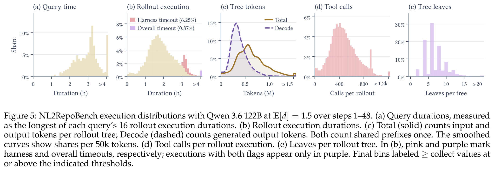

图 5：这张图证明了长尾和扎堆是真的——(a) 右端四小时以上的尖峰就是长尾；(b) 超时标记全挤在 3 小时后的尾部，拖慢批次的就这一小撮；(c) 总 token 曲线比 decode 更宽更靠右，两者之差就是重复上下文。

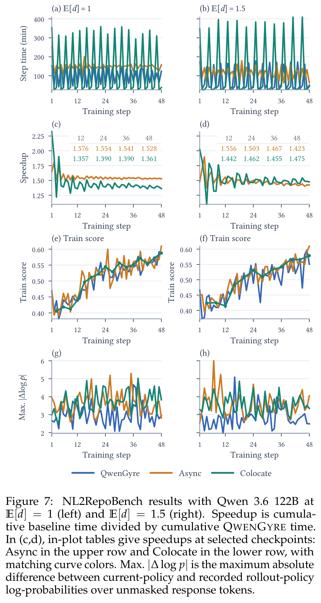

图 7：这张图证明了快得不吃亏——(a)(b) 三条线节奏一致而绿线（Colocate）峰最高，说明它每步都在整池等；(c)(d) 加速比在第 12 步前冲高再回落稳定，收益不是开局假象；(e)(f) 训练分数曲线互相穿插、终点几乎重合。

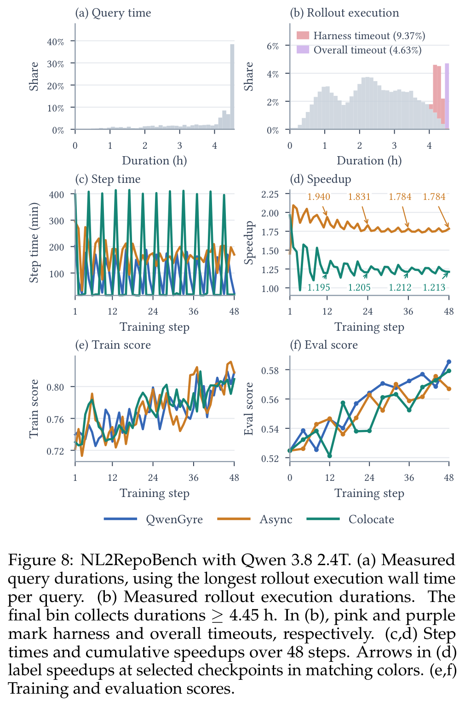

图 8：这张图证明了模型越大长尾越狠、弹性调度越值钱——(a) 在 4 小时处立起 40% 的柱子，远高于 122B；(d) 对 Async 的曲线从 1.940 缓慢衰减到 1.784，说明开局优势会随执行扎堆结束而收窄；(f) 评测曲线三条在 24 步前分不出高下。

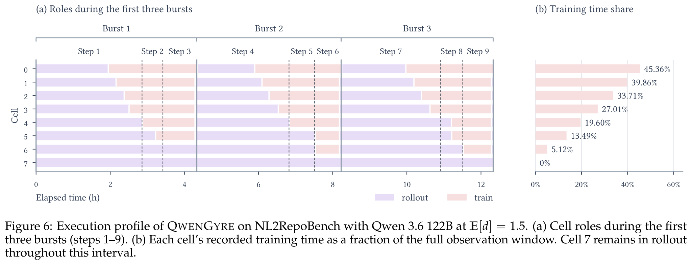

图 6：这张图证明了换角色是错峰的——(a) 0 号单元在第 1 个 burst 就进训练，7 号整段留在 rollout，中间几号依次后移；(b) 训练时间占比从 45.36% 降到 5.12% 再归零，正是越靠后的单元越晚被释放的读数。

**原文实验表**

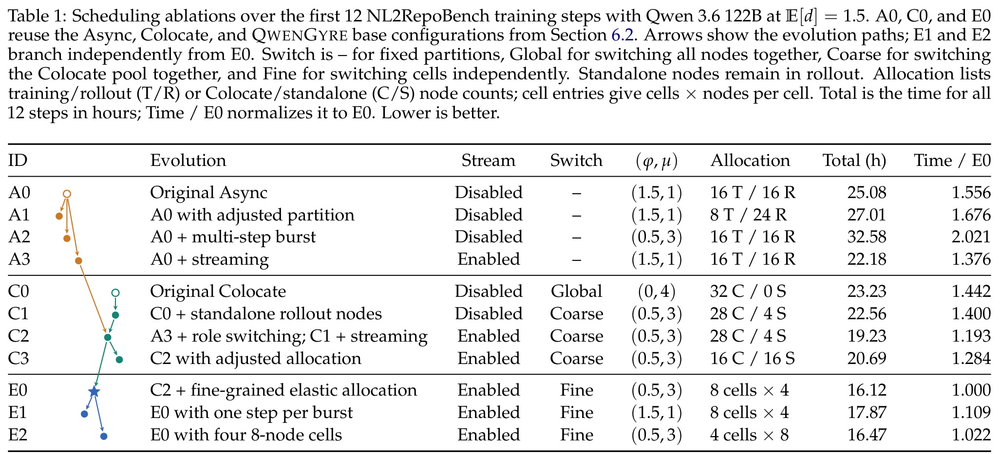

表 1：这张表证明了两条腿缺一不可——给 Async 单独加流式（A3）只省 11.6%，给 Colocate 单独加独立 rollout 节点（C1）只省 2.9%，凑齐再细到 8 个可独立切换的 4 节点单元（E0）才走到 1.000；E2 把 8 个单元并成 4 个只慢 2.2%，说明这个预算下单元粒度不敏感。

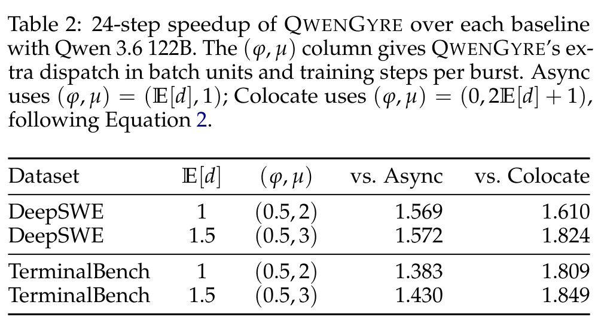

表 2：这张表证明了加速不是单一任务独有——DeepSWE 与 TerminalBench 的加速随陈旧度上升（对 Colocate 由 1.610 到 1.824、由 1.809 到 1.849），而 TerminalBench 对 Async 只有 1.383 到 1.430，是所有格子里最弱的一档。

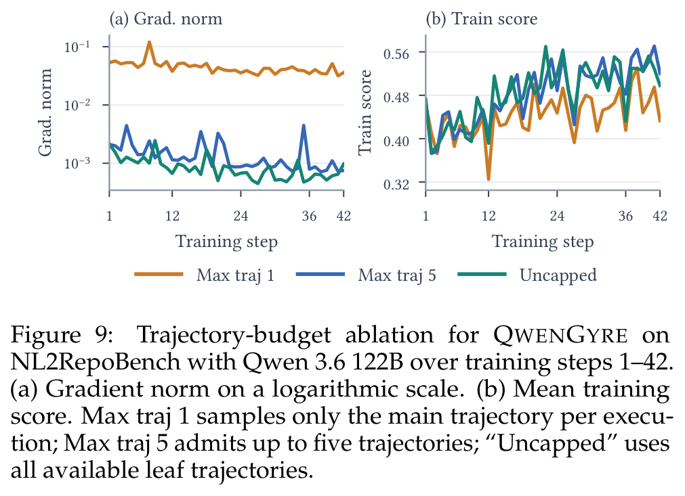

图 9：这张图证明了轨迹上限 5 是有效取舍——(a) 只取主轨迹（橙）的梯度范数比另两条高一个数量级以上，信号确实不够；(b) 橙线明显更低更抖，而蓝（上限 5）与绿（全收）几乎重合。

**消融告诉我们什么**

- 调度收益不是单点技巧。Table 1 的两条路径说明流式与细粒度各拿一半，合起来才从 1.442 倍走到 1.000。A1 更反直觉：单纯把节点从训练挪给 rollout 会慢 7.7%。
- 单步 burst 依然可用：E1 比 E0 慢 10.9%，但仍比用流式的 Async（A3）快 1.24 倍，多步 burst 只是加成。

**这些实验够不够支撑结论**

加速这一半支撑得硬：三个任务、两个规模、两个陈旧度、11 个配置的调度消融互相印证。

训练质量这一半偏弱。论文说「匹配基线训练分数」，但训练分数曲线只有单条、没有种子与误差棒；passrate 只报了 2.4T 一条曲线，122B 的提升幅度没报。两个方法都是作者自己实现的，加速比分母里混着实现成熟度差异，论文没拆开。

## 6. 局限性

**作者自己承认的**

- GPU 预算与单元粒度：弹性调度要求多个能独立切换的单元，每个还要装得下模型与训练并行，预算很小时撑不起来。作者只在 32 节点这一档比了 8×4 与 4×8，更小的总预算没测。
- 流式训练与全局打乱冲突：$\mu>1$ 时数据增量分配给连续几步，没法在 burst 前全局打乱；要打乱就得等整个 burst 数据齐了才第一步更新，牺牲重叠。作者用单步 burst 作替代，但样本顺序对学习质量的影响没有隔离。

**我看出来的**

- 隐形假设：默认 harness 的每次模型调用都能被透明代理截住并原样重放，且不因请求重试改变行为。这对 Claude Code 成立，对会在客户端做重试预算、幂等校验或本地缓存的外壳不一定。
- 隐形假设二：默认任务级奖励可通过评估保留的工作区得到，且部分进度可评。像代码写完但没提交这种状态能否评、评得准不准取决于评测器，论文没给准确性校验。
- 边界条件：收益来自 rollout 有长尾且训练比 rollout 短。任务都短、或训练一步比一批 rollout 还慢时，弹性调度没有空间，论文没给「何时该用」的判据。
- 边界条件二：角色优先级硬编码自 Claude Code 的四类。换成树搜索型或辩论型 harness，这个顺序没有依据。
- 缺的对比：没和 RollPacker、Seer、APRIL 这类专治长尾的系统比，也没和 ClawGym II 比。

## 7. 一句话总结

它把超长任务的训练拆成两笔账：GPU 别再干等，按水位动态换角色；轨迹别再重复，树上按角色有界采样、共享前缀只算一次。生活类比：餐厅按客流随时后厨前厅调人，还把几桌重复点的同一道菜合并成一份做。

核心公式（论文用来保证三个基线可比的记账式）：

$$
\boxed{\mathbb{E}[d] = \varphi + \frac{\mu - 1}{2}}
$$

先说它在算什么：边界派发下，一个 rollout 组从被派发到被训练消费，平均落后几个策略版本。

- $d$：调度陈旧度，单位是策略版本即训练步。
- $\varphi$：多派发的组数，以 $B$ 为单位，给长尾留缓冲。
- $\mu$：一个 burst 的训练步数。
- $\frac{\mu-1}{2}$：burst 内各步位置的平均落后量，从 0 编号。

价值在反解：三个方法要在同一陈旧度上比，就得配不同 $(\varphi,\mu)$；不做这步，加速比没有可比性。

## 8. 可复用点

- 在自己项目里用：先测两个数——执行时长分布、训练步时长。只有 rollout 的 P95 明显大于训练步、且执行真有长尾时，弹性调度才值得做。
- 在自己项目里用：先做轨迹树与来源掩码，再做调度。轨迹树收益是确定的（案例里 369/1,716 的直接冗余），调度收益依赖负载形状。
- 训练不收敛时先查：共享前缀是否被重复计损失。算同一条执行里选中轨迹总 token 数与去重后 token 数之比，偏离 1 太多就是有重复。
- 训练不收敛时先查：执行级权重是否均衡。列出每个执行贡献的损失权重，有执行是别人好几倍就是平坦平均没改。
- 想加弹性调度时先查：harness 能不能在不改逻辑的前提下被代理拦请求。不能就先别做，剩下的只有整池切换。

## 9. 我的疑问

- 摘要写对 Async 加速 1.38 到 1.78 倍，正文 6.2 节写 1.42 到 1.53 倍，Figure 7 图内表格是 1.528 / 1.423 这类数。三处口径不完全一致，摘要的 1.78 倍对应哪个任务原文没说清。我推断是 2.4T 那一档，属推断。
- 训练分数匹配基线只有一条曲线，没有多种子。Figure 8(e) 里三条线在 24 到 36 步之间互相穿插，这个区间的差异是否显著，原文没给统计。
- 2.4T 只有 NL2RepoBench 一个任务，另两个只有 122B。规模上的结论能否外推，原文没讨论。
- 部分打分的准确性没有验证。超时执行的分数与它跑完会得到的分数相关性多高？原文只说可评估就打分。
- 通信开销只报了两端切换耗时，KV 缓存迁移的 RDMA 带宽占用、satellite 拉权重的传输量都没报，更大集群上会不会成瓶颈看不到。
