> 一句话：把每次干活的录像压成几句口诀，再让口诀本跟着训练一起长厚。

## 0. 读之前你需要知道

**术语卡**

- **语言模型智能体（LLM agent）**：让一个语言模型在一个环境里一步一步动作，每步看到观察、回一个动作，直到任务结束。生活类比：蒙着眼在别人家找东西，每摸到一样东西要有人告诉你摸到了什么。
- **轨迹（trajectory）**：一局从开头到结尾的完整记录，包含每一步的观察和动作。生活类比：一盘棋的棋谱，从头记到尾。
- **强化学习（RL）**：不告诉模型每一步该怎么做，只在一局打完之后给一个分数，让它自己调整。生活类比：教练不喊「三步上篮」，只在赛后说赢或输。
- **GRPO**：一种不用额外训练价值网络的 RL 算法。同一道题采样一组回答，用组内相对名次当每条回答的信号，而不是绝对分。生活类比：同一道题让八个学生各做一遍，按这八个人里的名次给分，不给绝对分。
- **技能（skill）**：一条可复用的策略描述，原文规定它必须包含名字、原理、何时适用三样。生活类比：菜谱里的一句「热锅冷油再下料」，不是整道菜的做法。
- **技能库（SkillBank）**：放技能的地方，分两层——通用技能对所有任务都适用，任务专属技能只对某一类任务适用。
- **蒸馏（distillation）**：这里指让一个更强的模型把冗长的记录读一遍，写成短句。生活类比：让老司机看完一段行车录像，总结出三条驾驶口诀。
- **冷启动 SFT**：在 RL 之前先用监督学习教模型「怎么读技能、怎么照着做」。生活类比：先上几节示范课，再下场实战。
- **递归演进（recursive evolution）**：技能库在训练过程中被反复扩充改写，不是训练前定死。生活类比：球队每打完一节，教练根据这节的失误补一条战术，下一节就用。
- **分布外（OOD）**：训练时没见过的数据集，用来测能不能迁移。

**它站在谁肩上**

- ReAct（2022）：把「想一步、做一步」交替起来，是 agent 的基本形态。但它一局就是一局，不从过去的局里学东西。
- Reflexion（2023）：失败之后让模型写一段反思存在外部，下次读回来。反思绑在同一个任务上，换个任务带不走。
- Mem0 / ExpeL / MemP / SimpleMem（2024–2026）：把整条轨迹或压缩过的轨迹存进外部记忆库，新任务来了检索相似条目塞进提示词。存的是「当时怎么做」，不是「为什么这么做」。
- EvolveR（2025）：把策略和记忆库一起更新，但记忆单位仍然是粗糙的轨迹。ALFWorld 上 43.8%。
- MemRL（2026）：用 RL 只更新记忆库，策略冻结不动。ALFWorld 上只有 21.4%。
- GRPO（2024）：本文的优化器底座，式 (1) 就是它的原始损失。

## 1. 动机

一个老电工带徒弟。徒弟很勤快，每次修完都记笔记，把整段过程一字不落抄下来：先摸哪根线、拧了几圈、中途试了几次没通电、又从哪个插座重新开始。三个月后笔记堆成一箱。下次遇到类似故障，他翻出十页纸，里面九页是走错的路。老电工不一样，脑子里只有几条：带电先验电、先查开关再查线、拧不动就换端子。同样是干活，徒弟带的是录像，老电工带的是经验。

**以前怎么做**：把整条轨迹存进外部记忆库，新任务来了检索几条相似的塞进提示词。这是 Mem0、ExpeL、Reflexion 这一类做法。

**为什么不行**：一条三十步的记录里，能决定成败的往往只有两三步，其余是来回试探、走错又退回。整条塞进上下文，既占位置又稀释信号。论文的图 1(b) 把这件事画成了曲线：加记忆的 GRPO（GRPO+Memory）最终停在 62% 左右，比不加记忆的朴素 GRPO（约 75%）还低。堆经验反而拖后腿。

第二种不行来自「只更新记忆，不更新模型」。MemRL 就是这种，策略冻结着，只让记忆库变。它 ALFWorld 上只有 21.4%，因为记忆再好，模型本身不会用。第三种不行来自「更新了模型，但记忆还是轨迹」。EvolveR 两边都更新，43.8%，比只更新记忆好，但离真正会干还差得远。

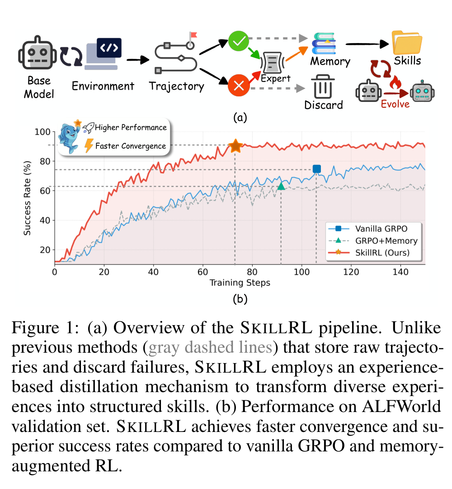

图 1：(a) 是整条流水线的示意图，灰色虚线是旧做法——轨迹存进记忆、失败样本直接丢掉；(b) 是 ALFWorld 验证集上的成功率曲线，SkillRL 到第 70 步左右就到 90%，朴素 GRPO 封顶在 75% 附近，GRPO+Memory 封顶在 62% 附近。这张图要证明的就是一句话：把经验压缩成技能，比把经验原样存下来更能提升成绩，而「原样存」甚至不如不存。

**为什么现在能做**：三件事凑齐了。一是有足够强的教师模型（本文用 OpenAI o3）能稳定地把几十步的长记录读成两三句话，换个弱模型这种蒸馏做不干净——这一点作者自己在表 5 里承认了。二是 GRPO 这类不训 critic 的 RL 算法成熟，7B 模型也能在交互环境里稳定跑完 150 轮。三是算力，一轮完整实验 8 张 H100 跑 30 小时，这个门槛在 2026 年是常规配置。

## 2. 贡献

这五条按盖房子的顺序看最好记：先拆掉不承重的旧墙（把轨迹换成技能），再打一道隔断（分层），然后让屋子边住边改（演进），最后验收时发现小房子比大别墅住得舒服（7B 打赢闭源），换个房型也照样能住（问答）。

- **技能替代轨迹，成绩大幅提升**。证据：表 3 把技能库换回原始轨迹（w/o Skill Lib.），ALFWorld 从 89.9 掉到 61.7，WebShop 从 72.7 掉到 50.2，是所有消融里掉得最狠的一项。
- **技能要分层，通用技能不能省**。证据：表 3 只留任务专属技能（w/o Hier.）掉到 76.8 / 61.4，说明「搜索顺序、动作前检查前置条件」这类通用条目确实在托底。
- **技能库能跟着训练一起长**。证据：图 3 里技能总数从 55 涨到 100（通用 12→20，任务专属 43→80）；图 5 里带演进的那条曲线 60 步就到 80% 成功率，不带演进的要到 90 步才到 82% 的更低峰值。
- **7B 的开源模型打过闭源大模型**。证据：表 1，ALFWorld 上 SkillRL 89.9，GPT-4o 48.0，Gemini-2.5-Pro 60.3。
- **检索增强问答上也有提升**。证据：表 2，七个数据集平均 47.1，最强的基线 EvolveR 是 43.1；Bamboogle 上 73.8 对 54.4，差 19.4。

## 3. 创新点

四条可以想成改装一辆车：后备箱里装的从一沓行车录像换成几张便签（成功失败分开处理）、便签分上下两层放（分层）、路上边开边补货（演进）、上路前先上几节驾校（SFT）。

- **成功和失败分开处理，失败压成教训而不是丢掉或整条存**。对比对象：Reflexion 和 Mem0 这类「只留成功的、或者整条都留」的做法。有用是因为失败轨迹里带着「哪一步开始错」的信息，成功轨迹里没有；但失败轨迹整条塞进上下文太长，所以让教师模型把它压成一句话教训：错在哪一步、错在什么推理、本该怎么做、下次怎么防。
- **技能分两层，每次只把相关的那层塞进去**。对比对象：把所有记忆条目一起塞进提示词的做法。有用是因为通用技能条数可控、对每个任务都适用，可以无条件带上；任务专属技能按相似度只取 $K=6$ 条，避免同一个任务类别下几十条技能把上下文占满。
- **技能库在 RL 过程中长，不在 RL 之前定死**。对比对象：EvolveR（记忆单位是轨迹）、MemRL（策略冻结只更新记忆）。有用是因为策略变强之后会走到没走过的状态，训练前一次性蒸馏出的技能覆盖不到；本文用验证集上失败的那部分轨迹反推「缺什么技能」。
- **先 SFT 再 RL，SFT 不能省**。对比对象：直接把技能塞给基座模型就开训。有用是因为基座模型没学过「先读技能再动手」这个格式，表 3 去掉这一环掉 24.7 个点，是第二大落差。

## 4. 方法

### 4.1 整体流程

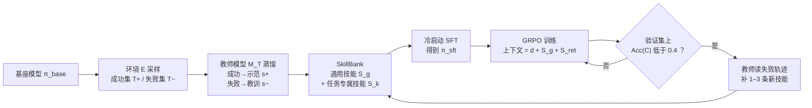

这张图的意思是：技能库不是训练完才建，它在训练中间被反复改写——左边那圈（采样、蒸馏）只跑一次，右边那圈（RL、验证、补技能）跑 150 轮。

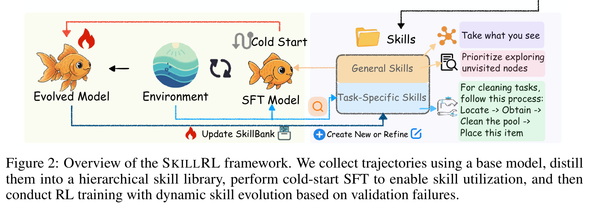

图 2：论文给的整体架构图。左边橘色区是「采样→蒸馏→建库→冷启动 SFT」，右边蓝色区是「用技能库训练→验证失败→更新库」，中间那条从 Evolved Model 绕回 SkillBank 的红线就是「递归」二字的落点。

### 4.2 模块拆解

**模块一：经验蒸馏（Experience-based Skill Distillation）**

为什么需要：模型的上下文窗口有限，而一条完整轨迹动辄上千 token。要让它「带着经验」去干活，经验必须压到几十 token 的粒度。

怎么做：先让基座模型 $\pi_{\text{base}}$ 在目标环境里跑，把结果分成成功集 $\mathcal{T}^{+}=\{\tau_i: r(\tau_i)=1\}$ 和失败集 $\mathcal{T}^{-}=\{\tau_i: r(\tau_i)=0\}$，$r(\tau)$ 是任务成功的二值标记。两批轨迹交给同一个教师模型，但问法不同。

公式：

$$
s^{+} = \mathcal{M}_T(\tau^{+}, d), \qquad s^{-} = \mathcal{M}_T(\tau^{-}, d)
$$

先说这个公式在算什么：它把「一条轨迹加一句任务描述」变成「一条技能文本」。两条式子形式一样，区别只在于输入是成功轨迹还是失败轨迹，以及教师模型被要求输出什么。

- $\tau^{+}$：一条成功轨迹，$\tau^{+}\in\mathcal{T}^{+}$，可以很长
- $\tau^{-}$：一条失败轨迹，$\tau^{-}\in\mathcal{T}^{-}$
- $d$：任务的自然语言描述，例如「heat some egg and put it in countertop」
- $\mathcal{M}_T$：教师模型，实验里是 OpenAI o3
- $s^{+}$：从成功轨迹蒸馏出的技能，一条短文本，要求点出关键决策点、正确动作背后的理由、能迁移到别的任务实例上的模式
- $s^{-}$：从失败轨迹蒸馏出的教训，同样短文本，原文要求包含四件事：（1）失败点、（2）错误的推理或动作、（3）本该怎么做、（4）防止同类失败的一般原则

关键差异在这里：成功轨迹被保留成「示范」，失败轨迹被压成「反事实」。原文的说法是“This transforms verbose failed episodes into counterfactuals”，意思是把冗长的失败过程变成「当时如果那样做就好了」。

**模块二：分层技能库 SkillBank**

为什么需要：不同技能的适用范围不同。「优先探索没去过的地方」对所有任务都有用；「洗东西要先找到池子」只对 Clean 这一类任务有用。混在一起检索，上下文会被无关条目占满。

怎么做：库的全集是 $\mathcal{S}_g \cup \bigcup_{k=1}^{K}\mathcal{S}_k$，前者是通用技能，后者是按任务类别 $k$ 分开的任务专属技能。每条技能是一个三元组：名字（如 systematic exploration）、原理（一句话说清怎么做）、when_to_apply（什么时候该用它）。实验里初始库有 55 条：12 条通用、43 条任务专属。

检索时，通用技能无条件全带；任务专属技能按相似度取。

公式：

$$
\mathcal{S}_{\text{ret}} = \text{TopK}\left(\{ s \in \mathcal{S}_k : \text{sim}(e_d, e_s) > \delta \}, K \right)
$$

先说这个公式在算什么：从当前任务类别的那一堆技能里，先按相似度筛掉不够像的，再按相似度排序取前 $K$ 条。

- $e_d$：任务描述 $d$ 的嵌入向量
- $e_s$：技能 $s$ 的嵌入向量
- $\text{sim}(\cdot,\cdot)$：两个向量的相似度。原文只写 `sim`，没写是余弦还是点积，也没写用哪个嵌入模型
- $\delta$：相似度阈值，低于它的技能连候选都不进
- $K$：最多取几条，实验里 $K=6$
- $\mathcal{S}_{\text{ret}}$：最终选中的任务专属技能集合

选完之后，策略就带着这批技能出动作：

$$
a_t \sim \pi_\theta\left(a_t \mid o_{\le t}, d, \mathcal{S}_g, \mathcal{S}_{\text{ret}}\right)
$$

- $o_{\le t}$：到第 $t$ 步为止的观察历史
- $\mathcal{S}_g$：通用技能，每次都全带
- $\mathcal{S}_{\text{ret}}$：上一步选出的任务专属技能
- 注意这里没有原始轨迹。模型看到的经验只有技能文本，这是它和 Mem0 一路最关键的区别

**模块三：冷启动 SFT**

为什么需要：原文直引“Simply providing skills to an unchanged model yields limited benefit”——把技能直接塞给没训过的模型，收益有限。模型得先学会「先读技能、把技能映射到当前观察、再出动作」这个格式，否则技能只是上下文里的装饰。

怎么做：让教师模型生成 $N$ 条「带着技能解题」的示范轨迹 $\mathcal{D}_{\text{SFT}}=\{(d_i,\mathcal{S}_i,\tau_i^{*})\}_{i=1}^{N}$，然后在这个集合上做标准的监督微调。

公式：

$$
\theta_{\text{sft}} = \arg\min_\theta \mathcal{L}_{\text{CE}}(\mathcal{D}_{\text{SFT}}; \theta)
$$

先说这个公式在算什么：在示范轨迹上最小化逐 token 的交叉熵，让模型学会「照着示范的样子，一边引用技能一边出动作」。

- $\mathcal{D}_{\text{SFT}}$：示范集合，每条包含任务描述 $d_i$、当时可用的技能集合 $\mathcal{S}_i$、教师给出的完整轨迹 $\tau_i^{*}$
- $\mathcal{L}_{\text{CE}}$：交叉熵损失
- $\theta_{\text{sft}}$：微调后的参数。它有两个身份：RL 的起点，以及 KL 正则的参考策略 $\pi_{\text{ref}}$

**模块四：RL 训练（GRPO）**

为什么需要：SFT 学到的是模仿教师，遇到教师没示范过的状态就僵住。RL 才能让模型自己试，靠成败信号改。

怎么做：每道题先检索技能，再采 $G$ 条完整轨迹，每条拿一个二值奖励，然后按组内相对名次算优势。

公式：

$$
A_i = \frac{R_i - \text{mean}(\{R_j\}_{j=1}^{G})}{\text{std}(\{R_j\}_{j=1}^{G})}
$$

先说这个公式在算什么：把「这条轨迹得了多少分」换成「这条轨迹在同一个题的一组里排第几」。

- $R_i$：第 $i$ 条轨迹的奖励，二值，成功记 1、失败记 0
- $G$：一组采几条，实验里 8
- $A_i$：归一化后的优势。注意一条轨迹里所有步共享同一个 $A_i$，这是 GRPO 的固有粗粒度

策略更新用 PPO 式的裁剪目标：

$$
\mathcal{J}(\theta) = \mathbb{E}_{d,\{\tau^{(i)}\}}\left[ \frac{1}{G}\sum_{i=1}^{G} \min\left(\rho_i A_i,\ \text{clip}(\rho_i, 1-\epsilon, 1+\epsilon)A_i\right) - \beta D_{\text{KL}}(\pi_\theta \| \pi_{\text{ref}}) \right]
$$

先说这个公式在算什么：在「让好轨迹的概率变大」和「别偏离参考策略太远」之间找平衡，裁剪那一步防止单次更新步子太大。

- $\rho_i = \pi_\theta(\tau^{(i)} \mid d, \mathcal{S}_g, \mathcal{S}_{\text{ret}}) / \pi_{\text{old}}(\tau^{(i)} \mid d, \mathcal{S}_g, \mathcal{S}_{\text{ret}})$：新旧策略在同一条技能增强过的轨迹上的概率比
- $\epsilon$：裁剪范围，超出 $[1-\epsilon, 1+\epsilon]$ 的比值被夹住
- $\beta$：KL 惩罚系数，实验里 0.01
- $\pi_{\text{ref}}$：参考策略，就是 SFT 出来的 $\pi_{\theta_{\text{sft}}}$

**模块五：递归技能演进（Recursive Skill Evolution）**

为什么需要：技能库是 RL 开始前一次性蒸馏出来的，只覆盖基座模型当时会犯的错。策略变强之后会走到新的状态，遇到新错误，旧技能答不上来。

怎么做：每隔 5 步（Validation interval）算一次验证集上每一类任务的成功率 $\text{Acc}(C)$。只有 $\text{Acc}(C) < \delta$ 的类别才触发补齐——这一条很关键，表现已经好的类别不去动它。触发后从这些类别的失败轨迹里挑样本：先按类别分组，按失败程度（负奖励的严重程度）排序，再用轮询取样保证各类都进来一点，避免全被同一个类别占满。

公式：

$$
\mathcal{S}_{\text{new}} = \mathcal{M}_T\left(\mathcal{T}_{\text{val}}^{-}, \text{SkillBank}\right), \qquad \text{SkillBank} \leftarrow \text{SkillBank} \cup \mathcal{S}_{\text{new}}
$$

先说这个公式在算什么：把「验证集上失败的轨迹」和「现在的技能库」一起交给教师模型，让它指出库里没覆盖的失败模式，产出新技能，然后直接并进库。

- $\mathcal{T}_{\text{val}}^{-}$：验证集上的失败轨迹，最多取 10 条（成功率低于 0.4 的类别）或 5 条（成功率高于 0.4 的类别）
- $\mathcal{S}_{\text{new}}$：本轮新增技能，每次最多 3 条
- $\cup$：并集。注意这里**只增不删**，原文没有任何剪枝或合并操作

教师模型被要求做三件事：（1）找出当前技能没覆盖的失败模式；（2）针对这些缺口提新技能；（3）对无效的旧技能提改进建议。但落到公式上只有并集，第（3）件事在形式上没有体现——这是方法层面的一个缺口，见第 6 节。

### 4.3 关键细节

- 基座模型 Qwen2.5-7B-Instruct；教师模型 OpenAI o3。
- SFT：学习率 $1\times10^{-4}$，batch 16，3 个 epoch，样本 7,500（ALFWorld）/ 2,400（WebShop）。
- RL：学习率 $1\times10^{-6}$，KL 系数 0.01，无效动作惩罚系数 0.1，最大 prompt 长度 6,000 token，最大回复长度 1,024 token，150 个 epoch。
- 检索与演进：Top-K = 6，更新阈值 $\delta$ = 0.4，验证间隔 5 步，每次最多 3 条新技能。
- 算力：8 张 NVIDIA H100 80GB。采样 3 小时、蒸馏 0.5 小时、冷启动 SFT 2 小时、RL 24 小时，单次实验约 30 小时。
- 一处口径冲突：正文说 RL 的 batch size 是 16，表 4 写的是 64。两个数不可能同时对。

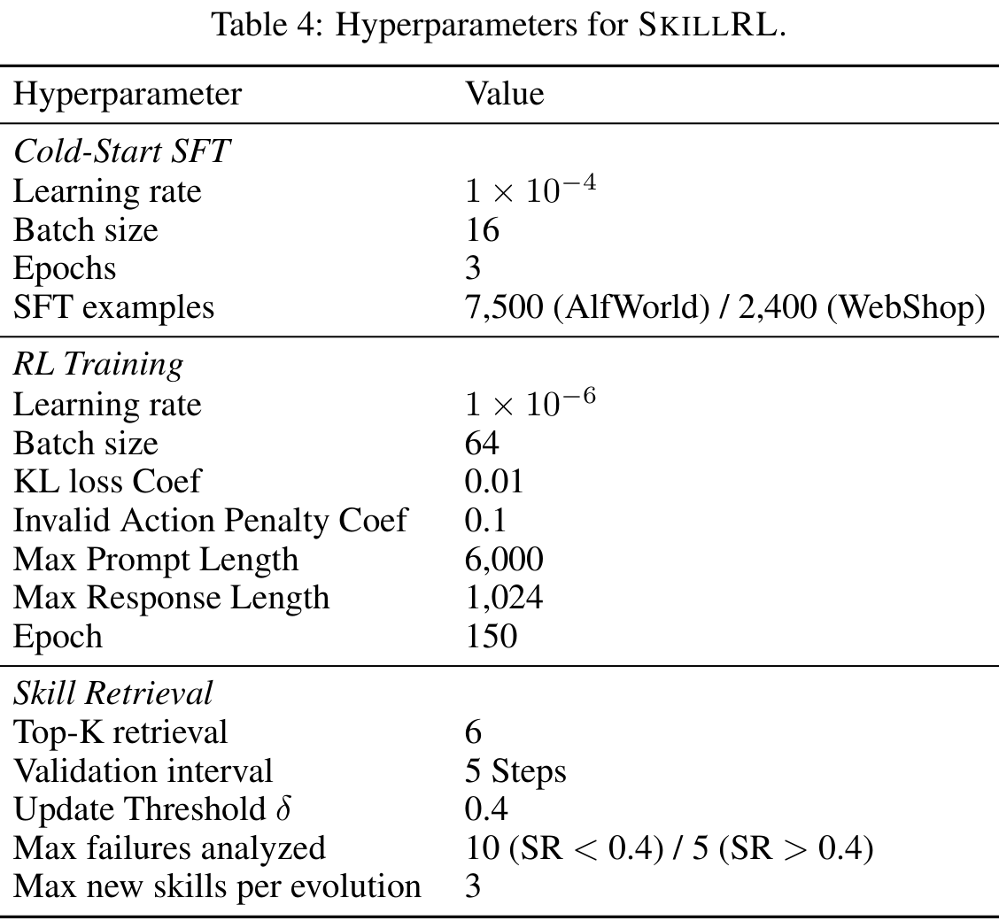

表 4：全部超参。看这张表主要看三组数：SFT 只有 3 个 epoch，说明它只负责把「读技能」这个格式教会，不指望它学能力；RL 要跑 150 个 epoch，是全部时间里最贵的一段（24 小时）；演进每 5 步触发一次、每次最多 3 条，所以理论上限是 30 次 × 3 条 = 90 条新技能，而图 3 实测只长了 45 条。

## 5. 实验结果

**实验设置**

- **数据集与切分**：三个板块。ALFWorld 是文本家居环境，分 Pick / Look / Clean / Heat / Cool / Pick2 六个子任务，报每个子任务的成功率和总体成功率；WebShop 是模拟网购，报平均 Score 和平均成功率 Succ.。检索增强问答七个集：单跳的是 NQ、TriviaQA、PopQA，多跳的是 HotpotQA、2Wiki、MuSiQue、Bamboogle，只在 NQ 和 HotpotQA 上训练（表 2 里标 †），其余五个是 OOD（标 ⋆）。原文未给 ALFWorld 与 WebShop 的测试集规模，也没写用的是 seen 还是 unseen 划分。
- **骨干模型**：主实验全部用 Qwen2.5-7B-Instruct。附录表 5 另外加了 Kimi-K2.5（1.1T 参数）做教师能力对照。
- **训练预算**：8 张 H100 80GB，单次实验约 30 小时（采样 3h、蒸馏 0.5h、SFT 2h、RL 24h）。SFT 样本量 7,500 / 2,400，RL 150 个 epoch。
- **基线**：四类。闭源（GPT-4o、Gemini-2.5-Pro）；提示与记忆类（ReAct、Reflexion、Mem0、ExpeL、MemP、SimpleMem）；RL 类（RLOO、GRPO）；记忆增强 RL 类（MemRL、EvolveR、Mem0+GRPO、SimpleMem+GRPO）。问答板块另外比 R1-Instruct、Search-o1、Search-R1、ZeroSearch、StepSearch、EvolveR。
- **指标**：ALFWorld 用成功率（%），WebShop 用平均 Score 和平均 Succ.（%），问答用准确率和七集合平均 Avg.。原文未给问答的判分细则，没写是不是 exact match。
- **推理设置**：原文未给采样温度、重试次数、单局回合上限，也没给检索器的配置。

主表只留能说明问题的几行，最强基线那一列按每个指标取表内最高的非本文方法：

| 数据集 / 任务 | 指标 | 本文 | 最强基线 | 提升 |
| --- | --- | --- | --- | --- |
| ALFWorld（All） | 成功率 % | 89.9 | 77.6（GRPO） | +12.3 |
| ALFWorld Cool | 成功率 % | 95.5 | 72.5（GRPO） | +23.0 |
| ALFWorld Pick2 | 成功率 % | 87.5 | 64.7（GRPO） | +22.8 |
| WebShop | 平均 Score | 85.2 | 80.3（RLOO） | +4.9 |
| WebShop | 平均 Succ. % | 72.7 | 66.1（GRPO） | +6.6 |
| 检索问答 7 集平均 | 准确率 % | 47.1 | 43.1（EvolveR） | +4.0 |

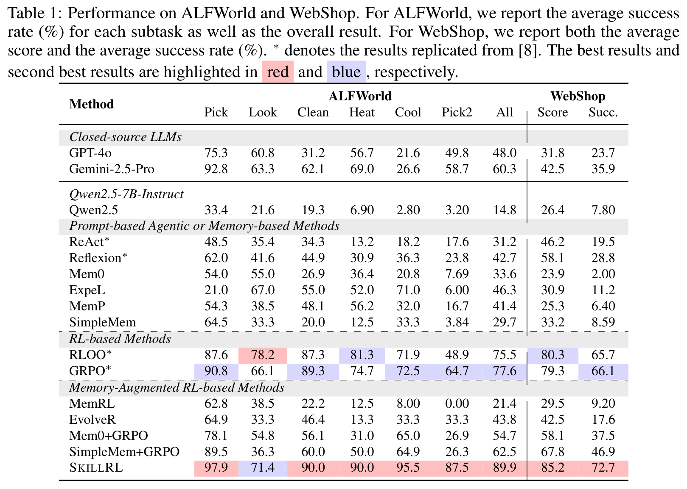

表 1：主结果，ALFWorld 六个子任务加 WebShop 两个指标。这张表最扎眼的不是总体 89.9，而是 Cool（95.5 对 GRPO 的 72.5）和 Pick2（87.5 对 64.7）这两列——需要多步规划和状态跟踪的子任务涨幅最大，说明技能补的正是「记住自己干到哪一步」这种能力。另一处值得盯的是 Look 这一列：SkillRL 71.4，RLOO 78.2，SkillRL 反而输了 6.8 分，原文没有解释。

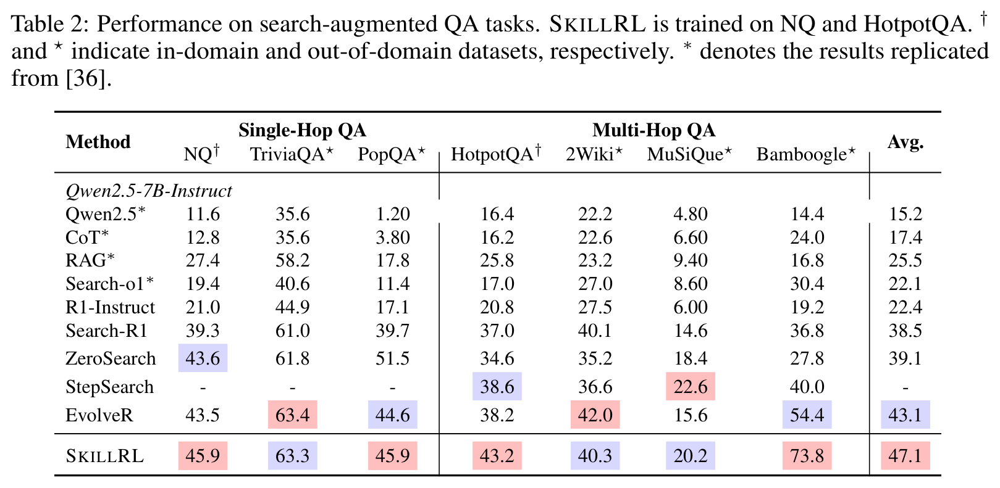

表 2：检索增强问答。平均分 47.1 是最高的，但这个平均是被 Bamboogle 撑起来的（73.8，第二好的 EvolveR 只有 54.4）。逐列看，SkillRL 在 PopQA 上 45.9 输给 ZeroSearch 的 51.5，在 MuSiQue 上 20.2 输给 StepSearch 的 22.6，在 2Wiki 上 40.3 输给 EvolveR 的 42.0，TriviaQA 上 63.3 比 EvolveR 的 63.4 低 0.1。也就是说七列里它只赢了三列，平均分靠一列的大幅领先拉起来。

**原文实验图**

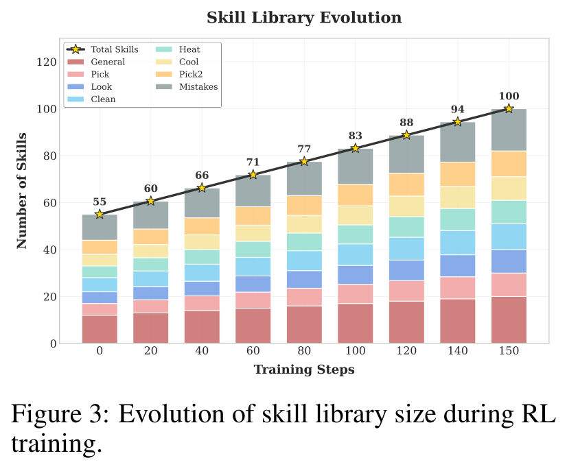

图 3：技能库在训练过程中的增长。柱子按通用技能、六个任务类别、Mistakes 分段堆叠，黄星是总数：55 → 60 → 66 → 71 → 77 → 83 → 88 → 94 → 100。读图能看出的两件事：一是增长基本匀速，每 20 步涨 5 到 6 条，说明演进触发条件（每类成功率低于 0.4）在全程都还在生效，不是补完就停；二是 Mistakes 这一段（失败教训）从头到尾都在长，说明作者把失败教训当成独立的技能类型在维护，而不是只存成功经验。

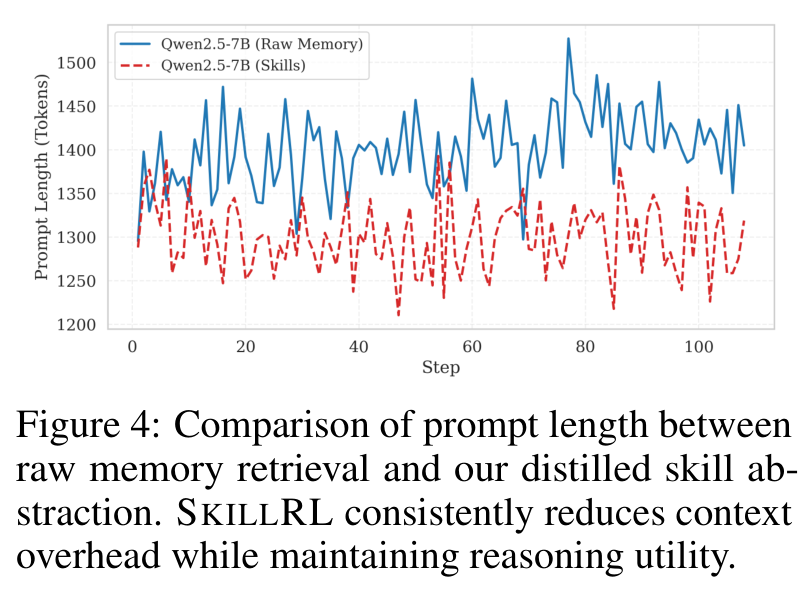

图 4：提示词长度对比，蓝实线是存原始轨迹的 Qwen2.5-7B，红虚线是存技能的 SkillRL。两条线都在 1200 到 1500 token 之间抖动，但红线整体低一档，均值约 1300 对约 1450，原文算出来 10.3% 的降幅。这里要泼一点冷水：正文另一处说技能蒸馏相对原始轨迹有 10–20× 的压缩，那是「一条轨迹压成一条技能」的压缩比；真正落到每次推理的提示词长度上，实测只省了 10.3%，因为提示词里还有观察历史、动作历史这些固定开销。

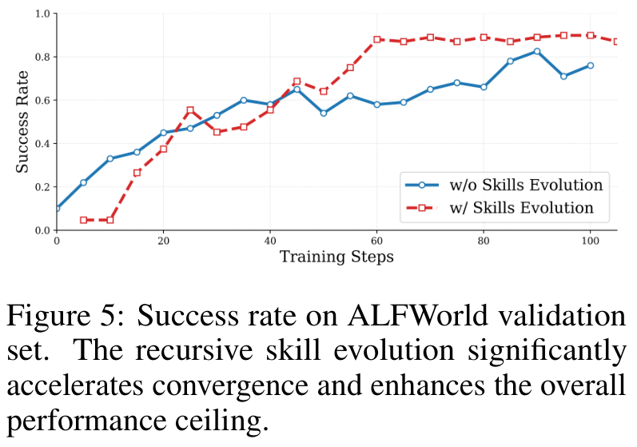

图 5：ALFWorld 验证集成功率，带技能演进 vs 不带。两条曲线在第 45 步左右交叉：之前不带演进的（蓝线）一直领先，因为那时技能库还没变、模型专心学；第 45 步之后红线抬头，60 步就到 0.87 左右并一直维持，蓝线要到 90 步才摸到 0.82，然后在 95 步回落到 0.72。交叉点正好对应技能库开始明显变厚的位置。

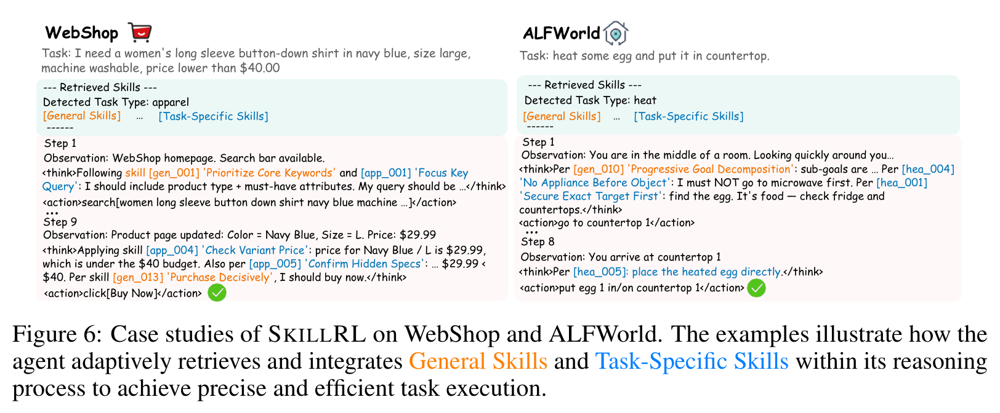

图 6：两个定性案例，左边 WebShop、右边 ALFWorld。这张图证明的不是分数，而是「技能真的被用起来了」：模型的 `<think>` 里会写明「按 gen_001 优先核心关键词」「按 gen_010 递进式拆解目标」「按 hea_004 没拿到物体前不许去电器」，技能编号和名字都对得上论文附录表 6 / 表 8 里的条目。ALFWorld 那个例子里，「先找鸡蛋（食物在冰箱和台面）再去微波炉」这条顺序就是 hea_004 的直接效果。

**原文实验表**

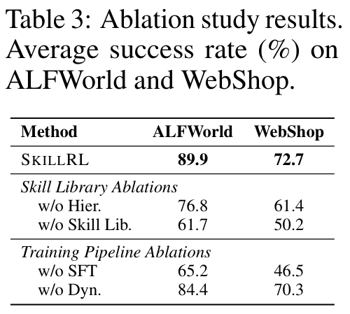

表 3：消融。四行分别对应：去掉分层结构（只留任务专属技能）、把技能库换回原始轨迹、去掉冷启动 SFT、去掉动态演进。

**消融告诉我们什么**：消融这件事像验一道菜的配方——一次只抽走一种调料，看味道掉多少，才知道哪味是关键。从大往小排是「原始轨迹 28.2 > 冷启动 SFT 24.7 > 分层结构 13.1 > 动态演进 5.5」（数字是 ALFWorld 上相对 89.9 的落差）。这个排序有两层含义。第一层，「用什么当经验」（轨迹 vs 技能，28.2）和「模型会不会用经验」（有 SFT vs 没 SFT，24.7）几乎一样重要，光有技能不教怎么用等于白搭。第二层，动态演进只有 5.5 的贡献，看着不起眼，但图 5 显示它的价值主要在前期：它让收敛快了 30 步，而不是把天花板抬高很多。

原文正文对这两个数的表述和表 3 对不上：正文说 w/o Skill Lib. 是「up to 25%」，表 3 实际是 28.2；正文说 w/o SFT 是「20% drop」，表 3 实际是 24.7。可能是相对基线的百分比和绝对百分点混用了，原文没交代。

**教师能力的重要性**（附录表 5）

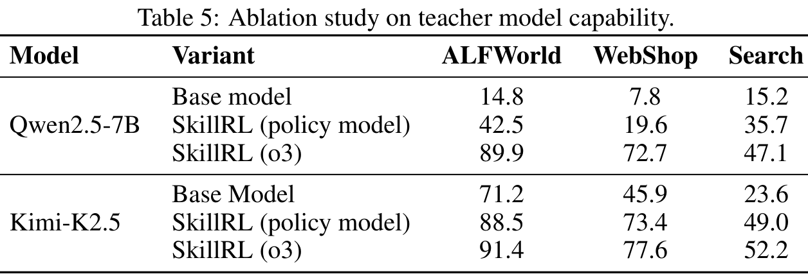

表 5：同一套流程，换不同能力水平的教师。这张表是全文最诚实也最要命的一张。「SkillRL (policy model)」这一行是拿模型自己当教师、不要 o3：Qwen2.5-7B 只能做到 42.5 / 19.6 / 35.7，和用 o3 的 89.9 / 72.7 / 47.1 差了 47.4 / 53.1 / 11.4。换成 Kimi-K2.5（1.1T）自蒸馏就能到 88.5 / 73.4 / 49.0，基本追平 o3 版本。原文的说法是 Qwen2.5-7B 低于“capability threshold for skill abstraction”，我把它翻译成：技能抽象这件事有个能力门槛，跨过去了才是自动发现，跨不过去就只是把强教师的答案抄下来。

**这些实验够不够支撑结论**：部分够。「技能比轨迹好」有表 3 的 28.2 个点撑着，很硬。「技能库能演进」只有 5.5 和一张单条曲线，而且没有多 seed。「自动发现技能」这个说法被表 5 直接推翻——7B 这一档根本不是自动，是强教师蒸馏。另外全篇没有报方差，NeurIPS 清单第 7 项（统计显著性）作者自己勾的是 No。

## 6. 局限性

这些假设像脚手架：搭着的时候楼能盖起来，拆掉之后楼未必还立着。下面分两堆——作者自己写进附录 A 的，和我读表读出来的。

**作者自己承认的**（附录 A）：依赖高能力的教师模型做技能蒸馏和合成轨迹；RL 流程消耗大量算力；技能库规模涨上去之后，怎么在不引入检索噪声的前提下管理它，仍是个没解决的问题；未来的方向是把「验证集周期性触发」换成更实时的演进，并推广到专业软件工程这类更宽的领域。

**我看出来的**：

- **隐形假设**：技能质量的上限由教师模型决定，跟学生无关。表 5 把这条摆出来了——同一套代码，7B 自蒸馏 42.5，o3 蒸馏 89.9。这意味着「自动化」这个词只在强模型上成立。
- **隐形假设之二**：任务能干净地按类别切开。演进的触发单位是「每个任务类别 $C$ 的成功率」，检索也是先定位类别再在那堆技能里 Top-K。如果任务类别本身模糊（比如开放式研究任务），这一层就塌了。
- **机制边界**：技能库只并集不删。原文的提示词里让教师「对无效的旧技能提改进建议」，但式 (7) 只有 $\cup$，没有任何删除或替换的算子。库从 55 长到 100 时可能还好，再往上长，检索噪声迟早出问题——作者自己也把这条写进了局限。
- **机制边界之二**：奖励只有任务成败，一条轨迹里所有步共享同一个优势 $A_i$。技能是唯一的步级信号，一旦技能没覆盖到关键的那一步，模型没有任何别的渠道知道「错在哪」。
- **缺的对比**：没有和「同样用 o3 生成 SFT 示范、但不带技能库」比。表 3 的 w/o Skill Lib. 那一行是不是也用了 o3 生成的 SFT 数据，原文没说清。如果没用，那 28.2 个点的落差里就混进了「有没有见过 o3 怎么解题」这个因素，而不只是「轨迹 vs 技能」。
- **缺的对比**：跨环境迁移。ALFWorld 学到的技能能不能给 WebShop 用？原文每个环境各训一套，没做这个实验。
- **数字层面**：正文的「15.3% 提升」在全表里找不到对应的算法。最接近的口径是 $(89.9-77.6)/77.6=15.85\%$，但那样只算了 ALFWorld 一项。

## 7. 一句话总结

不要让人背录像，要让人背口诀；而且口诀本得跟着他越练越厚，练到哪一步卡住，就补哪一条。

## 8. 可复用点

- 如果我要在自己的项目里做经验记忆：**把失败轨迹当一等公民**。只留成功的做法会丢掉「边界在哪」这条信息，而边界往往比正例更有用。具体动作是给成功和失败准备两套提示词，成功的那套问「关键决策点是什么」，失败的那套问「错在第几步、本该怎么做」。
- 训练不收敛时先查技能条数。$K=6$ 是原文在 ALFWorld（回合较短）上的值；任务步数更长、观察更长时，6 条技能可能挤掉观察历史，先把它降到 2 到 3 再试。
- 演进触发条件用「每类任务成功率 < 阈值」而不是全局平均。全局平均会被简单任务拉高，难任务永远等不到补技能的机会。
- SFT 那一步别省。表 3 里去掉它掉 24.7 个点，仅次于「换回原始轨迹」。省这一步的代价比省算力省下来的多。
- 想复用这套流程，先确认手上的教师模型够不够强。表 5 说得很直白：学生 7B、教师也是 7B，这套流程退化成一个很贵的自我模仿，成绩只有 42.5。

## 9. 我的疑问

- 正文说 RL batch size 16，表 4 说 64，哪个是真的？差 4 倍会直接影响复现。
- 「15.3%」到底怎么算的？我在表 1 和表 2 里找不到能对上这个数的一对口径。
- 检索用的嵌入模型是什么？换一个嵌入模型，$K=6$、$\delta=0.4$ 这组超参还成立吗？
- 技能库过 100 条之后会怎样？图 3 停在 150 步，没有更长的曲线，也没有库大小 vs 成绩的扫描实验。
- Look 子任务上 SkillRL（71.4）低于 RLOO（78.2），技能是不是在「只需观察、不需操作」的任务上有害？
- 表 2 的七个数据集，训练只用 NQ 和 HotpotQA，那另外五个 OOD 集合的成绩提升，到底来自「搜索策略可迁移」还是来自「模型见过 o3 的检索示范」？这两个原因作者没有拆开。
