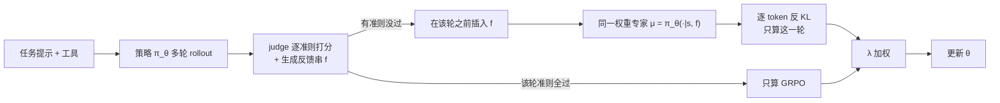
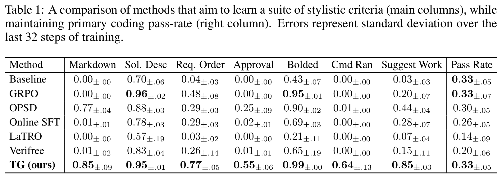
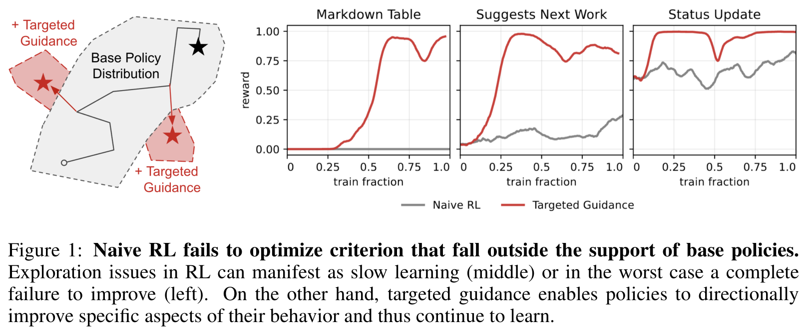
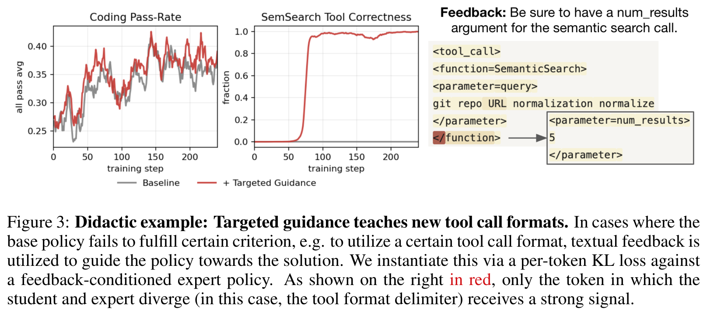
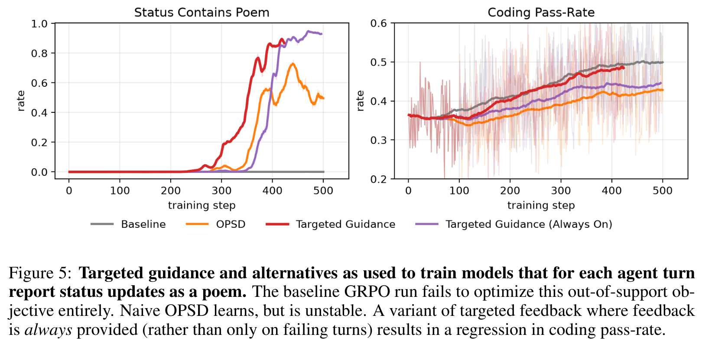
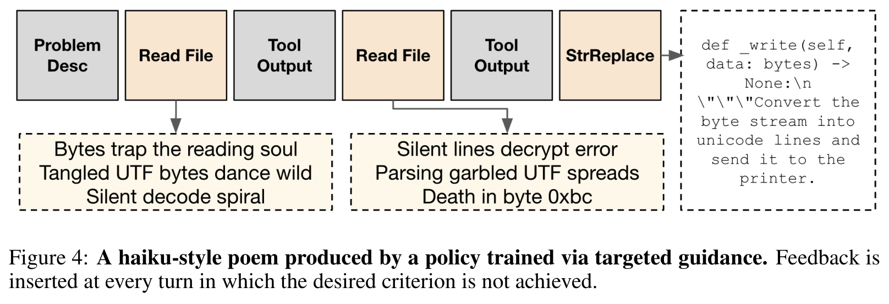
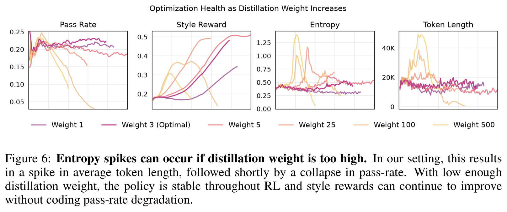
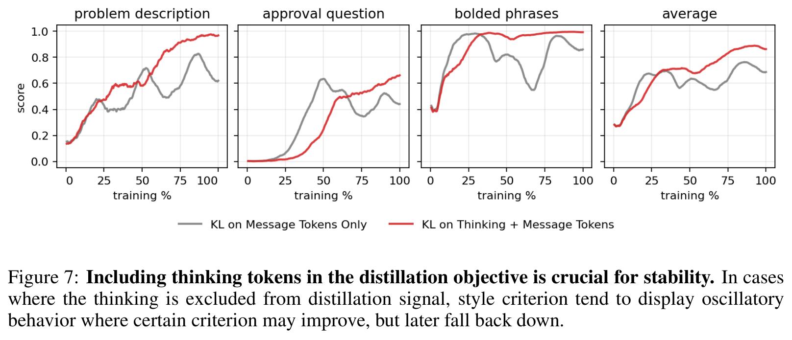

> 一句话：让强化学习不只给一个分数，还把一句批评塞回出错的那一步，让模型照着改。

## 0. 读之前你需要知道

**术语卡**

- **强化学习（reinforcement learning, RL）**：不告诉模型每一步该怎么做，只在结局给一个分数，让它自己多试几次、把得高分的做法变多。生活类比：学做菜，家里没人教，每次端上去只听到「咸了」或「刚好」，你得自己反复试。本文用的具体算法是 GRPO（Group Relative Policy Optimization），把同一道题采的一批答案互相比较，高于这批平均分的加分。
- **轨迹（rollout）**：让模型在环境里从头跑到尾的一次完整记录。生活类比：一场球赛的录像，从开球到终场。
- **轮次（turn）**：agent 的一步动作加环境返回的观察。多轮 agent 就是一场里有很多回合，一个回合通常是「说一句话 + 调一次工具」。类比：一局里的一次攻防。
- **支撑集（support）**：模型按当前概率分布可能吐出来的东西的集合。分布之外的输出概率近似为零。这个论文的全部困难都从这里来：概率近似零的动作，采不到，也就学不到。
- **KL 散度（KL divergence）**：两套概率分布差多远。$D_{\mathrm{KL}}(p\|q)$ 是拿 $p$ 去看 $q$ 有多意外，永远非负，完全一样时为 0。类比：两个人口味分布，一个只吃辣一个只吃甜，KL 就大。
- **蒸馏（distillation）**：让一个模型去模仿另一个模型的输出概率，而不是去模仿对错标签。老师给的不是答案，是整个词表上的概率分布，信息量大得多。生活类比：不是给你标准答案，是把手把手时的用力方向和幅度都给你。
- **自蒸馏（self-distillation）**：老师和学生是同一份权重。老师之所以比学生强，只因为它的上下文里多了一份提示。类比：同一个人，看了攻略再动手，就比空手做得好。
- **熵（entropy）**：输出概率分布有多散。熵高表示模型什么都敢说、拿不准；熵低表示它很笃定。训练中熵突然飙升，通常意味着模型开始乱说。
- **judge 模型**：不写答案，只读答案并打分的模型。本文的 judge 手里还有标准解（privileged information），所以它除了给分，还能写一句「你为什么没过」。

**它站在谁肩上**

- **GRPO（Shao et al., 2024）**：组内相对优势的策略梯度，本文的主干 RL 算法。它只看结局分数，不知道「该怎么改」。
- **OPSD / Self-Distilled Reasoner（Zhao et al., 2026）**：把提示塞进同一模型的上下文当老师，做逐 token 蒸馏。它证明了这条路能走通，但把提示放在全局上下文里，且不做 RL 奖励。
- **OPSD 的崩溃现象（2026 年一批工作）**：已有人报告自蒸馏会导致 reasoning shortening（推理变短）或 diversity collapse（多样性崩塌）。本文的稳定化设计是针对这些现象的。
- **门控式自蒸馏（Li et al. 2026、Ding 2026、Lu et al. 2026）**：只在失败的轨迹上施加蒸馏信号。本文把它从「整条轨迹」细化到「具体哪一轮」。
- **LaTRO（Chen et al., 2024）、Verifree（Zhou et al., 2026）**：把教师答案的似然当奖励。本文把它们列为对手，并指出它们要教师自回归生成新动作，代价大且不稳。

## 1. 动机

想象你学开车。教练坐在副驾，一节课下来只说一句「今天没过」。你不知道是倒车没看后视镜、还是变道没打灯、还是路口没减速。下次你还是会忘打灯，因为从来没人告诉过你打灯这件事。

如果教练改成在你每次忘打灯的那一秒说一句「打灯」，你立刻就学会了。这句话不是分数，是方向。

**以前怎么做**：现在主流的后训练系统里，一条答案的分数往往由好几个准则加权合成，比如「有没有用 markdown 表格」「有没有解释用户的问题」「有没有建议下一步」。每个准则背后通常是一个 judge 模型在打分，而 judge 除了给 0 或 1，还能写一句理由。可到了训练的时候，这些理由全部被丢掉，只剩下加权求和后的一个标量奖励，交给策略梯度去优化。

**为什么不行**：策略梯度的数学形式决定了它只能给「已经出现过的好行为」加权。作者在引言里的说法是，即使奖励函数被仔细设计好，只要策略没有机会做出这个行为，它就不会进步。原文一句：

> "while RL incentivizes existing good behaviors, such methods do not communicate how to perform new desirable behaviors."

意思是：RL 会强化已有的好行为，但它不负责告诉模型新行为长什么样。在多轮工具调用的 agent 场景里这件事更严重——一个奖励要等十几轮之后才出现，中间哪一步错了没有任何信号。

Figure 1 把这个困境画得很直白：灰色是普通 RL，在 Markdown Table 这个准则上整整训练了 100% 的步数，分数还是 0.00，一步都没动过；而 Suggests Next Work 也会学，但爬得又慢又抖。原因就是这个行为不在 base policy 的支撑集里，采样采不到，梯度里就没有这一项。

**为什么现在能做**：两个条件同时到位了。一是后训练流程里已经普遍存在带 rubric 的 judge，它本来就在输出逐条理由，这些文本是现成的、免费的监督信号。二是自蒸馏这套做法已经被验证过可行（同一份权重，上下文里多一段提示就能变强），所以「把理由塞回上下文当老师」不需要额外的大模型。

作者要解决的问题因此很具体：**怎么用这些现成的文本，同时不把普通 RL 已经学到的东西搞坏**。后者才是这篇论文真正的主题——前三节都在铺垫方向从哪来，第四节后半段全在讲怎么不翻车。

## 2. 贡献

- **提出 targeted guidance 框架，把每条准则的文本反馈变成逐 token 的训练信号**。证据：Table 1 里一行 7 个风格准则同时被拉动，而基线 GRPO 有 3 个准则停在 0.00。
- **在拉高 7 个准则的同时，主任务 pass-rate 没有掉**。证据：TG 的 Pass Rate 是 0.33，与 GRPO 的 0.33、Baseline 的 0.33 完全同分。
- **定位出两个让训练稳定的关键旋钮：蒸馏权重不能太大，且必须把 thinking token 纳入蒸馏**。证据：Figure 6 里 Weight 100 与 Weight 500 的熵冲到 1.25 以上随后 pass-rate 崩到 0.05 以下；Figure 7 里不含 thinking 的灰线在 4 个子图里全部来回震荡。
- **证明「只在失败轮次施加蒸馏」是必要的，不是可有可无的工程细节**。证据：Figure 5 里 Always On 变体（每轮都给反馈）在 poem 准则上冲到 0.95，但 coding pass-rate 掉到 0.44，低于 TG 的 0.49 和 Baseline 的 0.50。
- **给出了一个渐近无偏的论证**。证据：第 4 节末尾——当所有准则都持续满足时，门控让蒸馏项归零，损失退化成纯策略梯度，因此仍能收敛到最优策略。

## 3. 创新点

- **反馈插在出错那一轮之前，而不是塞进全局 system prompt**。对比对象：OPSD（Zhao et al., 2026）把 privileged information 放在全局上下文。有用是因为它把师生差异压在最小范围——论文用 Eq. (2) 的形式化说，我们希望的专家是「只在需要改的那一点上不同」，全局注入会让整条轨迹都被污染。
- **蒸馏信号和该准则的 RL 奖励同时存在**。对比对象：OPSD 只有蒸馏、没有对应奖励。有用是因为两者分工不同——原文的说法是蒸馏负责让策略学会这个行为，无偏的 RL 目标负责让策略留住并继续改进它。Figure 5 的橙线（只有蒸馏的 OPSD）能爬到 0.72 但随后掉回 0.50，正是缺了这一步。
- **门控的粒度从「整条轨迹」细化到「具体哪一轮」**。对比对象：前述几篇门控式自蒸馏工作按 rollout 成败决定要不要蒸馏。有用是因为一条轨迹里可能第 3 轮格式错了、第 7 轮风格对了，按整条轨迹门控会把好轮次一起推。
- **KL 在 trainer 侧用全词表精确计算，不用采样估计**。对比对象：常见的 top-k 或采样近似。有用是因为异步 RL 里推理引擎和训练器本身就有数值差异（inference-trainer mismatch），再叠一层估计误差会让信号变噪。
- **梯度通过 `sg` 截断，专家在单次更新内视为固定**。这不是新想法，但它让整个蒸馏项变成一个「有明确目标的回归问题」而不是师生互相追着跑——这一点在第 6 节讨论熵爆时被作者重新拿出来解释。

## 4. 方法

### 4.1 整体流程

一句话解释这张图：RL 的主干照常跑，只在「这一轮有准则没过」的地方，额外让学生去对齐一个「看了批评意见的自己」。

### 4.2 模块拆解

**模块一：把反馈归因到轮次**

为什么需要：一条多轮轨迹里可能有十几轮，judge 给的反馈必须落到具体某一步上才有用。落到整条轨迹上，模型不知道改哪里。

怎么做：每个二元准则 $R_i$ 除了返回 0/1，还额外产出一个反馈字符串 $f$。judge 逐轮评估，哪一轮违反了哪条准则，就把那条准则的反馈绑定到那一轮的编号上。论文里 $f$ 是**静态的**——同一准则永远用同一句话，比如「确保你的回复里至少有三句话描述用户原始问题」。

这一步没有公式，但它是整个方法的地基：只有归因到轮次，后面的门控和局部注入才有可能。

**模块二：用上下文构造专家**

为什么需要：如果真去训一个更强的老师模型，成本高、还可能引入新分布。而同一份权重加一句话就已经比空手做得好。

怎么做：在第 $t$ 轮的输入前面插入 $f_t$，其余一切不变，得到的条件分布就是专家：

$$
\mu(\cdot \mid s) = \pi_\theta(\cdot \mid s, f) \quad \text{（被标注的轮次）}, \qquad \mu = \pi_\theta \quad \text{（其余轮次）}
$$

- $\mu$：专家策略，本质是学生策略的一个「看了提示的版本」
- $s$：当前状态，在本文里就是此前所有观察与动作拼成的 token 序列
- $f$：反馈串，附着在具体某一轮上
- $\pi_\theta$：带参数 $\theta$ 的策略，本文就是那个 30B 的语言模型

关键点：$\mu$ 和学生共享 $\theta$，所以「师生差异」完全来自那一条 $f$。这也是为什么它可以被约束得很小。

**模块三：方向信号要满足的两个条件**

为什么需要：不是任何专家都值得模仿。如果专家本身更差，模仿它就是把模型带坏；如果专家在无关的地方也不一样，模仿它会顺手破坏别的能力。

怎么做：作者借经典策略改进的论证，提出两条**设计启发式**（原文明确说 neither condition is guaranteed in practice，即两条都不保证成立，只当设计指导）。

第一条，专家在当前策略的状态分布上要有正的优势：

$$
\mathbb{E}_{s \sim d^{\pi}} \, \mathbb{E}_{a \sim \mu(\cdot \mid s)} \big[ A^{\pi}(s, a) \big] > 0
$$

- $d^{\pi}$：当前策略 $\pi$ 实际会走到的状态分布，也就是 on-policy 的那批状态
- $A^{\pi}(s,a)$：优势函数，这个动作比当前策略的平均水平好多少
- 整式的意思：如果专家的动作平均来说比现状好，朝它走一小步就会变好

第二条，专家整体上要离原策略足够近：

$$
\mathbb{E}_{s \sim d^{\pi}} \Big[ \mathrm{KL}\big( \pi(\cdot \mid s) \,\|\, \mu(\cdot \mid s) \big) \Big] < \delta
$$

- $\mathrm{KL}(\cdot\|\cdot)$：两个分布之间的 KL 散度
- $\delta$：允许的偏离上限
- 整式的意思：只允许专家在「该改的那一点」上不同，别的地方要贴着原策略

作者把这两条当成施工图：$f$ 的设计要保证专家更强（第一条），注入位置要保证专家别处不动（第二条）。第 4.3 节的「反馈怎么设计」就是在执行第一条。

**模块四：组合损失**

为什么需要：光有蒸馏会塌（第 5.4 节用 Figure 6、Figure 7 证明），光有 RL 学不动。两者要拼在一起，而且蒸馏只能落在失败轮次上。

怎么做：主损失是 GRPO，附加项是失败轮次上的逐 token KL。

$$
\mathcal{L}(\theta) = \mathcal{L}_{\mathrm{GRPO}}(\theta) + \lambda \sum_{t \in \mathcal{F}} \mathrm{KL}\big( \pi_\theta(\cdot \mid s_t) \,\|\, \mathrm{sg}\big( \pi_\theta(\cdot \mid s_t, f_t) \big) \big)
$$

先说这个公式在算什么：在普通 RL 损失上，加一项「让学生的输出分布靠近看了提示的自己的输出分布」，而且只在出错的那些轮次上加。

- $\mathcal{L}_{\mathrm{GRPO}}(\theta)$：组内相对优势的策略梯度损失，负责主任务（写代码能不能过隐藏测试）
- $\mathcal{F}$：本轮 rollout 里**有准则没通过**的那些 agent 轮次的集合。这是全文最重要的一项，空集时整个附加项消失
- $s_t$：第 $t$ 轮开始时的状态
- $f_t$：绑定到第 $t$ 轮的反馈串
- $\mathrm{sg}(\cdot)$：stop-gradient，把括号里的分布当成常数，不往回传梯度。所以专家在这一次更新里是固定的
- $\mathrm{KL}(p \| q)$：$p$ 在前、$q$ 在后。这里学生在前、专家在后。原文把这称为 **reverse KL**，意思是方向与标准知识蒸馏（老师在前）相反
- $\lambda$：蒸馏权重，全文最关键的一个标量，第 5.4 节有专门的权重扫描

还有两处实现细节写在公式之外的正文里。一是这个 KL 项会按**整条 rollout 的所有 token 数**归一化，作者的理由是长轨迹上的大 KL 往往对应「推理打转」这类坏状态，不该让它主导梯度。二是 KL 在**整个词表**上精确计算，且全部在训练器侧完成。

**模块五：门控为什么能让它渐近无偏**

为什么需要：辅助信号用久了可能让模型收敛到一个「讨好评委」的假最优点——即使最优策略已经达到，$\mathrm{KL}(\pi_\theta(\cdot|s_t) \| \pi_\theta(\cdot|s_t, f_t))$ 也可能因为条件化的副作用而不为零（原文用词是 spurious affects of conditioning on feedback）。

怎么做：靠门控。如果所有准则一直满足，$\mathcal{F}$ 是空集，附加项恒为零，损失退化成纯策略梯度。因此只要最优策略存在，过程仍收敛到它。这是一个**论证**而不是定理，作者自己在第 9 节也承认，实验里并没有验证收敛性。

**模块六：反馈串本身要怎么挑**

为什么需要：呼应模块三的第一条——专家必须真的更强。同一句话可能有用也可能添乱，不能靠感觉。

怎么做：作者给了一个很土但可操作的流程：拿候选反馈串去问 base model，比较「带这句话」和「不带这句话」时的平均表现，只留下**平均有提升**的那些。注意这个筛选过程用的是自回归生成来评估，但真正施加的时候走的是逐 token 蒸馏——两者的度量不一样，作者没有展开这个缝隙。

**模块七：计算开销**

为什么需要：工程上贵的东西没人用。

怎么做：蒸馏的老师只提供 logit 目标，**不需要自回归生成**。所以相对标准 RL，增加的开销就是每轮多一次前向，用来拿到专家的 logit。显存问题可以用只物化最后一层隐状态的 kernel 缓解（论文引了 Liger-kernel 与 QuACK）。

### 4.3 关键细节

- **骨干**：Qwen3-Coder-30B，先在本团队的 agentic coding harness 上做过 SFT。作者在脚注里说明，Cursor 在 Composer 2.5 发布中用了类似技术，但那版不涉及 Qwen 系列。
- **训练超参**：200 步，每步 32 个组、每组 32 条 rollout，Adam，学习率 3e-6，数据集是单 epoch 的软件工程题集（同一提示只训一次）。
- **异步管线**：用 asynchronous RL pipeline（Pipelinerl），推理策略可能比正在训练的版本旧。这一点是后面解释「为什么 Online SFT / LaTRO 会掉」的关键前提。
- **蒸馏算子**：所有 distillation 类方法统一用全词表 KL，且**thinking 和 tool call 的 token 都计入损失**。这个「计入 thinking」在 5.4 节被单独做成了对照。
- **超参搜索**：扫了蒸馏权重 $\lambda$ 和 RL 里的风格奖励权重。
- **词表级 KL 的位置**：训练器侧算，避免推理引擎与训练器的数值差异（inference-trainer mismatch）。

## 5. 实验结果

**实验设置**

- **数据集与切分**：训练集是单 epoch 的软件工程题集，原文未给名称与规模；评测用隐藏测试用例判 pass-rate。7 条风格准则由外部 judge 模型判定，judge 用哪家模型原文未给。第 5.3 节另有一套「每一轮都要输出一首俳句」的评测，同样是自建的、原文未给规模。
- **骨干模型**：Qwen3-Coder-30B，先经自家 harness 的 agentic coding SFT。只训了这一个尺寸。
- **训练预算**：200 步，32 组 × 32 条 rollout，Adam，lr 3e-6，异步 RL 管线。用了几张什么卡、训了多久，原文未给。
- **基线**：Baseline（只优化 coding 奖励）、GRPO（7 条准则各给二元奖励后求和）、OPSD（有蒸馏无 RL 奖励）、Online SFT（用教师生成替代轮次做迭代 SFT）、LaTRO（教师轮次的似然当奖励）、Verifree（原始似然当奖励）。其中 Online SFT、LaTRO、Verifree 是作者为这个设定自己接上的对照。
- **指标**：pass-rate（隐藏测试全过的比例，越高越好）＋ 7 条二元风格准则的达成比例（越高越好）＋ 熵 ＋ 平均 token 长度（后两个是诊断量）。误差棒是训练最后 32 步的标准差，不是多次 seed 的方差。
- **推理设置**：解码温度、最大长度、judge 的具体提示词，原文均未给。

**主表**（提炼版，原表截图在下面）

| 准则 / 任务             | 指标        | 本文 TG | 最强基线                  | 提升    |
| ------------------- | --------- | ----- | --------------------- | ----- |
| Markdown 表格         | 达成率       | 0.85  | 0.77（OPSD）            | +0.08 |
| 解释用户问题（Sol. Desc）   | 达成率       | 0.95  | 0.96（GRPO）            | −0.01 |
| 必需顺序（Req. Order）    | 达成率       | 0.77  | 0.48（GRPO）            | +0.29 |
| 请求确认（Approval）      | 达成率       | 0.55  | 0.25（OPSD）            | +0.30 |
| 加粗（Bolded）          | 达成率       | 0.99  | 0.95（GRPO）            | +0.04 |
| 真的跑了命令（Cmd Ran）     | 达成率       | 0.64  | 0.01（OPSD）            | +0.63 |
| 建议下一步（Suggest Work） | 达成率       | 0.85  | 0.44（OPSD）            | +0.41 |
| 主任务                 | pass-rate | 0.33  | 0.33（GRPO / Baseline） | 0.00  |

两格要说清：**Sol. Desc 是本文唯一输给基线的一项**（0.95 对 GRPO 的 0.96），**pass-rate 是和 GRPO 完全打平**（0.33 对 0.33），不是超过。

表 1：这一行说明**7 条准则里 6 条大幅领先，主任务一格没掉**。原表还告诉你误差棒的口径——是训练末段 32 步的波动，不是 seed 间方差，所以不要把 $\pm.01$ 读成「这个方法很稳」。

图 1：左边是概念图，灰圈是 base policy 的支撑集，红星是奖励想要的区域，两个粉圈是 targeted guidance 把概率质量往那边推的方向。右边三张曲线才是证据：Markdown Table 上普通 RL 从头到尾一条 0.00 的直线，目标行为压根没被采到；Suggests Next Work 上普通 RL 爬到 0.25 左右就开始打转；Status Update 上普通 RL 也能到 0.75 但一路锯齿。三张图一起说明：支撑集外的行为不是**学得慢**，是**学不到**。

**5.1 引入一个新工具格式**

这一节回答的是：新工具、新参数这种 base model 从没见过的东西，能不能在 RL 阶段补上。

设定很具体：给 semantic search 工具加一个 `num_results` 参数，SFT 阶段没有这个格式，所以即使把示例放进 prompt，base model 也不用。训练时凡是这一轮用了工具但格式不对，就在该轮之前插入「记得给 num_results 参数」这句话，剩下的照 Eq. (3) 走。

图 3：左边两条曲线几乎重合，说明加这套东西不会伤主任务（红线甚至略高一点）；中间 SemSearch Tool Correctness 从 0 一路平着，在 60 步左右突然垂直拉到 1.0 然后钉住——这是一个典型的门槛型行为，一旦跨过去就稳定了，跟慢慢爬的技能不同。右边解释了为什么能这么干净：学生和专家的概率只有 `</function>` 那个分隔符处强烈分歧，其余 token 全部对齐，所以大信号只落在该改的地方。原文的说法是 "only the token in which the student and expert diverge (in this case, the tool format delimiter) receives a strong signal"。

**5.2 七条准则同时优化**

这一节是主结果。7 条风格准则里有几条天然打架：要「必需顺序」就可能要重排内容，要「加粗」就可能破坏 markdown 表格，要「建议下一步」就可能啰嗦。作者的关注点正是「能不能同时满足，而且不掉 pass-rate」。

读原表的三个事实：

1. **基线的 0.00 不是偶然**。Baseline 和 GRPO 在 Markdown、Approval、Cmd Ran 三格全是 0.00。这不代表模型学不会写表格，而是说这三条行为在该策略的支撑集里出现概率极低，采样采不到，梯度自然为零。这正是第 1 节那个论证的实证版本。
2. **OPSD 是唯一在风格上真能打的对手**。它在 Markdown 上拿到 0.77、Approval 上 0.25，是除本文外唯一把这两格拉起来的。但它的 pass-rate 是 0.30，比 GRPO 的 0.33 掉了 0.03。
3. **三个「教师生成式」方法集体掉 pass-rate**。Online SFT 0.26、LaTRO 0.14、Verifree 0.20，LaTRO 甚至把风格也一起拖下去（Bolded 只有 0.21，比 Baseline 的 0.43 还低）。作者的假设是：这三个方法要让教师自回归采样出全新的动作再去拟合，而在异步设定下这些动作可能已经过时（stale），抬高它们的似然等于在推一串可能并不优的动作。

**5.3 每一轮都要满足的准则**

前面 5.2 的准则只管最后一条消息的风格，也就是整条轨迹的末尾。5.3 把目标改成**每一轮**都得带一句诗体状态汇报。

这个设定选得很聪明：诗体状态汇报对 code agent 来说是彻底的分布外行为，跟「写代码」这件事几乎不相关，正好用来测「能不能把支撑集外的行为硬塞进去」。

图 5：左边 poem 准则上，Baseline（灰）从头到尾是 0，一步没动；OPSD（橙）能爬到约 0.72，然后掉回 0.50 附近，是**学会了但守不住**；TG（红）在 350 步之后陡升，440 步左右摸到 0.93 并稳住。右边 pass-rate 上，灰线 Baseline 最终约 0.50，红线 TG 约 0.49，紫线 Always On 掉到 0.44——这就是门控必要性的直接证据。要注意右边还画了逐 step 的浅色散点，抖动很大，说明这个量本身的方差就不小，0.01 的差距不足以分出胜负。

图 4：这是同一个策略真的产出的东西。每一轮状态汇报都是一首俳句，内容是「Bytes trap the reading soul / Tangled UTF bytes dance wild / Silent decode spiral」这种，还押着 5-7-5 的音节。这张图证明的不是分数，而是这个行为已经被内化进生成分布，不是外挂模板。

**5.4 失败案例与两个稳定化旋钮**

这一节是全文信息密度最高的地方，两个旋钮各自对应一种崩溃形态。

**旋钮 A：蒸馏权重太大 → 熵爆 → 长度膨胀 → pass-rate 崩**

图 6：Weight 1 和 Weight 3 是稳的，熵压在 0.4 附近，pass-rate 反而略微上行。Weight 100 和 500 在训练最开始熵就冲到 1.25 到 1.4，同步的是 token 长度从 1 万多冲到 5 万，然后 pass-rate 一路掉到 0.05 以下。注意顺序：**熵先爆，长度跟着爆，pass-rate 最后崩**，所以熵可以做早期预警。作者的机制解释是自蒸馏的递归性——学生熵变高，由于共享权重，专家也一起变高，两者互相推着往上走，所以一旦越过临界点就自我强化。作者也点明一点分寸：熵上升本身是必然的，往支撑集外推本来就会抬高熵，坏的是**尖峰**而不是**抬升**。

**旋钮 B：不蒸馏 thinking token → 准则之间来回震荡**

图 7：灰线（KL 只算 message token）在四个子图上全都在震荡——problem description 在 60% 附近掉一下再爬，approval question 在 50% 处见顶后落到 0.35 再回去，bolded phrases 更明显，从 1.0 掉到 0.55 再弹回。红线（KL 同时算 thinking 和 message）在四个子图上都是单调上升。

作者给了定性的解释，引用了一段 thinking trace 对照：不蒸馏 thinking 时，最后那条消息的思考里压根没提风格；蒸馏了 thinking 之后，思考里出现「I should format this nicely with proper markdown」「I should explain the issue, the solution, and ask for their confirmation」这类自我提醒。也就是说，**风格约束被写进了规划阶段**，而不是在生成时才临时补救。这解释了为什么只有蒸馏 thinking 才能让 7 条互相打架的准则共同收敛。

**消融告诉我们什么**

- 去掉门控（Always On）：poem 准则照样能到 0.95，但 pass-rate 掉到 0.44。**方向对、副作用大**，和论文的 Eq. (2) 直觉一致——专家偏离得太远。
- 去掉 RL 奖励（OPSD）：poem 能到 0.72 但守不住，掉回 0.50。**学会了留不住**。
- 去掉 thinking 的蒸馏：准则之间互相拆台，整体震荡。**单条能上去，整体上不去**。
- 不加蒸馏（Baseline / GRPO）：0.00 或缓慢爬升。**压根学不到**。
- $\lambda$ 太大：熵爆。**学到了但训练崩了**。

四种失败模式各不相同，这也是这篇论文比一般加个辅助损失的工作更有价值的地方：它把每种失败都对应到了一个具体的旋钮。

**这些实验够不够支撑结论**

大半够，但有几处要打折：

- 主表只报训练末段 32 步的标准差，**没有多 seed**。0.33 对 0.33 这种持平结论，在这种口径下只能说**没看到掉**，不能说**证明不掉**。
- 只有一个 30B 模型、一个 harness、一个领域。风格准则也是作者自选的 7 条。
- 图 7 的横轴是 `training %` 且只到 100，而主实验是 200 步、图 5 是 500 步。这一组消融的具体 run 设置原文未给，不能直接和主表对齐。
- 「渐近无偏」只有论证没有实验。作者自己在第 6 节把「哪些原子设计选择真正起作用」列为未做的事。

## 6. 局限性

**作者自己承认的**

- 每条奖励准则都要**手工写一个静态反馈串**，这是主要成本。将来也许能用另一个 RL 过程自动学出来，连门控和权重也一起学。
- 实验只在一个多轮软件工程设定里做过，而且被引导的目标集中在风格与格式，不是「主智能」。
- 有一批 OPSD 变体（论文列了 7 篇）没能在这个实验设定下逐个对跑。
- 缺少像「37 个实现细节」（Huang et al.）那样的原子级拆解，不知道哪个设计选择真正关键。

**我看出来的**

- **隐形假设：每条准则都能用一句静态文本说清**。这对「加粗」「放表格」成立，对「代码写得好不好」这种没法一句话说清的目标就不成立。论文的全部增益都建立在这个假设上。
- **隐形假设：judge 的反馈比它的分数更有信息量**。但如果 judge 本身判错，反馈会带着模型往错的方向走，而且因为它是逐 token 强对齐的，错误会被放大得比标量奖励更快。
- **机制边界：门控只在「失败」时开**。一条已经满足准则的轮次拿不到任何额外信号，所以这个方法无法把「勉强过关」推到「做得好」。它只补 0 到 1，不补 1 到 100。
- **机制边界：专家和学生的差距完全靠一句上下文撑起来**。如果模型 zero-shot 读不懂那句反馈（论文第 6 节自己提到依赖 zero-shot 能力），专家就不比学生强，Eq. (1) 的前提直接失效，此时这个损失只是在把模型往噪声上推。而论文没有办法在训练时检测这件事。
- **$\lambda$ 的稳定区间看起来很窄**。Figure 6 里 Weight 3 是 optimal、Weight 5 已经开始有掉头迹象、Weight 25 崩掉。一个需要逐任务扫参、且可用区间可能不到一个数量级的旋钮，在换模型或换领域时是实打实的迁移成本。
- **缺的对比**：没有和「多轮里直接给 step-level 奖励（PRM 式）」比，也没有和「把反馈塞进 system prompt 再做几次 SFT」这种最朴素的基线比。后者的缺失尤其可惜，因为第 5.1 节的设定里，作者自己说把示例放进 prompt 也不管用——那正是需要拿出对比的地方。

## 7. 一句话总结

以前 RL 只告诉模型「这次没考好」，这篇论文让教练在摔倒的那一步喊一句「看后视镜」，并且只在摔倒的时候喊。

核心公式：

$$
\boxed{\; \mathcal{L}(\theta) = \mathcal{L}_{\mathrm{GRPO}}(\theta) + \lambda \sum_{t \in \mathcal{F}} \mathrm{KL}\big( \pi_\theta(\cdot \mid s_t) \,\|\, \mathrm{sg}\big( \pi_\theta(\cdot \mid s_t, f_t) \big) \big) \;}
$$

整篇论文的工程判断都浓缩在 $\mathcal{F}$ 这个集合上：什么时候开、开在哪一轮、开多大。

## 8. 可复用点

- **如果我要在自己的项目里用**：把 judge 从「只返回分数」改成「返回分数 + 一句绑定了轮次编号的批评」。这一步不改任何训练代码就能先做，然后统计各个准则的通过率分布，看哪些准则的通过率是硬 0——那些才是值得上 targeted guidance 的。
- **如果我要在自己的项目里用**：先只加门控（$\mathcal{F}$ 只在失败轮次非空），$\lambda$ 从 1 到 3 起扫，别一上来就上 25 以上。Figure 6 说得很清楚，大权重在训练前 20% 步就已经把熵推到 1.2 以上了，早停就能看出来。
- **训练不收敛时先查**：看熵曲线有没有尖峰，再看长度曲线。本文的顺序是熵先动、长度跟着动、pass-rate 最后崩，所以熵是最早的报警器。
- **多准则互相打架时先查**：thinking token 有没有算进蒸馏损失。只蒸馏最终消息的模型会在生成时临时补救，蒸馏了 thinking 的模型会在规划时就兼顾，后者的曲线是单调的。
- **做异步 RL 时**：蒸馏的老师也要考虑 stale 问题。本文的解释里，LaTRO / Verifree 掉分的一部分原因就是它们的教师动作在异步管线里已经过时。逐 token 蒸馏天然没这个问题（老师只给 logit，不用生成），这也是选它的一个工程理由。

## 9. 我的疑问

- $\mathcal{F}$ 为空时附加项消失，这确实是「渐近无偏」的关键。但训练早期 $\mathcal{F}$ 几乎总是满的，此时损失里蒸馏项占主导，前 100 步到底在优化什么？论文没有拆开这两个阶段的相对幅度。
- 「反馈串必须平均有提升」的筛选是在 base model 上做的，但训练到第 300 步时学生已经变了，那句反馈还可能有效吗？论文没有讨论反馈的时效性，也没有重筛机制。
- Figure 5 里 Baseline 的 pass-rate 0.50 是四条线里最高的，比 TG 的 0.49 还高一点。这和「TG 不掉 pass-rate」的叙事有轻微张力，原文只说 minimizing regression，没有给这个差距做显著性检验。
- 7 条风格准则的奖励权重怎么定的？如果某条准则的权重很大，会不会把 pass-rate 一起吃掉？5.2 说扫过「RL style reward weight」，但没给扫的范围和结果。
- Table 1 里 Verifree 和 LaTRO 的 pass-rate 掉得那么狠（0.20 / 0.14），有没有可能是作者复现的实现问题而不是方法问题？原文只说 "we implement the same distillation operator"，对这三个对照的实现细节没展开。
- 那三张 Figure 1 的曲线只给了归一化后的 train fraction，没有绝对步数，也没给误差带。它们更像是示意而非测量，方法部分却把它当成核心证据引用。
