> 一句话：把向量库里的完整向量删掉，查询时用原文现算回来，索引只剩原文的百分之五。

> 手上的 PDF 是 arXiv v2（2025-11-25），标题已改成 LEANN: A Low-Storage Overhead Vector Index，和 arXiv 页面的 v1 标题不同。两版正文的数字有出入，见第 9 节。

## 0. 读之前你需要知道

**术语卡**

- **嵌入（embedding）**：把一段文字压成一串固定长度的数字，意思越近，数字越近。生活类比：给每本书按内容在空间里定一个坐标，讲同一件事的书坐标挤在一起。
- **向量检索（vector search）**：把查询也压成坐标，去库里找离它最近的 k 个坐标。生活类比：站在仓库门口，先找离你最近的三个货架。
- **近似最近邻（ANNS，approximate nearest neighbor search）**：不全库扫一遍，只走一小部分候选，允许漏掉少量真答案。
- **召回率（recall）**：标准答案里被找回来的比例。Recall@3 就是前 3 条里命中了几条真答案。
- **近邻图（proximity graph）**：把每个向量当路口的图索引，相近的向量之间连边，查询时顺着边一路走向更近的节点。HNSW 是这类索引的当前标准。生活类比：城市路网，导航只经过几个环线路口就到目的地，不必走遍所有街道。
- **PQ（product quantization，乘积量化）**：把一条 768 维向量切成若干段，每段用一个小整数编号代替，靠查码本还原近似值。生活类比：把高清照片换成 256 色索引图，文件小几十倍，远看还行，凑近就糊。
- **RAG（retrieval-augmented generation，检索增强生成）**：先从资料库检索几段原文，再把它们塞进大模型的提示里让它答题。
- **ef（search queue length）**：搜索时候选队列的容量，调大召回更高但算得更多。论文里所有延迟都在固定召回 90% 的前提下测。

**它站在谁肩上**

- HNSW（2018）：近邻图索引的当前标准，查询快、召回高，代价是每个节点都要存完整的 768 维向量和最多 60 条边。
- PQ（2011）：把向量压到几十分之一，但压得越狠量化误差越大，而且它只管向量，不管图的边。
- DiskANN（2019）：把向量和图放到 SSD，内存里只留 PQ 码做导航，可盘上仍然要存一份完整向量。
- EdgeRAG 与 IVF-Recompute（2024）：最早提出查询时现算嵌入，但挂在 IVF 索引上，重算次数是 $O(\sqrt{N})$，本文实测慢了上百倍。
- Hubs in HNSW（2024）：指出图里少数高度节点承担了大部分导航，本文的高度保持剪枝直接建在这个观察上。

## 1. 动机

生活场景：家里有个书柜，两千本书。你给每本书做了张索引卡，写上它的内容坐标，找书时先翻卡片。书少的时候卡片抽屉很轻。书涨到六千万段时，卡片的总重量是书本身的两倍半，抽屉直接压塌。

**以前怎么做**：把每段文本的嵌入向量连同图索引一起存下来，查询时直接算距离。

**为什么不行**：论文表 1 的账很清楚。76 GB 文本，嵌入要 173 GB，HNSW 的图元数据要 15 GB，合计 188 GB，是原文的 2.5 倍。个人电脑 32 GB 内存装不下。压缩是第一条路，PQ 压到 5 GB（约 35 倍），但图的 15 GB 元数据压不动；而且压这么狠，量化误差把下游准确率打到 17.9%，比关键词检索 BM25 的 18.3% 还低。

**为什么现在能做**：两件事同时发生。一是 RAG 的端到端时间已经被生成占满，表 1 里生成 20.86 秒、检索 0.05 秒，检索慢两秒用户根本察觉不到。二是嵌入模型变小变快，附录 D.2 用 33M 参数的 gte-small 替掉 110M 的 Contriever，端到端还快 2.3 倍、精度只掉 2 个点以内。于是有了一条新的交换：拿一点检索延迟，换掉绝大部分存储。

论文把问题写成一句话：能不能做一个索引，存储大幅下降，精度不掉，延迟只要落在合理范围内就能接受。

## 2. 贡献

- **索引体积压到原文的 5%**。证据：76 GB 数据集上 LEANN 只要 4 GB（图 2 GB 加 PQ 码 2 GB），HNSW 要 188 GB；图 3 里只有 LEANN 和 IVF-Recompute 落在原文线以下。
- **精度不掉**。证据：表 1 下游准确率 25.5%，与 HNSW 的 25.5% 相同；图 4 四个 QA 数据集上 LEANN 与 HNSW 的 EM 和 F1 逐项相等。
- **端到端延迟只多一到两成**。证据：表 1 端到端 23.34 秒对 HNSW 的 20.95 秒；表 2 里 GPQA 开销 1.6%，NQ 10.6%，TriviaQA 14.7%。
- **构建和更新也按存储预算做**。证据：分片合并把构建峰值存储降 5 倍（附录 D.1，15 个分片）；单条插入从 32.91 秒降到 0.52 秒（图 8），批量插入从 5.06 秒降到 0.10 秒。
- **比同为省存储的方案快两个数量级**。证据：都在查询时重算，IVF-Recompute 在 NQ 上要 307.61 秒，LEANN 只要 2.48 秒。

生活类比：以前的省空间做法是把仓库里的货拍照存档、扔掉实物；本文是连照片也扔掉，只留一张指路卡片，真要用货时按卡片回原货架现取。

## 3. 创新点

- **新在哪：不存向量，查询时用原文重算**。对比对象：HNSW、DiskANN、PQ 压缩都在盘上留完整向量或高精度码。有用是因为图搜索只碰极少数节点，6000 万节点里达到 90% 召回平均只需重算约两万个（图 6 的量级 $2\times10^4$），占全库万分之三。
- **新在哪：近似距离只用来剪枝，不用来决定走向**。对比对象：DiskANN 先用近似距离走完图、再对 top-100 重排。本文把两种距离交织起来，用精确距离决定访问谁，用近似距离决定谁不用重算。有用是因为 PQ 压到 100 倍时近似距离错得离谱，靠它导航会绕远路还漏答案。
- **新在哪：剪枝时保住高度节点**。对比对象：随机删边、统一压低最大度数。有用是因为图 2 显示度数越高被访问的概率越高，高度节点是导航骨架，砍掉它们等于把高速公路改成小巷。
- **新在哪：把重算攒成批**。对比对象：逐节点重算。有用是因为 GPU 一次算 64 条和算 1 条耗时差不多，逐条算等于把 GPU 当计算器用。

生活类比：快递分拣。先看面单（PQ 码）把可疑包裹挑出来，只对挑出来的开箱验货（重算），验完再决定往哪条传送带放；而且不一个个开箱，攒够一筐一起开。

## 4. 方法

### 4.1 整体流程

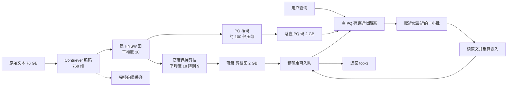

一句话解释：离线只落盘两样小东西，在线靠它们导航，真正的向量在需要时用原文现算。

这条链路值得一步步走一遍，因为全篇的省钱逻辑都挂在上面。

离线五步：

1. 读 76 GB 原文，按 256 token 切成块，得到六千万段。
2. 用 Contriever 给每块算一条 768 维向量。
3. 用这些向量建 HNSW 图。
4. 把图剪枝到平均度 9；把每条向量用 PQ 编成约 31 字节的码。
5. 只落盘两样：剪枝图的邻接表约 2 GB，PQ 码表约 2 GB。完整向量直接丢。

在线四步：

6. 查询算成向量，从入口点开始走剪枝图。
7. 每走到一个节点，先查 PQ 码算近似距离，只把最像的一小批取出来。
8. 对这一批，回到原文读出文本块、重新分词、重新过一遍嵌入模型，得到精确向量，算精确距离，塞进精确队列继续走。
9. 队列里精确距离最小的 3 个就是结果。

为什么这样能省：省掉的是纯开销，173 GB 向量加 15 GB 的边；留下的是本来就在你盘上的原文。第 8 步之所以划算，是因为图搜索只碰两万个节点，重算两万条嵌入在一张 4090 上是秒级的事。

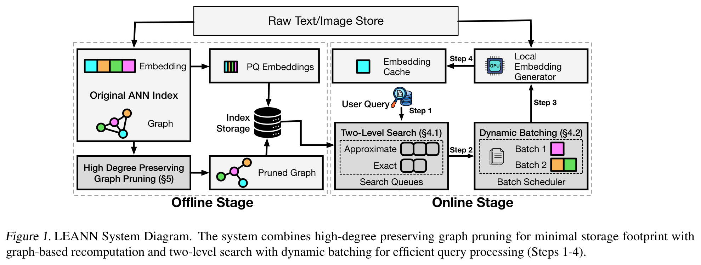

图 1（原文第 4 页）：这张图证明了整套系统的存储去向——离线阶段把原始图索引压成剪枝图加 PQ 码，在线阶段四个步骤全用来补重算的代价，两条搜索队列和批调度器是其中的关键部件。

### 4.2 模块拆解

**模块一：离线剪枝，把图的边砍掉一半**

为什么需要：删掉向量以后，剩下的图元数据仍有 15 GB。一个节点 64 条边、每条 4 字节是 256 字节，而一段典型文本块才 1 KB，光边就占了四分之一。

怎么做：按存储预算 $B$ 定一个最大度数 $M$，把度数最高的前 $\beta\%$ 节点当枢纽，允许它们保留到 $M$ 条边；其余节点只留 $m = M/5$ 条。建图时每个节点先搜出自己的候选邻居，再按这个额度连边。

公式（论文的剪枝目标）：

$$
\min\ T(G_1)=\sum_{i=1}^{ef} |V_i| \quad \text{s.t.}\ \ \mathrm{Space}(G_1)=\sum_{v\in V(G_1)} \deg(v)\, s_{\text{edge}} \le B,\ \ \mathrm{Acc}(G_1)\ge \tau
$$

先说这个公式在算什么：在存储不超过预算 $B$、精度不低于阈值 $\tau$ 的前提下，让查询时要重算的节点总数最少。

- $G_1$：剪枝后的图。
- $ef$：一次查询最多探索的轮数，也就是候选队列长度。
- $|V_i|$：第 $i$ 轮探索里需要重算嵌入的节点数，它们的和就是重算代价。
- $\deg(v)$：节点 $v$ 的出度。
- $s_{\text{edge}}$：存一条邻居编号的字节数，论文取 4 字节。
- $\tau$：允许的最低召回，实验按 90% 处理。

生活类比：城市要拆路省钱。全拆小巷会堵死，所以先保住环线和主干道（高度节点），只拆小区里那些绕来绕去的支路。

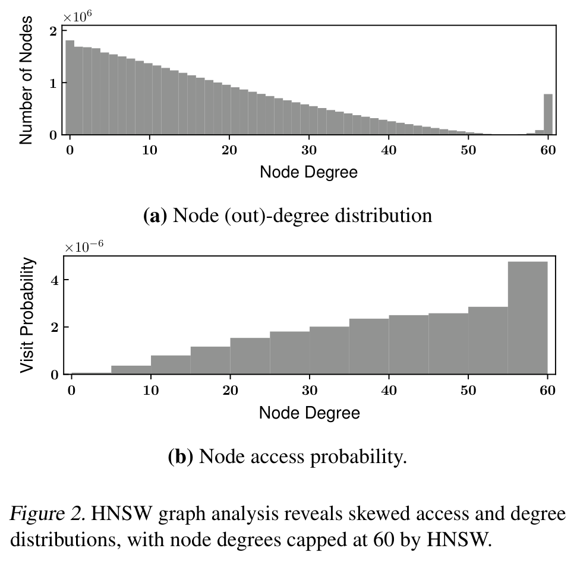

图 2（原文第 5 页）：这张图证明了为什么值得单独保住高度节点——(a) 度数分布是长尾，多数节点只有几条边，少数节点顶到 HNSW 的上限 60；(b) 访问概率随度数单调上升，55 到 60 这一档被访问的概率比低度节点高出一个量级。

**模块二：两级搜索，用近似距离决定谁不用重算**

为什么需要：全按精确距离走，每个新邻居都要重算，两万次会膨胀成几十万次。

怎么做：维护两个队列。近似队列 $AQ$ 存所有访问过的节点的 PQ 近似距离；精确队列 $EQ$ 存真正重算过的节点的精确距离。每一轮先把新邻居的近似距离算出来塞进 $AQ$，再从 $AQ$ 里挑近似距离最好的前 $\alpha\%$（排除已在 $EQ$ 里的），只对这批重算，重算完放进 $EQ$ 继续往下走。

公式（候选集的取法）：

$$
C=\operatorname{Top}_{\alpha\%}\bigl(AQ \setminus EQ\bigr)
$$

先说这个公式在算什么：从近似队列里挑出一小批值得花算力的节点。

- $AQ$：近似距离队列，键是 $(\text{节点}, \mathrm{Dist}(q,\tilde x_v))$，$\tilde x_v$ 是 PQ 还原出来的近似向量。
- $EQ$：精确距离队列，键是 $(\text{节点}, \mathrm{Dist}(q,x_v))$，$x_v$ 是现算出来的真实向量。
- $\alpha$：重排比例，控制每轮重算多少候选，越小越省算力，越大越稳。
- $C$：本轮真正要重算的节点集合。

生活类比：相亲先看照片筛一轮，只约最有希望的几位见面，见完再决定下一轮约谁。照片糊没关系，反正不用它下最终判断。

**模块三：动态批处理，把重算攒成一筐**

为什么需要：图上每一步的候选只有几个到几十个，逐条重算时 GPU 利用率极低。附录图 13 的拆解里，重算占一次批量查询 76% 的时间（76.5 ms，总约 100 ms）。

怎么做：不再严格按步推进，而是从候选队列里持续攒节点，攒到目标批大小就一起送进嵌入模型，代价是探索顺序有轻微滞后。

公式（批的累积条件）：

$$
|C_{\text{batch}}|\ \ge\ B_{\text{batch}}\ \Rightarrow\ \text{一次性重算 } C_{\text{batch}}
$$

先说这个公式在算什么：攒够了就一起算，不再一步一步等。

- $C_{\text{batch}}$：跨多个探索步累积起来的待重算集合。
- $B_{\text{batch}}$：批大小阈值，论文取 64，靠离线 profiling 定。

生活类比：攒一筐衣服再开洗衣机。一件一件洗，水和电全浪费在开机上。

**模块四：构建与更新，别在建索引时把磁盘撑爆**

为什么需要：建图阶段本来要给六千万段文本全算一遍嵌入，峰值存储会先爆掉，索引建完再省也没用。

怎么做：先在一小部分语料上跑 k-means 得到 $k$ 个中心，每条文本算完嵌入立刻分给最近的两个中心、然后丢掉嵌入，只留两个中心编号；再按中心分成 $k$ 个分片，逐片重算嵌入、建图、丢嵌入；最后把 $k$ 张图合并，重复节点取更高的 HNSW 层，下层边表合并后按 $M$ 随机丢弃超出的边。

公式（单条插入的复杂度，来自附录 B）：

$$
O(M\cdot ef_C + ef_C^2 + M^3)\ \longrightarrow\ O(M\cdot ef_C)
$$

先说这个公式在算什么：一次插入的开销从三次方降到一次方。

- $M$：最大出度。
- $ef_C$：建图时的候选队列长度。
- 三项分别对应邻居搜索、邻居筛选、反向边维护；加距离缓存、把 RNG 筛选简化成随机选择之后，三次项被消掉。

生活类比：搬家不要先把所有家具堆在客厅再慢慢摆，而是分房间搬，搬完一间清空一间。

**模块五：存储到底剩了什么**

公式（存储构成）：

$$
\mathrm{Storage} = \underbrace{4N\bar d}_{\text{剪枝图}} + \underbrace{\frac{4N\cdot \dim}{100}}_{\text{PQ 码}}
$$

先说这个公式在算什么：把索引体积拆成图的两项开销加上向量的那一项开销。

- $N$：文本块数，实验里 6000 万。
- $\bar d$：平均出度，剪枝后从 18 降到 9。
- $\dim$：向量维度，768。
- 第一项：每个节点存 $\bar d$ 个 4 字节邻居编号。
- 第二项：PQ 把每条 768 维 FP32 向量（3072 字节）压成约 31 字节。

代入 $N=6\times10^7$、$\bar d=9$：图约 2.16 GB，PQ 码约 1.84 GB，合计约 4 GB，正好对上表 1。

### 4.3 关键细节

- HNSW 基线用 $M=30$、$ef_{\text{Construction}}=128$，实际平均度 18、最大度 60。
- 剪枝的高低度数阈值取 $m=M/5$；枢纽节点取度数前 2%。
- 建图时允许所有节点和新插入节点连双向边到 $M$ 的上限，保证新节点有机会搭上枢纽。
- 重排比例 $\alpha$、批大小 64、剪枝的 $M$，论文都说靠离线 profiling 定，搜索空间和调参耗时原文未给。
- 更新用软删除：节点打删除标记，$O(1)$，删除比例超过 5% 才考虑后台重建，具体策略留作未来工作。
- 缓冲批量插入：新文本先放缓冲区，查询时把缓冲区和图的结果合并，查完再异步插入。

## 5. 实验结果

**实验设置**

- **数据集与切分**：检索库用 RPJ-Wiki，约 76 GB 原始维基文本，按 256 token 切块，得到 6000 万段。QA 用 NQ、TriviaQA、GPQA、HotpotQA 四个开放域基准，另加 FinanceBench（财报）、Enron 邮件、LAION 图片三组个人数据。每个 QA 集抽多少题、怎么切分，原文未给；召回的真值用精确搜索的结果代替（附录 C.2）。
- **骨干模型**：嵌入用 Contriever，110M 参数，输出 768 维；生成用 Qwen3-4B，多模态用 Qwen2.5-VL-7B-Instruct。全程不训练任何模型。
- **训练预算**：原文未给，因为没有模型训练。索引构建侧只给了一个数：分片合并把构建峰值存储降 5 倍（15 个分片，附录 D.1）。构建耗时、用了几张卡，原文未给。
- **基线**：HNSW（$M=30$，$ef_C=128$）、IVF（$nlist=8192$）、DiskANN（$M=60$）、IVF-Disk（mmap 版 IVF）、IVF-Recompute（按 EdgeRAG 思路自己实现的查询时重算）、PQ 压缩（压到 5 GB，略大于本文的 4 GB）、BM25（Pyserini）。
- **指标**：检索用 Recall@3，目标召回 90%；端到端用 EM 和 F1；延迟用秒，开销定义为检索时间除以检索加生成的总时间。
- **推理设置**：$k=3$；延迟测法是对 $ef$ 做二分搜索找到刚好达标的最小值，再在 20 条随机查询上取平均；生成温度、最大长度、提示模板，原文未给。

生活类比：这是一份体检报告，存储是体重秤上的数字（硬账，误差很小），延迟是跑步机上的读数（软账，和设备有关），精度是抽血结果（要同一批样本才可比）。

**主表**（只留能说明问题的行）

| 场景 | 指标 | 本文 | 最强基线 | 差距 |
| --- | --- | --- | --- | --- |
| RPJ-Wiki 索引体积 | GB | 4 | 188（HNSW） | 小 47 倍 |
| NQ RAG | EM % | 26 | 26（HNSW） | 持平 |
| NQ RAG | F1 % | 38 | 38（HNSW） | 持平 |
| NQ 检索 @90% 召回 | 秒 | 2.48 | 0.05（HNSW，最快但装不下） | 慢 50 倍 |
| NQ 检索 @90% 召回 | 秒 | 2.48 | 307.61（IVF-Recompute，同为省存储） | 快 124 倍 |
| NQ 端到端 RAG | 秒 | 23.34 | 20.95（HNSW） | 慢 11.4% |

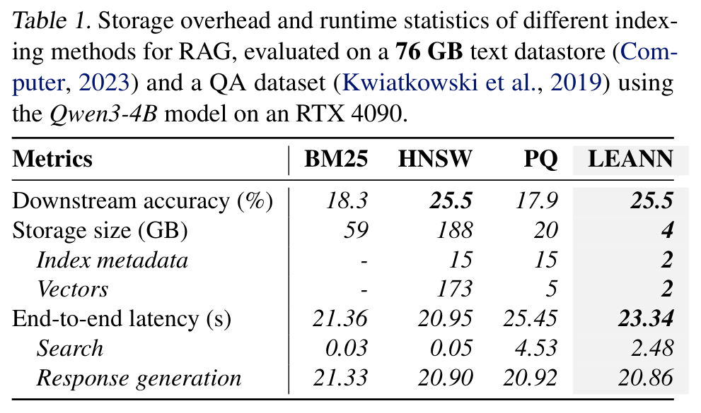

表 1（原文第 1 页）：这张表证明了代价被搬到了哪里——LEANN 把 188 GB 压到 4 GB，精度与 HNSW 打平，代价全落在检索时间上（0.05 秒变 2.48 秒），端到端只多 2.39 秒。

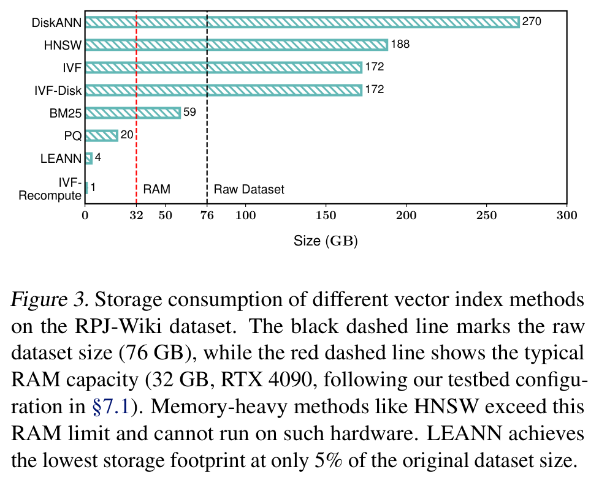

图 3（原文第 7 页）：这张图证明了别的方法为什么在个人设备上跑不起来——DiskANN 270 GB、HNSW 188 GB、IVF 172 GB 全都越过 32 GB 内存线和 76 GB 原文线，只有 LEANN 的 4 GB 和 IVF-Recompute 的 1 GB 在线下，而后者延迟不可用。

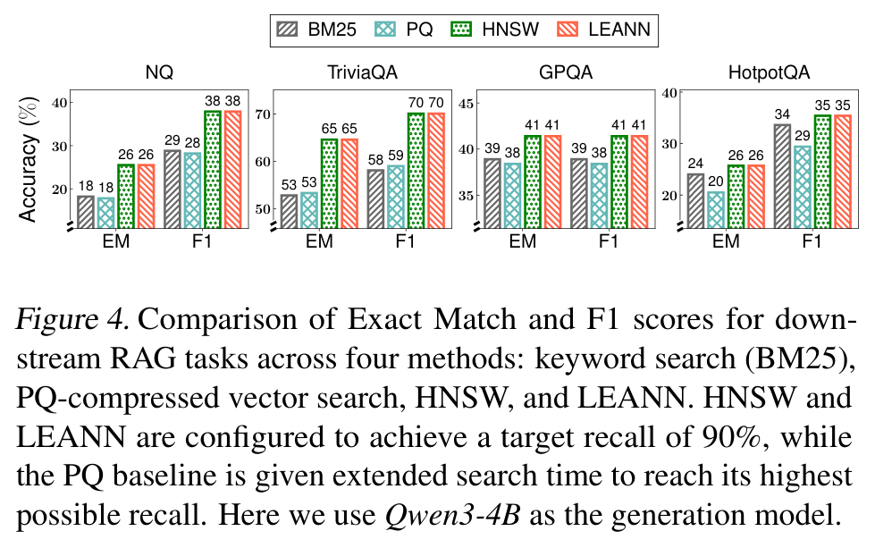

图 4（原文第 9 页）：这张图证明了省存储没换来精度损失——四个数据集上 LEANN 与 HNSW 的八根柱子高度完全一致，对 BM25 和 PQ 的领先集中在 NQ 与 TriviaQA 这类事实型问答，HotpotQA 和 GPQA 上差距很小。

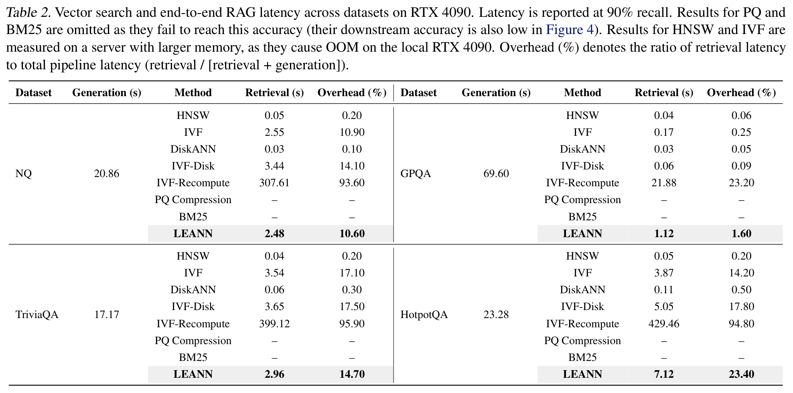

表 2（原文第 8 页）：这张表证明了代价藏在哪儿——LEANN 的检索要 1.12 到 7.12 秒，是 HNSW 的几十倍，但生成要 17 到 70 秒，摊到端到端只剩 1.6% 到 23.4%。

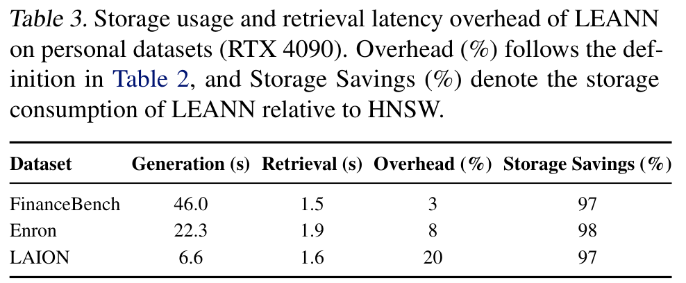

表 3（原文第 8 页）：这张表证明了结论不只对维基百科成立——换成财报、邮件、图片三种个人数据，相对 HNSW 省下 97% 到 98% 的存储，端到端开销 3% 到 20%。

**消融告诉我们什么**

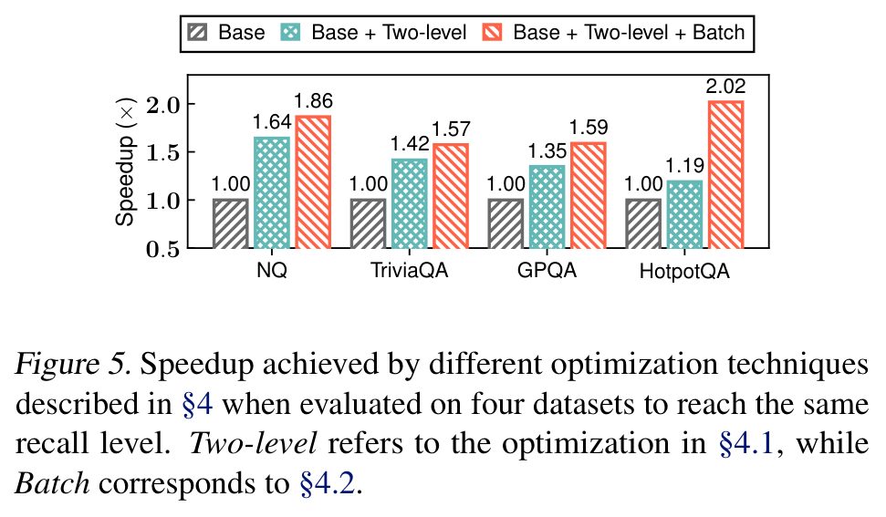

图 5（原文第 9 页）：这张图证明了两个延迟优化各值多少——两级搜索把速度提到平均 1.40 倍，再叠批处理到平均 1.80 倍；HotpotQA 从 1.19 倍跳到 2.02 倍，说明搜索路径越长越吃批处理的红利。

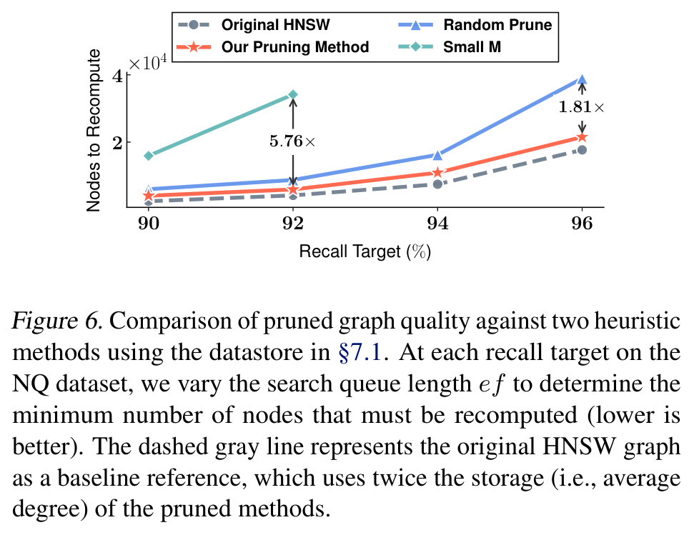

图 6（原文第 9 页）：这张图证明了剪枝方式比剪掉多少更要紧——同样把平均度从 18 砍到 9，本文曲线几乎贴着未剪枝的 HNSW，随机删边要多算 1.81 倍，统一压小 $M$ 要多算 5.76 倍，而且 94% 召回以上直接够不着。

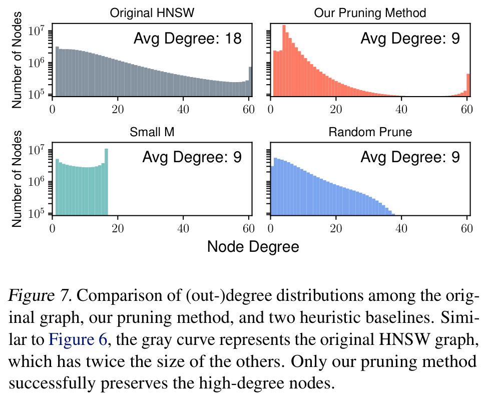

图 7（原文第 9 页）：这张图证明了增益的来源就是枢纽——只有本文的方法在度数 60 处保留了尖峰，Small M 把度数封在 18，随机删边最远只到 38。

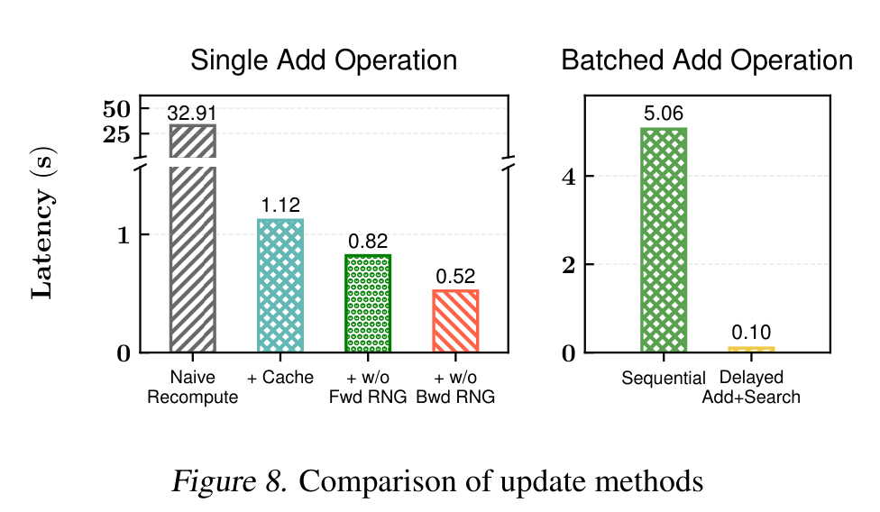

图 8（原文第 10 页）：这张图证明了更新路径也被认真优化过——单条插入从 32.91 秒降到 0.52 秒，批量插入用延迟插入把 5.06 秒降到 0.10 秒。

其余只提数字不裁图（附录 D）：换成 33M 的 gte-small，端到端快 2.3 倍、精度掉 2 个点以内；缓存 10% 的热向量换 1.5 倍加速、命中率 41.9%；一次批量查询里 GPU 重算占 76.0%，CPU 分词占 16.1%，IO 占 8.0%。

**这些实验够不够支撑结论**

够的部分：存储是确定性的账，4 GB 对 188 GB 不依赖测量口径；精度在四个数据集上与 HNSW 逐项相等，这个结论很硬；延迟在 RTX 4090 和 M1 Ultra 两套硬件上都测了，方向一致。

不够的部分：只报了一次测量，没有方差也没有重复次数；QA 集抽了多少题没说，EM 的置信区间未知；加速卡只有一档；构建耗时、显存占用、嵌入模型加载时间都没报，而这些在端侧恰好是痛点；EdgeRAG 没有直接对比，只用自己实现的 IVF-Recompute 当代理；Mac 上 HNSW 和 IVF 直接 OOM，表 4 的对比里少了最强基线。

## 6. 局限性

**作者自己承认的**

- 图合并用的是随机丢边的启发式，RNG 之类的更好合并策略留作未来工作。
- 软删除超过阈值后什么时候重建，策略留作未来工作。
- 剪枝的 $M$ 要靠离线 profiling 定，没给自动选法。
- 只做单跳检索，HotpotQA 这类多跳问题增益很小。

**我看出来的**

- 隐形假设：原文必须一直留在本地、且能反复重算。如果原文被删、被加密，或者嵌入模型换了版本，索引里的 PQ 码和重算出来的向量就不在同一个空间里，整套索引失效。论文没有讨论模型版本漂移。
- 边界条件：重算有 76% 的时间花在 GPU 上。没有独显、或者 GPU 被别的任务占着，2.48 秒会成倍拉长，那时候省下的存储换来的是不可用的体验。
- 缺的对比：没有和 MicroNN、ObjectBox 这类端侧向量库做端到端对比，也没有和用蒸馏小模型做近似的方案比。
- 这笔账只在一种场景成立：生成时间远大于检索时间。如果换成短回答、或者产品盯首字延迟，10% 到 23% 的端到端开销立刻显形，因为检索本身慢了 50 倍。

生活类比：把冰箱里的食材全扔了，只留一本菜谱，每次做饭现去菜市场买。冰箱腾出来了，但你家楼下必须永远有个菜市场，而且你得会做饭。

## 7. 一句话总结

它把向量索引从存数据改成存线索：留一张便宜的地图（剪枝图）和一张模糊的照片（PQ 码），真正需要看清楚时，回到原文现场重算一遍。类比：图书馆只保留书目卡片和缩略图，书还在架上，要读哪本现去取。

核心公式（本文的账本）：

$$
\boxed{\ \mathrm{Storage}=4N\bar d+\frac{4N\cdot\dim}{100}\ \ll\ 4N\dim\ }
$$

左边两项是图和码，右边是传统索引要存的完整向量。$N=6\times10^7$、$\bar d=9$、$\dim=768$ 时，左边约 4 GB，右边约 184 GB。

## 8. 可复用点

- 如果我要在自己的项目里用：先把检索延迟从端到端里单独拆出来测。只要生成占掉九成时间，就值得把向量表删掉换成重算。
- 直接可搬的参数起点：PQ 压 100 倍（768 维压到约 31 字节）；图剪枝把平均度砍一半；枢纽节点取度数前 2%，额度 $M$，其余 $M/5$；批大小 64。
- 查重算吞吐：先看 GPU 利用率，低于三成就是批太小，把批大小往上加，别急着换索引。
- 做增量更新时：新数据先进缓冲区，查询时把缓冲区和主图的结果合并，查完再异步插入，能省掉一次全量重建。
- 想再降延迟：把最热的 10% 向量物化到盘上，实测 1.5 倍加速、命中率 41.9%，代价是存储从 4 GB 涨到 22 GB。
- 换小嵌入模型比换索引更划算：33M 的模型换 2.3 倍端到端加速，精度只掉 2 个点，前提是重算确实是瓶颈。

## 9. 我的疑问

- 贡献列表写的是 90% top-3 召回在一秒内完成，但表 2 里达到 90% 召回要 1.12 到 7.12 秒，只有 GPQA 接近一秒。v1 摘要写的是两秒，v2 改成了一秒，数字没跟着改？
- 表 2 的 HotpotQA 开销是 23.4%，表 3 的 LAION 是 20%，正文却说 consistently adds less than 20%。这句和下表的数字对不上。
- 正文说比 IVF-Recompute 快两个数量级、最多 200 倍，按表 2 算是 124 倍（307.61 除以 2.48）和 135 倍（399.12 除以 2.96），没到 200。
- 图 4 的增益写成 EM 最高提升 11.8%、F1 最高 12.0%，但图上是 53 到 65 这样的绝对差 12 个点。到底是相对提升还是百分点，原文没写清。
- 摘要说索引小于原文的 5%，按表 1 算是 4 除以 76 等于 5.3%。差得不多，但口径不统一。
- 附录 D.2 正文写 gte-small 有 34M 参数，图 11 的图例写 33M。
