> 一句话：把网页先拍成图，再检索图、读图，整条链路不过文本。

PDF 来源：本机 Zotero 库（DOI 10.48550/arXiv.2606.28344）。

## 0. 读之前你需要知道

**术语卡**

- **RAG（检索增强生成）**：先翻资料，再让模型带着资料答题。生活类比：开卷考试，答题前先翻到相关那几页。
- **HTML 解析（HTML-to-text parsing）**：把网页源码里像正文的部分抽成纯文本。生活类比：把一份带表格的体检报告用语音念给你听，格式全丢。
- **VLM（视觉语言模型）**：既认图又认字的模型。生活类比：一个能看懂 PPT 截图的同事，你把图丢过去，他能念出第七行的小字。
- **嵌入模型（embedding model）**：把一段内容压成一串数字，内容越像数字越像。生活类比：给每本书算一个指纹，找相似的书就比指纹。
- **瓦片（tile）**：一张长截图按固定高度切出来的块。生活类比：把一卷长卷轴剪成 A4 大小的一叠纸。
- **视觉 token**：图喂给模型时会被切成小格，每格都要付上下文成本。生活类比：快递按件计费，图越大件数越多。
- **对比学习与 InfoNCE**：训练时把正确答案拉近、把错误答案推远。生活类比：教狗认球，拿球给奖励，拿石头就摇头。
- **难负样本（hard negative）**：长得像答案、但不含答案的样本。生活类比：考试里的干扰项，四个选项都在同一章，必须认真分辨。
- **单向量检索 vs 多向量检索**：一个块只存一个指纹，还是存一串指纹做细粒度匹配。生活类比：一个人一张证件照，还是一整本多角度写真集。

**它站在谁肩上**

- DPR（2020）：问题和文档都变成向量做检索，文本 RAG 的标准做法。不够在哪：默认你已经有一份干净文本。
- ColPali（2025）：直接给 PDF 页面截图做嵌入，证明检索可以不过 OCR。不够在哪：只在小规模精选文档上做。
- VisRAG（2025）：用页面图像同时做检索和生成。不够在哪：仍在几千页量级，不是开放域网页。
- trafilatura（2021）：目前最好的网页正文抽取器之一。不够在哪：它本身就是本文要绕开的那道会丢信息的工序。
- DeepSeek-OCR 与 Glyph（2025）：证明把文字渲成图有时比纯文本更省 token。不够在哪：只关注压缩，不涉及检索。

## 1. 动机

先讲个场景。你让助理查 2010 年欧冠决赛国米射正几次。助理把维基那页印成纯文字，表格变成一排竖线，射正那一行正好被压成空的。他回你：资料里没写。可答案就在页面上那张小表里，第四行写着 Shots on target 7。问题不出在资料，出在把页面变成文字这一步。

**以前怎么做**：网页源码（HTML）先过一遍抽取器，得到纯文本，按 1024 个 token 切块，块转成向量进索引；来问题时检索 top-k 块，塞给语言模型读。

**为什么不行**：三层损失，一层比一层隐蔽。

第一层是抽取时丢东西。图、图表、版面直接没了，表格被拉平成一串字。论文引用的一项研究说，单个抽取器可能丢掉 40% 以上可恢复的网页文本。

第二层是版面变一维。就算内容全在，两栏布局、字号层级、加粗强调，在 token 序列里都消失了。人在网页上靠这些线索定位信息，模型读到的却是一段没有路标的文字。

第三层最反直觉，是检索被稀释。维基右侧的信息框（infobox）线性化后变成关键词极密的字符串，几乎能和任何关于这个实体的问题匹配。于是它稳居第一，真正含答案的正文段落被挤到第 60 名开外。论文在 SimpleQA 上把这类失败单独统计了出来。

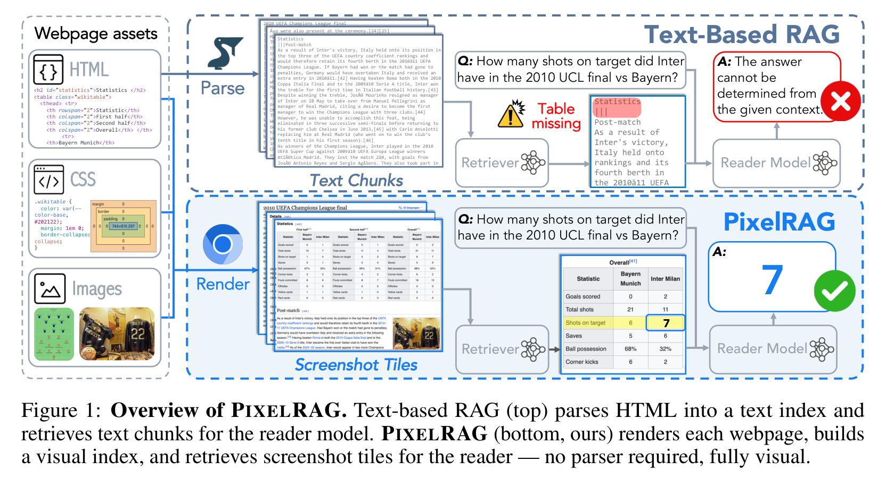

图 1：这张图证明了差别发生在流水线的形状上——上排文本路线在解析时把统计表压没了，检索器只能捞到 Post-match 那段散文，reader 只好答「无法从给定上下文确定」；下排像素路线把渲染后的一屏原样交出去，reader 直接从表里读出 7。

**为什么现在能做**：三件事同时到位。VLM 读像素文字的能力在这一代明显跃升，论文自己测出阈值大约在 Qwen3-VL-4B 附近；一屏 875×1024 的瓦片只花约 875 个视觉 token，和 1024 token 的文本块同量级，成本没失控；渲染与存储便宜到能把 700 万篇维基做成 3000 万张瓦片，索引 120 GB，一台机器装得下。

## 2. 贡献

- **第一次把纯像素 RAG 做到整库规模，并且在文本中心任务上也赢**。证据：维基全量 700 万篇、3000 万瓦片；Table 1 六个基准全胜，SimpleQA 78.8 对最强文本基线 71.6。
- **一套可复现的截图建库流水线**。证据：抓取与渲染解耦后，离线管线 2 天跑完 700 万篇（128 核、2 TB 内存、8 张 H100），平均每篇约 4.2 张瓦片。
- **面向截图的嵌入微调配方**。证据：合成查询加假负样本过滤再加 ViT 解冻，迷你库准确率从基座的 0.725 提到 0.793（Table 4）。
- **把图像分辨率变成省 token 的新旋钮**。证据：2 倍压缩下微调过的 reader 仍有 72% 准确率，约三分之一成本；3 倍压缩几乎追平未压缩。

用一句话打比方：过去是把图书馆每本书抄成文字再去查，这篇把整座图书馆拍成照片，然后直接查照片。

## 3. 创新点

- **检索单元从文本块换成渲染后的瓦片，全程没有解析器**。对比对象：所有文本 RAG，以及 ColPali、VisRAG 这类只在 PDF 小库上做的视觉检索。有用是因为：网页里答案经常长在表格和信息框里，这两样恰好是解析器最会弄坏的地方。
- **单向量加 2048 维的规模取舍**。对比对象：ColPali 系的多向量晚交互。有用是因为：3000 万瓦片下多向量索引要 6.5 TB，单向量只要 120 GB，一台机器装得下，而且实测足够准。打比方：给每本书只拍一张封面照，柜子放得下；整本写真集查得准，但柜子放不下。
- **ViT 也上 LoRA**。对比对象：ColPali 与 Swift 只给 LLM 主干上 LoRA。有用是因为：网页瓦片彼此长得极像，都是白底黑字两栏，需要更细的视觉分辨力，冻结 ViT 分不出来。Table 4 上这一步带来 0.770 到 0.793。
- **假负样本过滤**。对比对象：朴素难负样本挖掘（直接取 top 排名非正样本）。有用是因为：同一事实常出现在多个页面，不滤掉就会把正确答案当负样本惩罚。Table 4 上难负样本挖掘本身带来 0.723 到 0.770 的最大一跳。
- **分辨率当省 token 旋钮**。对比对象：文本 RAG 只能靠减 k 省钱。有用是因为：像素数和 token 数成正比，缩放既不重建库也不换检索器，只换喂给 reader 的图。

## 4. 方法

### 4.1 整体流程

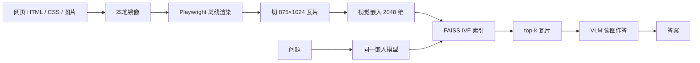

左边建库只做一次，右边每次提问只做一次嵌入加一次近邻搜索，然后把图直接丢给 VLM，中间没有任何文本转换。

### 4.2 模块拆解

**建库：把抓取和渲染拆开**

为什么需要：直接开浏览器逐页截图，700 万页要跑一个月左右。慢在两处：抓网页资源是网络等待，浏览器本身也不是为高并发渲染设计的，会频繁超时重试。

怎么做：先把整包资源抓到本地（维基用 Kiwix 的 ZIM 离线包，新闻站用异步爬虫并行抓域名），之后纯离线用 Playwright 的无头 Chromium 渲染。渲染后剥掉导航栏、侧栏和留白，只留正文区；超长页面滚动截全。最后按视口宽 875 像素、高 1024 像素不重叠切块。

结果：约 3000 万张瓦片（维基 713 万篇，平均 4.2 张一篇），新闻 66.8 万篇、360 万张瓦片。图片存储 5.6 TB 加 469 GB。

**索引：为什么只能用单向量**

为什么需要：多向量晚交互（每张图发一串 token 向量、打分时逐个对齐）精度更好，但一张瓦片发约 875 个视觉 token、每个 128 维，一张就是约 11.2 万维。3000 万张按 fp16 算约 6.5 TB，单机内存放不下。

怎么做：整张瓦片压成一个 2048 维向量，全库 fp16 约 120 GB。用 FAISS 的 IVF 做近似最近邻，支持增量增删，可以每天进新闻、定期刷维基快照而不用全量重建。

**嵌入微调：合成查询加剧负样本**

为什么需要：Qwen3-VL-Embedding-2B 是在通用图文对上训的，没见过网页截图配问题这种数据。

怎么做分三步。

第一步出题。先筛信息密度高的瓦片：渲染高度至少 3000 像素、剔掉消歧页和各命名空间页、只从一页的前 70% 取瓦片（避开页脚和参考文献）。然后让 LLM（gemini-3.1-flash-lite）看图出一道答案就在图里的题。

第二步两道过滤。自足性检查：问题不能出现指代这张截图的说法，用 gpt-4o 判，这一步丢掉 15.1% 的候选对（195,079 降到 165,537）。可答性检查：只给这张图让 LLM 回答，答对才留下。

第三步挖难负样本并过滤假负样本。用基座模型对问题取 top-20，跳过正样本，逐个让 LLM 只拿候选图回答，判成 CORRECT、WRONG、CANNOT_ANSWER 三档。判 CORRECT 说明这张邻居图其实也能答题，是假负样本，丢掉；其余留作难负样本，取前 M=2 个。凑不满 2 个就整条样本丢掉。

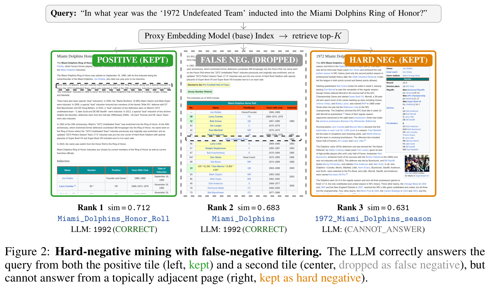

图 2：这张图证明了过滤是必要的而不是锦上添花——中间那张 Miami_Dolphins 页面排第二，看起来该当负样本，但模型只拿它也能正确答出 1992，说明它是假负样本，必须丢；右边 1972 赛季页才是真负样本，同主题但答不出，留下。

损失用 InfoNCE：

$$
\mathcal{L} = -\frac{1}{B}\sum_{i=1}^{B}\log
\frac{e^{\mathrm{sim}(q_i,p_i)/\tau}}
{e^{\mathrm{sim}(q_i,p_i)/\tau}+\sum_{j=1}^{M}e^{\mathrm{sim}(q_i,n_{i,j})/\tau}+\sum_{k\neq i}e^{\mathrm{sim}(q_i,p_k)/\tau}}
$$

先说它在算什么：一个 batch 里，每个问题要在一堆候选瓦片中把自己的正样本挑出来。分母里既有难负样本，也有同 batch 里别人的正样本。

- $B$：batch 大小，训练用 64
- $q_i$：第 i 条合成问题，2048 维向量
- $p_i$：对应的正样本瓦片，2048 维向量
- $n_{i,j}$：第 j 个难负样本，$M=2$
- $\mathrm{sim}(\cdot,\cdot)$：余弦相似度，取值 -1 到 1
- $\tau$：温度，控制分布的尖锐程度，原文未给具体值
- $\sum_{k\neq i}$：in-batch 负样本，把同批其他人的正样本也当负样本

**运行时检索与生成**

问题用同一个嵌入模型编码，按内积取 top-K 瓦片，直接以像素喂给 VLM reader 出答案。两个成本旋钮：取几张瓦片（K），以及瓦片送进 reader 前降到多低的分辨率（875×1024 可以降到 437×512，token 约四分之一）。

**可选：为低分辨率重训 reader**

为什么需要：直接把瓦片降采样，reader 会掉点，2 倍掉 5.1 个百分点，3 倍掉 16.7 个百分点。

怎么做：复用上一步已经产出的（问题、瓦片、答案）三元组，答案是可答性检查顺带拿到的，不额外标注；再配上检索出来的干扰瓦片，把瓦片降采样后做有监督微调。损失是标准的答案 token 交叉熵：

$$
L_{\text{SFT}} = -\,\mathbb{E}_{(q,T,a)}\sum_{t}\log P_{\phi}\!\left(a_t \mid T, q, a_{<t}\right)
$$

这个式子在算什么：给 reader 一组瓦片 $T$ 和问题 $q$，让它逐字生成标准答案 $a$，每一步都最大化正确 token 的概率。

- $T$：检索到的瓦片集合，含正样本和干扰项
- $\phi$：reader 的参数
- $a_t$：答案的第 t 个 token
- $a_{<t}$：已经生成的前缀

### 4.3 关键细节

- 视口宽 875 像素（维基正文区默认宽），瓦片高 1024 像素、不重叠、最后一张可以短。
- 一张瓦片的视觉 token 数约 $875\times1024/16^2/4 \approx 875$：16 是 ViT 的 patch 边长，投影层把相邻 4 个 patch 合成一个。
- 嵌入 2048 维；全库 fp16 约 120 GB。
- 训练集约 4 万条合成问题-瓦片对；batch 64；用 GradCache 分块（块大小 4）把有效 batch 和显存解耦；每个问题 2 个难负样本；峰值学习率 7e-6，20 步 warmup，余弦衰减；单张 H100 约 3 小时。
- LoRA 同时加在 LLM 主干和 ViT 上。
- 建库整条离线管线：单机 128 核、2 TB 内存、8 张 H100，约 2 天。
- 文本基线切 1024 token 一块，和一张瓦片的约 875 视觉 token 对齐，保证两边 token 预算可比。

## 5. 实验结果

**实验设置**

- **数据集与切分**：六个基准分三族。文本中心维基 QA：NQ（1000 题）、NQ-Tables（1000）、SimpleQA（1000）。多模态维基 QA：MMSearch（300 题，其中 171 带查询图、129 纯文本）、Encyclopedic VQA（749 题，只取 landmarks 子集的自动题）。新闻：LiveVQA（6632 题，只留 CNN、BBC、AP，Forbes 与 Variety 因反爬剔掉）。前五个查同一个 3000 万瓦片维基库，LiveVQA 查 66.8 万篇新闻库（360 万瓦片）。智能体任务用 MoNaCo 全量 1315 题。嵌入消融另建迷你库：400 题、7426 张瓦片（金标文章全部瓦片加基座模型 top-100）；reader 微调用 500 题留出集。
- **骨干模型**：检索器 Qwen3-VL-Embedding-2B（含微调版）；默认 reader Qwen3.5-4B；5.6 节扫了 31 个 reader，从 LLaVA-1.5-7B 到 Qwen3.5-397B-A17B，含推理模式。智能体控制器是 GPT-5。
- **训练预算**：嵌入微调约 4 万条对、batch 64、单张 H100 约 3 小时；建库 2 天、8 张 H100。reader 微调的轮数与学习率原文未给。
- **基线**：无检索；两条文本检索，只差解析器（trafilatura 与 mwparserfromhell），文本索引 1024 token 块、同一嵌入模型、同一 FAISS 索引。作者自己另加了两组 HTML 对照（检索文本但喂 HTML，以及整条 HTML 原生管线）。智能体实验多两条：Google（SerpApi）与 DS-Serve。
- **指标**：端到端准确率用 GPT-4.1 当裁判（温度 0、seed 42、max_tokens 1000），分 CORRECT、INCORRECT、NOT_ATTEMPTED 三档，只有 CORRECT 算 1 分；LiveVQA 是五选一，按字母精确匹配，不用 LLM 裁判。Recall@k 指 top-k 里有没有来自金标文章的项（按 URL 匹配）。MoNaCo 用 token 级 F1，因为答案常是多值列表。
- **推理设置**：默认 k=3、reader 不做思维链；5.2 节扫 k 从 1 到 3，压缩实验扫 k 从 1 到 5；MoNaCo 里 agent 最多发 20 次搜索、每次取 top-5。reader 解码的采样温度原文未给。

主结果按能说明问题的行提炼如下。

| 数据集 / 任务 | 指标 | 本文 | 最强基线 | 提升 |
| --- | --- | --- | --- | --- |
| NQ | Acc | 58.7 | 55.9（Trafilatura） | +2.8 |
| NQ-Tables | Acc | 48.8 | 42.5（Trafilatura） | +6.3 |
| SimpleQA | Acc | 78.8 | 71.6（Trafilatura） | +7.2 |
| MMSearch | Acc | 28.3 | 25.3（mwparserfromhell） | +3.0 |
| Encyclopedic VQA | Acc | 45.1 | 31.5（mwparserfromhell） | +13.6 |
| LiveVQA | Acc | 70.0 | 59.0（Trafilatura） | +11.0 |
| MoNaCo（智能体） | F1 与成本 | 同成本下 F1 最高 | Google、DS-Serve、文本块 | 成本低 2 到 4 倍 |

三处细节值得单独记下。第一，微调在 NQ、NQ-Tables、SimpleQA、EVQA 上都有增益，在 MMSearch 上原地踏步（28.3 到 28.3），在 LiveVQA 上反而略降（70.3 到 70.0）。第二，EVQA 的检索召回从文本的 6.5 提到 35.0，五倍多，说明图像能力是这类题的硬门槛。第三，MoNaCo 那一行原文只给了图，没给完整数值表。

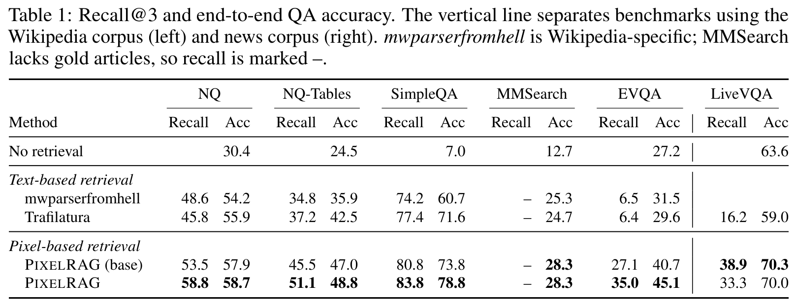

表 1：这张表证明了像素检索在六个基准上全面领先文本检索，连最像纯文本题的 NQ 和 SimpleQA 都赢，说明优势不是靠多模态题撑起来的。

### 5.1 为什么像素会赢：先看解析丢了什么

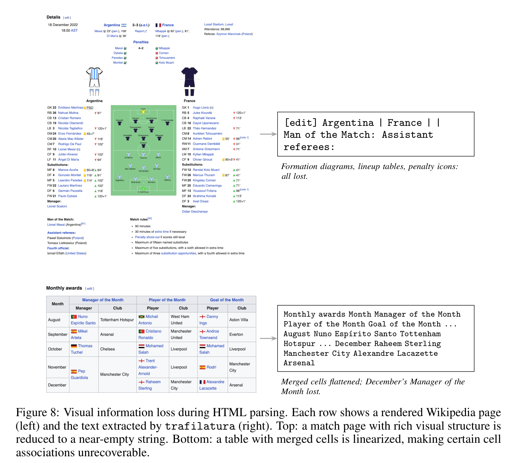

图 8：这张图证明了损失发生在解析这一步而不是模型这一步——左边一张带阵型图、点球图标和球员表的比赛页，被 trafilatura 抽成只剩 Man of the Match 和一串裁判名；右边带合并单元格的月度奖项表，线性化后 12 月的月度最佳教练整条对不上年份。

论文更进一步，按答案所在的版面元素把 SimpleQA 拆开统计。

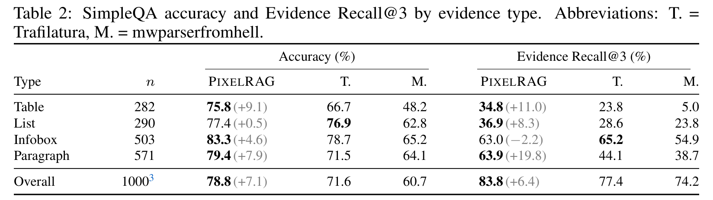

表 2：这张表证明了优势集中在表格和段落两类证据上——表格准确率 75.8 对 66.7 对 48.2，证据召回 34.8 对 23.8 对 5.0；段落类证据的召回差距最大（63.9 对 44.1），因为线性化后的信息框会挤占排名。信息框那一行像素反而略低（63.0 对 65.2），说明不是全面更好。

失败模式拆得更细：文本侧的失败里，解析损失占 36.6%，排名损失占 55.2%，读不懂占 8.2%。排名损失里 44% 是同一种病：文章自己的信息框稳坐第一。文本检索有 75.9% 的查询把文章第 0 块（信息框）排在第一，像素检索是 67.1%。一个具体例子：问达利母亲哪年去世，文本把达利本人的信息框排第一，真答案段落掉到第 12；问谢泼德是哪位总统提名的，答案段落到第 66。

### 5.2 消融：到底是哪一部分在起作用

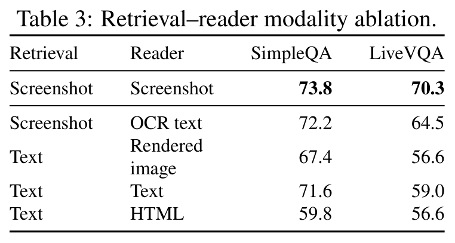

表 3：这张表证明了增益主要来自检索模态而不是阅读模态——同样是文本 reader，截图检索 72.2 就高于文本检索 71.6；反过来，文本检索配渲染图只有 67.4。把 HTML 直接喂 reader 更差（59.8），因为标签把上下文撑大 3.8 倍（7601 字符变 28941 字符）。

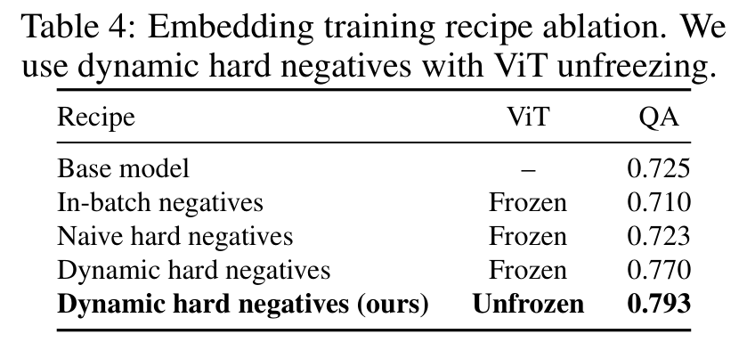

表 4：这张表证明了训练配方的每一层都有用，且最大一跳来自难负样本挖掘（0.723 到 0.770），ViT 解冻再补上 0.793。注意这张表是在 400 题迷你库上评的，和表 1 的绝对数值不是一个口径。

解析器本身也有天花板。

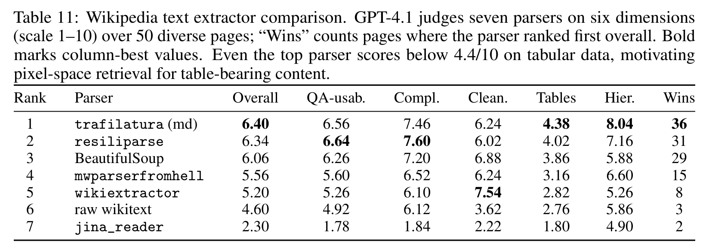

表 11：这张表证明了这不是选错解析器的问题——七个解析器里最好的 trafilatura 总分 6.40，但在表格这一维只有 4.38，没有一个超过 4.4。合并单元格、跨行跨列的对齐关系，任何线性化都留不住。

### 5.3 成本：多取几张、压多小

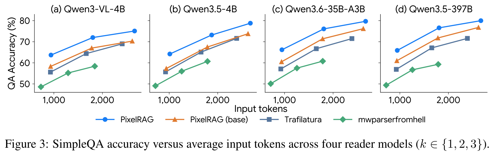

图 3：这张图证明了像素检索不是靠堆 token 换准确率——四条曲线里蓝线在同一 token 预算下始终最高，两个瓦片就能顶三块文本；而且换更强的 reader，四条线整体上移，蓝线与灰线的间距还略微拉大。

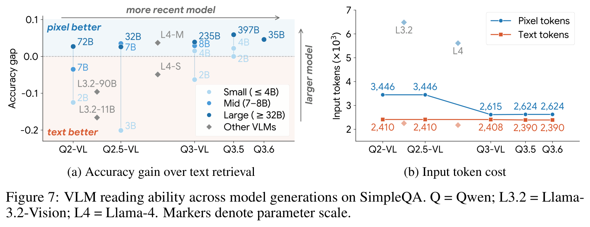

图 7：这张图证明了存在一个能力阈值——左图横轴按模型代际排，纵轴是像素减文本的准确率差，零线以上是像素赢；Qwen2 与 Qwen2.5 一代整体在零线以下（最差超过 12.5 个百分点），从 Qwen3-VL 起翻到零线以上，Qwen3.6-35B-A3B 到 +4.6 个百分点。右图顺带说明同一张瓦片在更新一代模型里花的 token 更少（3446 降到 2624）。

### 5.4 智能体场景：检索步数变少

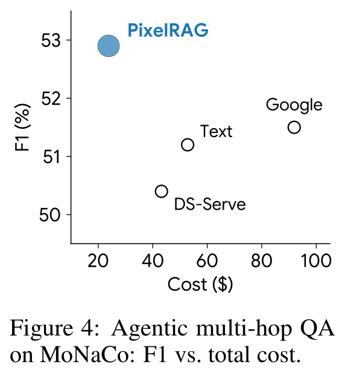

图 4：这张图证明了像素检索在智能体里同时更准和更省——MoNaCo 上 F1 最高的点（约 53）刚好落在成本最低的位置（约 25 美元），Google 和文本块都要 80 到 100 美元才拿到 51 到 51.5 的 F1。原因在论文里给了数字：一次检索返回的信息更多，agent 需要的搜索次数更少，累计提示 token 是 360 万对 3750 万，差十倍。

### 5.5 压缩：像素独有的省钱方式

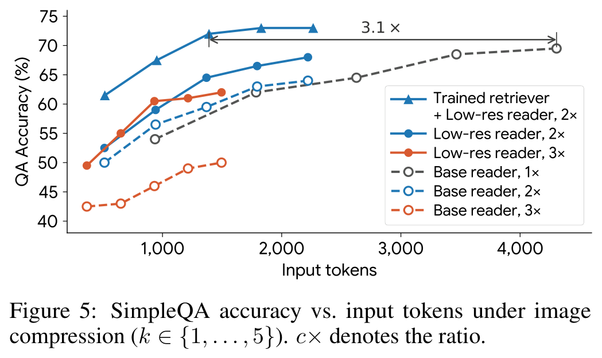

图 5：这张图证明了分辨率可以当连续的省钱旋钮——最上面那条线（微调检索器加 2 倍压缩 reader）在 k=3 时到 72%，超过了未压缩、k=5 的天花板，而 token 只要三分之一；只看 reader 微调，2 倍压缩能补回全部损失（平均 0.947，比 1 倍未压缩的 0.905 还高），3 倍压缩基本追平。

### 5.6 这些实验够不够支撑结论

支撑得住的部分：结论是像素检索在多个基准上更好，这一条有六个基准、两种语料、两条文本基线、多组消融相互印证，比较扎实。模态消融还专门把检索和阅读拆开，说明不是靠 reader 更强。

不够的部分：单向量与多向量没有在同规模下比过精度，只有存储账和一句足够准；新闻域微调不迁移（70.3 掉到 70.0）只有一句解释；没有报多次运行的方差；MoNaCo 只给图不给表。

## 6. 局限性

**作者自己承认的**

- 超链接结构丢了。像素里链接只是蓝色下划线，系统没法顺着点过去，多跳推理和实体消歧少了一类信号。作者的缓解方案是渲染时把链接 URL 和锚文本抽出来存成元数据。
- 存储开销大。维基一份截图库就接近 6 TB。缓解方案是渲染按需：嵌入存好之后把图删掉，检索命中再按 HTML 现场重渲。
- 只有英文。维基和三家新闻都是英文。

**我看出来的**

- 隐形假设：答案能被一屏里的一小块回答。跨屏拼证据的题这套方法没有专门验证，MoNaCo 上只给 F1 对成本的图，不给显著性。
- 边界条件：方法绑在 reader 能力上。低于 Qwen3-VL-4B 一级，像素检索反而输给文本，最差超过 12.5 个百分点。这不是调参能补的，只能等模型换代。
- 缺的对比：多向量检索只在存储账里被否掉，没在同等规模做精度对比。也就是说，单向量可能是被规模逼出来的妥协，而不是最优选择。
- 评测口径不完全对等：Recall@k 按 URL 匹配，一张瓦片天然就是文章的一屏，文本块 1024 token 也可能来自同一文章，两边的命中粒度并不一样。这是我的推断，原文没有讨论。
- 训练同源风险：合成问题全部来自维基瓦片，评测也在维基。论文强调 benchmark 是分布外（问题与标签没进训练），但页面风格、渲染管线、字体排版都是同源。新闻域微调没有增益，恰好侧面说明这份红利不跨域。这也是我的推断。

## 7. 一句话总结

与其把网页翻译成文字再检索，不如直接检索网页的照片——因为网页上的表格、信息框和排版本身就是信息的一部分，翻译一次就丢一次。

核心公式（这张论文的成本口径，决定了它做不做得起）：

$$
\boxed{\text{一张瓦片的视觉 token} \approx \frac{875\times1024}{16^2\times 4}\approx 875 \;\approx\; \text{一个 1024-token 文本块}}
$$

它说明为什么这条路能走通：像素检索没有比文本更贵，一个检索单元的成本和一块文本几乎一样，多的只是渲染和存储。

## 8. 可复用点

- 如果我要在自己的项目里用：先把抓取和渲染解耦。资源整包镜像到本地，再离线批量渲染，重试免费，实验可复现，这一条和用不用像素无关，都值得抄。
- 如果我要做视觉检索：把检索单元大小对齐下游的上下文预算。这里是 875×1024 一屏对 1024 token 一块，两边的 token 预算可比，消融才干净。
- 训练收敛慢或检索不准时先查负样本：先让裁判模型只拿候选回答问题，答对的直接丢掉，再决定它是不是负样本。这一步在这篇里值 4.7 个百分点。
- 微调视觉检索器时别只给 LLM 上 LoRA：同质页面（都是白底黑字两栏）场景下，ViT 也要放开，否则分不出细粒度差异。
- 想在 RAG 上省 token：先降输入分辨率，再用同分布数据重训 reader，比单纯减小 k 划算得多，因为前者是连续的、后者是离散的。
- 上线前先量 reader 的能力阈值：拿 4B 级和 8B 级各跑一次小样本对照，看像素是否已经赢过文本。没到阈值就上，会白亏十几个点。

## 9. 我的疑问

- Table 4 说难负样本挖掘贡献最大跳（0.723 到 0.770），但这张表是在 400 题迷你库上评的，库里的候选是"金标文章全部瓦片加基座 top-100"，比真实 3000 万瓦片容易得多。这个增益在真实库里还成立吗？
- 微调在 MMSearch 上完全没动（28.3 到 28.3），在 LiveVQA 上还略降，但正文统一说成持续提升。MMSearch 没涨是因为它缺金标文章、Recall 无法统计，还是因为查询里带图时嵌入模型的行为不同？原文没拆。
- 瓦片固定 1024 像素高、不重叠。一张跨瓦片的长表格被切断时，检索命中半张，reader 只能看到没有表头或没有结论的一半。为什么不做重叠切块或按 DOM 边界切？原文没有讨论，也没做这个消融。
- 数据侧用了 gemini-3.1-flash-lite 出题、gpt-4o 判假负样本，评测裁判是 GPT-4.1，智能体控制器是 GPT-5。四套闭源模型串起来，除了 40K 条训练对之外的数据构建成本是多少？可复现性怎么保证？
- 论文说"两张瓦片顶三块文本"，但表 1 里 Recall@3 是命中金标文章，表 2 的 Evidence Recall@3 才是命中证据。两个召回在论文里都叫 Recall@3，读表时很容易混。这两者的差距（83.8 对 78.8 那一列附近）具体各是多少题，原文只在附录给了分解。
