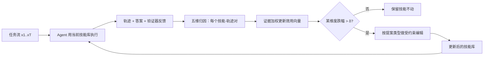
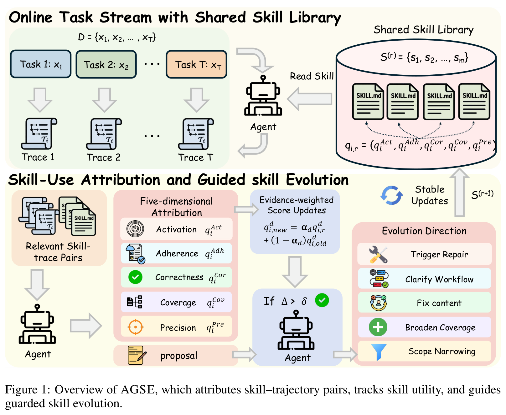
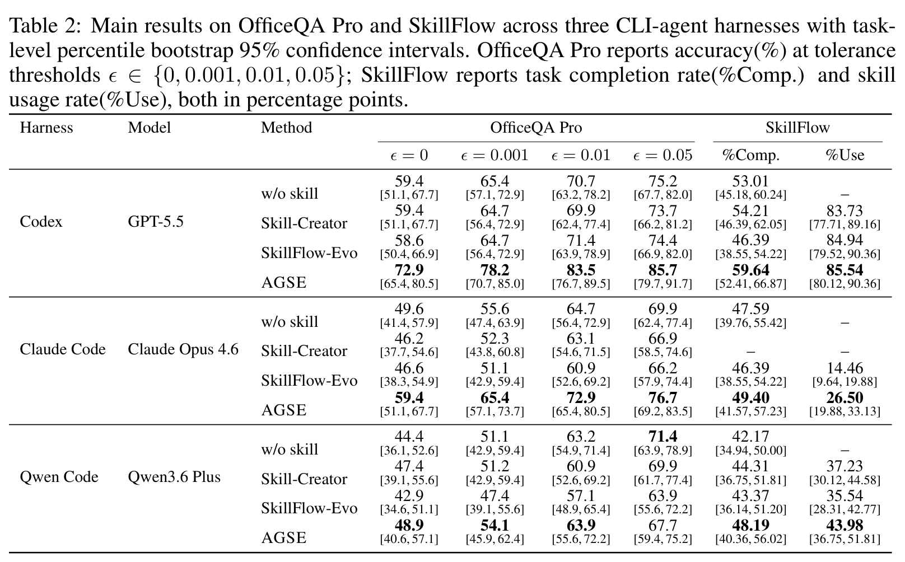
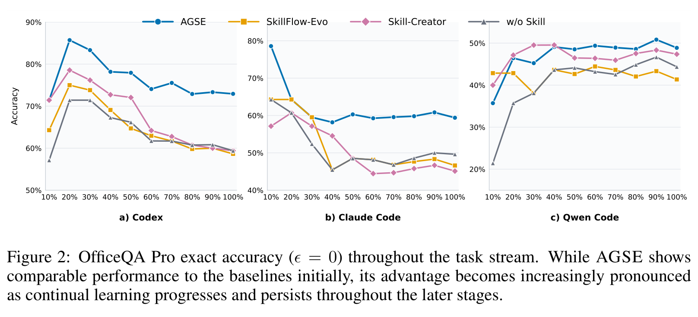
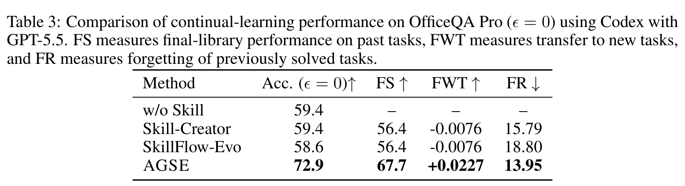
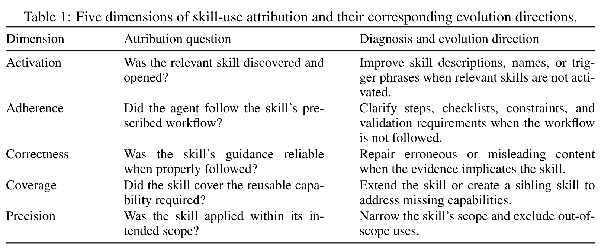
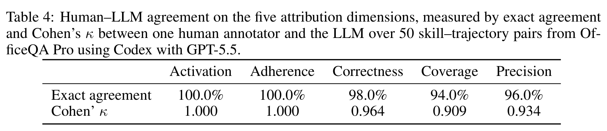
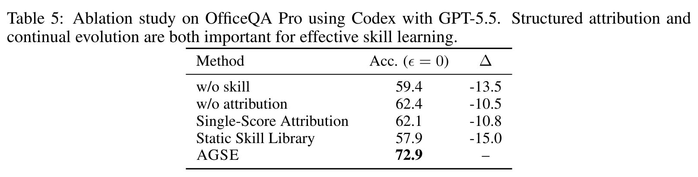

> 一句话：别因为一次任务失败就改技能手册，先把失败归因到具体技能的哪个维度，只在证据够的时候动它。

## 0. 读之前你需要知道

**术语卡**

- **技能库（skill library）**：一堆可编辑的文件，每个技能是一个 `SKILL.md`，加上脚本、参考资料。Agent 干活的时去翻这些文件，按里面写的流程做。类比：厨师的菜谱本，不用重新学做菜，照着改菜谱就行。
- **在线持续学习（online continual learning）**：任务一条接一条地来，不能回头看全量数据，每做完一批就得更新自己。类比：边营业边改菜谱的餐馆，不能停业重新培训。
- **归因（attribution）**：把「这次任务失败了」这个笼统的结果，拆到「哪个技能、哪个环节出了问题」。类比：球队输了，得说清是前锋没跑位、后卫漏人，还是教练战术不对，而不是全体罚跑。
- **效用向量（utility vector）**：给每个技能存五个分数，分别对应五个维度，范围 0 到 1，初始都是 1.0。
- **有守护的演化（guarded evolution）**：只有当某个维度掉得超过阈值，才允许改这个技能，而且改法由归因结果指定，不是自由重写。
- **FS / FWT / FR**：持续学习三件套。FS 是最终技能库在历史任务上的表现，FWT 是技能对新任务的迁移增益，FR 是对旧任务的遗忘率。

**它站在谁肩上**

- **Voyager / SkillWeaver（2024–2025）**：证明 agent 能自己攒出可复用技能，但它们多数是离线攒、或者一有反馈就改。
- **SkillFlow-Evo（2026）**：用轨迹和验证器反馈增量打补丁。这篇的直接对手，也是被证明「越改越差」的那个基线。
- **Skill-Creator（2025）**：反复用任务反馈迭代技能，相当于「没有归因的演化」。这篇的另一个基线。

## 1. 动机

一家公司有本操作手册，几十条流程。某天一个项目黄了。老板的反应是：改手册。

问题是改哪一条？有可能是这条根本没被翻到（没人看），有可能是看了但没照做（流程写得太绕），有可能是照着做了但内容是错的，也有可能是这条只适合 A 类项目却被用到了 B 类项目上。这四种情况对应的改法完全相反：第一种要改名字和触发词，第二种要写清步骤，第三种要改内容，第四种要把适用范围收窄。

如果不管三七二十一，看到项目失败就把手册重写一遍，会发生什么？有用的条目被改坏，本来对的流程被删掉，改着改着手册越来越差。

**以前怎么做**：把任务结果直接当改技能的信号。做对了就强化，做错了就让模型反思着改；或者用验证器打分，分低就重写。也有用「反思」把轨迹总结成经验再写进技能库的。

**为什么不行**：任务级的结果太粗。一次失败可能是技能没被激活、可能是激活了没遵守、可能是内容错了、可能是覆盖不全、也可能是用超了范围——这五种原因的修法不一样，但反馈信号里没有这个区分。反过来，任务成功也不能证明每个用到的技能都起了作用，可能只是别的技能救了场。所以把结果直接当改写信号，改出来的东西一半是噪声。

**为什么现在能做**：作者的观察是，虽然任务结果很粗，但**轨迹本身是细的**——技能有没有被打开、打开后有没有照着做、照做后结果对不对，这些都能从轨迹里读出来。缺的不是信息，是一个把信息归到技能身上的结构。这篇就是补这个结构。

## 2. 贡献

- **提出 AGSE 框架**：把「诊断」和「编辑」拆开，先沿五个维度给每个技能-轨迹对打分，再由分数变化决定改不改。证据：第 3 节的三段式流程与图 1。
- **给出证据加权的效用更新**：用指数滑动平均累积证据，样本少时改动小、反复失败时改动大，没有证据的维度不动。证据：式 (3.4) 与式 (3.5)。
- **有守护的演化**：只有某维度跌幅超过阈值才触发，且改法限定在七种预设动作里，内容修正还要求「技能相关 + 确实被遵守 + 确实导致失败」三条同时成立。证据：3.5 节。
- **三个 harness 上一致有效**：Codex/GPT-5.5、Claude Code/Claude Opus 4.6、Qwen Code/Qwen3.6 Plus，OfficeQA Pro 精确准确率 72.9 / 59.4 / 48.9，比无技能基线高 13.5 / 9.8 / 4.5 个点。证据：表 2。
- **持续学习指标全面更好**：FS 67.7（基线 56.4）、FWT +0.0227（基线 −0.0076）、遗忘率 13.95%（基线 15.79% / 18.80%）。证据：表 3。

## 3. 创新点

- **新在哪**：把「技能好不好」拆成五个可分别判定的问题，而不是一个总分。对比对象是单分数归因（表 5 里单分数只有 62.1）。有用是因为：五个维度对应五种互斥的修法，拆开后每条证据都能落到一个具体动作上。
- **新在哪**：诊断结果以「提案」的形式传给编辑模块，编辑时**看不到原始轨迹**。对比对象是让模型直接读轨迹改技能。有用是因为：切断了「被一条失败轨迹带跑」的路径，编辑只能依据结构化诊断。
- **新在哪**：效用用证据量加权的滑动平均，而不是简单平均。对比对象是「失败就改」。有用是因为：改动的幅度自动和证据强度挂钩，避免一次偶然失败就重写。
- **新在哪**：内容修正设了三重门槛（相关、被遵守、被牵连）。对比对象是「失败即改内容」。有用是因为：绝大多数失败根本不是内容问题，这条门槛把误伤挡住了。

## 4. 方法

### 4.1 整体流程

一句话解释：任务一条条跑完，攒够一个窗口就回头给每个技能打五个分，只有掉分超过阈值的技能才允许改，改法由提案指定。

图 1：框架总览。左边是任务流和共享技能库，中间是五维归因把每条技能-轨迹对拆成五个分数，右边是分数更新与演化方向（触发修复、澄清流程、修内容、扩覆盖、收窄范围）。注意图里那条判断分支「若跌幅 > δ 才演化」，这是整个方法的安全闸。

### 4.2 模块拆解

#### 4.2.1 五维归因

**为什么需要**：需要一个能区分「为什么失败」的坐标系。

对每个技能 $s_i$ 和每条轨迹 $\tau_t$，独立调一次 LLM 归因模块，输入是技能内容、任务与轨迹证据、最终答案、验证器反馈。输出三元组 $(\rho_{i,t}, z_{i,t}, p_{i,t})$：

- $\rho_{i,t} \in \{0,1\}$：这个技能跟这条任务相关吗
- $z_{i,t} = (z^{act}, z^{adh}, z^{cor}, z^{cov}, z^{pre})$，每项取 $0$ / $1$ / $\text{null}$
- $p_{i,t}$：七种动作之一，或者 none

五个维度分别回答：

| 维度 | 问的问题 | 对应的修法 |
| --- | --- | --- |
| Activation | 相关技能被找到并打开了吗 | 改描述、名字、触发词 |
| Adherence | Agent 按技能写的流程做了吗 | 补步骤、检查项、约束 |
| Correctness | 照做之后，指导可靠吗 | 修内容 |
| Coverage | 技能覆盖了要复用的能力吗 | 扩写或新建兄弟技能 |
| Precision | 是在它该用的范围内用的吗 | 收窄适用范围 |

关键设计：三个值里有一个是 $\text{null}$。这意味着「证据不足」和「确实出问题」被分开了——没证据就不判，也不更新。

#### 4.2.2 证据加权的效用更新

**为什么需要**：一次失败不该等于技能完蛋，但反复失败应该。

先算这一批的均值：

$$
\hat q^{d}_{i,r} = \frac{1}{|\mathcal{V}^{d}_{i,r}|}\sum_{v \in \mathcal{V}^{d}_{i,r}} v
$$

- $\mathcal{V}^{d}_{i,r}$：技能 $i$ 在维度 $d$ 上这一批里所有非 null 的标签
- 如果这个集合是空的，说明没证据，技能效用**原样不动**

然后用指数滑动平均更新：

$$
q^{d}_{i,\text{new}} = (1-\alpha^{d}_{i,r})\,q^{d}_{i,\text{old}} + \alpha^{d}_{i,r}\,\hat q^{d}_{i,r},\qquad
\alpha^{d}_{i,r} = \alpha_{\text{base}}\frac{n^{d}_{i,r}}{n^{d}_{i,r}+k}
$$

- $n^{d}_{i,r}$：这一批里该维度的有效标签数
- $k$：平滑系数，取 1
- $\alpha_{\text{base}}$：基准更新率，取 0.6
- 直观含义：证据越多，这一步迈得越大。只有 1 条证据时 $\alpha = 0.3$，有 5 条时 $\alpha = 0.5$，永远迈不到满

#### 4.2.3 触发与守护

**什么时候改**：定义跌幅 $\Delta^{d}_{i} = q^{d}_{i,\text{old}} - q^{d}_{i,\text{new}}$，只要存在某个维度 $\Delta^{d}_{i} > \delta$ 就触发。$\delta = 0.2$。

**怎么改**：编辑模块只拿到三样东西——技能当前内容、各维度效用变化、降分维度的提案。**拿不到原始轨迹**。七种动作：

| 动作 | 用途 | 对应维度 |
| --- | --- | --- |
| `@improve_trigger` | 改触发条件 | Activation |
| `@clarify_steps` | 写清流程 | Adherence |
| `@fix_content` | 修内容 | Correctness |
| `@broaden_coverage` | 扩覆盖 | Coverage |
| `@narrow_precision` | 收窄范围 | Precision |
| `@create_new_skill` | 新建兄弟技能 | Coverage（独立能力） |
| `none` | 什么都不做 | —— |

**最严的一条**：内容修正要求三个条件同时成立——技能相关、Agent 确实大体照做了、且证据指向技能内容。否则一律退到保守动作（改触发词、澄清流程、收窄范围）。这条是防误伤的核心。

### 4.3 关键细节

- 演化周期 $t = 4$：每 4 条任务更新一次技能库，块内冻结，保证因果边界干净
- 效用初值全是 1.0，即默认认为技能都是好的，只有证据能把它拉下来（悲观的反面：无罪推定）
- 三个 harness 共用同一套模型、任务顺序、工具、文件、验证器和执行时限，只有技能演化不同
- 全部实验在 Harbor 框架的隔离容器里跑，任务级验证器自动判分
- 没有任何模型权重更新，也没有策略训练——只改文件

## 5. 实验结果

**实验设置**

- **数据集与切分**：OfficeQA Pro 的 133 道题按原始顺序当作在线任务流（利用金融表格与量化推理之间的知识迁移）；SkillFlow 用它原生的终身学习设定。原文未给验证集/测试集的额外切分，任务流本身既是训练也是评测
- **骨干模型**：三套 harness —— Codex + GPT-5.5、Claude Code + Claude Opus 4.6、Qwen Code + Qwen3.6 Plus
- **训练预算**：无训练。演化每 4 条任务一次，技能库从空开始。原文给的是迭代与配置，未给总 token 或卡时（附录 C 有开销分析，正文未列数字）
- **基线**：w/o skill（不带技能）、Skill-Creator（反复用反馈迭代技能）、SkillFlow-Evo（用轨迹打补丁）。三者与 AGSE 共享因果边界和信息访问权限
- **指标**：OfficeQA Pro 报相对误差容差 $\epsilon \in \{0, 0.001, 0.01, 0.05\}$ 下的准确率；SkillFlow 报任务完成率与技能使用率；持续学习报 FS / FWT / FR
- **推理设置**：原文未给温度、长度上限等采样参数，只说明验证器判分与执行时限在三种方法间一致

**主表**（OfficeQA Pro，$\epsilon = 0$）

| 数据集 / 任务 | 指标 | 本文 | 最强基线 | 提升 |
| --- | --- | --- | --- | --- |
| Codex + GPT-5.5 | 准确率 | **72.9** | 59.4（w/o skill） | +13.5 |
| Claude Code + Opus 4.6 | 准确率 | **59.4** | 49.6（w/o skill） | +9.8 |
| Qwen Code + Qwen3.6 | 准确率 | **48.9** | 47.4（Skill-Creator） | +1.5 |
| SkillFlow / Codex | 完成率 | **59.64** | 54.21（Skill-Creator） | +5.4 |
| SkillFlow / Qwen Code | 完成率 | **48.19** | 44.31（Skill-Creator） | +3.9 |

表 2：三个 harness 上 AGSE 全部最高，且带了 bootstrap 95% 置信区间。值得注意的两点：Claude Code 上 Skill-Creator 在 SkillFlow 那几列是空的（跑不出结果），说明这类方法在弱一些的 harness 上会直接失效；SkillFlow-Evo 在两个 harness 上比不带技能还差，说明「有反馈就改」确实会帮倒忙。

图 2：整条任务流的准确率曲线。三个子图都是同一个形状——开头四条线纠缠在一起，跑到中后段 AGSE 才拉开。这个形状很重要：它说明增益不是「一开始技能库里有好东西」，而是「越跑越会用」，这正是持续学习要的。

**持续学习指标**

表 3：FS 67.7 对 56.4，FWT +0.0227 对 −0.0076（符号翻转，基线是负迁移），遗忘率 13.95% 对 15.79% / 18.80%。FWT 由负转正是这张表最有信息量的地方：基线学到的技能会拖累新任务，AGSE 的技能能帮上新任务。

表 1：五个维度的判定问题与对应修法。这是全文的概念骨架，把「哪里出问题」和「该怎么改」一一对应上了。

**归因质量与消融**

表 4：人工与 LLM 归因的一致性。50 对样本，Activation 与 Adherence 完全一致（$\kappa = 1.000$），Correctness 98%（0.964），Coverage 94%（0.909），Precision 96%（0.934）。Coverage 最低，也符合直觉——「技能该不该覆盖这个能力」本来就主观。

表 5：消融。去掉归因（直接改）62.4，单分数归因 62.1，技能库冻结不演化 57.9，完整方法 72.9。三条信息：拆分维度贡献 10.8 分，持续演化贡献 15.0 分，归因本身贡献 10.5 分。

**消融告诉我们什么**

最反直觉的是「技能库冻结」只有 57.9，比不带技能的 59.4 还低。也就是说，**攒了技能但不演化，不如干脆不要技能**——老的错误技能会把 Agent 带偏。这从反面解释了为什么 SkillFlow-Evo 会低于基线：不是「没学到东西」，而是「学到的东西在变坏」。

**这些实验够不够支撑结论**

主结果的支撑比较扎实：三个 harness、两套基准、带置信区间、消融完整，而且基线是在同等条件下重跑的。

要打折扣的地方：第一，只有两个基准，且 OfficeQA Pro 的 133 题被直接当流用，任务顺序固定，换顺序会不会改变结论没测；第二，演化周期 $t = 4$ 和阈值 $\delta = 0.2$ 只在附录做了敏感性分析，正文没给换参数后是否还成立；第三，归因一致性只测了 50 对、一个标注员，$\kappa = 1.000$ 这种满分本身也值得怀疑是不是样本太容易。

## 6. 局限性

**作者自己承认的**

- 归因依赖 LLM 判断，可能继承其偏差
- 只在 CLI 类 agent 任务上验证过

**我看出来的**

- **隐形假设**：五个维度被当作可独立判定，但它们在现实中耦合得很紧。比如「没被遵守」常常是因为「描述写得不清楚」，而描述问题又会被判成 Activation 或 Adherence，两者的修法完全不同，模型只能挑一个。
- **边界条件**：整个框架依赖验证器给出可靠的对错。没有自动验证器的开放式任务（写作、设计、研究）里，$\hat q$ 的第一步就算不出来，方法直接失效。
- **阈值是全局常数**：$\delta = 0.2$ 对所有技能、所有维度一样。但激活失败和内容错误的发生率差很多，用同一个阈值会让稀有维度的证据永远触发不了演化。
- **证据的独立性没处理**：同一批窗口里的多条轨迹往往来自相似任务，把它们当独立样本平均会高估证据量，$\alpha$ 会被推得过大。
- **缺的对比**：没有和「只做归因、不演化」的中间态比（消融里的 w/o attribution 是只演化不归因，方向相反），所以「归因 + 冻结」这个组合的效果是空白。

## 7. 一句话总结

技能库不是日记本，不能想起来就改；先当医生做诊断，确诊了才动手术。

核心公式：

$$
\boxed{\;q^{d}_{i,\text{new}} = \big(1-\alpha^{d}_{i,r}\big)q^{d}_{i,\text{old}} + \alpha^{d}_{i,r}\hat q^{d}_{i,r},\qquad \alpha^{d}_{i,r}=\alpha_{\text{base}}\frac{n^{d}_{i,r}}{n^{d}_{i,r}+k}\;}
$$

## 8. 可复用点

- **给任何「经验库」加一层归因**：不要用任务结果直接改经验，先拆成几个可分别判定的维度，每个维度对应一种修法。这套思路不限于 agent 技能，写文档、调 prompt、维护 FAQ 都能用。
- **没有证据就不要动**：用 null 表示「判不了」，让更新跳过这一维。这一条能挡掉大部分噪声。
- **更新幅度跟着证据量走**：$\alpha = \alpha_{\text{base}} \cdot n/(n+k)$ 是个很好的通用形式，比固定学习率稳。
- **编辑时不看原始轨迹**：只让编辑器看结构化诊断，能显著减少「被一条个例带跑」。这个信息隔离的招很便宜。
- **保护性反向指标**：注意到「冻结技能库比不带技能还差」这件事，如果你的系统攒了很多经验但从不清理，它可能已经在拖后腿了。

## 9. 我的疑问

- 五个维度之间的耦合怎么处理？比如一条轨迹同时被判 Activation 0 和 Adherence 0，是真的两处都坏，还是同一个根因的两种表现？
- $\delta = 0.2$ 在技能数量增长到几百条时还合适吗？技能越多，单条技能拿到的证据越少，$\alpha$ 越小，会不会出现「永远不会演化」的长尾技能？
- 归因一致性用 50 对、单标注员测出 $\kappa = 1.000$，这个数字太漂亮了。换一个标注员还成立吗？
- 如果验证器本身有偏差（比如只检查最终数值不检查过程），归因会不会把「蒙对」当成好技能？
