> 一句话：只训练模型、或者只改外壳都不够，让模型自己改外壳、改完再训练，来回两轮。

## 0. 读之前你需要知道

**术语卡**

- **策略模型（policy model）**：真正在跑的那个大模型本身，权重是它的全部。类比：厨师本人，手艺在身上。
- **外壳 / harness**：包在模型外面的一层代码，决定模型能看见什么、动作怎么执行、拿到什么反馈、什么时候收工。类比：厨房的布局和工具台，刀放哪儿、灶怎么用、出菜前谁检查。
- **搜索集（search set）**：改外壳的时候，用哪一批题来打分选优。类比：试菜时用的那几道菜。
- **硬任务集（hard-task set）**：某一轮训练里，所有 rollout 全错、一次都没做对的那些题。类比：这一周全桌都翻车的那几道菜。
- **H-step**：冻结模型，让它读自己的失败轨迹、写一个新的外壳出来。
- **P-step**：冻结外壳，用强化学习更新模型。
- **resolve rate**：生成的补丁能通过基准 verifier 的任务占比。越高越好。
- **verifier（验证器）**：跑测试、判对错的程序，只吐 0 或 1。类比：出菜前那台自动检测仪，合格亮绿灯。
- **GRPO**：一种强化学习算法，同一道题采一组答案，拿组内均值当基线算相对优势，不用单独训一个价值网络。
- **Balanced Adaptive Rollout（BAR）**：GRPO 的前置过滤器。每题采 8 条 rollout，挑 4 条拼成一组，要求这组的成功比例落在 0.25 到 0.75 之间，凑不够就继续采，直到攒够 32 组；这样避开全对或全错、组内优势全为零的废组。
- **RLVR**：用可验证奖励做强化学习，本文的 policy-only 对照。
- **pass@k**：每题采 $k$ 次，只要有一次对就算过。
- **pass@1**：每题采一次的平均成功率，衡量稳定性。
- **SFT / RFT**：前者拿别人（Opus 4.8）的成功轨迹做监督微调，后者拿自己成功的轨迹做拒绝采样微调。

**它站在谁肩上**

- **mini-SWE-agent（2024）**：一个极简的编码 agent 循环，模型发 bash 命令、看输出、最后打印补丁提交。本文就拿它当起始外壳。它的问题是没有保险：步数预算用光就直接交白卷，交上去的空补丁也照收。
- **Self-Harness（2026）**：只改外壳不动模型，用 base 模型当提议者。问题在于模型不变，它要补的失败模式也一直不变：本文里它两轮外壳搜索在 SWE-Verified 上只到 65.2，SWE-Multi 上还从 55.0 掉到 54.3。
- **Meta-Harness（2026）**：请 Opus 4.8 这种更强的外部模型来改外壳，模型冻结。改得比 Self-Harness 好，但学不进权重，换个模型就得重来。
- **Orchard / BAR（2026）**：给出了本文 P-step 的具体配方（GRPO + BAR）和训练数据构造方式，本文直接沿用。
- **HASE / WHALE / Evo2（2026）**：都动了「谁提议外壳」或「用哪些题搜」其中一样。HASE 把改外壳塞进 RL 动作空间，WHALE 用冻结的外部提议者，Evo2 单独训一个提议者而解题模型冻结。

## 1. 动机

一家餐厅老出问题：菜做砸了。老板有两个能改的地方——换厨师（模型），或者改厨房（外壳）。

**以前怎么做**：两拨人各改各的。一拨只改厨房：把刀摆得更顺手、加个出菜前检查岗，厨师不动。另一拨只培训厨师：让他练刀工、记配方，厨房不动。

**为什么不行**：只改厨房，厨师的手艺上限没变，能救的只是「本来会做但被布局卡住」的那部分。只培训厨师，他练的全是旧厨房里能做出的菜——旧厨房压根不让他颠锅，他就永远学不会颠锅。论文把这句话写得很直白：

> a harness tuned for one checkpoint may not target the failure modes of an updated policy

一个为旧版本模型调好的外壳，不会去针对新版本模型的失败模式。反过来，模型只从固定外壳采到的轨迹里学，学到的天花板就是那个外壳允许它做的事。

**为什么现在能做**：三件事凑齐了。一是模型有了读自己失败轨迹、然后动手写代码级补丁的能力——它既能当解题的人，也能当改外壳的人。二是编码任务有可执行 verifier，对错是硬信号，不用人打分。三是 GRPO 这类算法在稀疏的 0/1 奖励下还能榨出组内对比，BAR 再往里补一刀，把全对全错的废组滤掉。这三条让「模型自己改外壳」从想法变成能跑的实验。

## 2. 贡献

- **交替优化的框架 Self-HPO，在两个方向上同时赢**。证据：三个基准、两种设定下，它都是同组第一（表 1）。
- **平均 resolve rate 从 57.8% 提到 64.8%**。证据：Base 57.8±0.4，Self-HPO 64.8±0.6，比最强的单组件基线 RLVR（61.9±0.6）高 2.9 个点。
- **提升能跨出 Python 训练域**。证据：训练只用 Python 项目，SWE-Bench Multilingual（九种非 Python 语言）上 54.2→59.7，SWE-Bench Pro 上 58.3→65.2。
- **两个组件各自都留住了收益，合起来还超加**。证据：只换外壳（H2 配 P0）61.0→64.5，只换模型（P2 配 H0）61.0→64.4，合起来 69.5，涨 8.5 点，比两者单独增益之和（3.5+3.4=6.9）还多 1.6 点。
- **可靠性和能力上界一起抬**。证据：pass@8 从 80.0% 到 84.8%；按 Base 成功率分档，Hard 题 pass@1 涨 6.1 点，Medium 涨 17.2，Easy 涨 12.9。

## 3. 创新点

- **提议者就是被训的那个模型本身**。对比对象：Meta-Harness 用冻结的 Opus 4.8，WHALE 用冻结的外部提议者，Evo2 单独训一个提议者。有用是因为：P-step 刚把模型更新过，接着让它去读这一版自己的失败轨迹，提议的补丁天然对准当前弱点，不需要第二个模型去追一个移动的目标。
- **搜索集跟着训练走**。对比对象：Self-Harness、Meta-Harness、WHALE、Evo2、HASE 都用固定题集搜。Task-CoEvolve 虽然也换题，但换的依据是「候选外壳之间的结果方差」，不是「训练时暴露出的难度」。有用是因为：上一版模型做不出的题，新版可能已经会了；继续拿它们当靶子是浪费，而这一轮 P-step 里一次都没做对的题，正好是当下最硬的骨头。
- **改的是执行与终止逻辑，不只是提示词**。对比对象：大批 prompt/context 优化工作只动文字。本文的候选外壳是一个 Python 类，能重写 `step()`，能在模型提交的瞬间拦下来、能替换补丁、能在预算耗尽前介入。有用是因为编码任务里失败常常不是「想错了」，而是「改对了但没交出去」（空补丁、补丁打不上、步数用完）。
- **「交替」而非「塞进同一个动作空间」**。对比对象：HASE 也训自提议策略，但它把改外壳和解题放在同一个 RL 动作空间里，编辑要跨阶段才生效。本文把两件事切成 H-step 和 P-step 两段，各自冻结对方，梯度不互相污染。
- **超加性被单独测出来**。对比对象：多数 co-evolution 工作只报最终数。本文用 Table 3 做 3×3 交叉评估，把「外壳收益」和「模型收益」拆开量，得出合起来 8.5 > 3.5+3.4。

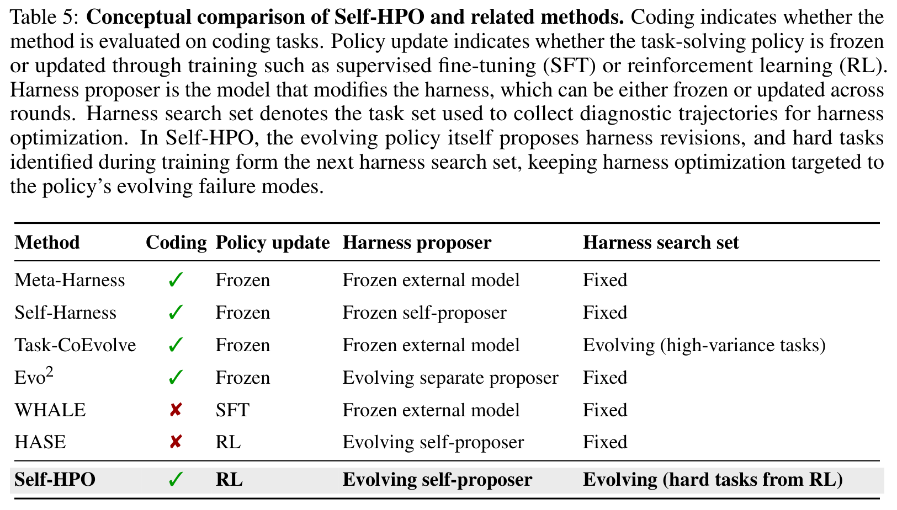

表 5：把本文和五个近邻并排摆，四列是「是否做编码任务、策略怎么更新、谁提议外壳、搜哪些题」。读法是看最后一行：Self-HPO 是唯一四格同时成立的方法——编码任务、RL 更新策略、演化的自提议者、来自 RL 的硬任务；HASE 只差搜索集固定，Task-CoEvolve 的策略是冻结的，Evo2 的提议者与策略脱钩。

## 4. 方法

### 4.1 整体流程

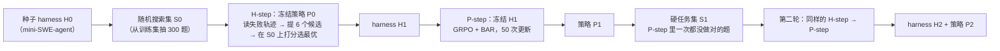

一句话解释：模型先当「改外壳的人」把外壳改好，再当「被训练的人」在外壳里练，练完把这一轮仍做不出的题交给下一轮去改外壳；两轮之后收工。

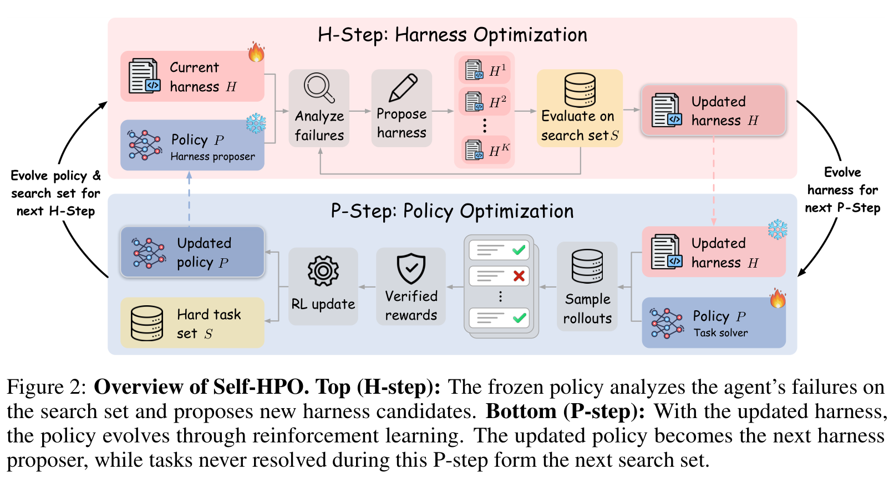

图 2：原图把两段各摊开成五步。要留意的是同一个蓝色模块在上下两段里换了身份——H-step 里它标着 Harness proposer（提议者），P-step 里标着 Task solver（解题者），权重是同一份；左边那条「Evolve policy & search set for next H-Step」的回边就是交替的接口。

### 4.2 模块拆解

**模块一：H-step，失败条件化的外壳搜索**

为什么需要：外壳是代码，不是一段可以随便改改的文字。要让模型改它、而且改得对，得先给它看到「现在具体是怎么失败的」。所以这个模块的第一步不是提议，是采集证据。

怎么做，两句话：用当前（冻结的）策略在外壳上跑一遍搜索集，拿到轨迹和分数；然后把当前最好的外壳、全部失败轨迹、之前所有候选和它们的得分一起喂给提议者，让它写下一版外壳。重复 $K$ 次，每次都在当前最优上继续改，最后挑搜索集得分最高的那个。

搜索目标其实是一个很朴素的期望值最大化。§2.1 说「联合优化」，指的就是下面这个量：

$$
J(H,P) = \mathbb{E}_{x\sim\mathcal{D}}\ \mathbb{E}_{\tau\sim\pi_{H,P}(\cdot\mid x)}\big[y(x,\tau)\big]
$$

这个公式在算什么：给定一套外壳 $H$ 和一个模型 $P$，在整个训练集上平均下来，一道题平均能拿到多少分。注意这是**定义**，不是本文提出的新式子，它的作用是把「外壳和模型要一起变好」变成一个有刻度的量。

- $x$：一道软件工程任务，取自训练集 $\mathcal{D}$。
- $\tau$：一条完整交互轨迹，包含模型发的每条 bash 命令和环境的每次回显。
- $\pi_{H,P}(\cdot\mid x)$：外壳 $H$ 与模型 $P$ 组合后在这道题上诱导出的轨迹分布。同一个模型换外壳，这个分布就变了。
- $y(x,\tau)\in\{0,1\}$：可执行 verifier 的判定，补丁过测试为 1，否则为 0。

H-step 里只动 $H$，$P$ 固定；P-step 里只动 $P$，$H$ 固定。两个期望里各锁住一个变量，这就是「交替」。

**模块二：搜索集的演化**

为什么需要：固定题集会让外壳优化目标过期。模型进步之后，旧题集里的题它可能已经都会了，那外壳再改也压不出新分。

怎么做：第一轮的搜索集 $S_0$ 从训练集 $\mathcal{D}$ 里均匀抽 300 题。此后每一轮的搜索集，是上一轮 P-step 里**一次都没做对**的题。论文给的定义是：

> a task is considered hard if it is never resolved in any of its rollouts in that P-step

一条题如果在这一轮 P-step 的所有 rollout 里都没被解出，就算硬任务。下一轮 H-step 会拿新的外壳–策略组合在这些题上重新跑一遍，生成新鲜的失败证据。

要注意时间粒度：搜索集在一个 H-step 内部是冻结的，只在两轮之间换。这保证了 $K$ 个候选是在同一批题上比较，分数才可比。

**模块三：P-step，在优化后的外壳下做 RL**

为什么需要：外壳改好了只是把路修平，手艺得真的练进去。而且这一段决定了下一轮的搜索集长什么样。

怎么做：冻结 $H_{t+1}$，从 $P_t$ 出发采 on-policy 轨迹，verifier 给 0/1 奖励，用 GRPO + BAR 更新。论文用的截断目标是标准 GRPO 的逐 token 版本：

$$
\mathcal{L}_{P}(\theta) = -\mathbb{E}_{i}\left[\frac{1}{|\mathcal{A}(\tau_i)|}\sum_{u\in\mathcal{A}(\tau_i)} \min\left(\rho_{i,u}(\theta)\hat{A}_i,\ \operatorname{clip}\left(\rho_{i,u}(\theta),\, 1-\varepsilon_{\mathrm{low}},\, 1+\varepsilon_{\mathrm{high}}\right)\hat{A}_i\right)\right]
$$

这个公式在算什么：对一组的若干条轨迹，逐 token 地算「新策略相对旧策略的概率比 × 这组的相对优势」，然后做截断，防止一次更新迈太大步子。取负号是因为习惯上写成最小化。

- $\tau_i$：第 $i$ 条轨迹，来自同一道题的一组 rollout。
- $\mathcal{A}(\tau_i)$：这条轨迹里**由助手生成的** token 位置集合。工具输出、环境回显不参与损失，这是 agent RL 的标准做法。
- $u$：$\mathcal{A}(\tau_i)$ 里的某一个 token 位置。
- $\rho_{i,u}(\theta)$：更新中的策略与采样时策略在第 $u$ 个 token 上的概率比。
- $\hat{A}_i$：组内相对优势，同组 rollout 的奖励减去组均值再归一化。
- $\varepsilon_{\mathrm{low}}=0.2$、$\varepsilon_{\mathrm{high}}=0.28$：截断上下界。用两个不同的数而不是对称区间，是沿用 Orchard 的配方。

BAR 在它前面站着当过滤器：每题先生成 8 条 rollout，挑 4 条凑成一个成功比例落在 0.25 到 0.75 之间的组；凑不够就继续采，直到攒够 32 个合格的组，得到一个 128 条轨迹的 batch。

**模块四：终止条件**

论文的停止规则是「硬任务集在两轮之间稳定下来」。实际跑的时候用了两轮就停，$K=6$ 个候选，每个 P-step 50 次 RL 更新。原文没给稳定性的量化阈值，这一点见第 6 节。

### 4.3 关键细节

这些决定别人能不能复现：

- **起始外壳**：mini-SWE-agent 的 ReAct 循环。模型发 bash 命令，最后用 `COMPLETE_TASK_AND_SUBMIT_FINAL_OUTPUT` 提交，后面几行就是补丁。
- **候选外壳的形态**：一个 Python 类，继承种子 agent，可以覆盖 `step()`。可以读 agent 状态、在受理提交前返回反馈、替换提交的补丁、在任意步介入。所以搜索空间是「代码 + 提示词模板」，不是纯提示词。
- **提议者看到什么**：当前最优外壳、它在搜索集上的轨迹、此前所有候选的得分与代码，外加四类自动算出来的诊断——覆盖率缺口（参考修复要改的文件，agent 实际碰过几个）、精度缺口（文件都碰对了但改错）、提交损失（轨迹里有真实修改，最终补丁却为空或打不上）、参考修复的原型分类。提议者本身是一个能开 shell 的编码 agent，可以进父外壳的代码里读。
- **每次只加一个机制**：硬约束是「父外壳的每个方法原样保留，只加一个新机制」，且不许把参考补丁或任务事实塞进解题模型的上下文，机制必须在运行时自己算信号。这解释了图 5 里优化后的外壳为什么只重写 `step()`。
- **模型服务**：SGLang。训练用 slime 框架，一个节点八张 B200。
- **训练数据**：2,484 条任务，来自 SWE-rebench、SWE-rebench V2、Scale-SWE 三个源。同一份数据既用于外壳搜索也用于 P-step。
- **优化器**：Adam，常数学习率 $10^{-6}$，weight decay 0.01，熵系数 $10^{-4}$，不加 KL 惩罚。
- **采样**：温度 0.95，top-p 0.95。每 batch 训练 1 个 epoch，全局 batch size 128，对应 1 次优化器更新。
- **评测**：步数上限 250，温度与 top-p 同为 0.95。因沙箱或 API 报错而失败的尝试会重跑，分母始终是基准全量。
- **对照公平性**：Self-Harness 和 Meta-Harness 用同样的搜索预算（$K=6$，每个候选在搜索集上跑一次）。

## 5. 实验结果

**实验设置**

- **数据集与切分**：训练用 SWE-rebench / SWE-rebench V2 / Scale-SWE 合成的 2,484 条任务，全部来自 Python 项目。测试用三个基准——SWE-Bench Verified 500 题（主基准，in-distribution）、SWE-Bench Multilingual 300 题（九种非 Python 语言）、SWE-Bench Pro 公开 V2 集 642 题。训练和外壳搜索都只用这 2,484 条；原文没提和测试基准之间的去污染检查。
- **骨干模型**：Qwen3.5-35B-A3B，总参 35B，激活 3B。只训了这一个尺寸。
- **训练预算**：两轮交替；每轮 H-step 评 $K=6$ 个候选，每个候选在搜索集上每题跑一次；每轮 P-step 50 次 RL 更新；batch 为 32 组 / 128 条轨迹。算力为单节点 8× B200。
- **基线**：自我改进设定下是 RLVR（只训模型）和 Self-Harness（只改外壳）；外部模型设定下是 SFT（蒸馏 Opus 4.8 轨迹）和 Meta-Harness（Opus 4.8 改外壳）。Base 是同一模型的零改动参照。
- **指标**：resolve rate，补丁通过基准 verifier 的任务百分比，越高越好。主结果报三次评测的均值与标准差（avg@3）。分析部分另用 pass@1、pass@k 和 zero-success groups 占比。
- **推理设置**：步数上限 250，温度 0.95，top-p 0.95。pass@k 分析每题 8 次尝试，估计式沿用 Chen et al. 2021 的无偏形式：$\operatorname{pass@}k = 1-\binom{n-c}{k}\big/\binom{n}{k}$，其中 $n=8$、$c$ 是成功次数，再对题取平均；pass@1 是成功频率的平均，pass@8 是「8 次里有一次成功」的比例。图 4 的阴影是 95% bootstrap 置信区间。

**主表**

| 基准 / 任务 | 指标 | 本文（Self-HPO） | 最强基线（RLVR） | 提升 |
| --- | --- | --- | --- | --- |
| SWE-Bench Verified | resolve rate | 69.5±0.9 | 67.5±0.8 | +2.0 |
| SWE-Bench Multilingual | resolve rate | 59.7±0.8 | 56.3±1.0 | +3.4 |
| SWE-Bench Pro | resolve rate | 65.2±1.4 | 61.8±1.3 | +3.4 |
| 三者平均 | resolve rate | 64.8±0.6 | 61.9±0.6 | +2.9 |

外部模型设定下 HPO 更强：SWE-Verified 71.6±0.9、SWE-Multi 61.4±0.7、SWE-Pro 66.0±0.5，平均 66.3±0.4，比 Meta-Harness（63.5±0.8）高 2.8 点。

**原文实验表**

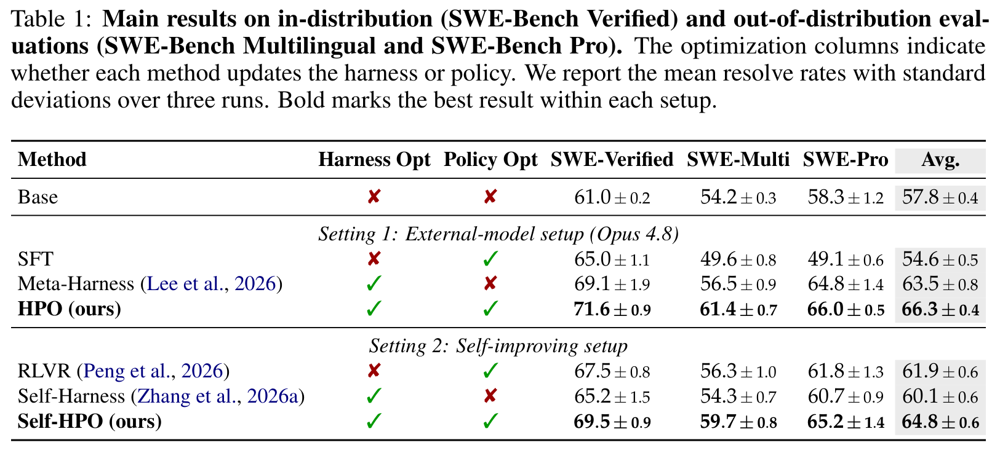

表 1：两种设定各自都填了两列优化开关。看这张表只需要盯两件事——只开一个开关的那四行（SFT、Meta-Harness、RLVR、Self-Harness）全都低于两个都开的 HPO / Self-HPO，而且四个「只开一个」的方法没有一个接近 69.5。另外 SFT 在 OOD 两列跌到 Base 以下（49.6、49.1），是全表唯一比 Base 还差的配置。

**原文实验图**

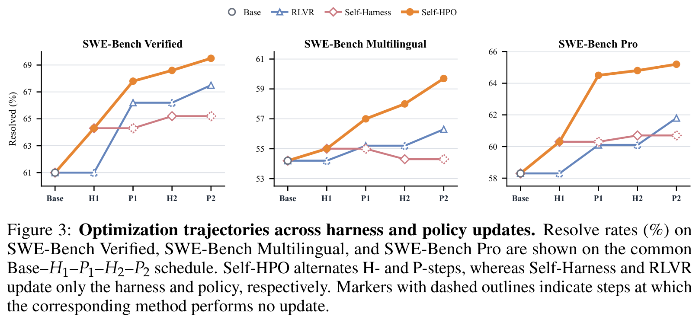

图 3：三块面板横轴是同一套 Base–H1–P1–H2–P2 行程。最看得出来的一点是 Self-HPO 的橙色线从 P1 起在每一个节点上都压着另外两条。H1 那个节点是橙粉两点重合——两条线共用第一次 H-step，跑的是同一批题、同一个外壳；蓝色原地不动，因为 RLVR 在 H-step 不做任何更新，虚线圈标的就是这些空档。更关键的是 SWE-Multilingual 的中段：Self-Harness 在 H2 从 55.0 掉到 54.3，是三条线里唯一往下走的，说明外壳改到第二轮开始反噬；而 Self-HPO 在 H2 还在涨。

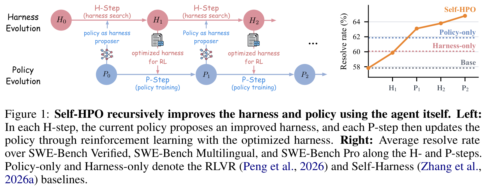

图 1：左边是循环结构，右边把三步的平均 resolve rate 摊开——58 起步、H1 后 60、P1 后接近 63、H2 后过 64、P2 后 64.8。两条虚线是单组件基线的天花板（Policy-only 约 62、Harness-only 约 60），橙色线一旦越过它们就再没回头。这张图值得单独看的地方是：单看 H1 这一步，Harness-only 和 Self-HPO 完全重合（同一个 H-step、同一批题），分叉发生在 P1，也就是「模型真的被更新」之后。

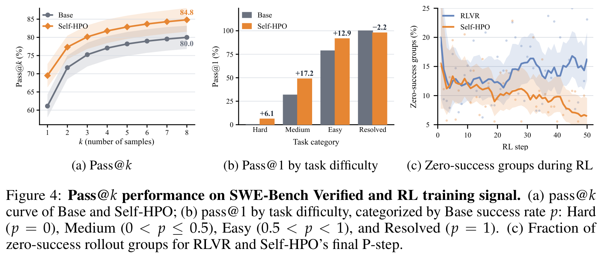

图 4：(a) 的橙蓝两条线在整个 $k$ 轴上都不交叉，$k=1$ 时差约 8 个点，$k=8$ 时差 4.8 个点——差距随 $k$ 变宽而收窄，符合「Base 有一批题偶尔能蒙对、Self-HPO 是稳定做对」的形状。(b) 是本文最诚实的一张图：Hard/Medium/Easy 三档都是正增益，但 Resolved 那根柱子是 −2.2，说明有一部分 Base 本来必对的题被训坏了。(c) 两条线的落差整体越拉越开，Self-HPO 在最后十步压到 6.5%，RLVR 在最后五十步还在 11%–17% 之间晃——这是 BAR + 硬任务筛选让训练信号变密的直接证据。

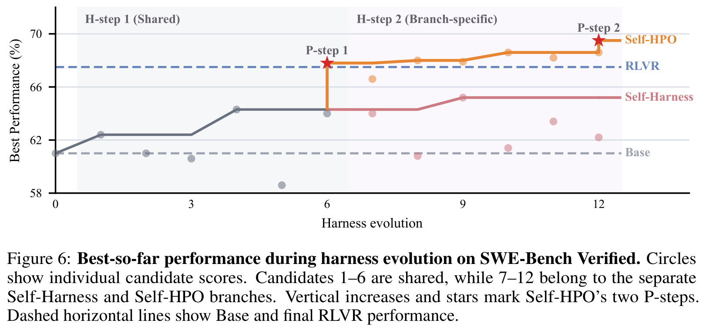

图 6（附录）：把外壳搜索拆到候选粒度。前 6 个候选是两条线共用的（同一个 H-step），从第 7 个开始分道：Self-Harness 继续在旧模型上改外壳，最好只能到 65.2；Self-HPO 先在 P-step 把模型抬到 67.8，然后重新开始搜索，第二个 H-step 到 68.6，再一个 P-step 到 69.5。这张图回答图 3 回答不了的问题——不是「改外壳没用」，而是「在同一个模型上改外壳，边际收益很快就见底」。

**原文实验表（消融）**

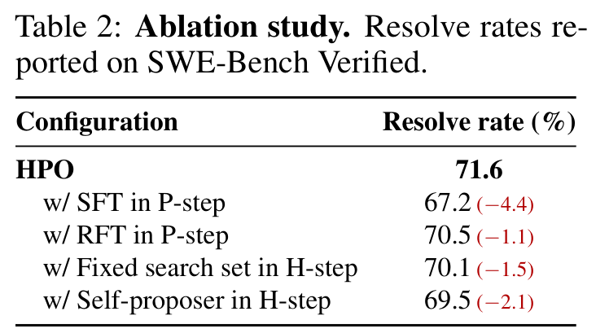

表 2：三件事各拆一刀，全部以 HPO（71.6）为参照。换掉 P-step 的 RL 用 SFT，掉 4.4 点，是最大的单点损失；换 RFT 掉 1.1 点；不换搜索集掉 1.5 点；把提议者从 Opus 4.8 换成自己，掉 2.1 点。

**原文实验表（交叉评估）**

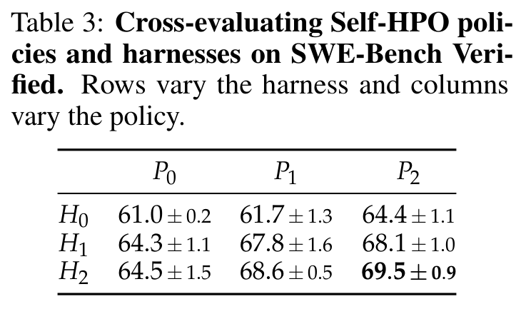

表 3：3×3 的交叉表，行是外壳、列是模型。对角线之外的两个角是关键：左下 H2 配 P0 = 64.5（只换了外壳），右上 H0 配 P2 = 64.4（只换了模型），右下 H2 配 P2 = 69.5。

**消融告诉我们什么**

这几条的排序很有意思。换成 SFT 掉 4.4 点，说明 P-step 里「用 RL 学自己的成败」这件事没法用「模仿强模型的成功轨迹」替代，哪怕模仿对象是 Opus 4.8。换 RFT 只掉 1.1 点，说明目标函数本身的形态（RL vs 拒绝采样）不是主要收益来源，主要收益来自 on-policy 数据加组内对比这个组合。搜索集不换掉 1.5 点，比换提议者（2.1 点）小一点，这一对数字合起来说的是：**「用哪些题」和「谁来提」都有用，但没有一个是决定性的一半**。

表 3 的超加性是本文最容易被误读的地方。3.5 和 3.4 是两次单独改动的收益，8.5 是一起改的收益。超出的 1.6 点意味着两者之间有正交互——外壳腾出的空间被模型吃掉了，模型新暴露的失败又被外壳接住了（这句是作者的读法，也是我的读法）。这不是「两个好东西加起来自然更好」的废话，如果是纯叠加，应该正好是 6.9。

**这些实验够不够支撑结论**

支撑主结论（交替优于单边）够，三个基准、两种设定、六个基线、每格三次评测，方向一致且幅度大于标准差。支撑「递归自我改进」这个词，不太够——只跑了两轮，而且第二轮两段都掉了：H-step 从 61.0→64.3（+3.3）降到 67.8→68.6（+0.8），P-step 从 64.3→67.8（+3.5）降到 68.6→69.5（+0.9）。它证明的是「交替有效」，不是「可以一直递归下去」。另外所有对比都没有做等算力校准，见第 6 节。

**案例研究：外壳到底改了什么**

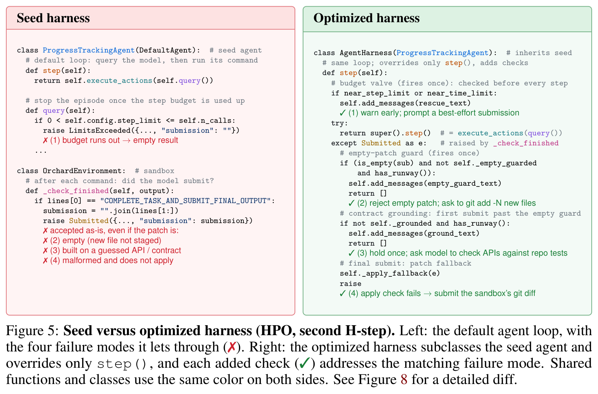

图 5：左边是种子外壳的两个类，右边是优化后的子类。种子外壳让四种失败穿过去——预算耗尽交白卷（✗1）、空补丁照收（✗2）、补丁建立在猜的 API 上（✗3）、补丁格式坏了打不上（✗4）。优化后的外壳只覆盖 `step()`，加四个检查逐个对上：(1) 预算见底前警告一次并要求尽力提交；(2) 空补丁拦一次，要求用 `git add -N` 把新建文件加进来；(3) 第一次过了空补丁关的提交再压一次，要求核对 API 名与签名；(4) 最终提交前 `git apply --check` 不过，就用沙箱自己的 `git diff` 顶上去。这张图是整篇论文最好的物证：所谓「外壳优化」在代码层面长这样，它不是提示词调优。

附录 E 给了一个具体任务（`sphinx-doc__sphinx-9658`）的对照。同一个 $P_2$，在种子外壳下：代码改对了、测试也过了，但收尾时模型打印了一段散文摘要而不是补丁，外壳照收，grader 收到空补丁，判错。在 $H_2$ 下：同样的收尾动作被拦下，外壳告知「你提交的补丁不含文件」，模型于是写 diff、验证、提交有效补丁，判对。论文还顺带承认了 $H_2$ 的一个假阳性——那条 PR 意图提醒是被 issue 文本里无关的关键词误触发的。

## 6. 局限性

**作者自己承认的**

- 提升不均匀，Resolved 那一档 pass@1 掉了 2.2 点（图 4b、§3.4）。
- 外部提议者有用但不是必需的（§3.3）：同一套框架换成 Opus 4.8 提议是 71.6，用自己提议是 69.5，作者原话是 helpful but not required。
- 案例里 $H_2$ 的 PR 意图提醒是假阳性（附录 E）。

**我看出来的**

- **隐形假设：失败可以被「外壳补丁」修好**。四个检查全是「拦住 + 提醒 + 兜底」，修的是**交付环节**（补丁没交出去、交出去打不上）。它修不了「理解错了 issue」这类认知错误。所以这套方法的天花板是模型已经能改对但交不出来的那部分题——这也是为什么 Resolved 档会掉：外壳的干预对了它是净赚，错了就是净亏。
- **算力没对齐**。两边的 RL 更新次数其实一样：RLVR 和 Self-HPO 都跑 P1、P2 两段，每段 50 次，共 100 次。差在 H-step——Self-HPO 每轮要额外评测 6 个候选外壳 × 整个搜索集，这部分算力没进任何对照。比较的是最终分数而不是等总算力分数，所以「交替比单训好」里有多少是方法的功劳、有多少只是多花了搜索算力，论文没拆开。Self-Harness 和 Meta-Harness 的搜索预算倒是和它对齐了（$K=6$，每个候选跑一次）。
- **硬任务集没有上限**。$S_0$ 是固定的 300 题，但之后的 $|S_t|$ = 上一轮 P-step 里全错的题数，这个数是多少、怎么控制 H-step 成本，原文没报。它随训练进度变化，意味着第二轮的搜索成本可能远大于第一轮，而论文没给。
- **搜索集和评测集同源的风险**。搜索用的 $S_0$ 从训练集 $\mathcal{D}$ 抽，硬任务集也来自 $\mathcal{D}$ 的 P-step rollout。SWE-rebench 系列和测试基准之间有没有重叠，原文没做去污染说明。在只有 300 题的搜索集上选 6 个候选的最优，选择偏差也不小，而每个候选只跑一次、没有重复，选出来的最优可能只是运气。
- **递归深度只有 2**。标题写 "Self-Evolving"，框架写 "recursive self-improving"，但实验只做了两轮，停止判据「硬任务集稳定」没有量化阈值，也没有展示第三、四轮的曲线。图 6 里第二轮 H-step 只带来 0.8 点（67.8→68.6），已经出现边际递减的迹象。
- **单一模型、单一外壳**。只有 Qwen3.5-35B-A3B 一个 backbone，种子外壳只有 mini-SWE-agent 一个。Self-HPO 的关键卖点是「提议者跟着模型走」，但这个论断需要至少两个不同家族的模型来支撑（比如一个本来就弱于自我诊断的模型，自己提议可能完全无效）。
- **缺的对比**：没有和「Opus 4.8 同时做提议者和解题者」比，所以无法判断 69.5 这个数离「用强模型外壳 + 弱模型权重」这条路的上限还差多远。附录 B（表 4）里列了一堆前沿模型，但那些是榜单数字，不是同一评测管线下的对照。
- **外壳搜索空间偏窄**。候选只能覆盖 `step()` 和提示词，不能改循环结构、不能加工具、不能拆多 agent。论文把「外壳优化能改执行与终止逻辑」当成卖点，但反过来也说明它的搜索空间被限定在一个很具体的接口上——换一个 agent 框架，这套提议者的提示词大概率要重写。

## 7. 一句话总结

别把「改模型」和「改外壳」当成两件分开的活：让模型自己读自己的失败去改外壳，改完在外壳里练，练完把仍不会的题留给下一轮改外壳——来回两轮，平均分从 57.8 抬到 64.8。

打个类比：这像是一个球员兼教练。他先以教练身份看自己上一场的失误录像，改战术板；再以球员身份按新战术板训练；训练里死活打不出来的那几个回合，就是下一版战术板要解决的东西。论文证明的是「球员兼教练比只换球员或只换战术板都强」，没证明的是「这么来回下去能一直变强」。

核心公式（本文的优化目标，用于定义「一起变好」是什么意思）：

$$
\boxed{J(H,P)=\mathbb{E}_{x\sim\mathcal{D}}\,\mathbb{E}_{\tau\sim\pi_{H,P}(\cdot\mid x)}\big[y(x,\tau)\big]}
$$

## 8. 可复用点

- **如果我要在自己的项目里用**：先别急着让模型改提示词。把外壳做成一个可继承的类，留一个 `step()` 钩子，让候选外壳能拦截动作、改反馈、换提交物。纯提示词搜索的天花板很低，能改执行逻辑才行。
- **如果我要在自己的项目里用**：搜索集别固定。每轮训练结束后，把「所有 rollout 全错」的样本捞出来当下一轮的外层优化目标。这个动作几乎零成本，而且能防止外层优化器追一个已经过期的分布。
- **如果我要在自己的项目里用**：外层优化器的提议者直接用正在训的那个模型，别单独挂一个强模型。省一个模型，而且它天然知道当前版本的弱点。前提是你的模型得有能力读轨迹并写代码补丁——这一点要先小规模验一下。
- **训练不收敛时先查**：GRPO 的 zero-success groups 占比。如果一组 rollout 全错，组内优势全是零，这一组对梯度没有任何贡献。BAR 那种「加采样直到成功比例落进 0.25–0.75」的过滤，是可以直接搬的，跟本文的外壳循环无关。
- **做 co-evolution 实验时**：至少报一次交叉评估表（外壳 × 模型），否则你无法回答「收益到底来自哪一半」。只看最终数会被追问。
- **评测时**：如果一个方法改的是「交付环节」而不是「理解环节」，一定要按难度分档报 pass@1。总体分数会掩盖 Resolved 档的倒退。

## 9. 我的疑问

- 第二轮 H-step 只涨 0.8 点，第三轮会怎样？是继续涨、平掉、还是像 Self-Harness 那样掉？论文用「硬任务集稳定」当停止条件，但两轮之后硬任务集到底还剩多少题？
- 硬任务集在第二轮有多大？如果它比 300 大很多，那 Self-HPO 相对 RLVR 的算力优势比看起来更大，2.9 点的差距就更难归因给方法。
- Resolved 档掉的 2.2 点，是哪一类题掉的？如果掉的是「模型本来稳过、但外壳的新检查误触发」的题，那这是一个可以靠降低假阳性修掉的工程问题；如果不是，那就是能力回退。
- 外壳提议者（附录 D 图 7）能看到搜索集任务的参考修复，提示词里明令禁止把参考补丁或任务事实写进解题模型的上下文，机制必须在运行时自己算信号。但「看过参考修复再设计机制」和「把答案钉进提示词」之间有没有灰区？去掉参考修复，提议质量会掉多少？
- 图 5 展示的是 HPO（Opus 4.8 提议）的第二轮外壳，而 Self-HPO 自己提的外壳长什么样，全文没给 diff。两个提议者产出的外壳是同一类改动，还是风格不同？
