> 一句话：让模型自己出题，把自写解答当提示，再教会自己独立作答。

## 0. 读之前你需要知道

术语卡：

- 大语言模型（Large Language Model, LLM）根据已有文字预测下一个文本片段；片段叫 token。
- 监督微调（Supervised Finetuning, SFT）让模型模仿参考解答。
- 在策略（on-policy）表示训练路径由当前学生自己生成；蒸馏（distillation）表示学生模仿教师的概率分布。
- 在策略自蒸馏（On-Policy Self-Distillation, OPSD）的双方起点相同，教师多看特权信息（Privileged Information, PI）。
- 本文的 On-Policy Self-Training（OPST）进一步自己生成题目和 PI，像一个人先写带答案的练习，再盖住答案独立重做。
- 指数移动平均（Exponential Moving Average, EMA）把历次学生权重平滑成教师；推理链（Chain-of-Thought, CoT）是逐步解题文本；分布外（out-of-domain, OOD）指未作为出题目标的评测领域。

它站在谁肩上：

- OPSD（Zhao et al., 2026a）用参考解答制造师生信息差，但需要已有题目与解答；
- u-OPSD（Li et al., 2026）去掉答案监督，仍需要人工题目；
- R-Zero（Huang et al., 2026）自己出题，再用强化学习调整模型，奖励只告诉整条回答好不好。

本文尝试把自生成解答转成每个 token 上的概率监督，像把卷末一个总分换成逐行批改。
这里的前序关系依据本文第 2 节，不代表独立复现了这些方法。

## 1. 动机

想象一个学生只拿到一张写着代数、物理、生活常识的纸，没有练习册。他能否从自己记得的知识中出题，写好参考解，再盖住参考解练习？

- 以前怎么做：SFT 模仿参考解；强化学习依据答案或验证器给奖励；普通蒸馏请更强教师；OPSD 则给同源教师额外答案。
- 为什么不行：这些路线通常仍需要人工题目、答案或外部判分，监督来源只是换了位置。
- 为什么现在能做：作者依靠已有模型的出题与条件推理能力，让带提示的模型指导不带提示的自己。

我的解释是，答案作为提示可能唤起已存在但不稳定的推理；这不是凭空获取新事实。
本文的 data-free 限定后训练阶段，Gemma 起点本身已经过指令微调，视觉版本还需要无标注图片。

## 2. 贡献

- 第一，完全自生成问答仍能带来提升。Table 1 中 Gemma 4 E2B、w/o Think. 的 MMLU 从 37.5 到 47.7。
- 第二，同一合成数据上，训练方式很关键。四种模型与推理设置下，OPST 的 Average 都高于 SFT 和 GRPO。
- 第三，两个过滤器具有增量收益。Table 5a 从无验证的 42.7，升至加 Verification 的 45.4，再升至加 Consensus gate 的 47.7。
- 第四，机制能迁移到视觉与另一模型家族。Table 4 的 E2B VQAv2 从 49.1 到 56.0，Table 8 的 Qwen3-4B-Base 平均分从 66.7 到 72.7。

像同一本练习册换了批改方式，成绩变好；这些证据支持有限设置内的改善，不能推出所有任务持续变强。

## 3. 创新点

- 新在监督从哪里来，以及放在哪里。相对仍依赖人工问题的 u-OPSD，OPST 只接收粗粒度主题，再生成问题、理由与候选答案；相对 SFT 和 GRPO，它把答案放进教师上下文，让教师在学生走过的每个位置给分布，而不是要求学生照抄或仅奖励答案一致。
- 新在质量与难度分开筛。Pseudo-Verification 先测答案能否重现、改写后是否稳定，Consensus Gate 再剔除学生已经全会的题。
- EMA 把循环连接起来。教师同时可承担出题、验证与监督，并随学生缓慢更新。

类比是先检查练习题有没有歧义，再挑学生尚未熟练的题，最后由长期观察其表现的老师批改；每个零件都有前序工作，贡献主要是这一组合与监督条件的推进。

## 4. 方法

### 4.1 整体流程

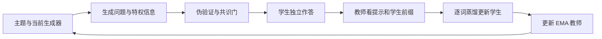

像自编练习册、检查题目、闭卷作答、开卷批改，再用新水平编下一轮。最终交付与评测的是 EMA 教师，而非最后一步学生。
原文有两个流程图，没有实验曲线类 Figure：

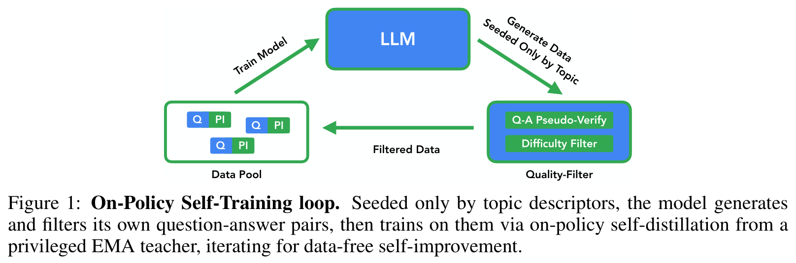

Figure 1（PDF 第 2 页）：生成、过滤、训练构成闭环。

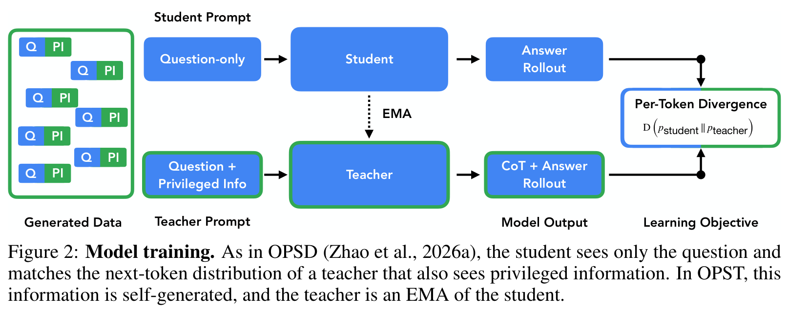

Figure 2（PDF 第 3 页）：师生条件不同，监督发生在学生轨迹上；不能把示意图误解成教师另采一条轨迹后逐位置硬对齐。

### 4.2 模块拆解

#### 出题与过滤：为什么需要？

自己写的题可能有歧义，也可能已经太简单。
生成器按主题 $\tau$ 生成 $(x,z)$，其中 $z=(r,a)$，分别是理由与候选答案；生成器可以是 EMA 教师，也可以是冻结的初始模型。
先在新上下文独立解 $x$，再把题目保义改写成 $x'$ 并重解。
下面的式子把原文两个判据合起来，最后一项表示只剔除学生全答对的题：

$$
v(x,z)=\mathbf1[\hat a(x)=a]\mathbf1[\hat a(x')=a],\qquad c(x,z)=\frac1G\sum_{g=1}^{G}\mathbf1[\hat a_g=a],\qquad \mathrm{keep}=v(x,z)\mathbf1[c(x,z)<1].
$$

- $x,x'$ 是变长问题文本，$r$ 是推理文本，$a,\hat a,\hat a_g$ 是答案；
- $G$ 是学生采样路径数，$v,\mathrm{keep}\in\{0,1\}$，$c\in[0,1]$，$\mathbf1$ 是条件成立记 1 的函数。

生活类比是让出题人隔天重做并换个问法，再看学生是否已经次次会做。
关键边界：$c=0$ 也会保留，所以这里没有保证题目处于可学的中等难度。一致性也不等于答案真实正确。

#### 条件教师：为什么比直接抄答案可能更好？

学生只读问题，教师额外读 PI，但双方都在学生已生成的前缀上预测。
下面的式子计算双方下一 token 的分布与一批题目的平均差异：

$$
p_{i,t}=\pi_\theta(\cdot\mid x_i,y_{i,<t}),\quad q_{i,t}=\pi_\phi(\cdot\mid x_i,z_i,y_{i,<t}),\quad \mathcal L_{\mathrm{OPST}}=\frac1B\sum_{i=1}^{B}\frac{\sum_{t=1}^{T}M_{i,t}D_\alpha(p_{i,t}\Vert q_{i,t})}{\sum_{t=1}^{T}M_{i,t}}.
$$

- $\theta,\phi\in\mathbb R^P$ 是具有 $P$ 个参数的学生、教师权重；
- $p,q\in\Delta^{V-1}$ 是词表大小为 $V$ 的概率向量，分量非负且总和为 1；
- $y_{i,<t}$ 是学生前缀，$B,T$ 是 batch 内题数与补齐长度，$M_{i,t}\in\{0,1\}$ 屏蔽 padding。

损失是标量，不反传教师；先逐题按有效长度平均，再跨题平均。
类比是老师看到草稿和提示后逐行给建议，不要求学生逐字复写提示；补全与纠错是可能的行为，不是理论保证。

#### 散度与 EMA：有一个必须保留的公式问题。

KL 散度衡量两个分布的差异，方向不同含义不同。
原文第 5 页写混合分布及公式 (5) 如下，随后声称上界为二元熵、两端分别趋近相应 KL：

$$
\bar q=(1-\alpha)q+\alpha p,\qquad D_\alpha(p\Vert q)=\alpha D_{\mathrm{KL}}(q\Vert\bar q)+(1-\alpha)D_{\mathrm{KL}}(p\Vert\bar q).
$$

$\alpha\in(0,1)$ 是标量，本文设为 $0.8$；$\bar q$ 与 $p,q$ 维度相同。

**我的推导：此处混合权重与外部权重错位，所述性质不随原式成立。**
取两类分布 $p=(1,0),q=(0,1)$，直接代入得到下式；它不是实验数字，而是检查原式的数学反例：

$$
D_\alpha-H(\alpha)=(2\alpha-1)\log\frac{\alpha}{1-\alpha}>0\quad(\alpha=0.8),\qquad H(\alpha)=-\alpha\log\alpha-(1-\alpha)\log(1-\alpha).
$$

$H$ 是二元分布的不确定性，单位取自然对数；上述 $p,q$ 是我构造的概率向量。
按印刷式，$\alpha\to0$ 时 $D_\alpha$ 已趋近 reverse KL，而非文中所述的缩放 forward KL。
将两项外部权重互换，才得到与其混合分布和文字极限相容的常见形式；不能据此断言代码也错了，本轮未检查训练代码。

教师更新计算的是历次学生权重的平滑平均：$\phi_k=(1-\beta)\phi_{k-1}+\beta\theta_k$，$k$ 是更新步，$\beta$ 是标量更新率，Table 6 默认 $0.05$。
像把多次测温平均，可压短期抖动，却不能消除温度计长期偏差。

### 4.3 关键细节

- 每轮重新生成并移除与此前轮次重复的题，师生权重跨轮保留；原文未交代具体去重算法。
- Table 6 的 MMLU 默认每轮 285 个样本、7 轮，不能外推成全部实验统一预算。
- 教师提示允许先补全不完整理由，随后把参考理由、候选答案作为背景。
- Visual OPST 给双方同一图片，教师额外读场景描述或由预测边界框中心计算的空间关系；其验证在 $K$ 个增强视图上统计与候选答案的一致比例。
- $K$ 是视图数，增强包括颜色扰动、缩放、随机裁剪，不做水平翻转，因为左右答案会改变。

我的判断：随机裁剪也可能移除被问物体，原文未给语义保持约束与通过阈值。
像检查地图方向时不能随意镜像，也不能把目标建筑裁掉。

## 5. 实验结果

### 实验设置六项

- 数据集与切分：按 MMLU、GPQA、GSM8K、HellaSwag 主题自出题，测试包括这四项与 ARC-Challenge、MATH-500、Winogrande；GPQA 实际为 Diamond，198 题，Table 3 则把 GPQA 当 OOD。视觉用 OpenImages V4 的无标注图训练，VQAv2、POPE 评测；训练图片数、精确切分与全部测试子集规模原文未给。
- 骨干模型：Gemma 4 E2B、E4B 指令模型，附录另测 Qwen3-4B-Base；名称中的 E2B/E4B 不应直接当作总参数量。
- 训练预算：MMLU 的上述轮数、样本数与 EMA 默认值已给；GPU 型号与数量、时长、batch、学习率、优化器、训练 token 总量及其他域具体样本数原文未给。
- 基线：Table 1 同合成数据的 SFT、GRPO；Table 2 加 Supervised SFT、Supervised OPSD、u-OPSD、R-Zero，后两者为作者重实现；PI 消融为 None、Placebo、Answer only、Rationale only、Full。
- 指标：语言 accuracy、Average，视觉 Acc.、F1、Rec.，均越高越好；Average 跨基准平均，w/o Think. 不含 GSM8K，不能跨两种设置直接比较。
- 推理设置：不开思考时多选题按选项 log-likelihood，MMLU 为 5-shot，其余多选为 zero-shot，并按 harness 要求作长度归一化；GSM8K 为 8-shot CoT。开思考时抽取最终答案，数学用数值匹配或 SymPy 符号等价；解析失败率作者报告为 0%。温度、最大长度、$T_{\mathrm{gen}}$、$G$、$K$、视觉判分细节原文未给，没有检索或外部教师裁判。

像比较学生成绩，必须先分清开卷闭卷、题目和批卷口径，再看名次。

### 主结果提炼

下表的最强基线限定为 Table 1 中使用相同合成数据的竞争方法；提升是由显示分数相减得到的百分点，不是相对百分比。

| 设置 / 任务 | 指标 | OPST | 最强同数据基线 | 提升 |
| --- | --- | --- | --- | --- |
| E2B，w/o Think. | Average | 45.6 | SFT 40.0 | +5.6 |
| E4B，w/o Think. | Average | 52.2 | SFT 50.9 | +1.3 |
| E2B，w/ Think. | Average | 63.0 | SFT 60.3 | +2.7 |
| E4B，w/ Think. | Average | 76.0 | SFT 72.2 | +3.8 |

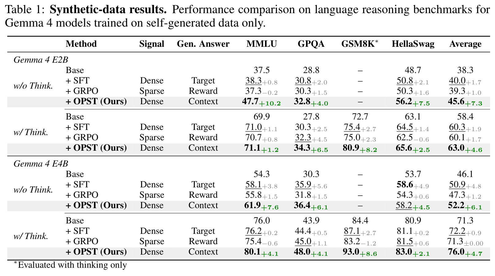

Table 1（第 7 页）：同数据下 OPST 的平均收益较好，但 E4B、w/o Think. 的 HellaSwag 是 SFT 更好；不能说每个单项都赢。

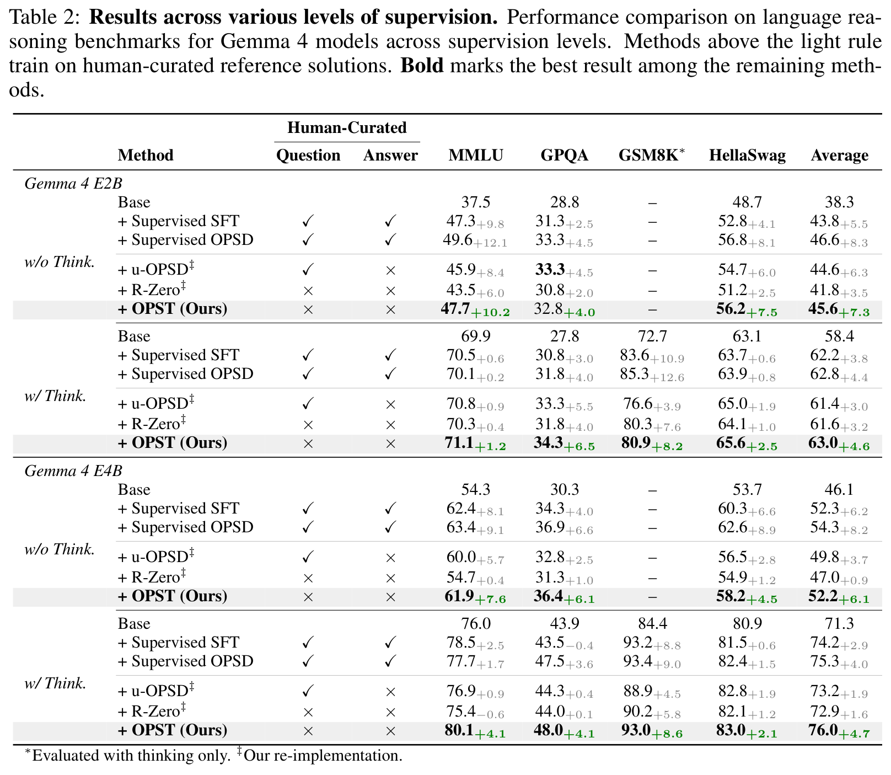

Table 2（第 8 页）：OPST 在不使用人工参考答案的方法中平均分最高；开思考时平均分略超 Supervised OPSD，但部分单项仍落后，且不是统一计算成本的证据。

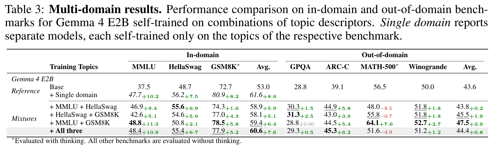

Table 3（第 8 页）：三域混训的 OOD 平均数上升，却遮住 MATH-500 的下降，像平均体检正常仍可能有单项异常。

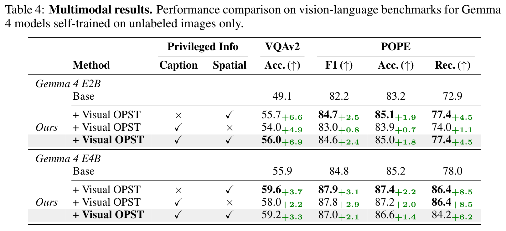

Table 4（第 9 页）：E2B 合并两种 PI 的 VQAv2 最好，E4B 却是 Spatial 单独最好，增加提示不保证互补；视觉表没有 SFT、GRPO 等竞争训练基线。
原表 E4B Spatial 的 Rec. 为 86.4，对 Base 78.0 标成 +8.5，按显示值相减为 8.4，可能涉及未显示小数或排版，不能擅改原表。

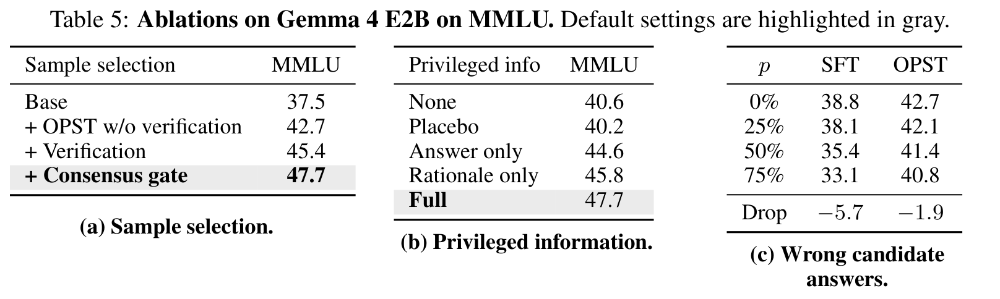

Table 5（第 9 页）：过滤与样本专属 PI 都有贡献，错误答案压力测试中 OPST 比 SFT 更抗噪；该测试关闭两个过滤器，不是完整系统在自然错误分布下的保证。

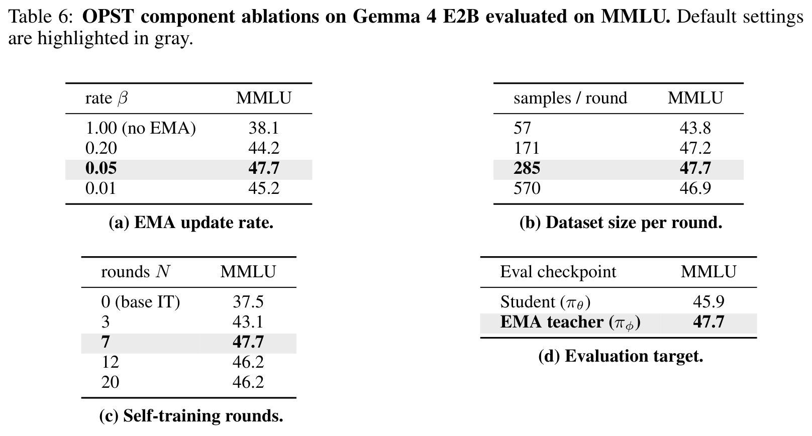

Table 6（第 14 页）：无 EMA 几乎失去增益，更多样本、更长迭代也非单调更好，说明循环需要节奏而非一直加练。

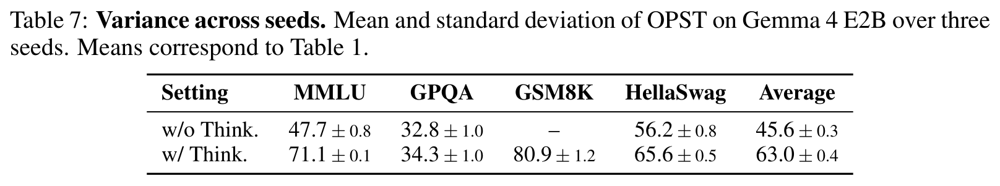

Table 7（第 15 页）：E2B 做了三个随机种子，标准差不超过 1.2，支持其主提升不是单次偶然；不能推广为全部视觉、E4B、消融都有同等统计保障。

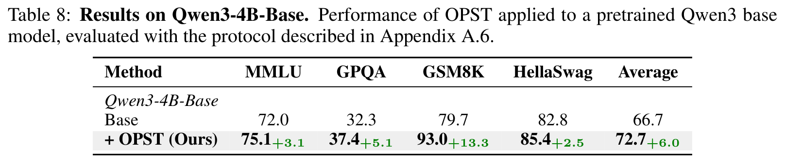

Table 8（第 16 页）：Qwen3-4B-Base 也提高，扩展了模型家族证据，但这一表只比较 Base 与 OPST。

### 消融告诉我们什么

- Rationale only 45.8 高于 Answer only 44.6，Full 47.7 最高；None 与 Placebo 仍有增益，意味着不能把所有收益归给正确提示。
- 最终学生 45.9、EMA 教师 47.7，模型选择本身贡献了差异。
- 7 轮后到 12、20 轮都降至 46.2，因此不能把闭环画成无限上升的楼梯。

### 这些实验够不够支撑结论

足以支持这些模型与任务上，自生成 PI 加条件自蒸馏优于文中同数据替代方案；尚不足以证明不遗忘、固定算力下最优或长期自我纠错。
相同数据控制了数据来源，但 SFT、GRPO、OPST 同时在目标、轨迹与教师处理上不同，作者将差异仅归因于答案放置位置，因果解释偏强。

## 6. 局限性

### 作者自己承认的

结论写道 “OPST can only amplify existing knowledge”。
意思是只能放大已有知识；作者还承认伪验证测自一致性而非正确性、主题人工选择、主实验模型较小，停止准则与工具或检索验证留作后续方向。

### 我的判断

- 第一，同源出题人、解题人和裁判会共享稳定误解，像同一把刻度偏掉的尺反复测量，重测一致也不代表准确。
- 第二，Consensus Gate 只排除 $c=1$，不排除 $c=0$；全错题可能是有价值的难题，也可能超出教师能力，当前机制无法区分。
- 第三，EMA 是时间平滑，没有独立事实来源，不能把稳定错误变成正确知识。
- 第四，生成分布由主题与已有知识决定，跨轮去重不保证概念覆盖。

### 实现与证据层面另记

公式 (5) 与文字性质冲突是已核对的论文内部问题，实际实现未知；未报告完整成本与多项关键超参，限制复现和公平效率比较。
视觉预测框仍可能错，且裁剪未必保义；OOD 平均分也不能替代逐任务遗忘检查。
这些是边界和缺口，不等于实验收益无效。

## 7. 一句话总结

模型把自编参考解当作开卷提示，在自己真正走过的解题路径上接受逐词指导，再把指导吸收到闭卷能力里；像先看草稿学会一道题，再合上草稿重做。最有价值的发现是**自生成解答的用途会改变学习效果**，不是发现了无中生有的知识来源。本文的关键损失已在第 4 节给出，但原式存在权重问题，因此不另用一个未经澄清的框中公式替作者概括。

## 8. 可复用点

- 实际接入时，把原来的问答记录扩成 $x,r,a$ 三部分，学生输入只保留 $x$，教师输入追加 $r,a$，并让双方读取同一学生前缀；这能直接测试把答案作为上下文是否优于照抄。
- 先做新上下文重解与保义改写，再记录 $c=0$、中间一致率、$c=1$ 的比例和真实抽检错误率，避免把共识当正确率。
- 训练同时保存学生与 EMA，分别评估，像同时保留当天成绩与移动平均，才能知道收益从哪里来。
- 不稳定时先检查 PI 泄漏、教师是否停止梯度、有效 token 归一化、EMA 速率与散度定义，再加轮数。

抽出的方法卡是 [[../../30 方法卡片/伪验证与难度联合筛选]]；借用它时还应增加独立验证与过难题诊断，具体新增设计属于我的建议。

## 9. 我的疑问

- 公式 (5) 到底是排版错误，还是实现也采用了权重错位的目标？
- 是否有完整训练配置与按阶段统计的计算成本？
- 在 $c=0$ 的题中，真难题、错答案、病题各占多少，过滤器实际保留率和教师纠错率是多少？
- 既然更长迭代会回落，不用测试集或人工标签如何决定停止？
- 若像盲测尺子一样加入一小批独立真值题，长期循环是否仍能保持收益？

这些问题分别要求代码、日志或新实验，单凭现有表格不能回答。

来源：联网取得 arXiv:2610.32770v1（2026-10-23），全文 20 页，阅读范围含正文与附录 A.1–A.8；PDF 本地位于 F:\CodexWorkSpace\2610.32770.pdf。图像均直接裁自该 PDF，保留原编号与图注。本文为预印本，未确认会议接收；本轮未运行训练或检查作者代码。
