> 一句话：两个共享底座、各自用强化学习训出来的专家，不训练、只靠前向统计量，就能合成一个平均分超过任一专家的一般模型。

## 0. 读之前你需要知道

**术语卡**

- **专家模型（specialist）**：拿一个底座，只用某一类任务的可验证奖励做强化学习，训出来的偏科模型。类比：同一个学生，一个只刷数学竞赛，一个只刷编程题。
- **on-policy 蒸馏（on-policy distillation）**：让学生自己先答题，教师在这些「学生写的答案」上给监督。类比：老师批改学生自己的作业，而不是让学生抄标准答案。
- **二阶矩（second moment，记作 $G$）**：某一层输入 $x$ 的外积 $xx^\top$ 的期望，形状是「隐藏维度 × 隐藏维度」。它记录的是**哪些输入方向被用得多**。类比：一张「常用词汇表」，告诉你这门课里哪些词出现频率高。
- **闭式解（closed form）**：不用迭代试错，直接把方程组解出来。类比：不用一次次调天平，直接按公式算砝码重量。
- **task arithmetic**：把每个专家的「改动量」直接相加，即 $W_b + \Delta_1 + \Delta_2$。它只看权重，不知道这些权重会被什么输入命中。
- **RegMean**：用输入二阶矩做闭式合并的老方法，2022 年提出，原本给监督微调的模型用。

**它站在谁肩上**

- **RegMean（2022）**：给出了线性层合并的闭式解，但统计量取自任务的训练语料。这篇的差别就是用模型自己生成的文本来算统计量。
- **task arithmetic / TIES / DARE（2022–2024）**：权重空间合并，不需要任何数据，代价是完全不知道输入分布。
- **on-policy 蒸馏（2023 起）**：在模型自己的分布上做蒸馏，效果好但要 rollout、教师前向和梯度。

## 1. 动机

你要一个既能做竞赛数学、又能写代码的助手。手上没有这样的模型，只有两个各自偏科的学生：一个数学很强但代码很烂，一个反过来。怎么把它们合成一个？

**以前怎么做**：三条路。一是把两个领域的数据混在一起重新做一遍强化学习；二是做 on-policy 蒸馏，让学生生成、教师监督、再更新；三是直接在权重上做算术，把两个专家的改动量加起来。

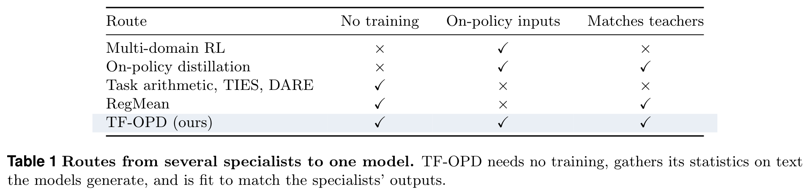

表 1：四条路线的对照。任务算术和 RegMean 都不用训练，但只有 TF-OPD 同时做到三件事——不训练、统计量取自模型自己生成的文本、并且显式对齐教师的输出。

**为什么不行**：多域强化学习等于从头再训一遍，最贵。on-policy 蒸馏便宜一些，但每加一个教师，就要多付一份 rollout、一份教师前向、一份梯度。权重算术最便宜，可它根本不知道这些权重会被什么输入命中：数学专家的更新被原封不动地作用到代码题的输入上，于是原本让模型变强的东西被稀释掉。论文里的具体表现是，7B 模型把数学和代码的更新相加后，在 AIME25 上反而低于数学专家本身。

还有一条中间路线：RegMean 用了输入信息，但它用的是**任务训练语料**。而一个推理模型在推理时，绝大部分计算花在自己生成的文本上，不是花在别人写好的题目上。

**为什么现在能做**：两个专家共享同一个底座，所以「合并」只需要合并它们的增量。更关键的是，用可验证奖励做强化学习时学习率很小，权重每个元素只被移动大约**一个 16 位浮点可表示的步长**。改动这么小、结构又同源，逐层的线性合并才有意义。

## 2. 贡献

- **证明这种合并可以完全不用训练**。在 Olmo 3 7B 上，数学专家和代码专家的闭式融合，在七个基准上都保住了各自专家的大部分增益，平均分超过任一专家。代价是每个专家几小时的 GPU 前向。
- **把「多教师逐层蒸馏」重写成 RegMean 那个闭式问题，并换上 on-policy 的统计量**。这是全文的技术核心：目标函数、统计量来源、求解方式三者对齐。
- **发现 rollout 的组成决定难问题上的成败**。陷入重复循环、被长度截断的答案只占答案数的 7%，却占了 23% 的 token；单独把它们去掉，融合模型在 AIME25 上就从「不如数学专家」变成「与数学专家持平」（同一评测格式下）。
- **分清什么重要什么不重要**：token 级拟合得再像也不保证难问题；学生自己写的 rollout、领域重加权、挖掘难题都换不来提升；而**数值精度是真的重要**。

## 3. 创新点

- **新在哪**：把「逐层蒸馏」的对象从「输出分布」换成「线性层的输入输出关系」，于是目标函数变成关于权重的二次型，可以直接解。对比对象是 on-policy 蒸馏（要梯度）和 task arithmetic（不看输入）。有用是因为：解一次线性方程，成本等于收集一次数据的前向。
- **新在哪**：统计量取自在**模型自己的 rollout** 上跑 teacher forcing。对比对象是 RegMean（取训练语料）。有用是因为：推理模型的真实输入分布，就是它自己写出来的那些长文本。
- **新在哪**：把「选哪些 rollout」当成一等公民，并给了一个无监督的检测器（用 DEFLATE 压缩率判断是否在重复循环）。对比对象是先前工作里各种按难度、按通过率选样本的启发式。有用是因为：在 token 等权的统计量里，少数超长循环答案会主导整个协方差矩阵。

## 4. 方法

### 4.1 整体流程

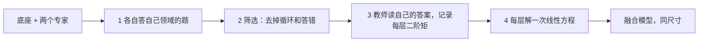

四步里前三步都是前向，第四步是线性代数，全程没有一次反向传播。第 2 步决定难问题上的上限。

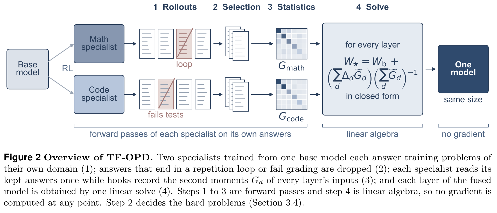

图 2：方法总览。每个专家先答自己领域的题，答完筛选掉循环和失败的答案，再把自己的答案读一遍并在每层前向 hook 里累加二阶矩，最后一层解一个线性方程。整个过程没有梯度。

### 4.2 模块拆解

#### 4.2.1 把层内蒸馏写成最小二乘

**为什么需要**：蒸馏的目标本来是「让学生在每个输入上模仿教师的输出」。如果只看单个线性层，这个目标可以写成一个只关于权重 $W$ 的二次型。

$$
W^\star = \arg\min_{W} \sum_{d=1}^{K} w_d\, \mathbb{E}_{x\sim\mu_d}\big\|Wx - W_d x\big\|_2^2
$$

先说这个公式在算什么：找一个新的权重矩阵 $W$，让它在每个教师 $d$ 的输入分布上，都尽量复现那个教师原来的输出。

- $K$：教师个数，本文是 2
- $w_d$：第 $d$ 个领域的权重，本文取等权 $w_d = 1$
- $\mu_d$：第 $d$ 个教师「在实际使用时看到的输入分布」，这是全文最关键的一个选择
- $W_d$：第 $d$ 个教师这一层原来的权重
- $W_b$：共享底座这一层的权重

这个目标对 $W$ 是二次的，而 $\mu_d$ 只通过二阶矩 $G_d = \mathbb{E}_{x\sim\mu_d}[xx^\top]$ 进入。所以只要拿到 $G_d$，问题就退化成解线性方程组。

#### 4.2.2 闭式解

**为什么需要**：既然梯度可以解析置零，就没有优化的必要了。

$$
W^\star = W_b + \Big(\sum_{d} \Delta_d \tilde{G}_d\Big)\Big(\sum_{d}\tilde{G}_d\Big)^{-1}
$$

先说这个公式在算什么：底座不动，只在其上叠加一个「按各领域输入频率加权平均」的增量。

- $\Delta_d = W_d - W_b$：第 $d$ 个教师相对底座的增量
- $\tilde{G}_d$：收缩后的二阶矩（见下）
- 逆矩阵那一步，等价于在「多个教师意见冲突」的地方按输入频率做折中

任务算术是把 $\sum_d \Delta_d$ 直接加上去，等于把每个教师的更新作用到**所有**输入上，包括只有另一个教师才会遇到的输入。闭式解则显式地最小化这部分误差。

**收缩**：直接求逆在数值上不稳定，所以把非对角元素按比例压掉：

$$
\tilde{G}_d = w_d\big[\alpha G_d + (1-\alpha)\,\mathrm{diag}(G_d)\big],\quad \alpha = 0.9
$$

- $\mathrm{diag}(G_d)$：只保留对角（每个坐标各自的方差）
- $\alpha = 0.9$：保留九成协方差结构，剩下一成退化成对角，等价于给每个坐标加一个把它们拉向教师的惩罚项

#### 4.2.3 三个性质，说明教师在哪里冲突

论文给了命题 3.1，三个结论很直观：

1. **如果所有教师的输入二阶矩相同**（$G_d = G$），闭式解退化成**权重平均**，而不是任务算术的求和。也就是说，分不清输入来自谁的时候，最优做法就是平均。
2. **如果只有一个教师的输入占主导**，解会收敛到那个教师的增量。
3. **如果几个教师的输入子空间互相正交**，每个教师在自己的子空间上被精确复现，互不干扰。

第三点直接指出现象：干扰只发生在输入分布重叠的地方。后面那个 $\varepsilon$ 诊断就是在量这件事。

#### 4.2.4 统计量从哪来：on-policy

**为什么需要**：解的好坏完全取决于 $\mu_d$ 选得对不对。

**怎么做**：让每个教师回答自己领域的训练题（数学从 DAPO-Math-17k 里抽 256 题，代码从 DeepCoder 训练集抽 256 题），每题答一次。筛选之后，教师把**自己的答案连同题目**再读一遍，这一次是 teacher forcing，边读边在前向 hook 里累加每层输入的 $X^\top X$。除以 token 数得到 $G_d$。

两个实现细节值得记：

- **哪些层共享统计量**：读同一个张量的线性层归为一组。Olmo 3 里每个 block 分四组（QKV、注意力输出、gate+up、down），分组是跑一次短前向自动探测的。
- **非线层怎么办**：embedding、归一化的增益和偏置这些不是隐状态的线性映射，直接按任务算术相加。

#### 4.2.5 循环样本筛选（全文最反直觉的一步）

**为什么需要**：统计量是按 token 等权累加的，所以一个特别长的答案会占很大权重。

**现象**：有些答案永远不结束，模型进入重复循环，一直写到长度上限。这类答案只占数学专家答案数的 **7%**，但占了 **23%** 的 token。而且循环里的输入几乎是周期性的，它们在协方差矩阵里集中到少数几个方向上，把整个解往「在退化输入上复现教师」的方向拉。

**怎么做**：用压缩率无监督检测。取答案最后 2 万个字符，用 DEFLATE 压一遍，如果压到不足原长的 **5%**（正常推理文本远达不到这个压缩率），就判定为循环。默认保留「自然结束且未被标记」的答案；能自动判分的领域再要求答对（数学对答案、代码跑测试）。

#### 4.2.6 求解与诊断

**怎么解**：每层一个线性方程组，double precision 求解，结果存成 32 位浮点。

**诊断 $\varepsilon$**：求解同时给出每个教师、每一层「有多少比例的更新没被复现」：

$$
\varepsilon_d = \frac{\mathrm{tr}\big[(\Delta^\star - \Delta_d)\tilde{G}_d(\Delta^\star - \Delta_d)^\top\big]}{\mathrm{tr}\big[\Delta_d \tilde{G}_d \Delta_d^\top\big]}
$$

- $\Delta^\star = W^\star - W_b$：融合后的增量
- 分子：融合结果与第 $d$ 个教师在**该教师输入分布**上的差距
- 分母：该教师自己增量的幅度，用来归一化
- 取值为零表示这一层完美复现了该教师；越大表示这一层冲突越严重

这个量是后面解释「为什么加权重会伤代码」的依据。

### 4.3 关键细节

- **不需要挑超参**：没有学习率、没有优化器状态，唯一的超参是收缩系数 $\alpha = 0.9$（全文固定）
- **成本**（表 4，48 GB 卡）：rollout 每 64 题 1 GPU 小时；统计 260 万 token 约 40 分钟；全层求解 25 分钟；两个专家合计约 **10 GPU 小时**
- **精度**：融合模型存 float32，评测时转 float16。原因是 RL 的增量本身只有一个 16 位步长大小，而融合出来的增量不是整数步，直接四舍五入到 bfloat16 会明显失真（融合增量与其 bfloat16 版本余弦相似度约 0.96）
- **不训练的部分**：没有反向传播、没有优化器、没有学习率衰减

## 5. 实验结果

**实验设置**

- **数据集与切分**：统计量取自数学 DAPO-Math-17k 的 256 题、代码 DeepCoder 训练集的 256 题，每题答一次；筛选后数学保留 175 条（正确、自然结束、无循环），代码保留 92 条（通过全部测试）。**没有使用任何评测题**。评测用 AIME24 / AIME25 / HMMT25（各 30 题）、MATH-500、OlympiadBench（674 题）、HumanEval+、MBPP+
- **骨干模型**：Olmo 3 7B。底座 `Olmo-3-1025-7B`，两个专家是 `Olmo-3.1-7B-RL-Zero-Math` 与 `...-Code` 的最终 checkpoint
- **训练预算**：**零训练**。两专家合计约 10 GPU 小时（48 GB 卡，全部是前向或线性代数）
- **基线**：底座、两个专家各自、task arithmetic（单位系数），以及 4.5 节里加的低秩变体和几种换统计量的闭式变体
- **指标**：准确率。数学答案取最后一个 `\boxed{}` 或 `Answer:` 行的内容做归一化匹配，规则判不了的用 CompassVerifier-3B 复核；代码取末尾定义入口函数的 Python 块，用 EvalPlus 的基础测试加额外测试判定，触到长度上限算失败
- **推理设置**：数学 temp 0.7、top-p 0.9、上限 31,744 token，每题采 4 个答案取平均；代码 temp 1.0、top-p 1.0、上限 32,768 token，每题 1 个。发布权重按 bfloat16 评测，融合模型按 float16

**主表**（只在能说明问题的行上保留）

| 数据集 / 任务 | 指标 | 本文 | 最强基线 | 提升 |
| --- | --- | --- | --- | --- |
| 七基准均值 | 准确率 | **61.1** | 59.8（数学专家） | +1.3 |
| OlympiadBench | 准确率 | **69.4** | 68.7（数学专家） | +0.7 |
| MATH-500 | 准确率 | 90.8 | 91.8（数学专家） | −1.0 |
| AIME24 | 准确率 | 50.0 | 50.0（数学专家） | 持平 |
| AIME25 | 准确率 | 38.3 | 43.3（数学专家） | −5.0 |
| HMMT25 | 准确率 | 27.5 | 30.8（数学专家） | −3.3 |
| HumanEval+ | 准确率 | 84.1 | 86.0（代码专家） | −1.9 |
| MBPP+ | 准确率 | 67.5 | 69.3（代码专家） | −1.8 |

**原文实验表**

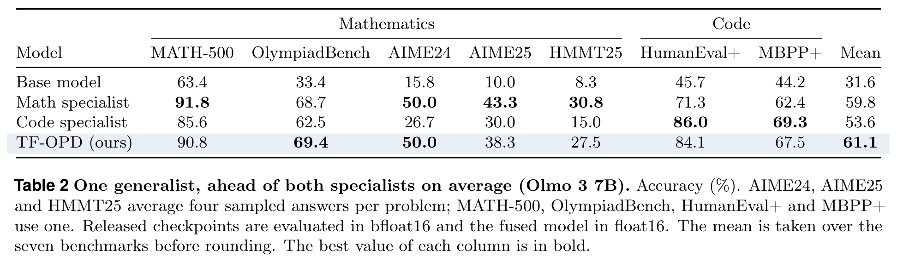

表 2：七列里只有两列是本文最高，但均值最高。这说明它不是在每个单项上赢，而是「哪个都不差」。另外 AIME25 的 38.3 与 43.3 的差距，在换到统一评测格式后会缩小到 1 分以内（表 5）。

**原文实验图**

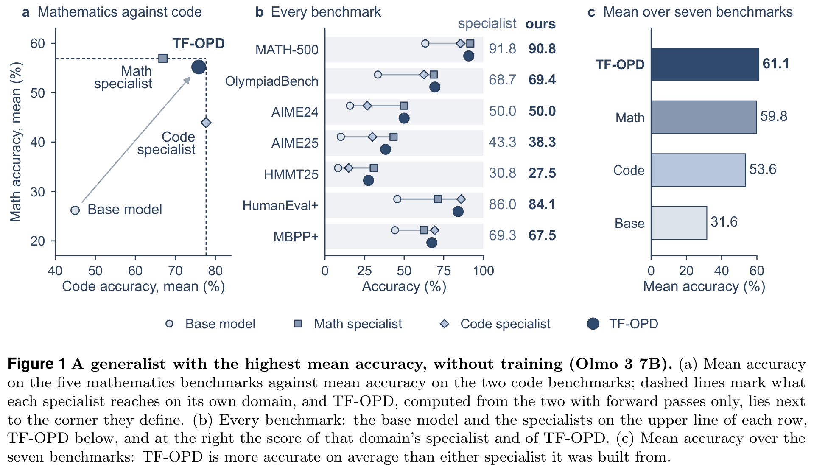

图 1：三个小图分别给出「数学 vs 代码的二维平面」「逐个基准」「七基准均值」。左图最能说明问题：两个专家的自身领域分数构成了右上角，而 TF-OPD 紧贴那个角而不塌向中间，也就是没有变成「两边都平庸」。下图的均值柱里 TF-OPD 的 61.1 高于数学专家 59.8 和代码专家 53.6。

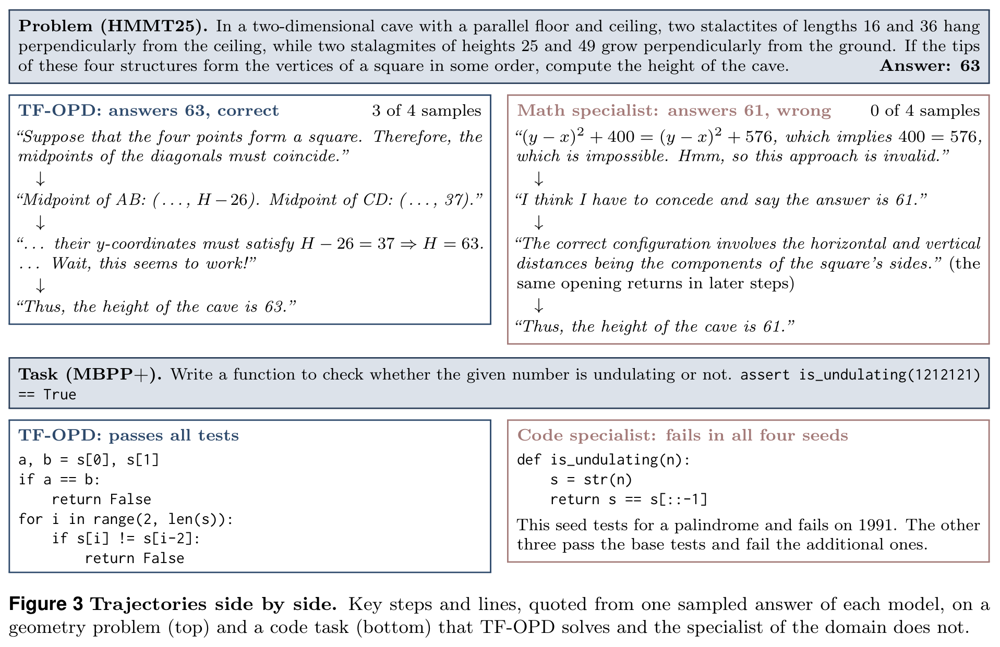

图 3：两道题并排看。上面那道几何题，融合模型想到「正方形对角线中点重合」，三步解出 63，四个采样里三个对；数学专家却卡在一个错误假设上、开始重复同一句话、最后给了 61。下面那道代码题，融合模型按题目定义实现了「起伏数」判断，而代码专家的一份实现把题目错解成了回文判断。这组对照想说明融合模型不是简单折中，有些题上它比两个专家都强。

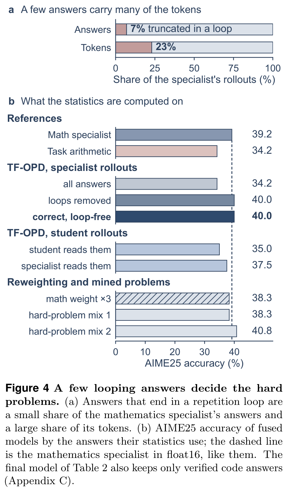

图 4：左图是关键证据——循环答案只占答案的 7%，却占 token 的 23%。右图是 AIME25 上不同统计量来源的对比：用全部答案时只有 34.2，与 task arithmetic 持平；只去掉循环答案就跳到 40.0，与数学专家（虚线，float16 同格式）持平；再只保留正确答案仍是 40.0，没有额外收益。

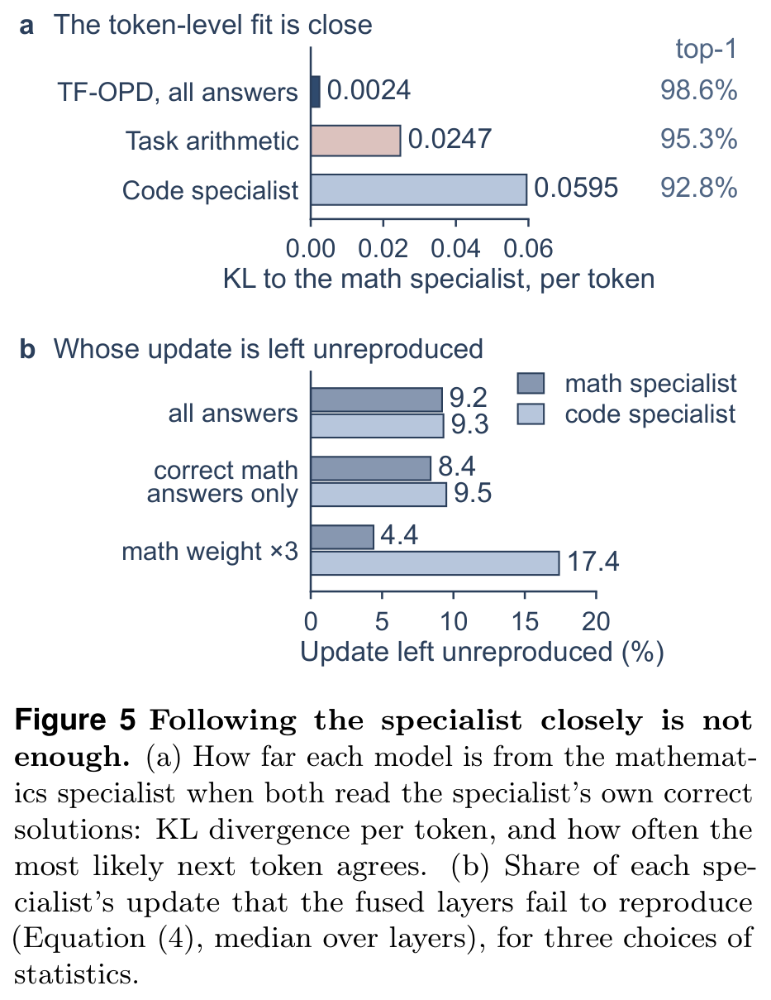

图 5：左图说明 token 级拟合得很好——用全部答案训练出来的融合模型，在与数学专家读同样文本时，逐 token 的 KL 只有 0.0024，top-1 一致率 98.6%，远超 task arithmetic；可它照样在 AIME25 上拉不开差距。右图是 $\varepsilon$ 诊断：加权重到 3 倍时，代码专家那部分复现不了的更新从 4.4% 涨到 17.4%，也就是靠重加权换来的数学涨分是拿代码掉的。

**原文实验表**

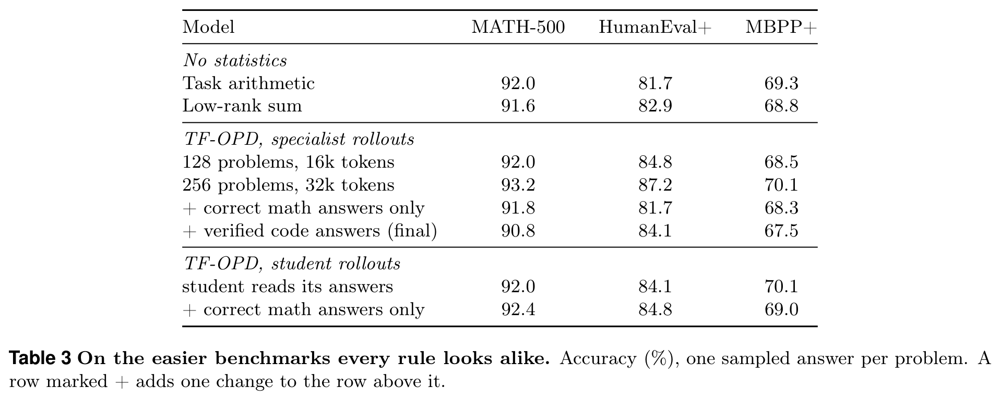

表 3：在容易的基准（MATH-500、HumanEval+、MBPP+）上，任务算术、低秩变体、各种闭式变体全部分不开，差距在误差范围内。这张表的价值是反证：**方法之间的差别只在难问题上显现**。

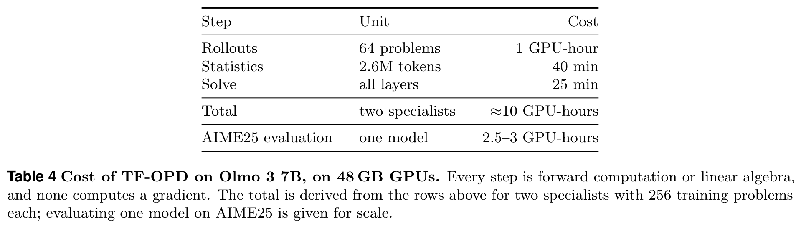

表 4：成本明细。值得注意的是求解只要 25 分钟，大头是 rollout（1 GPU 小时 / 64 题）。作为参照，评测一个模型在 AIME25 上要 2.5–3 GPU 小时——比求解本身还贵。

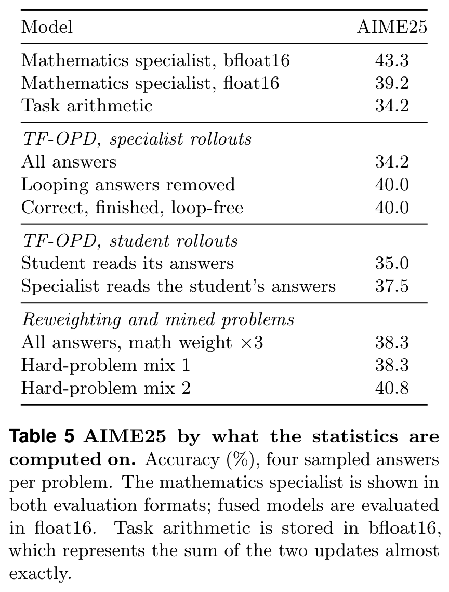

表 5：精度对照。数学专家换成 float16 评测后会掉几分，与融合模型（同为 float16）的差距随之缩到 1 分以内。这解释了表 2 里 AIME25 那 5 分的差有多少来自数值格式而不是方法。

**消融告诉我们什么**

- **筛掉循环答案是最有效的一步**，而且只需要去掉循环、不必再筛正确性。作者的解释是：做完但答错的答案，仍然是「教师正常推理」的样本。
- **学生自己写的 rollout 没有帮助**。严格意义上的 on-policy 用学生的文本，但实测（图 4 右）不如教师自己的答案，说明这里的 on-policy 指的是「模型生成」而不是「学生生成」。
- **重加权是跷跷板**。数学权重调到 3 倍能补回数学的损失，但代码那侧的未复现比例翻倍。
- **挖难题没有明确收益**。作者结论是「筛选去掉病因，其他补救只是在补偿症状」。

**这些实验够不够支撑结论**

主要结论有支撑：主表七列、图 4 的因果链（去掉循环→难问题回到专家水平）、图 5 的诊断，三者互相印证，而且成本表透明。

但有三处要打折看：第一，只有一个模型家族、一个尺寸（7B）、两个专家，没有验证第三个专家加入时是否还能保持；第二，AIME24/25/HMMT25 各只有 30 题，几个点的差距在抽样误差内，作者自己也写了「三十分题的基准只能分辨到这个程度」；第三，所有比较都建立在同一底座上，跨架构的情形作者明确说「还是得训练」。

## 6. 局限性

**作者自己承认的**

- 训练仍然必要的情形：教师与学生的架构或尺寸不同时，闭式解不成立
- 三个竞赛基准每题 30 题，几个点的差异在分辨力之外

**我看出来的**

- **隐形假设**：整个推导默认合并只发生在**线性层**，且各层可以**独立求解**。真正的蒸馏目标是把整网输出对上，逐层最优不等于整体最优。作者用任务算术处理非线性层，等于默认这部分无关紧要，但没有给出「逐层解离全局最优有多远」的界。
- **边界条件**：命题 3.1 的第三条（输入子空间正交时无干扰）在真实模型里很难成立，$G_d$ 通常是满秩的，只是奇异值分布不同。所以「冲突只发生在重叠处」这个说法在实践中要打折扣。
- **缺的对比**：没有和「训练一轮 on-policy 蒸馏」做同成本对照。论文反复用「几次前向 vs 一次训练」讲成本优势，但没有给一个同等 GPU 小时的蒸馏基线，读者无法判断省下的时间里损失了多少性能。
- **一个未解释的现象**：表 3 里 256 题、32k token 那一行（93.2 / 87.2 / 70.1）比最终的模型（90.8 / 84.1 / 67.5）在三个容易基准上都更高，但最终模型在难基准上更好。作者没有讨论这个「用筛选换难问题」的取舍到底值不值。

## 7. 一句话总结

把「让每个教师在自己爱看的输入上被复现」写成一个逐层的最小二乘问题，统计量从模型自己的答卷里数出来——于是合并专家这件事，从训练变成了做一次线性代数。类比：不是把两个老师的讲义揉成一本书，而是让学生把两位老师各自讲过的例题都做对。

核心公式：

$$
\boxed{\;W^\star = W_b + \Big(\sum_{d}\Delta_d\tilde{G}_d\Big)\Big(\sum_{d}\tilde{G}_d\Big)^{-1}\;}
$$

## 8. 可复用点

- **想合并两个同源专家**：先确认共享底座、同架构。然后按这份流程收集统计量（每个专家 256 题就够），解线性方程，成本约 10 GPU 小时。不用动训练框架。
- **统计量一定要在自己生成的文本上算**。用训练语料算（RegMean 的做法）在推理模型上会偏，因为它在测试时读的主要是自己写的东西。
- **筛选比求解重要**。如果你的模型有重复循环的毛病，先把这些样本去掉再算统计量，否则协方差被少数超长答案主导。检测方法可以直接抄：取末尾 2 万字符，DEFLATE 压到 5% 以下就判循环。
- **加第三个专家**：公式里多一项求和，不需要重训，但每个教师都要各跑一遍 rollout 和前向。
- **精度别忽略**：融合出来的增量不是整数个 16 位步长，存 bfloat16 会失真。存 float32、评测时转 float16。
- **判断有没有冲突**：用 $\varepsilon_d$ 逐层看哪个教师的更新被牺牲了，比看总准确率更快定位问题层。

## 9. 我的疑问

- 逐层独立求解与端到端最优的差距有多大？有没有可能交替求解（类似逐层坐标下降）能补回来？
- 第三个、第五个专家加进来时，$\sum_d \tilde{G}_d$ 的条件数会不会变差，导致数值不稳定？
- 循环答案的 5% 压缩阈值，在不同语言（中文推理）、不同任务（代码）上还成立吗？代码本身重复度高，会不会误判？
- 如果两个专家的底座是「同源但训过不同轮数」（比如一个多训了 10%），这套解法还能用吗？
