> 一句话：只把干成功的经验刻进模型里，下次同类任务直接会做。

## 0. 读之前你需要知道

**术语卡**

- **LLM agent（大模型智能体）**：让语言模型在一个环境里反复「想一步、做一个动作、看结果」，直到任务完成。生活类比：派去收拾屋子的实习生，每一步都得看现场再决定下一步，不能开工前把 50 步全写好。
- **long-horizon task（长程任务）**：要几十步交互才能完成的任务。生活类比：不是「3+5 等于几」，是「把凉鸡蛋放进微波炉」——找到鸡蛋、拿起来、放冰箱、等凉、再拿出来、塞进微波炉。
- **test-time training（TTT，测试时训练）**：模型上线后，用运行中产生的数据继续更新自己。生活类比：边考试边把刚做完那题的解法记下来，下一题直接用。
- **LoRA（低秩适配）**：不动机器原来那几亿个旋钮，只在旁边加一小排外挂旋钮，只训练这排。生活类比：不改原装电路，插一个可编程小模块。
- **distillation（蒸馏）**：让学生模型去模仿老师输出的**整个概率分布**，而不只是「正确答案」那一个词。生活类比：不是抄答案，是抄老师的解题直觉——每个岔路口老师觉得往哪走、有多确定。
- **privileged information（特权信息）**：只有老师能看到、学生看不到的额外输入。
- **verifier（验证器）**：环境自动给出的「这局成没成」判分，这里只有 0 或 1。
- **Avg. SR（average success rate）**：整个任务流上成功率的平均，越高越好。

**它站在谁肩上**

- Reflexion、MemP、ACE、ReasoningBank 这些 in-context 自适应方法（2023–2026）：把反思、记忆、技能存成文字，下次检索出来塞进提示词。不够的地方是检索不一定命中，而且模型本身一个字都没变。
- aTTT、TMEM 这类 TTT（2025–2026）：在一个 episode 内部改参数，结束后复位。不够的地方是经验不跨任务积累。
- OPSD（on-policy self-distillation，2025–2026）：让冻结的自教师看参考答案，学生只看题目。ASCENT 把这套搬到 agent 的流式部署里。
- RL 后训练（GRPO 等）：部署前用大量尝试把策略训好。不够的地方是需要多次尝试、需要离线训练集。

## 1. 动机

你雇了个新人做同一类杂活——「把某样东西弄凉了再放进某个容器」。他第一天每件事都从头摸索，经常超时。你不想给他重写一本手册再让他上岗，你希望他干完一单就记住这一单，下一单直接照着来。

**以前怎么做**：把经验写成文字。做完一局，让模型总结成反思、记忆条目、技能卡，存进一个库。下次遇到新任务，把库里相似的条目检索出来塞进提示词。模型本身一直冻着不动。

**为什么不行**：两个卡点，论文都给了证据。

第一，检索经常错。图 8(a) 显示，库里有同类成功经验时，top-5 检索只有 77.9%（4B）/ 67.5%（9B）能命中；top-1 只有 36.9% / 35.2%。每三次里有一次，明明有可用的经验却拿不到。

第二，就算检索对了，模型也可能不照做。图 4 第三列，记忆里规则写得清清楚楚——「遇到 cool 目标，去冰箱、拿起来、放进去、关门」，模型前两步做对了，第三步漏掉 `cool` 动作，还反过来相信自己「成功把鸡蛋拿出来了」，最后 50 回合耗尽。

更麻烦的是第二点没法靠加强检索解决。手册再准，执行手册的还是那个 frozen 的策略。

**为什么现在能做**：三件事同时成熟了。LoRA 让改权重便宜到一个回合就能改；部署场景本身就是连续任务流，一个 agent 会连着接上百个同类任务（ALFWorld 的流是 140 个），天然提供「边干边学」的数据；蒸馏这套工具已经成熟到可以拿**自己**当老师，不需要更强的外部模型或参考答案。

论文要回答的问题是一句话：一个部署中的 agent，能不能把自己每局只跑一次的验证过的轨迹，变成持久的权重更新，让后面同类任务做得更好。

## 2. 贡献

把它想成装修队进场：先证明「照着上一户的录像自己干」会砸墙，再给出「老师傅站在旁边盯着你干」的流程，最后交出三个小区的验收报告。

- **把 OaTTT 这个设定立出来了，并且证明「照抄自己的轨迹」会把自己搞坏**。证据：五种最直接的做法（Online ungated imitation、Online RFT、Online RFT+KL、Online REINFORCE、Online REINFORCE++）在 ALFWorld 流上全部掉到原始模型以下，有效动作率掉到接近 0（图 1c）。
- **提出 ASCENT：用冻结的初始模型当老师，把验证过的整条轨迹当后见之明，蒸给学生**。证据：ALFWorld seen 流 4B 46.4→69.5，9B 55.0→77.4（表 1）。
- **证明这套东西能跨场景迁移，也能在新场景上继续学**。证据：unseen 集冻结迁移 4B 43.3→62.7；在新场景上继续在线学升到 78.6（表 4、表 5）。
- **证明涨的不只是成功率，交互步数也降了**。证据：在「原始模型和 ASCENT 都做对」的任务上，平均少 4.8 回合（4B）/ 7.0 回合（9B），63.8% / 67.3% 的任务用更少回合（表 8）。
- **给这个蒸馏找了一个理论落点**：forward KL 的总体目标是各前缀上教师分布的**平均值**；同时证明验证信号本身不保证路径更短。证据：Lemma A.1、A.1.3 的 Eq 19。

## 3. 创新点

最核心那条可以这么想：自学的时候你对着自己的笔记复习，越复习越确信自己是对的；换成对着一个从来没被你带偏过的老师傅的讲解复习，才有机会发现笔记本身写错了。

- **新在哪：把「后见之明」放进教师的输入，而不是训练目标**。对比对象：直接 SFT 或 REINFORCE 把自己的轨迹当目标。有用是因为：学生只在自己走过的前缀上被纠正，但纠正方向来自「已经知道这局能成」的另一个自己——它不会把学生往「把刚才说的再重复一遍」推。
- **新在哪：教师冻结在初始权重，不跟学生一起漂**。对比对象：EMA 教师和周期性快照教师（表 7）。有用是因为：教师跟着学生走，学生的漂移会经由教师回流成下一轮的监督，形成正反馈；表 7 里演化最快的两个教师直接崩到 24.3%、45.7%，而冻结教师是 69.5%。
- **新在哪：整词表分布匹配，替代单 token 硬目标**。对比对象：Eq 13 的两种梯度形式。有用是因为：硬目标只抬高生成的那个 token，其余 token 按现值比例被压走，分布越来越尖；forward KL 把整个分布往老师那边拉，老师不认同的 token 会掉。
- **新在哪：用「无效动作过滤」提纯教师看到的经验，但学生仍在这些位置训练**。对比对象：普通拒绝采样只保留成功整局。有用是因为：一局成功也可能夹着几步环境根本没执行（返回 "Nothing happens."），把这些步从教师输入里删掉，教师给的就是「当初直接做对」的分布。

## 4. 方法

### 4.1 整体流程

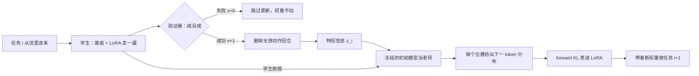

一句话：学生走一遍，只有走成了才把「这段路是怎么走成的」讲给一个不会变的自己听，让它逐词纠正刚才每一步。

### 4.2 模块拆解

**模块一：OaTTT 协议——先把游戏规则钉死**

为什么需要：不先规定「一个任务能试几次、什么时候允许学」，任何比较都站不住。

怎么做：任务流只过一遍，每个任务只跑一次，判分在更新之前完成。这叫 prequential（先前预测再更新）：第 $i$ 局的分是在它自己的轨迹能影响权重之前算出来的。

公式：

$$
\pi_i(\cdot \mid H_{i,t}) := p_{\theta_i}\bigl(\cdot \mid g(H_{i,t}; \mathcal{M}_i)\bigr),\qquad w_{i,t}\sim \pi_i(\cdot\mid H_{i,t})
$$

这个式子在说「第 $i$ 局第 $t$ 步，模型在什么样的上下文上吐出一个响应」。

- $H_{i,t}$：到第 $t$ 步为止看到的一切，任务是 $x_i$，加上观测 $o_{i,1}$、响应 $w_{i,1}$、观测 $o_{i,2}$……一直排下来，是一条越来越长的历史。
- $\mathcal{M}_i$：可选的跨任务记忆，可以是文字反思、技能卡，也可以为空。原文里 in-context 方法更新的就是它。
- $g$：把历史、指令、记忆拼成一段真实送进模型的文本。
- $\theta_i$：第 $i$ 局开始时的模型权重。OaTTT 允许它变，冻结模型则要求 $\theta_i \equiv \theta_0$。

奖励只有一局一个：

$$
\tau_i \sim \mathbb{P}_{\pi_i,\mathcal{E}}(\cdot\mid x_i),\qquad v_i = \mathcal{V}(x_i,\tau_i)\in\{0,1\}
$$

- $\tau_i$：第 $i$ 局的完整轨迹，任务 + 每步响应 + 每步观测。
- $\mathcal{V}$：验证器，给 0 或 1。注意这是**整局**一个信号，没有任何一步的中间打分。
- $v_i$：第 $i$ 局成没成。

更新规则本身就是一个空壳：

$$
(\theta_{i+1},\mathcal{M}_{i+1}) = \mathsf{Evolve}(\theta_i,\mathcal{M}_i;\, x_i,\tau_i,v_i)
$$

不同方法的差别全在这个 $\mathsf{Evolve}$ 里：in-context 方法改 $\mathcal{M}$ 不动 $\theta$，参数化方法改 $\theta$，本文两者都改（只是 $\mathcal{M}$ 留空）。

**模块二：直接做法为什么崩**

为什么需要：这是 ASCENT 的动机来源，也是最好懂的反例。

怎么做：五种做法共用一个损失，只在每个 token 前的系数 $\omega_{i,t,j}$ 上不同。

$$
\mathcal{L}_i(\phi) = -\sum_{t\in\mathcal{I}_i}\sum_{j=1}^{L_{i,t}}\alpha_{i,t,j}\,\omega_{i,t,j}\log p_{\theta_0,\phi}\bigl(y_{i,t,j}\mid c_{i,t,j}\bigr)
$$

这个式子在算「把所有生成过的 token 的负对数似然加起来，每个 token 前面乘一个可正可负的权重」。

- $y_{i,t,j}$：第 $i$ 局第 $t$ 回合的第 $j$ 个 token，也就是**模型自己刚写出来的那个词**。
- $c_{i,t,j}$：学生前缀，即「这一回合的第 $j$ 个 token 之前，模型看到的全部内容」。它取自真实跑出来的那一次，更新过程中不再变。
- $\alpha_{i,t,j} = (|\mathcal{I}_i|L_{i,t})^{-1}$：先按回合内 token 数平均，再按回合数平均，让长回合不主导。
- $\omega_{i,t,j}$：符号权重。ungated imitation 全取 1；RFT 取 $v_i$；REINFORCE 取 $v_i - \bar v_{\le i}$（历史平均成功率）。
- $\phi$：LoRA 适配器参数，$\theta_0$ 始终冻结。

关键在梯度。设学生在该位置的 logits 是 $\ell_\phi$，生成 token 是 one-hot 向量 $e_y$：

$$
\nabla_{\ell_\phi}\bigl[-\omega\log p^\phi_y\bigr] = \omega\,(p^\phi - e_y),\qquad
\nabla_{\ell_\phi} D_{\mathrm{KL}}\bigl(q\,\|\,p^\phi\bigr) = p^\phi - q
$$

先说这两个式子在算什么：第一个是「硬目标」的梯度，第二个是「分布匹配」的梯度，两者都在同一个位置上比较「学生在想什么」和「我们希望它想什么」。

- $p^\phi$：学生当前对整个词表的概率向量，长度等于词表大小。
- $e_y$：只在真实生成的那个 token 上是 1，其余全 0。
- $\omega$：上面那个符号权重，可正可负。
- $q$：老师给出的完整分布，此处被 `stopgrad` 截断，不参与求导。

第一个式子的效果：把 $y$ 的 logit 抬高 $\omega(1-p^\phi_y)$，把其他每个 token 的 logit 按它当前概率的比例压下去，压的量是 $\omega p^\phi_k$。换句话说，**它只会让分布更尖，尖的方向是「更相信刚才那个词」**。$\omega$ 为负时更糟：它把 $y$ 的概率直接送给本来就高的那些 token，等于在放大模型的既有偏好。

第二个式子的效果：每个 logit 往 $q_k - p^\phi_k$ 推，一直推到 $p^\phi = q$ 才停。老师认为该涨的涨，该跌的跌。

图 1 就是前一种做法的后果：五种方法的有效动作率掉到接近 0，第一 token 熵掉进 $10^{-6}$ 量级（几乎完全确定），KL 离初始策略越走越远。论文的说法是这些基线 "degrades the agent policy and collapse to lower success rate than the un-trained model"——比没训过的模型还差。

**模块三：ASCENT 的蒸馏目标**

为什么需要：要一个目标，既用上「这局成功了」这个信息，又不在自己生成的 token 上做硬拟合。

怎么做：教师是冻结的初始模型 $p_{\theta_0}$，它额外看到特权信息 $z_i$，学生看不到。在**同一个学生前缀**上，教师给出一个完整分布，学生去对齐它。

$$
q_{i,t,j}(\cdot) = \operatorname{stopgrad}\bigl[p_{\theta_0}(\cdot\mid z_i\oplus c_{i,t,j})\bigr],\qquad p^\phi_{i,t,j}(\cdot)=p_{\theta_0,\phi}(\cdot\mid c_{i,t,j})
$$

- $q_{i,t,j}$：教师在位置 $(i,t,j)$ 给出的下一 token 分布。`stopgrad` 意味着它只是一块固定的靶子，不往回传梯度。
- $p^\phi_{i,t,j}$：学生自己的分布。
- $z_i$：特权信息，下面单独讲。
- $c_{i,t,j}$：学生前缀。教师读的是 $z_i \oplus c_{i,t,j}$，即先看特权的整条成功轨迹，再看学生走到这一步的上下文。

损失是 forward KL：

$$
\mathcal{L}_i^{\mathrm{ASCENT}}(\phi) = \sum_{t\in\mathcal{I}_i}\sum_{j=1}^{L_{i,t}} \alpha_{i,t,j}\, D_{\mathrm{KL}}\bigl(q_{i,t,j}\,\|\,p^\phi_{i,t,j}\bigr)
$$

这个式子在算「每个位置上，老师的分布和学生的分布差多少」，按同样的回合内、回合间平均权重加总。

- $D_{\mathrm{KL}}(q\|p)$：forward KL，对每个 token 算 $q_k\log(q_k/p_k)$ 再求和。它惩罚「老师认为有可能、学生认为不可能」的情况特别重，所以偏向覆盖老师的整个支撑集。
- $\alpha_{i,t,j}$：和模块二完全相同的权重，保证两者训练在**完全相同的位置**上，只换了目标。

权重怎么走：

$$
\phi_{i+1} = \begin{cases}\mathrm{Evolve}\bigl(\phi_i;\ \mathcal{L}_i^{\mathrm{ASCENT}}\bigr), & v_i = 1\\[2pt] \phi_i, & v_i = 0\end{cases}
$$

- $v_i = 1$：这一局成了，拿它当教材，做几步优化。
- $v_i = 0$：这一局没成，**一步都不更新**，权重原样带进下一局。
- $\mathrm{Evolve}$：这里具体就是 AdamW 走两步（见 4.3）。

**模块四：特权信息长什么样**

为什么需要：教师要「看到后见」，但后见不能是外部参考答案——部署时根本没有。

怎么做：用这一局自己的轨迹拼出来。

$$
\tau_i = \bigl(x_i,\ o_{i,1},\ (w_{i,t},o_{i,t+1})_{t=1}^{T_i}\bigr)
$$

这是完整轨迹：任务、每一步的响应、响应执行后环境返回的观测，一共 $T_i$ 回合。

先判每一步的动作有没有被环境真的执行：

$$
d_{i,t} = \begin{cases}1, & \text{环境执行了 } \rho(w_{i,t})\\ 0, & \text{否则（含解析不出动作）}\end{cases}
$$

- $\rho$：动作解析器，从响应文本里抽出 `take egg 1 from diningtable 1` 这种命令。
- $d_{i,t}=1$：环境认了这个动作，执行了。
- $d_{i,t}=0$：解析失败，或者环境回了一句 "Nothing happens."，这一步等于白做。

特权信息只收 $d_{i,t}=1$ 的回合：

$$
z_i = h^{\mathrm{ASCENT}}\bigl(x_i,\ (w_{i,t})_{t:\,d_{i,t}=1}\bigr)
$$

- $h^{\mathrm{ASCENT}}$：固定模板，拼上任务目标、一句 "GOAL ACHIEVED"，再加上每个有效回合的完整推理加动作。
- 观测文本默认**不放进去**（消融里讨论过）。
- 关键的一点：过滤只改教师的输入。学生仍然在**完整轨迹**的所有非空响应位置（包括被删掉的无效回合）上被训练。

这带来一个反直觉的效果：在无效动作的位置上，教师看到的是「删掉了这段无效内容之后」的成功路径，于是它给出的分布倾向于「这里本来该做什么」；学生被推着往那个方向走。

### 4.3 关键细节

- **适配器**：LoRA 只挂在 `down_proj` 上，rank 16，scale 32。基座永远冻结。
- **优化**：AdamW，学习率 $1.5\times10^{-4}$。每个验证通过的局只走 **2 步**优化器。适配器和优化器状态跨任务保留。
- **轨迹的生命周期**：用完即弃。更新完这局，轨迹不进任何 replay buffer。论文明确写了 "No replay buffer is used in this paper."
- **教师实现**：教师就是同一份权重把 LoRA 关掉，返回 detach 的整词表 logits。不额外加载一份模型。
- **解码**：所有方法统一 ReAct 模板 + 贪婪解码，没有采样，所以方差主要来自任务顺序之外的随机性。
- **回合预算**：ALFWorld 和 WebShop 都是 50 回合，到 50 没完成就停并按失败算。
- **硬件**：全部实验跑在单张 NVIDIA H100 上。

## 5. 实验结果

这一节的读法像看体检报告：先看总分（成功率），再看是哪一项把总分拉上去的（消融），最后看代价（每局花的时间）。

**实验设置**

- **数据集与切分**：ALFWorld 是文本家居环境，seen 切分 140 个任务、6 个族（Pick / Look / Clean / Heat / Cool / Pick2），是主流；unseen 切分 134 个任务，换到了没见过的房间和布局，用来测冻结迁移和继续在线学。WebShop 是模拟网店，每条流 500 个任务，要搜到并买下符合描述的商品。AppWorld 测交互式代码生成，Test-Normal 168 个任务 56 个场景，Test-Challenge 417 个任务 139 个场景。训练集：OaTTT 没有独立训练集，任务流本身就是数据。
- **骨干模型**：Qwen3.5-4B 和 Qwen3.5-9B 两个尺寸，同一家族。
- **训练预算**：没有离线训练。在线阶段每局最多 50 回合（ALFWorld / WebShop）或 30 次交互（AppWorld），每局验证通过则走 2 步 AdamW。单卡 H100。所有结果报 3 次独立运行。
- **基线**：offline 方法（MemP、ACE、EvoSkill、GEPA、TextGrad、Trace2Skill，在固定训练切分上先建好记忆或提示再评测，超出 OaTTT 协议，只当参考点）；online in-context 方法（MemP、ReasoningBank、ACE、A-Mem、MemRL、Dynamic Cheatsheet，每局后更新记忆）；online 参数化方法（TT-OPSD，作者自己把 OPSD 改造成流式版本，教师只看当前回合）。另外第 3.2 节那五个直接模仿/强化方法只在图 1 的受控研究里出现，主表舍掉了。
- **指标**：ALFWorld 报 Avg. SR（整条流成功率，%）和 task-family SR；WebShop 报 Strict-SR（任务分 = 1）和 Mean-Score；AppWorld 报 TGC（任务目标完成率，要过全部基于状态的测试）和 SGC（场景目标完成率，场景内所有任务变体都过）；三个都报 mean turns（每局平均回合数，越低越好）。
- **推理设置**：ReAct 模板，贪婪解码，温度不适用（无采样）。WebShop 上 ASCENT 的更新门限接受得分 ≥ 0.9 的轨迹，而不是只接受 1.0。

主表只留能说明问题的行，最强基线那一列按同协议里最强的填：

| 数据集 / 任务 | 指标 | 本文 | 最强基线 | 提升 |
| --- | --- | --- | --- | --- |
| ALFWorld seen（4B） | Avg. SR (%) | 69.5 | 63.6（online MemP） | +5.9 |
| ALFWorld seen（9B） | Avg. SR (%) | 77.4 | 69.3（online ACE / offline MemP） | +8.1 |
| ALFWorld unseen，冻结迁移（4B） | Avg. SR (%) | 62.7 | 57.5（online MemP） | +5.2 |
| ALFWorld unseen，冻结迁移（9B） | Avg. SR (%) | 88.8 | 70.1（online MemP） | +18.7 |
| WebShop（4B） | Strict-SR (%) | 41.9 | 36.8（online MemP） | +5.1 |
| WebShop（9B） | Strict-SR (%) | 41.5 | 24.2（TT-OPSD） | +17.3 |
| AppWorld Test-Normal（4B） | TGC (%) | 26.2 | 22.0（MemP / ACE） | +4.2 |
| AppWorld Test-Challenge（4B） | TGC (%) | 20.0 | 19.2（ReasoningBank） | +0.8 |

相对 base 的提升：ALFWorld seen 4B +23.1、9B +22.4；unseen 冻结迁移 4B +19.4、9B +39.5；WebShop 4B +24.1、9B +24.3。论文的总结是 "improves exact success over the base by more than 22 points across ALFWorld and WebShop at both scales"，对得上。

**原文实验图**

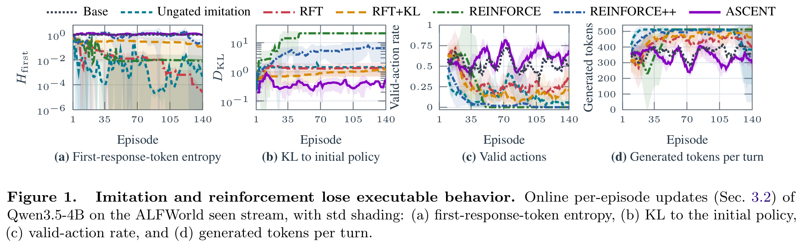

图 1：这张图证明了「直接照抄自己」会崩。四个面板从左到右是：首响应 token 的熵、到初始策略的 KL、有效动作率、每回合生成 token 数。看两条线就够——虚线（ungated imitation / RFT）的熵掉进 $10^{-6}$，有效动作率掉到 0 附近；ASCENT 的紫线一直贴着 base 的灰点线，KL 是所有方法里最低的。第 (d) 面板更能说明问题：崩掉的方法 token 数一路涨到 450 以上（越写越长还越写越错），ASCENT 在 70 局附近见顶约 450，之后回落到 310 左右并稳住。

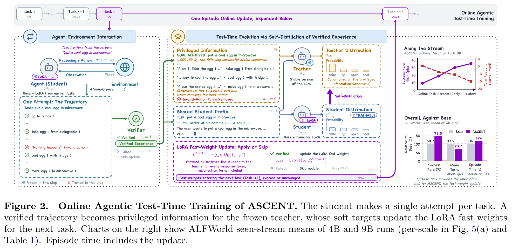

图 2：方法总览。看两处即可——左下的验证器把「失败」直接导去 "Skip update"，右上冻结点旁边写着 "Frozen in this step"，只有学生的 LoRA 标着 "TRAINABLE"。右侧三根柱是 4B 和 9B 的平均：成功率 50.7→73.5，平均回合 33.9→23.7，每局时间 106→124 秒。前两项是净收益，第三项是净成本（每局多了 LoRA 更新那一步）。

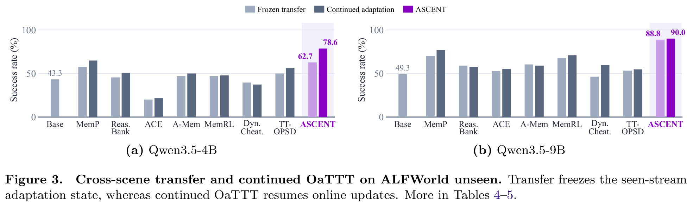

图 3：跨场景迁移和继续学。灰柱是冻结迁移，紫柱是在新场景上继续做 OaTTT。4B 从 43.3 提到 78.6，9B 从 49.3 提到 90.0。9B 上继续学的增益只有 +1.2，说明迁移本身已经很强、可提升空间变小。

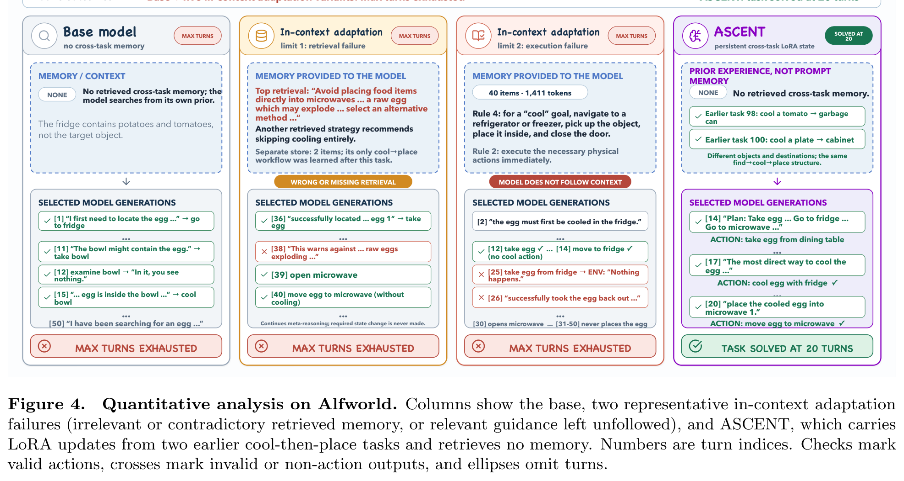

图 4：一个具体案例，任务都是「put a cool egg in microwave」。前两列是 in-context 方法翻车的两种典型方式：第一列检索到的是矛盾经验（"avoid placing food items directly into microwaves… a raw egg which may explode"），第二列检索对了但模型不照做（漏掉 cool 那一步）。第四列 ASCENT 压根没检索任何记忆，靠的是第 98、100 两局同族任务（cool a tomato / cool a plate）留下的 LoRA 权重，20 回合做完。

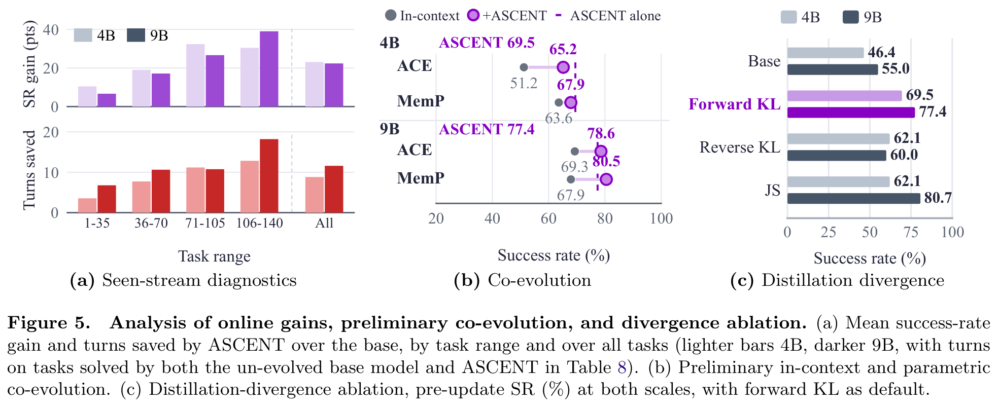

图 5：三个面板。左 (a)：ASCENT 相对 base 的增益随任务段往后变大（1-35 段约 10 pts（4B）/ 7 pts（9B），106-140 段到 30 pts / 39 pts），同时省下的回合数也在涨——这说明它是「越用越会」，不是一次性提升。中 (b)：把 ASCENT 和 in-context 方法叠加，4B 上 ASCENT 单独最好（69.5 vs 加 ACE 65.2、加 MemP 67.9），9B 上叠加反而更好（77.4 → 78.6 / 80.5）。右 (c)：换散度。4B 上 forward KL 最好（69.5），9B 上 JS 反超（80.7 vs 77.4）。

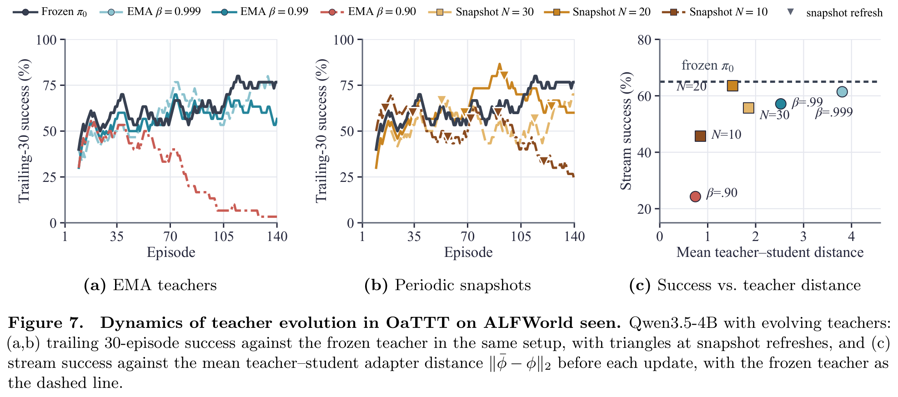

图 7：教师该不该跟着学生一起变。左 (a)：EMA 教师，$\beta=0.90$ 的那条红虚线从中段开始暴跌到 5% 以下。中 (b)：快照教师，刷新越频繁（三角形的间隔越短）跌得越狠，N=10 那条从 60.0 掉到 25.7。右 (c)：把「成功率」和「教师与学生的权重距离」画在一起，冻结教师（虚线，65%）在所有演化教师的上方。

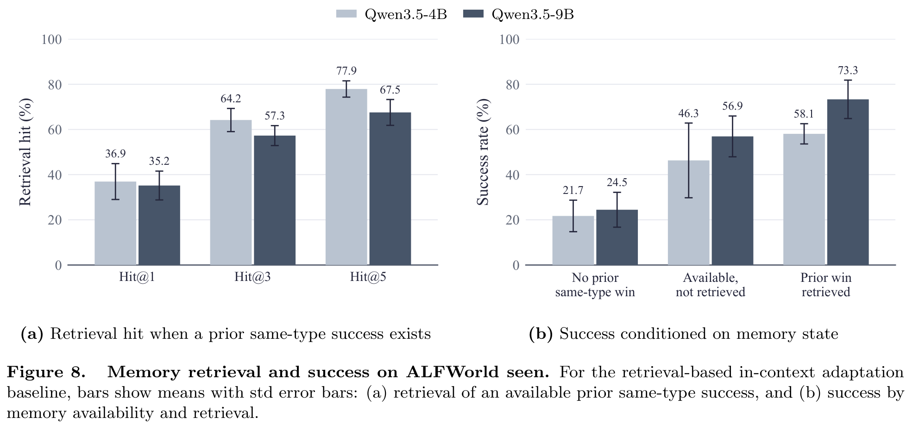

图 8：检索这条路的两个漏洞。左 (a)：明明库里有同类成功经验，Hit@1 只有 36.9% / 35.2%，Hit@5 才 77.9% / 67.5%。右 (b)：按记忆状态分三类看成功率——压根没有同类经验 21.7% / 24.5%，有经验但没检索到 46.3% / 56.9%，检索到了 58.1% / 73.3%。检索到确实有用，但它不是充分条件。

**原文实验表**

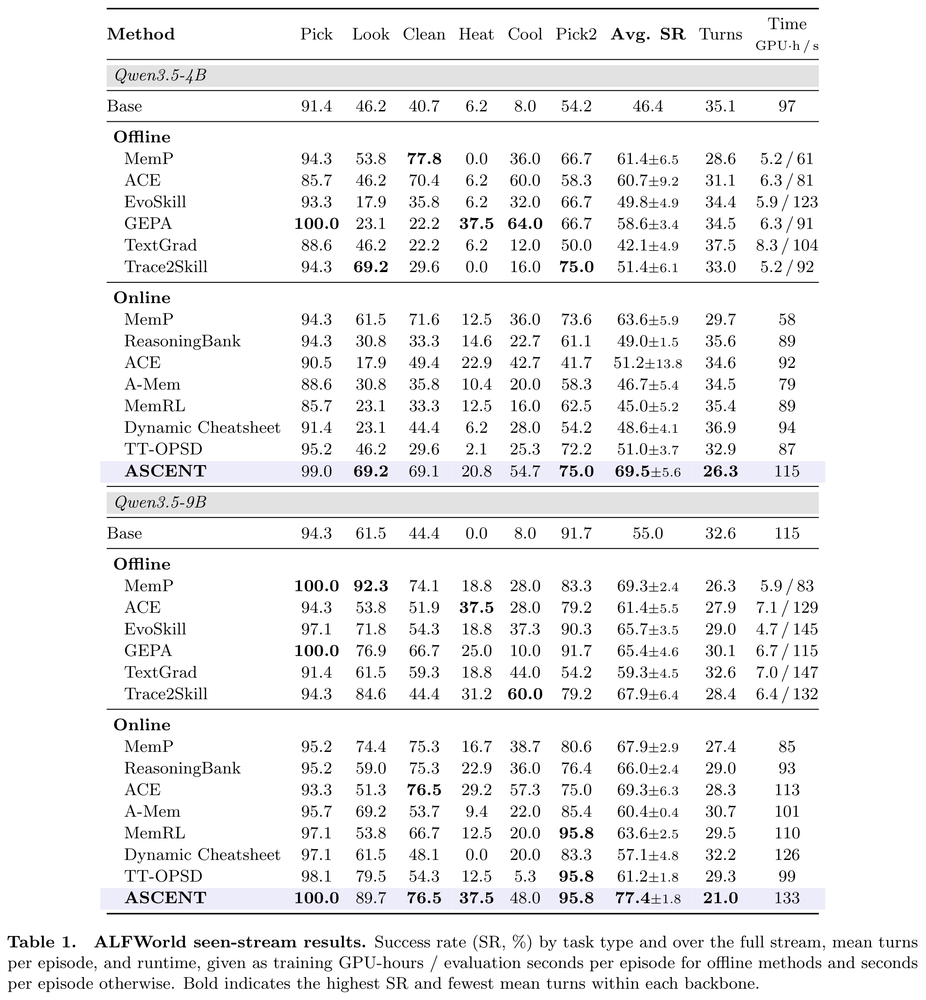

表 1：ALFWorld seen 主表。最能说话的是 Heat 和 Cool 两列：base 在 4B 上是 6.2 / 8.0，基本不会做；ASCENT 是 20.8 / 54.7。9B 上 Cool 从 8.0 直接到 48.0。注意 offline 的 GEPA 在 Heat 列有 37.5（4B），比 ASCENT 的 20.8 高——单个族上 ASCENT 不是全面最强。

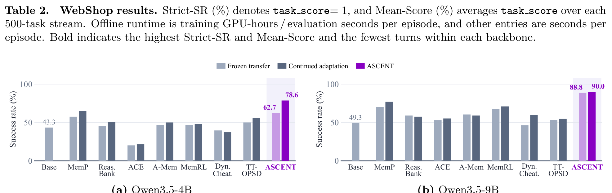

表 2：WebShop。4B 的 Strict-SR 从 17.8 到 41.9，Mean-Score 从 25.9 到 62.4，回合数 39.5→17.8。9B 上回合数只从 37.5 降到 26.7，但 Mean-Score 从 27.8 到 56.8。

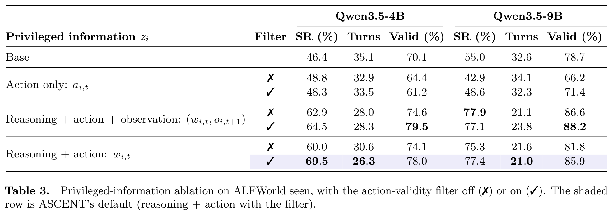

表 3：特权信息消融，这是最能解释「为什么有效」的一张表。三行是三档信息量：只给动作 $a_{i,t}$、给推理 + 动作 + 观测、给推理 + 动作。4B 上只有「推理 + 动作 + 过滤」这一档到 69.5，只给动作的版本掉到 48 附近，和 base 的 46.4 差不多。9B 上「推理 + 动作 + 观测」不加过滤也能到 77.9，说明大模型能吃更长的后见。

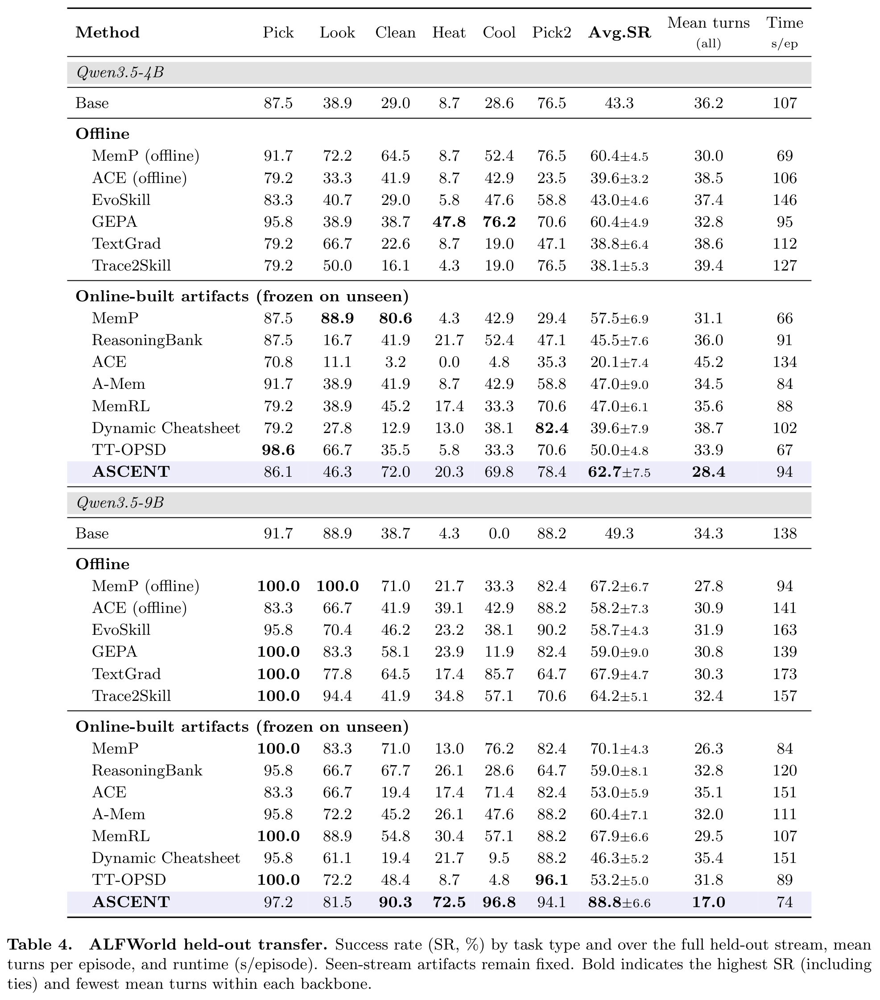

表 4：ALFWorld unseen 冻结迁移。9B 上 ASCENT 的 88.8 比所有 online 基线高出一大截（第二名 MemP 70.1），但这个 88.8 的方差是 ±6.6。

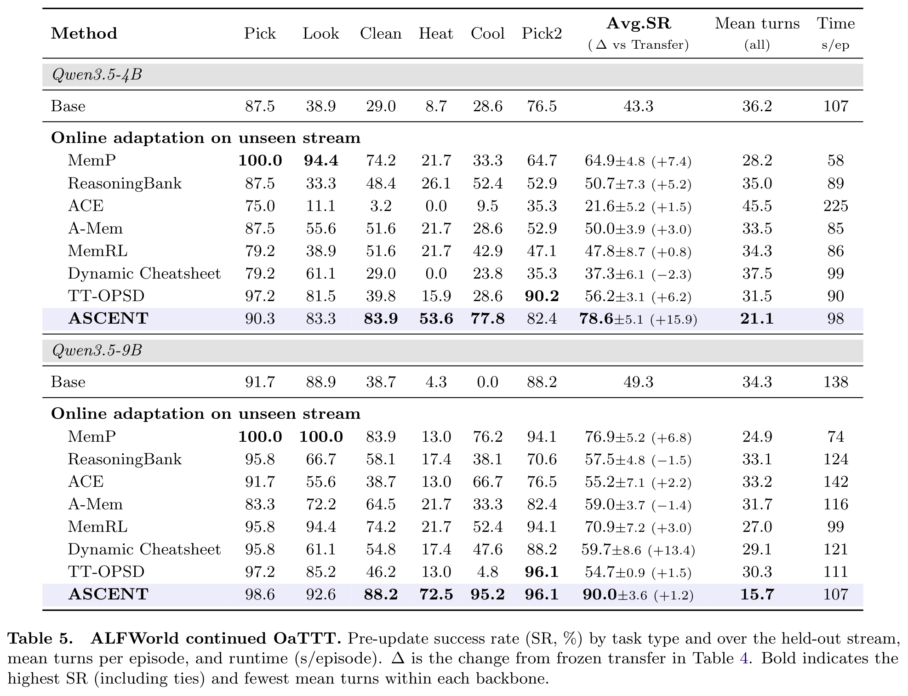

表 5：在同一批 unseen 任务上继续做 OaTTT。4B 从冻结迁移的 62.7 到 78.6（+15.9），9B 只从 88.8 到 90.0（+1.2）。

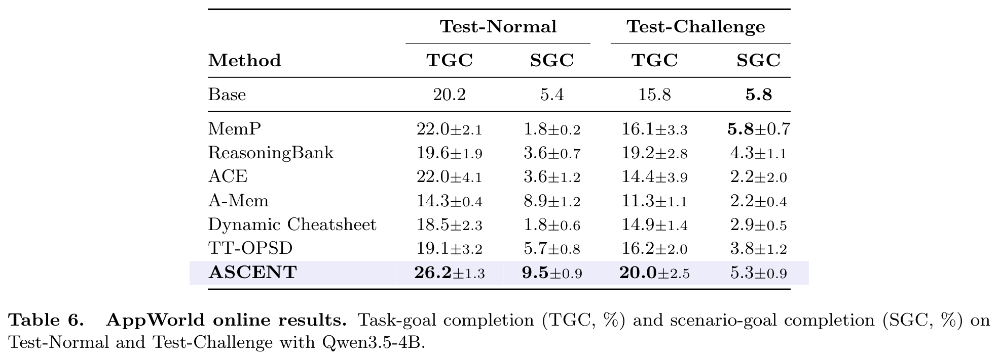

表 6：AppWorld。4B 上 TGC 在 Test-Normal 从 20.2 到 26.2，Test-Challenge 从 15.8 到 20.0。SGC 在 Test-Challenge 上反而从 5.8 掉到 5.3——论文自己承认 "On Test-Challenge, its task-level gain does not translate into a scenario-level lead."

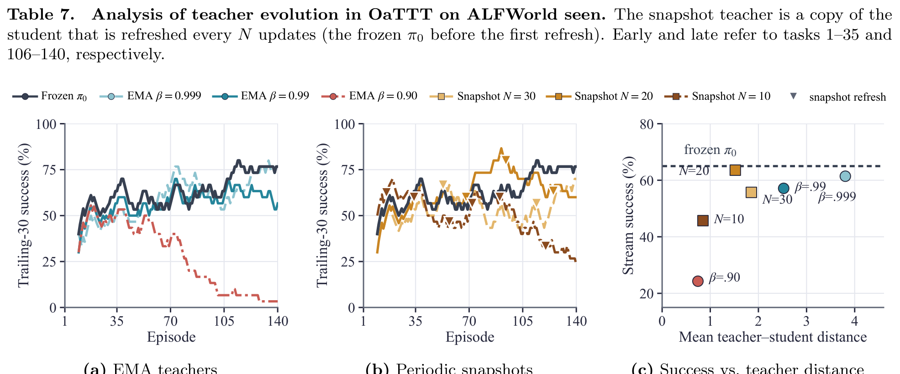

表 7：教师演化消融，和图 7 配套。冻结教师 69.5，Early→Late 是 59.0→75.2（越跑越好）；最快的 EMA $\beta=0.90$ 只有 24.3，Late 段掉到 2.9。慢速的 EMA $\beta=0.999$ 能到 61.4，Late 段 77.1 甚至超过冻结教师，但全程均值仍低。

**消融告诉我们什么**

三件事。

第一，**推理文本是后见的主力**。只给动作 $a_{i,t}$ 时，4B 是 48.8/48.3、9B 是 42.9/48.6，两个尺寸都不比 base 好多少。原因论文给了两条：推理解释了「为什么做这个动作」（服务于哪个子目标），而且推理占了学生生成 token 的绝大多数，动作只是短短一条命令——只给动作，等于只在少数位置上给指导。

第二，**小模型怕长后见，大模型不怕**。4B 上最优是「推理 + 动作 + 过滤」，9B 上「推理 + 动作 + 观测 + 不过滤」也能到 77.9。作者的解释是 9B 语言能力更强，能吃下更长上下文；过滤在 9B 上主要提的是有效动作率（86.6→88.2），不是成功率。

第三，**教师必须冻住**。这是全文最反直觉的消融：直觉上教师跟着学生一起进步应该更好，但表 7 里没有一个演化教师能超过冻结教师。作者的机制解释是「学生的漂移会通过教师回流成下一轮的监督」，`stopgrad` 只在一次更新内部切断这条路，跨任务时挡不住。

**这些实验够不够支撑结论**

大体够，有几处不够。

支持「有效」的证据是扎实的：三个环境、两个尺寸、3 次运行、和 8 个 online in-context 基线 + 1 个参数化基线比，而且迁移和继续学都做了。

不够的地方有三处。其一，所有模型都来自 Qwen3.5 一个家族，没有跨家族验证，无法排除「这套东西只对 Qwen 的分布成立」。其二，ALFWorld 的 9B 结果方差偏大（unseen 上 ±6.6），单看一个数字容易过度解读。其三，「效率提升」的论证绕了一道：主表里的 mean turns 是「所有局」的平均，失败的局会用满 50 回合，所以成功率高本身就会拉低平均回合数。作者在表 8 里补了「共享成功任务」的配对比较来剥离这个效应，但表 8 放进了附录，正文只给了 64% / 67% 两个数字。

## 6. 局限性

这一节分两块：作者在论文里印出来的三条，和我读完看出来的几条。前者是说明书上写了的小字，后者是说明书没写、但用起来会碰到的。

**作者自己承认的**

论文第 5 节的 Limitations 很短，三条：

1. "ASCENT needs full next-token distributions from its frozen copy, so it applies only to open-weight models."——它需要教师的完整词表分布，所以只能用在开放权重的模型上。闭源 API 拿不到 logits，这套方法直接失效。
2. "It gates updates on sparse episode-level verification and weights every turn equally."——只在整局成败上开门，所有回合等权。做对了哪几步、做错了哪几步，它分不出来。
3. "Because the teacher's privileged context contains the student's response text, it may partially reconstruct generated tokens, which would limit the independence of its hindsight."——教师的特权上下文里本来就包含学生写的那段文本，所以教师有可能只是在「部分重建」学生已经生成的 token，而不是真的在做独立的后见判断。作者说这是个 open question。

**我看出来的**

- **隐形假设：任务流里同类任务足够多、足够像**。ALFWorld 是 6 个族、140 个任务，一个族 20 多局，这是经验能复用的大前提。换成一个任务一个样的流（每个任务都独一无二），这套东西学到的东西没地方用。论文没有测这种流。
- **隐形假设：验证器是对的**。整套方法建立在「$v_i=1$ 就是真的成功」上，拒绝采样、无偏策略梯度的论证都依赖它。如果验证器本身有噪声（判错、漏判），被当成教材的可能是错的轨迹。论文用的三个环境验证器都很干净，没测有噪声的情况。
- **边界条件：一局只能学一次**。因为更新后轨迹就丢了，同一个任务不会重复出现。这意味着一个任务里出现的偶然性（比如某一步纯属运气）会被当成可复用经验。
- **缺的对比**：没有和「在线 RL + 学出来的 critic」比。论文的理由是 sparse reward 下 critic 难训（"requiring no value model or critic under sparse rewards"），但这是设计选择，不是实验证明。
- **缺的对比**：没有和「把同样的成功轨迹存下来、部署前统一 SFT 一遍」比。这个对照能回答一个关键问题——ASCENT 的优势到底来自「蒸馏方式」还是仅仅来自「用上了成功轨迹」。
- **实验层面**：只有文本环境，没有视觉或 GUI 环境；只有两个尺寸且同族；AppWorld 的 SGC 在 Challenge 上比 base 低，作者只用一句话带过。

## 7. 一句话总结

别让 agent 抄自己刚写的东西，让它听一个**不会变**的自己讲讲这局是怎么成的。

类比：学做菜。你自己瞎做一遍，居然成了。如果照着刚才那遍录像重放（直接模仿），你会把当时的犹豫、废动作、走错又折回来的路线一起学进去，越练越僵硬。ASCENT 的做法是让「刚做完这道菜的你」回头看整段过程，然后告诉「正在做的你」每个岔路口本来该怎么下手——而且这个「回头看的你」永远是刚入门时的那个版本，不会跟着你一起跑偏。

核心公式：

$$
\boxed{\ \phi_{i+1}=\begin{cases}\mathrm{Evolve}\bigl(\phi_i;\ \mathcal{L}_i^{\mathrm{ASCENT}}\bigr), & v_i=1\\[2pt] \phi_i, & v_i=0\end{cases}\ }
$$

其中蒸的靶子是教师的整词表分布，不是生成的那个词：

$$
\mathcal{L}_i^{\mathrm{ASCENT}}(\phi)=\sum_{t\in\mathcal{I}_i}\sum_{j=1}^{L_{i,t}}\alpha_{i,t,j}\,D_{\mathrm{KL}}\Bigl(\operatorname{stopgrad}\bigl[p_{\theta_0}(\cdot\mid z_i\oplus c_{i,t,j})\bigr]\,\Big\|\,p_{\theta_0,\phi}(\cdot\mid c_{i,t,j})\Bigr)
$$

## 8. 可复用点

- 如果我要在自己的项目里用：把「成功轨迹」喂给一个冻结的初始模型做教师，在自己跑出来的前缀上蒸整词表分布，而不是直接 SFT 自己的轨迹。这条换任务仍然成立——任何有成功/失败二元信号的在线学习都能套。
- 训练不收敛、或者越训越僵时先查：是不是在自生成 token 上做 hard-target 更新。如果是，换成 full-distribution KL，靶子用冻结副本生成。
- 教师千万别跟着学生每步更新。要更新也得隔很久，或者只在学生确认涨点之后更新一次（论文 C.1 结尾建议的 "evolving the teacher only in stages, after a verified gain of the student"）。
- 长轨迹蒸馏时，先按「动作有没有被环境执行」筛一遍教师输入，但训练位置保留全部。这一步几乎零成本（信号本来就来自环境的回话），4B 上单独就值 9.5 个点（表 3：60.0→69.5）。

## 9. 我的疑问

- 表 3 里 9B 的「只给动作」版本（42.9）比 base（55.0）还低，4B 上却和 base 持平（48.8 vs 46.4）。作者只解释了「动作 token 少」，没解释为什么在小模型上无害、在大模型上有害。这个反转可能是模型对特权信息格式的敏感度不同，但论文没查。
- 正文说「二值奖励下最大化成功轨迹似然给出无偏策略梯度估计」，但附录 A.1.1 的 Eq 15 写的是按接受概率的贝叶斯重加权，两者之间的证明连接没给。我不确定这个 "unbiased" 是严格意义还是宽松说法。
- forward KL 在 4B 上明显好于 JS（69.5 vs 62.1），在 9B 上反过来（77.4 vs 80.7）。作者说 "forward KL favors coverage of the teacher distribution, whereas reverse KL is mode-seeking"，但这解释不了为什么尺度一变结论就翻。我的猜测是 9B 的教师分布本身更尖，forward KL 的覆盖倾向反而引入了噪声，但这是推断，原文没说。
- 论文的核心机制解释是「教师看到学生写的文本，可能只是在重建」。如果是这样，ASCENT 的优势里有多少来自「教师看到了答案文本」、多少来自「分布匹配本身」？作者把隔离这个效应列为 open question，没有对应消融（比如把 $z_i$ 的文本换成只给动作描述、或者换成随机改写的版本）。
