> 一句话：让模型自己判断这道题要不要临时学一下、用哪种学法、还是直接答。

## 0. 读之前你需要知道

**术语卡**

- **测试时训练（Test-Time Training, TTT）**：模型在答题的那一刻，拿这条输入（或它的改写）当训练材料，对自己的参数做几步更新。类比：考试允许你在草稿纸上现推一遍，而不是只能用背下来的解法。
- **LoRA**：不碰原模型权重，只训一对很小的低秩矩阵，得到几 MB 的补丁。类比：教材不重印，只夹一张便利贴，用的时候贴上去。
- **技能（skill）**：本文的定义是**一个样本池 + 在池子上训出来的那个 LoRA**。第一次 `ADAPT` 之前，技能里只有样本，没有 adapter。
- **适应池（adaptation pool）**：攒同类 query 的篮子。像 TTRL 这种靠多条同类题多数投票造伪标签的方法，得先攒够 16 条才开得动。类比：一个人投票不算数，凑够一桌人才能计票。
- **策略（policy, $\pi_\theta$）**：本文里负责调度的小脑。它不答题，每轮只写一段 `<think>` 再吐一个动作。
- **轨迹（trajectory, $\tau$）**：一条 query 从进来到交卷的全部动作序列。
- **效用（utility, $U$）**：答案对不对，取值 0 或 1，由任务自带的自动验证器判。
- **基线相对收益（base-relative return）**：用同一条 query 直接问冻结模型拿到的分数当零刻度，只算这趟比不折腾多赚了多少。类比：不看你总分多高，只看你这趟多挣了几块钱。
- **GRPO / Dr. GRPO**：一种不用价值网络的强化学习算法，同一条题采 $G$ 条轨迹、用组内均值当基线；Dr. GRPO 去掉了组内标准差归一化。
- **冷启动（cold start）**：策略还没学会动作格式，采出来的轨迹全是废的，奖励信号等于零。

**它站在谁肩上**

- 五种 TTT 方法：SEAL（2025，从输入文本生成 self-edit 再蒸进 adapter）、TTT-FS（2025，把 few-shot 示范做 leave-one-out 增广后训 adapter）、TTRL（2025，用多条同类题的多数投票伪标签做 RL）、TLM（2025，直接在输入文本上最小化语言建模损失）、PoT（2026，按执行反馈或答案一致性反复搜索并在线更新）。它们都在已经知道该用哪种的前提下有效，没人管什么时候该用。
- AlphaProof（2025）与 TTT-Discover（2026）：把 TTT 做到 IMO 银牌和开放科学问题，但都靠人预先指定任务和流程。
- Reflexion / Voyager 式自改进 agent：改进发生在脚手架（记忆、提示、可执行技能）里，模型参数没变。
- 模块化 adapter 与技能库（LoRAHub、MoLora、SAGE）：能路由、能组合、能在失败时触发新建 LoRA，但池子多是部署前建好的，或者触发规则写死。
- 视觉里的选择性测试时适应（Niu 2022/2023、Gong 2023）：会筛掉没信息量的样本，但只在固定域、固定方法下。

## 1. 动机

你雇了个翻译，日英法德都能翻。现在递给他一段古汉语。他有两种反应：硬按法语的语序逐字翻，越翻越离谱；或者现场花两小时先学古汉语再翻，可能学会了，也可能学歪。人会做第三件事：先判断这段值不值得学。

TTT 现在就卡在后两种之间。论文开篇引了图灵那句话：「the possibility of letting the machine alter its own instructions provides the mechanism for learning from experience」——让机器改写自己的指令，是从经验中学习的机制。八十年过去，模型的指令（参数）在部署后依然是冻的。

**以前怎么做**：TTT 论文一律假设已经知道该学什么、该怎么学。AlphaProof 只做数学，TTT-Discover 只做指定的开放问题，流程和域都是人先划好的。

**为什么不行**：真实部署的请求是混着的——一条数学、一条代码、一条病历问答、一段长文档。原文把这层意思说得很直白：**「each TTT algorithm works in different settings, and applying an ill-suited method could waste test-time compute or even damage model performance」**，每种方法只在各自的设定里成立，用错了要么白烧算力，要么把模型带偏。这个带偏不是修辞：论文自己测出来，把 SEAL 无脑套到所有题上，总体效用 0.248，比什么都不做（0.256）还低；在数学上是 $-0.368$。

**为什么现在能做**：三件事凑齐了。五种 TTT 方法都成熟到能当工具调；LoRA 让学一次的产物变成一个可插拔的小文件，能存、能挂、能换；训练多轮 agent 的 RL 工程（GRPO 这一套）已经足够便宜。

## 2. 贡献

这五条读起来像一张项目结算单：不问请没请顾问，只问请顾问这一趟的净收益是多少。

- **把 TTT 从固定流程变成可调用工具加可增长技能库**。证据：动作集固定为 $\{\text{ASSIGN}, \text{ADAPT}, \text{LOAD}, \text{GENERATE}\}$，每次适应产出一个独立 LoRA，库跨 query 持久（第 2.1 节）。
- **训出一个会判断该不该学的策略**。证据：在 Qwen2.5-7B 上总体 utility 从 0.256 涨到 0.510，八个域全部为正（Table 1）。
- **学到的不是永远多学**。证据：算力惩罚 $\lambda_{\text{comp}}$ 从 0 增到 0.4，直接答率从 11.8% 单调升到 39.8%，归一化适应算力降 35.5%（Figure 3）。
- **决策能迁移**。证据：策略只在六个域上训过，在完全没见过的 Grid Puzzles 上拿到最大增益约 0.43；换成 Llama-3.1-8B、GLM-4-9B、Qwen2.5-14B，总体增益分别 +0.136、+0.142、+0.189（Figure 5、Table 2）。
- **真的会复用旧技能**。证据：三次评测 run 里共有 100 条 query 加载了先前建好的技能，帮了 61 条、只害了 1 条（第 3.1 节）。

## 3. 创新点

- **把要不要 TTT 做成多轮序贯决策，而不是一次静态路由**。对比对象：Semantic Router 用 query 的 embedding 相似度从标注样本里挑一个方法，挑完就答。Agentic-TTT 允许先归档、等池子攒够 16 条、再适应、再挂载。类比：静态路由像只看信封上的邮编就派件，这里允许拆包、暂存、并单再派。有用是因为 TTRL 这类方法有硬前置条件，一次选择表达不了先攒后训。
- **技能库是环境状态的一部分，不是外挂**。对比对象：LoRAHub / MoLora 的 adapter 池在部署前建好，SAGE 用写死的规则（检测到推理失败）触发建 LoRA。这里策略的每个决定都在改变自己未来能选什么，库的规模随部署时间增长。
- **用基线相对收益当奖励，而不是绝对分数**。对比对象：直接用 $U(\tau)$ 做奖励。有用是因为八个域的基线差得极远（Passage QA 0.040，Math 0.526）。用绝对分数，策略会在容易的域上躺赢、在难的域上学不动；减掉直接答的分数后，每条 query 的要不要动手落在同一把尺子上。
- **两段式训练解决冷启动**。对比对象：直接上结果驱动的 RL。原文的说法是，当策略几乎采不到合法动作序列时，**「the correct behavior remains almost invisible to reward-based learning」**，对的行为在奖励里几乎不可见，也就无法被强化。

## 4. 方法

### 4.1 整体流程

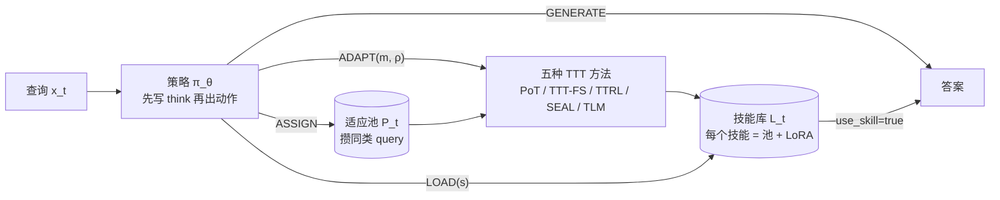

这张图说的是：一条 query 进来后，策略可以用四种动作里的任意一种开局，动作执行完把反馈塞回上下文，再来一轮，直到 `GENERATE` 交卷；池子和技能库在这条 query 结束后继续留着，成为下一条 query 的开局状态。像一间不断进货的仓库，每来一单可能新增一个货位，也可能直接调库存出货。

### 4.2 模块拆解

**模块一：状态与动作**

为什么需要：TTT 方法不是同质的。SEAL 吃输入文本，TTT-FS 吃 few-shot 示范，TTRL 吃一批同类题。要把它们塞进一个统一的决策接口，就得先抽象出材料放哪、方法怎么调、学完的成果怎么存。

怎么做：环境维护适应池 $\mathcal{P}_t$（每个池 $\rho$ 存一批兼容 query 加自带的材料）和技能库 $\mathcal{L}_t$。跨 query 状态 $S_t = (\mathcal{L}_t, \mathcal{P}_t)$。基座模型全程冻结，每次适应只产出一个 LoRA 技能 $s$，并附带一句自然语言描述，供策略判断以后要不要复用。

第 $k$ 轮的动作从四个原语里选：

$$
a_{t,k} \in \mathcal{A} = \{\text{ASSIGN}(\rho),\; \text{ADAPT}(m, \rho),\; \text{LOAD}(s),\; \text{GENERATE}\}
$$

- $a_{t,k}$：第 $t$ 条 query 第 $k$ 轮的动作，四个取值之一。
- $\rho$：池的键，如 `mcq-medical-4opt`（题型 + 规则推出来的域标签 + 选项数）。
- $m$：TTT 方法名，取自五种之一。
- $s$：技能 id。

`ASSIGN` 把当前 query 的材料归档进池，`ADAPT` 在池上跑方法 $m$ 产出技能，`LOAD` 挂载已有技能，`GENERATE` 交卷并终止。策略先写推理再出动作：

$$
c_{t,k} = (x_t, S_t, \tau_{t,<k}), \qquad z_{t,k} \sim \pi_\theta(\cdot \mid c_{t,k}), \qquad a_{t,k} \sim \pi_\theta(\cdot \mid c_{t,k}, z_{t,k})
$$

- $c_{t,k}$：第 $k$ 轮的上下文，三元组。
- $x_t$：当前 query。
- $S_t$：跨 query 状态（技能库 + 池）。
- $\tau_{t,<k}$：这条 query 到第 $k$ 轮之前的动作与环境反馈。
- $z_{t,k}$：先写出来的推理文本，包在 `<think>...</think>` 里。

**模块二：基线相对收益**

为什么需要：如果奖励直接用分数，策略会倾向于把所有算力押在本来就难的题上，也不会去算这次适应值不值。

怎么做：拿同一条 query 直接用冻结基座作答的轨迹当对照，只奖励超出部分，并对多花的时间收税：

$$
R(\tau_t) = \big[U(\tau_t) - U(\tau_t^{\text{GENERATE}})\big] - \lambda\big[C(\tau_t) - C(\tau_t^{\text{GENERATE}})\big]
$$

- $U(\tau)$：这条轨迹最终答案的效用，0 或 1。
- $\tau_t^{\text{GENERATE}}$：不含 `ASSIGN` / `ADAPT` / `LOAD`、直接作答的对照轨迹。
- $C(\tau)$：整条轨迹的算力成本，含策略推理、TTT 动作、最终作答。
- $\lambda \ge 0$：质量与算力的兑换率。训练阶段用的是它的两个实例：$\lambda_{\text{comp}}$ 管算力，$\lambda_{\text{inv}}$ 管无效动作。

于是目标就是让一条流上的期望累计收益最大：

$$
\theta^\star = \arg\max_\theta \; \mathbb{E}_{\pi_\theta}\left[\sum_{t=1}^{T} R(\tau_t)\right]
$$

- $T$：一条 query 流里的 query 数。
- $\theta^\star$：学到的策略参数。

**模块三：冷启动蒸馏**

为什么需要：基座模型从没见过这套动作协议，合法动作序列的初始概率接近零，RL 采不到正样本。

怎么做：用启发式规则为每条训练 query 提出逐轮的金标动作 $a^\star_{t,k}$，并且只在经验上的 TTT 评估确认它真有收益之后才保留。每一轮给一个 hint $h_{t,k}$，说明下一个金标动作是什么、为什么合适。让初始策略在带着 hint 的上下文里自己采：

$$
(z_{t,k}, a_{t,k}) \sim \pi_{\theta_0}(\cdot \mid c_{t,k}, h_{t,k}), \qquad \text{retain only if } a_{t,k} = a^\star_{t,k}
$$

- $\pi_{\theta_0}$：初始策略（基座加一个新 LoRA）。
- $h_{t,k}$：这一轮的提示，指明目标动作并解释理由。
- 保留条件：只有当策略自己吐出的动作等于金标动作时，这一轮才进数据集。

关键设计：推理文本 $z_{t,k}$ 是策略自己写的，不是外部的教师风格。收集完把 hint 全部删掉，得到三元组 $(c_{t,k}, z_{t,k}, a^\star_{t,k})$，上下文 token 从 loss 里 mask 掉，只监督推理和动作块：

$$
\mathcal{L}_{\text{SFT}}(\theta) = -\mathbb{E}_{\mathcal{D}_{\text{SFT}}}\Big[\omega_z \log \pi_\theta(z_{t,k} \mid c_{t,k}) + \omega_a \log \pi_\theta(a^\star_{t,k} \mid c_{t,k}, z_{t,k})\Big]
$$

- $\mathcal{D}_{\text{SFT}}$：去掉 hint 之后的轮级数据集。
- $\omega_z$：推理 token 的权重，取 1。
- $\omega_a$：动作 token 的权重，取 4。

为什么要 $\omega_a = 4$：动作块必须严格符合脚本格式，token 数又远少于推理。按 token 平均的话，长推理会把动作的学习信号稀释掉。把动作权重抬到 4 倍，等于明说格式比文采重要。

**模块四：结果驱动的强化学习**

为什么需要：蒸馏阶段学的是照示范做。示范里哪道题该适应、该用哪种方法，都是启发式规则加实测筛选定的，不是策略自己权衡出来的。要让它自己判断一次适应值不值，只能拿真实跑出来的收益打分。

怎么做：训练时模型面对一条 query 流，状态 $S_t$ 随流累积（技能库 + 适应池）。每遇到一个训练事件，分三步处理：

1. **存快照**。把当前状态 $S_t$ 原样存下来。
2. **从同一快照采多条轨迹**。从这份快照出发独立采 $G = 8$ 条完整轨迹，每条真跑到底：该归档就归档、该适应就真训 LoRA、最后真作答，用验证器打分算出奖励。8 条轨迹共享同一个起点，组内才有可比性。算完优势、更新完策略，环境退回快照时的状态。
3. **用金标推进流**。RL 更新完，流不按策略自己的动作走，而是执行标注好的金标动作序列，得到唯一的后继状态 $S_{t+1}$，再进入下一个事件。每个 epoch 开始时重置技能库与适应池，并在保持前置顺序（文档先到、TTRL 先攒够 16 条）的前提下重排训练 query，让每条 query 见到不同的跨 query 状态。

为什么非要这么绕：如果让策略自己的动作推进流，一条错动作会把后面所有训练状态带歪；而且同一事件里 8 条轨迹各自的后继状态都不一样，组内比较就失去意义。快照加独立采样保证同起点，金标推进保证状态分布稳定、可复现。

代价：训练时的状态不是策略自己走出来的，部署时却由策略自己决定，两者存在偏差（exposure bias）。作者在附录 E 里承认这是没解决的问题。

奖励含三部分：

$$
R(\tau) = \Delta U(\tau) - \lambda_{\text{comp}}\Delta C(\tau) - \lambda_{\text{inv}}P_{\text{inv}}(\tau)
$$

- $\Delta U(\tau) = U(\tau) - U(\tau^{\text{GENERATE}})$：效用增量。
- $\Delta C(\tau) = C(\tau) - C(\tau^{\text{GENERATE}})$：算力增量。
- $P_{\text{inv}}(\tau)$：无效动作的扣分，每被拒一次加 0.5，封顶 2.0。
- $\lambda_{\text{inv}}$：无效动作惩罚系数，取 0.15。

为什么要专门造 $P_{\text{inv}}$：环境会拒绝非法动作（比如调用不存在的技能、前置条件没满足就 adapt），但既不停轨迹也不改状态。于是策略可以原地反复撞墙，效用和算力都不动，奖励看不出差别。这个惩罚就是给撞墙单独标价，像停车场对反复刷闸机的车单独计次。

优势用 Dr. GRPO 的组内去均值，不做标准差归一化：

$$
A_t^{(g)} = R\big(\tau_t^{(g)}\big) - \frac{1}{G}\sum_{j=1}^{G} R\big(\tau_t^{(j)}\big)
$$

- $G$：每条事件采的轨迹数，取 8。
- $A_t^{(g)}$：第 $g$ 条轨迹的优势。

不除以标准差是为了保住奖励差异的幅度，避免隐式地按奖励方差大小给 query 加权。波动大的题会被放大，这在只有 0 和 1 两种分数的设定里尤其危险。

策略用带裁剪和 KL 正则的 GRPO 目标更新（裁剪系数 $0.2$，KL 系数 $0.02$）。

### 4.3 关键细节

**五种 TTT 工具各自要什么**。这些输入前提被写死在 harness 里，既是策略能选的工具集，也是这套方法的边界：

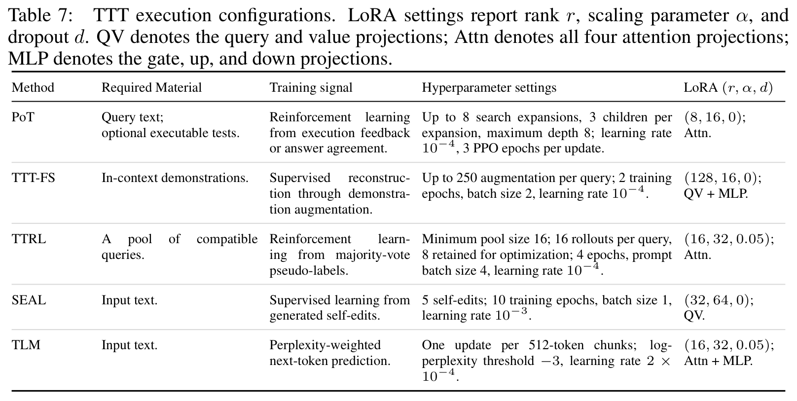

表 7：五种方法的输入要求、训练信号与超参。TTRL 是唯一需要批量样本的（池子至少 16 条，再适应要 16 条新的），其余四种都能单条 query 开训；成本从 TLM 的约一次直接回答到 TTRL 的上千次，差了三个数量级。这正是后面算力惩罚有东西可调的原因，也意味着换掉这五个方法，策略要重训。

- **每条 query 最多 6 轮，且只允许一次成功适应**。被拒的动作也吃轮次，但不吃适应额度；轮次用光就强制用冻结基座直接答。
- **索引**：池子和技能按语义 embedding 与 BM25 混合排序，只把前 $k = 8$ 个塞进上下文，防止库变大后把上下文撑爆。
- **增量再适应**：同一个池的 adapter 做 warm start，用新攒的样本加上最多 8 条随机 replay 重训，新 adapter 替换旧的。
- **缓存 TTT 结果**：同一个适应配置只跑一次（内部跑 3 次独立 TTT 取均值），后续出现直接复用估计值，降方差也降成本。
- **训练配置**：策略 LoRA rank 16；蒸馏 2 个 epoch，学习率 $10^{-5}$，batch 32，加权 loss 再除以 64 定梯度尺度；RL 3 个 epoch，学习率 $5\times10^{-6}$，采样温度 0.9，梯度累积 3 个 rollout group。单张 H200，7B 骨干一次训练约 11 GPU-hours。
- **答案生成与策略推理分家**：最终作答时禁用策略 LoRA，上下文里只放原始 query，不含策略的推理和动作历史。这一刀很关键，否则答题会被策略的调度思路污染。

## 5. 实验结果

**实验设置**

- **数据集与切分**：8 个域、11 个基准族。229 条训练 / 45 条开发 / 176 条测试 query。蒸馏用 177 条轨迹里的 2,072 个轮级样本，RL 用 187 条训练输入的流。评测走固定顺序的 176 条留出 query，从空技能库开始，训练与评测不共享库状态。文档类任务按文档切分（SQuAD 70 题对 31 段、LongBook 29 题对 25 本），文档本身不重叠，且文档事件不计入 utility 分母。
- **骨干模型**：主实验 Qwen2.5-7B-Instruct；跨家族测 Llama-3.1-8B、GLM-4-9B；跨尺寸测 Qwen2.5-14B。
- **训练预算**：单张 NVIDIA H200；7B 骨干一次训练约 11 GPU-hours；每个配置跑 3 次独立训练，每次只评一个 checkpoint。
- **基线**：Direct Answer（不 TTT）、Prompted（同一套提示但不训练）、Semantic Router（embedding 检索标注样本选方法）、Always-TLM / Always-SEAL / Always-TTRL（固定方法）、SFT only（只做蒸馏）、Oracle（按标注执行动作序列，用离线画像选方法，不可部署）。
- **指标**：overall utility，即任务专用自动验证器给出的平均二值分；分域报的是相对 Direct Answer 的差值。越高越好。
- **推理设置**：策略与答案解码都是 greedy；答案上下文只给原始 query；每 query 至多 6 轮；检索 $k = 8$。

这几组实验像体检报告：总体那一栏好看，不代表每个科室都好看，而且有的科室只有十来个样本。

**主表（提炼）**

| 方法                      | 总体 utility        |
| ----------------------- | ----------------- |
| Direct Answer           | 0.256             |
| Prompted                | 0.271 ± 0.003     |
| Semantic Router         | 0.347 ± 0.020     |
| Always-TLM              | 0.260 ± 0.003     |
| Always-SEAL             | 0.248 ± 0.029     |
| Always-TTRL             | 0.335 ± 0.038     |
| SFT only                | 0.375 ± 0.010     |
| **Agentic-TTT（SFT+RL）** | **0.510 ± 0.012** |
| Oracle（参考，不可部署）         | 0.650 ± 0.061     |

分域看，本文相对 Direct Answer 的增益与当域最强基线的对比：

| 域（测试题数）                | Direct | 最强基线                   | 本文     |
| ---------------------- | ------ | ---------------------- | ------ |
| Math (19)              | 0.526  | Always-TTRL +0.105     | +0.175 |
| Code (24)              | 0.250  | Semantic Router +0.042 | +0.167 |
| General Reasoning (24) | 0.167  | Semantic Router +0.138 | +0.208 |
| Grid Puzzles (14)      | 0.000  | Semantic Router +0.310 | +0.381 |
| Logic Games (30)       | 0.367  | Always-TTRL +0.233     | +0.367 |
| Medical QA (30)        | 0.400  | Always-TTRL +0.167     | +0.200 |
| Passage QA (25)        | 0.040  | Always-SEAL +0.427     | +0.347 |
| Long-context QA (10)   | 0.100  | Always-TLM +0.767      | +0.133 |

**原文实验表**

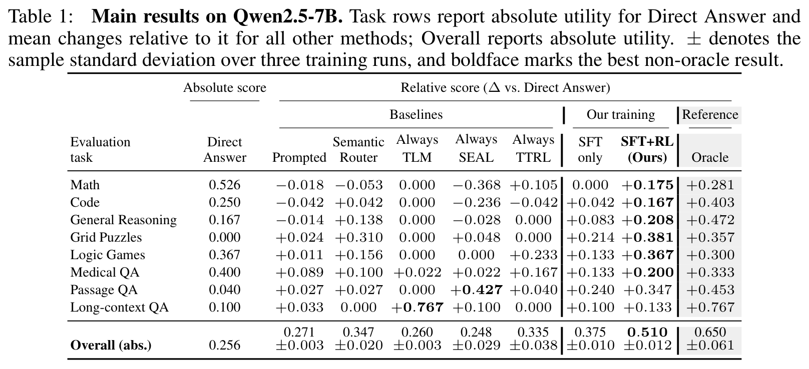

表 1：主结果。逐域看，本文在六个域赢过所有固定方法基线，在 Passage QA 和 Long-context QA 上输给单一固定方法，这两处是全文最值得盯的地方。同时它在 Grid Puzzles（0.381 vs 0.357）和 Logic Games（0.367 vs 0.300）上反超 Oracle，说明按标注走的路不一定是最好走的路。

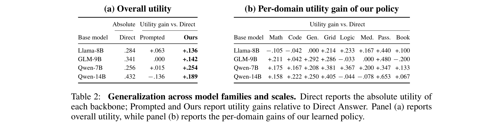

表 2：换成 Llama-8B、GLM-9B、Qwen-14B 后总体增益分别是 +0.136、+0.142、+0.189，说明这套调度不是 Qwen 专属；但逐域看有翻车：Llama 在数学上 $-0.105$、代码 $-0.042$，GLM 在 Long-context 上 $-0.200$，Qwen-14B 在 Logic Games 上 $-0.044$、Medical QA 上 $-0.078$。作者自己的解释是策略在直接答更可靠时没能忍住不动手。
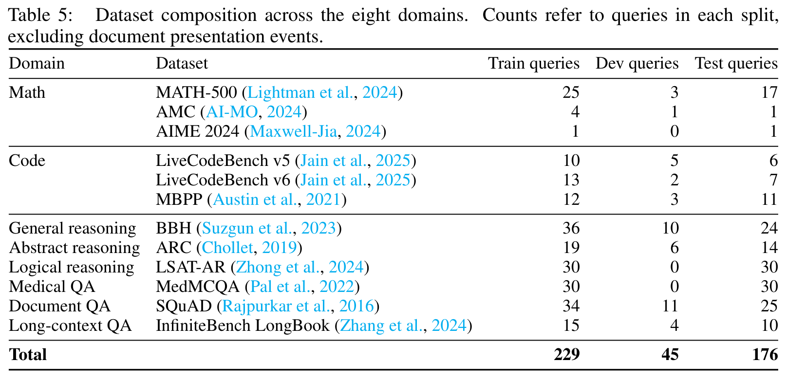

表 5：八个域的数据来源与切分。Math 只有 19 条测试、Long-context 只有 10 条，这两个域的逐域结论颗粒度很粗。

**原文实验图**

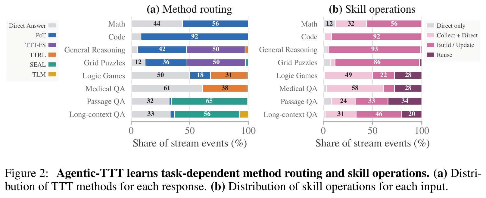

图 2：没有任何一个域是永远用同一个方法。(a) 里代码域 92% 走 PoT，Passage QA 65% 走 SEAL，长文 56% 走 SEAL，而 Medical QA 有 61% 直接答；直接答的比例从 Grid Puzzles 的 12% 到 Medical QA 的 61%，跨度四十多个点。(b) 里建新技能的比例在 Code、General Reasoning、Grid Puzzles 高达 92 / 93 / 86，而复用在 Passage QA 占 34%、Medical QA 占 28%。这两个域正是同一份材料被反复问的结构，策略确实抓到了。

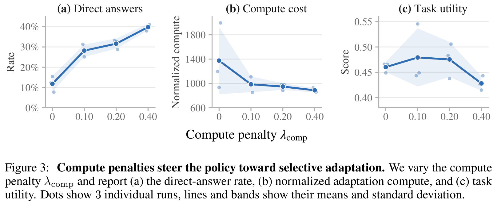

图 3：三条曲线一起读才有意思。(a) 直接答率随 $\lambda_{\text{comp}}$ 单调上升（11.8% → 39.8%），(b) 归一化算力单调下降（1375.5 → 886.9），但 (c) 效用不是单调的：$\lambda_{\text{comp}} = 0.1$ 和 $0.2$ 的效用高于 $0$。也就是说，不给算力标价时，策略会把能学当成该学。

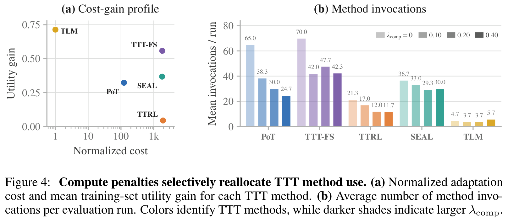

图 4：(a) 五种方法的成本-收益画像差异极大。TLM 成本约 1（相当于一次直接回答）、收益 0.70；TTRL 成本过千、收益接近 0；TTT-FS 收益最高（0.56）但也要约一千的算力。(b) 惩罚加大后，贵而收益低的方法被削：PoT 从 65.0 次降到 24.7 次，TTT-FS 从 70.0 降到 42.3，TTRL 从 21.3 腰斩到 11.7，而便宜的 TLM 反而从 4.7 微升到 5.7。所以它不是一刀切地少用 TTT，而是按性价比重新分配，这是本文最扎实的一个行为证据。

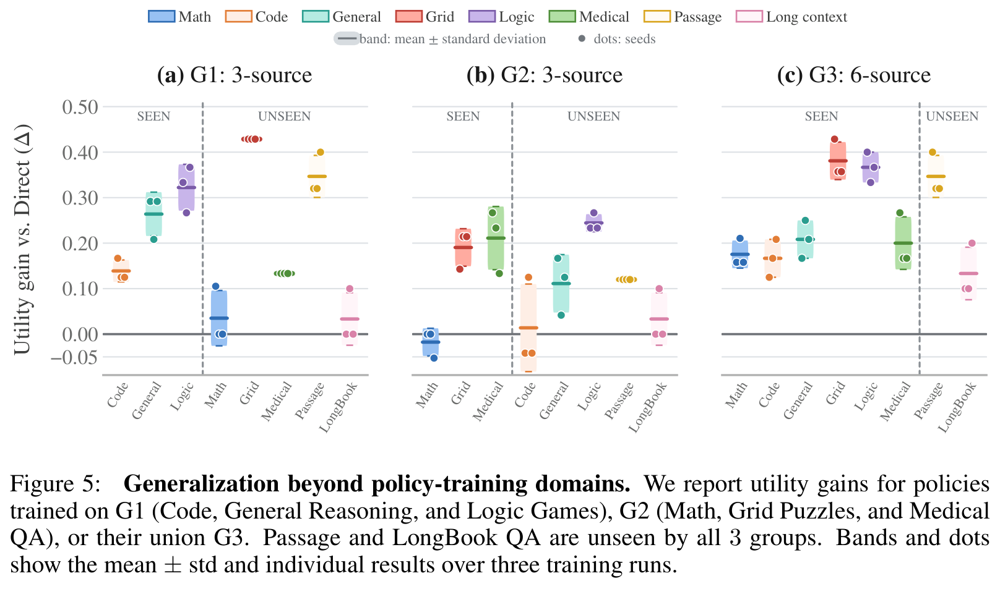

图 5：G1 只训 Code / General Reasoning / Logic Games，G2 只训 Math / Grid Puzzles / Medical QA，G3 是两者并集。关键读法是看虚线的右侧：G1 在从没见过的 Grid Puzzles 上拿到约 0.43 的最大增益，G3 在三个策略都没见过的 Passage 和 LongBook 上表现最好。所以学到的不是某个域该用哪个方法的查表，而是某种更通用的判断。

**消融告诉我们什么**

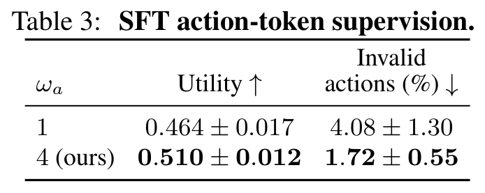

表 3：$\omega_a$ 从 1 提到 4，最终 utility 从 0.464 升到 0.510，无效动作率从 4.08% 降到 1.72%。动作 token 只占整条轨迹很小一部分，但它决定整条轨迹能不能跑起来。

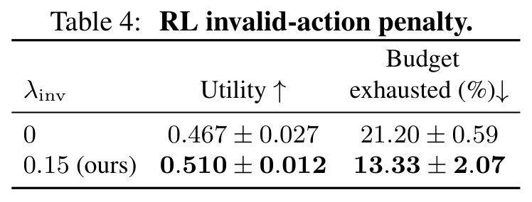

表 4：$\lambda_{\text{inv}}$ 从 0 提到 0.15，utility 从 0.467 升到 0.510，耗尽 6 轮预算的轨迹比例从 21.20% 降到 13.33%。撞墙会吃掉轮次预算，惩罚的作用是让策略把预算花在正事上。

**这些实验够不够支撑结论**

支撑的部分：176 条 query、3 次独立训练、有样本标准差，主表和三个迁移实验的结论是站得住的。

不够的部分有三块。第一，基准是挑过的。作者自己写，观察到适应收益的 query 约占 65%，而完整 MATH-500 里只有 35/500（7.0%）满足高增益标准；所以 0.510 这个数只描述这个被富集过的分布，不能外推成真实部署也能翻倍。第二，消融只做了两个（$\omega_a$ 和 $\lambda_{\text{inv}}$），缺的是最能说明问题的两个：去掉技能库（只留方法路由）和去掉基线相对收益（改用绝对分）。没有这两组，读者无法判断翻倍里技能库和相对奖励各占多少。第三，固定方法基线只挑了 TLM / SEAL / TTRL 三个便宜或中等的，缺 Always-PoT 和 Always-TTT-FS，而图 4(a) 里 TTT-FS 恰是收益最高的方法；同时也没有算力匹配的基线（同等 FLOPs 下多采样或自我一致性投票），所以学调度比固定用法好这句话，对手其实只摆了三成。

## 6. 局限性

**作者自己承认的**

- 基准分布依赖：故意富集了能从 TTT 获益的样本，在获益稀少的真实负载上，增益可能大幅缩水，与基线的差距可能消失。
- 跨 query 的信用分配没做：RL 优化的是单条 query 的收益，训练流靠金标动作推进，与自主部署之间存在错配（exposure bias）；攒材料、建技能这类延迟收益，主要靠 SFT 先验撑着。
- 安全与可逆性：TTRL 的伪标签可能强化错误，共享技能库可能传播错误甚至被投毒。好处是每个技能是独立 LoRA、基座冻结，坏技能能单独摘掉；但摘掉不等于没造成过伤害。
- 可验证性：基准优先选有参考答案或可执行测试的任务；真实部署没有真值，无法确认单条 query 上 TTT 是否真的帮了忙。

**我看出来的**

这四条合起来像一句提醒：考试范围划好了重点，在重点里考高分，不代表换一张卷子还能考高分。

- **隐形假设：训练流是专家开的路**。策略每轮只在金标动作走过的状态上学，包括库和池的初始状态都由金标历史生成。它从没练过我上一步把库搞乱了、现在怎么救。
- **边界条件：收益上限就是那五种方法的天花板**。方法集的输入前提写死在 harness 里（TTRL 要 16 条、SEAL 要 context、TTT-FS 要 demos），换一批方法或换一套前提，策略要重训。
- **缺的对比：没有随机路由和算力匹配两个基线**。Semantic Router 是强基线，但离同等算力下多采样还有距离；而多花 7 倍算力这件事，本来可以让 self-consistency 之类的廉价办法吃掉一部分。
- **一处明显的失分没被讨论**：Long-context QA 上 Always-TLM 拿到 +0.767，本文只有 +0.133。加上 Passage QA 输给 Always-SEAL（+0.347 vs +0.427），说明策略在有个固定方法特别对口的域上还不够果断。

## 7. 一句话总结

给模型配一个学习调度员：它不答题，只判断这道题要不要现学、拿哪种方法学、还是把上次学过的技能翻出来用，而这个判断本身是用比直接答多赚了多少、多花了多少算力训出来的。类比：不是让每个工人都自带全套工具箱，而是配一个工头，看活派工具。

核心公式：

$$
\boxed{\;R(\tau) = \big[U(\tau) - U(\tau^{\text{GENERATE}})\big] - \lambda\big[C(\tau) - C(\tau^{\text{GENERATE}})\big]\;}
$$

## 8. 可复用点

这套流程像给新员工配师父：先跟着走一遍对的路，出师后自己拿主意。

- **要训一个该不该调工具的策略**：奖励别用绝对分，用相对冻结基线的增量再扣算力。这条式子对检索、调 API、开子 agent 都成立。
- **多轮 agent 的冷启动**：先按轮给 hint，让策略自己采样推理，只保留动作与金标一致的轮次，再删掉 hint 做 SFT。注意上下文要 mask，只监督推理和动作块，动作 token 权重给到 4 倍。
- **训练不收敛时先查两个数**：无效动作率和轮次预算耗尽率。本文把无效动作率从 4.08% 压到 1.72% 换来 +0.046，把预算耗尽率从 21.2% 压到 13.3% 换来 +0.043，格式问题往往比算法问题更值钱。
- **TTT 结果要缓存**：同一个适应配置跑 3 次取均值，既是降方差的估计，也省掉重复训练。
- **采样不要除以组内标准差**（Dr. GRPO 的做法）：在 0/1 奖励、组内大量同分的设定下，除标准差会把噪声放大成权重。

## 9. 我的疑问

- Oracle 只到 0.650，而它是按标注动作走的。那么 0.510 与 0.650 的 0.14 差距，是策略没学会，还是 Oracle 多了一些策略看不到的标注信息？原文没拆。
- Long-context 上 Always-TLM 为什么能拿到 +0.767？我的推测是 TLM 直接在整本书的文本上做下一 token 预测，等于把书背进 LoRA，正好对口长文问答；但这只是推断，原文没解释。
- 技能库跨域共享，把一个数学 LoRA 误挂到病历题上会怎样？原文只给了复用的帮 61 / 害 1，没给误用技能的伤害统计。
- 归一化算力 1375.5 = 一次 176 题流的算力 ÷ 一次直接回答的算力，摊到每题约 7.8 倍（这个除法是我自己的推断，原文没有直接这么说）。这个代价在延迟敏感的场景里能不能接受，值得单算。
