> 一句话：没有答案时，让模型自己反复改，再把改写的方向压进权重。

## 0. 读之前你需要知道

**术语卡**

- **Self-Consistency（SC，自一致性）**：同一道题独立采样很多条解法，按最终答案多数表决。生活类比：一道题让十个自己各做一遍，少数服从多数。它的两个毛病是本文的靶子：推理时只留票数最多的那条，其余九条白算；训练时把多数答案当标准答案，多数错就一起错。
- **TTT（Test-Time Training，测试时训练）**：模型直接在测试题上训练，全程没有标准答案。生活类比：考场上边考边学，没人给你对答案。
- **OPSD（On-Policy Self-Distillation，同策略自蒸馏）**：学生自己生成轨迹，教师是冻结的初始模型，但教师能多看到一份特权信息（比如前一次的解），于是逐 token 告诉学生下一步该往哪走。生活类比：开卷的你逐句指导闭卷的你。
- **forward KL**：衡量两个概率分布差多少，$D(q\|p)$ 罚的是老师有概率、学生却没给概率的位置。生活类比：老师划了重点，你没复习到，扣分最狠。
- **RSI（Recursive Self-Improvement，递归自我改进）**：模型用自己的输出改进自己，拿改进后的自己继续改进。生活类比：写完一稿改一稿，每一稿都基于上一稿。
- **fix rate / break rate**：一次改写把错答改对的比例叫 fix rate，把对答改错的比例叫 break rate。生活类比：改卷时改对了几道、又改错了几道。
- **LoRA**：冻结大模型主干，只训练一小块低秩适配器。生活类比：不换整台机器，只换一个小插件。

**它站在谁肩上**

- Self-Consistency（Wang et al., 2023）：并行采样加多数投票，把投票结果同时当推理答案和训练目标。它便宜、通用，但早先的推理被浪费，多数错时训练会加固错误。
- TTRL（Zuo et al., 2025）：把多数投票的答案当奖励，用 GRPO 在测试题上做强化学习。它证明无标签 TTT 可行，但奖励仍是整条轨迹一个标量，且依赖多数正确。
- TTPO（Wang et al., 2026）：把 Self-Consistency 选中的那条解蒸馏进策略，做 dense token 监督。比标量奖励细，但监督对象仍是投票选出来的一条，选错就学错。
- OPSD 与 OPSD-TTT（Wang et al., 2026）：冻结初始模型当教师，用当前策略的最终答案当特权信息。它给出了本文的训练骨架，但参考解只有一代，没有把改写的方向传下去。
- CANON、U-OPSD（Gkountouras et al., 2026；Li et al., 2026）：用一致率挑 teacher reference，本质上还是在选一条解。
- STaR（Zelikman et al., 2022）：用模型自己解对的题继续训练。它需要标签或验证器，本文要在没有标签的条件下做同一件事。

## 1. 动机

考场上一道题你不会做。第一遍写完发现某一步推错了，你会拿回草稿纸，盯着那一步重新想，把上一遍的结论当起点。你不太可能把同一道题独立做十遍，然后数哪个答案出现次数最多，再把票数最多的答案抄到答题卡上。

Self-Consistency 做的就是后者。它在推理时并行采样十条解，只保留出现次数最多的最终答案，其余九条直接扔掉。更要命的是训练时：它把这条多数答案当成标准答案去蒸馏或当奖励。如果多数人错了，模型就在错误答案上反复加固。

**以前怎么做**：并行采样加投票（SC），或者用投票结果做伪标签训练（TTRL、TTPO、OPSD-TTT）。两条路共用同一个信号，这个信号既决定推理输出，又决定训练目标。

**为什么不行**：这个信号有两个独立的问题。

1. 推理低效。十条解里九条被丢弃，而正确答案可能就在某条被丢弃的解里。图 1(a) 画得很清楚：四个样本里三个答 17、一个答 42，投票选 17，可 42 才是对的。
2. 监督不可靠。投票错的时候，训练把错误答案的概率越推越高。错误不是随机噪声，是被系统性强化的。

**为什么现在能做**：三件事凑齐了。第一，模型已经具备看着上一版解改的能力，只要提示不给它压力，它能在 reuse、rework 和换思路之间自己选。第二，OPSD 提供了把上下文信息压进权重的成熟工具，冻结教师加 dense token 监督，不需要标签。第三，LoRA 让测试时训练的成本降到可接受，100 次更新在四张 H20 上几十分钟量级。

本文的出发点是把推理信号和训练信号拆开：推理走顺序改写，训练学改写的方向。

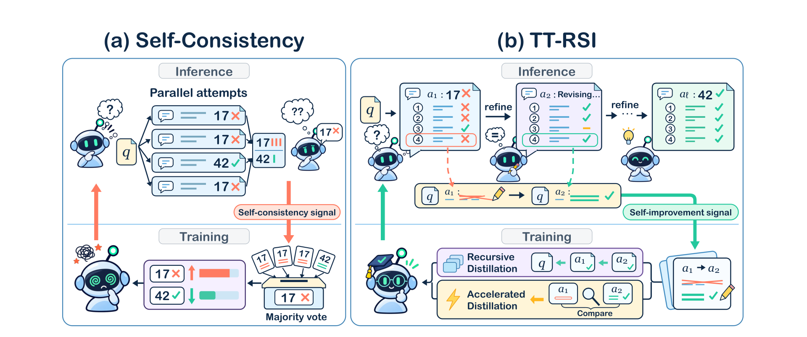

图 1：左边是 Self-Consistency，十条独立解投票，只留票数最多那条，再把投票结果回灌训练；右边是 TT-RSI，解在上下文里接力改写，训练学的是相邻两版解之间的改进方向。这张图证明两种范式的差别不在采样数量，而在信息流向：SC 把信息压成一个票数，TT-RSI 把每一步改动都留下来当监督。

## 2. 贡献

三层贡献像学骑车：先敢骑（推理层），再骑成肌肉记忆（权重层），最后知道为什么不会倒（理论层）。

- **In-Context RSI 把改写做成免训练的测试时扩展**。证据：在 AIME26 和 HMMT26 上，第 5 次尝试就超过 10 样本 Self-Consistency 的精度，同时少生成 68.6% 的 token（图 3）；在 8B 的 AIME26 上，In-Context RSI 把 Base 从 67.78 抬到 76.67（+8.89），同设置下 Self-Consistency 只把 TTPO 从 70.83 抬到 73.33（+2.50）。
- **In-Weight RSI 把改写压进权重，首答就能受益**。证据：首答平均比 Base 高 +5.79%，在三个模型规模上都是 label-free 训练方法里最高；8B 上 64.17%，比最强训练基线 TTPO 高 +2.34%。
- **两者叠加的 TT-RSI 在 15 个设置里赢 11 个、平 2 个**。证据：平均比 Base 高 +13.89%，比同测试时预算的 TTPO + SC 高 +4.79%。
- **给出一个可验证的理论解释**。证据：Theorem 1 说明一次权重更新在理想条件下等价于把改写链往前推一步；Corollary 1 说 In-Weight RSI 改善首答的条件和 Proposition 1 完全一致；Proposition 3 预测再加第三对相邻解没有额外收益，Table 3 实测只 +0.28 / 0.00。
- **顺带证明两件事**：在初始多数派就错的题上，In-Weight RSI 把 avg@64 从 5.73 抬到 12.76，Self-Consistency 在 6 道题里能改对 2 道（OPSD-TTT 是 1 道）；每次更新的训练时间比基线快 2.29 到 5.36 倍（Table 5b）。

## 3. 创新点

三个创新点像给同一条流水线换零件：投票箱、单条参考答案、平均用力。

- **推理侧：把独立采样换成链式改写，而且只带最新一版**。对比对象是 Self-Consistency 的并行采样，以及已有的 revision / re-solving 方法。有用是因为上下文长度不随尝试次数增长，每条新解只依赖上一条，既省 token 又避免历史越堆越乱。Table 2 显示，把参考解换成无关题目的一条解，精度反而比 Base 低 3.23%，说明收益来自这条解本身，不是多试几次的副作用。
- **训练侧：用相邻两版解的配对当监督，而不是一条被选中的解**。对比对象是 TTPO 和 OPSD-TTT，它们只蒸馏一条答案。本文让教师看 $a_1$ 去监督回答、看 $a_2$ 去监督改写，一次更新同时教两种行为，等于把改写链压缩一步。Table 3 里 Recursive Distillation 比最好的单项高 +1.95 / +1.01。
- **加速项：用两个教师分布的分歧给 token 加权**。对比对象是 OPSD 的均匀 token 权重。有用是因为改写真正改主意的位置只是少数 token，把这些位置的权重从 0.5 提到接近 1.5，等于把学习预算集中到改动上。Table 3 里再加这一项又涨 +1.11 / +0.76。
- **理论上把改写链写成分布层面的备份算子**，对比只给经验结论的自我改进工作。有用是因为它解释了第三对解为什么没用：备份算子已经走完一步，多一对不改变算子。

## 4. 方法

### 4.1 整体流程

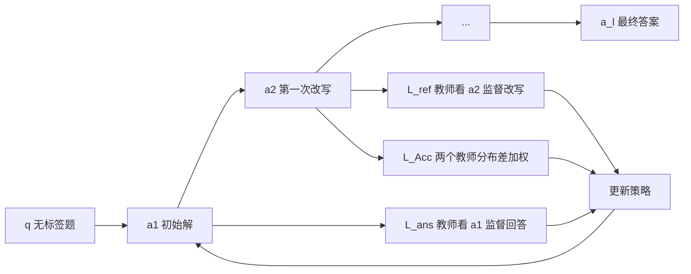

一条改写链产生 $a_1,\dots,a_\ell$，推理时返回最后一版的答案；训练时相邻两版解同时当教师，把回答和改写两种行为压进权重，更新后的策略重新开一条链。

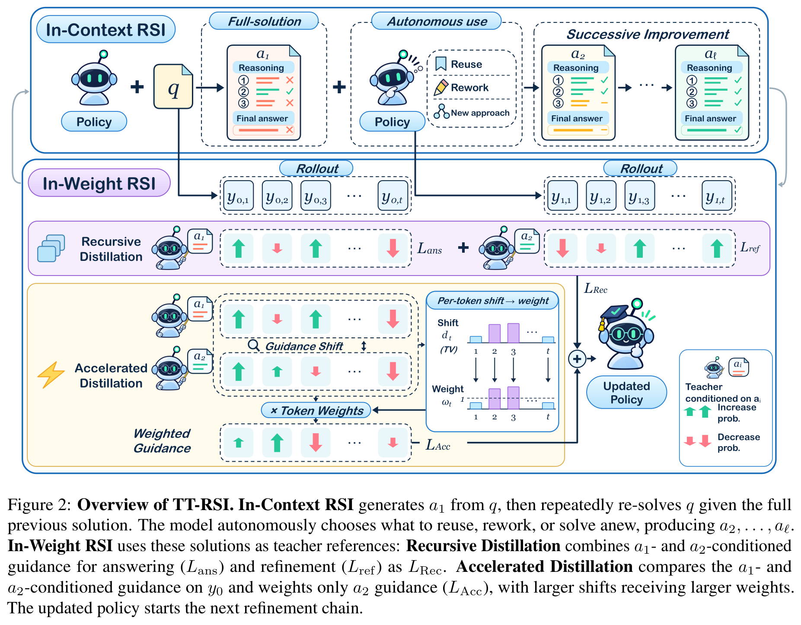

图 2：TT-RSI 的整体架构。上面是 In-Context RSI 的推理链，下面是 In-Weight RSI 的两项蒸馏；右侧更新后的策略重新开始下一条链。这张图证明训练信号不是外部标签，而是同一条链上相邻两版解的差。

### 4.2 模块拆解

**In-Context RSI**

为什么需要：并行采样把预算花在重复上。十次独立采样里，模型每次都可能踩同一个坑，而前一次的推导过程明明是免费的线索。

怎么做：只把上一条完整解放进上下文，让模型自己决定沿用、改哪一步还是换方法。系统提示把上一条解中立地标成 "A previous attempt"，并明确要求独立求解；参考解包含推导步骤和最终答案，但不含隐藏的 thinking trace。整条链是马尔可夫的，上下文不随尝试次数膨胀。

$$
a_1 \sim \pi_\theta(\cdot \mid q), \qquad
a_{k+1} \sim \pi_\theta(\cdot \mid q, a_k), \quad k = 1,\dots,\ell-1
$$

先说这个式子在算什么：第 1 版解只看题目，之后每一版只看题目和上一版解，最后返回第 $\ell$ 版的答案。

- $q$：无标签的测试题。
- $a_k$：第 $k$ 次尝试的完整解，包含推导和最终答案。
- $\pi_\theta$：当前策略，推理阶段不更新。
- $\ell$：链长，主实验取 $\ell = 11$，即 1 次初始尝试加 10 次改写。

**两状态分析（Proposition 1）**

为什么需要：得先知道改写什么时候有用、能走多远，否则调链长只能靠试。

怎么做：把每次改写看成两状态马尔可夫链，答错有 $f$ 的概率被改对，答对有 $b$ 的概率被改错。

$$
\mathrm{acc}_{k+1}
= (1-\mathrm{acc}_k)\,f + \mathrm{acc}_k\,(1-b)
= f + (1-f-b)\,\mathrm{acc}_k
$$

先说这个式子在算什么：下一版的答对率等于这一版错答被改对的量，加上这一版对答没被改坏的量。

- $\mathrm{acc}_k$：第 $k$ 次尝试的答对率，取值 $[0,1]$。
- $f$：fix rate，错答被改正的概率。
- $b$：break rate，对答被弄坏的概率。
- $1-f-b$：这一版对错状态没变的概率。

在 $f,b$ 不随尝试次数变、且 $f+b \in (0,1]$ 的假设下，这条式子有两个直接结论。第一，改写比首答好，当且仅当 $f(1-\mathrm{acc}_1) > b\,\mathrm{acc}_1$：改对的收益要盖过改错的损失。第二，链走到头会停在 $\mathrm{acc}_\infty = f/(f+b)$，本文叫 balance point。Table 2 里实测精度和 balance point 的差不超过 1.83%，说明这个两状态模型不是纯装饰。

**In-Weight RSI**

为什么需要：推理时跑 11 次太贵，而且部署时不一定允许串行生成。把改写能力写进权重，首答就能直接用到。

怎么做：学生生成两条 rollout，$y_0$ 只回答（上下文是 $q$），$y_1$ 做改写（上下文是 $q,a_1$）。教师是冻结的初始模型 $\pi_{\theta_0}$，分别带 $a_1$ 和 $a_2$ 当特权信息。教师总比学生多看一版解，所以知道这一步该往哪改。

$$
\mathcal{L}_{\mathrm{ans}}
= D\!\left(\mathrm{sg}\left[\pi_{\theta_0}(\cdot\mid q,a_1)\right] \,\middle\|\, \pi_\theta(\cdot\mid q)\right)\Big|_{y_0}
$$

$$
\mathcal{L}_{\mathrm{ref}}
= D\!\left(\mathrm{sg}\left[\pi_{\theta_0}(\cdot\mid q,a_2)\right] \,\middle\|\, \pi_\theta(\cdot\mid q,a_1)\right)\Big|_{y_1}
$$

$$
\mathcal{L}_{\mathrm{Rec}} = \mathcal{L}_{\mathrm{ans}} + \mathcal{L}_{\mathrm{ref}}
$$

先说这两个式子在算什么：第一个教模型在没有前情的情况下直接答出带 $a_1$ 视野的答案；第二个教模型在看到 $a_1$ 后写出带 $a_2$ 视野的改写。两个损失合起来，一次更新就把改写链压进一步。

- $\pi_{\theta_0}$：初始模型，全程冻结；训练只更新 LoRA 适配器。
- $\mathrm{sg}[\cdot]$：停止梯度，教师分布当固定靶子。
- $D(\cdot\|\cdot)$：逐 token 的 forward KL，实现里温度 1.1、单 token KL 裁剪 0.05。
- $y_0,y_1$：学生自己生成的回答轨迹和改写轨迹，非 thinking 模式，最多 1,024 token。
- $a_1,a_2$：链上的前两版解，作为教师的特权信息。

**Accelerated Distillation**

为什么需要：$\mathcal{L}_{\mathrm{ans}}$ 的教师只看 $a_1$，学生学到的是第一版水平的回答。要把 $a_2$ 带来的改进也压进首答，得让 $a_2$ 视野的教师来指导，但不能在所有 token 上平均用力，因为大部分 token 两个教师意见一样。

怎么做：在 $y_0$ 上再加一项蒸馏，逐 token 用两个教师分布的 TV 距离加权。分歧越大的位置，权重越高。

$$
\mathcal{L}_{\mathrm{Acc}}
= D_\omega\!\left(\mathrm{sg}\left[\pi_{\theta_0}(\cdot\mid q,a_2)\right] \,\middle\|\, \pi_\theta(\cdot\mid q)\right)\Big|_{y_0}
$$

$$
\omega_t = 1-\alpha + 2\alpha\,\frac{d_t}{d_t+\tau},
\qquad
d_t = \mathrm{TV}\!\left(
\pi_{\theta_0}(\cdot\mid q,a_1,y_{0,<t}),\;
\pi_{\theta_0}(\cdot\mid q,a_2,y_{0,<t})
\right)
$$

先说这个式子在算什么：同一段学生前缀上，让教师分别带着 $a_1$ 和 $a_2$ 各看一遍，两个分布差得越远，说明这个 token 正是改写改动的地方，权重就越大。

- $d_t$：两个教师分布的 total variation 距离，取值 $[0,1]$。
- $\omega_t$：第 $t$ 个 token 的权重，$\alpha=0.5$ 时从 0.5 平滑升到接近 1.5。
- $\tau = 10^{-4}$：防止分母为零的平滑项。
- $\alpha$：基准权重系数，保证没有分歧的 token 仍以 $1-\alpha$ 的权重被监督。
- $D_\omega$：按 $\omega_t$ 加权的 KL。

总损失把三项拼起来：

$$
\mathcal{L} = \mathcal{L}_{\mathrm{Rec}} + w_{\mathrm{Acc}}\,\mathcal{L}_{\mathrm{Acc}},
\qquad w_{\mathrm{Acc}} = 1
$$

**理论上它为什么能压缩链条**

把一次权重更新看成对“尝试编号”的备份。设当前模型第 $k$ 次尝试的分布是 $\mu_k$，改写算子 $K$ 把一次尝试推到下一次，$\gamma = w_{\mathrm{Acc}}/(1+w_{\mathrm{Acc}}) = 1/2$ 是加速项的混合比例。Appendix A 的 exact distributional backup 写成：

$$
\Phi(\mu,K) = \left(\mu\big((1-\gamma)I+\gamma K\big)T,\; KT\right)
$$

先说这个式子在算什么：备份后的新模型，第 $k$ 次尝试等于旧模型在第 $k$ 步和第 $k+1$ 步之间的一个混合，$\gamma$ 控制往下一步推多少。

- $\mu$：模型各次尝试的分布族。
- $K$：一次改写对应的转移算子。
- $T$：把分布映射回参数化策略的算子。
- $\gamma$：加速项占比，主实验取 $1/2$。

Theorem 1 给的是不含加速项的情形：$\gamma=0$ 时，做 $n$ 次备份后模型第 $k$ 次尝试的分布，等于初始模型第 $(n+1)k$ 次尝试的分布。Proposition 2 补上加速项：首答变成初始模型各次尝试的混合，期望等价步数是 $1+n+\gamma n(n+1)/2$，随 $n$ 二次增长。Corollary 1 说 In-Weight RSI 改善首答的条件与 Proposition 1 相同。Proposition 3 说再加第三对 $(a_2,a_3)$ 不改变备份算子，所以理论上没有额外收益。

这里有个必须说清的边界：固定点是 $\pi_\infty$，即初始模型改写链走无限步的极限。教师冻结在 $\theta_0$，所以 In-Weight RSI 的天花板就是这个固定点，它不能凭空超过首版模型自己反复改能到的水平。

### 4.3 关键细节

- 链长 $\ell = 11$，1 次初始加 10 次改写。
- LoRA rank 64、scaling 128；AdamW，学习率 $5\times10^{-6}$；100 次更新；每个 update 32 个 question occurrences；bf16；seed 42。
- 教师冻结初始模型；OPSD forward KL 温度 1.1、单 token 裁剪 0.05；三项损失权重都是 1；token 权重 $\alpha=0.5$、$\tau=10^{-4}$。
- 参考解用 thinking 模式采样，温度 1.0、top-$p$ 0.95，最多生成 38,912 token，上下文 40,960；学生 rollout 用非 thinking 模式，最多 1,024 token。这个不对称是有意的：参考解要尽量强，学生轨迹要便宜。
- 采样时用流水线：当前 update 的 $a_2$ 和学生 rollout 与下一个 update 的 $a_1$ 拼成一个 batch，$a_1$ 提前一个 update 采好。Table 5b 的低训练时间靠的是这个。

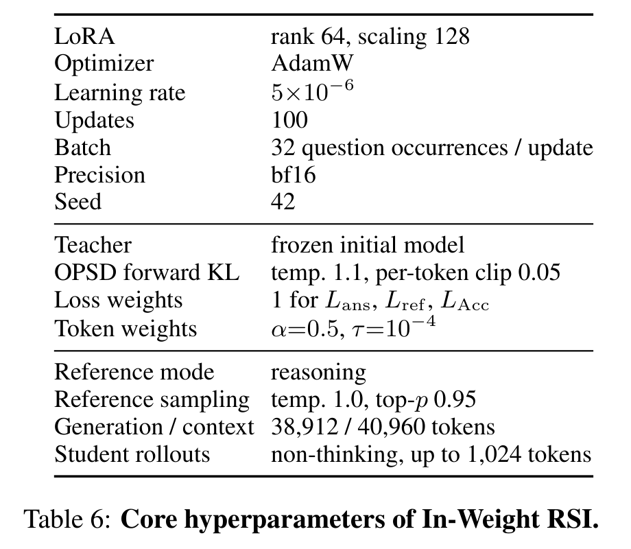

表 6：In-Weight RSI 的核心超参。它证明测试时训练的预算压得很小：100 次更新、LoRA、每次 32 个问题，学生 rollout 只到 1,024 token。

## 5. 实验结果

实验像体检：主表是总指标，消融是分项，案例是影像。

**实验设置**

- 数据集与切分：AIME 2025、AIME 2026、HMMT February 2025、HMMT February 2026、BRUMO 2025，全部来自 MathArena。每个 benchmark 的无标签题单独适配，标签只用于最后评分；没有额外的训练集，适配集就是评测集。
- 骨干模型：Qwen3-1.7B、Qwen3-4B、Qwen3-8B，三个规模各跑一遍。
- 训练预算：In-Weight RSI 做 100 次更新，每次 32 个 question occurrences；LoRA 微调；成本测量用 4 张 H20。
- 基线：TTRL、TTPO、OPSD-TTT、CANON、U-OPSD，另加 Base + In-Context RSI 和同测试时预算的 TTPO + SC。TTPO + SC 是作者专门加的对照，生成 token 数与整条改写链对齐。
- 指标：avg@12，每题采 12 条取平均正确率；Table 5a 用 64 条，同时报 avg@64 和 SC@64。全部是 accuracy（%），越高越好。
- 推理设置：thinking 模式，温度 1.0、top-$p$ 0.95、top-$k$ 不限、min-$p$ 0、presence penalty 0，最多生成 38,912 token。

**主结果**

| 模型规模 | Base | 最强基线（TTPO + SC） | TT-RSI | 提升 |
| --- | --- | --- | --- | --- |
| Qwen3-1.7B | 34.84 | 44.67 | 50.48 | +5.81 |
| Qwen3-4B | 55.76 | 65.76 | 69.64 | +3.88 |
| Qwen3-8B | 60.10 | 67.58 | 72.24 | +4.66 |

三个规模相对 TTPO + SC 的平均提升是 +4.79%，和逐项相减的差来自五个基准的平均方式。

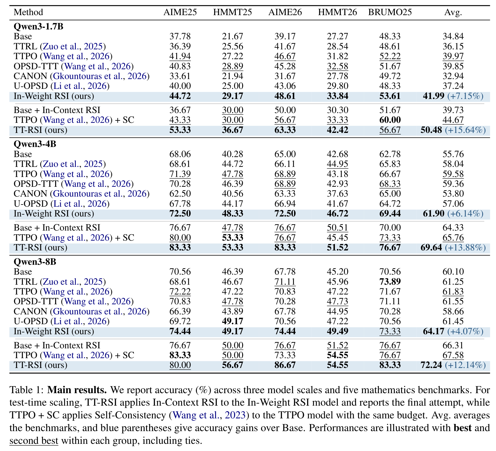

表 1：三个规模、五个数学基准的完整主表。它证明 TT-RSI 的增益不是某一个基准拉出来的：8B 上 AIME26 到 86.67，比 TTPO + SC 的 73.33 高 13.34 个点；1.7B 上 In-Weight RSI 的首答 41.99 已经超过 Base + In-Context RSI 十次改写后的 39.73。

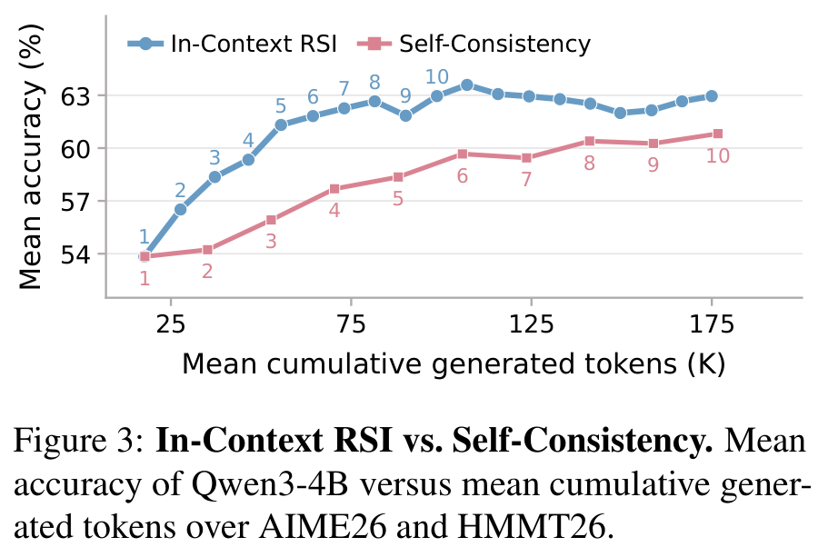

图 3：横轴是累计生成 token，纵轴是平均精度。In-Context RSI 在第 5 次尝试就超过了 10 样本 Self-Consistency，同时少生成 68.6% 的 token；在总 token 成本对齐的位置还保留 +2.13% 的优势。这张图证明顺序改写的性价比高于并行投票，而且差距在低预算段最大。

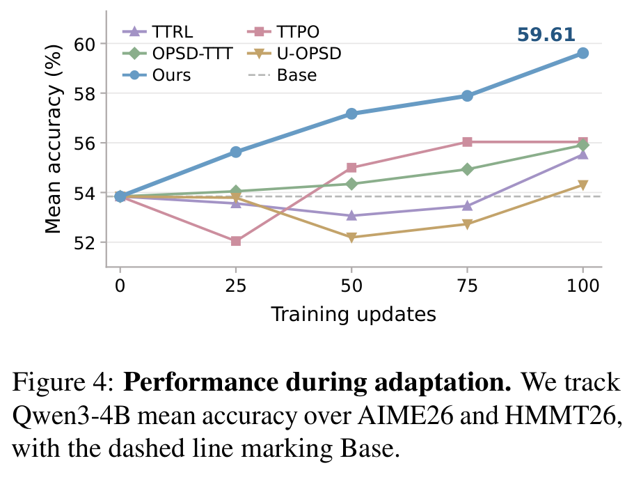

图 4：AIME26 和 HMMT26 的平均精度随训练更新变化。In-Weight RSI 从第一次更新起就压着所有基线，100 次更新到 59.61%，比 Base 的 53.84% 高 5.77 个点；TTPO、OPSD-TTT、TTRL 到 100 次更新时都还在 54 到 56 之间。增益来自训练过程，不是最后一次更新的抖动。

**消融：In-Context RSI 的设计**

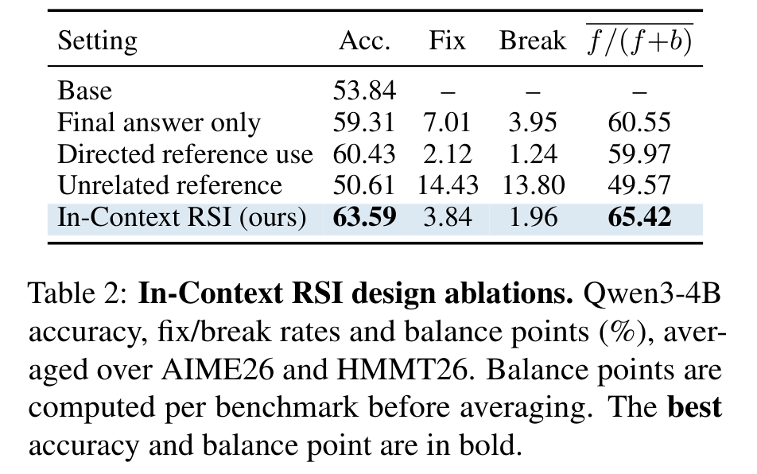

表 2：Qwen3-4B 上对改写设计的消融，AIME26 和 HMMT26 平均。完整设计把 53.84 抬到 63.59；只保留最终答案掉 4.28，break rate 从 1.96 涨到 3.95，差不多翻倍；要求模型定向检查并改正掉 3.16，fix rate 从 3.84 降到 2.12；把参考解换成另一道题的解读，精度比 Base 还低 3.23。这张表证明两件事：模型需要看到推导过程，不能只给答案；参考解必须是这道题自己的上一版，换题就变成干扰。

**消融：In-Weight RSI 的设计**

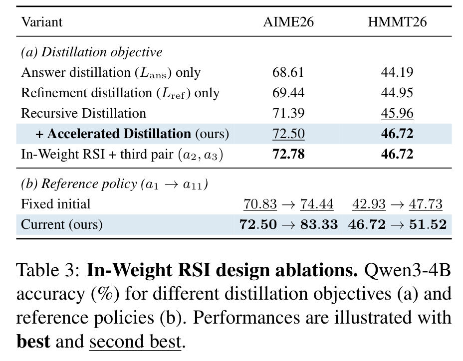

表 3：Qwen3-4B 上对蒸馏目标和参考策略的消融。单项监督里 $L_{\mathrm{ref}}$ 略强于 $L_{\mathrm{ans}}$，合起来到 71.39 / 45.96；加加速项到 72.50 / 46.72；再加第三对 $(a_2,a_3)$ 只到 72.78 / 46.72，AIME26 涨 0.28、HMMT26 持平，还多一次生成。参考策略用当前策略比固定初始策略好一大截：首答 72.50 对 70.83，十次改写后 83.33 对 74.44。这张表证明收益来自相邻解的配对监督，不是多堆一代解；也证明参考分布要跟着策略走，冻结在初始模型会把上限压低。

**跨任务迁移**

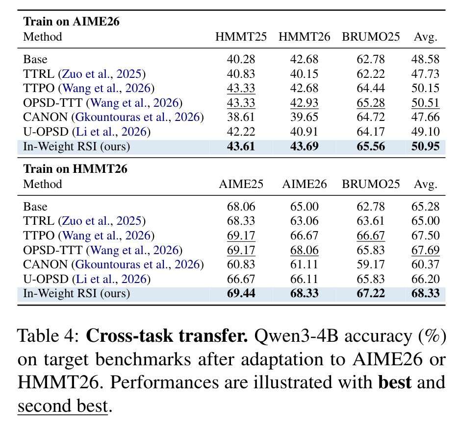

表 4：在 AIME26 上适配、测 HMMT25/HMMT26/BRUMO25，目标基准平均从 Base 的 48.58 抬到 50.95（+2.37）；在 HMMT26 上适配、测 AIME25/AIME26/BRUMO25，从 65.28 抬到 68.33（+3.05）。六个 source–target 对全部是最高，两行 Avg 平均 59.64%，超过 OPSD-TTT。这张表证明学到的是可迁移的改写行为，不只是记住了适配题的答案。

**超越初始多数派与训练成本**

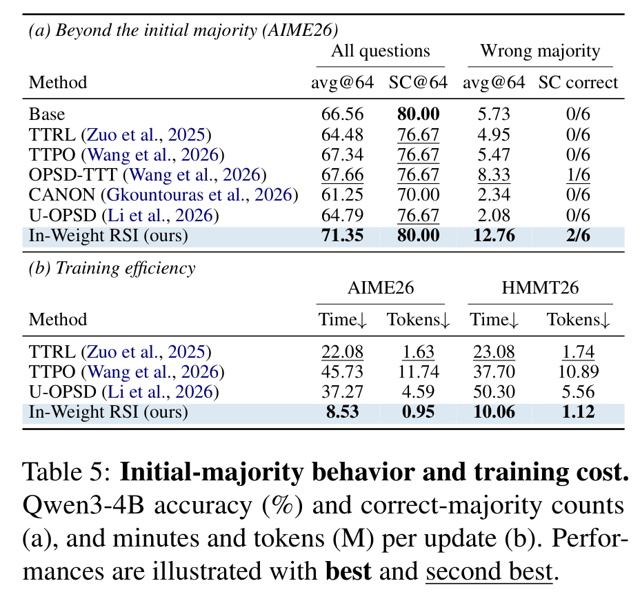

表 5：(a) 用 64 条样本重测 AIME26。把初始多数派就错的 6 道题单独拿出来，Base 的 avg@64 只有 5.73，In-Weight RSI 到 12.76（+7.03），比 OPSD-TTT 的 8.33 高 4.43；Self-Consistency 能在这 6 道题里改对 2 道，OPSD-TTT 是 1 道。全部题上 avg@64 从 66.56 到 71.35，比 Base 高 4.79、比 OPSD-TTT 高 3.69。(b) 每次更新的训练时间和 token 数：In-Weight RSI 在 AIME26 上 8.53 分钟、0.95M token，HMMT26 上 10.06 分钟、1.12M token；TTRL 是 22.08/1.63 和 23.08/1.74，TTPO 是 45.73/11.74 和 37.70/10.89，U-OPSD 是 37.27/4.59 和 50.30/5.56。这张表证明两件事：训练真的把错误多数派里的题改过来了；省时间主要来自流水线和更短的 rollout，不是少算。

**案例：训练把修正提前**

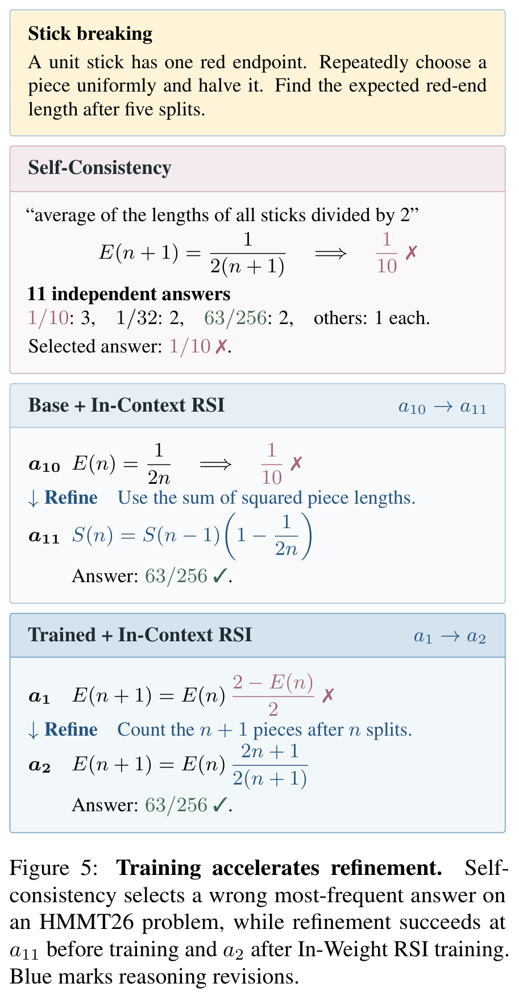

图 5：HMMT26 的 stick breaking 题。Self-Consistency 的 11 条样本里 $1/10$ 出现 3 次、$1/32$ 两次、$63/256$ 两次，投票选错 $1/10$。未训练的模型要到 $a_{11}$ 才改用平方长度递推，得到 $63/256$；训练后 $a_1$ 的公式还是错的，但 $a_2$ 就数清了 $n+1$ 块，直接改对。这张图证明 In-Weight RSI 把“想到正确方法”这一步从第 11 版提前到了第 2 版。

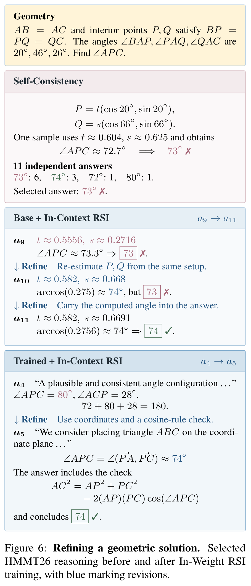

图 6：HMMT26 的几何题，求 $\angle APC$。Self-Consistency 的 11 条里 73° 出现 6 次，投票选 73°，正确答案是 74°。未训练的模型在 $a_{10}$ 已经用坐标算出 $\arccos(0.275)\approx 74°$，但最终答案还写 73，到 $a_{11}$ 才改；训练后 $a_5$ 直接用坐标加余弦定理检查，一次得到 74°。这张图证明中间推理可以比最终答案早一步变对，训练的作用是把这一步提前，而不是教一个新公式。

**这些实验够不够支撑结论**

支撑得比较扎实的部分：主结果覆盖三个规模、五个基准、六个基线，还专门对齐了测试时预算；消融把两个组件的设计选择逐个拆开；案例给出了机制层面的证据（改写位置前移）；跨任务迁移和错误多数派子集回答了“是不是只记住答案”。

不够的部分：

- 配置只给了 seed 42，没有多 seed 方差或置信区间。AIME 和 HMMT 都是 30 题量级，一题 3.3 个点，+0.28 这种差异在噪声范围内。
- 只有数学，只有 Qwen3 到 8B。作者自己在 Limitations 里承认了这一点。
- 没有和 best-of-$n$、self-refine、tree search 这类同样花推理预算的方法正面比；TTPO + SC 是最接近的对照，但不是所有顺序改写方法。
- 学生 rollout 限 1,024 token、参考解是 thinking 模式，两者的分布差异没有被单独消融。

## 6. 局限性

局限像地图边缘，没画到的地方不等于没有。

**作者自己承认的**：只覆盖数学推理，模型只到 Qwen3-8B；未来要扩到开放式任务和会用工具的 agent。

**我看出来的**：

- 隐形假设：每次改写的 fix rate 和 break rate 被当成常数。Proposition 1 的两状态模型默认 $f,b$ 不随尝试次数变，但实际链条越往后，模型越容易在一个错误框架里打转，$f$ 可能下降、$b$ 可能上升。Table 2 只报了整条链汇总的 $f$ 和 $b$，没有逐位置曲线。
- 隐形假设：上一条解是可靠起点。模型只带最近一版解，这是马尔可夫假设。如果某一版解把错误框架写得很完整，下一版很可能顺着它改，历史里更早的正确线索已经丢了。图 6 里未训练模型在 $a_{10}$ 已经算对却仍旧写 73，说明模型会锚定自己上一版的结论。
- 边界条件：天花板由初始模型决定。教师冻结在 $\theta_0$，固定点 $\pi_\infty$ 是初始模型无限改写能达到的极限。8B 上的增益（+4.07%）比 1.7B（+7.15%）小，可能是指数增长被更强的首版模型压缩，也可能是接近饱和，论文没有区分这两种解释。
- 边界条件：这是 transductive 的测试时训练。适配时用的是整个 benchmark 的无标签题，一次性拿到再训练；部署时如果题目一条一条来，或者分布随时间漂移，这套流程不能直接照搬。
- 缺的对比：没有和真正的人类改写轨迹比，也没有验证“改写方向”是否真的对应数学上的错误定位；案例只给了两个。
- 理论边界：Theorem 1 依赖 exact distributional backup、sequence-level forward KL 和遍历性假设，实现里是 token 级裁剪 KL 加 LoRA，定理是理想化模型，不是实测保证。

## 7. 一句话总结

投票是让别人替你选，改写是让下一版的自己替这一版的自己改错；把每次改动的方向蒸馏进权重，第一版就能带上后面几版的水平。好比写论文：与其找十个同学各写一版投票，不如自己改十稿，再把审稿意见内化成下一次直接写对的能力。

核心公式只有一条，它同时给出改进条件和天花板：

$$
\boxed{
\mathrm{acc}_{k+1} = f + (1-f-b)\,\mathrm{acc}_k,
\qquad
\mathrm{acc}_\infty = \frac{f}{f+b}
}
$$

## 8. 可复用点

- 如果我要在自己的项目里用：把 Self-Consistency 的并行采样换成接力改写，上下文只放上一条完整解加一句中立指令，先比第 5 次尝试的精度和 token 成本，再决定要不要加链长。
- 如果我要做无标签 TTT：教师看下一版解、学生看当前版，一次更新同时监督回答和改写；这比只蒸馏一条被选中的解多一个“改进方向”的信号。
- 训练不收敛时先查：fix rate 和 break rate。break rate 明显上升，说明参考解被当成了强锚点，模型在照抄而不是改错；这时先回退到只给最终答案或换无关参考做对照。
- 做自蒸馏时：用两个教师条件在同一前缀上的分布差（TV 距离）给 token 加权，把学习预算集中到“改主意”的位置；没有分歧的位置保留基准权重，避免只学少数 token。
- 评估时：先按初始多数派把题分组，单看错误多数子集上的提升。全量平均会把“本来就会的题”和“投票投错的题”混在一起，看不出方法到底有没有纠正系统性错误。

## 9. 我的疑问

- Proposition 2 说加速后等价步数按 $n^2$ 增长，但 100 次更新的实测曲线（图 4）看起来是接近线性的。是 exact backup 假设不成立，还是 100 次更新还没进入二次区间？
- 第三对 $(a_2,a_3)$ 没有额外收益，如果换成跨度更大的对，比如 $(a_2,a_5)$，或者同时用三对但共享教师，会不会有增益？Proposition 3 只排除了相邻的第三对。
- 学生 rollout 限 1,024 token 且非 thinking，参考解是 thinking 模式。蒸馏信号里有多少来自“解题方向”，有多少只是长度和文风差异？论文没有拆开。
- 跨任务迁移的提升，是学到了通用的改写行为，还是只是把数学推理能力整体加强了？Table 4 没有报适配题上的精度变化，无法区分这两种情况。
- 如果初始多数派错得很离谱（比如 6 道题里 5 道全错），In-Weight RSI 还能把 avg@64 从 5.73 抬到 12.76 这个量级吗？Table 5a 只给了 6 道题的子集，样本太小。
