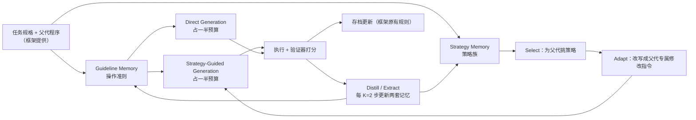

> 一句话：不改模型权重，只改模型手边那本笔记，能不能比改权重更好用。

**代码**：[yepengliu/TTME](https://github.com/yepengliu/TTME)

## 0. 读之前你需要知道

这篇论文问的是一个很朴素的问题：**积累经验到底要不要写进大脑**。

**术语卡**

- **test-time training（TTT，测试时训练）**：模型在解题过程中顺手训练自己，把这次的经验写进权重参数。生活类比：边考试边改自己的大脑回路，考完这门课你人已经变了。
- **test-time adaptation（测试时适应）**：泛指在推理阶段让模型变强的所有手段，TTT 只是其中一种；本文关心的另一种是"不动权重、只动外部记忆"。
- **external memory（外部记忆）**：放在模型上下文里的一堆文本，模型每次生成时读它，但权重不变。生活类比：考场上摊在桌上的错题本。
- **candidate / program（候选 / 程序）**：框架让模型写一段 Python 代码，代码构造出一个数学对象（一个函数、一个矩阵），由验证器打分。一次搜索步骤会生成大量这样的程序。
- **parent program（父代程序）**：搜索是一个树状过程，每一步从存档里挑几条已有程序当"父代"，在它们基础上改出新版本。生活类比：拿一份及格的作业改出下一版。
- **verifier（验证器）**：题目自带的判分脚本，直接算出候选构造的目标值，没有人工、没有裁判模型。这是本文全部数字可信的基础。
- **EFLOPs**：本文报告算力成本的单位，把候选生成、记忆相关调用、RL 训练全部折算成浮点运算量。
- **LoRA（low-rank adaptation，低秩适配）**：只训练一小块低秩矩阵、不动原权重的微调方法。TTT 在本文里训练的就是 LoRA 参数（rank 32）。

**它站在谁肩上**

- **FunSearch（2024）/ AlphaEvolve（2025）**：用程序演化搜索做数学发现，权重固定，靠专有大模型反复改写程序、验证器反复打分。它们证明了"搜索能发现新构造"，但没解决"经验怎么复用"，而且依赖闭源模型。
- **Reflexion（2023）、ExpeL（2024）、Agentic Context Engineering（2026）、GEPA（2026）**：这一条线相信经验应该写成文本放进上下文，用反思、记忆、提示演化来提升表现。它们证明了文本经验有用，但都是夹在具体系统里的做法，不是可插拔模块，也没有和"改权重"做过干净的对照。
- **TTT-Discover（2026）、ThetaEvolve（2025）**：本文的两个宿主框架。它们把演化搜索和测试时强化学习接起来，让 8B 级开源模型在数学构造任务上超过 AlphaEvolve。代价是整个过程都在做在线权重更新，慢且贵。本文直接把这两个框架的 TTT 部分拔掉，换成自己的记忆模块，其余一律不动。

## 1. 动机

想象你带一个实习生做实验。他第一次搭装置把管子接反了，第二次配色谱柱冲太快产物全跑了，第三次终于拿到一条像样的曲线。

这时候有两种"让他下次更好"的做法。

第一种是送他去读一个学期的研究生课程，把实验手感写进他的肌肉记忆。这就是 TTT：真改权重，真有效，但每换一个课题就得重训一次，而且训练过程本身要算力和时间。

第二种是给他一本实验记录本，写清楚"柱子冲太快会把产物带跑，流速压到 0.5 mL/min"，下次做实验前先翻本子。这就是 TTME：权重一点不动，只改本子。

**以前怎么做**：TTT 框架靠在线 RL 把搜索经验压进参数。TTT-Discover 会指数级提高高奖励尝试的权重，ThetaEvolve 把程序存档本身当成动态 RL 环境。

**为什么不行**：改权重很贵。本文 Table 3 显示，在 Qwen3-8B 上跑一道题，TTT 要 11.67 到 12.73 小时；而且这只是 8B 模型加 LoRA，换成更大模型、更长搜索，成本会继续涨。搜索框架本来就要为每个候选跑一次验证器，再叠上一层训练开销，规模上不去。

**为什么现在能做**：作者押的是一个判断——现在的开源模型（Qwen3-8B、gpt-oss-120b）本身已经有足够的数学、推理和写代码能力，缺的不是能力，是"知道上次哪里错了"。如果经验能用自然语言写清楚再放回上下文，那就不必把它烧进权重。这个判断能不能成立，就是这篇论文要测的东西。

## 2. 贡献

- **在五个数学构造任务、三个模型、两个框架上，用记忆替换 TTT 后分数全部不降反升**。证据：Table 1 和 Table 2 共五组任务×模型组合，w/ TTME 每一列都优于 w/ TTT。
- **算力成本大幅下降**。证据：Table 3，TTT-Discover + Qwen3-8B 上 runtime 降 47.7%–58.4%，EFLOPs 降 82.8%–84.6%，且已把记忆相关调用算进去。
- **两套记忆各自都有用，缺一个都掉分**。证据：Table 5，gpt-oss-120b 上去掉 Guideline Memory 或 Strategy Memory，三个任务全部变差。
- **TTT 和 TTME 叠加会互相拆台**。证据：Table 4，两者同时开时 AC2 掉到 0.944141、Erdős 掉到 0.380944，都比只开 TTME 差。
- **TTME 更常把不同分支的想法拼在一起，且拼出来的更常被选中继续搜**。证据：Figure 5 对应的统计，AC2 上组合被选为父代的比例 24.7% vs 18.6%（TTT）。

## 3. 创新点

- **把"经验积累"做成可插拔模块，并做了控制变量对照**。对比对象：TTT-Discover 和 ThetaEvolve 原论文里"搜索 + RL"的绑定设计。有用是因为：作者保留框架的父代选择规则、存档更新规则、任务验证器、候选预算，只替换 test-time adaptation 这一层，所以性能差异能归因到"改权重还是改记忆"，而不是别的零件。
- **把经验拆成两类，分别管"能不能跑通"和"能不能提分"**。对比对象：Reflexion 这类单一反思池、ExpeL 这类单一经验池。有用是因为：实现层面的教训（哪一步容易报错）和算法层面的想法（哪种构造思路能提分）混在一个池子里，检索时互相稀释；分开存之后，前者无条件注入所有生成提示，后者按父代挑选并改写。
- **策略不是直接贴进提示，而是先被改写成"针对这个父代的修改指令"**。对比对象：直接把检索到的经验原文塞进上下文。有用是因为：策略是从别的父代身上抽出来的，直接套用常常语法不通或前提不成立；先让模型读完整策略条目和完整父代代码，再写出一条可执行的改法，才真正用得上。
- **同一搜索步内显式去重**。做法：第 $i$ 个父代选策略时，能看到前面 $i-1$ 个父代已经用掉的策略集合 $\mathbf{A}_{<i}^{(t)}$，在同样可行时优先挑还没被用过的。有用是因为：并行父代如果都拿到同一条策略，等于把预算浪费在同一个方向上。

## 4. 方法

### 4.1 整体流程

这张图的意思是：框架负责"选父代、存档、打分"这些本文不动的零件，TTME 只插在"生成候选之前"和"打分之后"两个位置——打分之前给上下文加料，打分之后把结果提炼回记忆。

### 4.2 模块拆解

**问题形式化**

为什么需要：得先有一个能比较的对象。TTT 和 TTME 都在回答"拿到这一批评估记录之后怎么变强"，所以作者把两者写成同一个位置的两种更新算子。

怎么做：把科学发现任务规约成"生成可执行程序 → 验证器打分"的循环，目标是搜索预算内找到分数最高的合法候选。

公式：

$$
s^{\star}=\max_{\substack{x\in\mathcal{X}_{\mathrm{eval}}\\ v(x)=1}} s(x)
$$

先说这个公式在算什么：在搜索过程中所有被评估过的候选里，只保留合法（$v(x)=1$）的那些，取分数最大值。

- $x$：一个候选程序，输入后产生一个构造。
- $v(x)\in\{0,1\}$：合法指示，程序能编译并通过验证器才算 1。
- $s(x)$：验证器给的分数，作者统一成"越大越好"的方向；像 Erdős 这种原本越小越好的任务，比较时按方向处理。
- $\mathcal{X}_{\mathrm{eval}}$：搜索预算内被真正评估过的候选集合。
- $s^{\star}$：本次搜索的最好成绩，全文所有表格比的就是它。

然后是这篇论文的核心对照，同一个更新位置上放两个不同算子：

$$
\begin{aligned}
\text{Weight adaptation:}\quad & \theta_{t+1}\leftarrow U_{\mathrm{RL}}(\theta_{t},\mathcal{D}_{t}),\\
\text{Memory adaptation:}\quad & \mathcal{M}_{t+1}\leftarrow U_{\mathrm{mem}}(\mathcal{M}_{t},\mathcal{D}_{t}),\qquad \theta_{t}=\theta_{0}.
\end{aligned}
$$

这个式子在说：第 $t$ 步拿到评估记录 $\mathcal{D}_{t}$ 后，要么改参数，要么改记忆，二选一。

- $\theta_{t}$：第 $t$ 步的模型参数；记忆路线的关键是 $\theta_{t}=\theta_{0}$，全程等于初始权重，一步都没训。
- $U_{\mathrm{RL}}$：测试时强化学习更新算子。
- $\mathcal{M}_{t}$：外部记忆，本文里 $\mathcal{M}_{t}=(\mathcal{L}_{t},\mathcal{S}_{t})$，即准则记忆加策略记忆。
- $U_{\mathrm{mem}}$：记忆更新算子，由下面几个 LLM 调用实现。
- $\mathcal{D}_{t}$：到第 $t$ 步为止可用的评估记录。

**Guideline Memory（准则记忆）**

为什么需要：模型经常栽在实现细节上——数组越界、约束没满足、浮点精度不够。这类教训跨父代通用，不该只留在某一条分支里。

怎么做：每 $K$ 步把这段时间所有父代的结果汇总成一份 $r_{t}$，让同一个基础模型读汇总和现有准则，提出新准则，再和已有条目合并维护。

公式：

$$
\mathcal{G}_{t}\leftarrow\operatorname{Distill}(r_{t},\mathcal{L}_{t}),\qquad \mathcal{L}_{t+1}\leftarrow\operatorname{Maintain}(\mathcal{L}_{t},\mathcal{G}_{t},t)
$$

这个公式在算：先提炼出候选准则集合 $\mathcal{G}_{t}$，再决定哪些进库、哪些算重复、哪些该删。

- $r_{t}$：自上次更新以来的结果汇总，含合法结果及其分数、失败记录。
- $\mathcal{L}_{t}$：当前准则库，每条准则写清"什么时候适用、为什么、具体做什么"。
- $\operatorname{Distill}$：一次 LLM 调用，每次最多提 3 条，其中最多 1 条是"避免某类失败"。
- $\operatorname{Maintain}$：合并维护，不是 LLM 调用而是规则操作——新准则与库里的条目算 Jaccard 相似度（小写词元集合），$\ge 0.5$ 就算同一条，保留旧文本、把复现计数加一、把最近确认步刷成 $t$；否则作为新条目加入。
- 容量与过期：超过 20 个搜索步没被再次确认的准则删除；剩余条目按复现计数排序取前 24 条，平票看新旧。
- 展示预算：每条准则在提示里最多显示 240 字符，但库里存全文。

**Strategy Memory（策略记忆）**

为什么需要：真正让分数涨的是"改法"，比如把台阶函数的某一段抬高、把矩阵某两行对调。这种想法值得跨分支复用，但它绑在一个具体父代上，直接抄会水土不服。

怎么做：只挑出"子代合法且比父代分数更高"的父子对，让模型看父代代码、子代代码、代码 diff 和评估结果，写出一条"经验笔记"，再把共享同一底层想法的笔记归成一个策略族。

公式：

$$
\mathcal{E}_{t}\leftarrow\operatorname{Extract}(\mathcal{D}_{t}^{+}),\qquad \mathcal{S}_{t+1}\leftarrow\operatorname{Consolidate}(\mathcal{S}_{t},\mathcal{E}_{t})
$$

这个公式在算：从改进案例里抽出笔记集合 $\mathcal{E}_{t}$，再把笔记并入策略库 $\mathcal{S}_{t}$。

- $\mathcal{D}_{t}^{+}$：改进案例集合，条件是子代通过验证器、两个分数都是有限值、且按任务方向 $s(\text{child})>s(\text{parent})$。
- $\mathcal{E}_{t}$：经验笔记，每条写清"这个改动背后的算法想法是什么、什么条件下能用、来自哪个案例"；一个改动里有两个独立想法就拆成两条。
- $\operatorname{Consolidate}$：把笔记和现有族比对，同族的就把新笔记并进已有条目（更新想法描述、适用条件、实现变体），新想法就开一个新族；没有新笔记的族原样保留。
- $\mathcal{S}_{t}[a]$：按策略 id 取出完整条目，供后面 Adapt 使用。

**Strategy-Guided Search（策略引导搜索）**

为什么需要：策略是从别的父代身上抽的，必须先"翻译"成本父代能执行的动作，否则等于往提示里塞一段无关散文。

怎么做：先选、再改写、最后分预算生成。选择是跨父代顺序进行的，每个父代最多 $N$ 条策略，本文 $N=1$。

公式：

$$
\mathbf{a}_{i}^{(t)}=\operatorname{Select}\bigl(C_{i}^{(t)},\hat{\mathcal{S}}_{t},\mathbf{A}_{<i}^{(t)}\bigr),\qquad \mathbf{a}_{i}^{(t)}=(a_{i,1}^{(t)},\ldots,a_{i,N}^{(t)})
$$

这个公式在算：给第 $i$ 个父代挑出最多 $N$ 条策略，挑的时候能看到前面父代已经用掉了什么。

- $C_{i}^{(t)}$：框架给第 $i$ 个父代的输入上下文，含任务规格和父代程序本身。
- $\hat{\mathcal{S}}_{t}$：策略库的摘要视图，每条策略的摘要最多 400 字符。
- $\mathbf{A}_{<i}^{(t)}$：当前步里排在前面、且非空的策略选择集合，用来做去重。
- $\mathbf{a}_{i}^{(t)}$：第 $i$ 个父代的策略选择向量，不足 $N$ 个的位置填 $\varnothing$。

$$
d_{i,n}^{(t)}=\begin{cases}
\operatorname{Adapt}\bigl(C_{i}^{(t)},\mathcal{S}_{t}[a_{i,n}^{(t)}]\bigr), & a_{i,n}^{(t)}\neq\varnothing,\\[2pt]
\operatorname{Propose}\bigl(C_{i}^{(t)},\mathcal{S}_{t}\bigr), & a_{i,n}^{(t)}=\varnothing.
\end{cases}
$$

这个公式在算：把选中的策略改写成一条给这个父代专用的修改指令；一条也没选上时，就让模型基于父代和策略库自己提一个新想法。

- $d_{i,n}^{(t)}$：第 $i$ 个父代第 $n$ 条修改指令，提示里最多 700 字符。
- $\operatorname{Adapt}$：读完整策略条目加完整父代代码，写出"在这个父代上怎么改"。
- $\operatorname{Propose}$：没有可用策略时的兜底，从父代上下文和策略库内容里提新方向。

$$
x\leftarrow\operatorname{Generate}\bigl(C_{i}^{(t)},\mathcal{L}_{t}\bigr),\qquad
x\leftarrow\operatorname{Generate}\bigl(C_{i}^{(t)},\mathcal{L}_{t},d_{i,n}^{(t)}\bigr)
$$

这两个式子在算：每个父代的总候选预算 $B$ 对半分，$\alpha B$ 走"只带准则记忆"的直生，剩下 $(1-\alpha)B/N$ 按每条修改指令生成；本文 $\alpha=1/2$，所以 TTT-Discover 下 64 个候选拆成 32 + 32，ThetaEvolve 下 16 个拆成 8 + 8。

### 4.3 关键细节

- 更新节奏：两套记忆共用同一个间隔 $K=2$ 个搜索步，一次更新同时刷新准则和策略。
- 记忆容量：准则最多 24 条、每次最多提 3 条、过期窗口 20 步、合并阈值 Jaccard 0.5、单条展示上限 240 字符、修改指令上限 700 字符、每个父代 1 条指令（TTT-Discover 与 ThetaEvolve 两张超参表完全相同）。
- 谁来干这些活：候选生成和所有记忆操作（提炼、合并、选择、改写）都由**同一个**基础模型完成，没有任何外部小模型或规则引擎参与内容生成。
- 起点：两套记忆在每次运行开始时都是空的，所以前几步等于原文的 w/o TTT 直生。
- 两个宿主框架的存档规则原封不动：TTT-Discover 用 PUCT 从复用缓冲里选 8 个父代（缓冲 1000，系数 $c=1.0$，每父代最多收 2 个子代）；ThetaEvolve 从含 10 个 island、容量 10,000 的 MAP-Elites 存档里选 32 个父代。
- 代码版本固定：TTT-Discover 用 commit 6c40e82d，ThetaEvolve 用 commit 7c12898f。

## 5. 实验结果

**实验设置**

- **数据集与切分**：五个数学构造任务，全部来自被复现的两个框架——AC1、AC2、AC3（三条自相关不等式）、Erdős 最小重叠、Hadamard 最大行列式（$n=29$，元素取 $\pm1$）。原文未给训练/测试切分：这类任务是开放构造，判分就是任务验证器直接算目标值，不存在留出集。TTT-Discover 跑 AC1/AC2/Erdős，ThetaEvolve 跑 AC2/AC3/Hadamard。
- **骨干模型**：TTT-Discover 用 Qwen3-8B 和 gpt-oss-120b；ThetaEvolve 用 DeepSeek-R1-0528-Qwen3-8B（原文简称 Distill-Qwen3-8B）。TTME 下权重全程冻结，同一个模型既生成候选也做全部记忆操作。
- **训练预算**：TTT-Discover 每步 8 父代 × 64 候选 = 512，共 50 步，25,600 个主候选；ThetaEvolve 每步 32 × 16 = 512，共 65 步，33,280 个主候选。记忆维护、策略选择、策略改写都会额外增加 LLM 调用，原文说这部分已计入成本。TTT 侧只训 LoRA，rank 32。随机种子：TTT-Discover 原文用 42/1234/3407，本文只用 3407。
- **基线**：三种设置对照——w/o TTT（冻结权重、也不加记忆）、w/ TTT（直接引用原论文报告的结果，作者没有重跑）、w/ TTME（本文）。另外两组消融：TTT 与 TTME 的 $2\times2$ 组合（Table 4）、两套记忆的逐个移除（Table 5）。
- **指标**：任务分数本身（Erdős、AC1、AC3 越小越好；AC2、Hadamard 越大越好）、EFLOPs 算力、剔除评估耗时后的 runtime。另有两个行为指标：程序有效率（能编译并被打分的比例）、组合选中占比。
- **推理设置**：vLLM 服务，上下文 32,768 token，prompt + thinking 上限 26,000 token，temperature 1.0，top-$k$ 1.0，无 top-$p$，reasoning effort high；程序运行 1,000 秒、验证器超时 1,100 秒，失败不重试也不回传错误。ThetaEvolve 侧输出 SEARCH/REPLACE 格式，AC2 与 Hadamard 运行 300 秒、验证器 350 秒，AC3 运行 60 秒、验证器 70 秒。

主表（把五个任务压成一张，只留能说明问题的行）：

| 任务 / 框架 | 指标方向 | 本文（w/ TTME） | 最强基线（w/ TTT） | 提升 |
| --- | --- | --- | --- | --- |
| Erdős（TTT-Discover，gpt-oss-120b） | 越小越好 | 0.380862 | 0.380876 | 0.000014 |
| AC1（TTT-Discover，gpt-oss-120b） | 越小越好 | 1.502745 | 1.50287 | 0.000125 |
| AC2（TTT-Discover，gpt-oss-120b） | 越大越好 | 0.960784 | 0.9591 | 0.001684 |
| AC2（ThetaEvolve，Distill-Qwen3-8B） | 越大越好 | 0.948148 | 0.9469 | 0.001248 |
| AC3（ThetaEvolve，Distill-Qwen3-8B） | 越小越好 | 1.464224 | 1.4930 | 0.028776 |
| Hadamard（ThetaEvolve，Distill-Qwen3-8B） | 越大越好 | 0.579938 | 0.5764 | 0.003538 |

**原文实验图（本轮未裁出）**

本机 bash 执行器报 `EXECUTOR_UNAVAILABLE`（Niubash payload 不在会话工作区之外），没有 Python 也没有 pymupdf，PDF 也没能落盘到本地，所以这一节的图一张都没裁。按规则不用 mermaid 或文字描述冒充原图，先把等修复后要裁的清单和读图结论记下来：

- **Figure 2**：并排放 TTT（改权重）和 TTME（改记忆）两种适应机制的示意图。读图结论：这张图定义了全文的对照关系，看到它就明白表里的 w/ TTT 与 w/ TTME 只是同一个位置上换了算子。
- **Figure 3**：搜索过程中最好分数的爬升曲线。读图结论：正文说 TTT-Discover 下三条任务、两个模型都能在 25 步内超过 TTT 的最终成绩，ThetaEvolve 三个任务同样——也就是说记忆路线不是靠多花步数赢的，而是更早找到好构造。
- **Figure 4**：50 步内的平均程序有效率与最好分数。读图结论：TTT 和 TTME 的有效率都高于不加适应的直生，在 AC1 与 Erdős 上两者有效率接近，但 TTME 的分数更高——说明差异不来自"代码写得更能跑"，而来自"想法更值钱"。
- **Figure 5**：组合型候选被选为父代的比例。读图结论：AC1 10.2% vs 8.2%、AC2 24.7% vs 18.6%；再看"组合后还比父代提升超过 $10^{-5}$"的子集，AC1 5.4% vs 4.8%、AC2 17.1% vs 13.3%，说明跨分支拼接不只是更频繁，而且更常拼出有用的东西。
- **Figure 6**（附录 E）：五个任务最终找到的构造可视化。读图结论：用来肉眼确认搜出来的函数形状或矩阵结构确实和经典构造不同。

复现命令（等执行器恢复后跑）：`python "%USERPROFILE%\.dsh\skills\cf-xray-paper\scripts\crop_figs.py" TTME.pdf assets/TTME 2,3,4,5 --both`，图注编号按论文原编号保留。

**原文实验表（本轮未裁出）**

Table 1、2、3、4、5 的内容已逐格抄进正文表格（Table 1 与 Table 2 见上、Table 3 见成本一节、Table 4 与 Table 5 见消融），原表截图同样待执行器恢复后补裁，用于核对小数位数与脚注口径。

**成本对比（Table 3，TTT-Discover + Qwen3-8B）**

| 任务 | runtime / h（TTT → TTME） | runtime 降幅 | EFLOPs（TTT → TTME） | EFLOPs 降幅 |
| --- | --- | --- | --- | --- |
| AC1 | 11.76 → 5.36 | 54.5% | 29.47 → 4.53 | 84.6% |
| AC2 | 12.73 → 6.66 | 47.7% | 33.09 → 5.69 | 82.8% |
| Erdős | 11.67 → 4.85 | 58.4% | 26.21 → 4.15 | 84.2% |

**消融告诉我们什么**

Table 4 是最有信息量的一张。四个格子里，只开 TTME 最好（AC2 0.949248、Erdős 0.380927），只开 TTT 次之（0.9472 / 0.380932），两个都不开最差（0.944771 / 0.380957），而**两个都开反而掉到 0.944141 / 0.380944**。

这条结果的含义比"TTME 更好"更硬：在同一个框架里，改权重和改记忆不是互补关系。作者的解释是——两者在争夺同一份信息（同样的评估记录），而 RL 更新会把模型往"历史上高奖励的方向"推，恰好压掉了记忆里"换个方向试试"的那部分多样性。换句生活话说，实习生既读了研究生课程又带着错题本，反而不知道该听谁的。

Table 5 拆记忆成分：gpt-oss-120b 上，去掉 Guideline Memory 后 AC1 从 1.502745 掉到 1.505644、AC2 从 0.960784 掉到 0.958506；去掉 Strategy Memory 后 AC1 掉到 1.505981、AC2 掉到 0.956493。两个都不开是 1.505966 / 0.953682。值得注意的一点：**AC1 上单去掉 Strategy Memory 反而比两个都去掉更差**（1.505981 > 1.505966），这在统计上大概只是噪声，但它提醒读者这些差距小到第四位小数，别把排序读得太认真。

**这些实验够不够支撑结论**

支撑得住的：在作者划定的范围内（两个框架、三个模型、五个已验证任务、同一套预算），"记忆可以替代权重更新"这个结论是站得住的，而且成本优势很大，83% 左右的 EFLOPs 降幅不是一个能靠调参抹平的差距。

支撑不足的三处，我在下面第 6 节展开：TTT 的基线数字是抄的原文而不是自己重跑；每个设置只有一个种子；五个任务全是"数值型构造 + 精确验证器"，没有一条真正需要科学直觉的任务。

## 6. 局限性

**作者自己承认的**：原文没有单列 Limitations 章节。能读到的自我限制只有措辞层面的——结论反复被限定在 "in the evaluated discovery settings"、"for the discovery tasks we study"、"across the evaluated settings"，也就是承认这五个任务不能外推。另外 Table 3 特意说明"即使 TTT-Discover 只更新 LoRA 参数"，等于承认比较对象是成本已经压到最低的 TTT 变体。

**我看出来的**：

- **隐性假设一：经验可以被语言完整表达。** 这套方法只搬运"能被写成一句话的教训"。数学构造里真正难的是手感——比如"这个函数在两端的斜率要差不多"这类半量化直觉，写不进 240 字符的准则里就丢了。作者的实验正好全在可精确验证、可明确描述的构造任务上，天然避开这个弱点。
- **隐性假设二：经验提炼不需要外部校验。** Distill、Extract、Consolidate、Select、Adapt 五个动作全部由同一个基础模型完成，没有任何机制检查"这条准则是不是错的"、"这族策略是不是同一回事"。一条错误教训只要在两次更新里都被提出来，就会靠复现计数排到前面、并因过期窗口延长存活时间。论文没有测"记忆被污染后多久恢复"，这是个空白。
- **边界条件：验证器必须又准又快。** 整套搜索的每一步都要真跑程序打分（1000 秒运行 + 1100 秒超时），5 万多次候选意味着大量真实计算。换成没有精确验证器、或者验证本身要花几小时的领域（实验科学、临床、材料合成），这个循环根本转不起来。
- **边界条件：分数必须是可比较的标量。** Strategy Memory 只从"子代比父代分数高"的案例里抽经验。如果奖励是多目标、带约束、或者有平台期（很多改动分数完全一样），改进案例会非常稀少，策略记忆就长期是空的。
- **缺的对比：和更强的文本记忆基线。** 论文比了 w/o TTT（完全不加记忆）和 w/ TTT，但没有比"只往上下文里塞历史最优程序"、"只塞最近失败的报错"这类朴素记忆。所以现在还不能断定收益来自双记忆的结构设计，还是仅仅来自"往上下文里多塞了点有用的东西"。
- **成本比较混了服务栈。** Table 8 写明 TTT 用 Tinker 服务、本文用 vLLM。runtime 的 47.7%–58.4% 降幅里，有多少来自"不训练"，有多少来自"换了个更快的推理栈"，原文没拆开。EFLOPs 那 82.8%–84.6% 更可信一些，它是算出来的量而不是掐表。
- **单种子 + 抄基线。** 每个设置只有一个种子（3407），而原作者用了三个；w/ TTT 的数字直接引自原论文。Erdős 上 0.380862 与 0.380876 的差距是 1.4×10⁻⁵，这个量级不报方差就无法排除运行间波动。作者在正文里对 Erdős 的表述也最克制（只说 "outperforms"），没有强调幅度。

## 7. 一句话总结

带实习生时，与其送他去读一个学期研究生课程，不如给他一本写得够好的实验记录本——前提是这本本子每一页都得写对。

如果需要记住一个式子，就是那个"同一个更新位置、两种算子"的对照：

$$
\boxed{\;\theta_{t+1}\leftarrow U_{\mathrm{RL}}(\theta_{t},\mathcal{D}_{t})\quad\text{vs.}\quad \mathcal{M}_{t+1}\leftarrow U_{\mathrm{mem}}(\mathcal{M}_{t},\mathcal{D}_{t}),\ \theta_{t}=\theta_{0}\;}
$$

## 8. 可复用点

- **如果我要在自己的项目里用**：把"经验"按用途拆两层——一层是无条件注入所有提示的**实现准则**（易错点、API 用法、约束边界），一层是按样本挑选并改写的**方法策略**。混在一个池子里是最常见的错误做法。
- **如果我要在自己的项目里用**：策略条目必须存"适用条件 + 多种实现变体 + 来源案例"，不要只存一句结论。改写环节（Adapt）需要读完整条目和完整目标代码，只给摘要会写出无法执行的指令。
- **如果我要在自己的项目里用**：准则库里加复现计数和过期窗口，比加容量上限更重要。没有过期机制，早期噪声会永久占据上下文预算（本文取 20 步过期、24 条上限）。
- **训练不收敛或搜索停滞时先查**：先看策略库有没有长期为空——如果改进案例太少（奖励平台期、验证器太粗），记忆机制等于没开，此时该改的是奖励尺度而不是记忆结构。
- **做对照实验时**：像本文这样"只换一个零件、其余全冻"的设计，比"我全流程都比基线好"有说服力得多；代价是必须复现宿主的全部超参（本文连 commit 号都写进附录）。

## 9. 我的疑问

- 把 TTT 与 TTME 同时打开为什么会掉分？作者只给了一句"竞争同一份信息"的解释。有没有可能只是 RL 那一路把模型推到了记忆指令不匹配的分布上？换成"先跑记忆再跑 RL"的串行组合会不会反而更好？
- 准则的 20 步过期窗口和"最多 24 条"是怎么定的？原文只说是 "configurable hyperparameters"，没有做敏感性分析。这两个数字直接决定上下文预算和长期记忆的稳定性。
- 如果一个任务的分数是离散台阶（很多改动分数完全相同），"子代严格优于父代"的筛选会几乎筛不出案例。这种情况下 Strategy Memory 是否应该改用"代码差异本身的新颖性"来筛选？
- 论文把 TTME 说成 plug-and-play，但策略选择依赖"父代 + 策略摘要 + 已用策略列表"这个特定上下文格式。换一个宿主框架（比如不做树搜索、做线性采样），这套接口还能不能原样接上？
- Erdős 上 1.4×10⁻⁵ 的提升，在三个种子的重复实验里会不会消失？这是我最想看到、但论文没给的一张表。
