> 一句话：不再让模型当场读八份解题稿，而是先用这八份稿子把模型临时改一遍，改完再答。

## 0. 读之前你需要知道

**术语卡**

- **并行思考（parallel thinking）**：同一道题让模型独立采样 N 条解题过程，再把它们合成一个最终答案。生活类比：小组八个人各做一遍卷子，最后交一份。
- **推理轨迹（reasoning trajectory）**：一次完整的解题过程，从读到题目一直到写出最后的 `\boxed{}` 答案。生活类比：一份完整的手写解题稿。
- **聚合器（aggregator）**：把 N 份解题稿变成一份最终答案的那个东西。生活类比：组长。
- **测试时训练（test-time training，TTT）**：在推理的那一刻，用这道题自带的材料真的改动模型参数，改完再用改过的模型答题。生活类比：进考场前用这题的草稿纸把笔记重抄一遍，抄完再写答案，而不是考试时一直翻书。
- **LoRA 适配器（LoRA adapter）**：挂在冻结大模型旁边的一小块可训练矩阵，参数量只占原模型百分之几。生活类比：贴在原有说明书上的便签，说明书本身一个字不动。
- **元学习 / 双层优化（meta-learning / bi-level optimization）**：训练"怎么临时学"这件事本身，而不是训练"怎么答这道题"。生活类比：不教学生做某道题，而是训练他整理错题本的手法；手法好不好，看他整理完这套错题之后考试考几分。
- **知识蒸馏（distillation）**：学生模型照着老师给出的完整解题过程学，而不只是抄答案。
- **RLVR 与 GRPO**：RLVR 是只用最终答案对不对当奖励的强化学习；GRPO 是其中一种"组内互相比"的算法，同一题采几条回答，比组内平均好的加分、比组内平均差的减分。
- **消融（ablation）**：把方法里的某个零件拆掉，看分数掉多少，用来证明这个零件确实在出力。

**它站在谁肩上**

- **Self-Consistency / Majority Voting（Wang 等，2023）**：采 N 条轨迹，数哪个最终答案出现次数最多。不够，因为它只看最后那一行数字，中间写对的推导全扔了。
- **Reward-guided selection 与 Best-of-N（Wu 等，2025）**：训一个打分器给每条轨迹打分，挑最高分那条。不够，因为挑选只能在已有候选里挑，八条全错就必然全错。
- **Universal Self-Consistency / 模型式上下文聚合（Chen 等，2023；Zhao 等，2025）**：把所有轨迹拼进 prompt，让模型读一遍再写答案。不够，因为上下文长度随 N 线性涨，论文引用的说法是 access to information does not guarantee its effective use（拿得到信息不等于会用）。
- **MAML（Finn 等，2017）与 Reckoning（Chen 等，2023）**：内环用几步梯度把一段外部知识写进参数，外环学"怎么写"。这篇把它从"写一段知识"搬到"写一组多智能体推理轨迹"。
- **PERK（Chen 等，2025）**：把长上下文推理当作参数高效的测试时学习，TGU 截断梯度展开直接来自这里。这篇换掉了被压进去的东西：从上下文换成轨迹集合。

## 1. 动机

想象一个八人小组在考同一张数学卷子。八个人全算错了，但错的地方不一样：有人前三步完全正确、第四步抄错符号；有人用了一个没走通的方法，但中途证出了一个有用的引理；有人思路对但最后约分错了。

现在这道题要交一份正确答案。组长手里只有这八份错稿。

**以前怎么做**：三条路。第一条，数答案，八份里出现最多的那个数字就是最终答案。第二条，训一个打分器，挑"看起来最好"的那一份交上去。第三条，把八份稿子摊在桌上，让组长从头读到尾，读完自己写一份。

**为什么不行**：第一条只数最后一行的数字，看第四步抄错符号这件事对它完全不可见，中间那些正确的推导一律作废。第二条更死——挑选这件事只能在已有候选里挑，八份全错的时候，挑出来的一定是错的那一份，这是结构性的天花板，不是模型不够强。第三条看起来最合理，可它有物理上限：八份稿子拼起来是六千多个 token，论文引用的一串长上下文研究说得很直白，模型看到信息和模型用上信息是两件事，塞得越长越用不上。

三条路的共同点是：信息和决策之间隔着一层"读"。前两条根本没读，第三条读了但读不进去。

**为什么现在能做**：三件事凑齐了。一是 LoRA 把"临时改参数"变成单卡可负担的操作——只训练一小块矩阵，底座冻结，一张 H100 就能跑完整个内外环。二是双层优化（元梯度穿过内环）的工程实现成熟了，能把"怎么临时学"本身当成可训练参数，而不是手工设计学习率和小样本格式。三是公开数学题库足够大，能造出"一题配一组轨迹"的训练数据——这件事以前没人做，论文自己承认这个语料根本不存在，所以他们造了一个。

## 2. 贡献

- **提出 TTT-Consolidate，把聚合从"读轨迹"改成"把轨迹写进参数"**。证据：在最难的 None 档（八条轨迹全错），1.7B 平均从最强基线 13.0 提到 23.6，4B 从 19.6 提到 42.2，而所有基线都没超过 9.7（Figure 3）。
- **造出 OpenParallelThinking 语料**。12,810 道题配 63,507 个轨迹组，题源来自 19,615 道去重题，轨迹来自四个不同家族、不同规模的求解器。证据：没有这个语料，聚合器的内环就没有监督信号，作者把它当作方法可训练的前提而不是附属品。
- **证明两个环必须联合优化**。证据：只保留外环（就是 SFT Aggregation）在 1.7B 的 None 档是 3.2，只保留内环（没有元学习的朴素 TTT）是 5.0，两个环一起是 23.6（Table 7、Table 9）。
- **证明它不是在数答案**。证据：把 Majority 档里正确答案和错误答案对调、推理过程一个字不动，Prompt 聚合最多掉 52 分、RL 聚合最多掉 64 分，TTT-Consolidate 只掉 5 到 17 分（Figure 6）。
- **外环换成 RL 还能再加一层**。证据：平均绝对提升 4.6 分（约 22% 相对提升），GPQA-Diamond 从 22.7 提到 40.0（Figure 7）。

## 3. 创新点

- **新在哪：聚合发生在参数空间，不发生在上下文空间**。对比对象：上下文聚合（把轨迹拼进 prompt）。有用是因为：最终生成时上下文里只有题目本身（156 个 token），不背六千 token 的轨迹，KV cache 从 2.588 GB 降到 0.957 GB，总延迟从 55.038 s 降到 25.238 s，同档准确率还高 9.6 到 10.6 分（Table 6）。
- **新在哪：内环的目标是"复述轨迹"，外环的目标是"答对题目"，外环的梯度穿过内环回去改"怎么复述"**。对比对象：SFT Aggregation，同样的题、同样的轨迹组、同样的前沿教师目标解，但只有一层监督。有用是因为：外环能主动挑选内环该记住什么，而不是被动地照着轨迹抄。同条件对比在 Table 7：1.7B 的 None 档 3.2 变 23.6。
- **新在哪：所有轨迹必须进同一个 LoRA，在解码之前就交互**。对比对象：每条轨迹单独训一个 LoRA、各生成一个答案再投票（Single-Trace×8）。有用是因为：两条路看到的轨迹一样、花的适配算力一样，只是交互发生的时刻不同，结果 11.7 对 22.0（Figure 5）。
- **新在哪：把"生成多条思路"和"合并多条思路"解耦**。对比对象：Parathinker、Parallel-R1 这类让模型自己产多条分支再内部合并的工作。有用是因为：解耦之后被聚合的轨迹可以来自别的模型、别的规模、别的训练配方，这篇实验里的轨迹就是这么来的（正文 3.1 列了四个求解器：R1-7B、Nemotron3-14B、Qwen3-4B、Qwen3-30B-A3B）。

## 4. 方法

### 4.1 整体流程

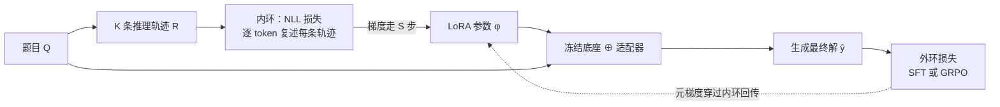

一句话解释这张图：左边是"抄"，抄进适配器；右边是"用"，用抄完的适配器答题；虚线是"抄得好不好由答题结果来打分"，这条虚线是整个方法的立意。

### 4.2 模块拆解

**模块一：内环，把轨迹压进 LoRA**

为什么需要：信息必须先进到参数里，最后答题时才不占上下文。论文的立论是 LLM 通过参数存取知识比通过长程注意力更可靠。

怎么做：对每条轨迹，让"底座加适配器"的模型逐 token 预测下一个 token，就跟你让它写这篇轨迹一样；误差通过梯度回传到适配器，走 S 步。走的步数越多，轨迹在适配器里留下的痕迹越重。注意这里没有正确答案的监督——内环只是在复述，不判断轨迹对不对。

$$
\mathcal{L}_{\mathrm{inner}}(\phi;Q,\mathcal{R})=-\sum_{k=1}^{K}\sum_{t=1}^{|R_k|}\log p_{\boldsymbol{\theta}_{\text{base}}\oplus\phi}\left(R_{k,t}\mid Q,R_{k,<t}\right)
$$

这个式子在算"给定题目、把前面已经写过的部分当下文，模型预测出这条轨迹下一个 token 的对数概率，再把 K 条轨迹的所有 token 加起来取负"。概率越高，损失越小。

- $Q$：题目，一段文本，作为所有轨迹的公共前缀
- $\mathcal{R}=\{R_1,\dots,R_K\}$：这一组轨迹，K 不固定，训练时按 16K token 预算打包，所以 K 随轨迹长度自然变化
- $R_{k,t}$：第 k 条轨迹的第 t 个 token，取值范围是整个词表
- $|R_k|$：第 k 条轨迹的 token 数
- $\boldsymbol{\theta}_{\text{base}}$：冻结的底座模型（Qwen3-1.7B 或 4B）
- $\phi$：LoRA 适配器参数，唯一被更新的东西
- $\boldsymbol{\theta}_{\text{base}}\oplus\phi$：把适配器挂到底座上之后的模型

适配器的更新就是普通梯度下降：

$$
\phi^{(s)}=\phi^{(s-1)}-\alpha\nabla_{\phi}\mathcal{L}_{\mathrm{inner}}\!\left(\phi^{(s-1)};Q,\mathcal{R}\right),\qquad s=1,\ldots,S
$$

- $\alpha$：内环学习率，一个标量
- $S$：内环步数
- $\phi^{(0)}$：外环学出来的初始适配器参数

跑完 S 步得到的 $\phi^{(S)}$ 就是"这组轨迹被压成的样子"。最终答案只从题目生成，轨迹本身不进 prompt：

$$
\hat{y}\sim p_{\boldsymbol{\theta}_{\text{base}}\oplus\phi^{(S)}}(\cdot\mid Q)
$$

**模块二：外环，让"怎么压"被答题结果塑造**

为什么需要：内环只会复述，它不知道哪些内容是解这道题有用的。得有人告诉它。

怎么做：把内环跑完的模型拿去答题，用答题的损失对**外环参数**（也就是内环的初始值 $\phi^{(0)}$，论文里记作 $\boldsymbol{\theta}_{\text{adapter}}$）求导。求导要穿过 S 步内环，这就是"元梯度"。

整体是一个双层优化：

$$
\boldsymbol{\theta}^{\star}=\arg\min_{\boldsymbol{\theta}}\;\mathbb{E}_{(Q,\mathcal{R},y^{*})}\Bigl[\,\mathcal{L}_{\mathrm{outer}}\!\bigl(\phi(\boldsymbol{\theta},\mathcal{R});\;Q,\;y^{*}\bigr)\Bigr]
$$

- $\boldsymbol{\theta}$：外环参数，也就是内环的起点 $\phi^{(0)}$
- $\phi(\boldsymbol{\theta},\mathcal{R})$：从 $\boldsymbol{\theta}$ 出发、在 $\mathcal{R}$ 上跑完 S 步内环之后的参数
- $y^{*}$：标准答案（或教师给出的示范解）
- $\mathcal{L}_{\mathrm{outer}}$：下面两种二选一

外环有两种写法：

$$
\mathcal{L}_{\mathrm{outer}}(\phi;Q,y^{*})=
\begin{cases}
-\sum_{t=1}^{T_{y^{*}}}\log p_{\phi}\!\left(y^{*}_{t}\mid Q, y^{*}_{<t}\right) & \text{(SFT)}\\[8pt]
-\mathbb{E}_{y\sim p_{\phi}(\cdot\mid Q)}\left[r(y,y^{*})\right] & \text{(RLVR)}
\end{cases}
$$

- 上支 SFT：让跑完内环的模型去模仿一段示范解 $y^{*}$，$T_{y^{*}}$ 是这段解的长度。示范解来自两个前沿模型：GPT-5.4-xhigh 和 Gemini 3.1 Pro Deep Think。信号密、方差低，但必须有教师。
- 下支 RLVR：让跑完内环的模型自己采样，用可验证的奖励 $r$ 打分。信号直接对着"答没答对"，但方差高。

RLVR 的具体形式是套在"跑完内环之后的策略"上的 GRPO：

$$
\mathcal{L}_{\mathrm{GRPO\text{-}MAML}}
=-\frac{1}{G}\sum_{i=1}^{G}\frac{1}{|y_{i}|}\sum_{t=1}^{|y_{i}|}\min\left(r_{i,t}\hat{A}_{i},\ \operatorname{clip}(r_{i,t},1-\epsilon,1+\epsilon)\hat{A}_{i}\right)
$$

$$
r_{i,t}=\frac{p_{\boldsymbol{\theta}_{\text{base}}\oplus\phi^{(S)}}\!\left(y_{i,t}\mid Q,y_{i,<t}\right)}{p_{\boldsymbol{\theta}_{\text{base}}\oplus\phi^{(S)}_{\mathrm{old}}}\!\left(y_{i,t}\mid Q,y_{i,<t}\right)}
$$

- $G$：每题采几条回答
- $y_i$：第 i 条回答，$|y_i|$ 是它的长度
- $r_{i,t}$：新策略和旧策略在第 i 条回答第 t 个 token 上的概率比。这里的"策略"是**跑过内环**的模型，所以这个比值本身就依赖 $\phi^{(S)}$
- $\hat{A}_i$：组内归一化后的优势，同一道题的 G 条回答互相比出来
- $\epsilon$：clip 的幅度，防止一次更新把策略推太远
- $\phi^{(S)}_{\mathrm{old}}$：冻结的参考副本

名字里那个 MAML 是重点：因为 $r_{i,t}$ 的分母分子都带着 $\phi^{(S)}$，对 $\phi^{(0)}$ 求导必须穿过 S 步内环。也就是说 RL 优化的不只是"答题"，还有"怎么抄轨迹"。

**模块三：截断梯度展开（Truncated Gradient Unrolling，TGU）**

为什么需要：穿过 S 步内环求导，显存是 $O(S|\phi|)$，一张 H100 撑不住。怎么做：前 $S-T$ 步内环正常跑但不建计算图，只有最后 $T$ 步挂进图里，显存降到 $O(T|\phi|)$。代价是早期步的梯度拿不到，用截断换可行。RL 版更狠，只保留最后一步（`unroll_start=3`，$n_{\text{inner}}=4$）。

### 4.3 关键细节

| 项目 | 取值 |
| --- | --- |
| 适配器 | LoRA，rank 256，$\alpha=128$，作用于所有权重矩阵 |
| 外环优化器 | AdamW，lr $1\times10^{-5}$，weight decay 0.01，cosine + 3% warmup |
| 外环训练量 | 最多 1 epoch，按验证损失早停 |
| SFT 基线 | 全参微调（LLaMA-Factory），lr $1\times10^{-5}$，batch 32，上下文 20,576，bf16 |
| RL 基线 | GRPO（Verl 框架），lr $3\times10^{-6}$，64 prompts，每题 5 条 rollout，prompt 8,192 / response 16,384 |
| RL 增强版外环 | lr $1\times10^{-6}$，weight decay 0.003，rollout 上限 2,048 token |
| 推理 | greedy（temperature 0），CoT 模式 8,192 token，thinking 模式 16,384 token |
| 硬件 | 单张 H100（93 GB HBM），64 核 CPU，64 GB 内存 |

内环和外环用的 prompt 不一样，这件事决定方法能不能跑通。内环把每条轨迹包成 `record{i}: {trajectory}`，就是让模型从头复述；外环的输入是 `record0 to recordK-1 are the information you memorized. Question: {problem} Please solve this problem step by step by reasoning from your memory...`——直接把"你记住了这些"当成事实告诉模型，题目本身才是问题。轨迹从 prompt 里彻底消失，这是它比上下文聚合省 KV 的根源。

## 5. 实验结果

**实验设置**

- **数据集与切分**：训练用 OpenParallelThinking，12,810 道题 / 63,507 个轨迹组，题源是 OmniMath、DeepScale、NuminaMath、OpenMathInstruct 四份语料去重后的 19,615 题，轨迹来自 R1-7B、Nemotron3-14B、Qwen3-4B、Qwen3-30B-A3B 四个求解器，思考段以 0.5 的概率被丢弃，再按 16K token 预算随机打包成组。8,000 条给 RL 训练，其余给 SFT。评测用 10 个基准共 1,645 题：AIME 2025（30）、AIME 2026（30）、Apex 2025（12）、ArxivMath（72）、CMIMC 2025（40）、HMMT Feb 2026（33）、HMMT Nov 2025（30）、IMO-Bench（400）、GPQA Diamond（198）、TheoremQA（800）。每题从 5 个源模型 × 8 次采样共 40 条候选里抽 8 条，按 8 条里答对的条数分成 None（0 条对）、Minority（0 到 3 条对）、Majority（4 到 7 条对）三档，共 1,645 × 3 = 4,935 组。所有 40 条全对或全错的边界题，用 GPT-5.3 和 Claude 4.6 在能看到标准答案的条件下手工改写一部分轨迹来平衡。
- **骨干模型**：Qwen3-1.7B 和 Qwen3-4B，两个规模。
- **训练预算**：单张 H100（93 GB）。外环最多 1 epoch 加早停；LoRA rank 256、$\alpha=128$；显存靠 TGU 压下来。原文没给外环的总 step 数、总 GPU 小时和每步的 batch 大小。
- **基线**：Majority Voting @8、Prompt Aggregation（CoT 与 Thinking 两种模式）、SFT Aggregation（CoT）、RL Aggregation（Thinking）、Recursive Refinement，以及不做聚合的 Extended Thinking（R1 式推理，16K 思考预算）。其中 SFT Aggregation 是作者特意加的对照：同样的题、同样的轨迹组、同样的前沿教师目标解，只是把结构压成单层。
- **指标**：每个基准的准确率（%），最终答案与标准答案匹配即算对，越高越好；10 个基准再取平均得 Avg. score。
- **推理设置**：greedy 解码，temperature 0，CoT 8,192 token / thinking 16,384 token 上限；TTT-Consolidate 走 Hugging Face Transformers，基线走 vLLM；小于 100 题的小数据集跑 8 次取平均。

**主表提炼**（完整表见下方原表）

| 设置              | 指标            | 本文   | 最强基线                       | 提升    |
| --------------- | ------------- | ---- | -------------------------- | ----- |
| 1.7B / None     | AIME25 准确率    | 36.6 | 22.9（Prompt Agg. Thinking） | +13.7 |
| 1.7B / None     | GPQA 准确率      | 22.7 | 13.6（Prompt Agg. Thinking） | +9.1  |
| 1.7B / Minority | AIME25 准确率    | 43.3 | 36.3（Prompt Agg. Thinking） | +7.0  |
| 4B / None       | CMIMC25 准确率   | 78.6 | 44.1（Prompt Agg. Thinking） | +34.5 |
| 4B / None       | TheoremQA 准确率 | 41.9 | 32.6（RL Aggregation）       | +9.3  |
| 4B / Minority   | GPQA 准确率      | 64.6 | 30.8（Prompt Agg. Thinking） | +33.8 |

**原文实验表**

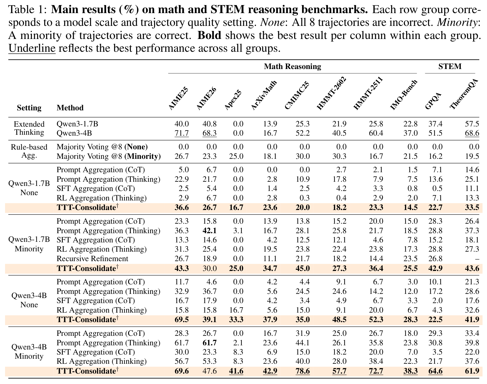

表 1：主结果。八条轨迹全错的一档里优势最大，这是最反直觉也最要紧的一格——规则投票在这里必然 0 分，因为没有任何正确答案可数。

**原文实验图**

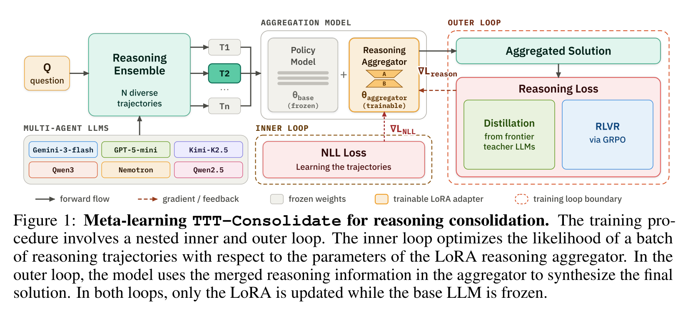

图 1：方法总览。八条轨迹从多个模型汇进来，只有内环虚线（$\nabla\mathcal{L}_{\text{NLL}}$）和两条外环虚线（Reasoning Loss 往下的回传）两条通路能改参数，其余全是冻结的前向。

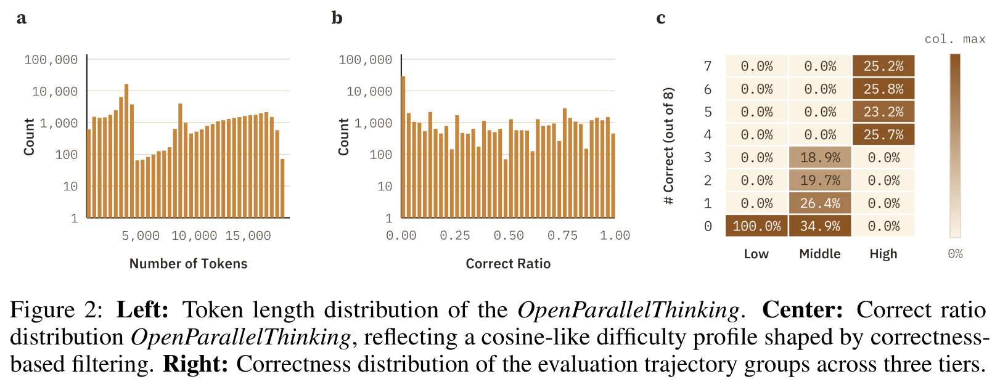

图 2：训练语料长什么样。(a) 轨迹长度分布，从几百到近两万 token，说明"按 16K 预算打包"时组大小会自然波动；(b) 正确率分布被刻意压成余弦形，中间难度最多；(c) 评测三档的构成——None 档 100% 是 0 条对，Minority 集中在 1 到 3 条，Majority 在 4 到 7 条。

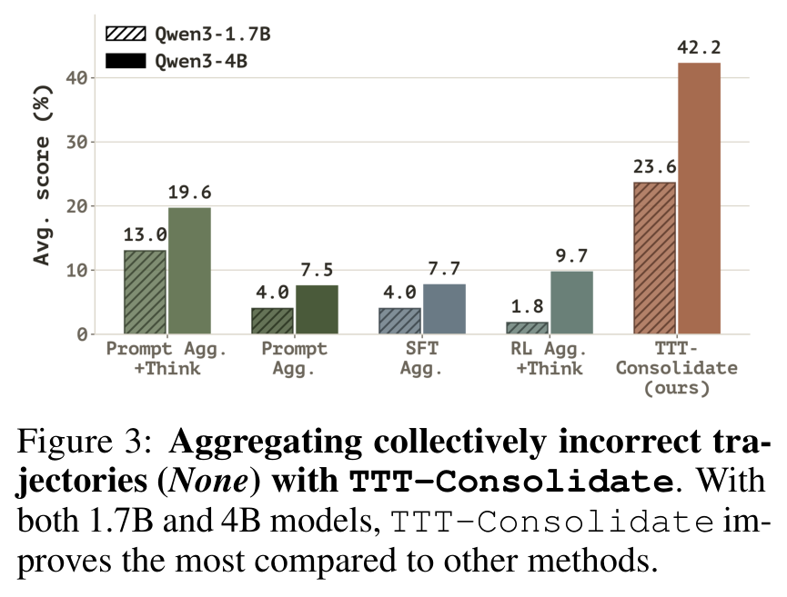

图 3：None 档平均分。1.7B 从 13.0 到 23.6（+10.6），4B 从 19.6 到 42.2（+22.6）——同样一组轨迹，骨干越强榨出的东西越多，涨幅翻了一倍。四个基线柱全在 9.7 以下。

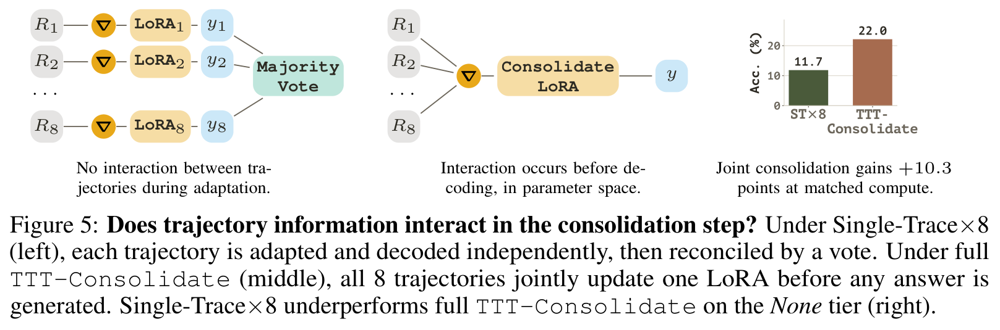

图 5：三种处理方式的对比图。左边每条轨迹各自训一个 LoRA 再投票（11.7），中间八条轨迹一起训一个 LoRA 再答（22.0）。看到的轨迹相同、算力相同，差别只在交互发生的时刻。

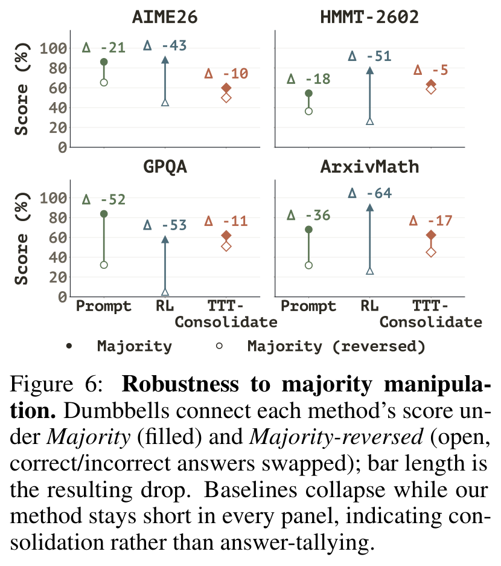

图 6：投票反转实验。实心点是原始 Majority 档分数，空心点是"把对错答案对调、推理不动"之后的分数，柱子长度就是掉分。Prompt 掉 21/43/52/36，RL 掉 18/51/53/64，TTT-Consolidate 掉 10/5/11/17。注意每格里 TTT-Consolidate 的**实心点本身就比两个基线低**（60 左右对 80 到 90）——它赢在反转后不掉。

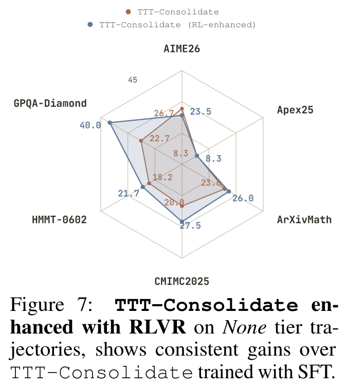

图 7：外环换成 GRPO 之后。棕色是 SFT 版，蓝色是 RL 版。GPQA-Diamond 从 22.7 顶到 40.0，是六边形里外扩最多的一角；AIME26 和 CMIMC2025 小幅上涨；Apex25 两个版本一样（都是 8.3）。

**算力对齐后的对照**

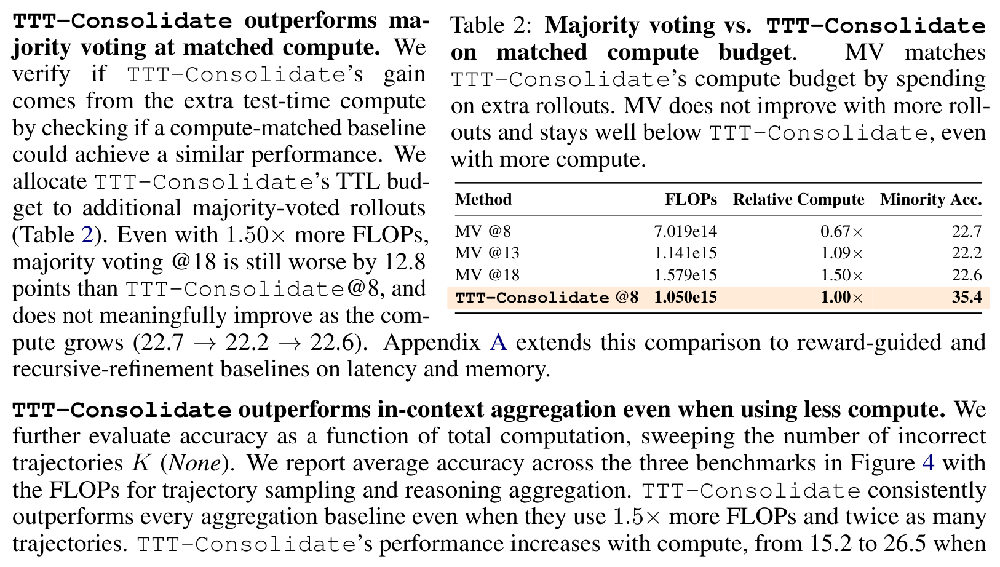

表 2：把 TTT-Consolidate 的算力预算折算成"再多投几次票"。多数投票从 8 次加到 18 次，算力涨到 1.50 倍，分数从 22.7 变 22.6，纹丝不动；TTT-Consolidate 用 1.00 倍算力拿 35.4。

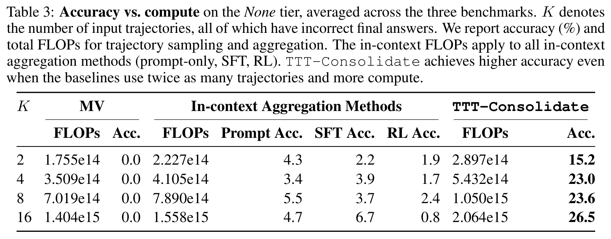

表 3：换成"加轨迹数"来花算力。TTT-Consolidate 从 K=2 的 15.2 一路涨到 K=16 的 26.5；同一张表里三种上下文聚合方法在更高的 FLOPs 下只有 1.7 到 6.7。

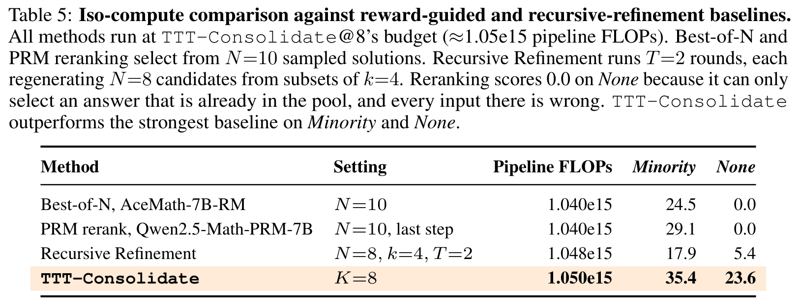

表 5：再加两个强基线。奖励模型 Best-of-N 和 PRM rerank 在 None 档都是 0.0——它们只能从候选里挑，候选全错就必然 0 分，这是机制性的，不是调参能救的。Recursive Refinement 在 Minority 是 17.9、None 是 5.4，都远低于 TTT-Consolidate 的 35.4 / 23.6。

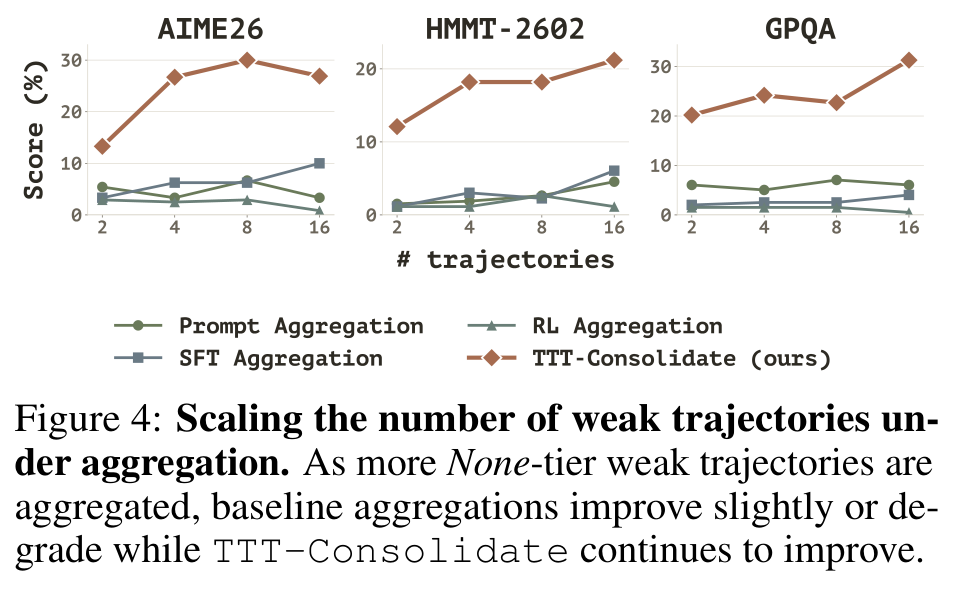

图 4：把弱轨迹的条数从 2 加到 16。棕色线（TTT-Consolidate）在三个面板里都往上走，GPQA 从约 20 到 30，AIME26 从约 13 到 30，HMMT-2602 从约 12 到 21；三条基线基本趴在原地，RL 聚合在 K=16 还掉到 1 到 6。唯一例外是 AIME26 的 K=16 档，TTT-Consolidate 从 30 回撤到约 27.5，作者没提这一格。

**消融告诉我们什么**

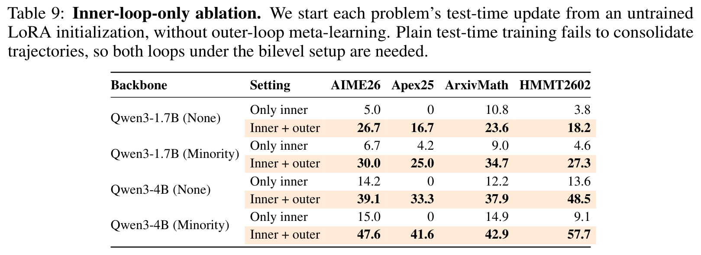

表 9：只留内环。没有外环元学习，直接从默认初始化跑内环，等于朴素 TTT。1.7B 的 None 档只有 5.0 / 0 / 10.8 / 3.8，配上外环是 26.7 / 16.7 / 23.6 / 18.2。

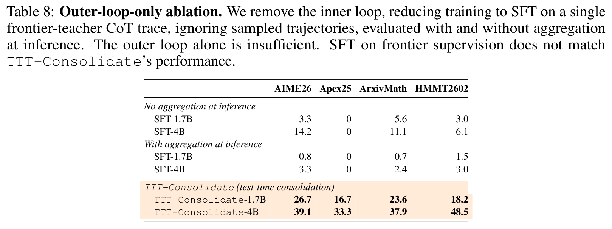

表 8：只留外环。把内环拆掉，训练退化成"照着教师的一条 CoT 做 SFT"，采样到的轨迹完全不用。不管推理时聚不聚合，1.7B 都只有 0.8 到 3.3，4B 是 3.3 到 14.2。

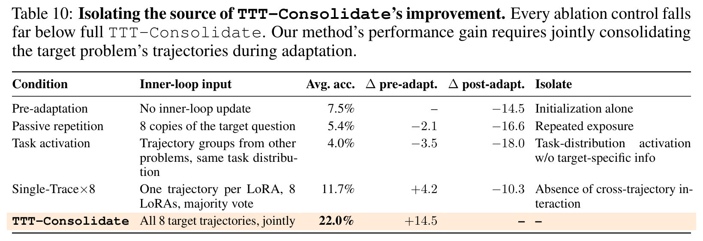

表 10：把增益的可能来源一个个掐掉。不跑内环 7.5%；内环输入换成 8 份重复的题干 5.4%；换成同一任务分布里**别的题**的轨迹组 4.0%；每条轨迹单独训一个 LoRA 再投票 11.7%；八条目标轨迹一起压进一个 LoRA 22.0%。这一列 `Isolate` 就是每条对照想排除的那个解释。

三张表合起来的意思是：**内环和外环都不能单独成立**。外环单独存在时，它只是普通的 SFT，轨迹等于没看见；内环单独存在时，它只是在背题，背完不知道往哪用；两个环一起、并且所有轨迹进同一个适配器，才有 22.0。表 10 还顺手排掉了"多读几遍题目"（5.4）和"激活了数学这个任务分布"（4.0）两个最省事的解释——它们都比 22.0 低十几分。

**这些实验够不够支撑结论**

支撑得很扎实的部分："聚合放进参数空间能提分"这件事，作者从五个角度堵了一遍——算力对齐（表 2、表 3、表 5）、延迟和显存（表 6）、投票反转（图 6）、轨迹条数扫描（图 4）、以及把各种替代解释一个个拆掉（表 10）。这个密度在同类论文里算高的。

不够的部分有四处。一是规模只到 4B，摘要说 gap widening at larger model scales 是从 1.7B 到 4B 推的，更大的骨干没测。二是评测的八条轨迹是从 40 条候选里**按正确条数分层挑**出来的，真实部署里没有这个分层器，图 2(c) 还显示三档的来源模型构成完全不同（None 档 51% 来自最弱的 Qwen2.5-1.5B），所以 None 档的高分有一部分来自"弱模型的错误很有信息量"这个特定设定。三是摘要那句 up to 20 percentage points 在原文里找不到口径——表 1 里个别格子差值达到 34.5（CMIMC25 4B None），表 7 对 SFT Agg 的平均增益是 +20.4 到 +42.2，都对不上 20。四是 Apex 2025 这一列大面积是 0：Qwen3 自己 Extended Thinking 就是 0.0，聚合器把它抬到 16 到 41，这只说明"从零开始学到了点东西"，不能说明"从错误轨迹里捞出了正确推理"。

## 6. 局限性

**作者自己承认的**

- 元学习要穿过内环反传，显存比普通微调高；再套上 GRPO 之后，rollout 生成和更高阶梯度一起把峰值显存推得更高。LoRA 已经削掉一大块，作者认为梯度检查点和更激进的截断还能再削。
- 实验只覆盖数学和 STEM，因为只有这些领域的轨迹质量能被"最终答案对不对"完全、干净地判出来。扩展到 agentic 场景（工具调用、多轮环境交互、开放式规划）时，怎么定义轨迹质量、怎么设奖励，都是新问题。

**我看出来的**

- **隐形假设一：一小组轨迹的信息量能塞进一个 rank 256 的 LoRA，并且塞进去之后还能被读出来**。K 从 8 涨到 16 的时候（图 4），rank 没有跟着调，容量够不够这件事原文没做分析。这是机制的硬边界：轨迹再多，能落进参数的就那么多。
- **隐形假设二：内环用 NLL，等于默认"这些轨迹值得逐字复述"**。轨迹全错时也照样一字不差地复述，全靠外环的元梯度去抵消。如果错误轨迹的错误率高到元梯度也扛不住，巩固就变成"认真学错"。这是为什么它必须配前沿教师的 SFT 目标、或者配可验证奖励——两种外环其实都在替内环承担"哪个字该记、哪个字别记"的判断。
- **边界条件：外环 SFT 版必须有前沿教师示范**。GPT-5.4-xhigh 和 Gemini 3.1 Pro Deep Think 给出的解本身就接近满分，这部分监督很强，表 7 的对照虽然控制了这一点，但没有完全排除"强监督 + 参数内化"这个组合本身就够用、双层只是其中一个实现方式的可能。
- **缺的对比**：没有和"用更大的模型做上下文聚合"在同等总成本下比；没有和"多轮 PRM 引导搜索"比——后者能生成候选池里原本不存在的答案，是唯一在机制上能和本文正面比"从零造答案"的路线。
- **评测口径的隐患**：三档是分层构造的，不是自然分布。真实场景里"八条全错"和"四条以上对"的比例由模型能力决定，论文没有给出自然分布下的整体数字。

## 7. 一句话总结

以前是把八份错稿摊在桌上让组长硬看，现在是让组长先把这八份稿子默写进一个小本子，合上稿子再答；而这个"怎么默写"的手法，是拿"默写完答题考几分"当分数专门练出来的。

类比：像考前用错题本做一次针对性重抄——不是把错题本带进考场翻，而是抄进脑子，抄的手法还是被历次考试分数反过来调过的。

核心公式：

$$
\boxed{\;\min_{\boldsymbol{\theta}_{\text{adapter}}}\ \mathbb{E}_{(Q,\mathcal{R},y^{*})}\Bigl[\mathcal{L}_{\mathrm{outer}}\bigl(\underbrace{\boldsymbol{\theta}_{\text{base}}\oplus\phi^{(S)}}_{\phi^{(S)}=\boldsymbol{\theta}_{\text{adapter}}-\alpha\sum_{s=1}^{S}\nabla_{\phi}\mathcal{L}_{\mathrm{inner}}(\phi^{(s-1)};Q,\mathcal{R})};\ Q,\ y^{*}\bigr)\Bigr]\;}
$$

外面这层最小化是对"内环起点"求的，梯度必须穿过里面那 S 步更新——这就是整篇论文和普通 SFT 唯一的结构差别。

## 8. 可复用点

- 如果我要在自己的项目里用：把"多候选合成一份"的 prompt 整段删掉，换成内环 NLL 把候选压进 LoRA，评测时只喂题目本身。省下来的不是提示词长度，是解码时的 KV cache——这篇从 2.588 GB 降到 0.957 GB。
- 训练不收敛时先查：内环 S 步的显存。先用 TGU（前 $S-T$ 步不建图，只留最后 $T$ 步），这篇 RL 版直接砍到只留 1 步。
- 造数据时：一条内环样本 = 1 道题 + K 条轨迹，按固定 token 预算打包让 K 自然浮动，比固定 K 更接近真实（论文用 16K）；按"几条对"分层，保证全错那一档至少占三分之一，否则模型会学成"挑答案"而不是"合成推理"。
- 想验证方法不是靠数答案：把正确答案和错误答案对调、推理过程一个字不动，重跑一遍。掉分超过 30 分的基本可以判定是投票器。
- 想让内环"只学对的"：把 NLL 换成按最终答案加权的 token 级损失，或直接降权错误轨迹的 token。这是论文没做、但机制上最自然的一步。

## 9. 我的疑问

- 图 6 里 TTT-Consolidate 在**没反转**的 Majority 档只有 60 分左右，明显低于 Prompt 和 RL 的 80 到 90。作者只解释了"反转后它掉得少"，没解释"反转前它为什么低"。是不是参数内化在"候选基本都对"的场景下反而不如直接读？
- Minority 的定义写成"0 到 3 条正确"，而 None 是"0 条正确"，两档在 0 条处重叠。既然每题都参与全部三档，Minority 实际应该是 1 到 3 条，这个边界原文没写清。
- rank 256 是"能把一组轨迹压进去"的容量上界。K 从 8 涨到 16 时（图 4）分数还在涨，说明容量没饱和；那 K 再往上呢？会不会需要按 K 调 rank？
- 附录 D 说 TGU 引自 `[44]`，但参考文献 `[44]` 是 Gorilla。从上下文看应该指 `[12]` PERK（那里才有 TGU 和这套编码方案），疑似编号错位。
- 图 4 里 AIME26 的 K=16 档，TTT-Consolidate 从 30 回撤到约 27.5，是三个面板里唯一的下降。作者在正文里只说 generally benefits from more trajectories，没提这次回撤，也没解释。
- 轨迹来源模型的数量三处对不上：摘要是 six LLMs，正文 3.1 是四个求解器，附录 C.1 的评测轨迹又是五个源模型。3.1 与 C.1 讲的是两批不同的轨迹，但摘要那句话把它们混在了一起。
