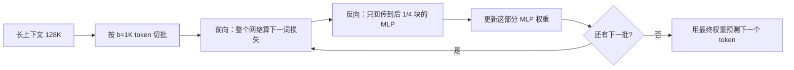

> 一句话：让模型读完长文本就顺手把内容学进参数，读多长推理都只花固定时间。

**代码**：[test-time-training/e2e](https://github.com/test-time-training/e2e)

## 0. 读之前你需要知道

**术语卡**

- **全注意力（full attention）**：每个新 token 都要把前面所有 token 的 key 和 value 翻一遍。好处是一个细节都不漏，坏处是每生成一个 token 的成本随上文长度线性涨，总成本是长度的平方。类比：每写一个字都要把前面整本书重读一遍。
- **滑动窗口注意力（sliding-window attention, SWA）**：只看最近 $k$ 个 token，更早的直接不看。成本恒定，但 $k$ 之前的信息彻底没了。类比：只记得刚才五分钟说的话。
- **RNN 型序列模型（Mamba 2、Gated DeltaNet）**：把历史压进一个固定大小的状态里，每来一个 token 更新一次状态，成本恒定。问题在状态太小，压不住很长的历史。
- **测试时训练（Test-Time Training, TTT）**：模型在推理那一刻，拿眼前这段输入当训练材料，对自己的参数跑几步梯度。类比：考试允许你在草稿纸上现推，而不是只能用背下来的解法。
- **内环 / 外环（inner loop / outer loop）**：内环是推理时那几步梯度；外环是训练时决定"从什么初始值开始跑内环"的那层优化。外环要对内环的梯度再求一次导，也就是梯度的梯度。
- **元学习（meta-learning）**：不是学"怎么答题"，是学"从哪个起点开始学能学得最快最好"。本文用它来练内环的初始权重。
- **TTT-KVB（Key-Value Binding）**：前作把自注意力换成一个"在推理时学会把 key 映射到 value"的小网络，是本文的出发点。Titans、Nested Learning、MesaNet 都在这条线上。
- **动态评估（dynamic evaluation）**：2013 年起的老做法，推理时直接在测试文本上继续做梯度下降，但训练时没为这件事做过准备。本文把它当成"不端到端"的对照组。
- **mini-batch（批）**：内环不是每读一个 token 更新一次，而是攒够 $b$ 个 token 更新一次。批越大越稳、越好并行，但批内彼此看不见。
- **prefill / decode**：prefill 是把给定的长上下文一次性读进去；decode 是接着一个个吐新 token。
- **梯度检查点（gradient checkpointing）**：为了省显存，不保存中间激活，反传时重算。本文还要沿着时间轴（每个 mini-batch）做一次，代价随上下文长度涨。

**它站在谁肩上**

- TTT 系列（Sun et al. 2023、2024）：提出"用梯度当记忆"的框架，但每层各自有一个重建损失，推理时逐层更新。
- TTT-KVB（Zhang et al. 2025，即 "Test-Time Training Done Right"）：把 TTT 做成可以替换注意力层的模块，配 LoRA 压状态，是本文最重要的对比对象和推导起点。
- 动态评估（Mikolov et al. 2013；Krause et al. 2018）：推理时继续训练的老思路，缺失的是"训练时就为推理时的学习做准备"。
- Clark et al.（2024）：在 Transformer 上加一层快权重、按块用下一词预测更新，思路最接近，但没有长上下文效率收益。
- Mamba 2（Gu & Dao 2023）、Gated DeltaNet（Yang et al. 2024）：恒定成本的 RNN 路线，是本文要打的对手。
- MAML（Finn et al. 2017）：外环学内环初始化，结构同源，区别在本文把语言建模本身当成元学习任务。

## 1. 动机

你听了一场机器学习的第一节课。讲师的第一句话你早就忘了，但那节课给你的直觉，几年后还在帮你读论文。

这篇论文的起点就是这个差别：人要变强靠的是**压缩**，不是**背诵**。

**以前怎么做**：全注意力 Transformer 是按"近乎无损地记住一切"设计的。每个新 token 都要扫一遍前面所有 token 的 key 和 value。细节一个不漏，代价是每 token 成本随上下文线性涨。想省钱就换 RNN：Mamba 2、Gated DeltaNet 每 token 成本恒定，但状态太小，上下文一长就压不住，损失曲线明显不如全注意力。

**为什么不行**：两条路各缺一半。全注意力有容量没效率；RNN 有效率没容量。中间路线（滑窗、注意力与 RNN 混搭）也只是折中，作者的原话是这些技术"still less effective than full attention in using longer context"。

**为什么现在能做**：两个条件凑齐了。一是自动微分框架已经能低开销地算梯度的梯度，元学习不再昂贵到没法上规模；二是"把上下文压进权重"这件事本身不需要新算子——被更新的就是普通的 MLP 层，可以用现成的训练基础设施分片到多卡。

作者的问题因此换了个问法：既然预训练本身就是用下一词预测把海量数据压进权重，那**推理时为什么不接着压**？

## 2. 贡献

- **把长上下文建模重新定义成持续学习问题，而不是架构设计问题**。证据：主干网络就是标准 Transformer + 滑动窗口注意力，没有新算子，改动只在训练目标和更新范围上。
- **提出 TTT-E2E，在两个方向上都是端到端**。内环直接用网络末端的下一词预测损失（不是逐层重建），外环直接优化"跑完内环之后"的损失（不是普通预训练）。证据：8K 上下文下损失 2.805，优于 TTT-KVB 的 2.818 与 SWA 基线 2.827。
- **上下文 scaling 追平全注意力**。证据：3B 模型、164B token 训练后，随上下文从 8K 加到 128K，TTT-E2E 的损失下降趋势与全注意力一致；Mamba 2 与 Gated DeltaNet 不一致。
- **推理延迟恒定，128K 时比全注意力快 2.7 倍**。证据：单张 H100 上测 prefill 延迟，每批固定 128K token。
- **训练开销是明显短板，作者自己点名**。证据：128K 上下文时训练比全注意力快，但 8K 时慢 1.2 倍，而预训练算力主要花在短上下文。

## 3. 创新点

- **把内环损失从"逐层重建"换成"网络末端预测下一词"**。对比对象：TTT-KVB 每一层都有自己的重建损失 $\ell^{(l)}$，还要额外的 $\theta_K$、$\theta_V$ 参数。有用是因为：推理时的训练目标从此和真正的测试目标完全一致，不再有"练的东西不是要考的东西"这层错位。表 1 里单换损失这一步就把 2.818 拉到 2.806。
- **外环优化的是"TTT 之后"的损失，而不是训练前的损失**。对比对象：动态评估直接在测试文本上做梯度下降，训练时按静态模型优化。有用是因为：前者保证初始权重是"适合被继续训练"的，后者只保证"不训练时好用"。
- **状态放在少数几个块的完整 MLP 上，而不是每个块的小 LoRA 上**。对比对象：TTT-KVB 每块一个多头小 MLP + LoRA。有用是因为：准备上游梯度的成本很高，与其更新很多个小状态，不如更新少数几个大状态。同一 760M 模型下隐状态从 18M 涨到 88M，prefill 延迟反而从 0.017 秒/1K token 降到 0.0086 秒/1K token。
- **给出对偶推导**：从 TTT-KVB 出发也能一步步走到同一个方法（简化输出规则 → 换损失 → 换状态），说明"训练时端到端"和"推理时端到端"是同一件事的两个方向。

## 4. 方法

### 4.1 整体流程



一句话解释这张图：读的每一批都在改模型，读完之后模型已经不是开始读的那个模型了。

### 4.2 模块拆解

**模块一：内环，按批做测试时训练**

为什么需要：如果每读一个 token 就更新一次（在线梯度下降），一是没法并行，二是单 token 的梯度噪声大、容易炸。

怎么做：把上下文按 $b$ 个 token 切批，每批算一次平均梯度，走一步。

公式：

$$
W_i = W_{i-1} - \eta\,\frac{1}{b}\sum_{t=(i-1)b+1}^{ib}\nabla \ell_t(W_{i-1}),\qquad i=1,\dots,T/b
$$

先说这个公式在算什么：每读完一批 $b$ 个 token，用这一批的平均梯度把权重往前推一步。

- $W_i$：读完第 $i$ 批之后的权重，形状与一组 MLP 层相同
- $\eta$：内环学习率，标量
- $b$：批大小，本文默认 1K token
- $T$：上下文长度
- $\ell_t(W)=\texttt{CE}\big(f(x_{t-1};W),x_t\big)$：第 $t$ 个 token 的交叉熵，$f$ 是整个网络

**模块二：外环，学一个适合被继续训练的起点**

为什么需要：如果内环的起点 $W_0$ 只是普通预训练出来的，那它被优化的是"不更新时好用"，不是"更新之后好用"，训练和推理对不上。

怎么做：把每条训练序列当成测试序列，先在它上面跑完内环，再对"跑完之后"的损失求导，反传到 $W_0$。

公式：

$$
\mathcal{L}(W_0;X)=\frac{1}{T}\sum_{i=1}^{T/b}\ \sum_{t=(i-1)b+1}^{ib}\ell_t(W_{i-1})
$$

先说这个公式在算什么：它把"边读边学"整条轨迹上每个 token 的损失加起来，作为训练时的目标函数。

- $X=(x_1,\dots,x_T)$：一条训练序列
- $W_{i-1}$：处理第 $i$ 批时用的权重，已经含前面所有批的更新
- $\ell_t(W_{i-1})$：用"读到此刻为止"的权重去预测第 $t$ 个 token 的损失，注意 $W_{i-1}$ 从没见过 $x_t$，所以这个损失就是真实的测试损失

关键在于这个式子里 $W_{i-1}$ 本身依赖 $W_0$，所以对 $\mathcal{L}$ 求导要穿过内环的每一步，这就是梯度的梯度。

**模块三：架构上的三个决定**

为什么需要：光有目标还不够，得决定"哪些参数允许在推理时被改"。

怎么做：

1. **只更新 MLP 层**。embedding、归一化、注意力层在内环里全部冻结，因为作者发现更新它们会让外环不稳定。
2. **只更新最后 1/4 的块**。760M 模型 24 层，就是最后 6 层。更新的块越多，能存的东西越多，但反传越贵；消融显示 6 层和 12 层效果相当，所以取更省的。
3. **每个被更新的块放两块 MLP**。第二块是静态的，专门存预训练知识，防止边读边忘。为了公平对比，全网络的 MLP 隐藏维度都缩小，总参数量保持不变。

**模块四：多 token 解码时的自训练**

为什么需要：prefill（读上下文）和 decode（往外写）是两件事，读的时候能更新，写的时候呢？

怎么做：解码出来的 token 攒满一个 TTT 批，就对这批自己生成的 token 走一步梯度，然后用新权重继续解码。

### 4.3 关键细节

- 窗口大小 $k=8\text{K}$，内环批大小 $b=1\text{K}$，且必须满足 $k \ge b$——窗口要先兜住批内的局部上下文，内环才有机会补上更长程的记忆。
- 五个模型规模：125M / 350M / 760M / 1.3B / 2.7B（表 3 的配置写明是 2.7B，摘要与正文用它作为 "3B"）。
- 预训练上下文 8K，扩展微调最长 128K；微调用 Books，token 数为预训练的 5%，批大小翻倍。
- RoPE：预训练 $\theta=500\text{K}$；扩展时 16K 用 1M、32K 用 2M、64K 用 5M、128K 用 10M。
- 微调学习率统一取 4e-4（网格搜过一次，发现各规模各长度都吃这一档），余弦调度在微调开始时重启。
- 解码评测的采样参数：temperature 1、top-p 0.95、repetition penalty 1.1。
- 显存上必须沿时间做梯度检查点——默认实现会把 $W_1,\dots,W_T$ 全存下来，存不下。

## 5. 实验结果

**实验设置**

- **数据集与切分**：预训练用 DCLM-Baseline（Common Crawl 的强过滤子集，共 3.8T token），先丢掉所有短于 8K 的文档，再随机采样出不同规模训练集；扩展微调用 Books；语言建模评测用 Books 的留出划分。检索评测用 RULER 里的 S-NIAH-1/2/3。滑窗大小消融与批大小消融是在 DCLM 上预训练后直接评测的，没经过 Books 微调。
- **骨干模型**：标准 Transformer + QK norm，Llama 3 分词器，五个规模 125M 到 2.7B。上下文 scaling 主实验用最大那个（正文称 3B）。
- **训练预算**：两阶段——8K 预训练 + 目标长度扩展微调。3B 模型训练 164B token（摘要口径）；表 3 给的 2.7B 配方是预训练 54B、微调 5%。微调预算固定为预训练的 5%。
- **基线**：全注意力 Transformer、SWA、SWA 与全注意力 5:1 混合（Gemma 风格）、Mamba 2、Gated DeltaNet、TTT-KVB，共六个，全部窗口 $k=8\text{K}$。作者还替基线做了两处优化：把 FlashAttention 2 换成 3；给带滑窗的基线加 QK norm（Gated DeltaNet 因此在 8K 预训练上从 2.814 降到 2.809，32K 微调上从 2.691 降到 2.683）。
- **指标**：test loss，即每个 token 交叉熵在序列上的平均，越低越好；上下文 scaling 图用 $\Delta$ loss，即相对全注意力的损失差；检索用精确匹配的准确率。
- **推理设置**：延迟在单张 H100 上测，每批固定 128K token（128K 时每批 1 条序列，8K 时 16 条）。解码评测用 Qwen-3-8B-Base 当打分器，先填 8K token 的 Books 文本，再自回归生成 8K，看 Qwen 在拼起来的 16K 序列上逐 token 的似然。

**主表**（8K 上下文、760M 模型的同口径对比）

| 方法 | test loss | 相对 SWA |
| --- | --- | --- |
| SWA（k=8K）基线 | 2.827 | — |
| TTT-KVB（Zhang et al.） | 2.818 | −0.009 |
| TTT-KVB 简化输出规则 | 2.819 | −0.008 |
| TTT-E2E all layers MH（中间版本） | 2.806 | −0.021 |
| TTT-E2E（本文） | 2.805 | −0.022 |

**原文实验表**（原表截图未裁出，下面照原文数字重排；表号为论文原编号）

表 1：同一条消融链上，光是"把逐层重建损失换成末端下一词预测"就把 2.818 推到 2.806，比后面所有架构改动加起来都大。

**原文实验图**（原图未裁出，见本节末尾说明）

- 图 1（第 1 页）：左图是 3B 模型在 Books 上的 $\Delta$ loss 随上下文长度变化，TTT-E2E 的线随长度增加持续走低，Mamba 2、Gated DeltaNet、TTT-KVB 的线在 32K 之后明显抬起来；右图是 prefill 延迟，128K 时本文比全注意力快 2.7 倍。读图结论：这正是论文标题里 "long context" 的全部含义——同样的模型规模下，只有本文把"上下文更长"稳稳换成了"损失更低"。
- 图 2（第 2.2 节）：左边是计算图，去掉注意力的玩具模型只有向上箭头，加了 TTT 之后多出反向和横向箭头；右边是逐 token 的测试损失曲线，四条线分别是不带注意力的玩具基线（绿）、TTT-naive（灰）、TTT-E2E（蓝）、全注意力（橙），$b=16$ 的版本画成红线。读图结论：naive 版本几乎贴着玩具基线，说明"推理时训练"本身不值钱，值钱的是"为推理时训练而训练"。红线在批内逐 token 上翘、每批开头掉下来，直接把"批内看不到自己批内前文"这个缺陷画了出来。
- 图 3（第 2.3 节）：左图是 TTT-E2E 的结构，整网一个末端损失，梯度只回传到后 1/4 块的 MLP；右图是 TTT-KVB，每块一个重建损失、各有 $\theta_K/\theta_V$、梯度在每块内部就停住。读图结论：两者都是"前向全通、反向只到一层"，区别在损失放在哪、状态有多大。
- 图 4（第 3.2 节）：三块面板，窗口大小 $k$、内环批大小 $b$、更新的层数，各画成损失或上下文 scaling 曲线。读图结论：$k$ 越大越好但收益在 8K 后放缓；$b$ 越大越差，所以只能取 1K；更新的层数只有 6 层和 12 层能跟着上下文长度一起降，1 层和 3 层直接走平。
- 图 5（第 3.3 节）：训练算力 scaling，左列在 DCLM 上评测，右列在 Books 32K 上评测；横轴分别是模型规模和训练 token 数，虚线标出 760M 和 48B 两个拐点。读图结论：小预算区本文优势明显，过了拐点之后三条线（全注意力、Gated DeltaNet、TTT-E2E）斜率趋同，说明"优势"其实是小算力下全注意力的劣势。
- 图 6（第 3.4 节）：把 32K 和 128K 两个上下文长度的结果按 token 位置拆开，横轴是位置、纵轴是该位置的测试损失。读图结论：本文在全长度区间都低于全注意力，但优势主要来自靠前的 token，靠近窗口末端时两者几乎重合；128K 的图更像 32K 的横向拉伸，而不是"曲线交叉"。
- 图 7（第 3.6 节）：解码评测，横轴 token 位置、纵轴 Qwen-3-8B-Base 给的似然，线性刻度，8K 处有一条 prefill/decode 分界线。读图结论：本文的 Qwen loss 在整段都低于全注意力；两条线都在 8K 处突然上跳，然后随生成变长慢慢回落。
- 图 8（第 3.7 节）：左图训练延迟随上下文长度变化，右图每 token FLOPs。读图结论：FLOPs 一条平线（成本确实恒定），但延迟在 8K 到 32K 之间上升，原因是沿时间的梯度检查点数量涨了 3.4 倍——省算力不等于省时间。

> **图还没落地，一键补齐**：本会话的 bash 执行器报 `EXECUTOR_UNAVAILABLE`（Niubash payload 必须在 session workspace 之外，宿主运行条件问题），裁图链路跑不起来，所以上面只有读图结论、没有原图。裁图脚本已备好，跑一条命令即可：
>
> ```bat
> C:\Users\7Xxx\ttt-work\get_figs.cmd
> ```
>
> 它做的事：自动挑一个能用的 python → 缺 PyMuPDF 就装 → 从 arXiv 下 2512.23675 的 PDF（v2 → 无版本 → export 镜像 → v1 逐个试，校验 `%PDF` 头与页数）→ 调 `cf-xray-paper/scripts/crop_figs.py` 裁 Figure 1–8 与 Table 1–3 → 对没裁到的编号按图注所在页整页 288dpi 兜底 → 全部写进 `assets/ttt-e2e/`。跑完把清单发回来，正文的图片引用由我补。

**表 2：Needle in a Haystack（3B、128K 微调后，准确率）**

| 方法 | S-NIAH-1 8K | 32K | 128K | S-NIAH-2 8K | 32K | 128K | S-NIAH-3 8K | 32K | 128K |
| --- | --- | --- | --- | --- | --- | --- | --- | --- | --- |
| Full attention | 1.00 | 1.00 | 0.99 | 0.99 | 1.00 | 0.86 | 0.64 | 0.67 | 0.64 |
| SWA | 1.00 | 0.26 | 0.07 | 1.00 | 0.28 | 0.05 | 0.57 | 0.24 | 0.05 |
| Hybrid SWA and full | 1.00 | 0.88 | 0.21 | 1.00 | 0.99 | 0.29 | 0.63 | 0.32 | 0.06 |
| Mamba 2 | 0.99 | 0.26 | 0.07 | 0.99 | 0.28 | 0.05 | 0.77 | 0.24 | 0.04 |
| Gated DeltaNet | 1.00 | 0.26 | 0.07 | 1.00 | 0.27 | 0.05 | 0.91 | 0.23 | 0.03 |
| TTT-KVB | 0.98 | 0.22 | 0.01 | 1.00 | 0.27 | 0.05 | 0.74 | 0.23 | 0.04 |
| TTT-E2E（本文） | 1.00 | 0.24 | 0.06 | 0.99 | 0.28 | 0.05 | 0.77 | 0.24 | 0.03 |

表 2：这是本文唯一明显输给全注意力的实验。作者的解释是：全注意力的长处正是"近乎无损地记住一切"，而本文的机制是压缩，会把看起来无关的细节（比如一句随机字符串）丢掉。

**表 3：基础配方（原文表 3，节选）**

| 规模 | 层数 | 维度 | 头数 | 预训练批 | 预训练 LR | 预训练 token | 微调批 | 微调 LR | 微调 token |
| --- | --- | --- | --- | --- | --- | --- | --- | --- | --- |
| 125M | 12 | 768 | 12 | 0.5M | 3e-3 | 2.5B | 1M | 4e-4 | 125M |
| 350M | 24 | 1024 | 16 | 0.5M | 1.5e-3 | 7B | 1M | 4e-4 | 350M |
| 760M | 24 | 1536 | 16 | 0.5M | 1.25e-3 | 15B | 1M | 4e-4 | 750M |
| 1.3B | 24 | 2048 | 32 | 0.5M | 1e-3 | 26B | 1M | 4e-4 | 1.3B |
| 2.7B | 32 | 2560 | 32 | 1M | 8e-4 | 54B | 2M | 4e-4 | 2.7B |

表 3：配置与预训练配方取自 GPT-3，并照 Mamba 2 的做法改了两处（用 GPT-3 的峰值学习率、1B 模型的批大小减半）。

**消融告诉我们什么**

- **内环损失是主要来源**。表 1 里换损失（2.818 → 2.806）比换状态结构（2.806 → 2.805）重要得多。
- **状态大小决定能不能 scaling**。只更新 1 层或 3 层，随上下文变长就走平；6 层和 12 层才能跟全注意力同斜率，而 12 层并不比 6 层好，所以取 1/4。
- **架构改动本身几乎没用**。把批大小设成 8K 等价于不做 TTT，这时 TTT-E2E 是 2.825、TTT-KVB 是 2.826、全注意力是 2.827——三者在噪声内。作者因此说架构设计在这套方法里只是配角。
- **TTT-E2E 不是在全补全滑窗的短板**。在 $k=8\text{K}$ 的设定下 SWA 就等于全注意力，TTT-E2E 在这之上还能把损失降 0.018，说明这个提升与"窗口看不全"是正交的两件事。
- **批大小的下限是硬件不是算法**。$b$ 越小理论上越准，但小于 1K 之后硬件利用率和稳定性都扛不住，所以卡在 1K。

**这些实验够不够支撑结论**

支撑"上下文 scaling 追平全注意力"这条，够。理由是：规模从 125M 到 2.7B、token 从 0 到 54B 都扫过，而且两个数据集（DCLM、Books）、两种评测（预训练后直接评、微调后评）都给了。拐点位置（760M、48B）也标了出来，没有只挑好看的点。

支撑"可以拿去生产"这条，不够。最大只到 2.7B/128K，两阶段训练，没有任何指令微调或 RL 阶段的实验；NIAH 直接说明精确检索能力是退化的。作者自己在 3.6 节写得很直白：进入这些阶段的评测超出本文范围。

## 6. 局限性

**作者自己承认的**

- **训练延迟是硬伤**。128K 时比全注意力快，8K 时反而慢 1.2 倍，而预训练算力主要在短上下文。原因是梯度的梯度这套流程没被优化过，cuDNN FlashAttention 不支持二阶梯度。
- **延迟随长度上升，不是常数**。每 token FLOPs 恒定，但沿时间的梯度检查点数量在 8K 到 32K 之间涨了 3.4 倍。
- **精确检索退化**。NIAH 上被全注意力大幅拉开，作者把它归因于压缩的固有代价。
- **超参选择的适用性存疑**。作者自己写：三个实现细节可能只是本文实验设定的产物，更长的上下文可能需要换别的选择。
- **tokenizer 与数据质量只给了轶事级观察**。换 Llama 3 分词器让 3B 上的优势涨了约 0.01；换 DCLM 之后 48B token 以上才和全注意力同趋势。作者明说这需要系统性复现，超出本文范围。

**我看出来的**

- **隐形假设：上下文里"重要"的部分能被下一词预测这个目标自己挑出来**。这个假设在自然文本上大概率成立，但在"信息稀疏、必须逐字记住"的任务上直接失效——NIAH 就是这个假设的反例，不是意外。
- **边界条件：$k \ge b$**。窗口必须不小于内环批，否则批内 token 互相看不见，模型退化成 bigram。这条约束把窗口大小和内环批大小绑在一起，两个超参的自由度其实只剩一个。
- **缺的对比：没有和"全注意力 + 更聪明的稀疏化"比**。原生稀疏注意力一类的路线同样想解决"每 token 成本随长度涨"，本文的对照组全是 RNN 与滑窗，缺这一类。
- **第二个缺口：微调阶段的学习率没有按方法单独搜**。4e-4 是照着全注意力基线搜出来的，TTT-E2E 用的是同一档。方法不同、内环还在改权重，最优外层学习率大概率不同，这一项可能让本文的数字偏保守也可能偏乐观，原文没说。
- **第三个缺口：解码评测的裁判只有一个模型**。图 7 全部结论建立在 Qwen-3-8B-Base 的似然上，换裁判是否还成立没有验证。

## 7. 一句话总结

这篇论文把"记住上下文"换成了"读完上下文就变成一个新模型"：读的时候一直在改自己，所以读完之后不需要回头翻笔记。

类比：全注意力像开卷考试，每答一题都翻一遍全部资料；RNN 像只带一张小抄；TTT-E2E 像考前把资料读一遍并且真的记住了——翻完就合上书，但书里的东西已经进了脑子。

核心公式：

$$
\boxed{\;\mathcal{L}(W_0;X)=\frac{1}{T}\sum_{i=1}^{T/b}\ \sum_{t=(i-1)b+1}^{ib}\texttt{CE}\big(f(x_{t-1};W_{i-1}),x_t\big)\;}
$$

## 8. 可复用点

- **如果我要在自己的项目里用**：把"外层优化"的目标从"模型不训练时的损失"换成"模型按我的流程跑完一遍之后的损失"。凡是流程里有一步不可导的近似、或者有一步推理时的适配，这一步就值得挪进外层目标里。
- **冻结什么、更新什么先做消融**：本文的证据是更新注意力、归一化、embedding 会炸外环。任何双层优化里，"内环允许改哪些参数"应该先当超参扫，不要默认全改。
- **状态要放在少数几个大容器里，不是多数几个小容器**：准备上游梯度的成本与"要更新的块数"成正比，与"每块多大"关系不大。
- **训练不收敛时先查**：内环批大小是不是小于窗口大小；外环学习率是不是照搬了不做内环时的值；显存是不是靠沿时间做梯度检查点硬撑的。
- **判据要选对**：本文用"随上下文变长，损失是否同斜率下降"来判断方法行不行，而不是某个单点损失。这个判据比单点数字更能识别"只是在小规模上占便宜"的方法。

## 9. 我的疑问

- 摘要写 3B 模型训练 164B token，表 3 的 2.7B 配方是预训练 54B。两处口径怎么对上？是 3B 另有更大预算的跑法，还是 164B 含了多轮重复？原文没说清。
- 图 1 里本文在早期 token 上就领先全注意力，而那时内环还没走过一步梯度——作者的解释是"权重只需要对准眼前这一批"。这个解释能不能被证伪？比如把第一批的损失单独拿出来，看优势是否随批大小变化。
- 如果内环不更新 MLP 而更新一块独立的 adapter，状态容量和解耦程度都会变，结论是否还成立？本文只比较了"哪些已有层"和"多少层"，没比较"新加容器"。
- 训练延迟 1.2 倍的劣势，靠"从预训练好的 Transformer 初始化"能消掉多少？作者把它列为未来工作，没给数据。
- 多 token 解码时的自训练（用自己生成的 token 更新自己）只在 3B base 模型上做了一次有限评测，没有指令微调模型。这条路径在真实对话场景里会不会自我强化错误？没有实验。
