> 一句话：只训小模型学怎么改思路，把写代码交给冻结的大模型，比直接训大模型更强也更便宜。

## 0. 读之前你需要知道

**术语卡**

- **测试时训练（test-time training, TTT）**：部署之后针对手上这一道题，用这道题自己的反馈再更一次参数。生活类比：不做统一复习，进考场看到卷子先补这一章。
- **验证器（verifier）**：能自动给候选答案打分、只出分不出理由的程序。生活类比：投币体重秤。
- **策略（policy）**：模型看着当前状态决定下一步做什么的概率分布。生活类比：司机看路况决定方向盘打多少度。
- **信用分配（credit assignment）**：总分出来后倒推是哪一步决策挣来的。生活类比：输球后判断是战术画错还是球员没跑到位。
- **PUCT**：树搜索的选点规则，一半往已知好的分支深挖，一半往没试过的分支去探。生活类比：找矿，既回老矿洞往下打，也去没打过钻的地方试一钻。
- **LoRA**：冻住原权重，只训一对很窄的低秩矩阵当补丁。生活类比：不动原著，只在页边贴便利贴。
- **熵目标（entropic objective）**：用指数加权把目标从平均好改成最好的那几个好。生活类比：选餐厅不看均分，只看最会吃的那几个朋友打的分。
- **组内相对优势（group-relative advantage）**：同一批兄弟答案互相比，不跟绝对分数线比。生活类比：同一个老师手里的五个学生排名次。

**它站在谁肩上**

- FunSearch（2024）：让大语言模型反复写程序、选优、打分发现数学构造。不够，因为参数没动，反馈只能决定留下谁。
- AlphaEvolve（2025）：加了进化程序库和更强的编码模型，同样不改参数。
- CORAL（2026）：多智能体加共享记忆加异步进化，还能上网。强，但仍冻结模型。
- TTT-Discover（2026）：第一次把验证器分数变成梯度，直接训写完整解的那个大模型。不够，因为必须训大模型，且一个总分同时评了策略和实现。
- SimpleTES（2026）：评估驱动的规模化路线，给出 Lasso 和 AHC058 上很强的参考解，本文主要对手。

## 1. 动机

装修老房子。设计师负责这面承重墙能不能砸，施工队负责钢筋怎么绑。为了省钱只请一个人，让他一边想方案一边砌墙，验收那天墙裂了，你根本不知道该换设计师还是换施工队。

**以前怎么做**：主流是把模型冻住，把验证器分数写进提示词让它多试几次，FunSearch、AlphaEvolve、CORAL 都走这条路。TTT-Discover 往前走一步，把分数变成梯度，在测试任务上真更新参数。

**为什么不行**：两块代价。一块是钱，梯度、优化器状态、策略统计量都得留着，输出又是几百上千 token 的结构化代码，一轮轮 rollout 下来显存和时长都吃不消。另一块更要命，是归因：验证器只看最终那份程序。策略上很聪明的改动，如果实现时变量作用域写错编译不过，拿到的分是 0，而这个 0 会被当成这个思路不行写进梯度。

论文给了例子。Polyomino 第 21 次更新，父解 91.3564 分，guidance 提按局部填充密度自适应调退火的长宽目标，执行器把变量用在作用域外编译失败，0 分，相对优势约 −1.00；同一组另一条建议提同样机制，执行成功拿 91.3173 分，优势 +0.90。同一个想法一负一正，差别全在实现。

**为什么现在能做**：三件事凑齐了。强执行器可以按 API 调用，不必自己训也不必自己部署，本文用 GLM-5.2；8B 配 LoRA 就能在单张 B200 上跑完整的强化学习循环；四个任务都已有现成的自动判分器。

## 2. 贡献

- **提出 Guidance-TTT 这个拆分**。证据：四个任务最终解都超过此前工作报告过的最好解，全程不联网、不继承现成解代码。
- **Polyomino 刷到 91.89**，超过可联网四智能体 CORAL 的 89.40 有 2.49 分，也超过赛方公布的人类参考 89.10。证据：表 2。
- **Lasso 从 0.1243 提到 0.1739**，同样正确性容差下相对 SimpleTES 提升 39.8%。证据：表 2。
- **适配成本砍掉约 58%**：同 Polyomino、同用 GPT-OSS-120B 当执行器，只训 8B guidance 花约 120 美元拿 83.19 分，直接训 120B 花约 283 美元拿 83.72 分。
- **受控消融说明该训哪里**：同 8B、同 rollout 预算，训策略 91.89，训它直接写完整解只有 41.63。证据：表 3。

类比：不是让工地老师傅改行做设计，是请个监工专挑图纸毛病。

## 3. 创新点

- **学的东西换了：动作从整份程序缩成一句改动**。对比 TTT-Discover 让模型直接吐完整解。有用是因为动作只有几十个 token，采样便宜、梯度路径短，而且改什么这件事可迁移，同一句按通道数分派融合路径在别处也成立。
- **被训对象换了：只训小的，大的冻住**。对比此前所有面向发现的 TTT 都训同一个模型。有用是因为同时买到两样，强执行器的实现能力一分没丢，适配成本压到单卡。
- **两种模型看到的信息不一样**。guidance 只看三样：解的摘要 $S^{\text{sol}}_p$、相对父解的改动摘要 $S^{\Delta}_p$、父解分数 $R_p$；执行器拿的是精确父解代码加这句 guidance。对比把整份代码塞进同一个上下文。有用是因为上下文短了，而且只给摘要这件事逼着 guidance 只描述意图不描述实现。
- **优势估计做成自适应的**。对比固定温标的 softmax 或 z-score。有用是因为四个任务奖励量纲差七个数量级，Lasso 是 0.17 量级，AHC058 是 8.5 亿，固定温标在一处合适在另一处就退化成 one-hot。

类比：从教一个人既画图又砌墙，改成只教他看图纸。

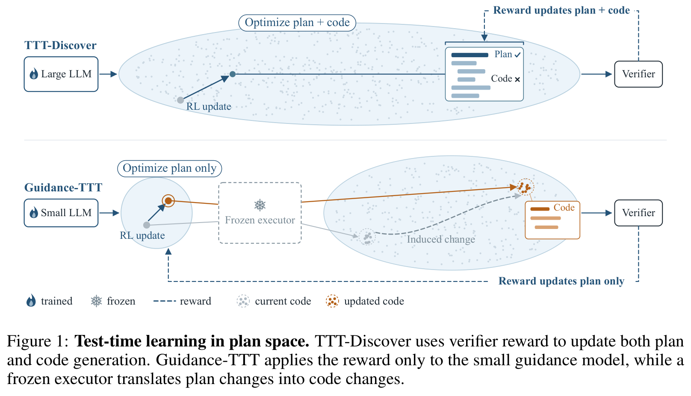

图 1：这张图证明了差别不在搜索方式而在奖励回传哪一层，上半张奖励改计划和代码，下半张只改计划。

## 4. 方法

### 4.1 整体流程

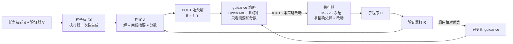

一句话解释：一圈里五件事，挑父解、让 guidance 说十六句接下来改哪儿、让冻结执行器把这十六句各自落成完整程序、打分、只用这十六个分数调 guidance。

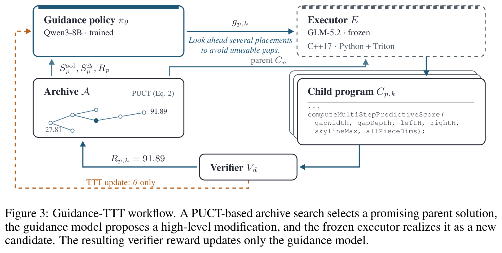

图 3：这张图证明了学习信号只回 guidance 参数，父解代码原封不动进执行器。

### 4.2 模块拆解

**档案与父解选择**

为什么需要：这是往哪儿改的入口。总从全局最好的解往下改会扎进局部坑，完全随机挑又等于把算过的算力扔掉。

怎么做：每个候选解连同两份摘要和分数进档案。每次更新用 PUCT 挑 $B=8$ 个父解，允许重复，优先避开同一批里已选过的祖先—后代链。

节点价值取它直接子节点里最好的分数：

$$
Q(i)=
\begin{cases}
v(i), & \mathcal{C}(i)=\varnothing,\\[4pt]
\max_{j\in\mathcal{C}(i)} v(j), & \text{否则}.
\end{cases}
$$

这个式子在算这个节点值多少分，规则是看你孩子里最出息的。$v(i)$ 是节点自己的任务分，TriMul 取负延迟、其余取原分，统一成越大越好；$\mathcal{C}(i)$ 是直接子节点集合，叶子为空时退化成自己的分。

选择规则：

$$
\mathrm{PUCT}(i)=Q(i)+c\,s\,P(i)\frac{\sqrt{N_{\mathrm{exp}}}}{1+n_i}
$$

这个式子在算这个节点该不该再投一次算力，前半截 exploitation，后半截 exploration。

- $c$：探索系数，取 1.0；$s$：按分数极差归一化，让探索项与分数量纲对得上
- $P(i)$：排名先验，只看名次不看绝对分，避免异常高分带偏整棵树
- $N_{\mathrm{exp}}$：总扩展次数；$n_i$：节点 $i$ 的扩展次数，分母 $1+n_i$ 保证访问越多奖励越小

**guidance 生成**

为什么需要：这是唯一被训练的部分，也是 thought space 这个说法的来处。

怎么做：guidance 收到父解的两份摘要和分数，采样出 $K=16$ 条高层改动建议，每条是自然语言，不是代码也不是隐向量，所以梯度只穿过几十个 token。类比：顾问看的是一页纸的病情摘要，不是整本病历。

**冻结执行与验证**

为什么需要：实现能力由执行器提供，而它不动，就永远不会因为测试时那几十次更新而退化。

怎么做：执行器拿精确父解代码加一条 guidance，产出新程序连同新摘要回传，验证器编译、跑测试、给分。Polyomino 编译不过就是 0 分，TriMul 要先过 18 个正确性测试才计时。

**策略更新**

为什么需要：这是把分数变成梯度的关节，也是信用分配真正的着力点。

怎么做：同一父解下的 16 个兄弟构成一组，先按组内分数自适应定温度，再用留一法算相对优势。

温度定成让加权分布与均匀分布的 KL 恰好等于 $\log 2$：

$$
q_i(\beta)=\frac{\exp(\beta r_i)}{\sum_{j=1}^{K}\exp(\beta r_j)},\qquad D_{\mathrm{KL}}\big(q(\beta)\,\|\,\mathrm{Uniform}(K)\big)=\log 2
$$

这个式子在算温度调到多少，才能让只看最好的那几个和一视同仁之间保持固定距离。

- $r_i$：第 $i$ 个兄弟的奖励；$K=16$：组内兄弟数
- $\beta$：逆温度，越大越偏向高分兄弟
- $\log 2$ 把 $\beta$ 钉在固定的有效集中度上，奖励量纲从 0.17 换成 8.5 亿 $\beta$ 会自动跟着变，不用手调

优势用留一法算：

$$
u_i=e^{\beta(r_i-r_{\max})},\qquad
A_i^{\text{reward}}=\frac{u_i}{\frac{1}{K-1}\sum_{j\neq i}u_j+\epsilon}-1
$$

这个式子在算这个兄弟比其余十五个兄弟好多少。

- $r_{\max}=\max_j r_j$：组内最高分，减掉它防止指数溢出；$u_i$：平移后权重，最高分那个恰好等于 1
- 分母是其余兄弟的平均权重，$\epsilon=10^{-12}$ 防除零
- 减 1 让和别人一样好对应 0 优势；比的是兄弟不是父解，所以比父解差但比同组兄弟好的解仍拿正优势

token 级基线修正：

$$
A_{it}=A_i^{\text{reward}}+0.1\big(\bar{d}-d_{it}\big),\qquad
d_{it}=\log\frac{\pi_{\text{rollout}}(g_{it}\mid s_p,g_{i,<t})}{\pi_{\text{base}}(g_{it}\mid s_p,g_{i,<t})}
$$

这个式子在算这个词的更新幅度要不要按它偏离原始策略的程度打折。

- $\pi_{\text{rollout}}$：这一批采样用的策略；$\pi_{\text{base}}$：训练开始前的原始 guidance 策略，不是执行器
- $d_{it}$：某个 token 上两者的对数概率差；$\bar{d}$：整批活跃 token 的均值，减掉即居中
- 系数 $0.1$ 等价于软性 KL 约束，但没有单独加 KL 惩罚项

actor 损失：

$$
\mathcal{L}(\theta)=-\frac{\sum_{i,t}m_{it}w_{it}A_{it}\log\pi_\theta(g_{it}\mid s_p,g_{i,<t})}{\sum_{i,t}m_{it}}
$$

这个式子在算抬高正优势 token 概率、压低负优势 token 概率。$m_{it}$ 是掩码，盖掉 padding、提示词 token 和整组被丢弃的样本；$w_{it}$ 是 REINFORCE 重要性权重，梯度上 detach；分母按 token 数平均。这不是 clipped PPO，没有 clip 也没有独立 KL 项。

**那个看家式子**

$$
J_\beta(\theta\mid p)=\frac{1}{\beta}\log \mathbb{E}_{g\sim\pi_\theta(\cdot\mid s_p)}\,\mathbb{E}_{C\sim E(\cdot\mid C_p,g)}\Big[\exp\big(\beta V_d(C)\big)\Big]
$$

这个式子在算 guidance 策略的期望得分，用指数加权把注意力压在高分尾部而不是均值。

- $\pi_\theta$：guidance 策略，唯一被训的东西；$E$：冻结执行器
- $s_p$：父解摘要三元组；$C_p$：父解代码；$V_d(C)$：验证器给程序 $C$ 的分；$\beta$：自适应逆温度
- 里层期望说明一件事：奖励从来不在 guidance 上算，是在它被执行器实现之后才算。这是方法最诚实也最脆弱的一句

### 4.3 关键细节

- guidance 用 Qwen3-8B，LoRA rank 32，只训 LoRA 参数；Adam，学习率 $4\times10^{-5}$，矩估计 $(0.9,0.95)$，weight decay 0
- 每次运行 $U=30$ 次更新，每次 $B=8$ 个父解，每个 $K=16$ 条 rollout，共 3840 次尝试，失败候选也占一次配额
- 一个 batch 只做一次优化器更新，不重复过多个 epoch；16 条 rollout 是 16 次独立采样后各执行一次，不是同一条 guidance 执行 16 次
- 采样温度 1.0、top-p 1.0；Polyomino 的 actor 上限是提示 4096 加回复 8192 token，TriMul 是 6144 和 10240
- 入库要求验证器通过且有分数，编译错误、崩溃、超时都不产生可选父解；TriMul 另有每父解保留两个最优子解的规则，只影响选父，不把 16 条训练 rollout 砍成 2 条
- AHC058 候选要 150 个实例全过才进档案，训练时被拒的候选仍可能拿部分奖励
- 种子解由执行器一次性生成，全程离线，不联网，不继承已有解代码

### 4.4 为什么训小的反而更好

这是全文最反直觉的一句，得拆开算。前三层论文有据，第四层是我的推断。

**成本，省的不是加法是乘法。** 适配开销正比于要保存梯度和优化器状态的参数量乘以每个样本的 token 数。guidance 只输出几十个 token，执行器那些上千 token 的代码完全不需要梯度，两个因子同时缩小。

**能力按功能切，不按规模切。** 消融里最狠的一行是 direct solution training 只有 41.63：同样 Qwen3-8B、同样 3840 次尝试，让它直接写完整 C++ 打包器，分数从 91.89 掉到 41.63。8B 里没有写高分代码的能力，但有说一句注意天空线凹陷别留用不上的缝的能力，而冻结的 GLM-5.2 能把这句话落成能编译的代码。

**学习信号被切短了。** 奖励落在一条改动上，而不是一条改动加三百行实现。同样一个 0 分，训大模型时代表这句话和实现都不行，训小模型时至少收窄成这句话配这个实现不行。

**我的推断：小模型的建议更多样。** 同一父解下 16 条建议要形成有方差的组，相对优势才有信号。大模型倾向给出高度相似的建议，组内方差小优势就退化。论文没有直接测建议多样性，8B 和 14B 的 useful yield 在 Polyomino 上是 14.09% 对 13.59%，也不直接支持这条。

**绝不是越小越好。** Polyomino 上 8B 拿 91.89，14B 掉到 89.80，32B 更差，有效性 83.15%、useful yield 9.30%。TriMul 和 AHC058 反过来 14B 明显更好。论文的解释是任务结构不同：TriMul 的改动可沿张量接口做组件级切分，Polyomino 的改动依赖排序、摆放和修复状态三者耦合。论文自己也说这解释不能隔离因果效应，且每个尺寸只有一条轨迹。

**信用分配到底缓解了多少。** 三处真动作：只让短动作承担梯度，实现细节不进梯度；组内比较代替绝对比较，同父解的 16 个兄弟共享题目难度和父解，父解好坏被差分掉；自适应温标让不同任务、不同更新阶段的优势尺度可比，避免奖励量纲把梯度推爆或推平。再加上只喂摘要这层输入端限制，guidance 根本没机会去想实现。

**没缓解的部分。** 奖励仍只在最终程序上观测，式 3 的里层期望改不了这个事实，第 21 次更新那个例子就是证据。准确的说法是减少了混淆项，不是消除。

## 5. 实验结果

**实验设置**

- **数据集与切分**：四个任务，单任务单次运行。Polyomino 用 FrontierCS 第 0 题 70 个用例，报 0 到 100 的聚合填充密度；TriMul 用 AlphaFold3 的三角乘法更新核，18 个正确性测试加 7 个计时用例，报几何平均延迟；Lasso 是全高斯路径求解，17 个搜索用例，要求与 scikit-learn 参考目标差在 $10^{-6}$ 以内，报几何平均求解时间倒数；AHC058 是 500 轮资源分配规划，150 个公开实例，报 AtCoder 分数。没有训练验证测试切分，不是泛化任务而是单题搜索。迁移测试另有 Lasso 的 15 个分布外用例与 11 个真实数据集，TriMul 的两个 Triton 版本。
- **骨干模型**：guidance 是 Qwen3-8B（消融全用 8B，TriMul 与 AHC058 主结果用 14B），LoRA rank 32；执行器 GLM-5.2，走 OpenRouter，开 high reasoning，全程冻结。另有 GPT-5.4 与 GPT-OSS-120B 作执行器对照。
- **训练预算**：guidance 的强化学习跑在 1 张 B200 上，30 次更新乘 8 父解乘 16 rollout 共 3840 次尝试；对照的 TTT-Discover trace 是 8 乘 64 采样、50 次更新。Polyomino 成本对照里本文约 120 美元、对方约 283 美元。
- **基线**：TTT-Discover（GPT-OSS-120B）、CORAL（Opus 4.6 与 GLM-5.2，Polyomino 另有可联网四智能体版本）、OpenEvolve（GLM-5.2，500 次迭代）、SimpleTES（120B 与 20B）、K-Search，以及 GPUMode 榜第 1、4、5 名和 FrontierCS 人类最好解。作者自加消融对照是 frozen guidance、direct solution training、G-Top2。
- **指标**：Polyomino 填充密度越高越好；Lasso 求解时间倒数，单位 1/ms，越高越好；AHC058 是 AtCoder 分数，越高越好；TriMul 七用例几何平均延迟，微秒，越低越好。榜上第 2、3 名被排除，因为用编译过的 CUDA 扩展而非 Triton，这条限制同样适用于本文自己的解。
- **推理设置**：guidance 温度 1.0、top-p 1.0；执行器开 high reasoning，Polyomino 侧无输出长度上限；TriMul 每次固定核测 3 次取均值，隔离 H100 80GB，CUDA 12.8 加 PyTorch 2.7.1 加 Triton 3.3.1，520 秒超时；Lasso 固定程序重复 5 次，单 CPU 线程，双精度。搜索期档案分与最终固定程序评测分是两套环境，不能混比。裁判模型不适用，四个任务都是程序化验证器。类比：四场都是机器阅卷，分数硬，没有裁判偏好。

| 数据集 / 任务 | 指标 | 本文 | 最强基线 | 提升 |
| --- | --- | --- | --- | --- |
| Polyomino | Score ↑ | 91.89（8B + GLM-5.2） | 89.40（CORAL 四智能体 + 联网） | +2.49 |
| Lasso | Score ↑（1/ms） | 0.1739（8B + GLM-5.2） | 0.1402（OpenEvolve + GLM-5.2） | +24.0% |
| AHC058 | AtCoder score ↑ | 850,082,731（14B + GLM-5.2） | 849,325,750（SimpleTES，GPT-OSS-20B） | +756,981 |
| TriMul | 几何平均延迟 µs ↓ | 1129（14B + GLM-5.2） | 1128（GPUMode 榜第 1） | 慢 1 µs |

基线怎么取要说明。Polyomino 取可联网四智能体 CORAL 的 89.40。Lasso 我取表 2 最高的既有方法 OpenEvolve 0.1402 而非摘要点名的 SimpleTES 0.1243，所以提升是 24.0% 而不是论文写的 39.8%，两个数指向不同基线。TriMul 的 1128 是公开榜提交，按此前工作报告的最好解算是 K-Search 的 1131。

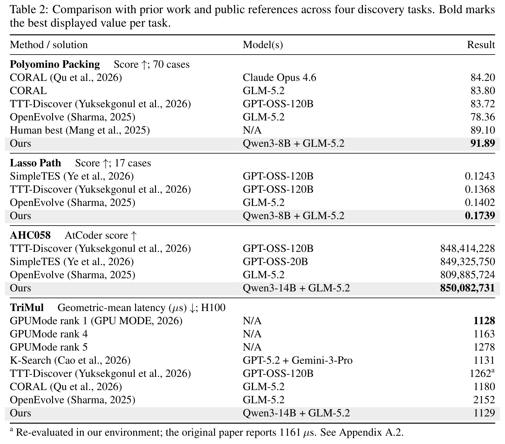

表 2：这张表证明了增益不是靠换更强模型换来的，执行器同档而分数反超。

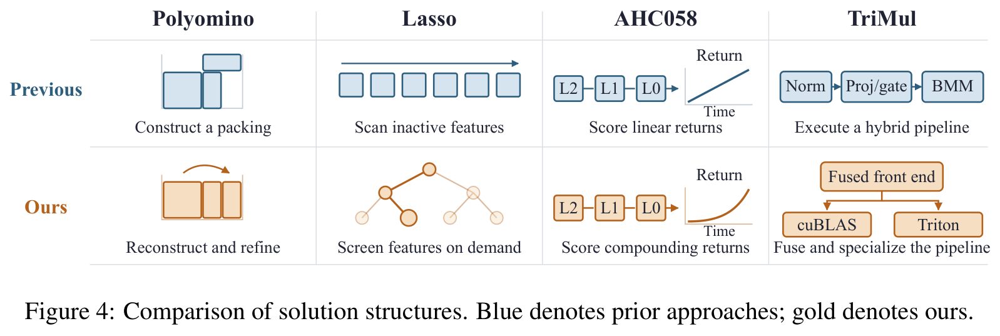

图 4：这张图证明了增益来自结构改动而非调参，四行都在原骨架上叠了一层针对性改造。

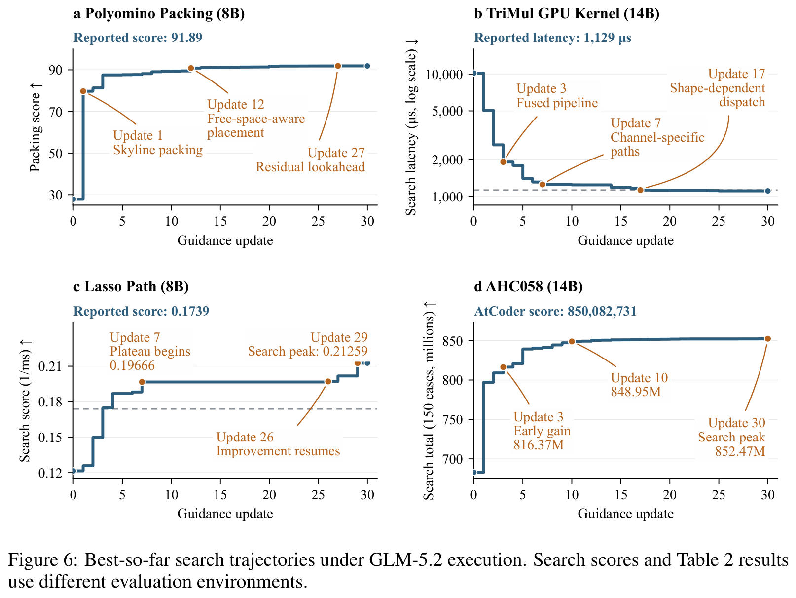

图 6：这张图证明了收益是跳跃加平台，四个面板都是阶梯而非平滑上升，第 1 次更新就把分数从 27.81 拉到 75 以上。

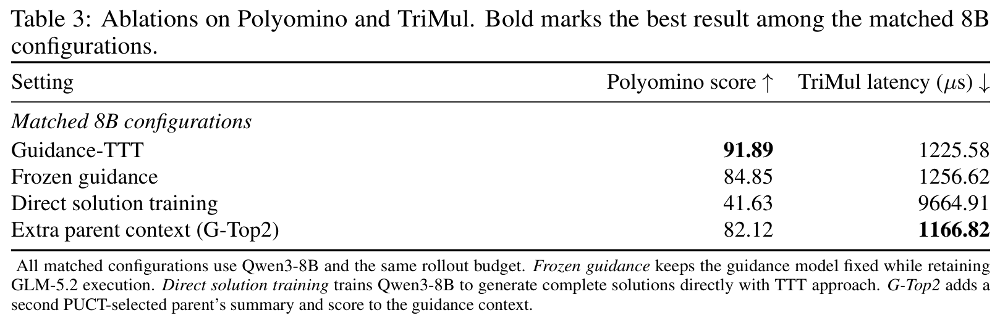

表 3：这张表证明了光拆架构不够还得训 guidance，而训错位置掉到 41.63。

**消融告诉我们什么**：训 guidance 相对不训值 7.04 分，训对位置相对训错位置值 50.26 分。第二个数字大得离谱，说明它主要衡量的是 8B 会不会写完整解，而不是两种训练范式的效率差，这是我的读法。G-Top2 在 Polyomino 掉到 82.12、在 TriMul 涨到 1166.82，方向相反，论文用改动可迁移性解释，但只有一条轨迹。

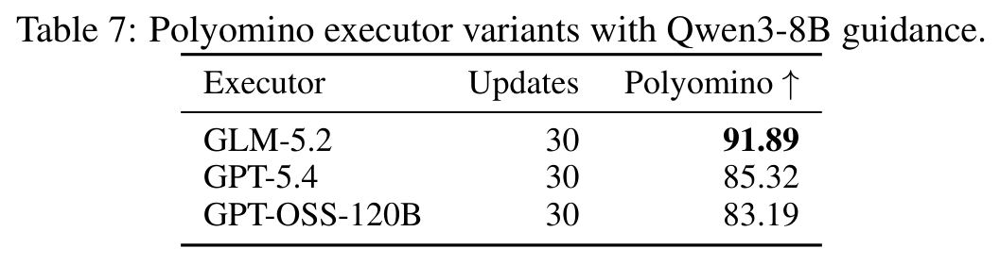

表 7：这张表证明了收益有大半是执行器给的，换弱一档掉 6 到 9 分。

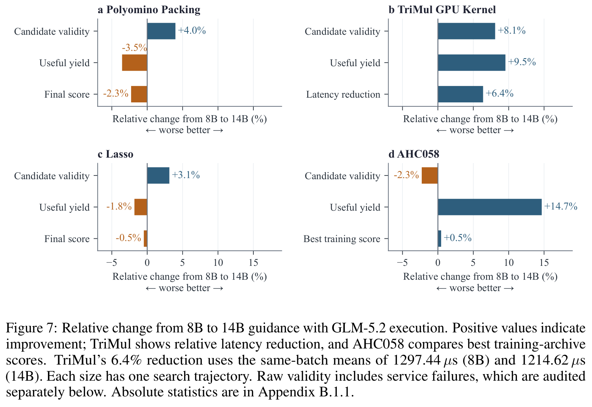

图 7：这张图证明了加大 guidance 不是单调变好，TriMul 三项全正而 Polyomino 掉分，32B 更差。

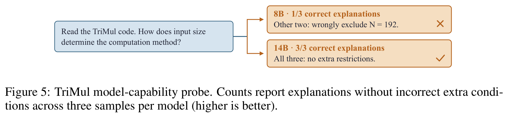

图 5：这张图证明了更大 guidance 的差别在能不能说清机制，8B 三次错两次、14B 全对。

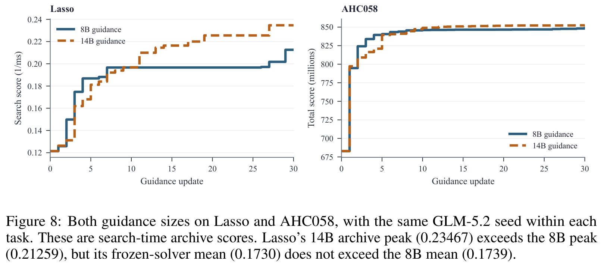

图 8：这张图证明了搜索期峰值不等于可交付解，Lasso 上 14B 峰值高但冻结重测更低。

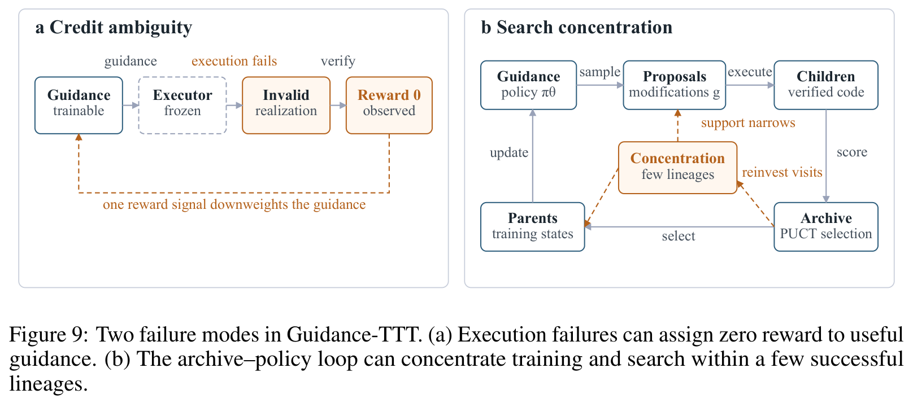

图 9：这张图证明了两个结构性弱点，归因歧义和搜索集中。Polyomino 无效候选 404/3840 全为编译失败，TriMul 1390/3840 多为正确性失败。

**这些实验够不够支撑结论**：部分够。训 guidance 比不训好这条最硬，同执行器同预算差 7 分。训 guidance 比训完整解好，方向对但幅度被夸大，因为对手是 8B 自己写代码，不是同等能力的执行器。冻住大执行器省钱这条，两个 run 采样预算不同，58% 里混了少采样的贡献。小模型本身更好这条最弱，每个尺寸只有一条轨迹。

不够的地方有四块：没有跨种子重复，主结果都是单轨迹；没有 8B guidance 加 8B 执行器，分不清收益来自解耦还是来自 GLM-5.2 本身；没有同执行器的纯提示词搜索对照组；TriMul 上 1129 对 1131 对 1128 差在微秒级，交替顺序测但没给重复间不确定性。

## 6. 局限性

类比：接力赛第二棒跑不动，第一棒再快也没用。

**作者自己承认的**

- 未来工作点名三件事：更丰富的 guidance 表示、更好的 guidance 与执行之间的信用分配、更多样性感知的搜索。等于承认现在这三样都不够。
- 附录 B.3 列出两种失败模式，归因歧义和搜索集中，并给了四组日志证据，但措辞是自己建立这些可观测结构，不分离策略更新、父解选择、评测波动和服务中断各自的因果作用。
- 附录 B.1 承认每个尺寸只有一条搜索轨迹，搜索随机性是无法排除的替代解释，Lasso 上极小的最终均值差不足以建立可靠排序。
- Polyomino 32B 掉到 83.15% 有效性、9.30% useful yield，作者没给解释，只说局部改进不保证最终解更好。

**我看出来的**

- 隐形假设：任务能被干净拆成改什么和怎么实现两层，且执行器对怎么实现几乎总是对的。四个任务都是程序合成，编译和运行给了硬边界，这个假设成立；换成要长链条状态维护的任务比如多轮工具调用的 agent，实现本身就含策略，拆不开。
- 边界条件：执行器必须显著强于 guidance，表 7 显示换弱一档掉 6 到 9 分。执行器弱到写不出高分代码时，guidance 说得再对也落不了地。
- 缺的对比：没有 8B 执行器配 8B guidance，也没有把执行器统一成同档开源模型后重跑所有基线。成本对照绑定了特定硬件和服务商定价，不能外推。
- 单轨迹问题：核心数字每个配置一条轨迹。论文用大量事后审计来补，审计能证明这些结构存在，不能给方差。

## 7. 一句话总结

把测试时训练从写代码的模型身上挪到想思路的模型身上，因为想思路只要几十个 token，写代码要几百上千个，而后者交给一个本来就会写的大模型冻着就行。类比：与其训练一个既不会设计又不会施工的人，不如训练一个会看图纸挑毛病的监理，配一支手艺已经很好的施工队。

核心公式：

$$
\boxed{\;J_\beta(\theta\mid p)=\frac{1}{\beta}\log \mathbb{E}_{g\sim\pi_\theta(\cdot\mid s_p)}\,\mathbb{E}_{C\sim E(\cdot\mid C_p,g)}\big[\exp(\beta V_d(C))\big]\;}
$$

## 8. 可复用点

类比：搬家具前先量门框，量完再决定拆不拆墙。

- 拆两个模型之前先量实现失败率。这篇里 Polyomino 编译或解析失败 10.5%，TriMul 正确性失败 36.2%。实测若低于 2%，拆开省下的归因收益不够付协调成本，训一个中等模型更省事。
- 组内比较用留一法不要用 z-score。z-score 会被组内一个异常高分的兄弟压扁其余样本，留一法让每个样本跟其余人的平均比，峰值不会吞掉梯度。
- 温度自适应那条 $\mathrm{KL}=\log 2$ 可以直接搬。任何奖励量纲随任务变化的强化学习都用得上，只需重算一次 $\beta$ 数值搜索的上界。
- guidance 侧只喂摘要不喂全文是便宜的上下文压缩。代价是摘要写不好就学不到东西，摘要生成要单独验质量，最好和喂全文的版本对比一组。
- 冻结执行器上线前先跑 20 个种子解确认通过率。AHC058 那次有 95 次和 245 次 HTTP 402 失败，服务侧失败会污染有效性统计。
- 训练不收敛时先查三件事：是不是组内全 0 分，论文说 0/240 组出现过全无效所以他们没这个问题；是不是 $\beta$ 打到数值搜索上界；是不是 PUCT 已把搜索压到单一血统，看子代父解相似度，论文的随机对基线是 0.3195，跑到 0.9576 就已经很集中。

## 9. 我的疑问

类比：账面上赢 1 微秒，跟秤上多一两一样，先看秤准不准。

- TriMul 上 1129 对 1131 对 1128 差几百纳秒。论文说用保留的配对批次同一容器内交替顺序测，但没给重复间方差，这个量级能不能算赢？
- 表 1 给 Lasso 填的 previous SOTA 是 0.1243（SimpleTES），可表 2 里 OpenEvolve 是 0.1402 更高。同一篇论文两张表的已完成方法上限不一致，这会影响 39.8% 的说服力。
- 表 3 里 TriMul 的 Guidance-TTT 是 1225.58，表 2 主结果是 1129。前者是 8B 档案端点、后者是 14B 最终核均值，消融内部自洽，但读者容易把 1225.58 当成方法最好成绩，论文没在表 3 给提示。
- G-Top2 在两个任务上方向相反，用改动可迁移性解释是事后叙事，一条轨迹撑不住。
- Lasso 的 14B 解在 RCV1 上慢到 63,674.64 毫秒，8B 是 10,156.79，几何平均被拉成 0.16 倍。这说明更大的 guidance 会产出更特化的解、换数据集就脆，论文只报了数没解释。
