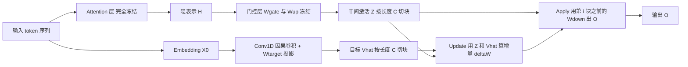
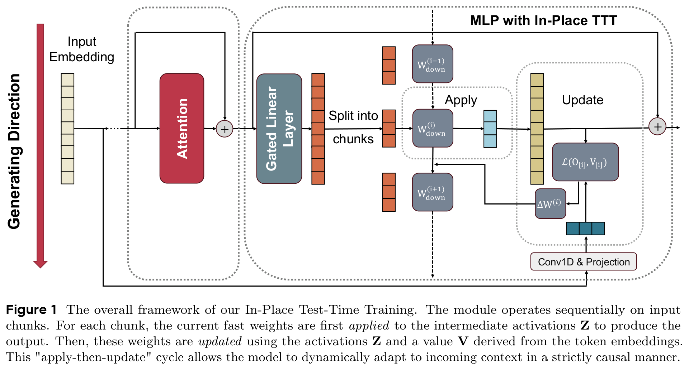
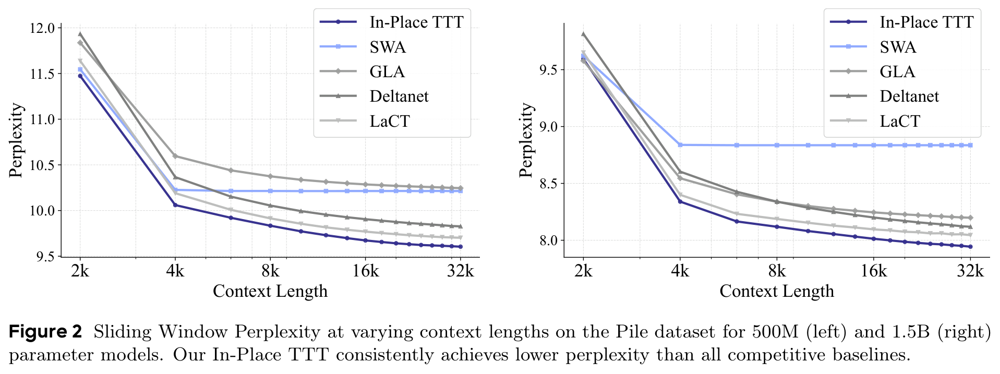
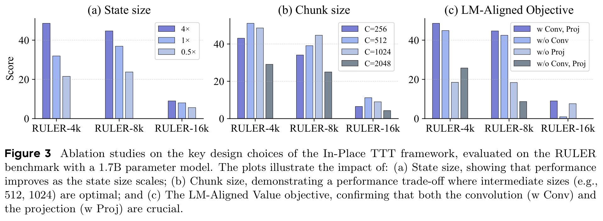
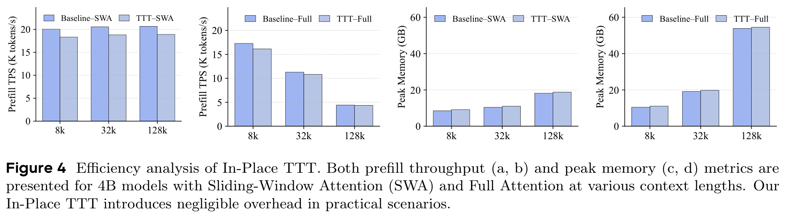
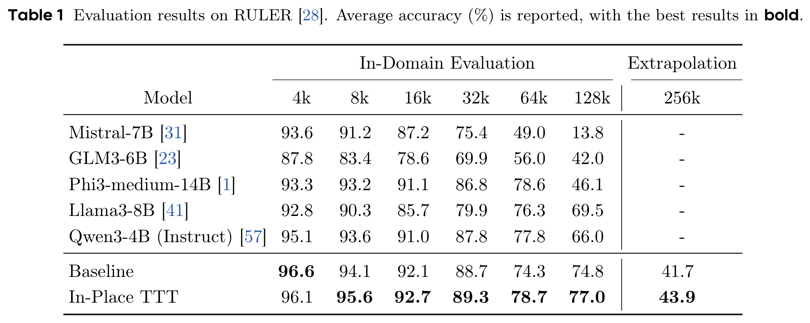
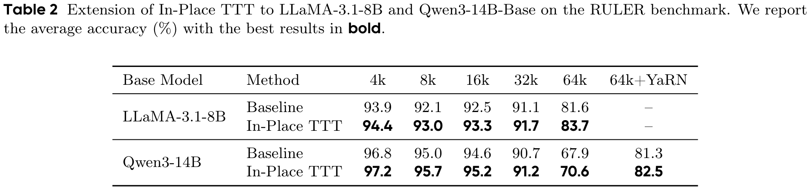
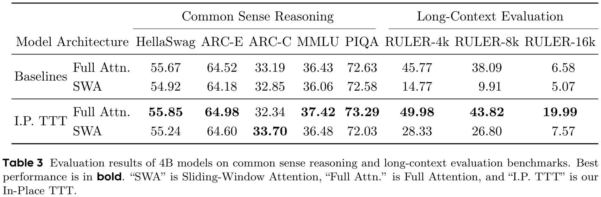

> 一句话：不改结构，让模型边读边把信息写进已有的一层权重，读得越长越占优。

## 0. 读之前你需要知道

**术语卡**

- **快权重（fast weights）**：推理时会被改动的那一小撮参数，其余权重全程冻结。生活类比：考试时课本不能改，但你可以在草稿纸上随手记新结论。
- **测试时训练（Test-Time Training, TTT）**：推理过程中对当前这段输入跑几步梯度下降改参数。生活类比：装修师傅进场先量一遍这间房的墙，再按这间房的尺寸调工具。
- **MLP**：Transformer 里跟在注意力后面的全连接块。生活类比：注意力负责配菜，MLP 负责下锅。
- **下一词预测（Next-Token Prediction, NTP）**：看前文猜下一个词，语言模型唯一的训练目标。
- **块（chunk）**：把长序列按固定长度切段。生活类比：长篇小说按章读。
- **归纳头（induction head）**：Transformer 里负责"见过 A 后面跟 B，再见到 A 就猜 B"的那套电路。生活类比：看到来电显示是老同学，手已经伸向接听键。
- **RULER**：长上下文基准，4k 到 256k 一系列任务的平均准确率。

**它站在谁肩上**

- 测试时训练（2020, Sun 等；2021, TENT）：在图像分布偏移上用自监督或熵最小化做测试时适配，快权重的概念最早来自 2016 年的 Ba 等。
- TTT 层（2024, Sun 等）：把循环网络的隐状态换成一个小神经网络，用梯度下降当更新规则。不够用在于它是新层，通常顶替注意力，必须从零预训练。
- 大块 TTT（2025, LaCT）：逐 token 更新改成大块更新换来并行度。不够用在于 TTT 仍当主 token 混音器，块一开大就掉点。
- 线性注意力的 delta 规则（2024, Yang 等）：用预测误差修正状态矩阵，本文更新式与它同源。
- 多 token 预测（2024, DeepSeek-V3）：一次学预测多个未来 token，本文借它说明喂未来信息这条路走得通。

## 1. 动机

生活场景：你在读一本 300 页的设备手册，读到第 200 页，作者用了一个第 30 页定义过的符号。你的做法是翻回去看一眼，或者在页边批一句"这个符号 = 输入电压"。整本书你没背下来，但把最需要的那一点抄在了手边。

大模型没有这页边空白。它读长文靠把所有历史 token 塞进上下文窗口，让注意力每次重扫一遍。窗口一满，前面的内容就真消失了；而且不管读多少遍，权重一个数都不会变。

**以前怎么做**：一条路是上下文学习，把历史全塞进提示；另一条是测试时训练，推理时改一小撮参数。

**为什么不行**：上下文学习受窗口限制，注意力计算量随长度平方增长，塞不下就是塞不下。测试时训练概念更对，但落到大模型上卡在三处。第一，现有 TTT 都是专门设计的新层，要顶替或并列注意力，等于必须从零预训练几百 B token，成本没人付得起。第二，标准 TTT 逐 token 更新，天生串行，GPU 并行度全浪费，只能靠小块缓解，块一小又回到串行。第三，TTT 的更新目标通常是重建当前 token，key 和 value 都取自同一个输入，模型学的是复读刚看到的东西，而语言模型要的是猜下一个词。

**为什么现在能做**：开源基座（Qwen3、LLaMA-3.1）足够强，才有可能热启动而非从零训；分块更新加并行前缀扫描（parallel scan）在线性注意力和状态空间模型里已跑通，能直接搬；多 token 预测验证了喂未来 token 的信息确实有用，为改目标提供依据。

## 2. 贡献

这五条放在一起看，相当于给一辆跑长途的车做三件事：不换发动机（架构不改）、把后备箱清出来当储物格（复用 MLP 本来就有的矩阵）、把导航目的从"我刚经过哪"改成"我下一步去哪"（对齐下一词预测）。

- **证明 TTT 可以完全不动架构**。证据：Qwen3-4B-Base 只做约 35B token 持续训练（约 20B@32k 加约 15B@128k），RULER 128k 从 74.8 涨到 77.0，256k 外推到 43.9，而每 6 层才装一个 TTT 模块。
- **换掉重建目标，给出与下一词预测对齐的目标**。证据：定理 1 证明对齐目标让正确 token 的 logit 期望至少提升 $\lambda_{lr}\,c_{norm}^2\,c_{align}$，重建目标对正确 logit 的提升被 $\epsilon$ 压到可忽略。
- **块可以开大到 512 到 1024**。证据：消融里 C = 1024 在 8k 上最高，C = 2048 明显掉点，说明存在最优块长而不是越小越好。
- **从零预训练也不输**。证据：500M 与 1.5B 上滑动窗口困惑度在所有长度最低（图 2）；4B 上 RULER-16k 从 6.58 到 19.99、RULER-8k 从 9.91 到 26.80（表 3）。
- **实现代价小**。证据：图 4 里 4B 模型从 8k 到 128k 的 prefill 吞吐与峰值显存跟 baseline 基本重合。

## 3. 创新点

打个比方：以前的 TTT 是给车加一个新零件，加完必须回厂重装整车；这篇是把一个现成零件的用法改了，车直接能上路。

- **新在哪：TTT 的载体从新层换成已有层里的一个矩阵**。对比对象：TTT 层、Titans、LaCT，都是新模块。有用是因为新模块的初始化与预训练权重不匹配必须重训；改一个已训好的矩阵，起点就是原模型，训练量降到持续训练级别。
- **新在哪：更新目标从当前 token 换成未来 token 的卷积投影**。对比对象：所有把 value 取成当前 token 投影的 TTT。有用是因为关联记忆里 key 与 value 同词时，查询命中的是"我刚听到什么"而不是"接下来该说什么"；value 换成未来词，命中才是预测。
- **新在哪：因为 TTT 不再当主 token 混音器，块长解耦了**。对比对象：chunk-wise TTT 被迫用小块。有用是因为小块意味着每块只做一次更新、并行度低；块开大后单次更新信息量更大，吞吐也上去。
- **新在哪：理论上把作用点算清了**。对比对象：以往 TTT 的目标设计多靠经验。有用是因为定理 1 把"哪个目标涨哪个 logit"写成可比较的上下界，消融因此有可检验的预测，而不是事后解释。

## 4. 方法

### 4.1 整体流程

一句话解释这张图：注意力块原封不动，门控 MLP 前两个矩阵也冻结，只有最后那个投影矩阵 $W_{down}$ 被拆成 apply 与 update 两条交替路径，一边用旧值出结果，一边把当前块的信息加进去。

### 4.2 模块拆解

**模块一：把 MLP 的最后一层投影当快权重**

为什么需要：TTT 要一个能在推理时改、又不破坏预训练能力的参数容器。新加一层不行，随机初始化的新层会和几十亿已训好的参数打架，只能靠重训重新平衡。

怎么做：门控 MLP 算 $O = \left(\phi(HW_{gate}^\top) \odot (HW_{up}^\top)\right)W_{down}^\top$。$W_{gate}$ 与 $W_{up}$ 冻结，只让 $W_{down}$ 动。每块先用当前 $W_{down}$ 出输出，再用这一块的激活和目标算一次更新写回。

原始 TTT 的通用更新式：

$$
W_i \leftarrow W_{i-1} - \eta \nabla_W \mathcal{L}\left(f_{W_{i-1}}(k_i),\, v_i\right)
$$

先说这个公式在算什么：拿当前快权重把 key 映射一遍，跟它该对应的 value 比一比，差多少就往减小差距的方向挪一步。

- $W_i$：第 i 步之后的快权重，本文里是矩阵，形状 $d_{ff} \times d_{model}$
- $\eta$：学习率，正标量，控制每步挪多远
- $\mathcal{L}$：衡量映射结果与目标 value 差多少的损失
- $k_i$：第 i 个 token 的 key，形状 $d_{ff}$
- $v_i$：第 i 个 token 的目标 value，形状 $d_{model}$

为什么投影矩阵可以当可训练参数，这是全文最需要讲清的一点，理由有三层。

第一层，TTT 的数学形式对快权重没有任何形状或类型约束，只要求它能被梯度更新、能把 key 映射成 value。任意矩阵都满足，所以合法。论文正是靠这一点把"选哪个参数"变成自由的工程选择。

第二层，$W_{down}$ 在门控 MLP 里的角色本来就是"把中间激活 $Z$ 线性映射成输出 $O$"，即 $O = ZW_{down}^\top$，这本身就是一个 key-value 关联记忆：$Z$ 是 key，$ZW_{down}^\top$ 是查出来的 value。预训练把它当慢权重存通识，推理时对它更新存这段上下文。同一个容器换一种写入时机，语义没有跳变，这是它能当快权重而不精神分裂的根本原因。

第三层，它的容量足够大。一个 $d_{ff} \times d_{model}$ 的矩阵是千万量级参数，比循环网络的隐状态向量大几个数量级，这正是消融里"状态越大越好"能成立的物理基础。

反过来说，为什么不动 $W_{up}$ 与 $W_{gate}$：它们决定特征怎么算，改了等于改写模型的感知方式，预训练能力掉得最快；$W_{down}$ 只决定特征怎么读出来，破坏面最小。

**模块二：分块更新，先 apply 再 update**

为什么需要：逐 token 更新严格串行，GPU 用不满；但块一开大，块内 token 就看不到同块的其他 token，因果性会被破坏。本文把这条约束挪到块边界上。

怎么做：把 $Z$、$V$、$O$ 按长度 C 切成不重叠的 k 块。第 i 块的输出只用第 i 块之前累积的更新，第 i 块自己的更新只影响后面的块。信息永远只从前往后流。

$$
O_{[i]} = Z_{[i]}\left(W_{down}^{(i-1)}\right)^\top, \qquad
W_{down}^{(i)} = W_{down}^{(i-1)} - \eta \nabla_W \mathcal{L}\left(Z_{[i]}\left(W_{down}^{(i-1)}\right)^\top,\, V_{[i]}\right)
$$

先说这两式在算什么：第一式用"进入第 i 块时的快权重"算输出；第二式用这一块的 key 与 value 算一步梯度，把权重挪到"离开第 i 块"的状态。所以处理第 i 块时，它自己的信息还没进权重。

- $Z_{[i]}$：第 i 块的中间激活，形状 $C \times d_{ff}$
- $V_{[i]}$：第 i 块的目标 value，形状 $C \times d_{model}$
- $W_{down}^{(i-1)}$：处理第 i 块时用的快权重，形状 $d_{ff} \times d_{model}$，等于初始 $W_{down}$ 加上前面所有块的更新和
- $O_{[i]}$：第 i 块输出，形状 $C \times d_{model}$
- $\phi$：门控激活；$\odot$：逐元素相乘

**模块三：与下一词预测对齐的目标**

为什么需要：原目标重建当前 token，模型学到的是"我刚看到什么"，不是"接下来该说什么"。换目标只需换 value 的来源，不动架构。

怎么做：value 不再取当前 token 的投影，而是先把 token embedding 过一维因果卷积，再乘一个可训练投影矩阵。卷积让每个位置的目标混入邻近位置（包括后一个 token）的信息，投影让模型自己学怎么把未来信息压成最有用的方向。

$$
\hat{V} = \mathrm{Conv1D}(X_0)\, W_{target}, \qquad
\mathcal{L}(\cdot,\cdot) = -\langle \cdot,\cdot\rangle_F, \qquad
W_{down}^{(i)} = W_{down}^{(i-1)} + \eta\, \hat{V}_{[i]}^\top Z_{[i]}
$$

先说这一串在算什么：损失取负的 Frobenius 内积，对矩阵求梯度就得到外积，于是"一步更新"就是把这一块的目标乘这一块的 key 直接加到快权重上。

- $\hat{V}$：对齐后的目标，形状 $n \times d_{model}$
- $X_0$：token embedding 序列，形状 $n \times d_{model}$
- $\mathrm{Conv1D}$：深度可分离一维卷积，核大小 5，因果 padding，无 bias
- $W_{target}$：可训练投影矩阵，形状 $d_{model} \times d_{model}$
- $\langle \cdot,\cdot\rangle_F$：Frobenius 内积，逐元素相乘再求和
- $\hat{V}_{[i]}^\top Z_{[i]}$：外积累加，形状 $d_{model} \times d_{ff}$，正好与 $W_{down}$ 同形

它怎么和下一词预测对齐：把 $W_{target}$ 取成单位矩阵、卷积核设成"下一个位置为 1、其余为 0"，这个目标就退化成标准 NTP 的标签。论文实际用一个学出来的卷积加投影，等价于让模型自己决定看未来几个 token、怎么混合，作者把它称为 NTP 的扩展，与多 token 预测同向。

**模块四：定理 1 到底说明了什么**

为什么需要：光说目标更对齐是口头承诺，需要一个能比较的界。

怎么做：构造归纳头场景。序列某处出现过一对 $(k^*, v^*)$，后面某处又出现 $k^*$，模型该预测出 $v^*$。快权重从前面所有位置累积更新，这个更新会改变查询位置的 logit。

$$
\Delta \ell_n[w] = \lambda_{lr}\sum_{t \in \text{prior}} \left(e_w^\top v_t\right)\left(z_t^\top z_n\right)
$$

先说这个公式在算什么：查询位置 n 对词 w 的 logit 变化，等于历史上每个位置贡献的"w 与那个位置的 value 有多像"乘以"那个位置的 key 与当前 query 有多像"。

- $\Delta \ell_n[w]$：位置 n 上词 w 的 logit 改变量，标量
- $\lambda_{lr}$：学习率，即前面式里的 $\eta$
- $e_w$：词 w 的 embedding，形状 $d_{model}$
- $v_t$：位置 t 的目标 value，形状 $d_{model}$
- $z_t, z_n$：位置 t 与 n 的中间激活，形状 $d_{ff}$

套两个假设：不同词的 embedding 近似正交（内积绝对值不超过 $\epsilon$），同 key 的位置激活对齐（$\mathbb{E}[z_{t^*}^\top z_n] = c_{align} > 0$）。于是有两种情形。目标取下一个 token 时，正确词 $v^*$ 的自内积是 $\|e_{v^*}\|^2 \ge c_{norm}^2$，logit 至少涨 $\lambda_{lr} c_{norm}^2 c_{align}$，其他词因为正交涨跌幅不超过 $\lambda_{lr}\epsilon c_{align}$。目标取当前 token 时，正确词 $v^*$ 与 key 词 $k^*$ 是两个不同词，内积被 $\epsilon$ 压住，正确词的 logit 期望变化几乎为零。

生活类比：重建目标像背单词表时把 A 和 A 配成一对，考你"A 后面是什么"时脑子里蹦出来的是 A 本身；对齐目标把 A 和 B 配成对，考的时候才蹦得出 B。

### 4.3 关键细节

- **热启动初始化**：Conv1D 权重零初始化，$W_{target}$ 初始化成稀疏对角（对角元从 $\mathcal{N}(0,\sigma^2)$ 采），于是 $\hat{V} \approx 0$、$\Delta W \approx 0$，训练开始时模型行为与预训练完全一致，TTT 是慢慢长出来的。
- **装在哪几层**：持续训练实验每 6 层装一个 TTT 模块；从零训练的 500M 与 1.5B 装了几层，原文未给。
- **推理时的范数裁剪**：若 $\|\Delta W_{down}^{(i)}\|_F$ 超过阈值 $\tau$，先缩放到 $\tau$ 再叠加。Qwen3-4B 的全部结果用 $\tau = 10^{-5}$。
- **上下文并行**：并行算每块的 $Z_{[i]}$ 与 $\Delta W_i$；对增量序列做前缀和得到每块之前累积的更新；再并行算每块的有效权重与输出。更新是外积累加、满足结合律，所以能扫。
- **文档边界**：走到文档边界时把快权重重置回预训练状态，防止跨文档串味。
- **训练超参**：持续训练学习率 5e-6，AdamW，weight decay 0.1，第二阶段接 YaRN；从零训练 500M 用 5e-4，1.5B、1.7B、4B 用 3e-4。

## 5. 实验结果

读这些数字要像看体检报告：不看总分，看哪几项在什么年龄段拉开差距。

**实验设置**

- 数据集与切分：从零预训练用自采混合语料（英中通用文本、高知识或推理密度数据、代码、数学、多语）。持续训练分短文档（分布接近预训练数据）与长文档（书籍、仓库级代码，加检索增强与长上下文 QA 合成数据），按 32k 与 128k 切成两阶段子集。评测用 RULER（4k 到 256k，OpenCompass）、Pile 与 Proof-Pile-2 的滑动窗口困惑度，以及 HellaSwag、ARC-E、ARC-C、MMLU、PIQA（lm-evaluation-harness）。数据配比与验证集切法原文未给。
- 骨干模型：持续训练三个，Qwen3-4B-Base、LLaMA-3.1-8B、Qwen3-14B-Base，架构不改直接继承。从零训练四个尺度：500M（$d_{model}$ 1024，24 层，8 头，$d_{ff}$ 3072，窗口 2048）、1.5B（$d_{model}$ 2048，24 层，16 头，$d_{ff}$ 6144，窗口 4096）、1.7B（骨架同 Qwen3-1.7B-Base）、4B（骨架同 Qwen3-4B-Base，分全注意力与滑窗两版）。全部 decoder-only、SwiGLU、RoPE。
- 训练预算：全部在 NVIDIA H800 上，卡数原文未给。500M 训 20B token，1.5B 训 60B token，1.7B 与 4B 训 120B token（序列长 8192）；持续训练第一阶段约 20B@32k、第二阶段约 15B@128k。batch 分别为 2M、4M、8M token。AdamW，梯度裁剪 1.0，weight decay 0.1，warmup 1024 步或 1.6B token。
- 基线：从零训练比 SWA、GLA、DeltaNet、LaCT，其中 In-Place TTT 与 LaCT 都建在 SWA 骨架上以控制变量；4B 实验另比全注意力与滑窗两版 baseline。持续训练比的是同一个 Qwen3-4B-Base 走完全相同课程（baseline），另列 Mistral-7B、GLM3-6B、Phi3-medium-14B、Llama3-8B、Qwen3-4B-Instruct 作参照，这五个不参与同条件对照。
- 指标：RULER 平均准确率（%，越高越好）；滑动窗口困惑度（越低越好，固定末尾一段 token，前文越长困惑度越低说明越会用上下文）；常识推理准确率（%）；prefill 吞吐（K token/s）与峰值显存（GB）。
- 推理设置：RULER 走 OpenCompass，常识推理走 lm-evaluation-harness；效率测试用 4B 持续训练后的 checkpoint，batch size 1，序列 8k 到 128k，滑窗版把注意力手动改成 1024 窗口；快权重更新带 $\tau = 10^{-5}$ 的范数裁剪。解码温度与生成长度上限原文未给（这几项都是判分任务，不涉及采样）。

**主表**

| 上下文长度 | 指标 | 本文（Qwen3-4B + TTT） | 最强基线（同模型同课程） | 提升 |
| --- | --- | --- | --- | --- |
| 4k | RULER 平均准确率 | 96.1 | 96.6 | −0.5 |
| 8k | 同上 | 95.6 | 94.1 | +1.5 |
| 16k | 同上 | 92.7 | 92.1 | +0.6 |
| 32k | 同上 | 89.3 | 88.7 | +0.6 |
| 64k | 同上 | 78.7 | 74.3 | +4.4 |
| 128k | 同上 | 77.0 | 74.8 | +2.2 |
| 256k（外推） | 同上 | 43.9 | 41.7 | +2.2 |

**原文实验图**

图 1：证明写入快权重这件事可以整个塞进一个标准 MLP 块里，apply 用旧权重出结果、update 用当前块算增量，两条路径在同一个 $W_{down}$ 上接续，所以既不需要新层，也不需要改注意力。

图 2：证明优势来自机制而不是调参，因为曲线形状本身就是证据。4k 之前五条线几乎重合，说明短上下文大家都够用；1.5B 面板里浅色的 SWA 从 4k 起变成水平线（它的窗口正好 4096），说明它到这儿再也吸收不到新上下文，而 In-Place TTT 是唯一一条在 32k 处仍有明显斜率的线。

图 3：证明三个设计都是必要条件而不是装饰。(a) 状态从 0.5 倍拉到 4 倍，RULER-4k 从二十出头抬到接近 50，三档之间接近线性，说明瓶颈是能存多少而不是怎么存。(b) 块长不是越小越好，C = 2048 在 8k 上掉到 25 一档，而 C = 1024 最高，说明块内因果缺口开始压过并行收益。(c) 去掉卷积后 RULER-16k 崩到 1 左右，去掉投影后 RULER-4k 从 50 掉到 19，两个组件各管一段长度。

图 4：证明 drop-in 的代价可以接受。TTT 的柱子在 8k 处比 baseline 低约一成，到 128k 几乎平齐，显存在 128k 也只高一点点，开销没有随长度放大。

**原文实验表**

表 1：证明提升集中在长端而不是全面碾压，4k 上反而低 0.5 分，8k 起反超，64k 拉开到 4.4 分；原表还说明 256k 外推这一列只有本文和它的 baseline 有数。

表 2：证明这不是 Qwen3-4B 的个例。换 LLaMA-3.1-8B 与 Qwen3-14B-Base 依然全长涨，64k 分别 +2.1 与 +2.7，接上 YaRN 之后仍然涨，说明它和位置外推技术互不冲突。

表 3：证明从零训练也能赢，而且赢得最多的地方正好在长端，全注意力版 RULER-16k 从 6.58 到 19.99，滑窗版 RULER-8k 从 9.91 到 26.80；同时常识推理五项只是小幅波动，说明不是靠牺牲通用能力换长文。

**消融告诉我们什么**：状态大小是单调正收益，说明快权重的容量就是天花板；块长有最优值，说明块内因果损失与并行度确有权衡点；两个组件分工清楚，卷积管长距离、投影管短距离，缺哪个就在对应长度段崩。

**这些实验够不够支撑结论**：基本够，但有缺口。drop-in 实验只有一个长文基准 RULER，baseline 与本文共享同一套数据与课程，外部五个模型只作参照，所以提升幅度缺第二个基准交叉验证。从零训练的最大尺度是 4B、120B token，比主流大模型小两个数量级，能否延伸到 30B 以上没有证据。消融只用 1.7B 一个模型，块长与层频率的最优值在更大模型上会不会移动，论文没说。

## 6. 局限性

这些局限像便签纸的物理限制：纸只有一页（容量），写在纸上的字只对后面读到的人有用（块内不可见），纸上写什么格式是提前定死的（卷积跨度）。

**作者自己承认的**：结论段把工作定位成迈向持续学习范式的一步而非终局；3.4 节明说这套原则与具体损失函数、优化器的选择正交，更好的优化器留作未来工作；与线性注意力、状态空间模型等高效骨干的结合同样留作未来工作。

**我看出来的**：

- 隐形假设：默认上下文信息可以被一个 $d_{ff} \times d_{model}$ 的线性映射压住而不丢关键细节。一旦任务需要精确回忆（比如从一百条事实里挑出第 37 条），单矩阵的容量与相互干扰就会露出来。RULER 在 128k 的绝对分只有 77.0、256k 只有 43.9，正好是这个假设的压力测试结果。
- 边界条件：块内 token 之间无法通过快权重互相传递信息，只能靠注意力补。块越大这个洞越大，C = 2048 掉点的真正原因大概率在这里而不是并行度。
- 边界条件：更新只有一步、固定步长、固定损失（负内积），没有用任何自适应优化，代价是长文里必须靠 $\tau = 10^{-5}$ 的范数裁剪兜底，而这个阈值是手调的，换模型换长度未必还合适。
- 缺的对比：目标消融只做了拆掉卷积与投影（按定义退化回重建当前 token，这一点是我的推断，原文没明说），没有和带遗忘门或 delta 修正的复杂重建目标在同一骨干上对比，所以"对齐 NTP"相对"更聪明的重建"的优势没被单独隔离。

## 7. 一句话总结

用一句大白话：语言模型原本读完就忘，这篇论文给它配了一本可以随手写的便签，便签就贴在它本来就有的某一层权重上，而且便签上记的是"接下来该说什么"而不是"刚才说了什么"。

类比：给一个记性很好但从不做笔记的老教授，在他每本教材的最后一页留一张空白纸。他读到关键处在纸上写一行，后面的阅读会自动参考这张纸。纸不是新书，教材不用重新出版。

核心公式：

$$
\boxed{W_{down}^{(i)} = W_{down}^{(i-1)} + \eta\, \hat{V}_{[i]}^\top Z_{[i]}, \qquad \hat{V} = \mathrm{Conv1D}(X_0)\,W_{target}}
$$

一句话读这个式子：每读完一块，就把"这一块该预测的未来"乘上"这一块的输入特征"，按学习率加权加到那一层权重上。

## 8. 可复用点

抽方法这件事像拆机器找零件：先确认这个零件的接口（形状、更新方式），再确认它装到新机器上不会顶到别的部件。

- 如果我要在自己的项目里用：先找一个"只影响输出读法、不影响特征算法"的矩阵。门控 MLP 的 $W_{down}$、注意力的输出投影 $W_o$、混合专家里的下投影都是候选，共同点是被更新的对象只改线性读出，不动非线性特征。
- 想低成本验证可行性：先只在一个模型的每 6 层装 TTT，学习率压到 5e-6，Conv1D 零初始化、$W_{target}$ 稀疏对角初始化，保证第一步 $\Delta W \approx 0$，先跑验证集确认指标不掉，再放开训练。
- 设计目标时先问一句：value 该取自当前位置还是未来位置。预测型任务（下一 token、下一帧、下一步动作）value 必须含未来；重建型任务（去噪、掩码恢复）value 取当前位置才对。
- 把更新写成外积累加（$V^\top Z$）就自动拿到结合律，可以直接换成前缀扫描做并行，不用自己再推一遍可并行性。
- 训练不收敛时先查：$\Delta W$ 的范数有没有随序列长度爆炸。先加范数裁剪，阈值从 $10^{-5}$ 量级试起。

## 9. 我的疑问

这些问题像拿到别人写的菜谱，火候和分量都写了，但"盐少许"到底多少还得自己试。

- 目标要取到下一个 token，块内最后一个位置的卷积必然越界到下一块。原文只说做了因果 padding 保证第 i 块的增量不含未来信息，没说越界位置怎么填（补零还是截断）。这决定了块边界处目标信息的完整度，复现时必须自己定。
- 3.1 节的更新式子左边写 $W_{down}^{(i+1)}$，式 (1) 左边写 $W_{down}^{(i)}$，两处索引差一格。我按"第 i 块用第 i 块之前的累积更新"这个语义对齐了写法，但原文没把索引统一说清。
- 表 1 里 baseline 在 128k 的分数（74.8）比 64k（74.3）还高。长文分数一般随长度单调下降，这里反过来，可能是 RULER 子任务构成或采样导致，原文没解释。
- 消融的"状态大小 4 倍、1 倍、0.5 倍"是用装 TTT 的层频率控制的，但 1.7B 模型在这三档分别装了几层，原文未给，这个消融的横轴没法精确复现。
- 图 3(c) 里"同时去掉卷积和投影"在 RULER-4k 上的分数（约 26）比"只去掉投影"（约 19）高，非单调。若两者都等价于退化成重建目标，不该差这么多。我怀疑"去掉投影"不是把 $W_{target}$ 设成单位矩阵而是把参数整个删掉、导致目标空间错位，但原文没写消融的具体实现。
