> 一句话：让模型在一道难题上边做边学，最后交出一个比人类更好的答案。

## 0. 读之前你需要知道

**术语卡**

- **测试时训练（test-time training）**：模型部署之后，不再只靠提示让它答题，而是针对当前这一道题继续改自己的参数。生活类比：驾照路考，教练不给你讲通用教材，只让你在同一条考试路线上来回开，边开边纠正你这条路线的手感。
- **策略（policy）**：给定题面和当前解，模型接着往下写的那个概率分布。生活类比：policy 是厨师的做菜习惯，rollout 是照这个习惯真炒出来的一盘菜。
- **rollout（采样一次）**：从策略里抽出一整段作答，包含思考过程和代码。
- **环境（environment）**：题目自带的判分程序，把作答里的代码跑起来，返回一个连续分数。生活类比：自动评分机，把菜端上去尝一口打分。
- **熵式目标（entropic objective）**：把优化目标从平均分换成接近最高分。生活类比：买彩票不是看平均中奖金额，而是专门挑那个出过一等奖的号码池下注。
- **PUCT**：一种选择规则，既押注当前分数最高的起点，也给没怎么试过的起点留机会。生活类比：复习时既刷最可能考的章节，也隔一阵翻一翻冷门章节，免得押漏。
- **LoRA**：只训练一小块低秩适配器，不动原模型权重。生活类比：不换整套发动机，只加一个外挂小涡轮。

**它站在谁肩上**

- AlphaEvolve（Novikov 等，2025）：把冻结的大模型塞进进化搜索循环，用历史程序拼提示，在数学和 kernel 上刷新纪录。不够的地方：模型本体一步没学，只能靠提示变好。
- 测试时训练（Hardt 与 Sun，2023）：证明在测试样本附近微调能提升效果，但目标是泛化到同类问题，而不是死磕这一道。
- AlphaProof（Hubert 等，2025）：给每道奥赛题现场生成更简单的课程再做强化学习，是测试时训练在数学上的成功案例。
- 同期工作 ThetaEvolve（Wang 等，2026）、MiGrATe（Phan 等，2026）、EvoTune（Surina 等，2026）：都在单个测试问题上做强化学习更新，但学习目标和复用策略基本沿用标准强化学习与进化搜索。

## 1. 动机

先讲个场景。你第一次遇到那种真正难的编程作业：教材读完了、课后题也刷完了，可这份作业要的东西书里根本没写。你只能瞎猜，猜出来的东西勉强能跑，跑出一点点动静。你只好停下来，从失败里找规律，下一版再试，几小时以后突然懂了新东西，这次成了。

这篇论文想说，让 AI 去做科学发现，比这个还难一档：作业至少还有答案，而发现按定义要超出人类已有全部知识。

**以前怎么做**：把模型冻住，让它对同一道题反复作答，把历史作答攒进一个池子，再用池子里的程序拼出新提示，让模型在旧答案基础上改。这套叫进化搜索，AlphaEvolve 是代表。生活类比：一个学生做完一百道题，把错题本整理得越来越漂亮，但脑子里那套解题思路一点没变。

**为什么不行**：提示能帮模型改这一份答案，改不了模型本身。作者的说法是，这就像一个永远无法内化新想法的学生。

**为什么现在能做**：三件事凑齐了。开源模型够强（gpt-oss-120b），按需微调的服务把单题成本压到几百美元（Tinker，一次 50 步训练约 500 美元），而且数学、kernel、算法竞赛、生物这几类题目都自带连续判分器，可以直接当奖励用。

## 2. 贡献

- **提出在测试问题上直接做强化学习的方法 TTT-Discover**。证据：四个领域共 9 个任务全部报告，其中 6 个刷新最好成绩。
- **Erdős 最小重叠问题（Erdős' minimum overlap problem）的上界推到 0.380876**。证据：原最好人类结果 0.380927，AlphaEvolve 之前做到 0.380924；这次的进步幅度是 AlphaEvolve 当年进步幅度的 16 倍。
- **GPU kernel 上全面超过人类最好提交**。证据：TriMul 竞赛 A100 上 2198.2 µs 对 4531.5 µs，快一半；H100 上 1161.2 对 1371.1；而奖励只按 H100 计时，另外三种 GPU 是顺带赢的。
- **两个 AtCoder 启发式竞赛（AtCoder Heuristic Contest）放到当时都能拿第一**。证据：ahc039 得 567,062 分（人类第一 566,997），ahc058 得 848,414,228 分（人类第一 847,674,723）。
- **单细胞去噪刷到榜首**。证据：PBMC 数据集 score 0.71、Tabula 0.73，此前最好 0.64（MAGIC）。全部结果用开源模型拿到，代码公开，单题成本几百美元。

## 3. 创新点

- **把训练目标从平均改成逼近最大值**。对比对象：PPO / GRPO 这类标准强化学习，优化的是期望回报。有用是因为发现只看最大值：一份 kernel 从 2000 µs 优化到 1900 µs，在期望回报里几乎拿不到额外奖励，可对人类来说这就是突破。
- **温度 β 按每个起点自适应**。对比对象：同期工作固定 β = 2。有用是因为 β 太大会在训练早期炸掉，β 太小又在后期让优势消失；作者改成给每个起点设一个 KL 预算，让 β 顶到预算为止。
- **复用规则用 PUCT，并且 Q 取子节点的最大奖励**。对比对象：AlphaEvolve 手写的变异 / 交叉启发式，以及 AlphaZero 里取均值的 PUCT。有用是因为从某个起点出发，只关心它最好的那次结果，不关心平均。
- **把策略当手段而不是目的**。对比对象：标准强化学习里策略本身就是交付物，要能反复部署。这里策略可以整体很差，只要在某一刻撞出一个新纪录就算成功。

第三条那点再补个类比：找矿的时候，你不会因为某条矿脉平均含金量低就放弃它，你要的是它有没有可能出过一块大金块。

## 4. 方法

### 4.1 整体流程

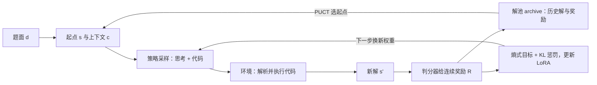

一句话解释这张图：每一轮先从解池按 PUCT 挑一个起点，让模型写出一版新解，跑出分数，这个分数既回流进解池，也用来做一次梯度更新，于是下一轮的模型比上一轮更会写这道题。

### 4.2 模块拆解

**搜索空间：程序文本，不是答案文本**

为什么需要先说清这一点：整篇论文的搜索都发生在代码空间里。状态 s 是一个具体产物——数学里是分段常值函数，kernel 里是 Triton 代码，AtCoder 里是 C++ 程序，去噪里是 Python 分析代码。动作 a 是思考 token 加一段代码。所以这里的搜索既不是调模型参数，也不是在自然语言答案里瞎猜，而是让模型写程序，程序再去伪造那个数学对象或那份实现。

怎么做：策略吐出 a，环境的转移函数 T 把代码解析出来；数学题还要再执行一遍代码，才能得到新的函数。产物交给判分器打分。

**奖励怎么来**

四类题目的奖励都是从题目自带的验证器算出来的：

- 数学：最小化问题上奖励正比于 1/上界，最大化问题上直接给界本身。合法性有硬约束，比如密度函数必须满足 $f(x)\in[0,1]$ 且 $\int f = 1$。
- kernel：奖励正比于一组固定输入形状上运行时的几何平均的倒数（跟榜单口径一致），只按 H100 计时。
- 算法竞赛：奖励是本地生成的公开用例上的分数。
- 生物去噪：奖励是 MSE，并额外约束 Poisson 分数。

三种情况记 0 分：产物没过合法性检查、代码超时（数学给 10 分钟执行）、kernel 跑错或超时。奖励连续这一点是整个方法的前提——作者在结论里明说，目前只适用于连续奖励的问题。

生活类比：这是驾校的电子考官，压线扣几分、超时扣几分，一路给分；而不是只在最后告诉你过没过。

**训练目标：熵式目标**

$$
J_\beta(\theta) = \mathbb{E}_{s\sim \mathrm{reuse}(H)}\left[\log \mathbb{E}_{a\sim\pi_\theta(\cdot\mid s)}\left[e^{\beta(s)R(s,a)}\right]\right]
$$

先说这个公式在算什么：把一组作答的奖励先做指数放大，再看这个指数平均有多大。β 越大，目标越接近那一次最高的奖励；β 趋向无穷时就退化成一个取最大值的算子。

- $s$：起点，从解池里按复用规则抽出来的某个历史解
- $a$：一次作答，含思考 token 和代码
- $R(s,a)$：环境给的连续奖励，非负，失败记 0
- $\beta(s)$：温度，逐起点设定，越大越偏袒高分作答
- $H$：解池，存历史解及其奖励

对它求梯度，得到加权策略梯度：

$$
\nabla_\theta J_\beta(\theta) = \mathbb{E}_{s\sim \mathrm{reuse}(H)}\mathbb{E}_{a\sim\pi_\theta(\cdot\mid s)}\left[w_{\beta(s)}(a)\,\nabla_\theta \log \pi_\theta(a\mid s)\right],\qquad w_{\beta(s)}(a)=\frac{e^{\beta(s)R(s,a)}}{\mathbb{E}_{\pi_\theta(\cdot\mid s)}\left[e^{\beta(s)R(s,a)}\right]}
$$

- $w_{\beta(s)}(a)$：重要性权重，奖励高于本组平均就大于 1，低于就小于 1
- 因为 $\mathbb{E}[w]=1$，减掉 1 就是一个天然基线
- 最后再挂一个 KL 惩罚，把新策略拴在初始策略附近：

$$
A(a;s) = w_{\beta(s)}(a) - 1 - \lambda \log\frac{\pi_\theta(a\mid s)}{\pi_{\theta_0}(a\mid s)}
$$

- $\lambda$：KL 系数，多数任务 0.1，算法竞赛 0.01
- $\pi_{\theta_0}$：初始策略，也就是没在测试时训练过的那个模型

β 怎么定：给每个起点解一个一维方程，要求加权后的倾斜分布 $q_\beta$ 与原策略的 KL 不超过预算：

$$
\mathrm{KL}\left(q_{\beta(s)}(\cdot\mid s)\,\|\,\pi_\theta(\cdot\mid s)\right)=\gamma,\qquad q_\beta(\tau\mid s)\propto \pi_\theta(\tau\mid s)\,e^{\beta r(\tau;s)}
$$

- $\gamma$：KL 预算，全文固定为 $\ln 2$
- 实际求解用二分搜索找 β，分母用留一法（leave-one-out）估计，再加一个 ε 防除零
- 这个估计对奖励的平移和缩放不变，换任务不用重调奖励尺度

生活类比：这是一个自动调音量的旋钮。房间吵（这组作答水平参差），旋钮就拧小，别让一两个爆款把整组带偏；房间安静（大家都差不多），旋钮就拧大，把细小的好坏差别也放大出来。

**复用规则：PUCT**

$$
\mathrm{score}(s) = Q(s) + c\cdot \mathrm{scale}\cdot P(s)\cdot \sqrt{\frac{1+T}{1+n(s)}}
$$

这个公式在算：给解池里每个解打一个分，判断下一轮从它这儿出发值不值。

- $Q(s)$：从这个解出发历史上拿到的最好子节点奖励，没展开过就直接用 $R(s)$。注意是最大值，不是均值
- $P(s)$：按奖励排名给的先验，排在前面的概率高但不独占
- $n(s)$：这个解自身加它所有后代被展开过的次数
- $T$：总展开次数
- $c$：探索系数，取 1.0
- $\mathrm{scale}=R_{\max}-R_{\min}$：把奖励范围拉回可比尺度

三个实现细节值得记：每次展开一个解，只把它的前 2 个子解收进池子；池子全局只留奖励前 1000 名，但初始种子永远保留；同一个 batch 里会把选中解的整条血缘（祖先加后代）屏蔽掉，逼模型换个方向。

生活类比：这就是复习策略。最可能考的章节要多刷（Q 高），冷门章节隔几轮也要翻（探索项），但如果你已经连着刷同一个知识点三遍，系统就不再给你排它（血缘屏蔽）。

**和 AlphaEvolve 到底差在哪**

三层差别，一层比一层关键：

1. 模型动不动：AlphaEvolve 冻结模型，只改提示；这里每步都改 LoRA 权重。
2. 复用怎么选：AlphaEvolve 用手写的变异 / 交叉，加领域相关的适应度和多样性度量；这里换成一个通用 PUCT 公式，四个领域共用一套超参。
3. 优化的量：AlphaEvolve 没有显式训练目标；这里每一步梯度都在把分布推向组内最高奖励。

生活类比：AlphaEvolve 是请一位不改主意的老专家反复改稿，改稿靠编辑给的结构化意见；TTT-Discover 是让这位专家边改边练手，改完几十稿，手感本身变了。

### 4.3 关键细节

- 模型 gpt-oss-120b，跑在 Tinker 上；LoRA rank 32；Adam，lr $4\times10^{-5}$，$\beta_1=0.9$，$\beta_2=0.95$
- 50 步训练，每步 512 条 rollout，分成 8 组 × 64，同组共享起点和上下文
- 每个 batch 只做 1 次梯度更新，不取 off-policy 步；对采样器与学习器的差异做重要性比率修正
- 采样温度 1.0，reasoning effort 设 high；上下文 32768 token，prompt 加思考上限 26000，剩下的留给最终代码；超限时用 teacher forcing 逼模型先收尾
- $\lambda=0.1$（算法竞赛 0.01），$\gamma=\ln 2$，PUCT 的 $c=1.0$
- 一次 50 步训练约 500 美元（按平均 prompt 3000 token、平均采样 16000 token 估算）

## 5. 实验结果

**实验设置**

- 数据集与切分：数学四题（Erdős 最小重叠、第一自相关不等式 AC1、第二自相关不等式 AC2、圆堆积 n=26 与 n=32）；kernel 两个竞赛（TriMul 分 A100 / H100 / B200 / MI300X 四个榜单，MLA-Decode 只有 MI300X 榜单）；AtCoder 两个赛道（ahc039 几何、ahc058 排产）；生物用 OpenProblems 去噪任务的三个数据集，Pancreas 用来训练，PBMC 与 Tabula 报告。这里没有常规的训练 / 测试切分——测试问题本身就是训练问题；AtCoder 用公开用例本地训练，官方私有用例只在最后提交评一次分。
- 骨干模型：gpt-oss-120b（开源），另跑一版 Qwen3-8B 专门和 ThetaEvolve 同模型对比。只训 LoRA，rank 32，不训全参。
- 训练预算：每题 50 步 × 512 条 rollout = 25,600 次采样；Tinker API；约 500 美元/题。训练用的 GPU 卡数与总时长原文未给（kernel 计时走远程 Modal）。
- 基线：Best-of-25600（同模型、同采样预算），OpenEvolve（AlphaEvolve 的开源版，同 25,600 预算），以及各题历史最强——AlphaEvolve、AlphaEvolve V2、ShinkaEvolve、ThetaEvolve、ALE-Agent、MAGIC / ALRA。消融里的常数 β、无熵式、无测试时训练、ε-greedy 复用、无复用、naive RL 都是作者自己加的对照。
- 指标：数学是常数上下界（Erdős 与 AC1 越小越好，AC2 越大越好）；kernel 是运行时 µs（越小越好，只报最好的那一个 kernel）；AtCoder 是官方分数（越高越好）；去噪是 score（归一化 MSE 与 Poisson 两项的均值，越高越好）。
- 推理设置：温度 1.0、上下文 32768、prompt 加思考上限 26000、reasoning effort high、teacher forcing 收尾；判分不是裁判模型，而是各题自带的确定性程序。超时阈值：数学代码 10 分钟、AtCoder 2 秒 / 1024 MB、去噪 400 秒。

主表只挑能说明问题的行。最强基线那一列按作者口径取同题的历史最好成绩；生物那一行另外给了同预算的 OpenEvolve。

| 任务 | 指标 | 本文 | 最强基线 | 提升 |
| --- | --- | --- | --- | --- |
| Erdős 最小重叠 | 上界 c（↓） | 0.380876 | 0.380924（AlphaEvolve） | 0.000048 |
| 第一自相关不等式 AC1 | 上界 $C_1$（↓） | 1.50286 | 1.50314（ThetaEvolve） | 0.00028 |
| 第二自相关不等式 AC2 | 下界 $C_2$（↑） | 0.9591 | 0.9610（AlphaEvolve V2） | 未刷新 |
| 圆堆积 n=26 / n=32 | 半径和（↑） | 2.635983 / 2.939572 | 2.635983 / 2.939572 | 持平 |
| TriMul kernel（H100） | µs（↓） | 1161.2 | 1371.1（人类第一） | 15.3% |
| TriMul kernel（A100） | µs（↓） | 2198.2 | 4531.5（人类第一） | 51.5% |
| MLA-Decode（MI300X，实例 1） | µs（↓） | 1669.1 | 1653.8（人类第一） | 未超过 |
| ahc039（几何） | 官方分（↑） | 567,062 | 566,997（人类第一） | 65 分 |
| ahc058（排产） | 官方分（↑） | 848,414,228 | 847,674,723（人类第一） | 739,505 |
| 去噪 PBMC | score（↑） | 0.71 | 0.70（OpenEvolve）/ 0.64（MAGIC） | +0.01 |
| 去噪 Tabula | score（↑） | 0.73 | 0.71（OpenEvolve）/ 0.64（MAGIC） | +0.02 |

**原文实验图**

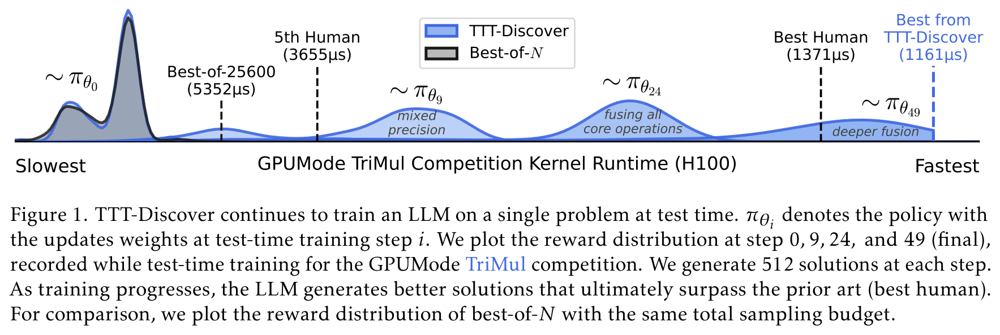

图 1：这张图证明了训练真的在起作用——第 0 步的奖励分布还堆在最慢那一端，到第 9、24、49 步整个分布一路右移并越过人类第一，而同样 25,600 次采样的 Best-of-N 分布宽度差不多却始终没有越过人类第一。图里还标出了每一步新出现的优化手法（mixed precision、fusing all core operations、deeper fusion），说明模型的进步是踩着具体技术台阶上去的。

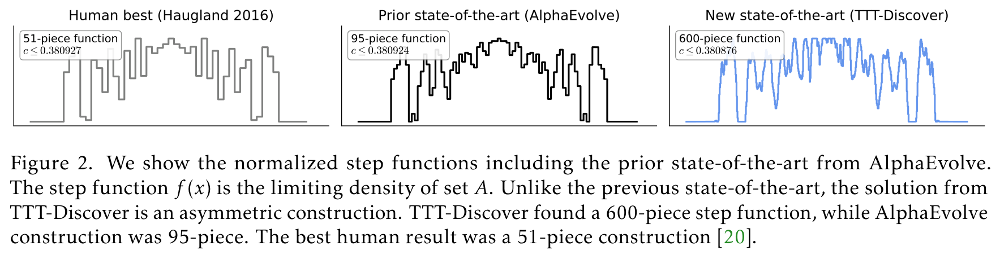

图 2：这张图证明了 Erdős 问题上的新纪录不是把旧解打磨出来的，而是换了一种结构——人类最好的是 51 段、AlphaEvolve 是 95 段的对称构造，TTT-Discover 给的是 600 段的非对称分段函数，段数多一个量级。

**原文实验表**

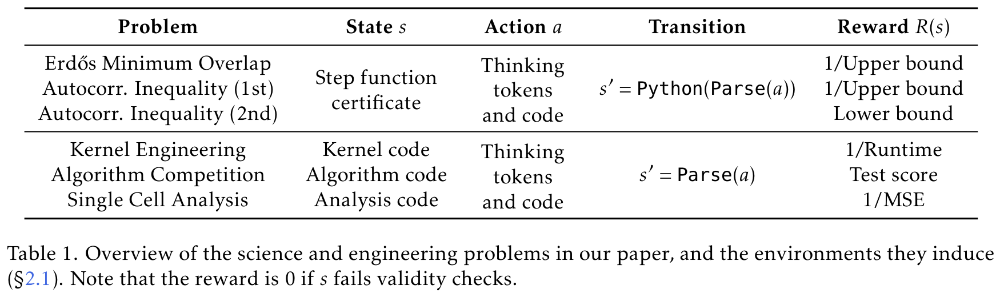

表 1：这张表证明了四类题目都能套进同一个马尔可夫决策过程（MDP）骨架——状态是候选产物、动作是思考加代码、奖励是 1/上界、1/runtime、测试分、1/MSE，所以换领域不用改算法，只换环境和判分器。

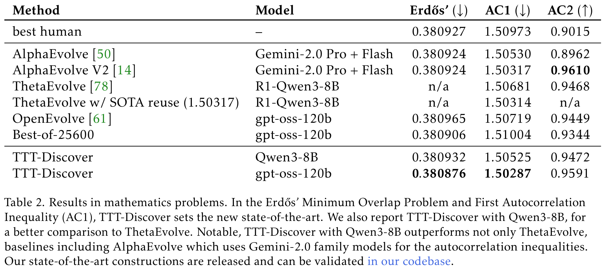

表 2：这张表证明了数学上的领先不是靠更强的模型——AlphaEvolve 那一列用的是 Gemini-2.0 家族，本文用开源的 gpt-oss-120b；换成更弱的 Qwen3-8B 后，AC1 的 1.50525 与 AC2 的 0.9472 仍然好过 ThetaEvolve 自己报的 1.50681 与 0.9468，但没赶上它热启动 AlphaEvolve V2 构造后的 1.50314。AC2 那列 AlphaEvolve V2 的 0.9610 没被打破。

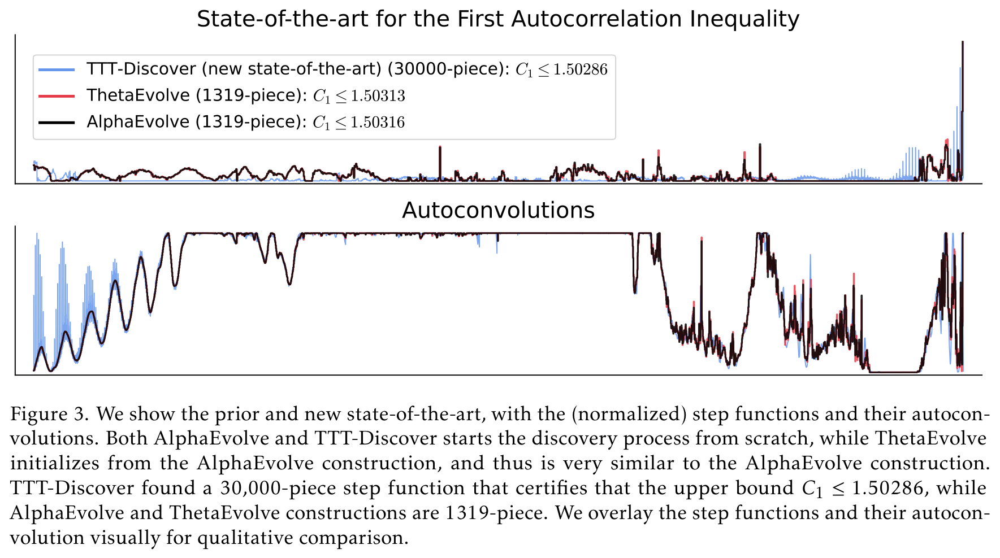

图 3：这张图证明了 AC1 上的改进来自一个完全不同的构造——AlphaEvolve 与 ThetaEvolve 的 1319 段函数和本文的 30000 段函数叠在一起看，自卷积曲线形状差异很大，说明本文是从零开始搜到的，而不是在别人解上做局部精修。

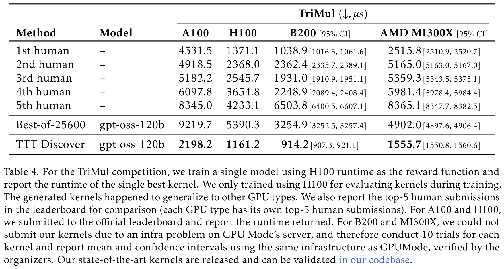

表 4：这张表证明了 kernel 上的优势是跨硬件的——奖励只按 H100 计时，四个 GPU 上却都赢了人类第一，A100 上差距最大（2198.2 对 4531.5）；Best-of-25600 在 A100 / H100 上比人类第一还慢一倍以上，说明这份收益来自学习而不是多采样。

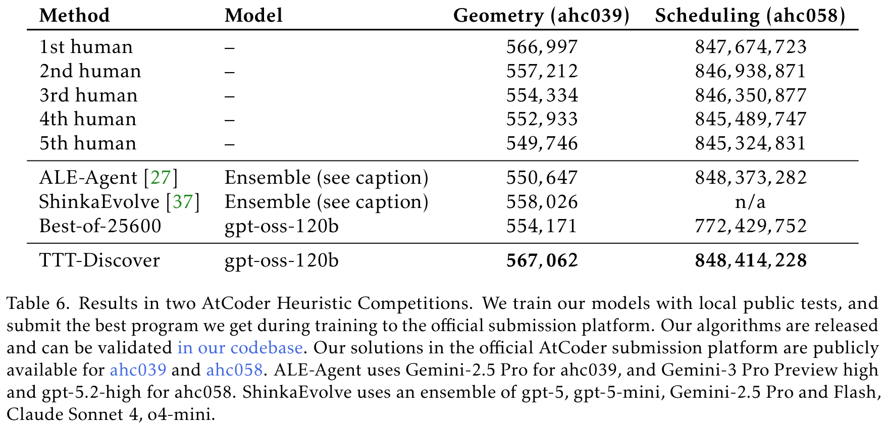

表 6：这张表证明了在两个真实竞赛里都能到第一——ahc039 从 ALE-Agent 的第 5 名解出发，一路改到 567,062 分，超过人类第一 566,997；ahc058 从零开始写到 848,414,228，也高于人类第一。注意 Best-of-25600 在 ahc058 上只有 772,429,752，比人类差一大截，这是全文里搜索和学习差距最大的一格。

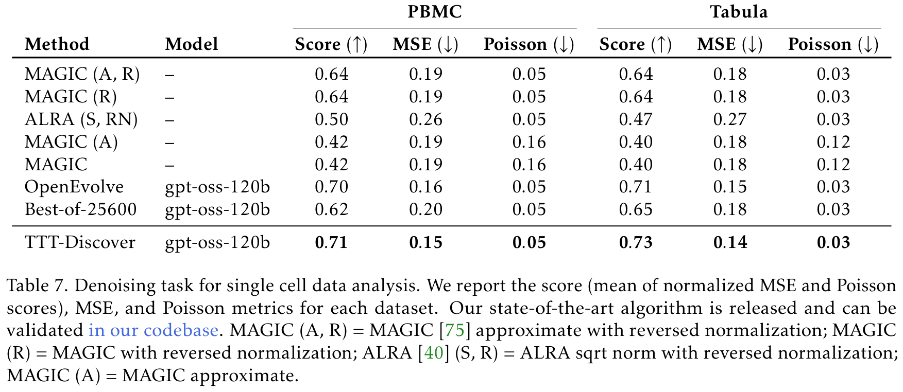

表 7：这张表证明了生物去噪上的提升是有限的——score 从 0.71 到 0.73，主要来自 MSE 0.15 / 0.14 比 MAGIC 的 0.19 / 0.18 低，Poisson 那一列基本没动（都是 0.03 到 0.05）。作者自己在正文加了免责声明：benchmark 指标变好不等于生物学结论成立。

**消融告诉我们什么**

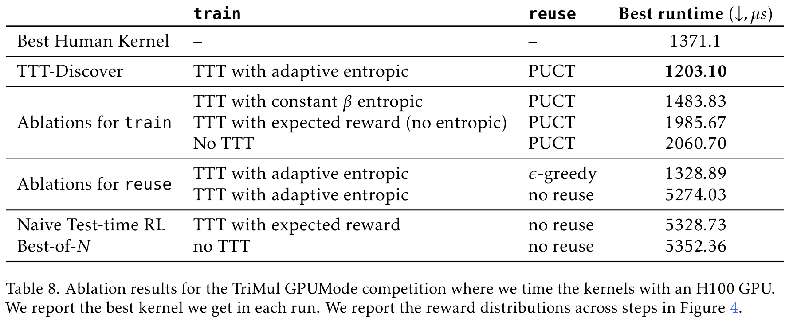

表 8：这张表证明了两个部件都不可省——去掉复用（no reuse）最好只能到 5274.03 µs，比 Best-of-N 的 5352.36 µs 只好一点点；去掉测试时训练（No TTT，只留复用）是 2060.70 µs，说明光靠 PUCT 复用能拿回一大半；两者都上才到 1203.10 µs。另外常数 β 是 1483.83、期望奖励目标是 1985.67，说明自适应 β 和熵式目标各自都值钱。

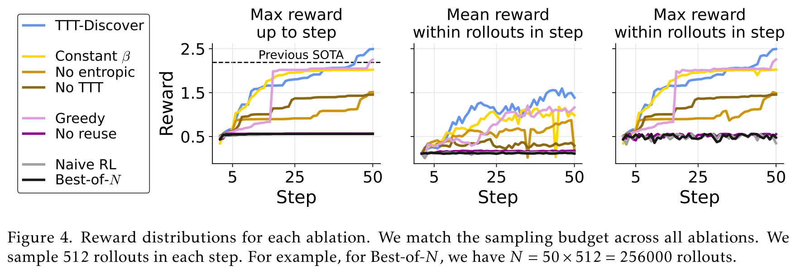

图 4：这张图证明了收益的形状——蓝线（完整方法）的最大奖励在第 25 步之后还在涨并穿过虚线（前 SOTA），黄线（常数 β）很早就压平，褐线（期望奖励）爬得慢且停在 1.5 附近，黑线（无测试时训练）完全不动。右图更狠：naive RL 和 Best-of-N 两条线几乎重合在 0.5 附近，标准 RL 在这个设定下等于没学。

**这些实验够不够支撑结论**

够的部分：同模型、同采样预算的 Best-of-N 和 OpenEvolve 都跑了；四个领域都有真实人类榜单；结果经过外部专家评审（数学的 Davide Torlo、kernel 的 GPUMode 组织者、生物的 Eric Sun）；代码和产物公开。

不够的部分：每个任务只跑了一次训练，没有多种子方差，0.380876 这种小数点后第六位的改进到底稳不稳，原文未给；消融只在 TriMul 一个任务上做；AtCoder 是事后回溯评测，只有两个赛道；MLA-Decode 那组在三个实例上都没在统计上赢过人类第一，正文的主结论没有强调这一点。

## 6. 局限性

**作者自己承认的**

- 只能用于有连续奖励的问题，稀疏或二值奖励是明确的未来工作。
- 生物那条加了免责声明：在 benchmark 上赢不等于对下游生物学任务有用；审稿人 Eric Sun 也补了一句，指标改进不一定转化成新的生物学发现。

**我看出来的**

- 隐形假设：每道题都得自带一个可信、连续、难以刷分的判分器。去噪那个任务里奖励就是 benchmark 的 MSE，一旦优化目标等于评测指标，方法就退化成刷分。
- 边界条件：单题成本几百美元乘上题数，而且每题都要重训一遍，学到的本事留不下来。50 步是固定值，更难的题需要多少步没有答案。
- 缺的对比：没有在完全相同模型和预算下跑 AlphaEvolve。OpenEvolve 是替代品，而且作者自己说它的提示涨得太长，大量 rollout 被 32k 上下文截断——这就让「学习比搜索强」的因果结论里混进了一个混杂因素。
- 缺的对比：只对齐了采样条数（25,600），没有对齐 token 数或实际耗时。测试时训练每步都要做梯度更新，真实成本肯定高于纯采样，这部分没有并列报出来。
- 失败分析基本没有：AC2 没刷新、圆堆积没进步、MLA-Decode 没赢，三处都只写了结果，没有解释为什么。

## 7. 一句话总结

别指望一个冻住的模型靠多试几次就撞出人类没想到的东西；让它在这道题上边做边学，并且只盯着最好的那一次结果，它就能把答案往前推一格。就像背单词：光把同一页翻一百遍不如合上书默写一遍再改，改的那一下才是学习。

核心式子就一个，熵式目标：

$$
\boxed{J_\beta(\theta) = \mathbb{E}_{s\sim \mathrm{reuse}(H)}\left[\log \mathbb{E}_{a\sim\pi_\theta(\cdot\mid s)}\left[e^{\beta(s)R(s,a)}\right]\right],\quad \mathrm{KL}\left(q_{\beta(s)}\,\|\,\pi_\theta\right)=\ln 2}
$$

## 8. 可复用点

- 如果我要在自己的项目里用：先把判分器写成确定性的，把奖励压到 0 到 1 附近，失败一律记 0；第一版直接上 PUCT 复用加熵式目标，不要在常数 β 上耗时间。
- 训练不收敛时先查：β 是不是在早期设太大。正确做法是每个起点解一次 KL 预算为 $\ln 2$ 的二分，而不是背一个常数。
- 复用池子：初始种子必须常驻，池子按奖励保留前 1000 名，每次展开只收前 2 个子解，同一个 batch 屏蔽整条血缘——这三条一起才防得住早熟。
- 上下文预算：给最终回答留够 token（这里 prompt 加思考上限 26000），并用 teacher forcing 强制收尾，否则一半 rollout 会烂在没写完上。
- 想知道收益到底来自学习还是采样：先跑同预算 Best-of-N，再跑无复用的 naive RL。这两个数几乎一样（5352.36 对 5328.73），说明你看到的全部提升都来自复用加训练。
- 想让结论更硬：每个任务至少跑 3 个种子，报最好值和区间；只报最好的一次，审稿人会问这是不是运气。

## 9. 我的疑问

- 图 4 的图注写 Best-of-N 是 $50\times512=256000$ 条 rollout，但正文和主表一直说 Best-of-25600。差 10 倍，哪个口径对？这会直接影响消融里 Best-of-N 是否被削弱了预算。
- 正文说所有 GPU 上都超过人类最好 15% 以上，但 B200 是 1038.9 到 914.2，只有约 12%。是不是这句话只对 A100 / H100 / MI300X 成立？
- 表 4 的 1161.2 µs 和表 8 的 1203.10 µs 是同一个设置吗？表 8 的图注说消融用自家评测器算，表 4 说 A100 / H100 用的是榜单返回值。两个数差 3.5%，读者容易混。
- 每个任务只训练一次，没有方差。数学题上 0.000048 这种量级的改进，会不会有一次幸运抽样的成分？作者没给重复实验。
- AC2 为什么没刷新？是奖励尺度（下界本身）不适合熵式目标，还是 30,000 段的搜索空间太大？作者只写了没做出发现。
- 数学题用 1/上界当奖励，而 c 已经在 0.38 附近，这个变换在局部几乎是常数，梯度信号极弱。自适应 β 是不是在隐式补偿这件事？原文没有讨论。
- 方法卡上我拿不准的一点：PUCT 那个 Q 取子节点最大值而不是均值，在 AlphaZero 的框架里是偏离标准的。作者只给了四行对比，没有说这样改会不会让某些分支永远被高估。这一点我标成推断，不是论文结论。

