> 一句话：让模型边读边学的那层，从逐字串行改成整段并行，几轮就够。

## 0. 读之前你需要知道

**术语卡**

- **测试时训练层（test-time training layer, TTT layer）**：把循环状态当成一个小网络的权重，边读序列边用梯度下降改它。生活类比：不是把笔记抄在本子上，而是把这一章的内容直接揉进你现在的理解方式里，读第二章时你的理解方式已经变了。
- **快权重（fast weights）**：一条序列内部被改动的那部分权重，记作 $\Delta \mathbf{W}_t$。外层用反向传播训练的那份参数叫慢权重 $\mathbf{W}_0$。类比：草稿纸和印好的教材，草稿纸每条序列开头都擦干净重写。
- **块近似（block approximation）**：把一个块里所有 token 的梯度都算在块入口那一份权重上，块内前面的 token 不算数。类比：一节课只在打铃时擦一次黑板，中间写满了也不擦，下节课的学生看到的是开始时的那块板。
- **块内并行形式（chunkwise-parallel form）**：把序列切成长度 $C$ 的块，块内用稠密矩阵乘法一次算完，只有块与块之间的状态要串行。类比：流水线分段，段内所有工位同时开工，段与段之间排队交接。
- **delta 规则（delta rule）**：写新值之前先沿这个 key 的方向把旧值擦掉，再写。类比：改错题时先擦掉原来那行再写新的，而不是直接往上叠。
- **门控线性注意力（gated linear attention, GLA）**：状态先乘一个衰减系数再做外积写入，Mamba-2 是它把门取成标量的特例。
- **不动点迭代（fixed-point iteration）**：先猜一个解，把它代进方程算出一个更好的解，反复。阻尼（damping）就是每次只走新旧之间的一部分，别一步迈到底。类比：调收音机旋钮，快对上频道时要一点点拧，一下拧到底会过站。
- **伪标签（pseudo-label）**：这篇里指的是隐藏层预激活上的梯度 $\delta\mathbf{z}$。它本来要靠反向传播算，现在先猜一个，再迭代改。

**它站在谁肩上**

- DeltaNet（2021）/ Gated DeltaNet（2025）：把线性注意力的加法写入换成一步梯度下降，写入前先擦除。为什么不够：状态只是一个矩阵，读和写共用同一组 key 特征，特征本身不会随上下文改变。
- Mamba-2（2024）：标量门控的线性递归，极快。为什么不够：同上，线性内存的表达力有上限，recall 类任务吃亏。
- TTT-MLP（Sun et al., 2025）：内层换成两层 MLP，用块近似换并行。为什么不够：块内梯度是过期的，块越大越省时间越不准，串行深度是 $T/b$。
- Titans（Behrouz et al., 2025b）：在同一个块形式上加了动量和权重衰减，串行结构没动。
- LaCT（Zhang et al., 2026）：把块开到成千 token，再挂一条滑窗注意力补局部信息。为什么不够：块太大，近似很粗。
- DEER（2024）/ ParaRNN（2026）/ 深度平衡模型 DEQ（2019）：把非线性递归当成不动点问题，用牛顿法迭代，每次迭代退化成一个并行扫描。为什么不够：通用牛顿步要转移雅可比，尺寸是状态维度的平方；ParaRNN 得靠结构化雅可比才做得动。

## 1. 动机

你在读一本很长的侦探小说。每读到一个新线索，你就更新一次自己对凶手的判断。这件事天然是串行的：第二个线索的意义取决于你读完第一个线索后的判断。

线性递归（Mamba-2、Gated DeltaNet）是**以前怎么做**的答案：它把整段历史压成一个矩阵，每次更新都是矩阵加法或一次线性变换。因为更新对状态是线性的，一整块 token 可以一次性用矩阵乘法算完，只有块边界的状态要串行传下去。这就是块内并行形式的来源，也是这些模型能跑得和注意力一样快的原因。

**为什么不行**：矩阵记忆读和写用的是同一组特征。要记住谁在哪个房间说了什么，只能靠外积硬塞进去，塞满了就覆盖。它没法根据当前上下文临时改造自己的特征。

**为什么现在能做**：三件事凑齐了。一是 Gated DeltaNet 和 Mamba-2 的分块 Triton 内核已经开源可用（FLA），别人写好的扫描可以直接借。二是 DEER 和 ParaRNN 证明了把递归当不动点、用并行扫描跑迭代这条路线在非线性 RNN 上走得通。三是社区已经接受训练时用有限轮迭代近似一个理想解这种交易，扩散模型和深度平衡模型都是这么干的。

这篇论文要回答的就是：能不能既保留非线性记忆的表达力，又拿回块内并行的速度。

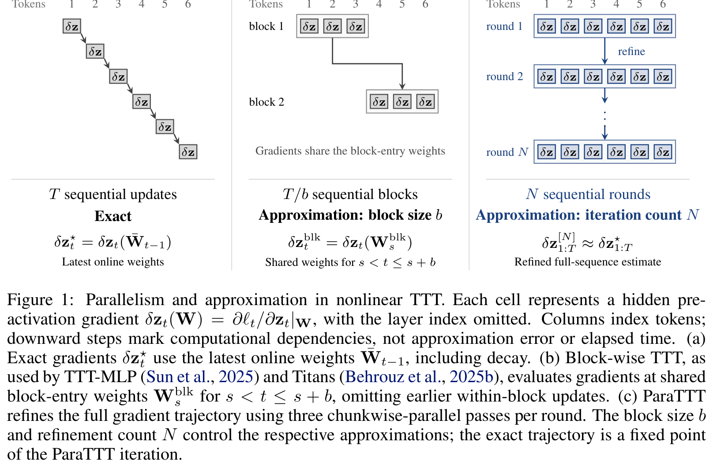

图 1：三种并行度的对比，每格是一个 token 的隐藏层梯度 $\delta\mathbf{z}$，向下的箭头表示计算依赖。左栏是精确递推，$T$ 层依赖；中栏是块近似，$T/b$ 层依赖，块内所有梯度共用块入口的权重；右栏是 ParaTTT，只有 $N$ 层依赖，每轮内部整段并行。这张图把全篇的取舍画完了：**近似误差的来源从块大小 $b$ 换成了轮数 $N$**。

## 2. 贡献

- **把任意深度的 MLP 记忆并行化了**。证据：算法对层数 $L$ 没有限制，每轮只需常数次分块扫描，串行深度是 $O(T/C)$，和序列长度成线性（第 3 节）。
- **证明了精确递推是不动点，并给出几何收敛条件**。证据：Proposition 1 不要求任何收缩假设就能保证迭代足够多次就等于精确；Theorem 1 在两层的软裁剪变体上给出收敛率 $\rho$，且 $\rho<1$ 与序列长度无关（第 3.3 节）。
- **相同误差下快 32 倍，整模型训练快 4.9 倍**。证据：$T=4096$ 时 $N=2$ 的输出误差等于 TTT-MLP 在 $b\approx 5$ 时的误差，耗时少 32 倍；340M 整模型训练吞吐 37.9k tokens/s 对 TTT-MLP 的 7.8k（第 4.2、4.3 节）。
- **质量上没有付出代价**。证据：340M 和 1.3B 上 WikiText-103 困惑度 25.46 / 15.21，低于 GDN 的 26.57 / 15.78；SWDE 41.9 / 62.8，高于 GDN 的 32.5 / 59.0（Table 1）。

## 3. 创新点

- **迭代变量选的是隐藏层梯度 $\delta\mathbf{z}$，不是快权重本身**。对比对象：DEER、ParaRNN 迭代状态轨迹，通用牛顿步的雅可比尺寸是 $O(d^2)$。有用是因为：一旦 $\delta\mathbf{z}$ 给定，权重递推 Eq. (3) 对状态就是线性的，直接变成现成的 GLA / GDN 内核，全程不用显式构造权重轨迹，也不用碰转移雅可比。每个 $\delta\mathbf{z}$ 只是一个 $d$ 维向量，比 $d\times d$ 的快权重便宜得多。
- **近似的旋钮从块大小 $b$ 换成迭代轮数 $N$**。对比对象：TTT-MLP 靠缩小 $b$ 提高精度，代价是串行深度 $T/b$ 变长。有用是因为：$N$ 每加一轮只增加常数次并行扫描，串行深度仍是 $O(T/C)$；而且 $N$ 只影响训练和预填充，解码时一个 token 就是一次精确的梯度步，压根不需要迭代。
- **把读出层精确、隐藏层近似这两件事拆开算**。对比对象：整层一起做块近似。有用是因为：读出层的输入特征一旦固定，它就是一个标准的 Gated DeltaNet，可以精确跑完；而且它对特征的梯度 $e_t$ 能在同一个内核里顺手拿到（就是论文改出来的 DELTARULEGRAD），不必再单独写一次反向。
- **两个实用设计：隐藏层换 delta 规则 + 读出层做中心化**。对比对象：分析里用的最简形式（隐藏层用线性注意力、读出层不中心化）。有用是因为：delta 规则会擦掉旧轮次写歪的内容，且在不动点处修正项自动消失、不改变目标递推，SWDE 从 28.4 提到 41.9；中心化让读出层在序列开头输出为零、但雅可比非零，解决了零初始化读出层不给隐藏层任何梯度、非零初始化又给输出加死偏置的两难，LAMBADA 困惑度从 29.06 降到 26.93（Table 7）。

## 4. 方法

### 4.1 整体流程

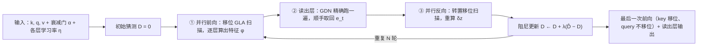

一句话解释这张图：一圈三轮扫描全部整段并行，圈数 $N$ 是固定的超参，收敛靠多转几圈而不是靠把序列切短。

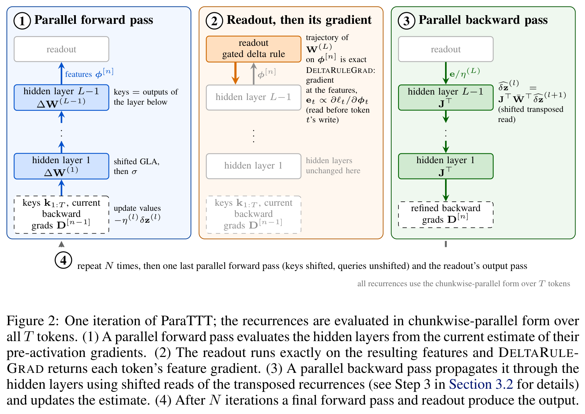

图 2：一轮迭代的三个通道。蓝框是并行前向，用当前估计的 $\delta\mathbf{z}$ 走移位 GLA，得到特征 $\boldsymbol{\phi}$；橙框是读出层，跑精确的 gated delta rule，顺手用 DELTARULEGRAD 取出 $e_t\propto\partial\ell_t/\partial\boldsymbol{\phi}_t$；绿框是并行反向，用转置的移位扫描把梯度逐层传下去，得到新的估计。第 4 步说明：转 $N$ 圈之后还要再做一次前向和一次读出，那一次才是真正输出。

### 4.2 模块拆解

**模块一：带深度记忆的 TTT 递推**

为什么需要：先把要算的东西定义清楚。整篇论文的合法性都建立在 Eq. (2) 才是真值、其余都是它的近似这个前提上。

怎么做：一层记忆就是一个 MLP，输入是 key，中间是若干隐藏层，最后一层是线性读出。

$$
\mathbf{z}^{(l)} = \mathbf{W}^{(l)}\mathbf{h}^{(l-1)} + \mathbf{b}^{(l)}, \qquad
\mathbf{h}^{(l)} = \sigma\!\left(\mathbf{z}^{(l)}\right), \qquad
f_{\mathbf{W}}(\mathbf{k}) = \mathbf{W}^{(L)}\mathbf{h}^{(L-1)}
$$

先说这个公式在算什么：给定一组权重，把 key 逐层喂上去，得到读出值。符号逐个解释：

- $\mathbf{k}$：本 token 的 key，$\mathbb{R}^d$，RMS 归一化到 $\|\mathbf{k}\|=\sqrt{d}$。
- $\mathbf{h}^{(0)}=\mathbf{k}$：输入直接当第 0 层激活。
- $\mathbf{W}^{(l)}$：第 $l$ 层的权重矩阵，$\mathbb{R}^{d\times d}$（每个头内部宽度固定为 $d_{\text{head}}=128$）。
- $\mathbf{h}^{(L-1)}$：最后一层隐藏激活，论文给它起了个名字叫特征，记作 $\boldsymbol{\phi}_t$。它还会被投影到单位球 $n(\mathbf{x})=\mathbf{x}/\max(1,\|\mathbf{x}\|)$，这一步被吸收进最后一次 $\sigma$ 里。
- $f_{\mathbf{W}}(\mathbf{k})$：读出值，$\mathbb{R}^{d_v}$，要和本 token 的 value $\mathbf{v}_t$ 比对。

权重拆成两半：$\mathbf{W}^{(l)}_t = \mathbf{W}^{(l)}_0 + \Delta\mathbf{W}^{(l)}_t$。$\mathbf{W}^{(l)}_0$ 是反向传播训练的慢权重，$\Delta\mathbf{W}^{(l)}_t$ 是每条序列从头开始、初值为零的循环状态。这正是快权重的含义。

真值递推（Eq. 2）是：先衰减，再走一步梯度。

$$
\bar{\mathbf{W}}^{(l)}_{t-1} = \mathbf{W}^{(l)}_0 + \alpha_t \Delta\mathbf{W}^{(l)}_{t-1},
\qquad
\mathbf{W}^{(l)}_t = \bar{\mathbf{W}}^{(l)}_{t-1} - \eta^{(l)}_t \left.\frac{\partial \ell_t}{\partial \mathbf{W}^{(l)}}\right|_{\bar{\mathbf{W}}_{t-1}}
$$

这个公式在算：第 $t$ 个 token 来的时候，状态先整体乘上衰减系数，再按内层损失 $\ell_t(\mathbf{W})=\tfrac12\|f_{\mathbf{W}}(\mathbf{k}_t)-\mathbf{v}_t\|^2$ 的梯度走一步。符号：

- $\alpha_t\in(0,1]$：衰减门，和 Gated DeltaNet 一样由输入算出来。
- $\eta^{(l)}_t$：第 $l$ 层的学习率，是输入 $\mathbf{x}_t$ 的一个学习过的线性函数再过 sigmoid，每个头、每一层各自独立。
- 层输出的取法有讲究：$o_t=f_{\mathbf{W}_t}(\mathbf{q}_t)$，key 用衰减后、自己这一步之前的 $\bar{\mathbf{W}}_{t-1}$ 读，query 用更新后的 $\mathbf{W}_t$ 读。这就是 key 移位、query 不移位。

直接算 Eq. (2) 要串行 $T$ 步，因为每个 token 的梯度都在一个依赖全部历史的权重上求。

**模块二：关键恒等式**

为什么需要：这是整篇论文能并行的技术支点，没有它就退化成块近似。

怎么做：把 Eq. (2) 的梯度步展开。因为内层损失是平方误差，对权重的梯度恰好是两个向量的外积：

$$
\Delta\mathbf{W}^{(l)}_t = \alpha_t \Delta\mathbf{W}^{(l)}_{t-1} - \eta^{(l)}_t\, \delta\mathbf{z}^{(l)}_t \mathbf{h}^{(l-1)\top}_t
$$

这个式子说：权重的变化量，就是预激活梯度与上一层激活的外积。符号：

- $\delta\mathbf{z}^{(l)}_t = \partial\ell_t/\partial\mathbf{z}^{(l)}_t$：损失对第 $l$ 层预激活的梯度，一个 $d$ 维向量，在 $\bar{\mathbf{W}}_{t-1}$ 处取值。
- $\mathbf{h}^{(l-1)\top}_t$：第 $l-1$ 层的激活转置，$\mathbb{R}^{1\times d}$。
- 两者外积得到一个 $d\times d$ 矩阵，正好是 $\Delta\mathbf{W}^{(l)}$ 的形状。

这个式子的分量全部是已知系数，除了 $\delta\mathbf{z}$。**一旦 $\delta\mathbf{z}$ 的整条序列给定，Eq. (3) 对状态就是线性的**。对隐藏层，它恰好是标量门控的线性注意力（Mamba-2 的形式），key 是 $\mathbf{h}^{(l-1)}_t$，value 是 $-\eta^{(l)}_t\delta\mathbf{z}^{(l)}_t$，门是 $\alpha_t$；对读出层，因为 $\delta\mathbf{z}^{(L)}_t$ 就是读出误差本身，它恰好是 Gated DeltaNet。两者都有现成的精确分块内核。

非线性的全部难度，被压缩成一条自洽条件：$\delta\mathbf{z}$ 决定权重轨迹，权重轨迹又决定 $\delta\mathbf{z}$。ParaTTT 就是解这个不动点。

**模块三：三步迭代**

为什么需要：把自洽条件变成可执行的循环。

怎么做：从 $\mathbf{D}=\mathbf{0}$ 出发（论文把这个 $\mathbf{D}=(\delta\mathbf{z}^{(l)}_{1:T})_{l<L}$ 也叫伪标签，因为它作为 value 进入扫描），每轮三步。

第一步，并行前向。把 Eq. (3) 沿时间展开，隐藏层第 $l$ 层在 token $t$ 处的快权重贡献是：

$$
\alpha_t \Delta\mathbf{W}^{(l)}_{t-1}\mathbf{h}^{(l-1)}_t
= -\sum_{j<t}\left(\prod_{i=j+1}^{t}\alpha_i\right)\eta^{(l)}_j \delta\mathbf{z}^{(l)}_j\left(\mathbf{h}^{(l-1)\top}_j\mathbf{h}^{(l-1)}_t\right)
$$

这个公式在算：token $t$ 读到的历史写入之和，衰减系数按距离连乘。符号：

- 求和只到 $j<t$，**不含 $j=t$**。原因是 key 在它自己写入之前被读，论文把这种扫描叫移位（shifted）扫描；标准形式（含 $j=t$）叫不移位。这一处是整篇实现里最容易出错的地方。
- $\prod_{i=j+1}^{t}\alpha_i$：从 $j+1$ 到 $t$ 的衰减连乘，越远的历史衰减越多。
- $\mathbf{h}^{(l-1)\top}_j\mathbf{h}^{(l-1)}_t$：两个激活的内积，就是线性注意力的打分。

一次分块扫描就得到第 $l$ 层所有 $T$ 个 token 的快权重贡献；加上慢权重部分 $\mathbf{W}^{(l)}_0\mathbf{h}^{(l-1)}_t+\mathbf{b}^{(l)}$、过 $\sigma$，就是下一层的输入。这一遍结束时拿到特征 $\boldsymbol{\phi}_{1:T}$，并把各层的雅可比 $\mathbf{J}^{(l)}_t$ 存下来给第三步用。第一轮 $\mathbf{D}=\mathbf{0}$ 时快扫描恒为零，可以直接跳过。

第二步，读出层精确求解。特征一旦固定，读出层的快权重就是标准 Gated DeltaNet：key 是 $\boldsymbol{\phi}_t$，value 修正成 $\tilde{\mathbf{v}}_t=\mathbf{v}_t-\mathbf{W}^{(L)}_0\boldsymbol{\phi}_t$，门是 $\alpha_t$，步长是 $\eta^{(L)}_t$，用现成的精确内核跑完。反向还需要每个 token 对特征的梯度，顺手在同一个内核里算：

$$
\mathbf{e}_t = \eta^{(L)}_t\,\bar{\mathbf{W}}^{(L)\top}_{t-1}\left(\bar{\mathbf{W}}^{(L)}_{t-1}\boldsymbol{\phi}_t-\mathbf{v}_t\right)
= \eta^{(L)}_t\,\frac{\partial\ell_t}{\partial\boldsymbol{\phi}_t}
= -\bar{\mathbf{W}}^{(L)\top}_{t-1}\mathbf{u}_t
$$

这个式子在算什么：读出层对它的输入特征有多敏感。符号：

- $\mathbf{u}_t=\eta^{(L)}_t(\mathbf{v}_t-\bar{\mathbf{W}}^{(L)}_{t-1}\boldsymbol{\phi}_t)$：token $t$ 写进读出层的那一笔更新。
- $\bar{\mathbf{W}}^{(L)\top}_{t-1}$：读出层权重的转置，$\mathbb{R}^{d_v\times d}$。
- $\mathbf{e}_t$ 的形状和 $\boldsymbol{\phi}_t$ 一样，是 $d$ 维。

注意 $\mathbf{e}_t$ 正比于 $\bar{\mathbf{W}}^{(L)\top}_{t-1}$。这条比例关系直接解释了后面为什么要做中心化：读出层如果零初始化，隐藏层在序列开头就一点梯度都拿不到。

第三步，并行反向。把 $\mathbf{e}_t/\eta^{(L)}_t$ 当成第 $L$ 层的 $\delta\mathbf{z}$，逐层往下传。唯一涉及快权重的运算是把 Eq. (4) 转置：

$$
\left(\alpha_t\Delta\mathbf{W}^{(l)}_{t-1}\right)^{\top}\delta\mathbf{z}_t
= -\sum_{j<t}\left(\prod_{i=j+1}^{t}\alpha_i\right)\eta^{(l)}_j
\left(\delta\mathbf{z}^{(l)\top}_j\delta\mathbf{z}_t\right)\mathbf{h}^{(l-1)}_j
$$

这个公式在算：把梯度从第 $l$ 层回传到第 $l-1$ 层。符号：

- 现在 $\delta\mathbf{z}$ 同时当 query 和 key，层输入 $\mathbf{h}^{(l-1)}$ 当 value，角色正好和 Eq. (4) 对调。
- $\delta\mathbf{z}^{(l)\top}_j\delta\mathbf{z}_t$：两个预激活梯度的内积，是这里的注意力打分。
- 扫描同样是移位形式，仍然只求到 $j<t$。

把 $\mathbf{J}^\top$ 和 $\mathbf{W}^{(l)\top}$ 依次乘上去，就得到重算的梯度轨迹 $\hat{\mathbf{D}}$。然后做一次阻尼更新：

$$
\mathbf{D}^{[n]} = \mathbf{D}^{[n-1]} + \lambda\left(\hat{\mathbf{D}} - \mathbf{D}^{[n-1]}\right), \qquad \lambda = 0.8
$$

这个式子在算什么：新估计不直接用，而是朝它走 80%。符号：$\lambda\in(0,1]$ 是阻尼系数，$\lambda=1$ 就是不阻尼。论文的 Proposition 1 说，$\lambda=1$ 时每迭代一轮就多一个 token 变精确，所以 $N\ge T$ 轮能精确复现串行递推；代价是可能震荡，所以实测用 0.8。

输出。迭代 $N$ 轮之后，再做最后一次前向（key 用移位读、query 用不移位读，因为每个 query 是在更新后的权重下求值的），做一次 Gated DeltaNet，最后加上 $\mathbf{W}^{(L)}_0\boldsymbol{\phi}_{q,t}$。

**模块四：两个实用设计**

为什么需要：上面描述的是最简形式，直接用效果不好。

怎么做之一，隐藏层从线性注意力换成 delta 规则。Eq. (4) 的写入是纯加法，旧轮次写歪的内容会一直留着。改成带擦除的 delta 规则后，修正项在不动点处自动消失，所以目标递推没有变，但过程更稳。代价是每层慢 17%（4K 时 35.6 ms 对 30.4 ms），换来的 SWDE 是 41.9 对 28.4。

怎么做之二，读出层中心化（centering）。把读出值改成 $f_{\mathbf{W}}(\mathbf{k}_t)=\mathbf{W}^{(L)}\boldsymbol{\phi}_t-\mathbf{W}^{(L)}_0\boldsymbol{\phi}_{0,t}$，也就是减去慢 MLP 在同一位置的输出。序列开头 $\boldsymbol{\phi}_t=\boldsymbol{\phi}_{0,t}$，读出为零；但雅可比 $\mathbf{W}^{(L)}_0+\Delta\mathbf{W}^{(L)}$ 从第一个 token 起就非零。这等价于训练 $f_\theta-f_{\theta_0}$ 而不是 $f_\theta$。

### 4.3 关键细节

- 记忆深度 $L=2$，也就是一个隐藏层，宽度等于头维度 $d_{\text{head}}=128$，MLP 是 $128\to128\to128$，激活用 SiLU。
- 单位球投影 $n(\mathbf{x})$ 在所有实验里都用，吸收进最后一次 $\sigma$。
- 每个头在快预激活上有一个学习过的增益；学习率 $\eta^{(l)}_t$ 每头每层独立；衰减门 $\alpha_t$ 由两层共享，和 Gated DeltaNet 的取法一致。
- $\lambda=0.8$，$N=2$（除非专门说明），块大小 $C=64$。
- 实现直接改 FLA 的 Triton 内核：块内 mask 从因果（$j\le t$）改成严格因果（$j<t$）。这是 key 在自己写入之前被读的唯一实现痕迹。
- ParaTTT 从同尺寸的 Gated DeltaNet checkpoint 初始化，不是从零训。
- 训练时梯度穿过 $N$ 轮迭代反传（unrolled），所以 $N$ 越大显存越高。
- 每轮每隐藏层要存三样 $T\times d_{\text{head}}$ 的中间量：伪标签、特征、雅可比；读出层的块边界状态在反向时重算。

## 5. 实验结果

**实验设置**

- **数据集与切分**：预训练语料 SlimPajama，用 Llama tokenizer，序列长度 $T=4096$。下游评测 WikiText-103 困惑度、LAMBADA 困惑度、零样本准确率（PIQA、HellaSwag、ARC-e、ARC-c、WinoGrande、BoolQ、SciQ，走 lm-evaluation-harness）、recall 生成任务（SWDE、FDA、TriviaQA、DROP，协议按 Arora et al. 2024a）、RULER NIAH 4K–32K（8 个任务各 100 样本）、LongBench 16 个英文任务。切分沿用各基准原版，原文未另做剔除。
- **骨干模型**：24 层 pre-norm 残差块，每块一个 token-mixing 层加 SwiGLU，RMSNorm，tied embedding。宽度 $d=1024$ 对应 340M，$d=2048$ 对应 1.3B；头维度 128，340M 用 8 头、1.3B 用 16 头；QKV 前有宽度 4 的短卷积加输出门。
- **训练预算**：340M 训 30k 步、15.7B token；1.3B 训 190k 步、100B token。每步 8 卡 × 每卡 8 条序列 × 2 次梯度累积 = 0.5M token。AdamW（$\beta=(0.9,0.95)$，$\epsilon=10^{-8}$，weight decay 0.01），峰值学习率 $4\times10^{-4}$，1024 步 warmup，余弦退火到 $4\times10^{-5}$，梯度裁剪 1，bf16，seed 42。1.3B 的 ParaTTT 用了两个节点。
- **基线**：Gated DeltaNet（342M）、Mamba-2（342M）、Transformer（341M，RoPE + YaRN）、TTT-MLP（349M，16 头 × 64，块大小 16，内层 MLP $64\to256\to64$，内层学习率 0.1）、LaCT（340M，块 2048，主表里是不带滑窗注意力的版本）。
- **指标**：困惑度越低越好；零样本准确率和 recall 越高越好；NIAH 是 RULER 在给定长度上的针平均。指标名保留原文写法（perplexity、zero-shot acc.、recall、NIAH）。
- **推理设置**：recall 任务先用 $N$ 轮分块迭代做预填充，之后逐 token 精确解码。NIAH 和 LongBench 的 $N$ 与表格注明的一致。温度、长度上限、裁判模型这几项原文未给。

**主表**

| 模型（340M） | Wiki ↓ | Lamb ↓ | SWDE ↑ | FDA ↑ | TriviaQA ↑ | DROP ↑ | NIAH 4K ↑ |
| --- | --- | --- | --- | --- | --- | --- | --- |
| Transformer | **25.34** | 39.25 | **54.6** | **28.4** | **40.5** | 14.5 | **38.6** |
| Gated DeltaNet | 26.57 | 29.66 | 32.5 | 17.8 | 35.7 | 15.3 | 25.9 |
| Mamba-2 | 26.99 | 45.87 | 25.8 | 5.7 | 30.6 | 12.6 | 8.1 |
| TTT-MLP | 26.12 | 40.35 | 33.1 | 16.2 | 35.2 | 13.9 | 31.5 |
| **PTTT（$N=2$）** | 25.46 | **26.93** | 41.9 | 20.3 | 39.6 | 14.4 | 32.6 |

| 模型（1.3B） | Wiki ↓ | Lamb ↓ | SWDE ↑ | FDA ↑ | TriviaQA ↑ | DROP ↑ | NIAH 4K ↑ |
| --- | --- | --- | --- | --- | --- | --- | --- |
| Transformer | **15.04** | 10.91 | **75.3** | **31.9** | 53.7 | 15.2 | **78.1** |
| Gated DeltaNet | 15.78 | 10.56 | 59.0 | 27.0 | 52.9 | 15.2 | 50.8 |
| Mamba-2 | 15.42 | 11.62 | 56.7 | 21.5 | 54.5 | 14.8 | 33.4 |
| **PTTT（$N=2$）** | 15.21 | **9.00** | 62.8 | 28.1 | 53.7 | 15.0 | 53.8 |

最强基线那一列在 340M 上是 Transformer（困惑度 25.34、SWDE 54.6），在 1.3B 上也是 Transformer（15.04、75.3）。ParaTTT 在困惑度上把 340M 的差距压到 0.12、1.3B 压到 0.17，在 SWDE 上仍落后 12.7 个点和 12.5 个点。它赢的是线性递归这一组：困惑度、LAMBADA、SWDE、FDA 全面优于 GDN 和 Mamba-2。

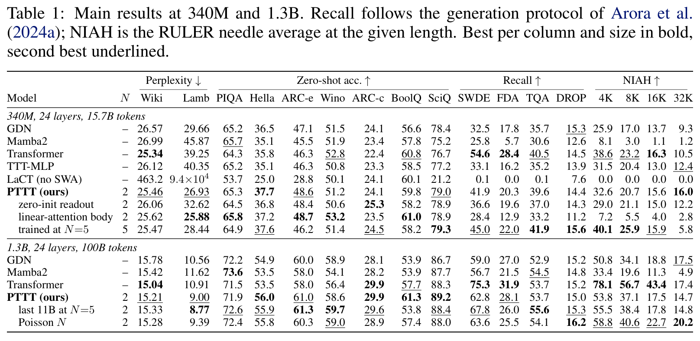

表 1：主结果全表。看两件事：一是 ParaTTT 相对 GDN/Mamba-2 的全面领先，二是 NIAH 长上下文列上 1.3B 的 ParaTTT（53.8/37.1/17.5/14.7）比 Transformer（78.1/56.7/43.4/17.4）差得很远，比 GDN（50.8/34.1/18.8/17.5）只好一点。

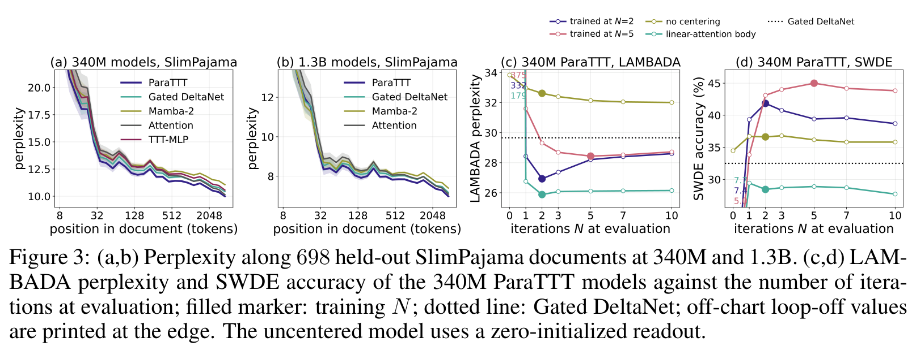

图 3：逐位置的困惑度，横轴是文档内已经读了多少 token。左两栏（a、b）能看到注意力在 8 到 32 个 token 时最差，几百 token 后追平；ParaTTT 在整段 4096 token 的窗口内都压在最低那条线上，两个尺度都是。右两栏（c、d）是迭代轮数扫描：$N=0$ 的中心化模型直接崩溃（LAMBADA 困惑度 332 / 375），零初始化读出层的模型 $N=0$ 时正常但加迭代几乎不涨，说明中心化才是换来迭代收益的那个前提。

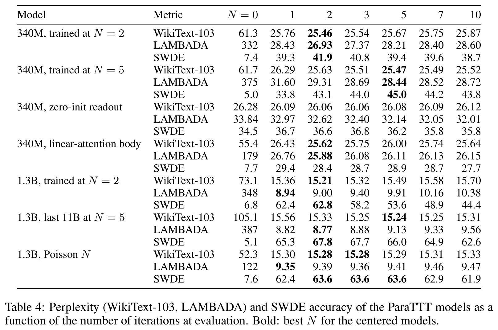

表 4：完整轮数扫描。340M 在 $N=2$ 最好（WikiText-103 25.46），训练在 $N=5$ 的模型在 $N=5$ 最好（25.47），**超迭代几乎不掉**：$N=10$ 时 25.87。1.3B 更敏感，$N=0$ 时 73.1，$N=2$ 时 15.21，$N=10$ 时回退到 15.70。

**消融：两个设计选择各值多少**

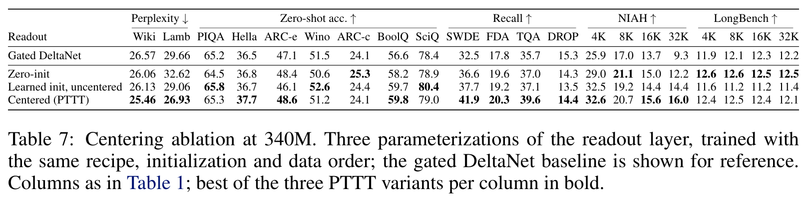

表 7：中心化消融。三行用同样的配方、初始化、数据顺序，只改读出层参数化。零初始化读出层（26.06/32.62/SWDE 36.6）和学出来的非中心化初始化（26.13/29.06/37.7）在困惑度上都比中心化（25.46/26.93/41.9）差一截，SWDE 差 4 到 5 个点。注意 NIAH 是反的：学出来的非中心化初始化在 8K 上是 21.1，高于中心化的 20.7。中心化不是处处赢。

另一条消融在 Table 1 里：把隐藏层从 delta 规则换回线性注意力，SWDE 从 41.9 掉到 28.4，甚至低于 TTT-MLP 的 33.1；困惑度反而略好（25.62 对 25.46）。**delta 规则买的是 recall，不是困惑度**。

**收敛性：迭代真的逼近精确递推吗**

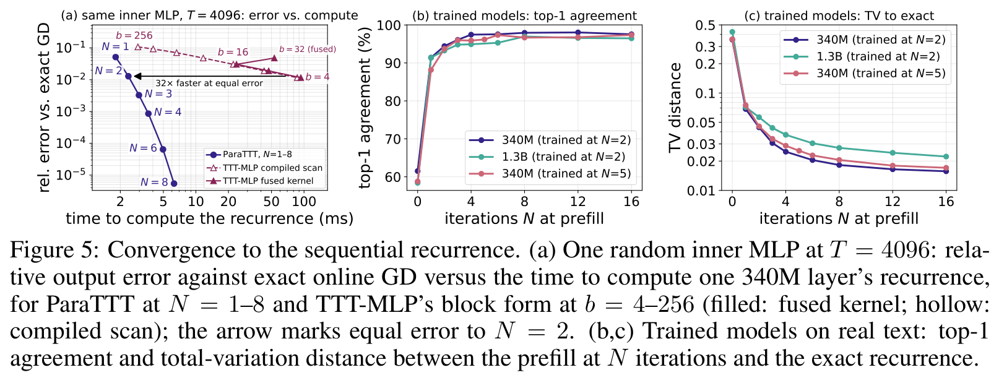

图 5：左栏（a）在同一个随机内层 MLP 上比较输出误差与计算时间。ParaTTT 每加一轮 $N$，误差按数量级往下掉（$N=2$ 约 $10^{-2}$，$N=8$ 到 $10^{-5}$，接近 bf16 噪声底）；TTT-MLP 只能靠缩小块 $b$ 降误差，降同样的量要长得多的时间。箭头标的等误差点在 $N=2$ 对 $b\approx5$，耗时少 32 倍。中右两栏（b、c）是在真实训练好的模型上，用 512 token 序列比较有限轮预填充与逐 token 精确递推：top-1 一致率前两轮就从 60% 出头冲到 90%，四轮后接近 95%，之后收益递减。这两栏的意义是：**定理的假设不成立，实际还是收敛**。

**效率：快在哪，贵在哪**

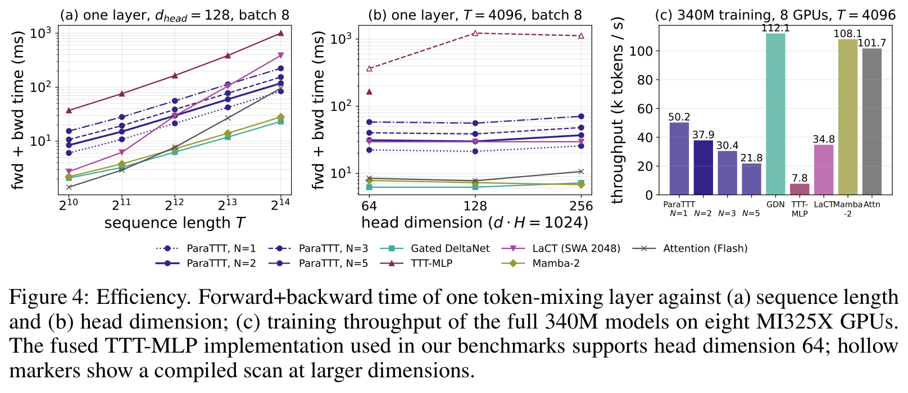

图 4：左两栏是单层的正向加反向耗时。纵轴是对数坐标，ParaTTT（实心深蓝）随序列长度线性增长，和 GDN、Mamba-2 平行；LaCT 和 TTT-MLP 的斜率明显更陡。横轴换成头维度（中栏），ParaTTT 几乎不随头维度变化，TTT-MLP 的编译版扫描直接顶到 $10^3$ ms 量级。右栏（c）是 340M 整模型训练吞吐，ParaTTT $N=2$ 是 37.9k tokens/s，GDN 112.1k、Mamba-2 108.1k、注意力 101.7k。

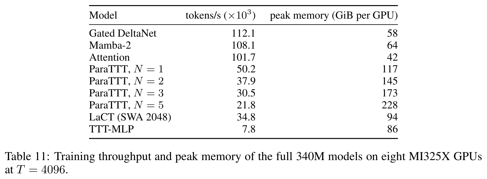

表 11：吞吐和峰值显存。ParaTTT $N=2$ 的吞吐是 GDN 的三分之一左右，峰值显存是 145 GiB 对 58 GiB，两倍半。$N=5$ 时显存 228 GiB、吞吐 21.8k。这是全文最实在的一笔代价：**速度换到了 TTT-MLP 的 4.9 倍，但离线性递归还差 3 倍，显存差 2.5 倍**。

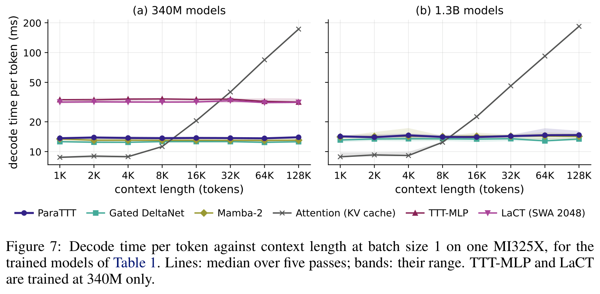

图 7：解码延迟。横轴是上下文长度，纵轴是每 token 毫秒（对数）。ParaTTT 的线几乎是水平的，说明解码时它退化成常数开销的一次精确更新，和上下文长度无关。注意力在 4K 到 8K 之间穿过它，之后一路陡涨；TTT-MLP 和 LaCT 始终是它的两倍以上。这一栏是 ParaTTT 相对 TTT-MLP 最占优的地方。

**合成任务：非线性记忆到底强在哪**

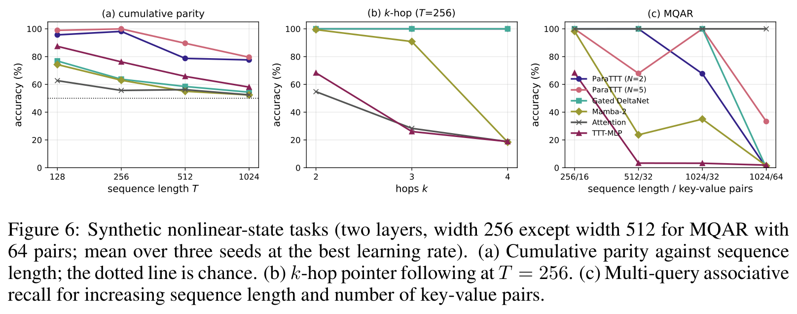

图 6：（a）累积奇偶校验，$T$ 到 256 时 ParaTTT 还有 96% 到 100%，GDN 和 Mamba-2 已经掉到 63% 上下，注意力不到 63%；$T=1024$ 时 ParaTTT 仍在 78% 到 80%。（b）$k$ 跳指针跟随，ParaTTT 和 GDN 能解所有 $k$，Mamba-2 在 $k=4$ 崩到 20%，注意力从来不会组合。（c）多查询联想召回，GDN 和 ParaTTT 都能撑到 32 对键值，64 对只有注意力还行。

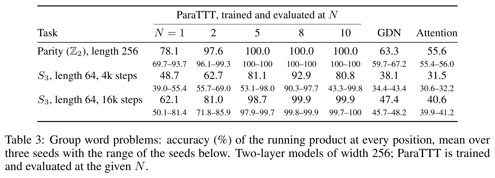

表 3：群论词问题。$S_3$ 长度 64、训 4k 步时，ParaTTT $N=1$ 是 48.7，$N=8$ 是 92.9，而 GDN 只有 38.1、注意力 31.5；训 16k 步时 $N=8$ 到 99.9。这张表最能说明多迭代确实在买表达能力，不是买困惑度的小数点。

**预填充与解码的失配**

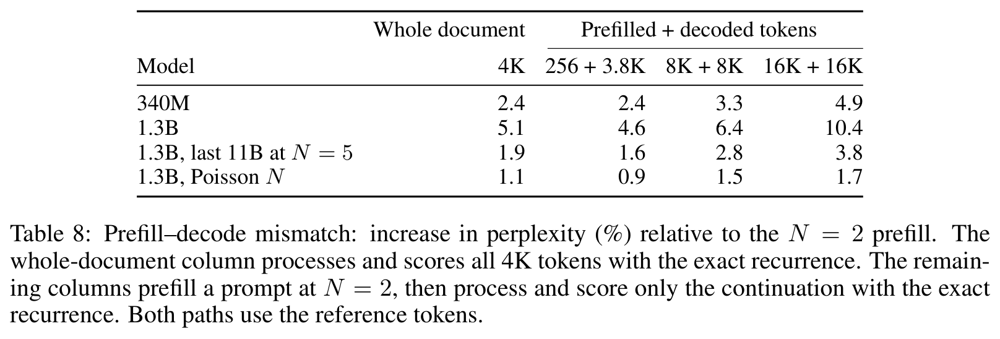

表 8：预填充用 $N=2$ 的分块近似、解码用精确递推，两条路径对不上，困惑度会涨。340M 在整篇 4K 文档上是 2.4%，1.3B 是 5.1%；把预填充长度拉长到 16K + 16K 时 1.3B 涨到 10.4%。训练时随机化 $N$ 的变体把这个数压到 1.1% 到 1.7%，最后 11B 用 $N=5$ 训的变体压到 1.9% 到 3.8%。

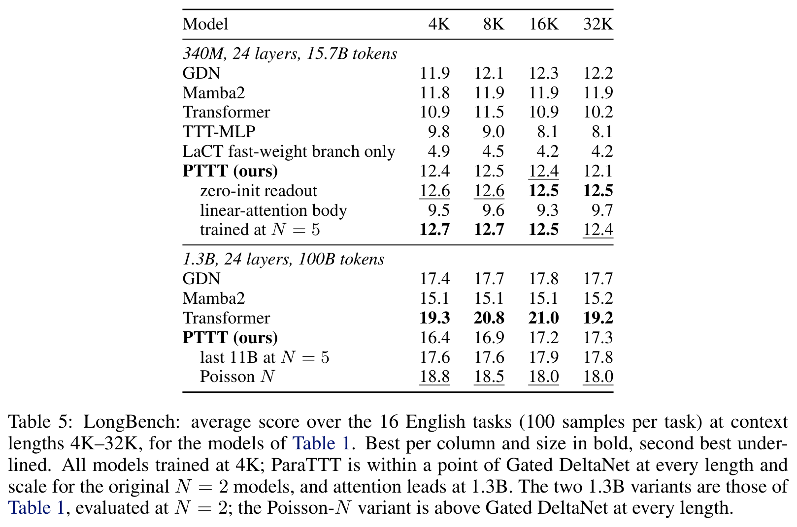

表 5：LongBench 16 个英文任务的平均分。340M 上 ParaTTT（12.4/12.5/12.4/12.1）略高于 GDN（11.9/12.1/12.3/12.2），远高于 TTT-MLP（9.8 到 8.1）。1.3B 上 ParaTTT（16.4 到 17.3）低于 GDN（17.4 到 17.8），更低于 Transformer（19.2 到 21.0）；随机化 $N$ 的变体（18.0 到 18.8）反超 GDN。

**消融告诉我们什么**

三个结论，按可靠性排。第一，中心化和 delta 规则不是锦上添花：去掉中心化，迭代几乎不涨点（表 4 零初始化那几行）；去掉 delta 规则，SWDE 掉 13.5 个点（表 1）。第二，迭代轮数存在最优值，且最优值跟着训练时的 $N$ 走：$N=2$ 训的模型在 $N=2$ 最好，$N=5$ 训的在 $N=5$ 最好，说明模型会适配训练时的迭代深度。第三，随机化 $N$ 是个便宜的鲁棒化手段：训练多花 5% 时间，换来对 $N$ 不敏感，还顺带改善长上下文检索（NIAH 4K 从 15.0 到 16.2，LongBench 反超 GDN）。

**这些实验够不够支撑结论**

核心结论是 $N=2$ 的并行近似和精确串行递推足够接近，这一点站得住：图 5 同时给了合成设定下的误差-时间曲线和真实模型上的一致率，两个角度互相印证。

但有三处不够。一是**只有单 seed**，而主表里好几处差距只有 0.1 到 0.5 个困惑度点，这个量级和 seed 方差同阶，没有置信区间就无法判断"match or exceed"里有多少是噪声。二是**算力和状态大小都没对齐**：ParaTTT 每步贵 3 倍（37.9k 对 112.1k tokens/s）、显存贵 2.5 倍，所以同样 100B token 不等于同样算力，而作者明确说不做对齐，读者没法回答给我同样的 FLOPs 是不是加宽 GDN 更好这个问题。三是**1.3B 上的长上下文和 LongBench 都不占优**，这部分被一句 "attention leads at 1.3B" 带过了。

## 6. 局限性

**作者自己承认的**

- 每个 ParaTTT 配置只跑了一个 seed。
- 和基线的算力、状态大小都没有对齐。
- Theorem 1 的条件是充分的，实测模型的学到的学习率和门都落在条件外（Table 10：$\eta/(1-\alpha)$ 的中位数，读出层 3.9 到 4.1，隐藏层 7.5 到 9.0，逐层中位数最高到 100），所以收敛是测出来的，不是证出来的。
- 长文档上预填充-解码失配更大，加 $N$ 只能部分缓解（表 8）。
- 主表里 LaCT 用的是不带滑窗注意力的配置，那个配置本身表现很差（WikiText-103 困惑度 463.2）。
- TTT-MLP 的融合内核只支持头维度 64，更大维度只能用它慢 2.2 倍的编译扫描。

**我看出来的**

- 隐形假设：这条路线要成立，得默认梯度轨迹的不动点迭代谱半径足够小、几轮就能进到可接受误差。Theorem 1 给的充分条件是 $\epsilon=\bar\eta/(1-\bar\alpha)\le 1/4$，而实测中位数在 3.9 到 9.0，差了一个数量级以上，逐层最高到 100。也就是说**定理和实测模型几乎不覆盖同一个区域**，定理更像是这条路理论上可行的示意，不是我们的模型在定理保护下的保证。
- 边界条件：训练长度是 4096，超出这个长度后近似质量下降明显。1.3B 在 16K + 16K 的预填充下困惑度涨 10.4%，而 NIAH 在 4K/8K 上是 53.8/37.1，比 Transformer 的 78.1/56.7 差一大截；到 32K 时所有模型都掉到 15 到 18 之间。**它是长上下文模型，但不是长上下文强模型**。
- 缺的对比：没有和同样显存预算下把 GDN 加宽或加深比；没有和别的非线性递归（xLSTM、M2RNN）比；最大只到 1.3B。
- 一个工程上的隐患：整套实现依赖把 FLA 内核的块内 mask 从 $j\le t$ 改成 $j<t$。这种改动不会报错，只会静默地算错，复现时值得单独写一个对照测试。
- 状态其实是 GDN 的两倍：每头两个 $128\times128$ 矩阵（一个隐藏层加一个读出层），不是单个。显存贵 2.5 倍的主要原因不在这里，而在每轮都要存三份 $T\times d_{\text{head}}$ 的中间量。

## 7. 一句话总结

以前的非线性记忆像每读一个字就改一次脑子：准，但只能一个字一个字来。ParaTTT 改成先按猜测把整段读完、再回头统一改、改 $N$ 遍：快得多，而且改到最后和逐字改是同一个答案。

类比：批改作文。逐字批是老师读一个字写一句评语，绝对准确但慢；ParaTTT 是先按经验给整篇打个草稿分，再对着草稿逐段复核、修正草稿，复核三轮，草稿就收敛到逐字批的结果。

核心公式：

$$
\boxed{\;\Delta\mathbf{W}^{(l)}_t = \alpha_t \Delta\mathbf{W}^{(l)}_{t-1} - \eta^{(l)}_t\, \delta\mathbf{z}^{(l)}_t \mathbf{h}^{(l-1)\top}_t\;}
$$

这是全篇的支点：权重变化是预激活梯度与上一层激活的外积。一旦 $\delta\mathbf{z}$ 给定，它对状态就是线性的，于是三次现成的并行扫描就能跑完一整轮。

## 8. 可复用点

- **如果我要在自己的项目里用**：任何内层有梯度下降的结构（TTT、fast weight、meta-learning 内循环、在线适配的 adapter）都可以照这个套路走。找那个一旦给定它、递推就变成线性的中间量——这篇里是预激活梯度 $\delta\mathbf{z}$，不是权重本身——然后把它当迭代变量，用现成的线性递归内核跑循环。
- **判断能不能套**：前提是内层损失对权重的梯度能写成两个向量的外积（平方误差、交叉熵配 softmax 都行），且状态是慢权重加增量的形式。做不到这两点，递推就不是线性的，套不上。
- **训练不收敛时先查**：mask 是不是严格因果。key 必须在自己的写入之前被读，用标准因果 mask 会静默地多算一项 $j=t$，误差不大但收敛变慢，很难定位。
- **显存先算再定 $N$**：每轮每隐藏层要存三份 $T\times d_{\text{head}}$，$N=5$ 时代价是 $N=2$ 的 1.6 倍显存。小卡上先跑 $N=1$ 验证管线，再往上加。
- **想省掉中心化的话**：至少要做一次 $N=0$ 和 $N=2$ 的对比，如果两者差距很小，说明中心化没起作用，迭代也白加。

## 9. 我的疑问

- 定理里为什么必须换成软裁剪 $n_{\text{soft}}(\mathbf{x})=\mathbf{x}/\sqrt{1+\|\mathbf{x}\|^2}$？作者说硬投影不满足全局 Lipschitz 雅可比，但实际用的是硬投影。这个 gap 到底有多大，有没有反例？
- 32 倍这个数是在 batch 1、单个随机内层 MLP、$T=4096$ 上测的，端到端训练只有 4.9 倍。差的那 6 倍去哪了？原文没说。我的推断是读出层和逐层 epilogue 的开销把收益摊薄了，但没看到拆解。
- $N=5$ 训的 340M 在 4K/8K NIAH 上大幅提升（40.1/25.9 对 32.6/20.7），32K 却从 16.0 掉到 5.8。为什么迭代更深反而在最长上下文上崩？原文只报了数，没有解释。
- 随机化 $N$ 为什么全面更好？直觉上它像一种正则（模型不能依赖固定的迭代深度），但机制没讲。
- 1.3B 上 LongBench 明显不如 Transformer（16.4 到 17.3 对 19.2 到 21.0），差距比 340M 时更大。是规模上去之后非线性记忆的收益被摊薄，还是训练 token 不够？
