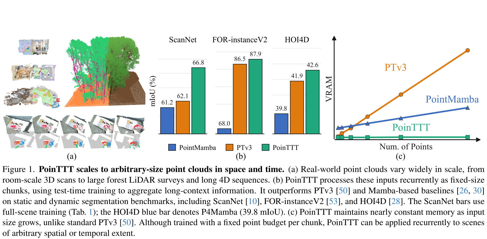
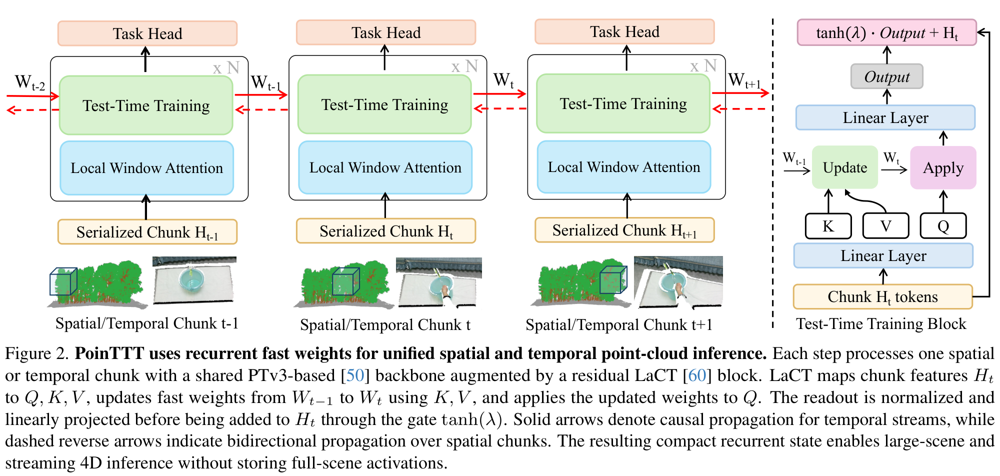
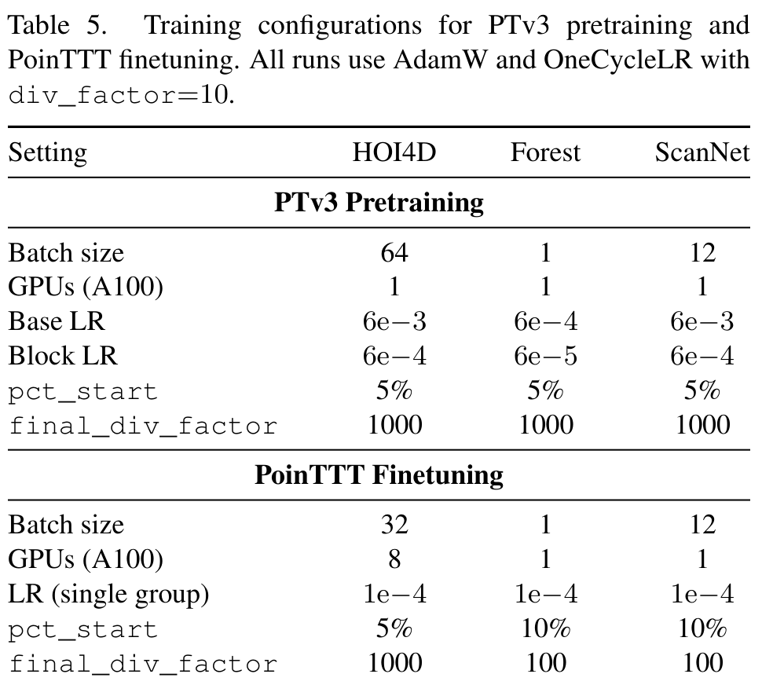
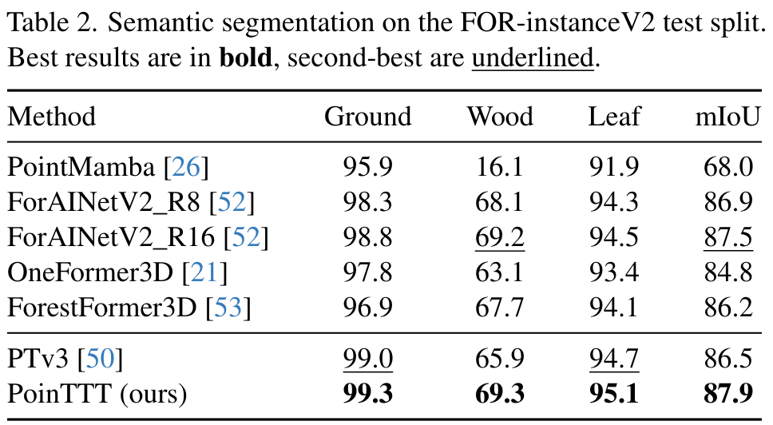
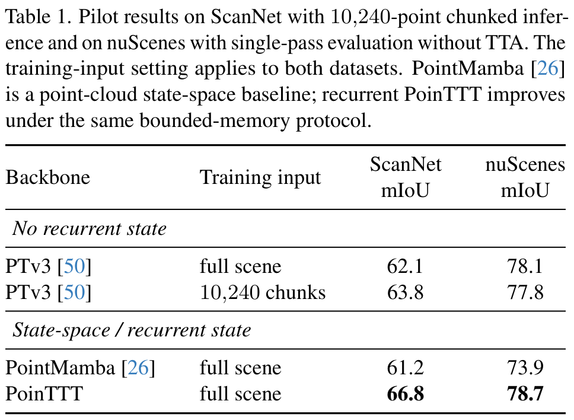
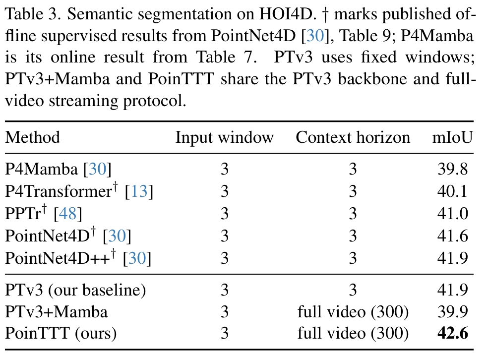
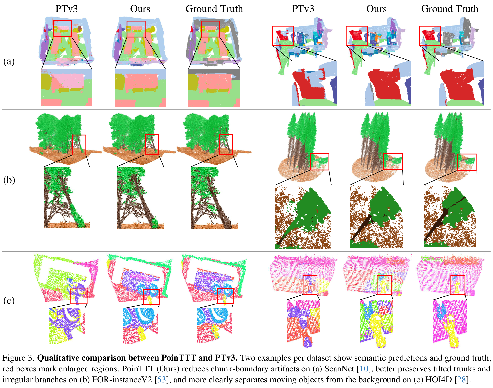
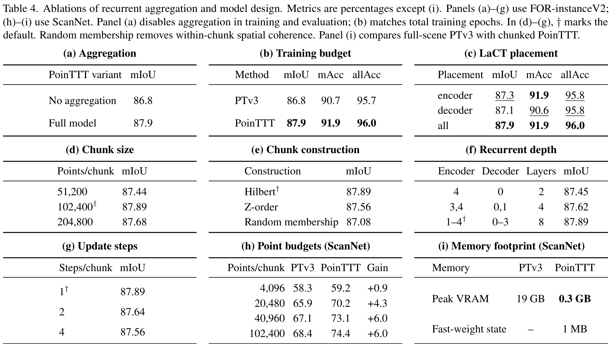

> 一句话：把超大点云切成固定大小的块逐块处理，用测试时训练把跨块信息写进一组小权重，让模型在显存不随场景变大的前提下记住整片森林或整段视频。

## 0. 读之前你需要知道

**术语卡**

- **点云（point cloud）**：一堆带坐标的三维点，可以带颜色、法向等属性。生活类比：给房间里每件物体的表面撒满细沙，每粒沙记一个坐标。
- **语义分割（semantic segmentation）**：给每个点判一个类别，比如地面、树干、树叶。生活类比：把每粒沙按所属物体染成不同颜色。
- **块（chunk）**：从大场景里切出的一个固定点数子集，森林实验默认 102,400 点。生活类比：一大盒拼图装不下，分成若干小盒，一盒一盒拼。
- **激活内存（activation memory）**：前向计算时必须同时留在显存里的中间张量。生活类比：做菜时摊在台面上的备料，台面多大决定你一次能处理多少。
- **自注意力（self-attention）**：每个 token 和一批 token 比对、加权取信息。PTv3 把它限制在局部窗口里，所以单次只能看一块。
- **测试时训练（test-time training, TTT）**：推理时用输入本身做几步梯度更新，把当前输入的信息写进权重。生活类比：不重新上学，只根据眼前这套题临时改自己的笔记。
- **快权重（fast weights）**：推理过程中被改写的那些权重，和训练完就冻结的骨干参数（慢权重）相对。
- **LaCT**：Large Chunk Test-Time Training，用大块 token 做内环更新的 TTT 变体，本文的跨块记忆模块直接建在它上面。

**它站在谁肩上**

- **Point Transformer V3（2024）**：强局部点云骨干，序列化加窗口注意力，块内几何处理得很好；但它每次只吃固定大小的输入，块与块之间不传递任何状态。
- **TTT layers（2024）与 LaCT（2025）**：证明可以把上下文压进一个内环更新的小网络，在长上下文语言任务上用固定大小状态替代全量 KV。它们压的是序列内部的信息，没有处理「点云块之间」这种带空间结构的流。
- **PointMamba（2024）与 Mamba 系列**：用固定大小的状态沿序列递推，是本文最直接的状态递推对照。区别在状态怎么写：Mamba 用输入相关的线性递推，本文用梯度步改一个 MLP 的权重。

## 1. 动机

想象你给一片天然林做激光扫描。扫描仪在林地中央一圈圈往外扫，最后得到几亿个点。你要给每个点标上「地面 / 树干 / 树叶」。问题是显存装不下整片林子，一次前向最多塞十万个点。

**以前怎么做**：把场景切成小块，每块单独送进网络，预测完按坐标拼回去。训练也这么切。

**为什么不行**：每块的预测只能看到块内。一棵树的树干斜跨两个块，左边看到半截，右边看到半截，拼起来就是断的。作者在 ScanNet 上量了这个损失：同一个 PTv3 权重，全场景输入 76.6 mIoU，切成 10,240 点的块再拼回去只剩 62.1。换成一开始就按块训练，也只回到 63.8。原文的判断是 "feeding chunks bottlenecks the network"，切块本身就是瓶颈，不是训练方式的问题。

**为什么现在能做**：两件事凑齐了。PTv3 这类骨干把块内几何做得很强，缺的只是块间记忆；LaCT 这类 TTT 方法证明了，一块输入可以用几步梯度写进一个很小的 MLP，状态大小与序列长度无关。把后者挂到前者上，就能不换骨干补上跨块记忆。

## 2. 贡献

- **把任意范围点云分割重述为递推块处理**。证据：给出块序列形式化（第 4.1 节），空间与时间两种输入共用一套接口，Fig. 1 把三个数据集画进同一张对比图。
- **提出 PoinTTT：在 PTv3 的编码器和解码器上挂残差 LaCT 层**，用快权重做跨块记忆。证据：Tab. 2 森林 87.9 mIoU，比 PTv3 高 1.4，比 ForestFormer3D 高 1.7。
- **同一套机制同时支持离线空间与在线时序推理**。证据：HOI4D 全视频流式 42.6 mIoU，比三帧窗口的 PTv3（41.9）高 0.7，比同骨干的 Mamba 递推对照（39.9）高 2.7。
- **激活内存与场景大小解耦**。证据：ScanNet 峰值显存 0.3 GB，全场景 PTv3 是 19 GB；快权重状态约 280,000 个数，占 1 MB（附录 A.3）。

类比：以前是每个工人各写一段、互不通气；现在每个工人动笔前先读前面留下的便签，便签比整本台账小得多。



图 1：左边是三类真实点云的尺度差（房间、森林、4D 手物交互），中间柱状图是三个数据集的 mIoU，右边是显存随点数增长的曲线。图的作用是先把「尺度差」和「显存差」摆出来：PoinTTT 的曲线基本是平的，PTv3 随点数线性上涨。HOI4D 那组蓝柱是 P4Mamba 的 39.8，不是 PTv3。

## 3. 创新点

- **块不再只是推理时的外部技巧，而是模型接口的一部分**。对比对象：此前的大场景方法把 crop / tile / clip 当预处理，模型内部仍然假设定长输入。有用是因为：只有把块写进模型，跨块状态才有地方存，训练与推理的输入协议才能一致。
- **用残差方式挂记忆模块，而不是替换骨干**。对比对象：PointMamba 把点云序列建模换成状态空间模型，等于换发动机；本文保留 PTv3，只加一个门控旁路。有用是因为：块内几何已由成熟骨干解决，重训一个全新骨干代价大，残差从零初始化还能保证起点不差于 PTv3。
- **同一个先更新后应用（update-and-apply）的配方给出两种方向性**。对比对象：TTT 类方法通常只有因果版本。有用是因为：静态场景允许先看完整场景再回头解码，作者用「正向更新一遍、反向应用一遍」拿到双向上下文；4D 流式保持因果，不偷看未来帧。
- **把 TTT 用在跨块记忆，而不是分布偏移适配**。对比对象：MATE、SMART-PC、PointMAC 这些点云 TTT 工作做的是测试时适应（换传感器、换腐蚀、换任务）。有用是因为：这里要记的是同一场景里已经看过的内容，不是把模型调到新分布上。

类比：不是给车换发动机，而是加一个副油箱；也不是看完整部电影再写影评和边看边写两种模式各造一辆车，而是同一辆车换挡。

## 4. 方法

### 4.1 整体流程

```mermaid
flowchart LR
  A[大场景 / 长视频] --> B[切块<br/>Hilbert 排序或时间分段]
  B --> C[块 t 的 token H_t]
  C --> D[PTv3 局部编码]
  D --> E[LaCT：用 K、V 更新快权重<br/>W_t = Update(W_t-1, H_t)]
  E --> F[用更新后的 W_t 处理 Q<br/>O_t = Apply(W_t, H_t)]
  F --> G[门控残差<br/>H_t + tanh(λ) O_t]
  G --> H[任务头 / 交给下一块]
  E -.状态传给下一块.-> C
```

一句话：每个块先由骨干提局部特征，再由 LaCT 把这批特征写进快权重，然后用刚写好的快权重读出这个块的输出，写好的权重原样留给下一个块。

### 4.2 模块拆解

**块序列化**

为什么需要：点云是无序集合。按文件顺序切块，块内可能包含场地两头毫无关系的点，局部窗口注意力就白做了。

怎么做：静态场景先体素化到固定网格，把每个体素的整数坐标送进三维 Hilbert 曲线排成一维，再按这个顺序切成固定点数的块。Hilbert 曲线的性质是空间上近的点在一维上也近，每块因此落在场景的一个连续区域。4D 输入按短时间段分段，每段体素化后当一个块（HOI4D 上是三帧一块），不做全局排序。

生活类比：把一张地图上互相挨着的街区，排成一条队伍时也尽量让邻居站在一起，而不是随机点名。

公式：场景 $\mathcal{S}=\{(p_i,a_i,y_i)\}_{i=1}^{n}$ 被表示成块序列

$$
\Pi(\mathcal{S}) = (\mathcal{P}_1,\dots,\mathcal{P}_T), \qquad \mathcal{P}_t=\{(p_{t,j},a_{t,j})\}_{j=1}^{M_t},\quad M_t \le M
$$

- $p_i\in\mathbb{R}^3$：第 $i$ 个点的坐标。
- $a_i$：可选属性（颜色、法向等）。
- $y_i$：语义标签，只在训练时用。
- $M$：每块点数上限，森林实验取 102,400。
- $M_t$：第 $t$ 块的实际点数，不超过 $M$。
- $T$：块数，随场景空间范围或视频长度增长。

**LaCT 层：把上下文写成快权重**

为什么需要：骨干在块内很强，但参数对所有块一样，块与块之间没有通道传递信息。需要一个容量固定、能被写入、能被读出的状态。

怎么做：先对块特征做层归一化，投影成 Q、K、V 三份；K 和 V 做一次内环梯度更新，把这对键值关联写进 MLP 的权重；更新后的权重再作用到 Q 上，得到这个块的输出。Q、K 做 ℓ2 归一化，让内积变成余弦相似度，数值更稳。

生活类比：快权重是一本便签本。每来一块，就用这块的内容在上面补几笔（更新）；写完立刻翻着这本便签回答关于这块的问题（应用）；下一块来了接着在这本上补。

公式一：快权重网络的形状。

$$
f_W(x) = W^{(1)}\big(\mathrm{SiLU}(W^{(0)}x)\odot W^{(2)}x\big),\qquad W=\{W^{(0)},W^{(1)},W^{(2)}\}
$$

- $x$：一个 token 的特征向量，维度 $d$。
- $W^{(0)},W^{(2)}$：把 $d$ 维投到隐藏维 $d_h$ 的两个矩阵（按 SwiGLU 的通常写法；原文未给 $d_h$ 数值）。我的推断：两者形状相同，分别走激活分支和门控分支。
- $W^{(1)}$：把 $d_h$ 投回 $d$，输出与输入同维。
- $\odot$：逐元素乘，门控分支决定激活分支哪些维度放行。

公式二：内环目标函数，让每个键记住它对应的值。

$$
\mathcal{L}_{\mathrm{TTT}}(W;H_t) = -\sum_{j=1}^{M_t}\big\langle f_W(K_{t,j}),\,V_{t,j}\big\rangle
$$

- $H_t\in\mathbb{R}^{M_t\times d}$：第 $t$ 块的特征矩阵。
- $K_{t,j},V_{t,j}$：第 $j$ 个 token 的键和值，各 $d$ 维。
- $\langle\cdot,\cdot\rangle$：内积。最大化「用键查出来的值」和真实值的内积，等价于在这个块上做一次联想记忆的写入。

公式三：写入。三个矩阵各走一步梯度下降，再做正交化和范数恢复。

$$
\Delta W_t^{(r)} = -\mathrm{NS}\big(\nabla_{W^{(r)}}\mathcal{L}_{\mathrm{TTT}}(W_{t-1};H_t)\big),\qquad
W_t^{(r)} = \mathrm{Norm}\big(W_{t-1}^{(r)}+\Delta W_t^{(r)}\big)
$$

- $r\in\{0,1,2\}$：三个权重矩阵分别更新。
- $\nabla_{W^{(r)}}\mathcal{L}_{\mathrm{TTT}}$：目标函数对第 $r$ 个矩阵的梯度，形状与 $W^{(r)}$ 相同。
- $\mathrm{NS}$：Newton–Schulz 正交化，用几次矩阵迭代把梯度矩阵压到近似正交，替代精确的逆或 SVD。我的推断：作用类似 Muon 优化器里的正交化，防止连续多块的更新把权重尺度带偏。
- $\mathrm{Norm}$：按每个注意力头恢复行范数，抑制更新次数带来的尺度漂移。

公式四：读出。用刚更新好的权重处理这个块的查询。

$$
O_t = \mathrm{Apply}(W_t,H_t) = P_{\mathrm{out}}\big(f_{W_t}(Q_t)\big)
$$

- $Q_t$：这个块的查询矩阵，$M_t\times d$。
- $f_{W_t}$：用更新后的快权重跑一遍 MLP。
- $P_{\mathrm{out}}$：每个头先做层归一化，拼起来，再过一层可学习输出投影。

公式五：门控残差。新信息以加法进入，初始权重为零。

$$
H_{\mathrm{out},t} = H_t + \tanh(\lambda)\,O_t,\qquad \lambda \text{ 初始化为 } 0
$$

- $H_t$：骨干原来的块特征。
- $\lambda$：可学习标量门控，初始 0，训练开始时 $\tanh(\lambda)=0$，整个模型等价于原始 PTv3。
- $O_t$：LaCT 读出的跨块信息。



图 2：左边三个块是时间上的递推，实线箭头表示 $W_{t-1}\to W_t$ 的因果传递，虚线回箭头标出静态场景里反向应用的那一遍。右边虚线框是单个 LaCT 块的内部：token 先投成 Q/K/V，K、V 走 Update 改权重，Q 走 Apply 读权重，最后经线性层和 $\tanh(\lambda)$ 门控加回 $H_t$。

### 4.3 关键细节

**两种遍历顺序**。静态场景用离线版：先用 `no_grad` 正向跑一遍，只更新权不存激活，得到 $W_T$；再从最后一块往前跑一遍应用，每块用最终的 $W_T$ 解码。这一遍可微，梯度攒完整条序列再反传。4D 流式用在线版：每来一块先更新再应用，预测只依赖已经看到的块，梯度同样攒完整段再反传。生活类比：离线是先读完全书再回头做笔记，在线是边读边做、不许翻页。

**为什么反向应用**。静态场景没有因果限制，用最后一块的权重解码所有块，等于每个块的预测都看过整片场景。代价是要跑两遍，第二遍还得留着激活。

**训练分两阶段**。先按标准点云分割训练 PTv3（逐点交叉熵），再插入 LaCT 端到端微调，让骨干和快权重一起适应递推。森林预训练 100 轮、微调 200 轮；HOI4D 两阶段各 50 轮。优化器 AdamW 加 OneCycleLR。

**默认配置**（Tab. 4 扫出来的）：森林每块 102,400 点；每块只更新 1 次；编码器第 1–4 层、解码器第 0–3 层挂 LaCT，共 8 层；块序用 Hilbert；门控初始 0。



表 5：预训练与微调的完整配置。森林和 ScanNet 都用单卡 A100，HOI4D 微调用 8 卡；微调阶段学习率统一降到 1e−4，森林微调还把 `final_div_factor` 从 1000 降到 100。这张表说明两件事：微调贵在卡数而不是轮数；不同数据集的学习率分组并不一样，直接照搬跑不出同样结果。

## 5. 实验结果

**实验设置**

- **数据集与切分**：ScanNet 室内分割，推理统一用 10,240 点的块、预测拼回后算场景级 mIoU，论文设了全场景训练与块训练两个 PTv3 对照；nuScenes 户外 LiDAR，单遍推理、不做 TTA；FOR-instanceV2 森林测试集，单场景从几百万点到约 $4\times10^{8}$ 点；HOI4D 动态手物交互，三帧一块做在线分割。各数据集训练/验证的场景数与切分比例，原文未给。
- **骨干模型**：PTv3，编码器与解码器都插 LaCT，共 8 层；参数量与通道宽度原文未给。
- **训练预算**：森林预训练 100 轮加微调 200 轮，单卡 A100；HOI4D 两阶段各 50 轮，预训练 1 卡、微调 8 卡 A100。batch size 与学习率见 Tab. 5。总步数、总点数原文未给。
- **基线**：PTv3（全场景训练、块训练两种）、PointMamba（作者按同一套场景处理协议改造成分割）；森林任务另有 ForAINetV2_R8 与 ForAINetV2_R16、OneFormer3D、ForestFormer3D；HOI4D 有 P4Mamba、P4Transformer、PPTr、PointNet4D、PointNet4D++，以及作者自搭的同骨干 Mamba 对照 PTv3+Mamba。
- **指标**：mIoU 与 class IoU（森林分 ground / wood / leaf 三类），另有 mAcc 与 allAcc；都越高越好。
- **推理设置**：单卡 A100；森林走离线递推，每块最多 102,400 点，状态沿整片样地传递；HOI4D 每段视频初始化一次状态，三帧一块，不看未来的块；nuScenes 不做 TTA。

主表只留能说明问题的行，最强基线按同一指标算：

| 数据集 / 任务 | 指标 | 本文 | 最强基线 | 提升 |
| --- | --- | --- | --- | --- |
| ScanNet（10,240 点块推理） | mIoU | 66.8 | 63.8（PTv3，块训练） | +3.0 |
| nuScenes（单遍，无 TTA） | mIoU | 78.7 | 78.1（PTv3，全场景训练） | +0.6 |
| FOR-instanceV2 测试集 | mIoU | 87.9 | 87.5（ForAINetV2_R16） | +0.4 |
| FOR-instanceV2，wood 类 | class IoU | 69.3 | 69.2（ForAINetV2_R16） | +0.1 |
| HOI4D（三帧窗口，全视频上下文） | mIoU | 42.6 | 41.9（PTv3 / PointNet4D++） | +0.7 |
| ScanNet 峰值显存 | peak VRAM | 0.3 GB | 19 GB（PTv3） | 约 63 倍 |

FOR 那一行要看清：对着通用骨干 PTv3 是 +1.4，对着专做森林分割的 ForAINetV2_R16 只有 +0.4，wood 类只多 0.1。作者正文强调的是 +1.4 与 +1.7，参照对象是 PTv3 和 ForestFormer3D（86.2），不是 87.5 的 ForAINetV2_R16。



表 2：森林分割主结果。ForAINetV2 系列与 OneFormer3D 是专为森林或室内实例分割设计的，PoinTTT 只在固定大小块上训练，测试时却按整片样地递推。看这张表要盯 wood 列：几家方法的 ground 与 leaf 都接近饱和（98 以上、94 以上），差距全在跨块才连得起来的树干与枝条。



表 1：ScanNet 与 nuScenes 的先导实验。前两行是同一个 PTv3 架构的两种训练方式，块推理下都掉到 62–64，说明切块损失不是换训练方式能补回来的；PoinTTT 66.8 是在同样的 10,240 点块推理下拿到的。nuScenes 上所有方法差距很小（77.8–78.7），这一列的说服力比 ScanNet 弱。



表 3：HOI4D 在线 4D 分割。带 † 的是 PointNet4D 论文里报的离线监督结果，协议不同，不能与在线方法直接比；同协议可比的只有 PTv3（三帧窗口，41.9）、PTv3+Mamba（全视频上下文，39.9）和 PoinTTT（全视频上下文，42.6）。同骨干只换记忆机制，Mamba 反而比固定窗口低 2.0，说明状态递推不是换个模块就自动成立。



图 3：三个数据集各两组定性对比，红框是放大区域。ScanNet 那行能看到分块留下的条带状伪影，PoinTTT 边界更连续；森林那行是斜生树干，PTv3 会把它判成背景或截断；HOI4D 那行是运动物体，PTv3 把运动的手与邻近背景混在一起，PoinTTT 分得更开。定性图只说明现象，不能替代指标。



表 4：九组消融。(a) 保留 LaCT 但切断跨块聚合，掉 1.1；(b) 把 PTv3 训到同样总轮数，仍差 1.1，涨点不是多训出来的；(c) 只插编码器或只插解码器都不如两边都插；(d) 块大小非单调，102,400 最好；(e) Hilbert 87.89 高于 Z-order 87.56 高于随机分组 87.08；(f) 递推层数从 2 加到 8，87.45 升到 87.89；(g) 每块更新 1 次最好，加到 4 次反而降到 87.56；(h) ScanNet 上块越大，PoinTTT 相对 PTv3 的优势越大，102,400 点时 +6.0；(i) 峰值显存 19 GB 降到 0.3 GB，状态 1 MB。

**消融告诉我们什么**

- 涨点主要来自跨块聚合本身，不是参数变多或训练变长。(a) 与 (b) 各掉 1.1，两个对照都堵住了。
- 状态要读得到也要写得到：只插一边（c）都不如两边，编码阶段的几何与译码阶段的语义都需要场景上下文。
- 更新次数不是越多越好（g）。同一块重复更新只是反复复述同一批观测，不引入新点；这与加层（f）不同，加层是让不同层级各写各的关联。
- 块序不能打乱（e）。随机分组把空间邻居拆散，块内几何先垮，递推再强也补不回来。这条对复现最要紧：换数据集时必须确认块是按空间局部性排的。

**这些实验够不够支撑结论**

我的判断：主结论「递推状态能补回切块损失」站得住，ScanNet 从 62.1/63.8 到 66.8，且表 4h 中优势随块大小增大而扩大，到 102,400 点后不再继续增。但有几处不够：

- 所有主结果只报一个数，没有多种子方差。FOR 上对最强专用方法只高 0.4、wood 只高 0.1，这个量级没有方差支撑就只是噪声级差异。
- 缺一个关键基线：带重叠的滑窗加预测融合。它同样能让每个预测看到块外证据，只是显存和计算更贵；不比这个，就分不清「快权重记忆」与「多看点邻居」谁在起作用。
- 只报显存不报时间。递推必须串行，附录也承认总耗时随块数增长，但没有 wall-clock 对比，部署取舍看不清。
- 只有 PTv3 一个骨干、四个数据集、监督训练。作者在 A.4 自己承认没有大规模点云预训练，也没扩到更多传感器与场景类型。

类比：这份实验报告像体检只拍了三项核心指标，每一项都拍得很清楚，但没做对照组的长期随访。

## 6. 局限性

**作者自己承认的**：

- 推理沿块轴串行，总运行时间随块数增长；并行、层级化或缓存状态传播留作未来工作。
- 算力受限，只做了四个数据集、训练预算封顶，没有扩到更多数据集或更长训练。
- 只在监督设定下训练，没有用大规模点云预训练。

**我看出来的**：

- 隐形假设：块内必须保持空间局部性。Hilbert 排序是这套方法成立的前提，块内几何一旦被拆散（随机分组掉 0.8），递推补不回来。换到采样更无序的传感器时，得先解决排序。
- 边界条件：快权重容量固定约 1 MB，场景越大，能记住的信息密度越低。论文最大到 $4\times10^{8}$ 点的森林，再大一个量级是否成立没有实验。
- 缺的对比：没有和滑窗重叠、层次化池化、外部场景图记忆这些非 TTT 的跨块方案比；也没有和「直接把 PTv3 的窗口开大」比算力归一化后的效果。
- 在线版的因果性只在 HOI4D 上验证，提升 0.7 是在三帧窗口基线上取得的；更长视频、更强运动下状态会不会被早期帧带偏，没有压力测试。

生活类比：用一张便利贴记一整本书的内容，记的是梗概，不是原文；书越厚，梗概丢的细节越多。

## 7. 一句话总结

大场景点云不必一次塞进显存：切成小块，每块用几步梯度把内容写进一个 1 MB 的小网络，下一块接着用。像接力赛交棒，棒子很小，但每一棒都带着前面跑过的路线。

核心公式：

$$
\boxed{\;W_t=\mathrm{Norm}\Big(W_{t-1}-\mathrm{NS}\big(\nabla_W \mathcal{L}_{\mathrm{TTT}}(W_{t-1};H_t)\big)\Big),\qquad O_t=P_{\mathrm{out}}\big(f_{W_t}(Q_t)\big)\;}
$$

## 8. 可复用点

- 如果我要在自己的项目里用：先把输入按空间局部性排成序列（Hilbert / Z-order / Morton），再切固定大小的块。这个排序步骤比换记忆模块更影响结果。
- 记忆模块从零初始化、以门控残差挂到现有骨干上，能保证起点不差于原模型，适合在已经调好的骨干上加新能力。
- 训练时只喂块、推理时喂整条块序列，必须保证两边的块大小与块内构造方式完全一致，否则状态分布会漂。
- 训练不收敛时先查内环更新的步长与 Newton–Schulz 迭代次数。快权重每块都改，步长过大会让状态在几十块内爆掉；本文用 1 次更新就够，先把更新次数降到 1 再调。
- 想省显存又不想改骨干：这套残差 TTT 是现成模板，代价是推理串行，静态场景还要两遍前向。

## 9. 我的疑问

- 离线版反向应用那一遍，梯度要攒完整条序列再反传，训练时的峰值显存真的只和块大小有关吗？论文只说激活内存有界，没给训练峰值。
- 快权重 1 MB 是 8 层共享一个状态，还是每层各一个？正文说每层各自维护快权重，附录说状态约 280,000 个数，两个口径对不上 8 层各一份的量级。我倾向于这是单层或总量口径，但原文没有明说。
- Tab. 1 里 PoinTTT 的 training input 写 full scene，方法部分又说训练用固定大小块。这两个说法怎么统一？如果训练真的喂整场景，那「训练见块、推理见块」的一致性论证要打折扣。
- HOI4D 上 PTv3+Mamba 39.9 比固定窗口 PTv3 41.9 低，作者没有解释。是 Mamba 的状态被早期帧污染，还是训练不充分？

像读论文时在页边写问号：这些问号不影响主结论，但决定了这套方法能不能直接搬走。
