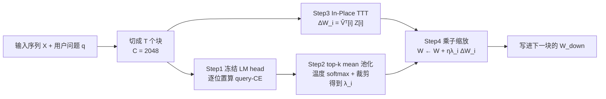
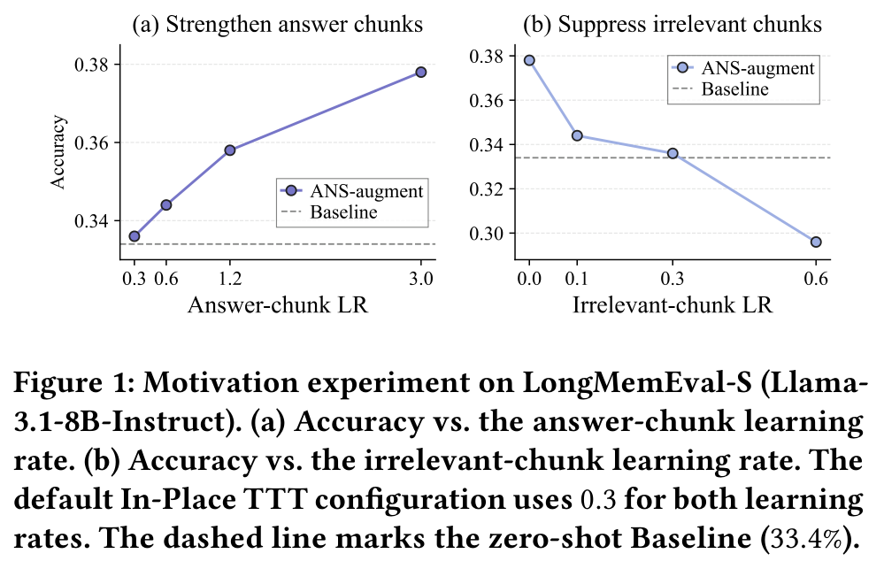
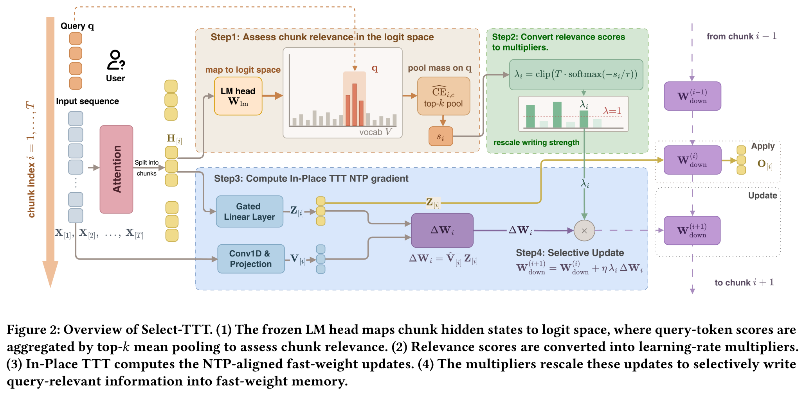
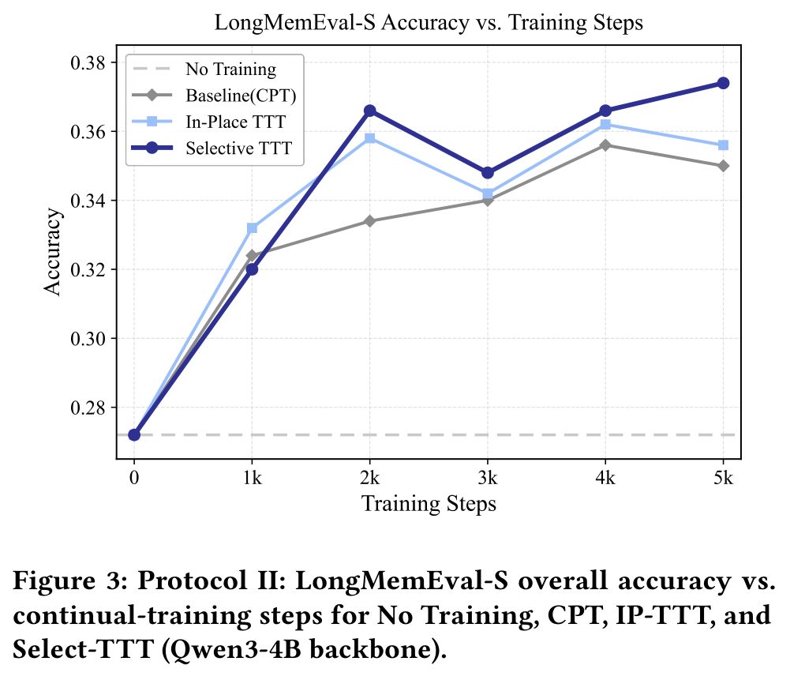
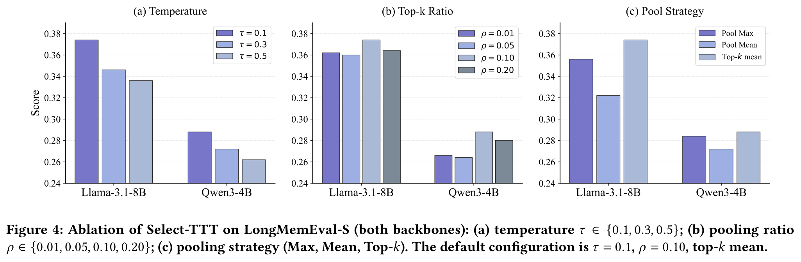
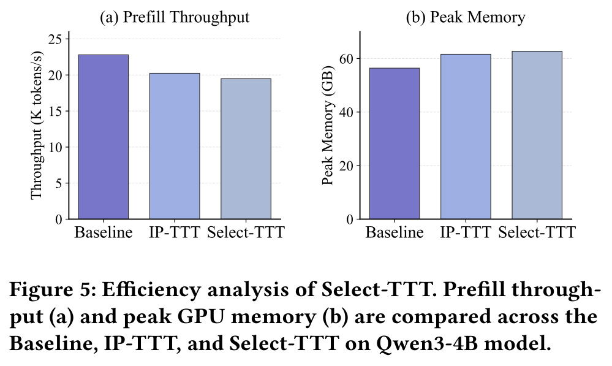
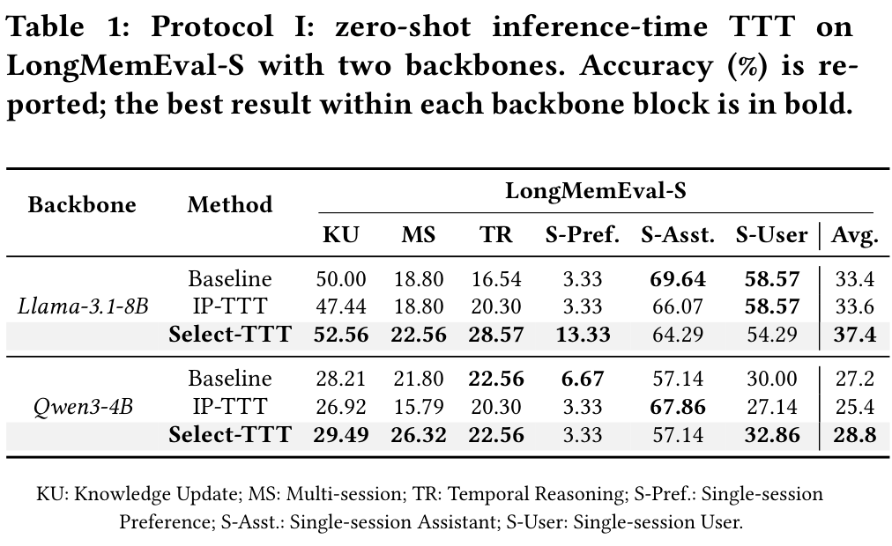
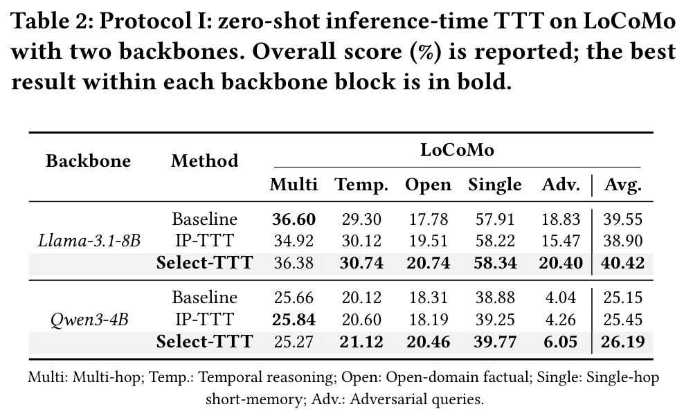
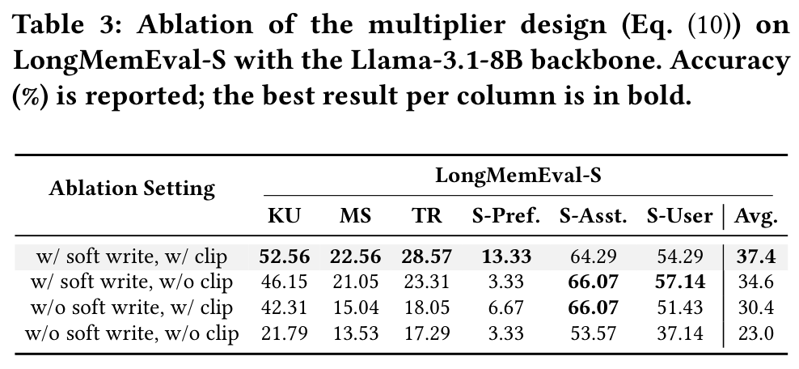
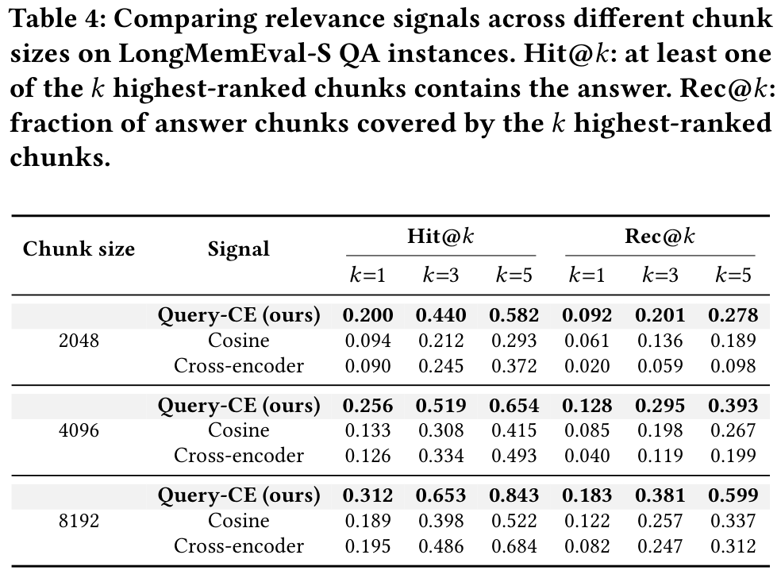

> 一句话：给边读边记的模型加一条规矩，只把和问题有关的那几段使劲记进便签。

## 0. 读之前你需要知道

**术语卡**

- **快权重（fast weights）**：模型里一小块会在读输入的时候被就地改写的参数。生活类比：不是把整本书搬回家（改长期权重），而是撕一张便利贴，边看边往上记，看完就扔。
- **测试时训练（Test-Time Training, TTT）**：模型在推理的那一刻、处理当前这条输入的过程中，对自己的参数做几步梯度更新，把这条输入的信息写进参数。类比：考试允许你在草稿纸上边读题边演算，而不是只能瞪着题目空想。
- **分块（chunk）**：把长输入切成等长的连续片段，一块一块处理。这篇里块大小 $C = 2{,}048$ 个 token。
- **门控 MLP（gated MLP）**：Transformer 每层里那个「先升维、过激活、再降维」的前馈网络，SwiGLU 版本多一条门控支路。Llama 和 Qwen3 都用它。
- **下投影（down-projection，$\mathbf{W}_{\mathrm{down}}$）**：门控 MLP 最后把宽维度压回模型维度的那个矩阵。这篇把这一层当便利贴。
- **logit**：输出头吐出的一串未归一化分数，过 softmax 就成「下一个词是词表里每个词的概率」。词表大小 $V$ 在 Llama-3.1-8B 上是 128,256，Qwen3-4B 上是 151,936。
- **输出头（output head，$\mathbf{W}_{\mathrm{lm}}$）**：把隐状态映射成词表 logit 的矩阵，通常和输入 embedding 绑定。这篇全程冻结它，只借它当尺子。
- **交叉熵（cross-entropy, CE）**：衡量模型给目标词分配的概率有多低，越低说明模型越「看好」这个词。
- **上下文并行（context parallelism）**：把一条几十万 token 的序列切开放到多张卡上同时算。这篇的方法必须保住这一点，否则工程上不可用。

**它站在谁肩上**

- 快权重（Schmidhuber, 1992；Ba et al., 2016）：最早提出用一组临时参数当记忆，但当年只在很小的循环网络里玩得动，放不进现代 LLM。
- 测试时训练（Sun et al., 2020；Wang et al., 2021）：在视觉里用来对付分布漂移，做法是测试时对模型做几步自监督更新。问题是这些方法要么要额外自监督目标，要么要改结构。
- 线性注意力与 TTT 层（Katharopoulos et al., 2020；Sun et al., 2025；Behrouz et al., 2025）：把 TTT 做成新的循环层，效果好，但要从头预训练，现有开源权重用不上。
- In-Place TTT（Feng et al., 2026）：把门控 MLP 的下投影当快权重，让 TTT 变成「不改结构、不重训」的插件。这篇直接建在它上面，**要修的正是 In-Place TTT 的写入节奏**。
- 长上下文问答基准（Wu et al., 2024；Maharana et al., 2024）：LongMemEval 和 LoCoMo，这两篇是本文测量的场地。

## 1. 动机

设想你和一个助理聊了三年，聊天记录四十来个 session、十一万 token。你想问一句「我上次说想去哪儿旅行」。

人翻记录会自动跳读，一眼扫过几百句「好的」「收到」「哈哈」，停在真正提到旅行的那两段上。现在的大模型不是这样。

**以前怎么做**：模型每回答一步，都要用注意力把整份记录重新读一遍。读的时候它对每一行都一样上心——注意力机制本身没有「这段话和当前问题无关」的先验。

**为什么不行**：读得越多越稀释。文献里已经被反复验证（Lost in the middle、RULER）——上下文窗口装得下，不等于模型用得上。真正带答案的证据往往只占很小一段，其余全是噪声。而一旦部署，模型权重是冻死的，它只能反复重读，不能把「记住了」这件事沉淀下来。

In-Place TTT 想解决这个：边读边把内容写进快权重，读完就有一份压缩后的记忆。听起来对。但作者实测发现，在 LongMemEval-S 上用 Llama-3.1-8B-Instruct，打开 In-Place TTT 只把平均准确率从 33.4% 抬到 33.6%——**几乎没有效果**，某些设置下还不如不开。

作者把原因归到 In-Place TTT 的写入节奏上：它的每个块都用同一个学习率 $\eta$ 写进去（论文里叫 uniform write schedule），不管这块是不是和问题有关。于是几十个无关块在自己的记忆里和那一个答案块平起平坐，噪声把信号盖掉了。

用一个比喻：你在便利贴上记笔记，但这张便利贴只有巴掌大。你却把整场会议从头到尾一字不落地往上抄。抄到最后，真正重要的那句决议被挤得看不清了。

**为什么现在能做**：关键在于「相关」这个信号不用额外去训。预训练好的 LLM 自己就带着一把尺子——它的输出头。作者的做法是：让每个块的隐状态过一遍冻结的输出头，看它给问题那几个词分配了多少概率质量。给得多，说明这一块的表示已经能预测出问题，那它就相关。这个信号免费、无监督、不加参数。

## 2. 贡献

- **把 In-Place TTT 在真实长文问答上的失效定位到「写入不分轻重」**。证据：Llama-3.1-8B-Instruct 上 LongMemEval-S 只从 33.4% 涨到 33.6%；作者用一个有 ground-truth 答案块标注的 ANS-augment 实验，把答案块与无关块的学习率拆开扫，答案块加强时准确率单调涨到 37.8%，无关块加强时掉到 29.6%（Figure 1）。
- **提出 Select-TTT：一条按块缩放写入强度的规则**。证据：同一个 TTT checkpoint 上只改乘子，LongMemEval-S 上 Llama 从 IP-TTT 的 33.6% 到 37.4%，Qwen3-4B 从 25.4% 到 28.8%（Table 1）。
- **证明这个信号不需要监督、不需要新参数、不破坏上下文并行**。证据：相关性分数直接读冻结输出头，训练参数量与 IP-TTT 相同；打分只增一次输出头前向，prefill 吞吐从 IP-TTT 的约 20.2 K tokens/s 到 Select-TTT 的约 19.6 K tokens/s（Figure 5，我按图读数）。
- **在持续训练协议下也成立**。证据：Qwen3-4B 在 LongCite-45k 上训 5k 步，Select-TTT 37.4%，高于 IP-TTT 35.6% 和 CPT 35.0%（Figure 3、Table 10）。
- **顺手证明 query-CE 比通用检索信号更会挑块**。证据：chunk size 8192、$k=5$ 时 Query-CE 的 Hit@5 是 0.843，余弦相似度 0.522，cross-encoder 0.684（Table 4）。

## 3. 创新点

- **在 logit 空间里量「这块和问题有多相关」**。对比对象：余弦相似度、cross-encoder 重排器。这两个都假设文档是独立单元、向量来自单独对比学习编码器、问题和文档落在同一个标定过的语义空间里；而这里的「块」是同一条输入里切出来的连续片段，只有前向过程中产生的中层隐状态可用。用冻结输出头把隐状态投到词表分布上，再看问题 token 的概率质量，等于把「相关性」变成一个有直接逐步含义的量。有用是因为：不需要任何检索模型、不需要文本预处理，且和模型自己的表示对齐。
- **把相关性变成逐块的学习率乘子，并且保住总预算**。对比对象：In-Place TTT 的全局学习率 $\eta$。新在 $\lambda_i$ 乘在每一步更新上，$\frac{1}{T}\sum_t \lambda_t \approx 1$，只改分配不改总量。有用是因为：如果只放大相关块而不收缩无关块，总写入量会膨胀，快权重会被过度更新——作者设计的三个 desiderata（soft write / budget preservation / stability）就是专门堵这个口子的。
- **插件式，不动并行结构**。对比对象：所有把 TTT 做成新循环层、需要从头预训练的做法。新在这条规则只把 $\Delta\mathbf{W}_i$ 乘一个标量，主体计算与 IP-TTT 一模一样，所以保留了块级、matmul 密集、上下文并行的全部性质。有用是因为：它能在现有开源权重上直接开，`λ≡1` 时精确退化成 IP-TTT。

## 4. 方法

### 4.1 整体流程

这张图的意思是：打分（上路）和算梯度（下路）是两条并行的支路，最后只在乘法那一个节点汇合。所以加了这个方法，原来那条昂贵的块并行主路一点没变。

### 4.2 模块拆解

**In-Place TTT 的写入（本文的地基）**

为什么需要：得先有一个「记忆」可以被写。In-Place TTT 挑的是每个门控 MLP 里的下投影 $\mathbf{W}_{\mathrm{down}}$——它本来就在，不用新加结构。

怎么做：门控 MLP 的前向是

$$
\mathbf{O} = \Bigl(\phi(\mathbf{H}\mathbf{W}_{\mathrm{gate}}^\top) \odot (\mathbf{H}\mathbf{W}_{\mathrm{up}}^\top)\Bigr)\mathbf{W}_{\mathrm{down}}^\top
$$

符号表：

- $\mathbf{H}\in\mathbb{R}^{n\times d_{\mathrm{model}}}$：$n$ 个 token 的隐状态，Llama 上 $d_{\mathrm{model}}=4096$。
- $\mathbf{W}_{\mathrm{gate}},\mathbf{W}_{\mathrm{up}}\in\mathbb{R}^{d_{\mathrm{ff}}\times d_{\mathrm{model}}}$：冻结的慢权重，Llama 上 $d_{\mathrm{ff}}=14{,}336$。
- $\phi$：激活函数（SwiGLU 里的 SiLU）。
- $\odot$：逐元素乘，就是门控。
- $\mathbf{Z}=\phi(\mathbf{H}\mathbf{W}_{\mathrm{gate}}^\top)\odot(\mathbf{H}\mathbf{W}_{\mathrm{up}}^\top)\in\mathbb{R}^{n\times d_{\mathrm{ff}}}$：中间激活，被当作 TTT 的「键」。
- $\mathbf{W}_{\mathrm{down}}\in\mathbb{R}^{d_{\mathrm{model}}\times d_{\mathrm{ff}}}$：唯一会被改写的那块，就是快权重。

值（target）由 token embedding 过一个因果的一维卷积再投影得到：

$$
\widehat{\mathbf{V}} = \mathrm{Conv1D}(\mathbf{X}^0)\,\mathbf{W}_{\mathrm{target}}
$$

$\mathbf{X}^0\in\mathbb{R}^{n\times d_{\mathrm{model}}}$ 是 token embedding，$\mathrm{Conv1D}$ 是核大小为 5 的因果深度卷积（零初始化），$\mathbf{W}_{\mathrm{target}}$ 是稀疏对角初始化。这样构造是为了让「值」带上未来 token 的信息，和下一词预测（NTP）对齐。

损失取负的 Frobenius 内积 $\mathcal{L}=-\langle\cdot,\cdot\rangle_{\mathrm{F}}$，于是梯度有闭式解。把序列切成 $T$ 个不重叠的块，第 $i$ 块的更新是

$$
\mathbf{W}_{\mathrm{down}}^{(i+1)} = \mathbf{W}_{\mathrm{down}}^{(i)} + \eta\,\underbrace{\widehat{\mathbf{V}}_{[i]}^\top\,\mathbf{Z}_{[i]}}_{\Delta\mathbf{W}_i}
$$

符号表：

- $\mathbf{W}_{\mathrm{down}}^{(i)}$：处理第 $i$ 块之前的快权重，维度 $d_{\mathrm{model}}\times d_{\mathrm{ff}}$。
- $\mathbf{Z}_{[i]}\in\mathbb{R}^{C\times d_{\mathrm{ff}}}$：第 $i$ 块的键（$C=2048$）。
- $\widehat{\mathbf{V}}_{[i]}\in\mathbb{R}^{C\times d_{\mathrm{model}}}$：第 $i$ 块的值。
- $\Delta\mathbf{W}_i=\widehat{\mathbf{V}}_{[i]}^\top\mathbf{Z}_{[i]}\in\mathbb{R}^{d_{\mathrm{model}}\times d_{\mathrm{ff}}}$：这一块贡献的更新量，一个矩阵乘法就能算完，所以块与块之间可以并行。
- $\eta$：全局学习率，本文设 0.3。

生活类比：每读完一个段落，就在便签上按「这段话里出现了什么词 × 这些词对应什么后续」的乘积补一笔。补多少，由 $\eta$ 统一规定。

**问题就出在这个统一规定上。** 不管这一块是「嗯嗯好的」还是「我想去冰岛」，$\eta$ 都一个数。

**块相关性打分（Step 1）**

为什么需要：要让 $\lambda_i$ 因块而异，先得有个不花钱的相关性信号。

怎么做：把每块每个位置的隐状态过一遍**冻结的**输出头，得到词表上的 logit，再看它给问题那几个 token 分了多少概率。位置 $c$、块 $i$ 的 query-CE 是

$$
\widehat{\mathrm{CE}}_{i,c} = -\frac{1}{Q}\sum_{j=1}^{Q}\log\frac{\exp\bigl((\mathbf{z}_{i,c})_{q_j}\bigr)}{\sum_{v\in\mathcal{V}}\exp\bigl((\mathbf{z}_{i,c})_{v}\bigr)}
$$

符号表：

- $\mathbf{q}=(q_1,\dots,q_Q)$：问题 token 的 id 序列，$Q$ 是问题长度，训练时就是该样本的问题，推理时就是用户输入。
- $\mathbf{z}_{i,c}=\mathbf{W}_{\mathrm{lm}}\,\mathrm{RMSNorm}(\mathbf{h}_{i,c})+\mathbf{b}_{\mathrm{lm}}\in\mathbb{R}^{V}$：位置 $c$ 的词表 logit，$V$ 是词表大小。
- $(\mathbf{z}_{i,c})_{q_j}$：这一行 logit 里第 $j$ 个问题 token 对应的那一维。
- $\widehat{\mathrm{CE}}_{i,c}$：负对数似然，越低说明模型越「看好」问题里的词，也就越相关。

一个位置太低不代表整块相关，所以要在块内聚合。用的是 top-$k$ mean 池化：

$$
s_i = \mathrm{Pool}^{(K)}_{c\in[C]}\bigl(\widehat{\mathrm{CE}}_{i,c}\bigr),\qquad K=\max\bigl(1,\lceil \rho C\rceil\bigr)
$$

符号表：

- $s_i$：第 $i$ 块的单一相关性分数，越低越相关。
- $\rho\in(0,1]$：保留比例，默认 0.1，即 2048 个位置里只留 CE 最低的约 205 个再平均。
- $K=\lceil\rho C\rceil$：实际保留的位置数。
- 三种退化：$\rho=1$ 是全块平均（mean），$\rho\to 0$ 是只留最低那一个（max）。

生活类比：判断一页纸重不重要，不能把整页的字都拿来平均——一页里就一句话是答案，剩下全是页边注。应该只看最像答案的那几行，再把这几行平均。

作者说得很直白：选择 top-$k$ mean 是因为"一个块的相关性应由它最相关的那部分决定，而不是对所有 token 求平均"。

**分数转乘子（Step 2）**

为什么需要：$s_i$ 是负交叉熵的量纲，不能直接当学习率用；而且必须保证总量不变、不能有块暴走。

怎么做：对负分数做带温度的 softmax，再乘块数、再裁剪：

$$
\lambda_t = \mathrm{clip}\!\left(\frac{\exp(-s_t/\tau)}{\sum_{i=1}^{T}\exp(-s_i/\tau)}\cdot T,\;0,\;M\right)
$$

符号表：

- $s_t$：第 $t$ 块的分数，越低（越相关）→ $\exp(-s_t/\tau)$ 越大。
- $\tau$：温度，默认 0.1。越小，相关块和不相关块的差距被拉得越开。
- $T$：块的总数。乘上去是为了让 $\frac{1}{T}\sum_t\lambda_t\approx 1$，即平均写入强度仍是 $\eta$。
- $M$：上裁剪，默认 10.0，防止某一块被放大到失控。
- $\lambda_t\in(0,M]$：第 $t$ 块的学习率乘子。

这条路满足三条，作者逐条点名：

1. **soft write**：softmax 严格为正，所以没有哪一块被完全丢掉。因为 query-CE 只是估计，万一估错了，至少还留了一点写入。
2. **budget preservation**：乘 $T$ 之后平均乘子约等于 1，总写入量守恒，只改分配。这一条很关键——它让改进不来自「多写」，只来自「写到对的地方」。
3. **stability**：上裁剪 $M$ 防止单块主导。温度很小时 softmax 会非常尖，没有裁剪的话某块可能拿到远超预算的乘子。

生活类比：把一个月的生活费按重要性分到各项开支上，但总预算不变。不够重要的少给点，最重要的多给点，但不能把整月的钱全砸在一项上。

**选择性更新（Step 4）**

为什么需要：把乘子接到写入上。

怎么做：整个方法就改了这一个式子：

$$
\mathbf{W}_{\mathrm{down}}^{(i+1)} = \mathbf{W}_{\mathrm{down}}^{(i)} + \underbrace{\eta\,\lambda_i}_{\text{query-conditioned step size}}\;\widehat{\mathbf{V}}_{[i]}^\top\,\mathbf{Z}_{[i]}
$$

符号表：

- $\eta\lambda_i$：有效步长。$\lambda_i<1$ 时这块写得更轻，$\lambda_i>1$ 时写得更重。
- 其余符号同上。

$\lambda_i\equiv 1$ 时，这个式子精确退回 In-Place TTT。所以 Select-TTT 和 IP-TTT 的唯一差别，就是每块的乘子是常数还是由查询决定。

作者还给了一个解释角度：把 $\Delta\mathbf{W}_i$ 看成 NTP 对齐目标的闭式梯度步，那么上式就是**逐块 SGD 加一个按查询条件化的自适应步长**。自适应步长在深度学习优化里是老技术，新的是这个步长由查询决定。

### 4.3 关键细节

这些细节决定别人复现得出来还是复现不出来。

- **模块插在哪**：每第 6 层插一个 TTT 模块，层号 $\{0,6,12,18,24,30\}$，两个骨干都是 6 个 TTT 层。Qwen3-4B 只有 36 层，所以插到第 30 层为止。
- **打分不物化 $[T,C,V]$ 张量**。直接算 logit 会得到一个 $T\times C\times V$ 的张量，$V$ 十几万，显存放不下。作者用了两个技巧：
  - **分块 log-sum-exp**：把词表切成大小为 $B$（默认 2,048）的块，逐块算 $\mathrm{lse}^{(k)}_{i,c}$，再用 log-exp 相加合并。峰值激活从 $O(V\cdot T\cdot C)$ 降到 $O(B\cdot T\cdot C)$。
  - **只取问题 token 的 logit 行**：Eq. (8) 只用到 $Q$ 个问题 token 对应那几行，直接 gather 出来算，代价从 $O(TCHV)$ 降到 $O(TCHQ)$。因为 $Q\ll V$，这一步省得最多。
  - 展开后 $\widehat{\mathrm{CE}}_{i,c}=\frac{1}{Q}\sum_j[\mathrm{lse}_{i,c}-(\mathbf{z}_{i,c})_{q_j}]$，两个便宜的量就能拼出来。
- **初始化要让 TTT 一开始等于没有**。Conv1D 零初始化、$\mathbf{W}_{\mathrm{target}}$ 稀疏对角初始化，于是第 0 步 $\Delta\mathbf{W}_{\mathrm{down}}\approx \mathbf{0}$，模型行为与原始 checkpoint 完全一致，TTT 机制随着训练慢慢长出来。
- **超参默认值**：$\tau=0.1$、$\rho=0.10$、$M=10.0$、$B=2{,}048$、块大小 $C=2{,}048$、$\eta=0.3$。
- **上下文并行**沿用 In-Place TTT 的实现，加权更新用因果前缀和聚合（Algorithm 1，附录 A）。

## 5. 实验结果

**实验设置**

- **数据集与切分**：推理评测用 LongMemEval-S（500 道题，每题嵌在约 40 个 session、约 115K token 的历史里，6 个子任务：Knowledge Update、Multi-session、Temporal Reasoning、Single-session Preference、Single-session Assistant、Single-session User）和 LoCoMo（公开十段对话，正文写"约 1,980 题"、附录 B.3.1 写 1,986 题，19–32 个 session、每段 369–689 轮，5 类查询）。两个都是纯推理评测，没有训练/测试切分。持续训练用 LongCite-45k（约 44,600 条长上下文 QA，带句子级引用标注），作者只保留英文、且上下文长度落在 8K–65K token 的子集。
- **骨干模型**：Llama-3.1-8B-Instruct（32 层，$d_{\mathrm{model}}=4096$，$d_{\mathrm{ff}}=14{,}336$，原生 131,072 位置，无 RoPE 扩展）和 Qwen3-4B（36 层，$d_{\mathrm{model}}=2560$，$d_{\mathrm{ff}}=9728$，YaRN 扩展因子 4）。所有非 TTT 权重与原始 checkpoint 一致。
- **训练预算**：Protocol II 用 AdamW，峰值学习率 $5\times10^{-6}$，weight decay 0.1，梯度裁剪 1.0，warmup 2%，global batch size 8，最大序列长度 65,536，最多 5k 步，每 1k 步存一个 checkpoint。TTT 学习率 $\eta=0.3$，块大小 $C=2{,}048$。硬件是 Nvidia H200，**卡数原文未给**。
- **基线**：Baseline（原始预训练模型直接评）、IP-TTT（$\lambda_i\equiv 1$ 的 In-Place TTT）、CPT（同样语料上的常规持续预训练，不带 TTT），另有 No Training 参考线。IP-TTT 与 Select-TTT 跑在**同一个 TTT checkpoint** 上，两行只差乘子是常数还是查询条件化，所以它们的对比干净地隔离出「选择性」的贡献。
- **指标**：LongMemEval-S 按官方逐子任务报 accuracy（%）；LoCoMo 按 query type 报 overall score（%）。两边表里的 Avg. 都是**按题加权的总体准确率**（Table 11 脚注写明 "Avg. is the question-weighted overall accuracy"），不是五个子任务的算术平均。检索信号分析用 Hit@$k$（前 $k$ 个块里至少一个含答案）和 Rec@$k$（前 $k$ 个块覆盖了多少比例的答案块），越高越好。
- **推理设置**：原文未给解码温度、长度上限、采样次数；也未给 LoCoMo 的裁判模型。只说 LongMemEval-S 按官方逐子任务协议评、LoCoMo 按 query type 报分。

主表：

| 数据集 / 任务                                        | 指标                | 本文（Select-TTT） | 最强基线            | 提升         |
| ----------------------------------------------- | ----------------- | -------------- | --------------- | ---------- |
| LongMemEval-S（Llama-3.1-8B-Instruct，Protocol I） | Accuracy (%)      | 37.4           | 33.6（IP-TTT）    | +3.8       |
| LongMemEval-S（Qwen3-4B，Protocol I）              | Accuracy (%)      | 28.8           | 27.2（Baseline）  | +1.6       |
| LoCoMo（Llama-3.1-8B-Instruct，Protocol I）        | Overall score (%) | 40.42          | 39.55（Baseline） | +0.87（我算的） |
| LoCoMo（Qwen3-4B，Protocol I）                     | Overall score (%) | 26.19          | 25.45（IP-TTT）   | +0.74（我算的） |
| LongMemEval-S（Qwen3-4B，Protocol II，5k 步）        | Accuracy (%)      | 37.4           | 35.6（IP-TTT）    | +1.8（我算的）  |

注意表格里两个 37.4 是不同格子：Protocol I 的 Llama 是 37.4，Protocol II 的 Qwen 也是 37.4，别串。

**原文实验图**

图 1：这条图是整篇论文的动机证据。横轴是人为给某一类块设的学习率，纵轴是 LongMemEval-S 准确率，虚线是零样本基线 33.4%。(a) 只加强答案块：0.3→33.6%（就是 IP-TTT 的默认设置）、0.6→约 34.5%、1.2→约 35.8%、3.0→37.8%，单调上升。(b) 只加强无关块：准确率一路往下掉到 29.6%，明显穿过基线以下。**读图结论：多写不是好事，写对地方才是。方向反了，写入本身会变成伤害。** 有一处对不上：正文说 (b) 从 34.8% 掉到 29.6%，但图上最左端那个点（无关块学习率 0.0）读到的是约 0.378，即 37.8%。

图 2：整体架构。左边是输入序列按 chunk index 切成 $T$ 块，中枢是 Attention 出的隐状态 $\mathbf{H}_{[i]}$；上支路走 Step 1→2 打分出 $\lambda_i$，下支路走 Step 3 算 $\Delta\mathbf{W}_i$；两路在中间的乘法节点汇合，得到 $\mathbf{W}^{(i+1)}_{\mathrm{down}}$ 传给下一块。**读图结论：新加的只有上方那半边的打分链路，右边读写快权重的那条主线与 IP-TTT 完全一样，这是「插件式」在图上最直接的证据。**

图 3：Protocol II 的训练曲线（Qwen3-4B）。横轴 0→5k 步，灰色虚线是 No Training（27.2%）。1k 处排序是 IP-TTT（约 33.1%）> CPT（约 32.4%）> Select-TTT（约 32.0%）——**Select-TTT 反而最低**，这是论文里唯一一次落后；2k 处 Select-TTT 跳到 36.6% 反超；3k 处三条曲线一起掉（Select-TTT 约 34.8%、IP-TTT 约 34.3%、CPT 约 34.0%）；5k 处拉开到 37.4% / 35.6% / 35.0%。**读图结论：选择性这条规则不是从一开始就赚的，要等模型先适应 TTT 机制（约 2k 步之后）才开始收租；3k 那个集体下凹原文没解释。**

图 4：三个设计选择的柱状消融，左右两组柱子分别是 Llama-3.1-8B 和 Qwen3-4B。(a) 温度：$\tau=0.1$ 时 Llama 约 0.374、$\tau=0.5$ 时掉到约 0.336，Qwen 同样是 0.288 → 0.262，越小越好。(b) 池化比例：非单调，Llama 上 0.10（约 0.374）明显好于 0.01/0.05/0.20（约 0.362/0.360/0.364）。(c) 池化策略：Llama 上 Top-$k$ mean（约 0.374）比 Max（约 0.356）高，比 Mean（约 0.322）高一大截。**读图结论：把差距放在「温度」和「池化方式」上的收益，比放在「池化比例」上大得多；Mean 池化是三个里最差的，直接验证了「整块平均会稀释信号」这个假设。**

图 5：Qwen3-4B 上的推理开销。(a) prefill 吞吐：Baseline 约 22.8 K tokens/s、IP-TTT 约 20.2、Select-TTT 约 19.6。(b) 峰值显存：约 56 GB → 约 62 GB → 约 63 GB。**读图结论：从 IP-TTT 到 Select-TTT 的代价大约是 3% 吞吐和 1 GB 显存，真正的开销来自 IP-TTT 本身（开着 TTT 就掉约 11% 吞吐、涨约 6 GB）。**

**原文实验表**

表 1：Protocol I 在 LongMemEval-S 上的逐子任务结果。**读表结论：Select-TTT 的增益集中在跨多个 session、需要拼合证据的子任务上——Llama 的 Multi-session 18.80→22.56、Temporal Reasoning 20.30→28.57、Single-session Preference 3.33→13.33；而 Single-session Assistant 反而从 66.07 掉到 64.29、Single-session User 从 58.57 掉到 54.29。** 也就是说它不是全面提升，是把预算从「答案就在一段里」的场景挪到了「答案散在几段里」的场景。另外注意 IP-TTT 在 Qwen3-4B 上把平均分从 27.2 拉低到 25.4，这正是本文要修的失效。

表 2：Protocol I 在 LoCoMo 上的结果。**读表结论：这里的增益比 LongMemEval-S 小得多（Llama 40.42 vs 基线 39.55），而且 IP-TTT 本身就掉分（38.90），说明 LoCoMo 上「选择性」主要是把 IP-TTT 造成的损失补回来、再小幅超过不开 TTT 的基线，不是净赚。**

表 3：乘子设计的两个保护件的消融（Llama-3.1-8B）。四行是 softmax 与 clip 的开/关组合。**读表结论：37.4 → 34.6（去掉 clip）→ 30.4（去掉 soft write）→ 23.0（两个都去掉）。clip 值 2.8 pp，soft write 值 7.0 pp，两个都缺时相对完整版掉 14.4 pp，比各自掉幅之和还多，说明这两个保护件有交互作用——只留一个都容易让分配失稳。** 这些差是我从表里减出来的。

表 4：三种相关性信号在不同块大小下的检索质量（LongMemEval-S 上带答案块标注的题）。**读表结论：Query-CE 在每一个块大小、每一个 $k$、两个指标上都赢，而且块越大赢得越多——8192 块时 Hit@5 是 0.843，cross-encoder 0.684，余弦 0.522；Rec@5 更是 0.599 对 0.312。余弦相似度几乎是最差的那个，说明「把块向量和问题向量做余弦」在这类隐状态输入上确实不成立。**

**消融告诉我们什么**

- 温度必须小：$\tau=0.1$ 最好，说明「把预算高度集中在少数几块」比「温和分配」更对。这和动机实验 (b) 的方向一致——噪声写入是纯伤害，所以宁可赌窄一点。
- 池化比例不敏感但要挑中间值：0.01 到 0.20 之间只差几个 pp，0.10 是折中。作者自己说这是 trade-off，不是一个清晰的最优点。
- 池化策略最敏感：Mean 掉到 32.20（Llama），比 Top-$k$ mean 的 37.40 低 5.2 pp。这一条最有信息量，因为它直接检验了「块的相关性由最相关部分决定」这个假设。
- 两个保护件都必需，但 soft write 更关键。去掉 soft write 等于让不相关块的乘子趋近 0，也就是硬选择；掉 7 pp 说明**硬选的代价很大**，因为 query-CE 会估错，估错时把整块扔掉就再也救不回来了。

**这些实验够不够支撑结论**

部分够。支撑得最好的是「选择性比统一写入好」这一条：同一个 checkpoint、只换乘子、两个骨干两个基准都赢，这个对比是干净的。支撑得弱的是三处：

1. **单个种子、没有方差**。LongMemEval-S 的 Single-session Preference 从数值全是 3.33 的倍数看，只有 30 道题（我的推断），一道题就是 3.33 pp。Select-TTT 相对 IP-TTT 的 +3.8 pp 里有相当一部分落在这种格子上。Protocol I 的 +3.8、+1.6 都没有误差棒。
2. **Protocol II 只画了一个骨干**。Figure 3 是 Qwen3-4B，Llama 的曲线只在附录 Table 11 里以数字出现，正文没有画也没有讨论 1k 处那次落后在 Llama 上是否重现。
3. **没有和 RAG 比**。这是最要紧的一处缺失：本文的整个立论是「与其反复重读，不如写进权重」，但要证明这条路线值得，至少要知道「同样的预算拿来做法检索再回答」是什么水平。论文完全没有这个对照。

## 6. 局限性

**作者自己承认的**

- query-CE 只是启发式估计。"the logit-space query-CE is only a heuristic estimate of chunk relevance"，而且打分时把**多个 TTT 层**的隐状态都送进**同一个**冻结输出头，这可能影响这些层查询 token 分数的标定。
- 学一个相关性函数是可能的方向，但会引入额外计算、参数和训练开销。
- 块大小固定，跟着 IP-TTT 的设置走以保住上下文并行；语义自适应切块可能给出更好的边界和更准的相关性估计。
- 评测只覆盖 8B 以内两个骨干、两个英文基准；更大模型、多语言、其它模态都留作未来工作。

**我看出来的**

- **隐形假设**：它默认「用户问题」在写入的那一刻就已经确定且唯一。整条规则是围绕一个 $\mathbf{q}$ 建的——$\lambda_i$ 只对这一个问题最优。可是 agent 场景恰恰是「上下文在不断演进、问题会换好几个」，这时候要么每次换问题就把整份记忆重写一遍（贵），要么沿用一个为旧问题定制的分配（错）。
- **边界条件**：需要问题能被「局部证据」回答。如果问题本身是全局归纳（「总结这三年我们的关系变化」），块级相关性没有区分度，$\lambda_t$ 会全部趋近 1，方法退化回 IP-TTT。论文只测了 LongMemEval-S 和 LoCoMo 这种「有明确证据段」的题，没测归纳型任务。
- **缺的对比**：没有 RAG 对照（见上）；没有和「只喂给模型相关块」的 oracle 上界比——有了这个上界才知道 37.4% 距离天花板还有多远；没有和更强的长上下文基线（如换更大模型、YaRN 拉更长）比。
- **机制层的一个疑点**：如果把同一块同时喂给不同层的打分、每层的 $\lambda$ 又各自独立，那么同一个位置在不同层得到的相关性判断可能互相矛盾。论文没有报告各层 $\lambda$ 分布的一致性，也没有做「只在第一层打分、其余层共用」这种对照。
- **工程量级未交代**：H200 张数、实际训练小时数、总 token 数都没给，只有"最多 5k 步、global batch 8、序列 65,536"，读者无法估算复现成本。

## 7. 一句话总结

这篇等于给「边读边记便签」的模型加了一条规矩：**下笔之前先看一眼问题，和问题沾边的多写几笔，不沾边的少写几笔，但总共还是只写那么多字。**

类比：一个助理做会议记录，以前是把全场录音逐句抄一遍，抄完关键决议要找半天；现在他边听边判断「这句和我要汇报的主题有关吗」，有关的写详细，无关的只记一笔，篇幅一样，但翻开就能用。

核心公式（这篇的看家式子）：

$$
\boxed{\;\mathbf{W}_{\mathrm{down}}^{(i+1)} = \mathbf{W}_{\mathrm{down}}^{(i)} + \eta\,\lambda_i\,\widehat{\mathbf{V}}_{[i]}^\top\,\mathbf{Z}_{[i]},\qquad \lambda_t=\mathrm{clip}\!\left(T\cdot\mathrm{softmax}_t\!\left(-\frac{s_t}{\tau}\right),0,M\right)\;}
$$

## 8. 可复用点

- **要在线决定「记住什么」时，先找模型自己现成的尺子**。这里用的是冻结输出头 + 目标 token 的交叉熵。同一招可以搬到：给召回文档打分、给轨迹片段做信用分配、给 tool 返回结果判重要性。前提是那个「目标」本身是 token 序列，才能算交叉熵。
- **分配类调制一定要做预算守恒**。$\lambda$ 先 softmax 再乘 $T$，平均乘子锁在 1。这样任何提升都不能被解释成「多写了一倍」，消融才有意义。换到任何「按重要性分配预算」的场景都适用。
- **记得加上裁剪**。温度小 + softmax 尖 → 单块乘子可能爆掉。$M$ 是这个方法的保险丝，消融里去掉它掉 2.8 pp。
- **打分链路单独拆出来，别碰主链路**。作者的实现只额外算「需要的 token 行」+「分块 log-sum-exp」，避免物化 $[T,C,V]$。如果我要在大词表模型上做类似打分，第一件事就是查有没有物化这个张量。
- **训练不收敛时先查初始化和乘子范围**：TTT 类方法的常见失败是第 0 步就把预训练权重冲坏。这篇用零初始化 Conv1D + 稀疏对角 $\mathbf{W}_{\mathrm{target}}$ 保证 $\Delta\mathbf{W}\approx 0$ 起步。

## 9. 我的疑问

- Eq. (7) 写的是 $\mathbf{z}_{t,c}=\mathbf{W}_{\mathrm{lm}}\mathrm{RMSNorm}(\mathbf{h}_{i,c})+\mathbf{b}_{\mathrm{lm}}$，下标 $t$ 和 $i$ 混用，按上下文应该是 $\mathbf{z}_{i,c}$。原文笔误还是别有用意？
- ANS-augment 这个实验名，原文通篇没给缩写展开。我按实验描述理解为「对 answer 块做 augment」，但没有原文依据。
- Figure 1 (b) 正文说从 34.8% 掉到 29.6%，图上最左端点却是约 37.8%。是笔误，还是 (b) 的起点不是 0.0？
- 推理时，用户问题要作为 $\mathbf{q}$ 参与打分。那么在多轮对话里，问题在流式输入中间才出现，这时前面的块已经用旧 $\mathbf{q}$ 写完了——是重写还是忽略？
- 若某题的证据跨好几十个块（LongMemEval-S 里 40 个 session 的题），$\tau=0.1$ 的尖 softmax 会不会把预算全押在少数块上，反而漏掉分散的证据？论文没有按「答案块数量」分层报告结果。
- $M=10$ 这个上限是怎么定的？消融里只打了「有/无 clip」，没扫 $M$ 的取值。
