> 一句话：没有标准答案时，把多数同学选的答案当参照，同意的抄、不同意的罚。

## 0. 读之前你需要知道

**术语卡**

- **RLVR（Reinforcement Learning from Verifiable Rewards）**：用能自动判对错的答案当奖励来训练模型。生活类比：做完题对答案，对了一道给一颗糖。它的毛病是奖励粒度太粗——整条解答只拿一个分，中间哪一步错了没人管。
- **OPSD（On-Policy Self-Distillation，同策略自蒸馏）**：把正确答案塞进同一个模型的开头提示里，让"看过答案的自己"当老师，给"没看过答案的自己"生成的每个 token 打分。生活类比：开卷的你指导闭卷的你，逐句告诉你下一句该怎么说。
- **TTT（Test-Time Training，测试时训练）**：模型直接在测试题上训练，全程没有标签。生活类比：考场上边考边学，没有人给你标准答案。
- **伪标签（pseudo-label）**：让模型对同一道题采样很多条解法，答案里出现最多的那个就是伪标签。生活类比：全班同学投票选出的答案。它经常是错的。
- **GRPO（Group Relative Policy Optimization）**：同一道题采样一组轨迹，用组内得分相对高低算每个轨迹的"优势"，优势高就鼓励、低就惩罚。生活类比：一个班里排名，不看绝对分，只看比平均高多少。
- **FKL（forward KL，前向 KL）**：$D_{\mathrm{KL}}(q \| p)$，其中 $q$ 是老师分布、$p$ 是学生分布。它强迫学生在老师给出高概率的地方也给出高概率，是"抄老师"的标准做法。
- **privileged information（特权信息）**：只有训练时能拿到、推理时拿不到的信息。这里就是伪标签。
- **advantage（优势）**：某条轨迹比同组平均水平好多少。正数表示该鼓励，负数表示该压制。

**它站在谁肩上**

- TTRL（Zuo et al., 2026）：第一个把"多数投票"当奖励做 TTT 的方法。它有效，但每条轨迹还是一个标量奖励，跟 RLVR 一样粗，而且多数投错时训练会加固错误。
- OPSD（Zhao et al., 2026）：把标准答案当特权信息，让模型自己蒸馏自己。它需要真标签，所以进不了 TTT。
- 负学习 NLNL（Kim et al., 2019）：噪声标签下，"这个样本不是什么"比"是什么"可靠得多。这篇论文的直觉就来自这里。
- TIP（Xu et al., 2026c）：自蒸馏里只训练不到 10% 的 token 就能接近全 token 效果，token 的重要性差别很大。
- STAPO（Liu et al., 2026a）：RL 里低概率、低熵的 token 是"异常输出"，该被屏蔽。

## 1. 动机

想象一场没有标准答案的竞赛考试。考场里坐着一百个你，每人独立做同一道题。收卷后你没法判断谁对，只能看哪种答案出现得最多，然后拿它当参考答案。

问题是：竞赛题本来就难。作者在 AIME 2026 上用 Qwen3-1.7B 实测，多数投票产生的伪标签在约 85% 的题上是错的。拿这样的参考答案去教模型，等于请一个八成会答错的老师来逐句批改。

**以前怎么做**：TTRL 把投票结果变成 0/1 奖励，用 GRPO 训练。OPSD 把真答案塞进提示里当老师，逐 token 蒸馏。前者没有标签活不下来，后者有标签但太粗或太贵。

**为什么不行**：把伪标签直接当 OPSD 的老师，错误会被放大到每个 token。原文一句话说清了差别："a corrupted reward misleads once per trajectory; a corrupted teacher misleads at every token." 一个错的奖励，一条轨迹只被骗一次；一个错的老师，每个 token 都被带偏。

**为什么现在能做**：作者发现了一个不对称的统计事实。伪标签错了不要紧，因为**跟伪标签不一致的轨迹，绝大多数本来就是错的**——在 85% 伪标签错误的情况下，这些不一致轨迹里仍有约 79% 是错的（Figure 1a）。所以"罚不一致"这个动作，不依赖伪标签本身对不对，它只需要知道"你不是多数派"。而"抄伪标签"这个动作，一旦伪标签错了就全错。

这个差别像什么？像老师改卷时不告诉你正确答案，只告诉你"你这题跟大多数人的解法不一样"。这句话在大多数情况下依然有用——因为大多数人确实做对了，而你这个异类确实错了。但它有个前提：多数派真的对。论文没有回避这个前提，而是把它用到了极致——只在不一致样本上用这种弱信号，在一致样本上换另一种信号。

## 2. 贡献

- **建立了伪标签依然可用的统计依据**。证据：在 AIME 2026 + Qwen3-1.7B 上，伪标签错约 85% 的题，但不一致轨迹里约 79% 本身也错，所以惩罚不一致是安全的。
- **提出非对称目标 TTPO**：一致样本走 OPSD 蒸馏，不一致样本走 GRPO 惩罚，两条路都加 token 级筛选。证据：Table 2，纯 TTT 下 Qwen3-1.7B 从 38.0% 提到 45.2%，超过 TTRL 的 40.2% 和 OPSD-TTT 的 41.9%。
- **无标签达到了有标签的水平**。证据：Table 1，OpenThoughts 上 TTPO 三个尺寸 40.1 / 58.6 / 62.6，均高于用真标签的 OPSD†（39.7 / 58.4 / 61.7）。
- **关闭思考模式后收益更大**。证据：Table 7，1.7B 从 9.5% 到 34.7%（+25.2），4B +30.6，8B +36.4，而 OPSD 只涨 7.1 / 5.8 / 3.5。
- **跨基准泛化**。证据：Figure 4，在任一基准上训练，另外两个基准的分数都涨。

## 3. 创新点

- **正负样本用两种目标，而不是一种**。对比对象：TTRL（全是 GRPO）、OPSD-TTT（全是蒸馏）、以及"全轨迹蒸馏"的变体。新在把"一致/不一致"当成路由信号，让每种信号只出现在它可靠的地方。有用是因为错标签的破坏半径被限制在 $|P|$ 这一小撮样本里，而不是全部 $K$ 条。
- **token 级筛选做了双向，且方向相反**。对比对象：TIP 只在蒸馏里挑 token，STAPO 只在 RL 里屏蔽 token。新在正样本分支按"学生还没学会"加权（熵和散度都低的降权），负样本分支按"自信地错"加权（低概率高分、高概率低分）。有用是因为两个分支要解决的问题正好相反：一个要找还没学会的位置，一个要找错误发生的位置。
- **用无标签的自我进化打破投票天花板**。对比对象：所有"用 GT 路由"的方法。新在证明多数投票的路由随模型变强而变准（Figure 6 的 Maj@12 从 33.3 涨到 42.4），而 GT 路由在难题上因为正样本近乎为零会直接把两边都饿死（Eq. 13–14）。

## 4. 方法

### 4.1 整体流程

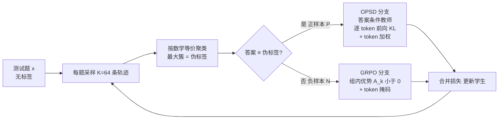

一句话解释：题目进来先采样一大把解法，投票出参考答案，然后按"跟不跟票"分流到两条完全不同的学习路径。整个过程不用一个标签，训练完的模型直接去答下一批题。

### 4.2 模块拆解

**多数投票伪标签**

为什么需要：没有真值，必须自己制造一个参照系。

怎么做：每题采样 $K$ 条轨迹，抽出最终答案，按数学等价聚类，最大的簇就是伪标签，簇大小记为共识票数 $c$。答案等于伪标签的进正样本集 $\mathcal{P}$，其余进负样本集 $\mathcal{N}$。论文设 $K = 64$，理由是难题通过率低，票数少了投票不可靠。

公式：

$$
\hat{a} = \arg\max_{a} \left| \{k : a_k \equiv a\} \right|, \qquad c = \left| \{k : a_k \equiv \hat{a}\} \right|
$$

先说这个公式在算什么：数一数哪个答案出现次数最多。

- $\hat{a}$：伪标签，一个数学答案（可能是数字或表达式）
- $a_k$：第 $k$ 条轨迹抽出来的答案
- $\equiv$：数学等价，不是字符串相等，$\frac{1}{2}$ 和 $0.5$ 算同一个
- $c$：伪标签拿到多少票，后面分析里用 $|P|/K$ 表示

**答案条件教师**

为什么需要：OPSD 的精髓是"看过答案的模型"比"没看过的"强，所以拿它当老师。

怎么做：教师和学生是同一份权重，唯一差别是提示前缀——教师前缀拼上伪标签 $\hat{a}$，学生前缀只有原题。两者对同一段已生成的内容给出下一个 token 的分布。教师关掉梯度、冻结在基座权重，学生带梯度。

公式：

$$
q_t^{(\hat{a})} = \pi_\theta(\cdot \mid [x; \hat{a}]_{\text{teacher}}, y_{<t}), \quad \text{no grad}
$$

$$
p_t = \pi_\theta(\cdot \mid x_{\text{student}}, y_{<t}), \quad \text{with grad}
$$

先说这组公式在算什么：同一个模型，带答案提示时给一个分布，不带时给另一个分布，两个分布的差就是要学的方向。

- $q_t^{(\hat{a})}$：教师分布，条件在题面 $x$、伪标签 $\hat{a}$、已生成前缀 $y_{<t}$ 上，第 $t$ 个位置
- $p_t$：学生分布，只条件在题面 $x$
- 上标 $(\hat{a})$ 提醒读者：这个教师是被伪标签污染的

这里有个容易漏掉的设置：训练时**学生关闭思考模式、教师开启思考模式**（Table 5，附录 A）。所以这两个分布的差，除了答案信息，还混着"思考 vs 不思考"的差。论文自己也说，正样本分支的蒸馏在标签错时会退化成"从思考模式蒸馏到非思考模式"，而这仍然是有益的（45.7 vs 46.5，Figure 3）。

**正样本：OPSD 分支**

为什么需要：一致的样本里有宝贵的密集监督，但均匀地蒸馏会把梯度浪费在已经学会的 token 上。

怎么做：对每条正样本，逐 token 算教师和学生的前向 KL，再乘一个权重，最后按 token 数归一。

公式：

$$
\mathcal{L}_{\text{OPSD}}(k) = \frac{1}{T_k} \sum_{t=1}^{T_k} w(t) \cdot \mathrm{KL}\left(q_t^{(\hat{a})} \,\|\, p_t\right)
$$

$$
w(t) = \hat{H}(t) + \hat{\Delta}(t) - \hat{H}(t)\cdot\hat{\Delta}(t)
$$

先说第一个公式在算什么：让学生的分布朝教师的分布靠，但每个位置靠的力度不同。第二个公式在算那个力度。

- $T_k$：第 $k$ 条轨迹的有效 token 数
- $q_t^{(\hat{a})}$、$p_t$：教师和学生在位置 $t$ 的 vocab 分布，都是 $|V|$ 维
- $w(t) \in [0,1]$：这个 token 的权重
- $\hat{H}(t)$：学生熵，按样本做 min-max 归一化到 $[0,1]$，越高表示学生越不确定
- $\hat{\Delta}(t)$：$\mathrm{KL}(q_t \| p_t)$，同样归一化，越高表示教师和学生差得越多

$w(t)$ 是 Soft-OR：两个信号只要有一个高，权重就高；两个都低，权重才趋近 0。两个都低意味着"学生很确定，而且和教师一致"，那这个位置已经学完了，不值得再给梯度。生活类比：复习时先把已经背熟的那几页跳过，把时间花在还不确定的章节上。

**负样本：GRPO 分支**

为什么需要：不一致的轨迹需要被压制，但伪标签不可信，不能用它当奖励去算"对不对"。

怎么做：给每条轨迹一个 0/1 奖励（答案是否等于伪标签），在整组 $K$ 条上算组内标准化优势。负样本的 $A_k < 0$，乘上对数概率就是惩罚。

公式：

$$
\mathcal{L}_{\text{GRPO}}(k) = -\frac{A_k}{T_k}\sum_{t=1}^{T_k} m(t)\cdot \log \pi_\theta\left(y_k^{(t)} \mid x, y_k^{(<t)}\right)
$$

$$
A_k = \frac{r_k - \mathrm{mean}(\{r_j\}_{j=1}^{K})}{\mathrm{std}(\{r_j\}_{j=1}^{K})}, \qquad r_k = \mathbb{1}[a_k \equiv \hat{a}]
$$

先说这组公式在算什么：这条轨迹比组内平均差多少，差多少就罚多少。$m(t)$ 决定罚它的哪些 token。

- $A_k$：组内标准化优势，负样本为负
- $r_k$：二元奖励，1 表示答案等于伪标签
- $T_k$：有效 token 数
- $m(t) \in \{0,1\}$：token 掩码
- $\pi_\theta(y_k^{(t)} \mid \cdot)$：学生生成这个 token 的概率

关键在 $A_k$ 的符号。负样本的奖励是 0，只要组里有人拿 1，$A_k$ 就是负的。这意味着 GRPO 分支惩罚的**不是**"你的答案错了"，而是"你没进多数派"——这个判断不依赖多数派对不对。原文把这层意思说成："GRPO on N requires only "not in the majority cluster" — independent of â's content"。

论文还点了一个副作用：标准 GRPO 里正优势的梯度会抵消一部分对"失败轨迹里局部正确 token"的误伤，但 TTPO 的 GRPO 只作用在负样本上，这个对冲没了。原文把它叫 False Penalties on Negative Samples 问题，所以必须主动减伤。

**token 掩码**

为什么需要：一条错轨迹里也有一大半 token 是对的，全罚会把正确的推理技能一起打掉。

怎么做：给每个 token 打分，取分数中位数以上的前 50% 才罚。

公式：

$$
s(t) = -\log p_t\left(y^{(t)}\right)\cdot\left(1 - \hat{H}(t)\right), \qquad m(t) = \mathbb{1}\left[s(t) \geq \mathrm{median}(\{s(t')\}_{t'=1}^{T_k})\right]
$$

先说这个公式在算什么：挑出"模型本来不太可能说出口、却又很确定地说出口"的 token，这些通常是错误发生的地方。

- $-\log p_t(y^{(t)})$：这个 token 的负对数概率，越大表示模型越"不该说"它
- $\hat{H}(t)$：学生在这个位置的归一化熵，$(1-\hat{H})$ 是"确定度"
- $s(t)$：最终得分，两项相乘
- $m(t)$：掩码，得分进入前 50% 才保留

这里的设计选择是用**未归一化**的 $-\log p$ 当排序主轴。原因：局部正确的 token 通常概率高，自然被排除；真正异常的 token 是"模型很确定地输出了低概率内容"，两项一起才把它顶到前面。用归一化概率排序的话，一个本来就该低概率的罕见数学符号会被误伤。

**统一目标**

为什么需要：两个分支的量级差一个数量级（Figure 8 左，GRPO loss 约 0.1–0.3，FKL loss 约 0.01），直接相加会让 RL 主导。

怎么做：给 GRPO 项乘 $\lambda$，$\lambda = 0.1$，大致把两边梯度拉到同一量级。

公式：

$$
\mathcal{L}_{\text{TTPO}} = \frac{1}{|\mathcal{B}|}\left(\sum_{k\in\mathcal{P}}\mathcal{L}_{\text{OPSD}}(k) + \lambda\sum_{k\in\mathcal{N}}\mathcal{L}_{\text{GRPO}}(k)\right)
$$

先说这个公式在算什么：把两条路的损失加权求和，一次更新。

- $\mathcal{B}$：这一步参与更新的轨迹集合，$|\mathcal{B}| = K_{\text{train}} = 8$
- $\mathcal{P}$、$\mathcal{N}$：正、负样本集合
- $\lambda \in [0,1]$：RL 权重，消融在 Table 8

### 4.3 关键细节

这些细节决定复现得出来还是复现不出来：

- **每题采样 $K=64$ 条，但只有 8 条进梯度**（$K_{\text{train}}$），且强制 50% 正、50% 负。Table 9 显示动态比例（跟着真实分布走）反而更差，因为正样本多时负样本变少，而负样本的优势本来就被放大，人少了信号立刻稀释。
- **选轨迹用最短的**。Table 10 里 shortest 最好（46.5），longest 只有 45.6。原因是梯度只更新前 1024 个 token，短轨迹的前 1024 个 token 覆盖整条推理链的比例更高；长轨迹的前 1024 token 常常还在铺垫。
- **最多生成 16,000 token，但梯度只回传前 1,024 个**。前者是为了投票时答案能被抽出来，后者是训练预算。
- **LoRA r=64，$\alpha$=128**，学所有线性层。学习率 $5\times10^{-6}$，batch 32，训练 100 步（GRPO / TTRL 是 500 步）。
- **教师冻结在基座权重**，LoRA 适配器关掉。这一点很关键：教师不会跟着学生一起退化。
- **全词表 logit 蒸馏**，不是只在采样到的 token 上算 KL。

## 5. 实验结果

**实验设置**

- 数据集与切分：两个设置。OpenThoughts 设置下模型在有标签数据上训练，但 TTPO 不用标签，标签只给基线用；纯 TTT 设置下直接在测试题上训练，无任何标注。评测集是 AIME 2025、AIME 2026、HMMT 2025、HMMT 2026、BRUMO 2025 五个竞赛级数学基准。
- 骨干模型：Qwen3-1.7B、Qwen3-4B、Qwen3-8B，全部 LoRA 微调。
- 训练预算：TTPO 与 OPSD 训 100 步，GRPO 与 TTRL 训 500 步；有效 batch 32；TTPO 用 4×H20，其他方法 8×H20。
- 基线：GRPO†（真值奖励 RL）、OPSD†（真值自蒸馏）、TTRL（投票奖励 RL）、OPSD-TTT（用温度 0 思考模式输出当特权信息的自蒸馏）。带 † 的是用真标签的。
- 指标：Avg@12，每题采 12 次取平均正确率，越高越好；分析部分另用 Maj@12，多数投票后的正确率。
- 推理设置：thinking mode 开启，温度 1.0，top-p 0.95，max new tokens 38,912。OPSD 和 TTPO 报 100 步内每 25 步存一次的检查点里的峰值。

**主表**

| 设置 | 模型 | 本文 TTPO | 最强基线 | 提升 |
| --- | --- | --- | --- | --- |
| 纯 TTT 平均 | Qwen3-1.7B | 45.2 | 41.9（OPSD-TTT） | +3.3 |
| 纯 TTT 平均 | Qwen3-4B | 61.1 | 59.4（OPSD-TTT） | +1.7 |
| 纯 TTT 平均 | Qwen3-8B | 65.3 | 63.7（OPSD-TTT） | +1.6 |
| OpenThoughts 平均 | Qwen3-1.7B | 40.1 | 39.7（OPSD†） | +0.4 |
| OpenThoughts 平均 | Qwen3-4B | 58.6 | 58.4（OPSD†） | +0.2 |
| OpenThoughts 平均 | Qwen3-8B | 62.6 | 61.7（OPSD†） | +0.9 |

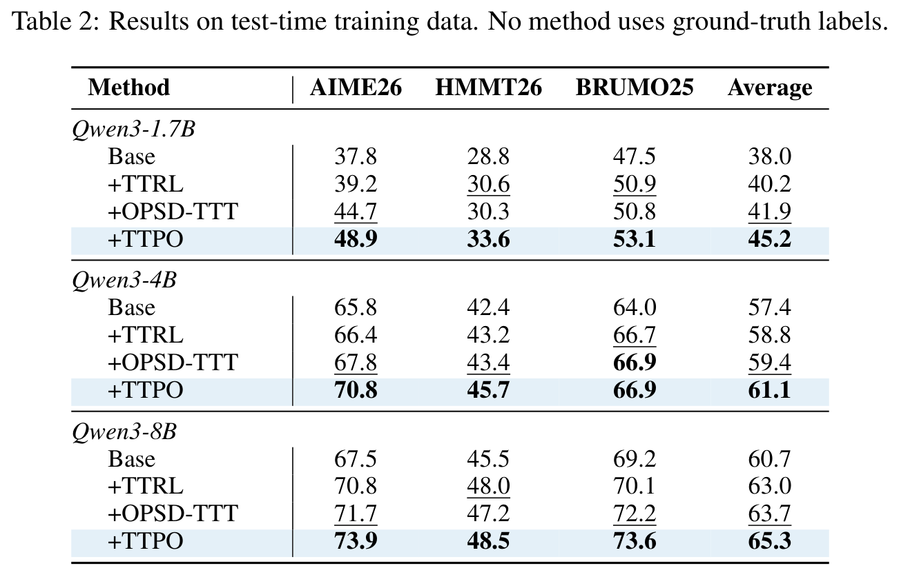

表 2：纯 TTT 设置，所有方法都不用真标签。TTPO 在三个尺寸上都是第一，最显眼的是 1.7B 上比 TTRL 高 5.0 个点，说明密集的分布级指导确实比单标量奖励信息量大。

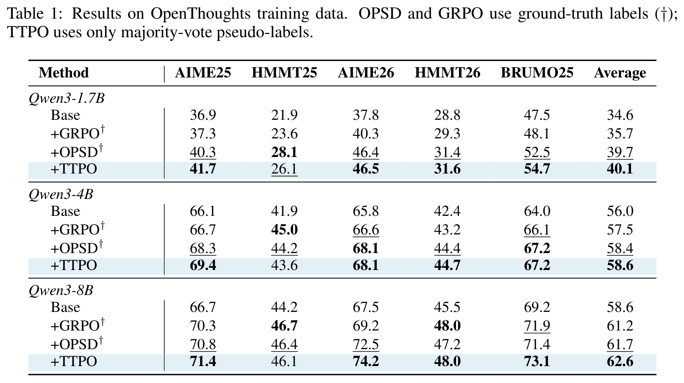

表 1：OpenThoughts 设置，OPSD† 和 GRPO† 用真标签，TTPO 只用伪标签。TTPO 三个尺寸的平均分都压过用真标签的 OPSD†，说明伪标签配非对称目标可以替代人工标注。

**原文实验图**

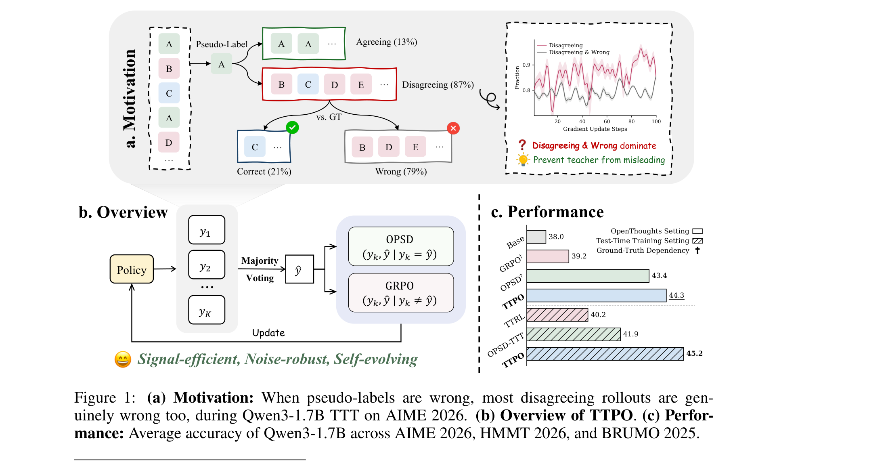

图 1：(a) 伪标签错约 85% 的题，但不一致的轨迹里约 79% 本身也错，这就是非对称设计的立论根基；(c) 1.7B 在三个基准上的平均分，TTPO 45.2 高于 OPSD-TTT 41.9 和 TTRL 40.2，且是所有方法里唯一同时做到"不用标签"和"最高分"的。

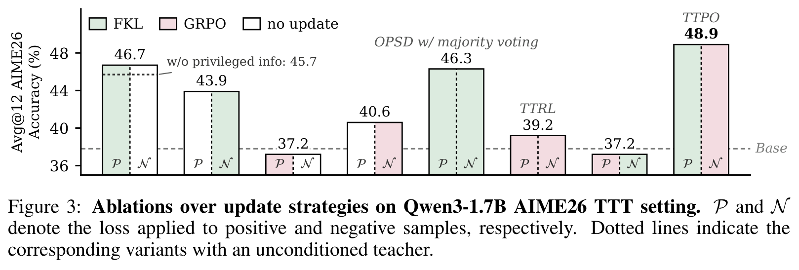

图 3：更新策略的消融，AIME26 纯 TTT。完整 TTPO 48.9 最高；只对正样本做 FKL 46.7，负样本不动；全 FKL 46.3；只对负样本做 FKL 43.9；把 GRPO 用到正样本 37.2，几乎等于不训练。方向反了惩罚最重，说明"哪个信号配哪类样本"不是可选项。

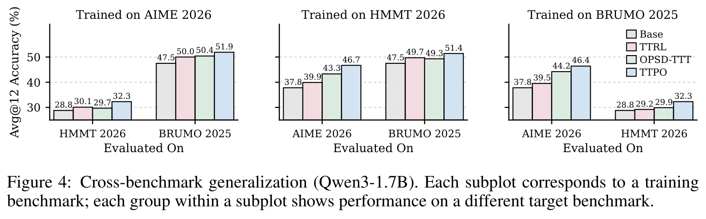

图 4：跨基准泛化。三个子图对应三个训练基准，每个组是换一个测试基准。三张图里 TTPO 的柱子都是每组最高；在 HMMT 2026 上训练后去考 AIME 2026，从 37.8 涨到 46.7，涨幅 8.9 个点，比同设置下的 TTRL（39.9）和 OPSD-TTT（43.3）都高。

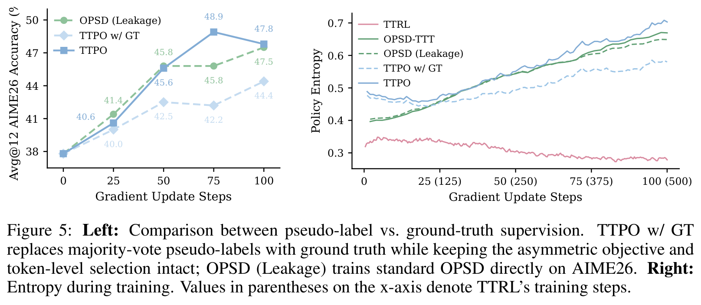

图 5：左图比较伪标签与真值。TTPO（48.9）反超 TTPO w/ GT（47.8）和 OPSD (Leakage)（47.5）——用假标签比用真标签还高。右图是策略熵，TTPO 从 0.47 一路涨到 0.70，TTRL 反而从 0.34 掉到 0.28，两组曲线在中段交叉后越拉越开。

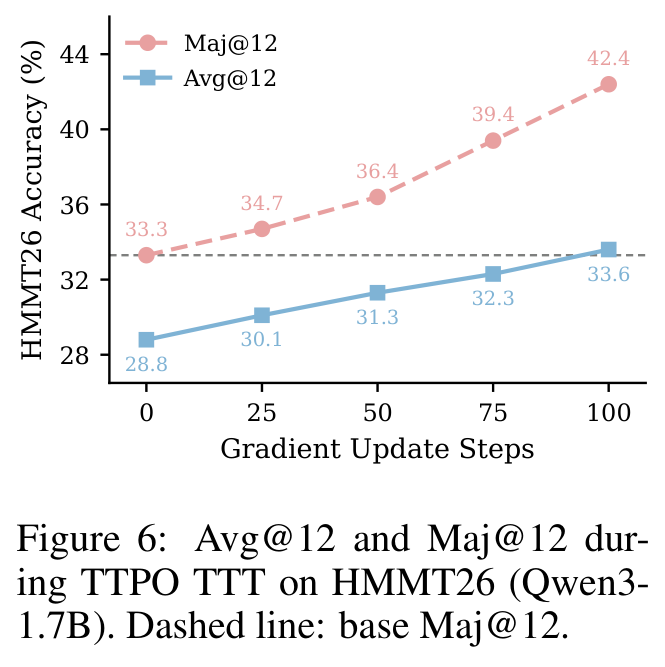

图 6：自我进化的直接证据。Avg@12 从 28.8 爬到 33.6，追平了基座的 Maj@12（虚线 33.3）；同时 Maj@12 没有停在原地，从 33.3 涨到 42.4。投票质量跟着模型一起涨，训练天花板被自己抬高了。

**消融**

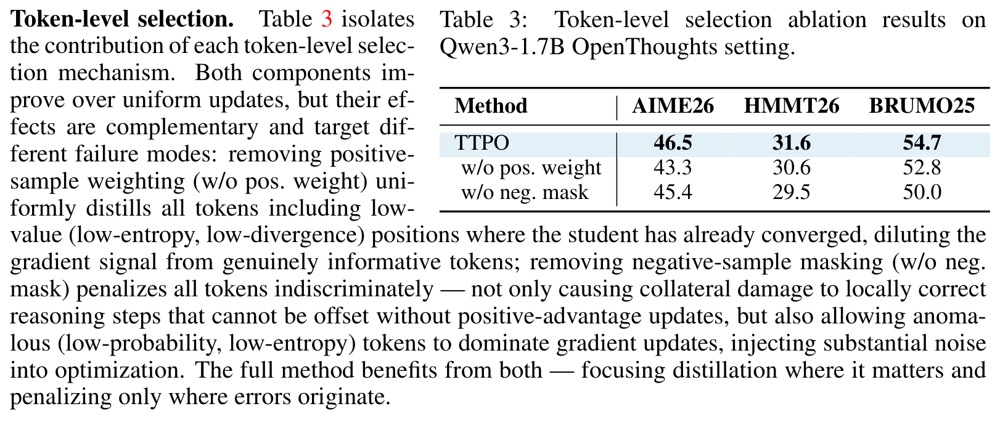

表 3：token 级筛选的消融，1.7B OpenThoughts。去掉正样本加权，AIME26 从 46.5 掉到 43.3；去掉负样本掩码，BRUMO25 从 54.7 掉到 50.0。两个机制都有效，且掉的基准不同，说明它们修的是不同的毛病。

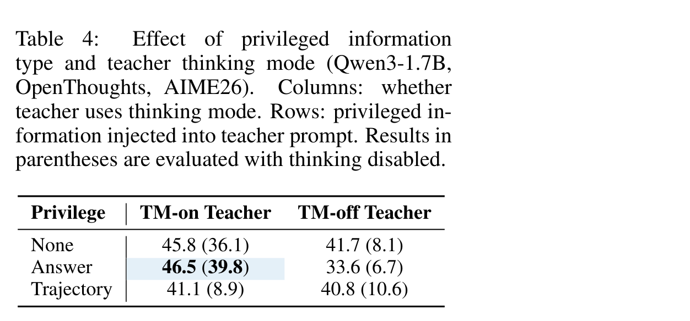

表 4：特权信息类型与教师思考模式的组合。最好的组合是"教师开思考 + 只给答案"，46.5（关思考评测 39.8）。给整条轨迹反而降到 41.1，因为轨迹太长会挤占教师自己的推理空间，把它变成"续写给定前缀"。

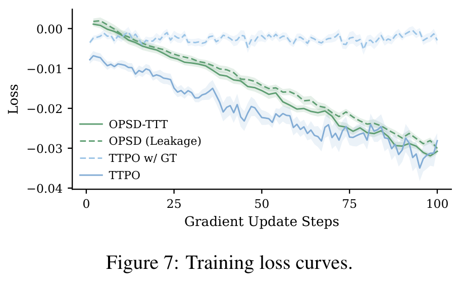

图 7：训练损失曲线。TTPO w/ GT 的损失几乎不降、常在 0 附近停住，这是真标签在难题上正样本太少、两个分支同时被饿死的直接表现；TTPO 用伪标签反而稳定下降。

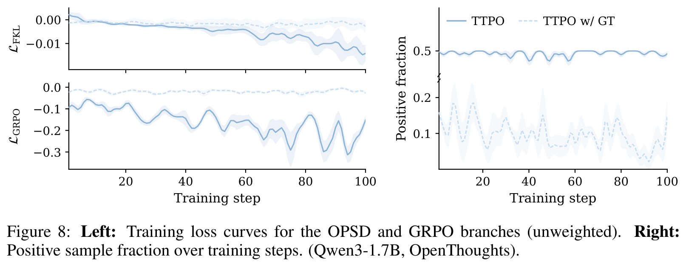

图 8：左图两条分支的原始损失，GRPO 的量级比 FKL 大一个数量级，这就是必须引入 $\lambda$ 的原因；右图正样本比例，TTPO 稳定在 0.5（因为强制 50/50），TTPO w/ GT 在 0.1 上下抖，后半段更低。

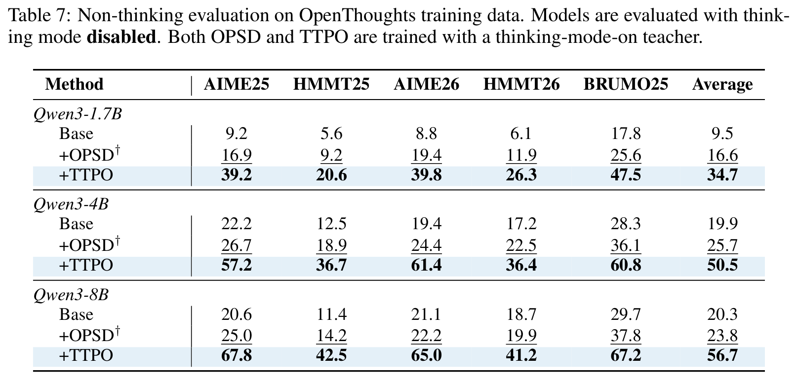

表 7：关闭思考模式后的评测（训练时教师仍开思考）。TTPO 在三个尺寸上分别涨 25.2 / 30.6 / 36.4 个点，OPSD 只涨 7.1 / 5.8 / 3.5。作者归因于 GRPO 分支主动压制了学生自己生成模式里的坏推理，而纯蒸馏只是被动对齐。

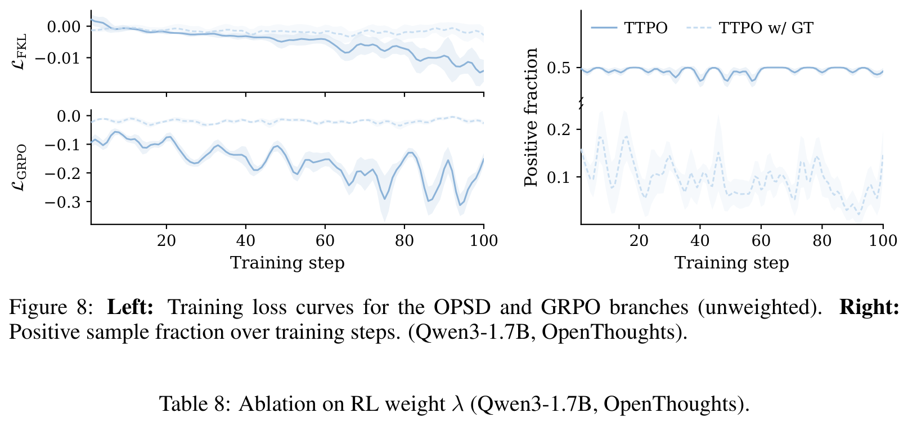

表 8：$\lambda$ 的扫描，0.01 到 0.2。峰值在 0.1（AIME26 46.5），两端都掉，0.2 时跌到 41.7，说明 RL 项一旦压过蒸馏就开始破坏。

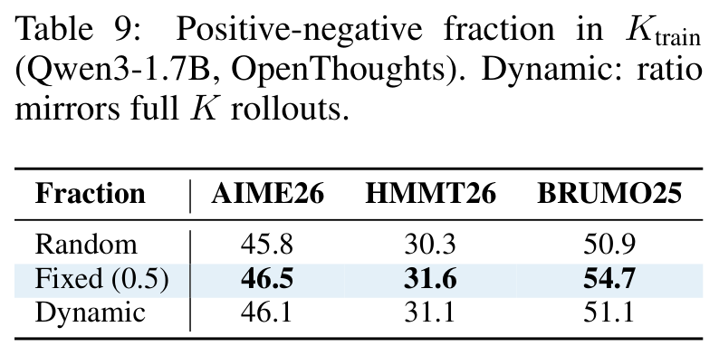

表 9：$K_{\text{train}}$ 的正负比例。固定 50/50 最好，random 和 dynamic 都更差。

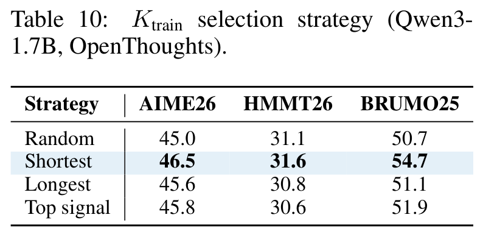

表 10：选哪 8 条轨迹进梯度。按最短选最好，比 random 高 1.5 个点，比"选信号最强的"高 0.7 个点。

**消融告诉我们什么**：三个超参里最敏感的是 $\lambda$（0.1 上下各差 2–5 个点），其次是轨迹选择策略，最不敏感的是正负比例（三种都能用，固定 0.5 最稳）。token 级筛选的两个机制贡献相当，都不能省。

**这些实验够不够支撑结论**：支撑"无标签能追平有标签"够。但有几个地方撑得不够紧。

一是所有基准都是竞赛数学，答案能抽成一个数，换成代码或开放推理这套判分逻辑不成立。

二是论文报的是 100 步内的峰值检查点，不是最终检查点，这对训练稳定性的说服力有折扣。

三是所有对比都在 Qwen3 单一模型家族上做，换别的基座（比如蒸馏过的小模型）投票质量和熵的行为可能不一样。

## 6. 局限性

**作者自己承认的**：

- 依赖投票质量。$K$ 很小、或者题目难到没有一条轨迹答对时，投票信号退化，两个分支都收到噪声监督。
- 领域局限在数学推理。代码生成需要执行验证，开放推理需要奖励模型，都还没做。
- 训练全程用同一个固定的非对称目标。模型变强后最优的蒸馏 / RL 配比可能会漂移，论文没做课程。

**我看出来的**：

- 隐形假设：这篇论文要成立，必须默认"答案不一致 ≈ 推理过程有错"。这在数学上大致成立，因为答案不匹配通常意味着推导断了。但在开放式任务里，不同的解法可以都对，这时"不进多数派就是错"会系统性地压制多样性，把模型推向单一解法。
- 边界条件：教师冻结在基座权重。这意味着蒸馏的上限是基座模型在思考模式下、拿着正确答案时的表现。学生永远超不过"开卷的自己"。论文里 TTPO 超过 TTPO w/ GT 的现象，恰恰是因为伪标签比真值更容易被匹配，不是因为它学到了更好的推理。
- 缺的对比：没有和"直接用 base 模型的 self-consistency 多次采样"比。Avg@12 已经相当于采样 12 次取平均，如果只比推理时扩展，8B 的 60.7 可能与 4B+TTPO 的 61.1 打平，成本对比缺失。
- 机制层面：伪标签错误率在训练过程中的变化论文没有报。85% 是初始状态还是全程平均，正文没写；图 6 给的是 Maj@12 的上升曲线，不等于伪标签准确率的曲线。

## 7. 一句话总结

没有标准答案时，别急着信多数票，但要相信"少数派多半错了"这件事；让少数派挨罚、多数派抄作业，两条路各用各的信号，模型就能靠自己越练越准。像一群水平参差的同学互相批改，判分的依据不是答案，而是你跟大家有多不一样。

核心公式：

$$
\boxed{\mathcal{L}_{\text{TTPO}} = \frac{1}{|\mathcal{B}|}\left(\sum_{k\in\mathcal{P}}\mathcal{L}_{\text{OPSD}}(k) + \lambda\sum_{k\in\mathcal{N}}\mathcal{L}_{\text{GRPO}}(k)\right)}
$$

## 8. 可复用点

- 如果我要在自己的项目里用：把"一致性路由"抽象出来——凡是有便宜但不准的监督信号，就把它拆成"相信它"和"只相信反例"两种用法，各配一个损失。这个结构不限于数学题，凡是能自动判定答案是否相同的任务都能套。
- 如果投票质量差到没法用：先看 $K$ 够不够。64 条是这篇的选择，更难的题可能要到 128；$K$ 不变时，可以按共识票数 $c$ 给每道题加权，$c$ 低就降低这一题对损失的贡献。
- 训练不收敛时先查：GRPO 和蒸馏损失的量级比。这篇里差了一个数量级，不缩放就会一边倒。先打印两条分支的 loss 均值，再定 $\lambda$。
- 如果只更新前 N 个 token：轨迹选择要用最短的。长轨迹的前 N 个 token 通常只是铺垫，梯度打不到关键推理步。

## 9. 我的疑问

- 伪标签准确率在训练过程中到底怎么变？85% 是快照还是平均值？图 6 给了 Maj@12，但 Maj@12 是"投票对的比例"，和"伪标签对的比例"应该不是同一个数。
- 教师冻结在基座，学生一直在更新，两个分布会越差越远。这个散度有没有上限？论文只用 token 加权去抑制已经收敛的位置，没有讨论教师和学生整体分布漂移。
- 8B 上 TTPO 的增益（+4.6）比 1.7B（+7.2）小，是能力饱和还是超参没调？$\lambda$ 和小模型共用 0.1，大模型可能需要不同的配比。
- 关思考模式的评测里，TTPO 8B 的 56.7 已经接近开思考模式基座的 60.7，说明训练把思考能力压缩进了不思考的模式。这个压缩会不会牺牲掉一部分长链推理的能力？论文没测。
