> 让模型读长文时自己记笔记，而不是把整本书一直摊在桌上。

## 0. 读之前你需要知道

**术语卡**

- **测试时训练（test-time training）**：模型训练完之后不把参数完全冻住，遇到测试输入还会做几步更新。生活类比：考前复习完，进考场看到题还能在草稿纸上临时推一遍。
- **注意力（attention）与上下文窗口**：每个 token 和窗口里所有 token 两两算相关，再按相关度加权取信息。生活类比：把整本书摊在桌上，哪一页都能同时看，但桌子必须够大。
- **循环模型（recurrent model）与隐藏状态（hidden state）**：读完一个 token 就把信息压进一个固定大小的状态，下一个 token 接着用。生活类比：只允许带一张便签进考场，写满了就得擦掉旧内容。
- **梯度（gradient）**：损失对参数的导数，指哪边调参数能让损失下降。生活类比：蒙眼下山时脚底感觉到的坡度方向。
- **困惑度（perplexity，ppl）**：模型给测试文本的平均负对数似然的指数，越低表示越不意外。生活类比：猜下一个词时平均有几个候选在犹豫，越少越准。
- **针在草堆（needle-in-a-haystack, NIAH）**：在一大段无关文本里找回一句指定的话；S-NIAH 是 RULER 里的单针版本，只藏一条信息。生活类比：在一千页会议记录里找某个人说过的一句数字。
- **关联记忆（associative memory）**：把 key 映射到 value 的存储，给一个 key 就能取回对应 value。生活类比：电话簿，名字是 key，号码是 value。
- **惊喜（surprise）**：当前记忆对新的 key→value 预测得有多差；越差，梯度越大，越值得写。生活类比：读到和预期完全相反的情节，印象最深。
- **TC^0**：一类算力很弱的电路复杂度类，连简单的状态跟踪都做不了。生活类比：只会做固定层数的查表，不会一边读一边维护一个计数器。
- **词元（token）**：文本被切分后的最小单位，可以是一个词、一个子词或一个字符。生活类比：把一句话切成一块块积木。
- **多层感知机（multilayer perceptron, MLP）**：几层全连接网络，每层做线性变换再过一个非线性激活，叠起来能拟合比线性映射复杂得多的函数。生活类比：一条流水线，每层把原料加工得更抽象一点。
- **上下文学习（in-context learning）**：不更新权重，只靠上下文里给的示例或说明，临时学会当前任务。生活类比：考试时看两道例题就会照着做，但没有把新公式背进脑子。
- **均方误差（MSE）与平均绝对误差（MAE）**：MSE 是误差平方的平均，MAE 是绝对误差的平均；两个都越低越好。生活类比：MSE 更狠地惩罚大偏差，MAE 只算平均差了多少。
- **top-1 准确率（top-1 accuracy）**：分类时只看概率最高的那个类别猜对没有，越高越好。生活类比：选择题只认你填的第一个答案，不看备选。
- **BABILong**：把 bAbI 的多跳问答嵌进超长文档，测模型能不能在长文里找齐多条事实再推理。生活类比：把几条线索分散在一千页书里，让你串起来回答。

**它站在谁肩上**

- Transformer（2017）：用注意力直接建模所有 token 对，表达力强，但计算量随上下文长度平方增长，窗口一长就贵。
- RNN（循环神经网络）、LSTM（长短期记忆网络）和后来的线性循环模型（Mamba 2023、DeltaNet 2024、Gated DeltaNet 2024）：把历史压进固定大小的状态，推理快，但状态容量有限，写满就覆盖。
- 测试时训练（TTT，Sun et al. 2020；TTT-layer 2024）：测试时也更新参数，但更新目标通常是重建当前输入，且没有遗忘机制；记忆写满后无法清理。
- 快权重（fast weights，Schmidhuber 1992）与关联记忆：把线性层当可写内存，用 Hebbian 或 delta 规则写入；问题是只看当前一步的 surprise，缺少 token 流和遗忘。

## 1. 动机

想象你读一本一千页的悬疑小说，读到第九百页，需要想起第三十页的那条线索。你有两种笨办法。

第一种是把整本书一直摊在桌上，眼睛能同时扫到每一页。这就是注意力：信息全在，但桌子要无限大，读到后面越摊越贵。

第二种是只带一张便签，每读一页就把便签上的内容擦掉重写。这就是固定大小的循环状态：便宜，但写到后面，第三十页的线索早被覆盖了。

Titans 想给你第三种东西：一本可以随时翻写的笔记本。读到意外的东西，多写一笔；旧内容不重要了，让它慢慢褪色；需要时按 key 去查。

**以前怎么做**：语言模型主要靠注意力，把上下文窗口尽量做大；或者用线性循环模型，把历史压进一个矩阵状态。

**为什么不行**：注意力是 $O(N^2)$，窗口扩大一倍，计算量约四倍；线性循环模型的 state 大小固定，长序列里信息会互相干扰，而且大多数模型没有真正的遗忘门，写满就溢出。

**为什么现在能做**：线性循环模型重新流行，GPU/TPU 上的矩阵乘和前缀扫描足够快；长上下文需求变强；用梯度做内环更新在 meta-learning 和 TTT 里已经被验证可行。Titans 把这些拼起来：记忆不再是一个矩阵，而是一个可以用梯度训练的深层 MLP。

## 2. 贡献

- **提出一个神经长期记忆模块**。它不是固定 hidden state，而是一个 MLP；每读一个 token，就用 key→value 的重建误差产生梯度，把这次经历写进 MLP 参数。证据：去掉这个设计里的任一部分，语言建模 ppl 从 27.01 升到 28.49–29.04（表 5）。
- **给出三种把记忆接进 Transformer 的方式**。MAC 把记忆当上下文，MAG 把记忆当门控，MAL 把记忆当一层；再加一个完全不用注意力的 LMM。证据：400M 规模下四个变体的常识 Avg 分别是 47.83、48.65、48.60、47.87，均高于最强基线 47.69（表 1）。
- **长上下文检索明显更强**。S-NIAH 在 16K 长度上，Titans 各变体在 PK/N/W 三个任务上仍有 80.2–98.6 分，TTT、Mamba2、DeltaNet 在 N 和 W 上大多跌到个位数或 0（表 2）。
- **能撑到很长的 BABILong**。few-shot 下 Titans (MAC) 从 $10^3$ 的约 80% 缓降到 $10^6$ 的约 53%，在 $3\times10^5$ 到 $10^6$ 之间超过 GPT-4；fine-tuning 下到 $10^7$ 仍有约 70%，Llama3.1-70B 在 $10^7$ 约 46%（图 6）。
- **跨模态也能用**。时间序列 7 个数据集上 MSE 全部最低；DNA 五个任务里两个第一，整体被作者称为 competitive（表 3、表 4）。

作者在摘要里写 Titans 能 "scale to larger than 2M context window size"。这句话是主张，不是这一版论文里单独做过的 2M 实验；证据要看 BABILong 的 $10^7$ 横轴和 S-NIAH 的 16K，具体见第 5 节。

生活类比：这几条贡献像给一本书同时换了纸张、装订和索引，单看每项都有用，合起来才决定这本书能不能长期翻。

## 3. 创新点

生活类比：把笔记本从“只能写固定页数”改成“活页 + 自动划重点 + 三种插页方式”，下面每条说的都是其中一处改动。

- **记忆是深层 MLP，不是线性矩阵**。对比对象：DeltaNet、Gated DeltaNet、TTT 的矩阵值记忆。新在把记忆做成 $L_{\mathcal{M}}\ge 1$ 层的 MLP，用梯度更新。有用是因为矩阵记忆的容量和表达力受线性映射限制，MLP 能拟合更复杂的 key→value 关系；表 5 把深层记忆换成线性记忆，ppl 从 27.01 升到 28.49。
- **用 surprise 的动量写，而不是只看当前一步**。对比对象：DeltaNet 的 delta 规则、TTT 的当前样本重建。新在把过去的 surprise 用 $\eta_t S_{t-1}$ 累积进来，当前梯度只是其中一项。有用是因为长序列里“值得记”的事件往往连续出现，只看一步会被噪声带偏；去掉动量，ppl 升到 28.98。
- **遗忘门做成数据相关的 weight decay**。对比对象：TTT 没有遗忘、Mamba2 的固定衰减。新在让 $\alpha_t$ 由当前 token 决定，$0$ 保留、$1$ 清空。有用是因为记忆容量固定，不清理就会被旧信息占满；去掉 weight decay，ppl 升到 29.04，是消融里最差的一档。
- **记忆可以当上下文、门控或一层**。对比对象：Samba、Gated DeltaNet-H2 这类固定把循环层和注意力叠起来的 hybrid。新在给出三种接法，分别换效率和表达力。有用是因为任务不同：MAC 在长上下文检索最好（表 5 的 97.95），MAG 的语言建模 ppl 最好（25.70），MAL 训练吞吐更高（图 9）。
- **训练时把序列分块，块内矩阵乘、块内动量前缀扫描、块间递推**。对比对象：逐 token 串行更新的循环模型。新在把递推式展开成闭式，用 matmul 和 associative scan 并行。有用是因为不并行就训不动长序列；图 8 显示吞吐随序列长度基本不变。

## 4. 方法

### 4.1 整体流程

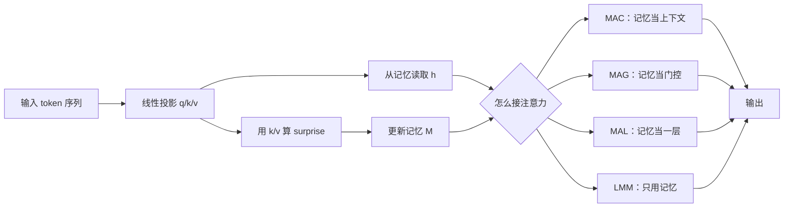

这张图的主线是：每个 token 先投影出 query、key、value；query 去读旧记忆，**key/value 去算 surprise 并写新记忆**；写完之后，再决定记忆和注意力怎么组合。

### 4.2 模块拆解

#### 4.2.1 神经长期记忆

**为什么需要**

固定大小的 hidden state 不够用。注意力的窗口虽然大，但计算量随长度平方增长。Titans 想要一个容量比矩阵大、又能在测试时继续写、还能主动忘的记忆。

**怎么做**

记忆 $\mathcal{M}$ 是一个 MLP，层数 $L_{\mathcal{M}}\ge 1$。每来一个 token $x_t$，先把它投影成 key 和 value：

$$
\mathbf{k}_t=x_tW_K,\qquad \mathbf{v}_t=x_tW_V
$$

然后让记忆把 $\mathbf{k}_t$ 映射成 $\mathbf{v}_t$，映射误差就是这一步的 surprise：

$$
\ell(\mathcal{M}_{t-1};x_t)=\left\|\mathcal{M}_{t-1}(\mathbf{k}_t)-\mathbf{v}_t\right\|_2^2
$$

这个式子在算：当前记忆对这对 key→value 的预测差多少。差得越多，梯度越大，下一步写得越狠。

- $x_t$：第 $t$ 个 token 的表示，$d_{\text{in}}$ 维。
- $W_K,W_V$：key 和 value 的投影矩阵，$d_{\text{in}}\times d_{\text{in}}$。
- $\mathbf{k}_t,\mathbf{v}_t$：key 和 value 向量，$d_{\text{in}}$ 维。
- $\mathcal{M}_{t-1}$：第 $t$ 步之前的记忆 MLP。
- $\ell$：标量损失，越大表示越 surprise。

写完的记忆用动量累积，再用遗忘门保留旧内容：

$$
S_t=\eta_t S_{t-1}-\theta_t\nabla\ell(\mathcal{M}_{t-1};x_t),\qquad
\mathcal{M}_t=(1-\alpha_t)\mathcal{M}_{t-1}+S_t
$$

这个式子在算：先把过去的 surprise 按 $\eta_t$ 留一部分，再减去当前梯度乘学习率，得到这次要写进去的更新 $S_t$；最后把旧记忆按 $1-\alpha_t$ 保留，加上新更新。

- $S_t$：和记忆同形状的更新累加器。
- $\eta_t$：数据相关的 surprise 衰减；$\eta_t\to0$ 忽略上一次 surprise，$\eta_t\to1$ 完全保留。论文用 0 和 1 两个极端解释作用，没有给具体参数化。
- $\theta_t$：数据相关的学习率，控制这次 surprise 写多狠；取值范围与参数化原文未给。
- $\alpha_t\in[0,1]$：数据相关的遗忘门。$\alpha_t\to0$ 保留旧记忆，$\alpha_t\to1$ 清空旧记忆。
- $\nabla\ell$：损失对全部记忆参数的梯度。

作者说这个更新等价于“mini-batch 梯度下降 + momentum + weight decay”。我的理解是：$-\theta_t\nabla\ell$ 是梯度步，$\eta_t S_{t-1}$ 是动量，$(1-\alpha_t)\mathcal{M}_{t-1}$ 是乘性衰减；三项合起来就是一条带遗忘的在线学习规则。

读取时用 query 查记忆：

$$
\mathbf{q}_t=x_tW_Q,\qquad y_t=\mathcal{M}^*(\mathbf{q}_t)
$$

这个式子在算：当前 token 的 query 去记忆里查对应的内容。$\mathcal{M}^*$ 表示只做前向、不更新权重；$W_Q$ 是 query 投影；$y_t$ 是读出的向量。

先读后写，保证当前 token 看不到自己刚写进去的内容。这一点和因果注意力里的 mask 是同一个道理。

**记忆深度**

$L_{\mathcal{M}}$ 是 MLP 层数，实验取 1–4。层数越深，能拟合的 key→value 关系越复杂，但每步更新也更贵。图 7 显示加深带来的 ppl 收益在所有测过的序列长度上都存在，图 8 显示吞吐随深度线性下降。hidden width 和每层具体结构，原文未给。

#### 4.2.2 分块并行训练

**为什么需要**

如果严格按 token 串行更新，训练长序列时 GPU 利用率很低。Titans 要把递推式展开成可以矩阵乘的形式。

**怎么做**

把序列切成大小为 $b$ 的 chunk。段内所有梯度都用段首的记忆 $\mathcal{M}_{t'}$ 来算，段与段之间再按递推传下去：

$$
\beta_i=\prod_{j=1}^{i}(1-\alpha_j),\qquad
\mathcal{M}_t=\beta_t\mathcal{M}_0-\sum_{i=1}^{t}\theta_i\frac{\beta_t}{\beta_i}\nabla\ell(\mathcal{M}_{t'};x_i)
$$

这个式子在算：从初始记忆 $\mathcal{M}_0$ 出发，把每一步的梯度按“从该步到当前步累积保留了多少”加权求和。

- $\beta_t$：从第 0 步到第 $t$ 步的累积保留率；$\alpha$ 越大，$\beta$ 掉得越快。
- $t'$：当前 chunk 的起点，$t'=t-\mathrm{mod}(t,b)$。
- $b$：chunk 大小，原文未给具体值。
- $\theta_i$：第 $i$ 步的学习率。
- 求和项里的 $\beta_t/\beta_i$：第 $i$ 步的更新到第 $t$ 步还剩多少。

段内用矩阵乘一次算完，chunk 内的动量递推用 parallel associative scan 做前缀扫描。

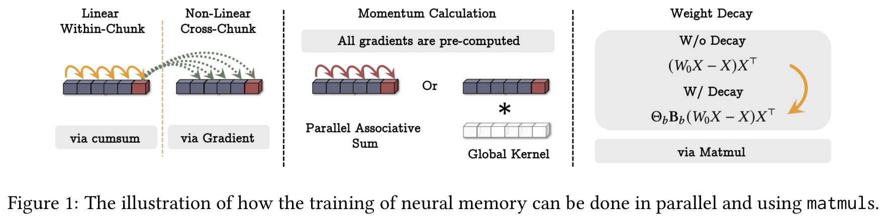

图 1：左边是段内线性 cumsum、段间梯度递推；中间是动量计算，可以走 parallel associative scan，也可以走 global kernel 的矩阵乘；右边是 weight decay，写成 $\Theta_b B_b (W_0X-X)X^\top$ 后用 matmul 算。它说明 Titans 的串行更新可以被改写成矩阵运算。

代价是段内梯度都用段首记忆算，不是每一步的最新记忆；这是一个为了并行做的近似，会损失一点表达力。这也解释了为什么 chunk 不能无限大。

#### 4.2.3 持久记忆

**为什么需要**

有些知识不属于当前上下文，而是任务本身带过来的，比如“这是情感分类”或“这是代码”。这些不该在每个样本里重新学一遍。

**怎么做**

加一组可学习、但与输入无关的向量 $P=[p_1,\dots,p_{N_p}]$，拼到序列前面。训练时它和别的参数一起学；测试时冻结，不参与内环更新。生活类比：随身带的常用公式卡片，不管今天做哪道题都先摊在桌上。

$N_p$ 是持久记忆的 token 数，原文未给具体取值。它不随输入变化，所以在同一个任务的所有样本上共享。

#### 4.2.4 三种接法

**MAC：记忆当上下文**

把长序列切成段 $\texttt{S}^{(t)}$。先用当前段做 query，从记忆里读历史信息：

$$
h_t=\mathcal{M}^*_{t-1}(\mathbf{q}_t),\qquad \mathbf{q}_t=\texttt{S}^{(t)}W_Q
$$

再把持久记忆、读出的历史、当前段拼在一起，送进注意力：

$$
\tilde{\texttt{S}}^{(t)}=[P\parallel h_t\parallel \texttt{S}^{(t)}],\qquad
y_t=\texttt{Attn}(\tilde{\texttt{S}}^{(t)})
$$

最后用 $y_t$ 更新记忆，并把 $y_t$ 和记忆的读出做门控：

$$
\mathcal{M}_t=\mathcal{M}_{t-1}(y_t),\qquad
o_t=y_t\otimes\mathcal{M}_t^*(y_t)
$$

这个式子在算：注意力先决定当前段里哪些信息值得记，再把 $y_t$ 写进记忆；输出时把注意力的结果和记忆的读出相乘，让两路互相筛。

- $\texttt{S}^{(t)}$：第 $t$ 个段。
- $W_Q$：query 投影矩阵。
- $\mathbf{q}_t$：当前段的 query。
- $P$：持久记忆。
- $h_t$：从长期记忆读出的历史信息。
- $y_t$：注意力层的输出。
- $o_t$：这一层的最终输出。
- $\parallel$：拼接。
- $\otimes$：门控；论文说可以是任意非线性门控，实验里先把两路输出归一化，再乘可学习向量权重，过 $\sigma(\cdot)$。
- $\mathcal{M}^*$：只前向、不更新。

图 2 是 MAC 的整体结构。三条分支分别是 core（当前段）、contextual memory（长期记忆）、persistent memory（固定前缀）；测试时长期记忆还在学，core 做 in-context learning，persistent 冻结。

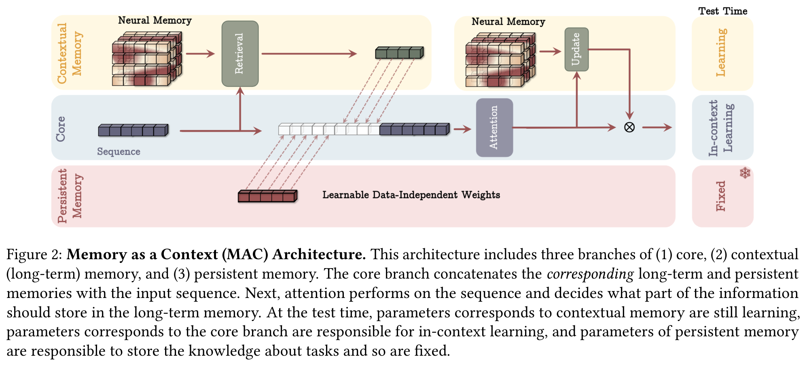

图 2：MAC 把记忆读出当成额外的上下文 token，和当前段一起送进注意力；当前段看得见历史，但历史只能通过记忆这一路进来。

图 3a 是 MAC 的注意力 mask：段内全因果，段与段之间通过长期记忆和持久记忆连接。

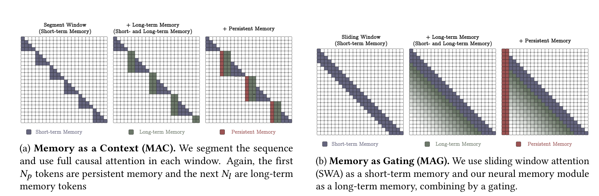

图 3：左边是 MAC 的分段 mask，右边是 MAG 的滑动窗口 mask；深蓝是短期记忆，绿色是长期记忆，红色是持久记忆。它说明三种记忆在注意力图里各自占哪一块。

**MAG：记忆当门控**

不分段。把持久记忆拼到输入前面，一路走滑动窗口注意力，另一路走神经记忆，最后用门控相乘：

$$
\tilde{x}=[P\parallel x],\qquad
y=\texttt{SW-Attn}^*(\tilde{x}),\qquad
o=y\otimes\mathcal{M}(\tilde{x})
$$

这个式子在算：滑动窗口注意力提供精确的短期记忆，神经记忆提供会褪色的长期记忆，两路逐元素门控后输出。

- $x$：输入序列。
- $\tilde{x}$：拼上持久记忆后的输入。
- $y$：滑动窗口注意力的输出。
- $o$：这一层的最终输出。
- $\texttt{SW-Attn}$：滑动窗口注意力（sliding window attention，SWA），只看最近一段窗口。
- $\mathcal{M}(\tilde{x})$：对整个序列跑完递归后的记忆输出。
- $\otimes$：同 MAC，论文允许任意非线性门控。

图 4 是 MAG 的结构：只有持久记忆被拼进上下文，长期记忆不直接进注意力，而是走门控分支。

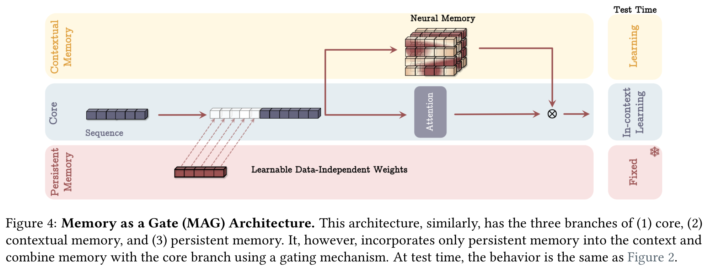

图 4：MAG 把长期记忆从“上下文”改成“门控”，注意力只负责短期精确检索，长期记忆负责给输出加权。

**MAL：记忆当一层**

先让记忆把上下文压一遍，再送进滑动窗口注意力：

$$
\tilde{x}=[P\parallel x],\qquad
y=\mathcal{M}(\tilde{x}),\qquad
o=\texttt{SW-Attn}(y)
$$

这个式子在算：记忆层先压缩过去和当前上下文，注意力再在压缩后的表示上做短期检索。

- $x$：输入序列。
- $\tilde{x}$：拼上持久记忆后的输入。
- $y$：记忆层压缩后的表示。
- $o$：这一层的最终输出。
- $\mathcal{M}(\tilde{x})$：对整个序列跑完递归后的记忆输出。

图 5 是 MAL 的结构。它最接近常见的 hybrid：循环层和注意力层串联。作者说它的缺点是表达力被每一层分别限制，不能像 MAC 那样让注意力主动决定记什么。

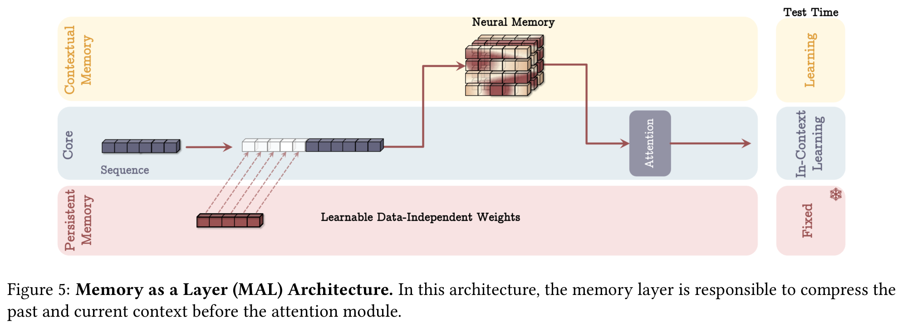

图 5：MAL 把记忆放在注意力之前，先压缩再检索；结构简单，但记忆和注意力的互补性弱于 MAC。

**LMM：完全不用注意力**

把 MAL 里的注意力去掉，只留记忆模块，就是 LMM，也就是表 1 里的 Titans (LMM)。它证明记忆模块单独也能当序列模型用。

#### 4.2.5 实现细节

- 所有 block 都有残差连接。
- 计算 query、key、value 时用 SiLU 激活；query 和 key 做 L2 归一化。
- query、key、value 投影之后各接一个 1D depthwise-separable 卷积。作者说卷积对性能提升不显著，但计算便宜。
- 输出投影之前做归一化和线性门控。归一化具体用哪种，原文未给。
- 记忆模块是 MLP，$L_{\mathcal{M}}\ge1$；实验扫了 1–4 层。
- 内环只更新记忆参数；投影矩阵、注意力、持久记忆由外层的下一词预测损失训练。
- 测试时只更新记忆，持久记忆和注意力权重冻结；注意力负责 in-context learning。

#### 4.2.6 理论主张

Theorem 4.1 说：Transformer、对角线性循环模型、DeltaNet 都限制在 TC^0 内，而 Titans 能解 TC^0 之外的状态跟踪问题，所以理论上比它们更有表达力。

论文只给了定理陈述，没有给证明。我的推断：这是一个表达力层面的论证，不是“Titans 一定训得更好”的保证；它也不说明样本效率或优化难度。

## 5. 实验结果

生活类比：读实验部分像看体检报告，先看主指标，再看哪项异常、哪项根本没测。

**实验设置**

- **数据集与切分**：语言建模用 Wikitext 的 perplexity；常识推理用 LMB（LAMBADA）、PIQA、HellaSwag、WinoGrande、ARC-easy、ARC-challenge、SIQA、BoolQ 八个数据集；长上下文用 RULER 的 S-NIAH（2K/4K/8K/16K）和 BABILong；时间序列用 ETTm1/ETTm2/ETTh1/ETTh2/ECL/Traffic/Weather；DNA 用 GenomicsBenchmarks 的五个下游任务。具体切分、few-shot 样本数、NIAH 针的位置分布，原文未给，只说沿用近期线性循环模型的评测协议。
- **骨干模型**：170M、340M、400M、760M 四个规模；每个 Titans 变体都做这四个规模。训练长度 4K token，Llama 2 tokenizer，词表 32K。
- **训练预算**：170M/340M/400M 用 15B token，760M 用 30B token，均从 FineWeb-Edu 采样；batch 0.5M token，AdamW，学习率 4e-4，cosine 退火，weight decay 0.1。GPU/TPU 型号、卡数、训练时长，原文未给。
- **基线**：Transformer++、RetNet、GLA、Mamba、Mamba2、DeltaNet、TTT、Gated DeltaNet；hybrid 有 Samba、Gated DeltaNet-H2。400M 的基线数值直接取自 Gated DeltaNet 论文，不是本文在同一套代码里重跑。BABILong 的基线结果取自 Kuratov et al. 2024；DNA 基线取自 Arora et al. 2024。
- **指标**：语言建模看 perplexity，越低越好；常识和 NIAH 看 accuracy，越高越好；时间序列看 MSE/MAE，越低越好；DNA 看 top-1 accuracy，越高越好。
- **推理设置**：NIAH 测 2K 到 16K；BABILong 分 few-shot 和 fine-tuning 两种；解码温度、最大长度、提示模板，原文未给。

### 5.1 语言建模与常识推理

主表只留能说明问题的行。最强基线取同一规模里 Avg 最高的模型；340M 是 Gated DeltaNet，400M 和 760M 是 Gated DeltaNet-H2。

| 规模 | 模型 | Wiki. ppl↓ | 常识 Avg↑ |
| --- | --- | --- | --- |
| 340M | Gated DeltaNet（最强基线） | 27.01 | 45.42 |
| 340M | Titans (LMM) | 26.18 | 46.17 |
| 400M | Gated DeltaNet-H2（最强基线） | 24.19 | 47.69 |
| 400M | Titans (LMM) | 25.03 | 47.83 |
| 400M | Titans (MAC) | 25.61 | 48.65 |
| 760M | Gated DeltaNet-H2（最强基线） | 19.88 | 51.49 |
| 760M | Titans (LMM) | 20.04 | 51.56 |
| 760M | Titans (MAC) | 19.93 | 52.51 |
| 760M | Titans (MAG) | 18.61 | 52.50 |

340M 上，LMM 两项都超过最强基线：Wiki ppl 26.18 对 27.01，Avg 46.17 对 45.42。

400M 上，LMM 的 Wiki ppl 25.03 比 GDN-H2 的 24.19 差 0.84，但 Avg 47.83 高 0.14；MAC 的 Wiki ppl 25.61 更差，Avg 48.65 更高；MAG 的 Wiki ppl 23.59 反而更好。

760M 上，LMM 的 Wiki ppl 20.04 比 GDN-H2 的 19.88 差 0.16，Avg 51.56 只高 0.07；MAC 的 Wiki ppl 19.93 仍略差，Avg 52.51 高 1.02；MAG 的 Wiki ppl 18.61 是全场最低，Avg 52.50 高 1.01。

这张表说明：Titans 的常识 Avg 稳定更高，但 Wiki ppl 并不是每个规模、每个变体都赢。MAC 在 400M 的 Wiki ppl 上甚至明显退步，作者没有单独解释。

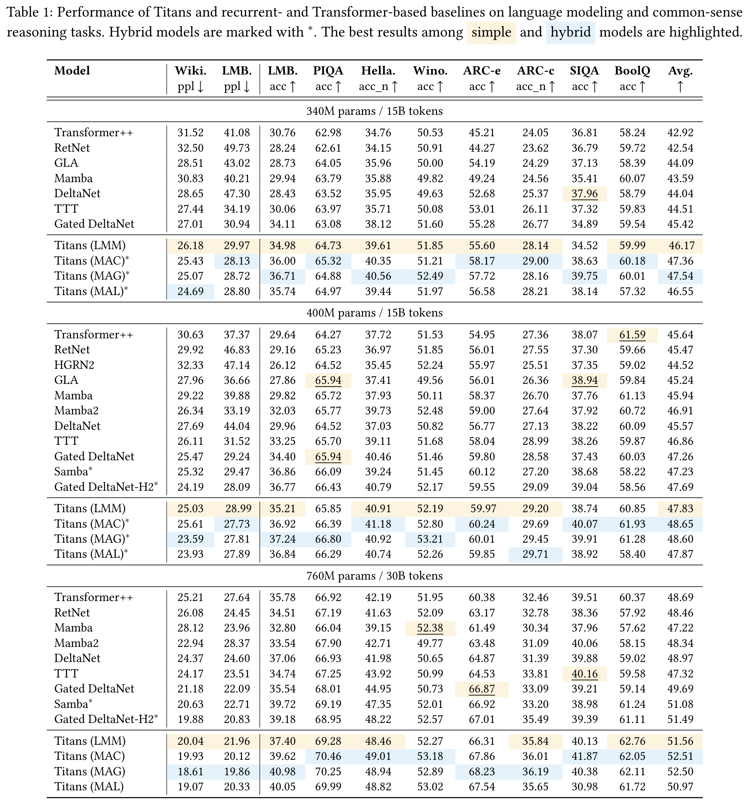

表 1：三个规模的主结果。只看 Avg，Titans 的 LMM 在每个规模都是非 hybrid 第一；MAC/MAG 在 400M 和 760M 的 hybrid 里也高于 Samba 和 Gated DeltaNet-H2。

### 5.2 长上下文检索：S-NIAH

S-NIAH 只测 16K 这一列。数字越高越好。

| 任务 | Titans (LMM) | Titans (MAC) | Titans (MAG) | Titans (MAL) | 最强基线 |
| --- | --- | --- | --- | --- | --- |
| S-NIAH-PK | 96.2 | 98.4 | 97.4 | 97.8 | 88.4（TTT） |
| S-NIAH-N | 80.2 | 97.4 | 98.6 | 96.4 | 5.4（DeltaNet） |
| S-NIAH-W | 80.6 | 95.2 | 88.2 | 90.4 | 0.0（三家都是 0） |

PK 上，LMM 已经比 TTT 高 7.8 分；N 和 W 上差距更大：TTT、Mamba2、DeltaNet 基本崩到个位数或 0，Titans 仍在 80 以上。MAC 是三个任务里最稳的，N 上 97.4，W 上 95.2。

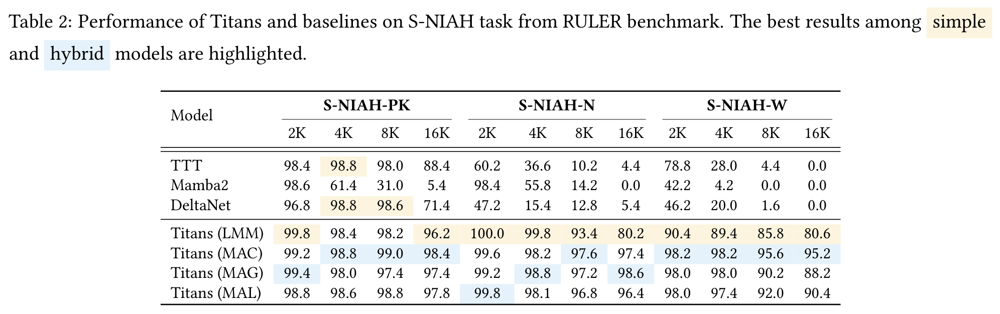

表 2：S-NIAH 从 2K 到 16K 的全表。Titans 的优势不是只在 16K 出现，而是随着长度增加，基线掉得比 Titans 快；LMM 在 N/W 上也有明显下滑，加上注意力后的 MAC/MAG 更稳。

### 5.3 BABILong：多跳长文档

BABILong 不是找一句话，而是把多条事实分散在极长文档里，要求模型跨事实推理。图 6 左右分别是 few-shot 和 fine-tuning。

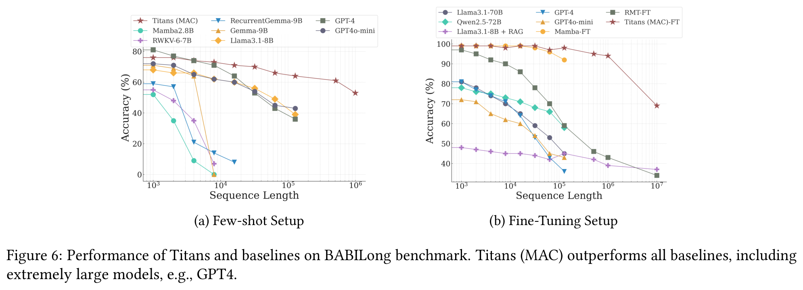

图 6：few-shot 下 Titans (MAC) 从 $10^3$ 的约 80% 缓降到 $10^5$ 的约 65%，$10^6$ 仍有约 53%；GPT-4 从 $10^3$ 的约 99% 降到 $10^6$ 的约 36%，两线在 $3\times10^5$ 到 $10^6$ 之间交叉；Mamba2.8B 在 $10^4$ 前已接近 0。fine-tuning 下 Titans (MAC)-FT 到 $10^4$ 约 98%、$10^5$ 约 94%、$10^6$ 约 93%，$10^7$ 约 69%；Llama3.1-70B 从约 99% 跌到 $10^7$ 的约 46%，Llama3.1-8B+RAG 从约 48% 缓降到约 38%。这些是从图上读的约数。

我的判断：这是全文最强的长上下文证据，因为它把横轴拉到 $10^7$ token。作者说 Titans (MAC) 的参数量远小于这些基线，正文还提到比 Llama3.1-8B+RAG 少约 70 倍；但作者没有给 Titans (MAC) 的具体参数量，所以做不了严格的参数匹配比较，趋势仍然清楚。

### 5.4 时间序列

时间序列用 Simba 框架，把 Mamba 模块换成神经记忆；指标是 MSE/MAE，越低越好。下表的最强基线取该数据集上两项里更好的那个。

| 数据集 | Neural Memory MSE | Neural Memory MAE | 最强基线 MSE | 最强基线 MAE |
| --- | --- | --- | --- | --- |
| ETTm1 | 0.358 | 0.387 | 0.383（Simba） | 0.396（Simba） |
| ETTm2 | 0.261 | 0.309 | 0.271（Simba） | 0.327（Simba） |
| ETTh1 | 0.420 | 0.421 | 0.441（Simba） | 0.432（Simba） |
| ETTh2 | 0.336 | 0.382 | 0.361（Simba） | 0.391（Simba） |
| ECL | 0.162 | 0.261 | 0.169（Simba） | 0.274（Simba） |
| Traffic | 0.415 | 0.289 | 0.428（iTransformer） | 0.282（iTransformer） |
| Weather | 0.231 | 0.265 | 0.255（Simba） | 0.280（Simba） |

MSE 是 7/7 最低；MAE 是 6/7 最低，Traffic 上 iTransformer 的 0.282 比 Neural Memory 的 0.289 更低。作者正文说“outperforming all baselines”，严格按 MAE 看，Traffic 这一项不是。

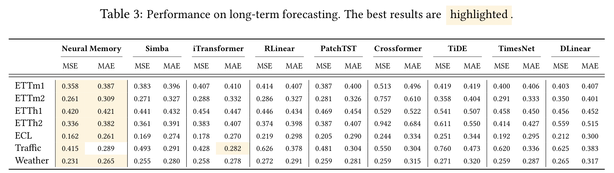

表 3：时间序列全表。Neural Memory 在 7 个数据集上 MSE 全部最低；MAE 只有 Traffic 输给 iTransformer，其余 6 个最低。表中高亮的是每个数据集的最优值。

### 5.5 DNA

DNA 用 GenomicsBenchmarks 的五个下游分类任务，指标是 top-1 accuracy。

| 任务 | Neural Memory Module | 最强基线 |
| --- | --- | --- |
| Enhancer Cohn | 75.2 | 74.2（HyenaDNA） |
| Enhancer Ens | 89.6 | 89.5（Based） |
| Human Reg. | 89.3 | 93.8（HyenaDNA） |
| Non-TATA Promoters | 96.6 | 96.8（Based） |
| Human OCR Ens. | 79.9 | 80.9（HyenaDNA） |

五个任务里两个第一，三个不是第一；Human Reg. 差 4.5 分，是差距最大的一项。作者的结论是 competitive，不是全面领先。

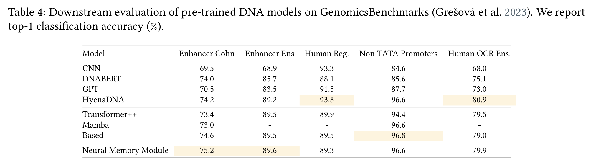

表 4：DNA 全表。Neural Memory Module 在 Enhancer Cohn 和 Enhancer Ens 上最好，Human Reg.、Non-TATA Promoters、Human OCR Ens. 分别输给 HyenaDNA 或 Based。预训练数据、模型规模和训练预算原文未给。

### 5.6 记忆深度与吞吐

图 7 扫了 $L_{\mathcal{M}}=1,2,3,4$，并用 Mamba 作对照。模型规模是 170M、360M、760M；这里写 360M，主表写 340M/400M，作者没有说明这两个数字怎么对应。

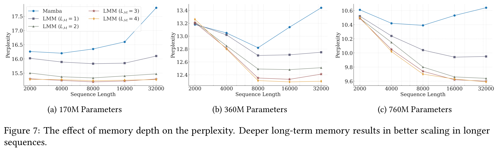

图 7：加深记忆层，ppl 在所有序列长度上都下降；Mamba 在 170M 和 360M 上随序列变长明显上升，760M 在 32K 时约 10.65，而 LMM depth4 约 9.64。170M 上 depth3/4 接近，360M 和 760M 上 depth4 在 8K 之后最低。

图 8 是同一条深度轴的训练吞吐。

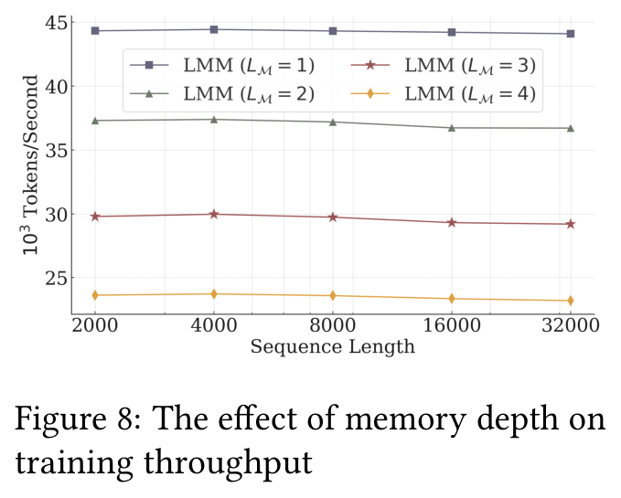

图 8：depth1 约 44K token/s，depth2 约 37K，depth3 约 30K，depth4 约 23K；2K 到 32K 基本平，说明吞吐不随序列长度明显下降，但深度每加一层都更慢。效果和效率要取舍。

图 9 换成和基线比训练吞吐。

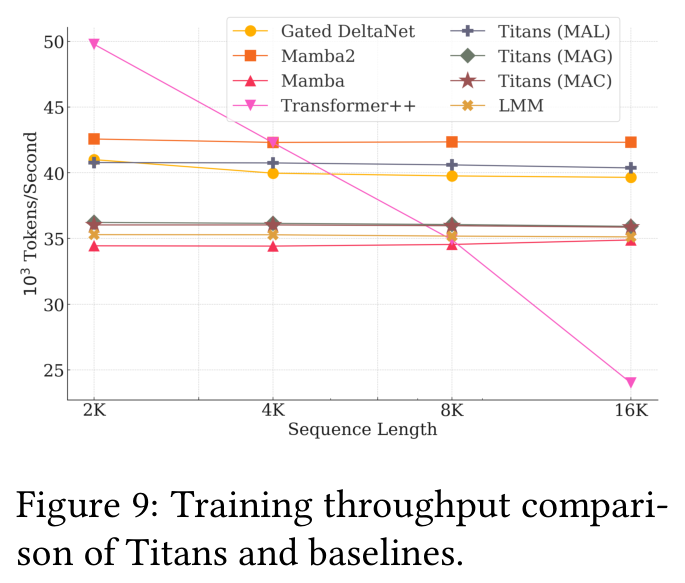

图 9：Transformer++ 从 2K 的约 50K 掉到 16K 的约 24K；Mamba2 约 42–43K 基本平；Titans MAL 约 40–41K；MAC/MAG 约 36K；LMM 约 35.5K；Mamba 约 35K。作者正文说 MAL 比基线快，但图里 Mamba2 在 2K–16K 仍略高于 MAL，原文没有解释这个出入。

### 5.7 消融

表 5 以 LMM 为基座，一次只改一个部件。左列 ppl 越低越好，中列和右列 acc 越高越好。

| 设置 | Language Modeling ppl↓ | Reasoning acc↑ | Long Context acc↑ |
| --- | --- | --- | --- |
| LMM | 27.01 | 47.83 | 92.68 |
| +Attn (MAC) | 26.67 | 48.65 | 97.95 |
| +Attn (MAG) | 25.70 | 48.60 | 96.70 |
| +Attn (MAL) | 25.91 | 47.87 | 96.91 |
| Linear Memory | 28.49 | 46.97 | 85.34 |
| w/o Convolution | 28.73 | 45.82 | 90.28 |
| w/o Momentum | 28.98 | 45.49 | 87.12 |
| w/o Weight Decay | 29.04 | 45.11 | 85.60 |
| w/o Persistent Memory | 27.63 | 46.35 | 92.49 |

这张表的 LMM 基线 ppl 是 27.01，和表 1 里 400M Titans (LMM) 的 25.03 不是同一套数值；表 5 的训练设置原文没交代，不能混着比。

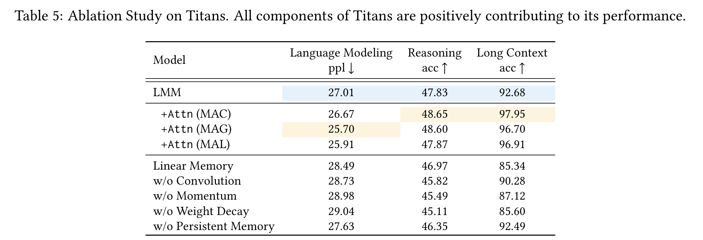

表 5：消融全表。去掉 weight decay、momentum、convolution、persistent memory 都会掉分；作者说贡献最大依次是 weight decay、momentum、convolution、persistent memory，但按 ppl 退化幅度看，Linear Memory 的 28.49 比 w/o Persistent Memory 的 27.63 掉得更多，作者在排序时没有提这一行。

**消融告诉我们什么**

- 遗忘门最重要：去掉 weight decay，ppl 从 27.01 升到 29.04，长上下文 acc 从 92.68 掉到 85.60。
- 动量第二：去掉 momentum，ppl 升到 28.98，长上下文掉到 87.12；说明“连续 surprise”确实比“当前一步 surprise”有用。
- 卷积和持久记忆也有贡献，但幅度小一些；持久记忆的贡献主要在语言建模和推理：去掉后 ppl 从 27.01 升到 27.63、推理从 47.83 降到 46.35，长上下文几乎不变（92.68 到 92.49）。
- 深层记忆换成线性记忆，ppl 升到 28.49，长上下文掉到 85.34；这是“深度”本身的价值，不是某个门控的功劳。
- MAC 的长上下文最好（97.95），MAG 的语言建模 ppl 最好（25.70），MAL 两边都不是最好；三种接法确实有取舍。

**这些实验够不够支撑结论**

够支撑的部分：语言建模、常识、NIAH、BABILong、时间序列、DNA、深度消融、吞吐，覆盖面很广；主结果有 340M/400M/760M 三个规模，长上下文有 $10^7$ token 的曲线，时间序列有 7 个数据集。

不够的部分：

- 2M context 是摘要里的主张，没有单独的 2M token 标准实验；S-NIAH 只到 16K，BABILong 虽然到 $10^7$，但不是标准 2M 评测。
- 训练硬件、卡数、训练时长、随机种子与方差，原文未给；主表 400M 的基线还是从 Gated DeltaNet 论文借的，不是同环境重跑。
- NIAH、时间序列、DNA 三组实验的模型规模和训练预算，原文未给；DNA 的 Titans 预训练细节也没有。
- BABILong few-shot 里作者说 Titans 的参数量远小于这些基线，正文还提到比 Llama3.1-8B+RAG 少约 70 倍；趋势有说服力，但不是参数匹配比较。
- 只测了训练吞吐，没有推理延迟；而 Titans 的卖点之一是测试时还要逐 token 更新记忆，推理开销不能从图 9 推出来。
- 时间序列的 MAE 在 Traffic 上不是第一，DNA 只有 2/5 第一，正文的“outperforming all”覆盖不了这些例外。

## 6. 局限性

生活类比：局限像地图上的空白，作者标出的边界之外，才是你实际部署时要自己踩的点。

**作者自己承认的**

- 这是第一版，作者在脚注里写 "We are working on finalizing the results of larger models"，意思是更大模型的结果还没放进来。
- 代码还没放出来，作者在结论里说打算很快公开。
- 深度有取舍：加深记忆能降 ppl，但训练吞吐线性下降，作者明确说加深并不总是高效。

**我看出来的**

- 隐形假设：记忆容量固定，靠遗忘门就能管理长序列。可如果任务需要精确记住大量互不相关的条目，MLP 容量和标量遗忘门都不够细；论文没有测“条目数量”这个维度。
- 边界条件：2M 以上的能力主要靠 BABILong 的曲线外推；没有在 2M 长度上做标准 NIAH 或语言建模，也没有报告显存和延迟。
- 缺的对比：NIAH 只和 TTT、Mamba2、DeltaNet 比，没有 Transformer++、GPT-4 这类强基线；BABILong few-shot 的参数量不匹配；DNA 只报 5 个任务。
- 训练时 chunk 内用段首记忆算梯度，是一个并行近似；chunk 越大，近似越粗，但论文没有给 chunk 大小的消融。
- 图 9 的文字结论和图不一致：作者说 MAL 比基线快，图中 Mamba2 仍略高于 MAL；这不影响大方向，但说明“快”要按具体基线读。
- 消融的贡献排序漏了 Linear Memory：它的 ppl 退化比 persistent memory 更大，作者却在排序里没提。
- 340M 和 360M 两个数字在正文与图 7 之间不一致，作者没有说明。
- 定理只给陈述，没有证明；表达力论证不能替代收敛性和样本效率的证据。

## 7. 一句话总结

Titans 把长期记忆从固定大小的隐藏状态换成一个可以现场用梯度改写的深层 MLP：读到意外的东西就多写一笔，旧内容按遗忘门慢慢褪色，需要时用 query 去查。

生活类比：一本会自己划重点、也会让旧页褪色的笔记本。

核心更新式：

$$
\boxed{\mathcal{M}_t=(1-\alpha_t)\mathcal{M}_{t-1}+\eta_t S_{t-1}-\theta_t\nabla\ell(\mathcal{M}_{t-1};x_t)}
$$

这个式子在算：旧记忆按 $1-\alpha_t$ 保留，加上按 $\eta_t$ 累积的旧 surprise，再减去当前 surprise 的梯度步。$\alpha_t$ 控制忘多少，$\eta_t$ 控制动量，$\theta_t$ 控制写多狠。

## 8. 可复用点

生活类比：可复用点像把一道菜拆成火候、刀工和调味，换食材也能照着做。

- 如果我要在自己的项目里用：把某个线性循环层的 hidden state 换成一个 2 层 MLP，输入当前 token 的 key，目标是当前 token 的 value；用 MSE 做内环损失；外层仍然用任务损失训投影和输出层。
- 训练不收敛时先查：遗忘门是不是一开始就太大（$\alpha_t$ 接近 1 会把记忆一直清空）；记忆学习率 $\theta_t$ 是不是比外层学习率大太多；q/k 有没有做 L2 归一化；depth 先从 1–2 层试，不要一上来就 4 层。
- 长上下文检索优先选 MAC：表 5 里 MAC 的长上下文 acc 最高；要语言建模 ppl 选 MAG；要训练吞吐选 MAL 或 depth1 的 LMM。
- 分块并行时，chunk 内用段首记忆算梯度；chunk 越大越省显存，但近似越粗，先在小 chunk 上验证效果再放大。
- 评估时不要只信 2M 的主张：在自己的目标长度上重测 NIAH 和语言建模，同时报推理延迟、显存和参数量；和基线做参数匹配，不要拿小模型和大模型比绝对值。
- 如果任务需要精确记忆大量条目，先做容量压力测试：固定记忆大小，逐步增加需要记住的 key→value 对，看 ppl/准确率在第几对开始崩；这能判断标量遗忘门够不够。

## 9. 我的疑问

生活类比：疑问像书页边上的问号，不一定是否定，但都是下一步要验证的地方。

- $\alpha_t$、$\eta_t$、$\theta_t$ 具体怎么参数化？论文只说数据相关，没有给网络结构和初始化。
- chunk 大小 $b$ 取多少？有没有 chunk 大小的消融？
- 每个 Transformer block 都有一套记忆，还是整个模型共享一套？论文没有明说。
- 持久记忆的长度 $N_p$ 怎么选？换任务要不要重新调？
- 2M context 的说法，为什么没有对应的 2M 标准实验？
- 测试时逐 token 更新记忆，实际推理延迟和显存是多少？论文只给了训练吞吐。
- 340M 和 360M 到底是不是同一个模型？
- 表 5 的 Long Context acc 是在 BABILong 的哪个长度上算的？表 5 只给 acc，没有给长度。
- DNA 实验里 Titans (LMM) 的预训练数据、模型规模和训练预算是什么？
- 记忆更新只用自监督的 key→value 重建，遇到噪声或错误上下文时，surprise 会不会把噪声也写进去？论文没有做这个压力测试。
