> 一句话：把模型权重当成能读懂的输入，让它直接写出新任务的权重。

## 0. 读之前你需要知道

**术语卡**

- **智能体（agent）**：会连续做多步、能调用工具、能从上次经验里改进行为的大模型程序。生活类比：不是答题机，是能自己跑腿办事的实习生。
- **参数高效微调（PEFT, Parameter-Efficient Fine-Tuning）**：不改大模型本体，只额外训练一小块参数来适配新任务。生活类比：不重装修房子，只在门后挂一个挂钩。
- **前缀微调（prefix-tuning）**：PEFT 的一种，在每一层前面插一段可训练向量，让这段向量影响后面所有计算。生活类比：在乐谱开头写一条速度提示，整首曲子都跟着变。
- **父任务（parent task）**：合成一道复合任务时被拿去做原料的那两个原始任务。生活类比：两道旧菜谱合出一道新菜，那两道旧菜谱就是父任务，新菜是子任务。Composite-SNI 的任务名 `79_411` 就是两个父任务的编号拼起来的，血缘写在名字里。
- **缓存（cache）**：算过一次就存下来、下次直接拿来用的中间结果。生活类比：备菜，切好的葱姜蒜先搁小碟里，下锅时抓一把就走，不用现切。省的是时间，代价是占一份地方。
- **K-V 缓存（Key-Value cache）**：Transformer 每层、每个 token 都要算一个键和一个值，前文算完就不会再变，存下来就能省掉重算。生活类比：读长文时手边那张摘抄卡，回答后面的问题照着它说，不用回头翻原文。这篇论文里的参数化技能就是这段缓存：前缀微调学出来的正是一串键和值，插进这个存储位就等于让模型读过一段提示。差别在于普通缓存用完就丢，这里是训练出来长期保存的，还会被 SkillSmith 重写。
- **超网络（hypernetwork）**：专门用来输出别的网络权重的网络。生活类比：不做菜，只写菜谱。
- **旋转位置编码（RoPE）**：把第几个字这个信息编码进向量的方法，做法是给向量做旋转。生活类比：给每个字脚上绑一个只跟站位有关的罗盘，搬走前要先转回去。
- **上下文学习（ICL, In-Context Learning）**：不训练，把几个例子写进提示词让模型照着做。生活类比：当面示范一遍，不动手教。
- **负对数似然（NLL）**：模型给正确答案的概率越低，这个数越大。生活类比：考试扣分，扣得越多说明越不确定。
- **Elo 等级分**：国际象棋那套评分，只根据两两胜负推算全局排名。生活类比：围棋段位，赢强手涨得多。
- **模型合并（model merging）**：把两个微调过的权重直接相加、平均或拼接，得到一个会两件事的权重。生活类比：两杯咖啡倒一起，指望更好喝。

**它站在谁肩上**

- Reflexion（2023）：让智能体把失败写成人话反思，塞回上下文再试。不够的地方是反思活在上下文窗口里，读完就忘，也不会变成模型的能力。
- SPoT（2022）与 ATTEMPT（2022）：把多个软提示或适配器合并、加权来迁移技能。不够的地方是合并规则要么是平均，要么是黑盒注意力，读不懂任务之间的语义关系。
- LoRAHub（2023）：学一个组合器，按需把多个 LoRA 拼起来。不够的地方是它只吃权重不吃文字，没法用一句话说清要什么。
- LoRA.rar（2025）：用超网络合并 LoRA。不够的地方同样是单模态，而且对象是 LoRA 不是前缀缓存。
- 组合泛化研究（Lake & Baroni 2018、Keysers 2019、Dziri 2023）：反复证明模型在没见过的技能组合上会掉点。这篇把这个现象当成靶子。

## 1. 动机

想象一位老师傅。他脑子里有两套东西：一套是手上的功夫，切菜火候、颠锅力度，说不清但做得出；另一套是写了二十年的笔记本，上面记着红烧要先炒糖色。现在客人点了一道他没做过的菜，要用红烧的手法做一道川菜。

老师傅只有两条烂路。第一条，翻笔记本照着念，但笔记本再厚也就那么几页，复杂菜写不下。第二条，凭旧手感硬套，可手上的功夫不能读、不能改、不能拼，炒糖色和麻辣在他手上揉不到一起。

这篇论文要给的，是第三条路：把手上功夫也变成能读、能写、能拼的东西。

**以前怎么做**：智能体从经验里学习，走的是两条互不相通的管道。文字那条路把经验写成反思、记忆、提示词（Reflexion、Mem0、PromptAgent），靠自然语言引导下一次推理。权重那条路把每个子任务练成一个小模块（adapter、LoRA、prefix），需要时用算术把模块合起来。

**为什么不行**：文字那条路被上下文窗口卡死。一个任务的示例理论上都能写进 prompt，但写不下就是写不下，而且每次推理都要重付一遍 token 的钱。权重那条路推理便宜，可合并是浅层算术：平均两个缓存等于假装两个任务的语义可以线性相加，拼接等于假装它们互不干扰。真正决定成败的信息，比如这两个任务在功能上怎么配合，在这些算子里没有位置。

**为什么现在能做**：三个条件凑齐了。第一，prefix-tuning 让读一段文字后产生的 K-V 和从头训出来的 K-V 落在同一个张量空间，技能长得一模一样，权重才具备被语言模型读取的可能。第二，4B 级开源模型可以在单机训一个额外的协处理器。第三，Gemini 2.5 这类模型能批量合成任务血缘已知的训练数据，否则没法验证合成能力。

## 2. 贡献

- **在权重合并之外开出一条新路**。证据：Composite-SNI 零样本时 SkillSmith 的 Elo 是 1800，最好的算术合并 LERP 只有 692。
- **造了带血缘标注的组合数据集 Composite-SNI**。证据：从 SNI 任务对出发生成约 35 万个候选，三轮过滤后留下约 9 万个，最终约 2.1 万个复合任务，其中约 1.7 万个用于元训练。
- **三个数据集上都赢过单模态基线，而且在难任务上优势最大**。证据：Composite-SNI 微调后 Elo 2627、最强基线 2243；MMLU-ProX 上 2515、最强权重合并基线 2014。
- **给出不依赖 ground truth 的检索方案**。证据：检索加 LLM 挑选在 15 个任务上全部优于直接训练，随机挑选在 3 个任务上还不如直接训练。

比方的说法：不是把两道菜倒进一个锅，而是请了个会看菜谱也会尝味道的帮厨，让他重炒一盘。

## 3. 创新点

- **把权重空间当成一种输入模态**。对比对象是所有已有超网络与合并方法，它们输入要么只有权重、要么只有文本。有用是因为：权重一旦能被读进来，要什么技能就可以用一句话说清，不必先在训练集上试错。
- **输出整段新缓存，而不是合并系数**。对比对象是 LERP、Concat、SVD、SPoT 这些只能选算子、算权重的方法。有用是因为：表达能力不再被算术形式限制，模型能写出一个不属于任何父任务的缓存。
- **用一条拼装序列同时喂两种模态**。对比对象是把文本和权重分开编码再接头的做法。有用是因为：控制 token 把一段文字和一段权重绑成可寻址的任务包，模型知道哪段权重配哪段描述。
- **合成数据集加检索替代标注的组合拳**。对比对象是只在真实任务集上做实验的工作。有用是因为：合成集有 ground truth，能单独评估合成能力；真实集有噪声，能评估脏输入下的鲁棒性。

比方的说法：以前的合并方法像调音台上三个旋钮，只能拧大小；这篇是让一个懂音乐的人重新弹一遍。

## 4. 方法

### 4.1 整体流程

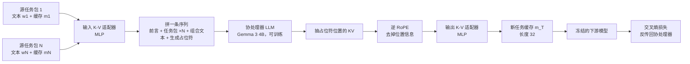

一句话解释这张图：两个旧技能（一份文字说明加一段权重）塞进一个模型，这个模型读完吐出一段属于新任务的权重。

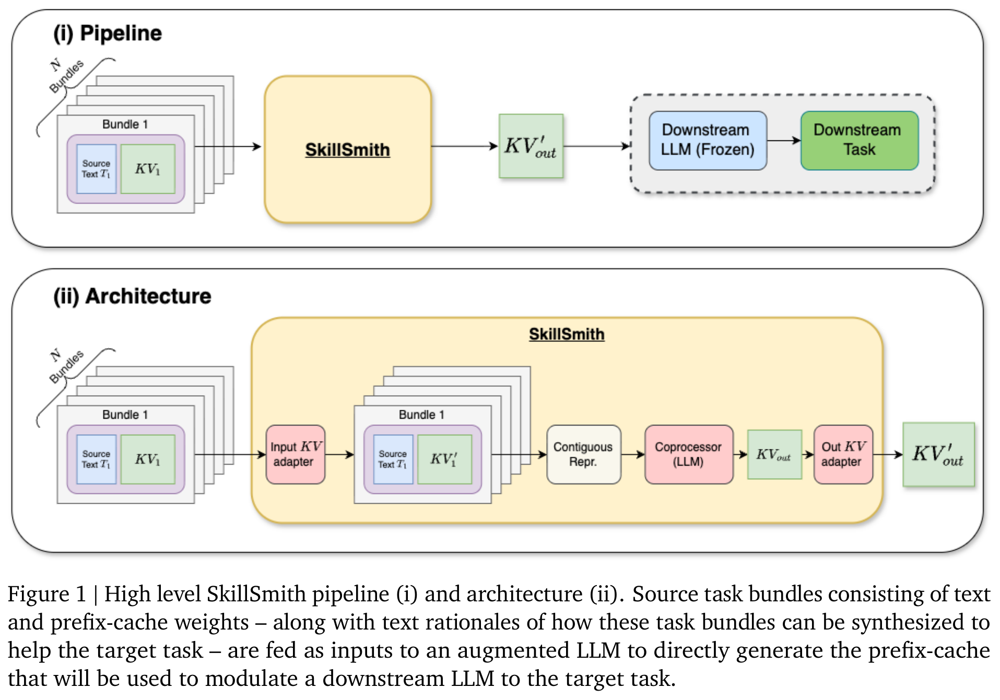

图 1：这张图是全文骨架。上半部分说明 SkillSmith 的输出直接插到冻结的下游模型前面；下半部分展开内部，被训练的只有三块，输入适配器、协处理器 LLM、输出适配器，下游模型的权重全程不参与训练。

### 4.2 模块拆解

**源任务包（task bundle）**

为什么需要：要让模型读懂技能，技能得有一个统一打包格式，否则文字和权重对不上号。

怎么做：每个见过的任务打包成一对，文字配权重。

$$
b_i=(w_i,\;m_i),\qquad i\in\mathcal{T}_{\text{src}}
$$

这个式子在说什么：一个技能包由一段文字和一段权重配对组成。

- $b_i$：第 $i$ 个源任务包，是送进模型的输入单位。
- $w_i$：该任务的文本元数据，任务描述加 4 到 16 条上下文示例，是一段字符串。
- $m_i$：该任务的 K-V 缓存，形状是层数 × 2（键和值）× 头数 × 前缀长度 × 头维度。只在前缀长度 32 上训练，且只训全局层。

**输入适配器**

为什么需要：训出来的缓存（不是由文字算出来的，而是把那串键和值直接当参数、用梯度下降学出来的）和语言模型内部的隐状态数值分布不是一回事，直接拼进去模型读不懂。

怎么做：一个多层感知机（MLP）把 $m_i$ 投到语言模型的隐空间，得到 $KV_i'$。只改数值尺度，不改结构。

**序列拼装**

为什么需要：模型得知道这段文字到这里结束、后面这段权重属于它。靠位置隐式区分不可靠，要显式打标记。

怎么做：把一条序列按固定顺序拼起来。

- 前言：描述整体目标的文字，先让模型进入状态。
- 任务包区：每个包写成 `src_start` → $w_i$ → `kv_start` → $KV_i'$ → `kv_end`，再接下个包，有几个源任务就重复几遍。
- 组合文本：说明这些源任务怎么组合才能解决目标任务，也可以直接放目标任务的几个示例或一句描述。
- 生成区：`gen_start` 标记，接 $L$ 个占位 token $z_1,\dots,z_L$，最后 `gen_end`。

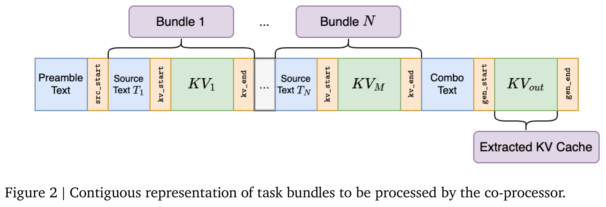

图 2：这张图把控制 token 的作用画得很直白。黄色窄条是标记，蓝色块是文字，绿色块是权重，模型看到 `kv_start` 就知道接下来的张量是权重而不是文字。右下角的括号说明最后要摘走的正是生成区那一段。

**协处理器前向与占位符抽取**

为什么需要：要拿到新技能，得有个地方让模型把答案写出来。占位符就是那块答题纸。

怎么做：整条序列送进 Gemma 3 4B 做一次前向，只把 $z_1,\dots,z_L$ 这些位置上的 K-V 抽出来，得到 $KV_{\text{out}}$。这些位置的键值不是从文本算出来的，而是模型读完前文后生成的状态。

**逆 RoPE 与输出适配器**

为什么需要：抽出来的 K-V 带着我在序列第 800 个位置这类信息，但新缓存（就是那 32 个假 token 的键和值）要放到下游 prompt 最前面当第 0 到 31 个 token 用。位置不擦掉，下游模型会以为前面还有八百个 token。

怎么做：先做逆 RoPE 旋转把位置信息剥掉，再过一个 MLP 投回缓存的数值空间（把协处理器读取态的数值翻译成下游认得的前缀缓存尺度与方向），得到最终可部署的 $m_T$，形状是层数 × 2 × 头数 × 32 × 头维度，能直接写进下游缓存的第 0 到 31 位。

**端到端元训练**

为什么需要：如果只用生成得像不像父任务当目标，模型会学成复制粘贴。要让它学生成出来之后下游任务做得好不好。

怎么做：把生成的缓存插进冻结的下游模型，算任务损失，梯度穿过缓存张量一路反传回协处理器。下游模型永远不更新。

谁动谁不动，按这三条记：

- 被训练的只有 $\theta$ 里的三块：输入适配器、协处理器 LLM 本体、输出适配器。
- 冻结的两类：下游模型 $M_\phi$（只借道算损失，权重不更新）、源任务缓存 $m_i$（事先各自训好，当固定输入用，元训练时不碰）。
- 例外只有一个：评测时如果把生成的缓存接着在目标任务上微调，那时 $m_T$ 才成为可训练对象。那是评估协议，不是 SkillSmith 的训练过程。

$$
\theta^{*}=\arg\min_{\theta}\sum_{(T\{\boldsymbol{x},\boldsymbol{y}\},\,\mathcal{T}_{\text{src}}[T],\,w)\sim\mathcal{D}^{\text{train}}}\mathcal{L}\Big(M_{\phi}\big(\boldsymbol{x};\,m_T\big),\,\boldsymbol{y}\Big)
$$

先说这个公式在算什么：固定下游模型，只调协处理器的参数，让协处理器写出的缓存在下游任务上损失最小。

- $\theta$：协处理器参数（输入适配器、LLM 本体、输出适配器），是要学的东西。
- $\phi$：下游模型 $M_\phi$ 的参数，全程冻结。
- $\mathcal{D}^{\text{train}}$：元训练集，每个元素是三元组（目标任务的数据对、它的源任务集合、组合文本）。
- $m_T=\text{SkillSmith}_\theta(\{b_k\}_{k\in\mathcal{T}_{\text{src}}[T]},w)$：协处理器根据源任务包和组合文本生成的缓存。
- $\boldsymbol{x},\boldsymbol{y}$：下游任务的输入与目标，$\mathcal{L}$ 是交叉熵。
- 关键点：$m_T$ 出现在下游模型的输入位置上，梯度必须穿过这个张量才能回到 $\theta$。

### 4.3 关键细节

**源缓存怎么训**：每个源任务一个缓存，长度在 32、64、128 里随机采样以增加多样性，优化步数在 200、500、1000 里搜，学习率在 $10^{-2}$ 到 $10^{-4}$ 里搜，按验证集 NLL 选最好的一组。只训全局层，因为带局部层的缓存一旦超出窗口就失效。

**SkillSmith 怎么训**：Adam，学习率在 $10^{-3}$ 和 $10^{-4}$ 里选，batch 在 32、64、128 里选；Composite-SNI 上训 10000 步，SNI 上 2000 步。两处正则：一是 KV dropout，以 0.1、0.293、0.5 的概率把整段缓存置零，逼模型不能只依赖权重；二是训练时输出长度在 16、32、64、128 里随机采样，评估时固定 32。

**Composite-SNI 怎么造**：SNI 任务两两配对，让 Gemini 2.5 Pro 生成一个必须同时用上两个父任务技能的新任务，并自评 1 到 5 分。先丢掉自评 ≤3 分和示例少于 16 条的，再做两轮 LLM 两两对比筛选，最后按正确性、内部一致性、事实性再筛一遍。终稿按父任务是否在元训练集出现过分成 Both-Seen、One-Seen、Neither-Seen 三档。

**没有 ground truth 时怎么办**：两级流水线。第一级用 Gemini Embedding 把任务的 16 条示例各自编码，训一个两层 MLP（512、256）做任务分类，推理时把 16 条示例的对数概率加起来当分数。

$$
s_i=\sum_{j=1}^{K}\log\text{softmax}\big(f_\theta(\mathbf{e}_j^{(q)})\big)_i,\qquad \hat{s}_i=\tanh\!\left(\frac{s_i-\mu_s}{\sigma_s}\right)
$$

这个式子在说什么：一个源任务像不像目标，看它的 16 个示例分别打分再求和，然后 z-score 归一化并压到 -1 到 1。

- $K$：每个任务的示例数，实验里取 16。
- $f_\theta$：把示例向量映射到 $N$ 个源任务上的分类器。
- $s_i$：第 $i$ 个源任务的原始得分，越大越相关。
- $\mu_s,\sigma_s$：所有源任务得分的均值与标准差。
- $\hat{s}_i$：归一化后的分数，按它排序取前若干。

第二级把排好序的任务按顺序两两配成候选对，连同目标任务描述交给 Gemini 2.5 Pro，让它挑出唯一最相关的一对。全程固定 $N=2$。

## 5. 实验结果

**实验设置**

- 数据集与切分：Composite-SNI 是作者自建集，父任务取自 SNI，约 2.1 万个复合任务，约 1.7 万训、15 个测（三档各 5 个）。SNI 共 1,616 个任务、76 类，实际用 875 个任务、每任务 1024 条，测试 10 个任务，严格留出但参与过 CSNI 构造。MMLU-ProX 覆盖 14 学科 × 29 语言，元训练剔掉 3 个学科、3 种最差语言，测试 6 个语言-学科对。
- 骨干模型：SkillSmith 的协处理器和下游解题模型都是 Gemma 3 4B，下游全程冻结。只测了一个尺寸。
- 训练预算：Adam，学习率在 $10^{-3}$ 与 $10^{-4}$ 里选，batch 在 32、64、128 里选；Composite-SNI 训 10000 步，SNI 训 2000 步。用什么卡、几张、总时长，原文未给。
- 基线：权重空间有 LERP、Concat、源任务迁移（等价于 SPoT）、SVD 三个轴、父任务平均；文本空间有 ICL，$k$ 从 16、32、64 里按验证 NLL 选；无迁移的有直接前缀微调，分随机初始化与用 ICL 前 32 个 token 初始化两种。除 ICL 外都跑零样本与下游微调两档。
- 指标：每个任务算留出集平均 NLL，再把 15、10、6 个任务的 NLL 聚合成 Elo，越高越好。
- 推理设置：生成的缓存长度固定 32（Concat 因拼接是 64）。这里不做采样解码，温度与长度上限不适用，原文未给。

指标为什么用 Elo 而不是直接平均 NLL：各数据集的 NLL 量纲差太多，有的任务只有 0.003，有的到 11.5，直接平均会被大方差的难任务带偏。做法是先把两两胜负统计成胜率矩阵，再用 Bradley-Terry 模型反解评分。

$$
W_{ij}=\frac{1}{|\mathcal{T}_{\text{eval}}|}\sum_{T\in\mathcal{T}_{\text{eval}}}\mathbb{I}\big(\mathcal{L}_i(T)<\mathcal{L}_j(T)\big),\qquad E_{ij}=\frac{1}{1+10^{(R_j-R_i)/400}}
$$

这个式子在说什么：先用两两胜负算出经验胜率，再假设胜率是评分差的逻辑函数，反解出每个方法的评分。

- $W_{ij}$：方法 $i$ 赢方法 $j$ 的任务比例，取值 0 到 1。
- $\mathcal{L}_i(T)$：方法 $i$ 在任务 $T$ 上的损失，越小越好。
- $\mathbb{I}(\cdot)$：条件成立取 1，否则取 0。
- $E_{ij}$：模型期望的胜率。
- $R_i,R_j$：待求的 Elo 评分，初值 1500，用 L-BFGS-B 数值优化。

| 数据集 / 设置 | 指标 | 本文 | 最强基线 | 提升 |
| --- | --- | --- | --- | --- |
| Composite-SNI，零样本，对权重合并 | Elo | 1800 | LERP 692 | +1108 |
| Composite-SNI，零样本，对纯文本 ICL | Elo | 1800 | ICL 1942 | −142 |
| Composite-SNI，下游微调后 | Elo | 2627 | ICL 初始化微调 2243 | +384 |
| SNI，下游微调后 | Elo | 2821 | ICL 初始化微调 2853 | −32 |
| MMLU-ProX，下游微调后 | Elo | 2515 | Concat 2014 | +501 |
| MMLU-ProX，零样本，不做 CSNI 预训练 | Elo | 1736 | ICL 357 | +1379 |

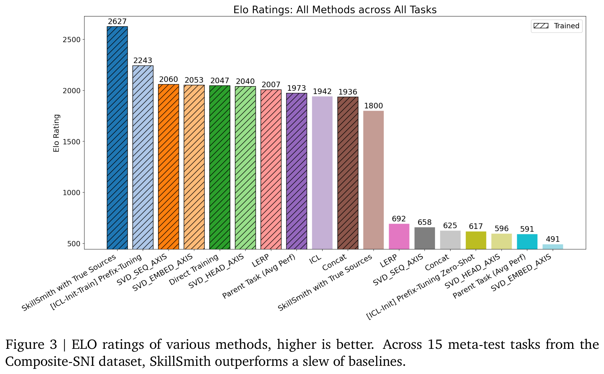

图 3：这张图证明了两件事。一是权重合并派被甩开一个量级，零样本那八根柱子全在 700 以下，连直接用 ICL 例子初始化都比它们强；二是零样本的 SkillSmith 和 ICL 处在同一区间，说明不微调时基座模型本身的文本能力就是天花板。真正拉开差距的是微调档，用 SkillSmith 初始化后再微调，比用 ICL 初始化高，比直接训练高得更多。

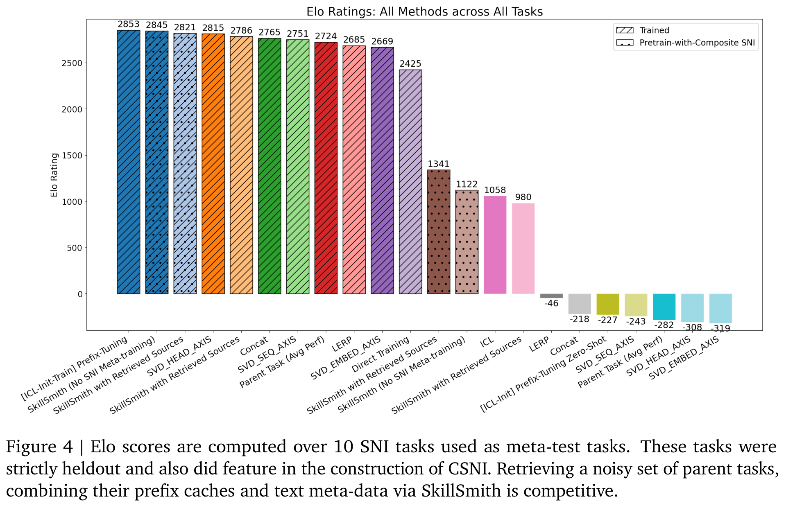

图 4：这张图是三个数据集里最不体面的一张。微调档前十根柱子挤在 2669 到 2853 之间，差值不到 200 分，而 Elo 的置信区间本来就不窄，等于分不出高下。更值得看的是零样本那组的负数，纯算术合并的 Elo 掉到 -46 到 -243，说明没有下游数据时把两个任务的缓存硬平均，会把模型拖到比直接训练还差的位置。

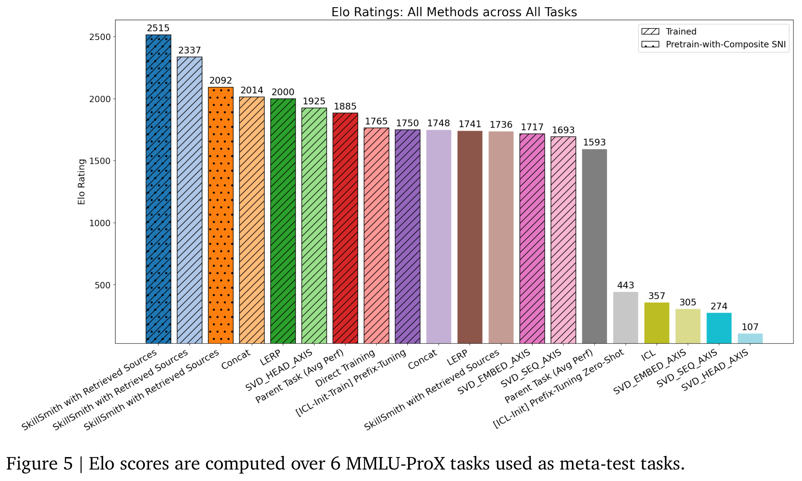

图 5：这张图找回了差距。同样允许微调，最好的权重合并是 2014，SkillSmith 最高一档 2515，中间空了 500 分。作者的解释是这里数据少、任务难：MMLU-ProX 总共约 250 个任务，评的又是模型最弱的语言和没见过的学科，梯度下降没法靠多跑几步补回一个坏起点。

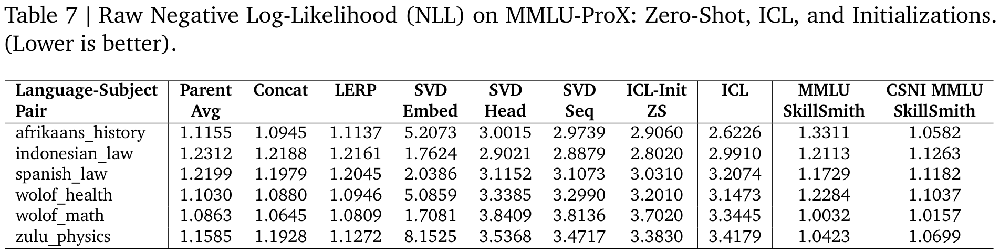

表 7：这张表是图 5 的绝对尺度版本，也是全文能核对口径的地方。把它和图 5 对照着看会发现 Elo 排序和 NLL 排序并不完全一致，某些语言-学科对 ICL 的 NLL 反而更低，但在六任务整体胜率里它排最后。原因是 Elo 只看两两胜负，把这些细微差距放大了。

**消融告诉我们什么**

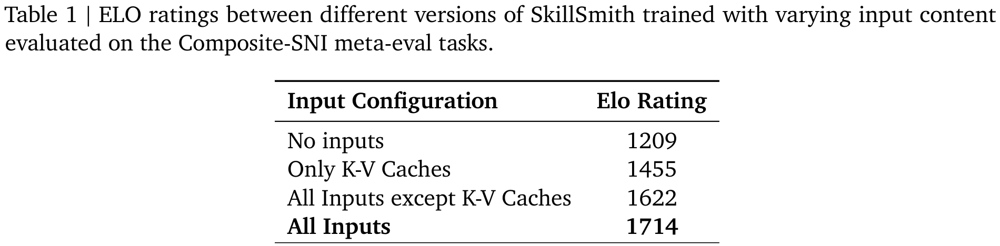

表 1：这张表证明了权重确实被用上了，而不是被模型当噪声忽略。只喂缓存时从 1209 抬到 1455，说明模型能从权重里读出信息；只喂文字时到 1622，说明文字信息量更大；两者都喂才到 1714。作者额外指出只喂缓存那一档相当于把 ATTEMPT 从算术组合换成了学习组合，这个对照很有说服力。

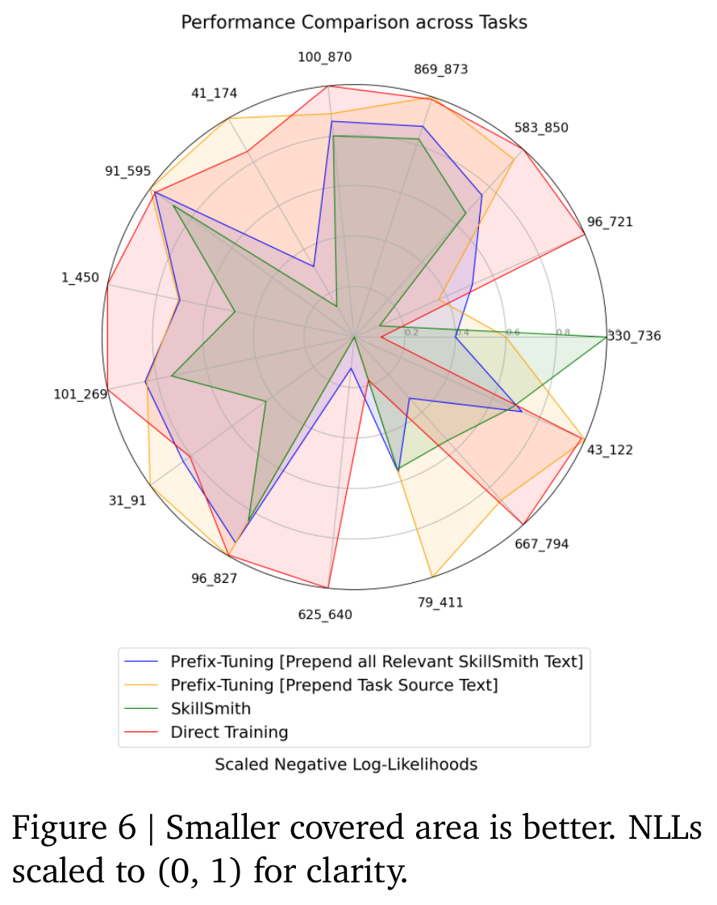

图 6：这张图回答了一个更尖锐的质疑，赢是不是只因为看到了更多文字。四条线里，加了全部文字的直接训练（蓝线、橙线）比纯直接训练（红线）确实缩了一圈，但每一格都没缩到绿线的位置。绿色是 SkillSmith，面积最小。这说明增益来自两种模态的配合，不是文字本身。

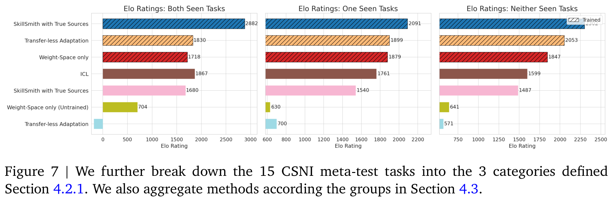

图 7：这张图是泛化性的关键证据。三栏按父任务（合成这道题时用的两个原料任务）有没有在元训练集里当过原料分组，不是按复合题本身分组。最右一栏 Neither Seen 里两个父任务都没在元训练集出现，SkillSmith 依然排第一。三栏有一个共同规律，微调档排序稳定，而零样本档在 One Seen 与 Neither Seen 上的相对位置比 Both Seen 好，说明见过的父任务越多，零样本合成反而越容易贴着父任务走。

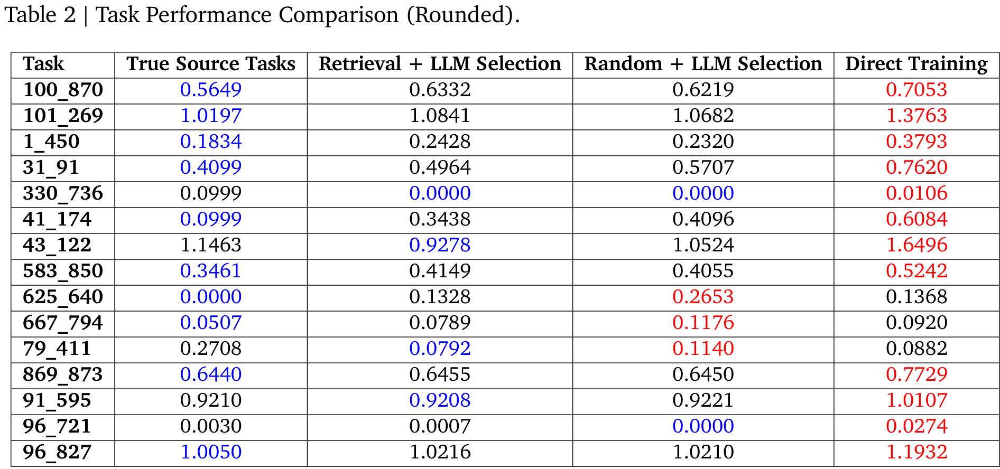

表 2：这张表是检索质量的下限测试，也是全文唯一一张能看到上界、实际方案、下界三方对比的表。蓝色是每行最好的结果，红色是比直接训练还差的格子。True Source Tasks 一列是合成这道题时真用的两个父任务，也就是标注值，等于假设检索永远不出错的上界，所以整列都是蓝的；Retrieval + LLM Selection 一列是实际可用的方案，不是最好，但每一行都优于红色的 Direct Training；Random + LLM Selection 有三格飘红，说明乱挑原料会毁掉合成。

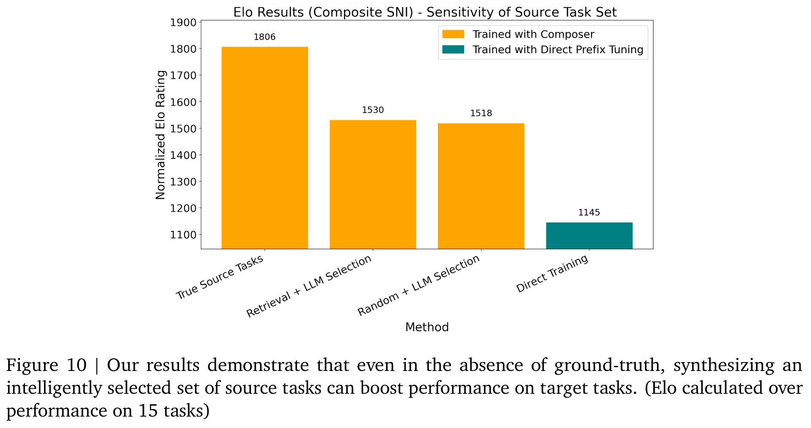

图 10：这张图把表 2 的结论压成几根柱子的差。用真源任务是 1806，用检索挑到的是 1530，随机挑是 1518，直接训练是 1145。检索和随机只差 12 分，都在噪声里，但两者都比直接训练高 370 分以上。也就是说只要给 SkillSmith 一对像样的源任务它就赢，挑得准不准只值一点点。

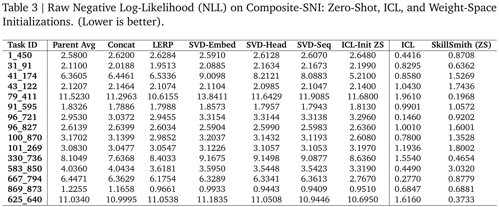

表 3：这张表是图 3 的绝对尺度版本，也暴露了本文最尴尬的一格。逐任务看 ICL 那一列，很多行的 NLL 低到 0.4、0.14 甚至 0.003，而 SkillSmith 零样本那列常在 0.6 到 3.0 之间。零样本时纯文本 ICL 在多数任务上确实更好，Elo 里 1800 对 1942 的落后不是聚合造成的假象，逐任务看也是真的。

**这些实验够不够支撑结论**：机制层面的结论够。Composite-SNI 有 ground truth，消融拆得干净，图 6 和图 10 分别堵住了文字泄漏和检索噪声两个漏洞，足以支撑权重当模态可行。强度层面的结论不够。三个数据集的测试任务分别只有 15、10、6 个，Elo 是相对分，正文没有一张跨数据集的绝对指标主表，SNI 那组还明确出现了天花板效应。最要紧的是零样本档输给 ICL，这条本文承认了，但没解释为什么参数合成在无适配时拼不过纯文本。

## 6. 局限性

**作者自己承认的**：零样本时 ICL 仍然很有竞争力，基础模型不靠参数适配也能打；SNI 上微调后各方法分不出来，作者归因于任务太简单、数据太多；检索只是有效近似，Elo 上比随机挑选只好一点，改进检索被列为未来工作；只做了两个源任务的组合。

**我看出来的**：

- 隐形假设：全篇默认源任务真的和目标任务相关，而且新任务真能由旧技能拼出来。如果目标任务需要的是全新能力，这套流程只会把两个不相干的缓存揉成一个更差的缓存，论文里没有任何拒绝合成的机制。
- 隐形假设：协处理器和下游模型都是 Gemma 3 4B，模型读自己的权重时分布天然匹配。换成用 A 模型读 B 模型的权重会不会垮，没测，而这恰是实际部署最常见的形态。
- 边界条件：生成缓存固定 32 个 token 且只作用于全局层，技能表达力被这个预算卡住；序列长度随源任务数量线性增长，技能库一大上下文就爆。
- 缺的对比：没和全参数微调比，也没在同等算力下和把示例全塞进 prompt 的 ICL 比成本。Elo 赢了，但训一个 4B 协处理器加维护整个缓存库的开销没出现在任何表里。
- 数据质量依赖 LLM 裁判：35 万筛到 2.1 万，三轮过滤全靠 Gemini 2.5 自评与两两对比，作者做了人工抽样校准，但没报告人工与自动筛选的一致率。

## 7. 一句话总结

以前的模型要么照着笔记干活，要么凭手感干活；这篇让模型先读完笔记，再动手改自己的手感。

核心公式：

$$
\boxed{\;\theta^{*}=\arg\min_{\theta}\;\mathbb{E}_{(T,\mathcal{T}_{\text{src}}[T],w)\sim\mathcal{D}^{\text{train}}}\Big[\mathcal{L}\big(M_{\phi}(\boldsymbol{x};\,\text{SkillSmith}_\theta(\{b_k\},w)),\;\boldsymbol{y}\big)\Big]\;}
$$

一句话读这个式子：唯一被训练的是写权重的那个模型，判分的是用权重的那个模型。

## 8. 可复用点

- 如果我要在自己的项目里用：先给每个 PEFT 模块配一段固定格式的文字描述，再用控制 token 把文字与模块打包成可寻址单元。让模型自己去对齐文本和权重，效果远不如显式打标记。
- 如果我要抽出中间层 KV 当下游前缀：一定先做逆 RoPE 再进适配器。漏了这一步，下游会带着错误的绝对位置解码，表现为效果莫名变差且极难 debug。
- 训练不收敛时先查：KV dropout 加了吗。把整段缓存置零这种 dropout 比常规 dropout 有效，它直接逼模型学会没有权重时也靠文字推断。
- 输出长度训练时随机、评估时固定，是防止模型死记某个长度的便宜办法，成本几乎为零。
- 如果我要跨数据集比较多个方法而量纲不同：用胜率矩阵加 Bradley-Terry 拟合 Elo，比直接平均指标稳。但要同时把原始指标放附录，否则读者没法核对。
- 元训练任务太少时（这篇里 MMLU 只有约 250 个）：先合成数据预训练再在真实任务上微调。不做预训练的零样本版本低一大截。
- 检索器做得糙一点没关系，但必须有一个。图 10 说明随机挑一对源任务依然比直接训练高 370 分，真正决定成败的是有没有源任务包，而不是挑得多准。

## 9. 我的疑问

- 协处理器和下游模型不同源会怎样？用 27B 读 4B 的缓存，或反过来，这算不算另一种形态的蒸馏？
- 两个源任务互相冲突时（一个要求简洁、一个要求啰嗦）模型会怎么合成？论文没有任何冲突案例分析，而这决定了它能不能用于真实技能库。
- $N$ 从 2 加到 4、8，性能继续涨还是因序列变长而掉？作者明确只做了 2，这条 scaling 曲线是能不能上生产的关键。
- Elo 拟合把自比较设成 0.5，胜率又来自同一批任务。MMLU-ProX 只有 6 个任务时，这个评分的置信区间到底多宽？
- 生成的缓存能不能当源任务包再喂回 SkillSmith，做多轮迭代？如果能，这就是一条权重层面的自我改进链路，但论文没往这个方向走。
