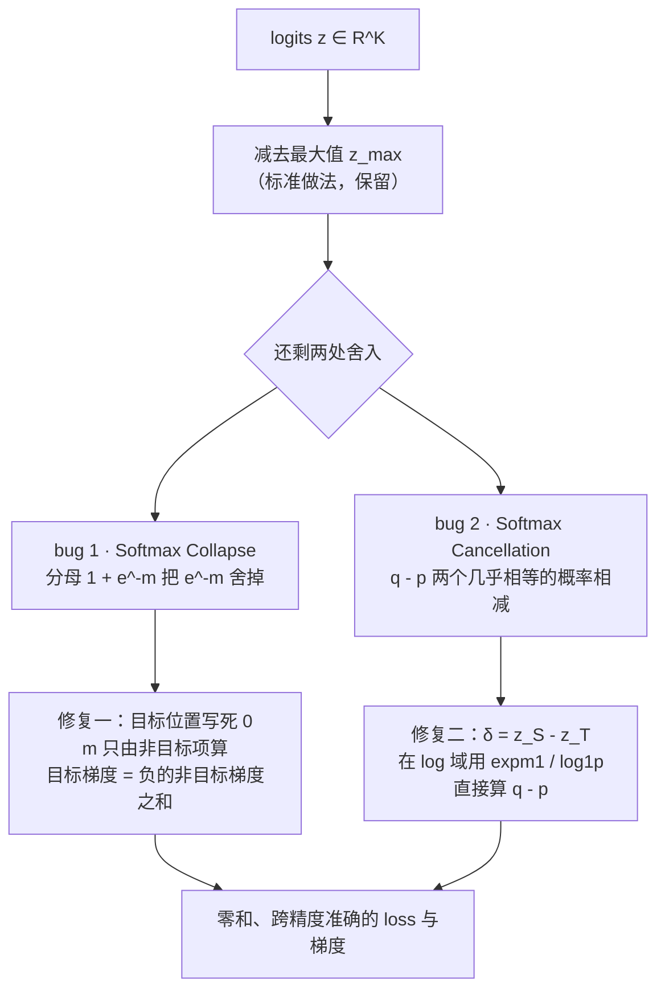
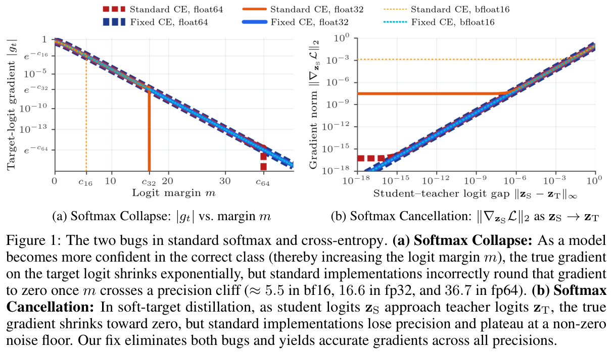
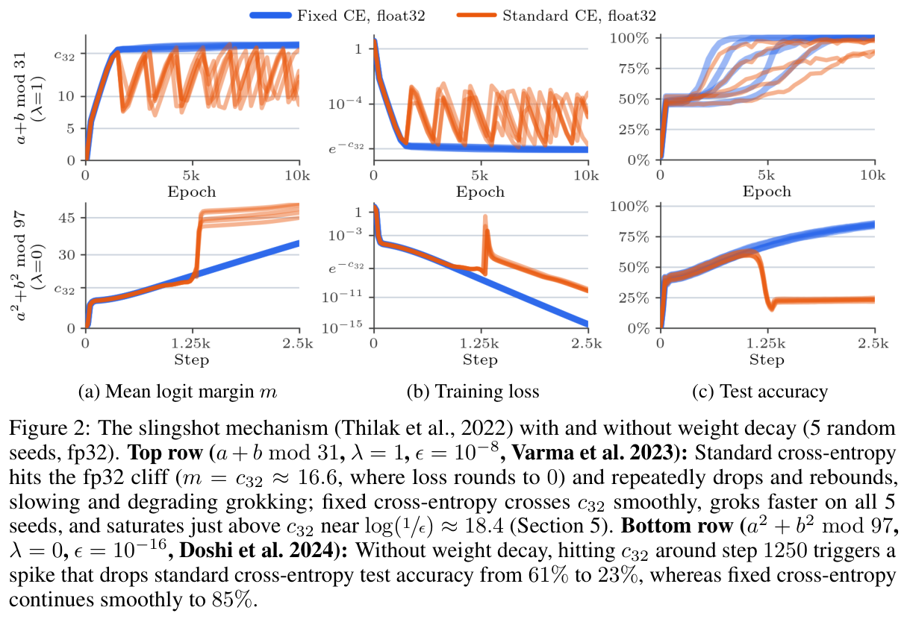
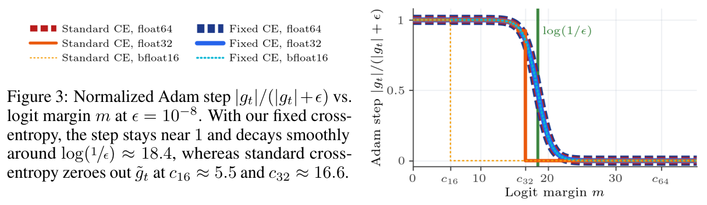
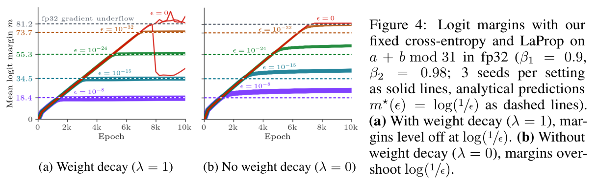
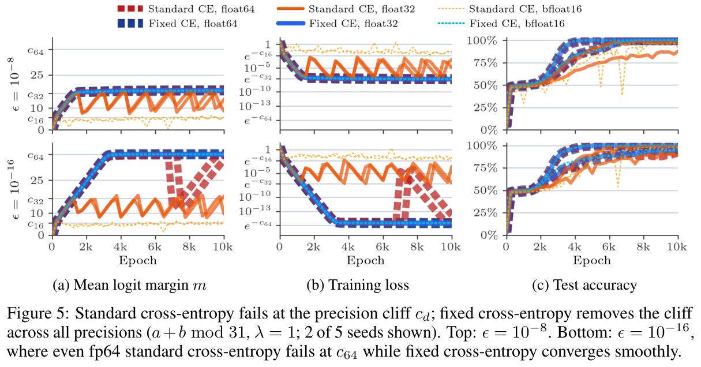
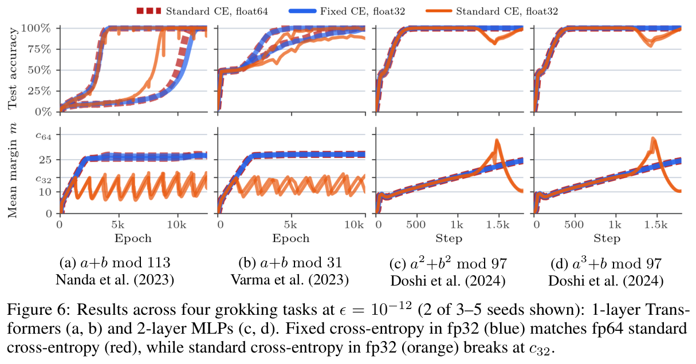
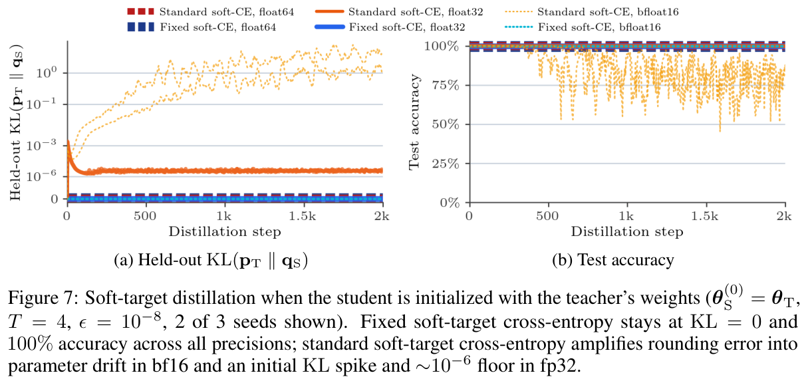
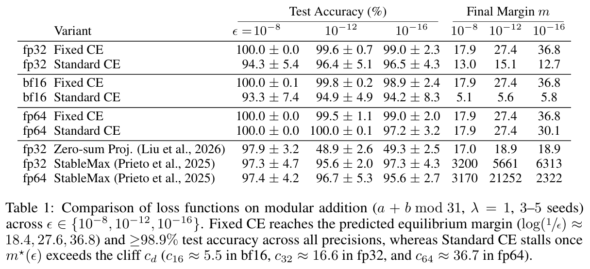

> 一句话：把分类模型最后一步的概率换算重写一遍，让它在极度自信时不再把梯度算成 0。

## 0. 读之前你需要知道

**术语卡**

- **logit**：模型最后一层直接吐出来的那串没归一化的分数。生活类比：老师批卷时先给每道选项打个原始分，还没换算成百分制。
- **softmax**：把 logit 分数变成「加起来等于 1 的概率」的函数。生活类比：把一桌 5 个人各自打的分，换算成各占多少百分比。
- **log-softmax**：softmax 取对数，算式上更稳，梯度性质更好。生活类比：不报百分比，报百分比的对数，乘法变加法。
- **交叉熵（cross-entropy, CE）**：衡量「模型给正确答案留了多少概率」的损失，正确类概率越高损失越小。生活类比：猜中了几乎不扣分，猜错了往死里扣。
- **log-sum-exp（LSE）**：$\log\sum_j e^{z_j}$，就是 softmax 分母取对数后的样子。生活类比：一堆很大的数直接相加会爆表，先取对数再加就不会炸。
- **bf16 / fp32 / fp64**：计算机存小数的三档精度，分别约 3 位、7 位、16 位有效数字。生活类比：三种刻度的尺子，bf16 最粗，量 1 毫米的东西直接归零。
- **梯度**：损失告诉参数「往哪调、调多少」的信号。生活类比：站在山坡上感觉脚下的坡度，坡平了就不知道往哪走。
- **Adam / AdamW**：常用的自适应优化器，会拿梯度除一个「最近梯度平均大小」，所以梯度整体变小它也不怕，照样把步子放大。生活类比：自动挡油门，坡变缓它自动踩深。
- **权重衰减（weight decay）**：每一步顺手把参数往 0 拉一点，$\lambda$ 是拉力系数。生活类比：每回合强制瘦身，防止参数胖到失控。
- **grokking**：模型先在训练集上背下来（准确率 100%），再训练很久，测试集准确率才突然跳上去。生活类比：先死记硬背例题，过了很久才突然开窍。
- **知识蒸馏（knowledge distillation）**：用大教师模型的输出概率当答案，去教小学生模型。生活类比：抄高手的解题步骤，而不是只抄最后那个答案。
- **精度悬崖（precision cliff, $c_d$）**：本文定义，指 logit margin 大到某条线之后，标准实现算出的目标梯度被舍入成 0。bf16 约 5.5，fp32 约 16.6，fp64 约 36.7。

**它站在谁肩上**

- Higham（2002）、Blanchard et al.（2021）：给出「先减最大值再算 log-sum-exp」这套稳定写法，今天 JAX、PyTorch、TensorFlow 全都这么写。不够的地方：它只防上溢，不防「往 1.0 上加一个极小量」时被舍掉。
- Prieto et al.（2025）：发现并命名了 Softmax Collapse，提出 StableMax，把 softmax 里的 $\exp$ 换成一条分段有理函数来绕开悬崖。不够的地方：换掉的是 $\exp$，交叉熵本身没动，结果 margin 会涨到几千。
- Liu et al.（2026）：把 slingshot 和低精度训练联系起来，提出 Zero-sum Proj.，把梯度均值减掉让总和归零。不够的地方：目标梯度在减之前就已经是 0，投影只能把非目标梯度里的 $1/K$ 分给它，等于没修。
- Thilak et al.（2022）：记录并命名 slingshot，即训练到后期 loss 反复出现的平台期加突刺。
- Hinton et al.（2015）：知识蒸馏，温度 $T$ 的写法沿用至今。
- Varma et al.（2023）、Nanda et al.（2023）、Doshi et al.（2024）：三套模运算 grokking 任务和训练协议，本文的实验装置直接照搬。
- Wortsman et al.（2024）、Kosson et al.（2024）：指出 Adam 里的 $\epsilon$ 和权重衰减会互相制衡，形成平衡点。

## 1. 动机

想象你在给一张考卷判分。你非常确定正确答案是 A，于是给 A 打了 99 分，其他三个选项各打了 1 分。换算成百分比，A 是 99%，其余是 0.33%。现在你想知道「如果 A 再多 1 分，正确率会涨多少」——结果算出来是 0。不是真的 0，是计算器把 0.0000001 这种小数直接舍掉了。

这就是这篇论文要处理的事。网络越训练越自信，最后那几个 logit 差得越来越大，标准实现算出来的「正确类梯度」会被舍成 0。但其他类的梯度没有归零，于是梯度加起来不再是 0：本该等大反向的一对力，一边被抹掉，另一边还在推。

**以前怎么做**：所有框架的 softmax 都是先减去最大 logit $z_{\max}$ 再取指数，防的是 $e^{z}$ 上溢（fp32 里 $e^{88}$ 就爆了）。这套写法从 2002 年用到现在，教科书级。

**为什么不行**：减完最大值之后，正确类那一项被写死成 0，分母变成 $1 + e^{-m}$，其中 $m$ 是正确类比其余所有类合起来高出多少。$m$ 一旦变大，$e^{-m}$ 就小到「往 1.0 上加不动」——fp32 里加不动 1.0 的量级是 $10^{-7}$ 左右，对应 $m \approx 16.6$。这就是精度悬崖。跨过悬崖之后分母恒等于 1.0，正确类概率恒等于 1.0，梯度 $q_t - 1 = 0$。

第二个 bug 藏在蒸馏里。学生和教师都给出一组概率，梯度是两者相减 $q - p$。当学生已经和教师很像时，这是两个几乎相等的数相减，有效数字全丢了。更麻烦的是前向用 softmax、反向用 log-softmax，两条算路径不完全一样，于是哪怕学生 logit 严格等于教师 logit，梯度也不是 0，而是一个小的残差。

**为什么现在能做**：两件事。一是 bf16 训练成了默认选项，而 bf16 的悬崖在 $m \approx 5.5$，训练几步就撞上；二是 grokking 研究把模型推到极端置信度（margin 几十上百），把这条隐藏的线顶到了台面上。修法本身不需要新数学，`log1p` 和 `expm1` 这两个数值分析里的老函数就够了。

## 2. 贡献

- **把两个 bug 定位到具体算子**。证据：在 bf16、fp32、fp64 三档精度上复现出断崖，位置分别落在 $c_{16} \approx 5.5$、$c_{32} \approx 16.6$、$c_{64} \approx 36.7$（图 1a）。
- **给出几行代码的修复，不改框架**。证据：$z = [9, -9, -9]$、目标类 0 时，标准实现返回的目标对数概率、损失、目标梯度全是 0.0，修复后返回 $3.046\times10^{-8}$，且梯度三项加起来等于 0。
- **消掉 slingshot，并说明它不只来自低精度**。证据：fp32 下 AdamW 默认 $\epsilon = 10^{-8}$，其平衡点 $\log(1/\epsilon) \approx 18.4$ 刚好落在 $c_{32} \approx 16.6$ 上方，所以标准交叉熵必然先撞悬崖再去追平衡点，于是反复突刺（图 2、图 5）。
- **给出 margin 平衡的闭式预测 $m^\star \approx \log(1/\epsilon)$**。证据：图 4 把 $\epsilon$ 从 $10^{-8}$ 一路扫到 0 跨多个量级，3 个种子，实测曲线与解析虚线重合。
- **蒸馏不再漂移**。证据：学生用教师的权重初始化（$\theta_S^{(0)} = \theta_T$），标准实现在 bf16 下把学生推离教师、准确率往下掉，fp32 下先 KL 尖峰再停在 $10^{-6}$ 的地板；修复后三档精度都是 KL $= 0$、准确率 100%（图 7）。

## 3. 创新点

- **新在哪：把 bug 追到「谁和 1.0 相加」这一步**。对比对象：Prieto et al.（2025）看到现象后选择换掉 $\exp$，Liu et al.（2026）看到现象后选择投影梯度。本文不肯绕路，直接问「哪一行加法把有效数字吃掉了」。有用是因为：定位到算子，才可能在不改前向语义的前提下只改实现，性能和数值两头都保住。
- **新在哪：目标类的梯度不直接算，用「其余梯度之和取负」构造**。对比对象：Zero-sum Proj. 是算完之后再投影到零和子空间，属于事后补救。有用是因为：投影只能把已有信息重新分配，而本文是让正确类的梯度根本不需要经过 $q_t - 1$ 这条会丢精度的路径，零和变成构造性质而不是约束。
- **新在哪：$q - p$ 不再由两个概率相减得到，改成在 log 域里由 $z_S - z_T$ 直接算**。对比对象：标准实现分别算 softmax 再相减，且前向 softmax、反向 log-softmax 两条路径不一致。有用是因为：只要 $z_S = z_T$，$\delta = 0$ 是精确的 0，算式自然返回精确的 0 梯度，残差从根上没有了。
- **新在哪：把数值 bug 和超参 $\epsilon$ 连成一条等式**。对比对象：slingshot 此前一直是经验现象，大家知道它和精度有关，但说不清阈值。有用是因为：$m^\star \approx \log(1/\epsilon)$ 直接告诉你「$\epsilon$ 调到多少，fp32 下就不会再撞悬崖」——$\epsilon \ge 10^{-7}$ 时平衡点降到 16.1 以下，突刺消失。

## 4. 方法

### 4.1 整体流程

一句话解释这张图：标准流程里「减最大值」这一半是好的，坏的是后面那两处减法——一处是把 $e^{-m}$ 加到 1.0 上，一处是两个概率相减；修复就是把这两处各自换一种写法。

### 4.2 模块拆解

#### 4.2.1 bug 一：Softmax Collapse

**为什么需要先定义 margin**

要谈「模型有多自信」，需要一个不随类别数变化的量。本文用的是 logit margin：

$$
m = z_t - \log \sum_{j \ne t} e^{z_j}
$$

先说这个公式在算什么：正确类的原始分，比「所有错误类合在一起的分数总量」高出多少，用对数尺度表示。

- $z_t$：正确类 $t$ 的 logit，实数，可正可负。
- $z_j$：第 $j$ 个错误类的 logit。
- $\log\sum_{j \ne t} e^{z_j}$：把 $K-1$ 个错误类的分数用 log-sum-exp 合成一个「总量级」。
- $m$：标量，每个样本一个。$m = 0$ 表示正确类和错误类总量打平；$m > 0$ 表示正确类领先。

生活类比：一支球队的得分，减去其余所有球队得分之和（换算到对数刻度）。领先 20 分是碾压，领先 1 分是险胜。

**为什么标准实现会把它算错**

当 $t$ 就是最大的 logit 时，减完最大值有 $\tilde z_t = 0$、$\tilde z_j < 0$，分母是

$$
\sum_i e^{\tilde z_i} = 1 + \sum_{j \ne t} e^{z_j - z_t} = 1 + e^{-m}
$$

梯度有两半，作者在式 (3) 里把两种写法并排放：

$$
g_t = \underbrace{\frac{1}{1 + e^{-m}} - 1}_{\text{Standard}} = \underbrace{-\frac{e^{-m}}{1 + e^{-m}}}_{\text{Fixed}}, \qquad
g_j = \frac{e^{z_j - z_t}}{1 + e^{-m}} \quad (j \ne t)
$$

先说这个式子在算什么：正确类的梯度，用两种代数上完全等价的写法表达；左边那种在浮点里会坏掉，右边那种不会。

- 左式：先算 $q_t = 1/(1+e^{-m})$，再减 1。这正是所有框架反向传播时走的路径。
- 右式：直接算 $-e^{-m}/(1+e^{-m})$，把 $e^{-m}$ 留在分子上。
- $g_j$：每个错误类的梯度，分母相同，分子是 $e^{z_j - z_t}$，一个本来就很小、但**没有和 1.0 相加**的数。

$m$ 一旦超过 $c_d$，$1 + e^{-m}$ 在浮点里就等号于 $1.0$。左式于是变成 $1/1 - 1 = 0$；右式变成 $-e^{-m}/1$，照样精确到指数下溢（$m \approx 88$）。

这里的关键不是「精度不够」，而是**两条路径的不对称**：错误类的梯度没经过「加 1.0」这一步，所以它还活着。于是式 (4)：

$$
\tilde g_k = \mathbb{1}[k \ne t]\, g_k, \qquad \sum_k \tilde g_k = -g_t = \frac{e^{-m}}{1 + e^{-m}} > 0 \quad \text{for } m > c_d
$$

这个式子在说什么：标准实现算出来的梯度，只有正确类那一项被抹成 0，其余全都保留，所以总和是个正数而不是 0。

- $\tilde g_k$：标准实现实际返回的梯度。
- $\mathbb{1}[k \ne t]$：指示函数，目标类那一项直接置 0。
- 总和 $> 0$：本该为零的合力，现在有了一个向上的净分量。

生活类比：拔河两队本应势均力敌，裁判把左边一队的绳头悄悄剪了，右边还在拉——绳子当然会往右滑。

#### 4.2.2 修复一：不把 1 加进 $e^{-m}$

思路一句话：既然坏在「$1 + e^{-m}$」，那就让这个 1 根本不出现，改成对 $e^{-m}$ 本身取 `log1p`。

先看 standalone 的 log-softmax 和 softmax，作者在式 (5) 里重写：

$$
\tilde z_k = \mathbb{1}[k \ne i_{\max}]\,(z_k - z_{i_{\max}}), \qquad
m = -\operatorname*{LSE}_{j \ne i_{\max}} \tilde z_j, \qquad
\log \mathrm{softmax}(z)_k = \tilde z_k - \mathrm{softplus}(-m)
$$

这个式子在说什么：最大那一维不参与求和，只保留一个精确的 0；其余维度照常偏移；最后用 softplus 把「$1 + e^{-m}$」这个对数算出来。

- $i_{\max}$：argmax 的下标。
- $\tilde z_k$：偏移后的 logit。最大值处直接写死成 **0**（不是 $z - z$，是常数 0），其余是 $z_k - z_{i_{\max}} \le 0$。
- $m = -\operatorname{LSE}_{j \ne i_{\max}} \tilde z_j$：把最大值那一维排除在外，只用剩下的 $K-1$ 维算 margin。因为其余项都 $\le 1$，这个 LSE 是能安全算出来的。
- $\mathrm{softplus}(-m) = \log(1 + e^{-m})$：数值稳定的写法，内部用的就是 `log1p`。

对硬标签的交叉熵更简单，式 (6) 直接用目标类 $t$ 顶替 $i_{\max}$，省掉一次 arg max：

$$
m = -\operatorname*{LSE}_{j \ne t}(z_j - z_t), \qquad L(z, t) = \log(1 + e^{-m}) = \mathrm{softplus}(-m)
$$

这个式子在说什么：损失只依赖 $K-1$ 个「错误类减正确类」的差值，正确类自己的绝对值根本不进入计算。

- $z_j - z_t$：错误类相对正确类的差值，必 $\le 0$。
- $L$：损失，标量，非负，$m$ 越大越接近 0 但永远不为 0（除非 $m = \infty$）。

**关键的一步在自动微分上**。因为第 $t$ 个位置被换成了常数 0，而不是 $z_t - z_t$，$z_t$ 只通过那 $K-1$ 个差值出现在损失里。于是反向传播自动得到式 (7)：

$$
g_j = e^{z_j - z_t - L} \quad (j \ne t), \qquad g_t = -\sum_{j \ne t} g_j = -\frac{e^{-m}}{1 + e^{-m}}
$$

这个式子在说什么：正确类的梯度不是算出来的，是从其余 $K-1$ 个梯度求和取负**推出来**的。

- $g_j$：错误类的梯度，和前面一致。
- $g_t$：正确类梯度，等于错误类梯度总和的相反数。
- 减号：确保 $\sum_k g_k = 0$ 恒成立，不依赖任何数值巧合。

这一步就是全文最巧的地方：它不是把 $q_t - 1$「算得更准」，而是干脆不算它。零和从数学恒等式变成构造性质。

生活类比：以前是先称每个人的体重再算出总体重，秤不准就全错；现在是先称所有人，最后一个的体重用「总体重减去其他人」倒推，只要总数对，最后那个一定对。

#### 4.2.3 bug 二：Softmax Cancellation

**为什么需要**

蒸馏的损失是 $L(z_S, z_T) = -\sum_k p_k \log \mathrm{softmax}(z_S)_k$，其中 $p = \mathrm{softmax}(z_T)$。求导得式 (8)：

$$
q = \mathrm{softmax}(z_S), \qquad \tilde g_k = \frac{\partial L}{\partial z_{S,k}} = q_k - p_k
$$

这个式子在说什么：学生梯度就是两个概率分布逐项相减。

- $z_S$, $z_T$：学生、教师的 logit，都在 $\mathbb{R}^K$。
- $q_k$, $p_k$：两边的概率，各自加起来等于 1。
- $\tilde g_k$：标准实现返回的梯度。

当 $z_S \to z_T$ 时真梯度趋于 0，这也是蒸馏收敛的判据。但浮点里做不到：$q$ 和 $p$ 各自先舍入到概率，再相减，差量 $\delta = z_S - z_T$ 的信息早就丢了。更糟的是前向 $p = \mathrm{softmax}(z_T)$、反向 $q = \exp(\log\mathrm{softmax}(z_S))$ 走的不是同一条算子序列，两者在机器精度上都对不齐，于是 $z_S = z_T$ 时得到的不是 0，而是一个残差地板。

生活类比：用两把刻度不同、各自有零位误差的尺子量同一个物体，读数都说 1.000 米，但减出来不是 0，而是 0.003 米——这个差值不是物体长出来的，是尺子自己的误差。

#### 4.2.4 修复二：在 log 域里直接算 $q - p$

思路一句话：不碰概率，只在 logit 差值 $\delta = z_S - z_T$ 上算，用 `expm1` 和 `log1p` 把「接近 0 的量」的精度保住。

式 (9) 分三步：

$$
d_k = \delta_k - \sum_i p_i \delta_i, \qquad
s_k = d_k - \operatorname{log1p}\!\Big(\sum_i p_i\, \mathrm{expm1}(d_i)\Big), \qquad
u_k = p_k\, \mathrm{expm1}(s_k)
$$

这个式子在说什么：先把 logit 差按教师分布居中，再精确算出 $\log(q_k/p_k)$，最后用 `expm1` 把它变回 $q_k - p_k$。

- $\delta_k = z_{S,k} - z_{T,k}$：逐项 logit 差，实数。
- $d_k = \delta_k - \sum_i p_i\delta_i$：把 $\delta$ 减去它在 $p$ 下的均值，也就是让 $\sum_i p_i d_i = 0$。这一步让后面那个 log 的常数项消失。
- $s_k = \log(q_k/p_k)$：两个概率的 log 比。这里用 `log1p` 而不是 `log(1+x)`，因为括号里的量可以小到 $10^{-16}$。
- $u_k = q_k - p_k = p_k(e^{s_k} - 1)$：用 `expm1` 算 $e^{s_k} - 1$，$s_k$ 极小时这是 $s_k + s_k^2/2 + \cdots$，不会像 $e^{s_k} - 1$ 那样把有效数字吃光。
- $p_k$：权重，来自教师，前向计算，不参与求导。

两个性质保证它不会崩：一是 $\sum_i p_i d_i = 0$ 且 $\mathrm{expm1}(x) \ge x$，所以 `log1p` 的输入恒非负，不会出现 $\log$ 负数；二是 $s_k$ 中等大小时（$|s_k| \ge 1$）直接回退到 $u_k = q_k - p_k$，避免 $p_k$ 舍成 0 而 `expm1` 上溢造成 $0 \times \infty$。

最后还要补一刀，让梯度严格零和：

$$
g_k = u_k - q_k \sum_i u_i, \qquad \text{使 } \sum_k g_k = 0
$$

这个式子在说什么：把刚刚算出的差值减掉它在 $q$ 下的加权和，强行把总和拉回 0。

- $u_k$：上一步的 $q_k - p_k$ 近似。
- $\sum_i u_i$：理论上是 0（两个分布各自归一），数值上是一个很小的非零残差。
- $q_k\sum_i u_i$：按学生概率分配这个残差，减掉即可。

生活类比：称十袋米的总重量应该等于各袋之和，实际差了几克，就把这几克按每袋的份额摊回去，账面上永远是平的。

### 4.3 关键细节

- **用 `log1p`，不要用 `softplus(log s)`**。论文第 9 页有一条勘误：早期版本的代码写成 `softplus(log s)`，在「除一个 logit 外全是 $-\infty$」的场合（因果注意力里的 mask、极端 logit）会因为对 $\log 0$ 求导出 NaN。正确写法是 `log1p(s)`，$s = 0$ 时安全。作者注解说是「一个过于积极的 agent 为了让代码对上式 (5)(6) 做的简化」——复现时要特别小心这一行。
- **硬标签可以省掉 arg max**。式 (6) 直接把 $t$ 当作「被写死为 0 的那一维」，不需要先求最大值，少一次全量归约。
- **前向损失仍用标准式，只把梯度换掉**。代码里用 `jax.lax.stop_gradient` 把前向的 `-sum(p * log_q)` 保住，再加一项 `sum(sg(g) * (z_S - sg(z_S)))`，这是 JAX 里注入自定义梯度的标准写法（前向值不变，反向用给定梯度）。
- **蒸馏实验里用 $T = 4$ 压低 margin**。温度 $T$ 把 logit 除以 4，使 $m/T < c_{16}$，保证 $p$ 不会自己退化成 one-hot。这一步是为了把 bug 隔离出来：如果 $p$ 已经是 one-hot，Cancellation 就被掩盖了。
- **扫 $\epsilon$ 时改的是 $\sqrt{\hat v}$ 的更新方式**。图 4 的实验用 LaProp，直接更新 $\sqrt{\hat v}$ 而不对 $g_i$ 平方（fp32 里 $|g_i| < 2^{-63}$、即 $m \approx 38$ 时平方会下溢），这样才能把 $\epsilon$ 一路探到 0。

## 5. 实验结果

**实验设置**

- 数据集与切分：模运算合成任务。$a + b \bmod 31$（50% 训练切分，其余 50% 测试，Varma et al. 2023）、$a + b \bmod 113$（Nanda et al. 2023）、$a^2 + b^2 \bmod 97$ 与 $a^3 + b \bmod 97$（Doshi et al. 2024）。蒸馏用 $a + b \bmod 53$，同样 50% 训练切分。原文只对模 31 明确写了切分比例，模 113、二次、三次三项的切分比例原文未给。
- 骨干模型：1 层、4 头、宽度 64 的 ReLU Transformer，去掉 LayerNorm，用于 $a+b \bmod 31$；模 113 与模 31 用 1 层 Transformer；$a^2+b^2 \bmod 97$、$a^3+b \bmod 97$ 用 2 层 MLP。蒸馏里学生是 2 层 ReLU MLP，教师是同一结构训到 100% 准确率的 fp32 权重。
- 训练预算：full-batch AdamW，$\eta = 10^{-3}$、$\beta_1 = 0.9$、$\beta_2 = 0.98$、$\lambda = 1$，训练 10,000 个 epoch。蒸馏是 2,000 步 full-batch Adam，$\eta = 2\times10^{-3}$、$\beta_1 = 0.9$、$\beta_2 = 0.98$、$\lambda = 0$、$\epsilon = 10^{-8}$、$T = 4$。种子数 3–5 个。显卡型号与训练时长原文未给。
- 基线：Standard CE（bf16 / fp32 / fp64 三档）、Zero-sum Proj.（Liu et al., 2026）、StableMax（Prieto et al., 2025）。fp64 Standard CE 作为「正确参考」，因为它是唯一在 $\epsilon$ 不太小时不受悬崖影响的版本。
- 指标：test accuracy（%）、final / mean logit margin $m$、mean training loss、held-out KL$(p_T \| q_S)$。
- 推理设置：本文没有推理阶段。所有实验都是 full-batch 训练加训练结束后的全测试集准确率，没有采样、没有温度（除蒸馏的 $T = 4$）、没有裁判模型。

主表只留能说明问题的行。这里的「最强基线」取两个口径：一是 fp64 Standard CE（数值上的正确答案），二是同类 fp32 修复方法（工程上的竞争者）。

| 数据集 / 任务 | 指标 | 本文（fp32 Fixed CE） | 最强基线 | 提升 |
| --- | --- | --- | --- | --- |
| $a+b \bmod 31$，$\epsilon=10^{-8}$ | test accuracy (%) | 100.0 ± 0.0 | 100.0 ± 0.0（fp64 Standard CE） | 持平；但 fp32 Standard CE 只有 94.3 ± 5.4 |
| $a+b \bmod 31$，$\epsilon=10^{-12}$ | test accuracy (%) | 99.6 ± 0.7 | 100.0 ± 0.1（fp64 Standard CE） | −0.4 pp，在种子方差内 |
| $a+b \bmod 31$，$\epsilon=10^{-16}$ | test accuracy (%) | 99.0 ± 2.3 | 97.2 ± 3.2（fp64 Standard CE） | +1.8 pp |
| $a+b \bmod 31$，$\epsilon=10^{-12}$ | final margin $m$ | 27.4 | 27.4（fp64 Standard CE） | 与 fp64 一致；fp32 Standard 卡在 15.1 |
| $a+b \bmod 31$，$\epsilon=10^{-12}$ | test accuracy (%) | 99.6 ± 0.7 | 48.9 ± 2.6（fp32 Zero-sum Proj.） | +50.7 pp |
| $a+b \bmod 31$，$\epsilon=10^{-12}$ | final margin $m$ | 27.4 | 18.9（fp32 Zero-sum Proj.） | +8.5；StableMax 的 5661 是另一回事 |

**原文实验图**

图 1：两个 bug 的边界。左图横轴是 margin、纵轴是目标梯度绝对值，六条线在 $m < 16$ 时完全重合，一旦越过各自那档精度的悬崖（虚线标出的 $c_{16}$、$c_{32}$、$c_{64}$）就垂直跌到底——跌的是 Standard CE，Fixed CE 一路平滑下去。右图横轴是学生-教师 logit 间距，真梯度应该随间距缩小而趋于 0，标准实现却在 $10^{-3}$（bf16）和 $10^{-6}$（fp32）处压出一条水平地板，怎么靠近都不再降。

图 2：slingshot 的完整因果链。上排（$\lambda = 1$，有权重衰减）：Standard CE 的 margin 一到 $c_{32} \approx 16.6$ 就上下锯齿，训练损失同步出现周期性突刺，测试准确率被拖到 94 ± 5%，而 Fixed CE 一路穿过 $c_{32}$、停在 $\log(1/\epsilon) \approx 18.4$ 附近，5 个种子上都更快 grok 并拿到 100%。下排（$\lambda = 0$，无权重衰减）：两条线在 step 1250 之前完全贴住，然后一次突刺把测试准确率从 61% 打到 23%，Fixed CE 继续走到 85%。这张图说明突刺不是「有衰减才会发生」，而是「有没有 LayerNorm 兜底」决定它是无害还是致命。

图 3：归一化步长随 margin 的衰减曲线。纵轴是 $|g_t|/(|g_t| + \epsilon)$，理想情况下它应该一直贴着 1，直到 $m$ 接近 $\log(1/\epsilon) \approx 18.4$ 才平滑下来。bf16 的 Standard CE 在 $c_{16} \approx 5.5$ 就断崖归零，fp32 在 $c_{32} \approx 16.6$ 断崖，而两条 Fixed 曲线都跟着理论虚线走到底。这张图是「$m^\star$ 不是拟合出来的，是 $\epsilon$ 决定的」最直接的证据。

图 4：$\epsilon$ 从 $10^{-8}$ 扫到 0 时 margin 的落点。左图每条实测实线都精确停在对应 $\epsilon$ 的解析虚线 $m^\star = \log(1/\epsilon)$ 上（$10^{-8} \to 18.4$、$10^{-15} \to 34.5$、$10^{-24} \to 55.3$ 等），$\epsilon = 0$ 那条没有平衡点，一直爬到 fp32 梯度下溢的 $m \approx 81.2$ 才停。右图去掉权重衰减后，所有曲线都越过自己的 $m^\star$ 继续上升——说明平衡点是「权重衰减」和「$\epsilon$ 截断梯度」两者合起来才成立的，单靠一个都不够。

图 5：精度扫描下的 grokking 曲线。上排 $\epsilon = 10^{-8}$：Standard CE 在 bf16 停在 $c_{16}$、在 fp32 反复突刺，Fixed CE 三档精度全部平滑穿过去到 100%。下排 $\epsilon = 10^{-16}$：平衡点被抬到 $36.8 > c_{64}$，连 fp64 的 Standard CE 都在 $c_{64} \approx 36.7$ 处崩掉（红色虚线那段掉头），而 Fixed CE 依然全绿。这张图说明悬崖随精度整体右移，但只要你把 $\epsilon$ 调小，总能追到它前面——只有修掉 bug 才能两头都赢。

图 6：四个任务上的同构复现。上排测试准确率、下排 margin，从 1 层 Transformer（a、b）换到 2 层 MLP（c、d），从模 113 换到二次、三次多项式，fp32 Standard CE（橙）在四个任务上都在 $c_{32}$ 处开始锯齿，fp32 Fixed CE（蓝）和 fp64 Standard（红）几乎完全重合。这是本文最强的一条泛化证据：bug 与架构、与任务的具体形式无关。

图 7：蒸馏里的漂移。学生用教师权重初始化，理论上一步都不该动。左图 held-out KL：bf16 的 Standard CE（黄虚线）一路爬到 $10^0$ 量级，fp32（橙实线）先冲到 $10^{-3}$ 再落回 $10^{-6}$ 的地板，Fixed 的两条平贴在 0。右图对应准确率：bf16 标准实现从 100% 掉到 50% 附近并剧烈抖动，fp32 保住 100% 但 KL 不为 0。这张图说明 Adam 的 $\sqrt{\hat v} + \epsilon$ 分母会把残余的 $10^{-3}$ 级梯度放大成真实位移。

**原文实验表**

表 1：主结果全表。三档精度 × 三档 $\epsilon$ × 五个变体。Fixed CE 的 final margin 在三个 $\epsilon$ 上分别是 17.9 / 27.4 / 36.8，正好对上 $\log(1/\epsilon)$ 的 18.4 / 27.6 / 36.8，且三档精度完全一致；Standard CE 的 margin 一旦该到的地方超过悬崖就停住（fp32 到 13.0–15.1、bf16 到 5.1–5.8）；Zero-sum Proj. 在 $\epsilon \le 10^{-12}$ 时准确率掉到 49% 左右，因为它的 margin 卡在 18.9 上不去；StableMax 的准确率还看得过去（95%–97%），但 margin 是 3200 到 21252，说明它靠把 $\exp$ 换掉绕过了悬崖，代价是 logit 尺度彻底失控。

**消融告诉我们什么**：本文的「消融」不是一个开关，而是三层扫描。第一层扫精度（bf16 / fp32 / fp64），证明悬崖位置就是精度的函数，与模型和任务无关；第二层扫 $\epsilon$，证明平衡点位置由 $\epsilon$ 单独决定，与学习率 $\eta$、$\beta_1$、$\beta_2$ 无关（式 10 里这三个量会约掉，所以 RMSProp 和 LaProp 的稳态点相同）；第三层扫权重衰减（$\lambda = 1$ 与 $\lambda = 0$），证明 $m^\star$ 这个平衡点是「$\epsilon$ 截断梯度」与「$\lambda$ 拉参数」两者共同的结果，去掉任一半，margin 都会失控。三层扫描互相不重叠，所以合起来能支撑「机制就是这几个量相互作用」这个说法。

**这些实验够不够支撑结论**：分两半看。数值层面够——图 1、图 3 的曲线是纯算术，可以独立复算，fp32 与 fp64 逐点对齐就是硬证据。训练层面不够——全部实验都在模运算这类合成任务上，模型是 1 层 Transformer 和 2 层 MLP，参数量以千计，训练 1 万 epoch 就到头了；没有语言模型、没有真实语料、没有大规模分布式训练。作者自己也在结论里承认「本文探到的极端 margin 和近零师生差在大规模标准训练里并不常见」。另外「without meaningful slowdown」这句没有给出任何吞吐或显存数字，属于待验证的工程声明。

## 6. 局限性

**作者自己承认的**：第一，实验里的极端 margin（几十到几千）和近零师生差在常规大规模训练里并不常见，所以修复的实际收益可能在别处（长尾的高置信度样本、蒸馏、mask 场景）而不是主流预训练；第二，论文明确说这套东西是「easy drop-in replacements」，但没给性能数据。

**我看出来的**：

- **隐形假设**：式 (10) 的推导要求「参数已经不动」，也就是 $\hat m_i \to g_i$、$\hat v_i \to g_i^2$ 收敛。这个前提在训练早期不成立，而 slingshot 恰恰发生在 grokking 后期的平台期，所以推导与现象是对得上的；但把它当成「训练全程的规律」就不对了，$m^\star$ 只是渐近落点。
- **边界条件**：修复假设损失只有「硬标签」和「一层教师分布」两种形态。多教师（每个 token 一个教师）、特征层蒸馏、对比学习里的 InfoNCE，都不是这个式子能直接套的。
- **边界条件**：$K$ 很大时（比如 15 万词表），式 (6) 需要显式构造 $K-1$ 个差值再做一次 log-sum-exp，本文没讨论这种规模下的显存与归约代价。作者说「不需要内部转到高精度」，这一点是真的，但代价换到了另一处。
- **缺的对比**：没有和「直接把 loss 算在 fp64 里」这个最笨的基线比吞吐。fp64 casting 是公认的绕路方案（Nanda et al. 2023 就这么干），本文说自己的方案更好，但只比了准确率，没比成本。
- **缺的分析**：修复后 softmax 的输出概率在 $m$ 极大时仍然是 1.0（浮点表示的下限），变化的只是梯度。这对置信度校准、温度缩放、以及依赖概率值的下游分析（比如不确定性估计）有什么影响，完全没碰。
- **缺的边界**：$K$ 很小或很大时修复还剩多少价值，原文没给实验。所有任务都在 $K$ 为 31、53、97、113 这个中等区间；$K = 2$ 时非目标项只剩一项，公式仍成立但几乎没什么可修的，$K$ 到十万级才轮到归约代价说话。

## 7. 一句话总结

标准 softmax 和交叉熵在两个地方「拿大数加小数、拿大数减小数」，把有效数字吃掉了；本文把这两步各自换成一个不需要加 1.0 的写法，梯度就从「碰巧对」变成「结构上必然对」。

类比：以前的算法像用一把会掉刻度的尺子量身高，量到 1.9 米以上刻度就糊了；本文不是在尺子上加个放大镜，而是换了个量法——先量地面到 1 米，再量 1 米往上那一段，两段都是小量，永远清楚。

核心公式（全文的枢纽，两条一起看）：

$$
\boxed{\;L(z,t) = \operatorname{softplus}\!\Big(-\operatorname*{LSE}_{j \ne t}(z_j - z_t)\Big), \qquad g_t = -\sum_{j \ne t} g_j\;}
$$

第一项说：损失只看 $K-1$ 个相对差值，正确类的绝对尺度不参与。第二项说：正确类的梯度不单独算，由其余梯度之和取负推出。两条合起来，$\sum_k g_k = 0$ 就成了恒等式而不是数值巧合。

## 8. 可复用点

- **如果我要在自己的项目里用**：把 `log_softmax` 和 `cross_entropy` 换成 §2 那 30 行 JAX（PyTorch 逐行平移即可，`log1p`、`expm1` 两个函数名字一样）。改完之后跑一遍 $z = [9, -9, -9]$ 这个手算例子，确认返回 $3.046\times10^{-8}$ 而不是 0。
- **如果我在做蒸馏**：把损失换成 §3 的 `soft_target_cross_entropy`，注意它返回的是「前向损失 + 自定义梯度」的组合，不能只拷 loss 那一行。验收方式：令 $z_S = z_T$，看梯度是不是精确的 0。
- **训练不收敛 / 出现周期性 loss 突刺时先查**：算一下 batch 内的平均 margin $m$，再算 $\log(1/\epsilon)$。如果 $m$ 逼近后者而 $\log(1/\epsilon)$ 又在 $c_{32} \approx 16.6$ 附近，基本可以确定是 Softmax Collapse，而不是学习率或数据问题。
- **调 $\epsilon$ 当旋钮用**：$\epsilon$ 不是「防除零的小常数」这么简单，它直接决定 margin 的天花板 $\log(1/\epsilon)$。想让 logit 别涨太猛，把 $\epsilon$ 调大即可——$\epsilon \ge 10^{-7}$ 就能让 fp32 下的平衡点落在悬崖之下。
- **写数值相关的算子时照这个套路自检**：找出「大数 + 小数」和「两个相近数相减」两类点，各自换 `log1p` / `expm1` / 「用总和倒推最后一项」，然后拿 fp64 版本当参考逐点对齐。

## 9. 我的疑问

- **为什么是 $\log(1/\epsilon)$ 而不是 $\log(1/(\epsilon\lambda))$？** 平衡条件是 $|g| \approx \epsilon\lambda|\theta|$，$\theta$ 的位置在推导里被并进了比例常数，但原文没写这个常数是什么量级。如果不同层的 $|\theta|$ 差很多，$m^\star$ 应该是一个分布而不是一个数——图 4 里多条实线确实各停各处，但那是不同 $\epsilon$ 造成的，不是不同层。这一点原文没说清。
- **$\epsilon = 0$ 时 margin 爬到 81.2 才停，这个 81.2 是怎么来的？** 原文只说「fp32 梯度下溢」，$|g| \propto e^{-m}$ 下溢到 $10^{-38}$ 对应 $m \approx 87$，但实测停在 81.2。中间差的这 6 个量级来自哪里（$\sqrt{\hat v}$ 的更新方式？权重衰减的累积？），原文没有展开。
- **只有 $\theta_S^{(0)} = \theta_T$ 这一种初始化**。这是把 bug 放到最大倍数的极端设置——真实蒸馏里学生从随机初始化开始，跟教师差很远，$q - p$ 的差值本身就很大，Cancellation 可能根本不是瓶颈。所以图 7 的结论「防止学生漂离教师」在真实场景里有多少分量，我判断是小的，但原文没测。
- **`log1p` 版本在「除一个 logit 外全是 $-\infty$」时的行为**。勘误说 `softplus(log s)` 会 NaN、`log1p(s)` 不会，但 $s = \sum_{j \ne t} e^{\tilde z_j}$ 如果所有非目标项都是 $-\infty$，$s = 0$，`log1p(0) = 0`，损失 $= 0$——这在 mask 场景下语义上对吗？掩掉的类本该完全不产生梯度，得到 0 损失是合理的，但这条推理原文只是一句带过，没有实验。
- **勘误那句「an over-eager agent」值得留意**。论文自己的代码在发表前被改坏过一次，说明这类数值代码的「等价改写」非常容易出错。我在复现时会优先信论文公式而不是论文代码，两者都跑一遍再对比。
