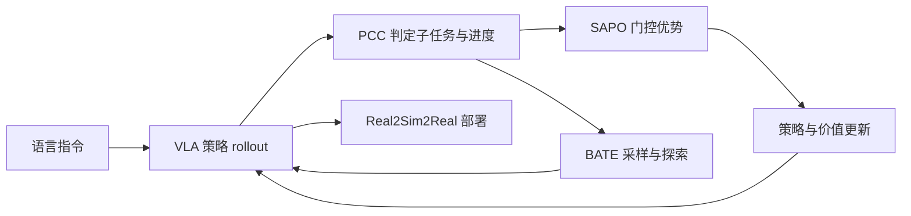
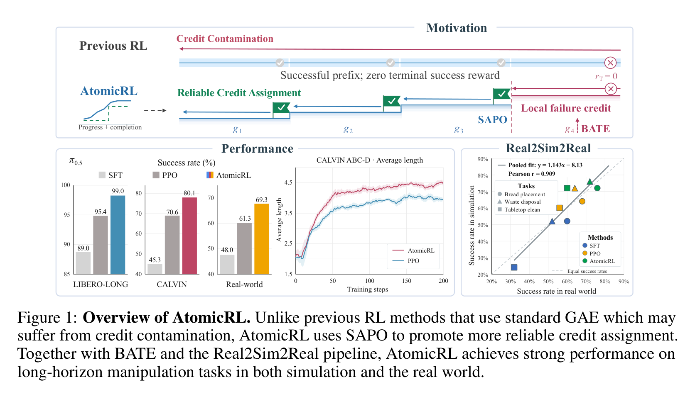
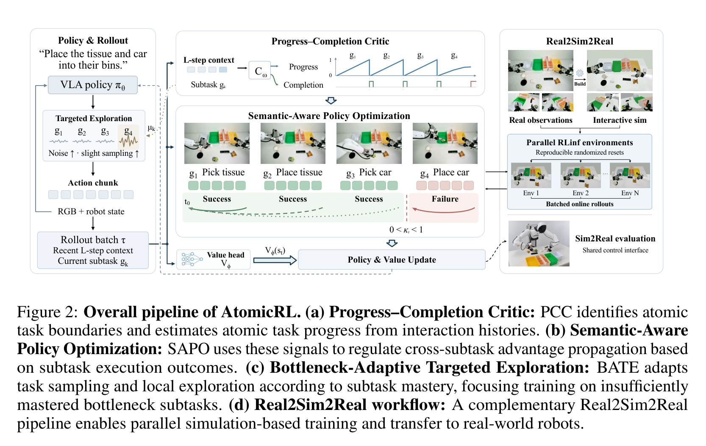
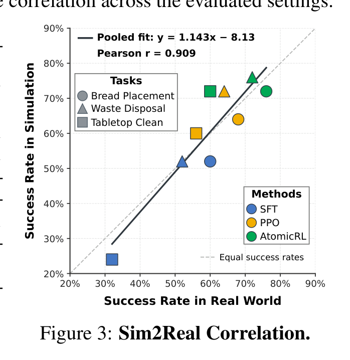
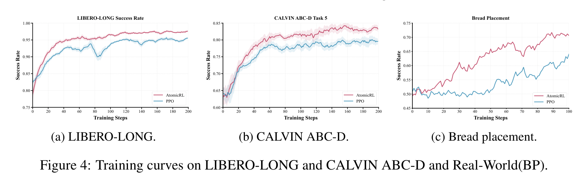

> 一句话：把长任务切成一段段小任务，只让失败的那一段拖后腿，同时把练习时间优先给最不熟的那一段。

## 0. 读之前你需要知道

**术语卡**

- **VLA 模型（vision-language-action）**：输入图像和语言指令、直接输出机器人动作的大模型。
- **模仿学习（imitation learning）**：照着人类示范学。生活类比：照着视频学做菜，视频里没拍到的步骤就不会。
- **GAE（广义优势估计）**：把每一步的即时好坏累加成「这一步比平均好多少」的算法，带一个衰减系数 λ。
- **TD 残差**：一步预测误差，即「这一步拿到的奖励加上下一状态估值，减去当前估值」。
- **信用分配（credit assignment）**：一个最终结果出来，该把功劳或责任分给前面哪些动作。
- **原子子任务（atomic subtask）**：任务分解后不可再分的一段，比如「拿起面包」。
- **SFT / PPO**：监督微调；近端策略优化，一种常用的强化学习算法。
- **仿真到真机（sim2real）**：在仿真里训练、部署到物理机器人上。

**它站在谁肩上**

- VLA-RL / SimpleVLA-RL（2025–2026）：把在线 RL 接到 VLA 上，证明了这条路能走通。不够的地方：奖励只有「整条任务成功/失败」，轨迹一长信号就稀得几乎为零。
- STARE-VLA（2025）：利用轨迹里的阶段结构做阶段级偏好优化和奖励塑形。不够的地方：改的是奖励密度，没解决「后面失败会倒着污染前面」这个问题。
- RialTo / GSWorld（2024–2025）：用真实场景重建加物理引擎做 Real2Sim2Real。不够的地方：搭环境要协调重建、资产、控制对齐，复现成本高。

## 1. 动机

教一个机械臂摆桌子：先把面包放盘子里，再把纸巾扔进垃圾桶，最后把遥控器收进盒子。整套动作有几十秒、几百个控制步。

**以前怎么做**：只在最后判断「整套做成了没有」，然后让 RL 算法自己回头算每一步该记多少功。

**为什么不行**：假设前 90% 都做对了，最后一步失手，最终奖励是 0。这个 0 会沿着时间倒着传回去，把前面做对的那些步的优势值也压成负数——作者把这个叫信用污染（credit contamination）。轨迹越长，污染越严重。第二件事是练习分配：训练到后期，失败会集中在一两个卡住的子任务上，但采样还是平均分配给所有任务，交互预算浪费在已经练熟的部分。

**为什么现在能做**：VLA 基座（π0.5、OpenVLA-OFT）已经能靠模仿学习把单步动作做稳，剩下的瓶颈在长程协调；同时分布式 RL 框架（RLinf）和并行仿真环境让「在仿真里跑几千条 rollout」变得便宜。

## 2. 贡献

- **提出以原子任务结构为核心的 RL 后训练框架**。证据：LIBERO-LONG 上 π0.5 从 PPO 的 95.4% 提到 99.0%，OpenVLA-OFT 从 94.8% 提到 98.8%。
- **SAPO：在语义边界上给 TD 残差装一个软闸门**。证据：消融里单独加 SAPO 把成功率从 78.2% 提到 87.8%，是所有组件里贡献最大的。
- **BATE：按子任务掌握度重新分配采样和探索**。证据：在 SAPO + 退火奖励塑形之上再加 BATE，从 89.6% 到 91.2%。
- **Real2Sim2Real 管线**：一条真实示范就能重建可交互仿真环境，训练后回到真机。证据：真机三个任务平均从 SFT 的 48.0% 提到 69.3%，比 PPO 高 8.0 个点。

## 3. 创新点

- **新在哪**：不改奖励，改优势传播的路径——跨子任务边界时按「下一个子任务成没成」决定是否衰减。对比对象：STARE-VLA 的阶段级偏好优化、IG-RFT 的子任务级奖励。有用是因为：稠密奖励只是把信号变多，失败子任务的负信号还是会传回前面的成功段；而闸门是直接切断这条传播路径。
- **新在哪**：用一个学出来的轻量 critic（PCC）自动判定子任务边界，而不是靠人工标注或固定时间窗。对比对象：需要人工划分子任务的阶段式方法。有用是因为：换任务时不用重新标注，边界跟着语义走。
- **新在哪**：采样权重和探索强度都由同一组掌握度统计驱动。对比对象：均匀采样 + 固定熵系数。有用是因为：训练后期把预算集中到瓶颈上，同时降低对已掌握技能的扰动。

## 4. 方法

### 4.1 整体流程

一句话解释：PCC 负责「现在做到第几段了」，SAPO 负责「失败别往回传染」，BATE 负责「下一轮多练哪一段」。

### 4.2 模块拆解

**模块一：SAPO（语义感知策略优化）**

为什么需要：一整条轨迹只有一个 0/1 奖励，失败段的负信号会顺着 GAE 往前传。

怎么做：先算标准的一步 TD 残差，再在累加时对每条跨边界的路径乘一个门控因子。同一子任务内部保持原来的衰减；跨边界时，如果下一段成功了就照常传，失败了就按 $\kappa$ 衰减。

$$
\delta_t = r_t + \gamma(1-d_t)V_\phi(s_{t+1}) - V_\phi(s_t)
$$

先说这个公式在算什么：这一步实际拿到的东西，比「原本预期」好多少。

- $r_t$：chunk 级奖励，通常只有任务结束时的 0 或 1。
- $\gamma$：折扣因子。
- $d_t$：该步之后环境是否终止。
- $V_\phi(s_t)$：价值网络对当前状态的估值。

$$
\hat{A}^{\mathrm{SAPO}}_t = \sum_{\ell=0}^{T-t}(\gamma\lambda)^{\ell}\Big[\prod_{j=0}^{\ell-1}\big(1-(1-\kappa_{t+j})\,b_{t+j}\big)\Big]\delta_{t+\ell}
$$

先说这个公式在算什么：把后面各步的 TD 残差按衰减加权求和，但每跨过一次「失败的子任务边界」就打一次折。

- $\lambda$：GAE 的迹衰减系数。
- $b_t$：语义边界指示，$b_t=1$ 表示这一步之后进入了新的子任务。
- $\kappa_t \in [0,1]$：边界处的通过率。下一段成功取 1（完全不衰减），失败取 $0<\kappa_t<1$（部分衰减）。
- 连乘项：从 $t$ 到 $t+\ell$ 之间所有边界通过率的乘积。
- 关键设计：一步 TD 残差 $\delta_t$ 本身不动，价值自举也不动，所以子任务内部的信用分配完全保留。

**模块二：BATE（瓶颈自适应目标探索）**

为什么需要：后期失败集中在少数子任务上，均匀采样浪费预算。

怎么做：给每个子任务维护一个完成率的指数滑动平均当「掌握度」，掌握度越低权重越高；同时把熵正则按掌握度放大，让不熟的那段多探索。

$$
\mu^{(n)}_k = \beta\,\mu^{(n-1)}_k + (1-\beta)\,\hat{s}^{(n)}_k
$$

先说这个公式在算什么：子任务 $k$ 最近一段时间做成的比例，平滑一下当掌握度。

- $\hat{s}^{(n)}_k$：这次统计窗口内该子任务的成功比例。
- $\beta$：平滑系数，越接近 1 越稳。

$$
w_i = 1+\rho\Big[\max_{k\in K_i}(1-\mu_k)\Big]^{\eta},\qquad P_{\mathrm{task}}(i) = \frac{w_i}{\sum_j w_j}
$$

先说这个公式在算什么：给整条任务算一个采样权重，任务里最不熟的那一段越差，整条任务被抽到的概率越高。

- $K_i$：任务 $i$ 包含的子任务集合。
- $1-\mu_k$：能力缺口。
- $\eta$：缺口到权重的敏感度。
- $\rho$：权重上浮的上限。
- 基础权重 1 保证已掌握任务仍有采样，用来监测遗忘。

$$
\mathcal{L}_{\mathrm{explore}} = -\alpha_H\,\mathbb{E}_t\big[f_{\mathrm{exp}}(1-\mu_{z_t})\,H_{\theta,t}\big]
$$

先说这个公式在算什么：按当前所在子任务的掌握度，调节熵奖励的强度。

- $H_{\theta,t}$：策略在该步的熵。
- $z_t$：当前激活的子任务下标。
- $f_{\mathrm{exp}}$：有界的探索权重，掌握度低时更大。

**模块三：PCC（进度—完成评论家）**

为什么需要：SAPO 要知道边界，BATE 要知道掌握度，两者都依赖「现在做到哪了」。

怎么做：拿最近 $L$ 步的观测—动作对，输出 $B-1$ 个序数进度 logits 和一个完成 logit；进度按阈值累加解码，完成概率超过阈值且进度也够、并连续 $N$ 步成立时，判定子任务切换。

$$
\hat{p}_t = \frac{1}{B-1}\sum_{j=1}^{B-1}\mathbb{1}\big[\sigma(u^{\mathrm{prog}}_{t,j}) > \tau_{\mathrm{ord}}\big],\qquad \hat{q}_t = \sigma(u^{\mathrm{comp}}_t)
$$

先说这个公式在算什么：把若干二分类头拼成一个 0 到 1 的进度估计，再单独算一个完成概率。

- $B$：离散进度档数。
- $u^{\mathrm{prog}}_{t,j}$、$u^{\mathrm{comp}}_t$：进度与完成的 logits。
- $\tau_{\mathrm{ord}} = 0.5$：序数解码阈值。
- $\sigma$：sigmoid。

**模块四：Real2Sim2Real 与 PBSR**

为什么需要：真机上跑在线 RL 太贵、危险、还难以复现。

怎么做：给一条真实多模态示范、机器人型号元数据和必要的物体观测，自动重建一个可交互仿真环境、一套共享观测—动作接口、一组可复现的随机初始布局；策略在仿真里优化后按同一接口部署回真机。另外，PCC 的进度估计可以顺手做成稠密奖励，权重用线性退火逐渐调小。

$$
(E_{\mathrm{sim}}, C, S_0) = \mathcal{B}(\tau_{\mathrm{real}}, m, D_{\mathrm{aux}}),\qquad r_t = r^{\mathrm{env}}_t + \alpha_n r^{\mathrm{PBSR}}_t
$$

先说这个公式在算什么：左边是「重建出的仿真环境、接口约定、初始布局」，右边是「稀疏环境奖励 + 退火的稠密塑形奖励」。

- $\tau_{\mathrm{real}}$：一条真实示范。
- $C$：仿真与真机共享的接口规格，保证同一策略两边都能跑。
- $S_0$：可复现的随机初始状态集合。
- $\alpha_n$：塑形奖励权重，训练中线性退火。

### 4.3 关键细节

- 每次训练只有 200 个优化步，两个 VLA 基座都能在这个预算内接近饱和。
- 消融用的是「示范更少、更弱的 SFT 检查点」作为起点，这样组件贡献才看得出来——在满分附近做消融是看不出差异的。
- 奖励塑形不是越多越好：作者发现稠密的过程级奖励在 SAPO 下反而不如较稀疏的子任务级奖励，所以最终用退火而不是固定权重。
- PCC 训练标签由 VLM 自动生成再人工修正，训练集 150 条轨迹、测试集 500 条。

## 5. 实验结果

**实验设置**

- 数据集与切分：LIBERO-LONG 的 10 个长程任务；CALVIN 按 ABC-D 协议，在 A/B/C 上训练、在没见过的 D 上评测；真机三个任务各收集 100 条专家示范做 SFT。
- 骨干模型：π0.5 与 OpenVLA-OFT 两个 VLA 策略；真机用 AgiBot G1。
- 训练预算：每次运行 200 个优化步，跑在 RLinf 框架里；卡数、并行环境数原文未给（附录训练细节）。
- 基线：SFT（不跑 RL）、PPO（同框架同预算）。
- 指标：LIBERO 报任务平均成功率（每任务 50 次试验）；CALVIN 报连续完成 1–5 个任务的比率和平均完成长度（1,000 次评测）；真机每任务 25 次试验。
- 推理设置：评测用确定性策略，无额外采样技巧；仿真—真机相关性用九个「任务×方法」组合做 Pearson 相关。

| 数据集 / 任务 | 指标 | 本文 AtomicRL | 最强基线 PPO | 提升 |
| --- | --- | --- | --- | --- |
| LIBERO-LONG（π0.5） | 成功率 | 99.0% | 95.4% | +3.6 |
| LIBERO-LONG（OpenVLA-OFT） | 成功率 | 98.8% | 94.8% | +4.0 |
| CALVIN ABC-D | 平均完成长度 | 4.56 | 4.36 | +0.20 |
| CALVIN ABC-D | 五连成功率 | 80.1% | 70.6% | +9.5 |
| 真机三任务平均 | 成功率 | 69.3% | 61.3% | +8.0 |
| 消融起点（弱 SFT） | 成功率 | 91.2% | 78.2% | +13.0 |

**原文实验图**

图 1：问题与方案对照。左边「previous RL」在最后一步失败时把整条轨迹的优势压成 0，右边 AtomicRL 只让失败那一段背锅，前面成功的段保留正向信号。

图 2：系统全貌。(a) PCC 从最近 L 步判断当前子任务和进度；(b) SAPO 用这些边界决定跨段衰减；(c) BATE 按掌握度调采样与探索；(d) Real2Sim2Real 把真机示范变成并行仿真环境，训完再回真机。

图 3：仿真与真机成功率的散点，九个组合的 Pearson r = 0.909，拟合线 y = 1.143x − 8.13，略高于等成功率线，说明仿真略偏乐观但排序可靠。这张图是「仿真里调出来的策略在真机上还算数」的直接证据。

图 4：三条训练曲线。(a) LIBERO-LONG 上 AtomicRL 从第 20 步就领先，且方差带更窄；(b) CALVIN 五连任务在第 40 步左右拉开差距；(c) 真机 Bread Placement 的提升最明显——作者归因于这条任务最长，信用污染的危害最大。

**消融告诉我们什么**

- 组件贡献是递进的：PPO 78.2 → 加 SAPO 87.8（+9.6）→ 加退火 PBSR 89.6（+1.8）→ 加 BATE 91.2（+1.6）。SAPO 是主要来源，另外两个是小幅叠加。
- 奖励颗粒度不是越细越好：在 SAPO 下，0/1 奖励 87.8、子任务级 89.4、过程级稠密 89.0，完整配置（退火）89.6。稠密奖励在策略还弱时有帮助，策略变强后反而稀释了终点信号。
- PCC 够用且便宜：95.92% 准确率、89.20% 召回、4.08% 误检、28.8M 参数、42.4 ms 延迟。它是整个方法的前置条件，如果边界判错，SAPO 的门控就会在错误的位置触发。

**这些实验够不够支撑结论**

仿真上的结论支撑得比较扎实：两个基座、三个基准、真机加消融，网格完整。需要打折扣的是「真机 21.3% 提升」——每任务只有 25 次试验，三个任务的平均值方差不会小，论文没有给置信区间；而且真机的 RL 全程在重建的仿真里做，真机只承担评测，所以这个数字衡量的是「仿真训练 + 迁移」，不是「真机在线学习」。

## 6. 局限性

**作者自己承认的**

- 论文正文没有独立的 Limitations 小节，只在附录里提到方法仍有若干限制（未在正文展开）。
- Real2Sim2Real 依赖一条真实示范和必要的物体观测，场景重建的质量决定上限。

**我看出来的**

- 隐形假设：任务能被干净地分解成有序的原子子任务，且子任务之间没有交错或回退。真实的长程操作经常需要「回去重做」，这时边界判定和门控都会失准。
- 边界条件：$\kappa_t$ 由「下一段成没成」决定，但「成功」本身来自 PCC 的判定，是一个可能出错的中间信号；PCC 的 4.08% 误检会直接变成错误的门控。
- 缺的对比：没有和「用过程奖励模型（PRM）做稠密奖励」这条主流路线比，只在自己的奖励塑形变体之间比。
- 真机实验的规模偏小：3 个任务、每任务 25 次、每任务 100 条示范，且没有报种子间方差。
- 一个未解释的细节：真机 PPO 在 Tabletop Clean 上只有 52%，而 SFT 是 32%，提升幅度远小于另外两个任务，作者没有讨论这个任务为什么特殊。

## 7. 一句话总结

做一桌菜，最后一道炒糊了，不该把前面三道都判成不及格；而且下一轮练习应该多练那道总炒糊的。

核心公式：

$$
\boxed{\ \hat{A}^{\mathrm{SAPO}}_t=\sum_{\ell=0}^{T-t}(\gamma\lambda)^{\ell}\Big[\prod_{j=0}^{\ell-1}\big(1-(1-\kappa_{t+j})b_{t+j}\big)\Big]\delta_{t+\ell}\ }
$$

## 8. 可复用点

- 如果我要在自己的项目里用：任何带阶段结构的长程任务（多轮工具调用、多步代码修复），都可以在阶段边界上给优势传播加一个「按下一阶段成败」的衰减因子，不需要改奖励函数。
- 训练不收敛时先查：边界判定是不是太密或太稀。判定太密会把一条子任务切成几段，门控频繁触发；太稀则退化成普通 GAE。
- 采样策略可以直接抄：用完成率的 EMA 当掌握度，任务权重取「最难那段的缺口」的幂次，比按全局成功率调权更聚焦。
- 上线前先查：仿真和真机的成功率相关性。本文 r=0.909，如果你的场景掉到 0.5 以下，仿真里调出来的超参不可信。

## 9. 我的疑问

- $\kappa_t$ 在失败边界上取多少？正文只说 $0<\kappa_t<1$，具体值和敏感性分析在附录。
- 如果子任务顺序被打乱（比如先放纸巾再拿面包），PCC 的进度估计会不会直接崩？
- 200 步就接近饱和，是因为任务本身简单，还是因为 SAPO 让样本效率极高？没有和更长训练的 PPO 比最终收敛值。
