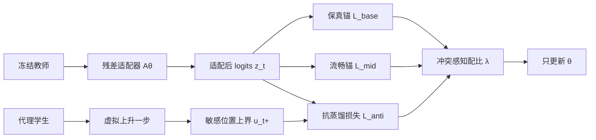
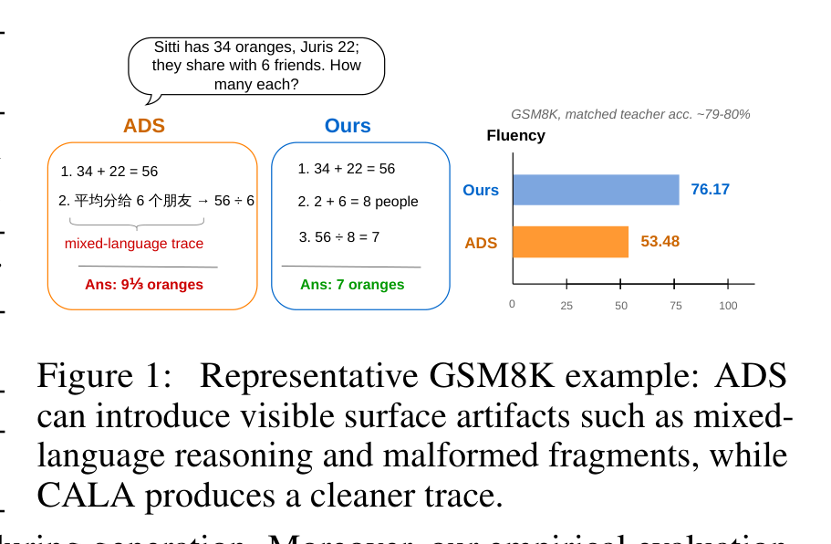
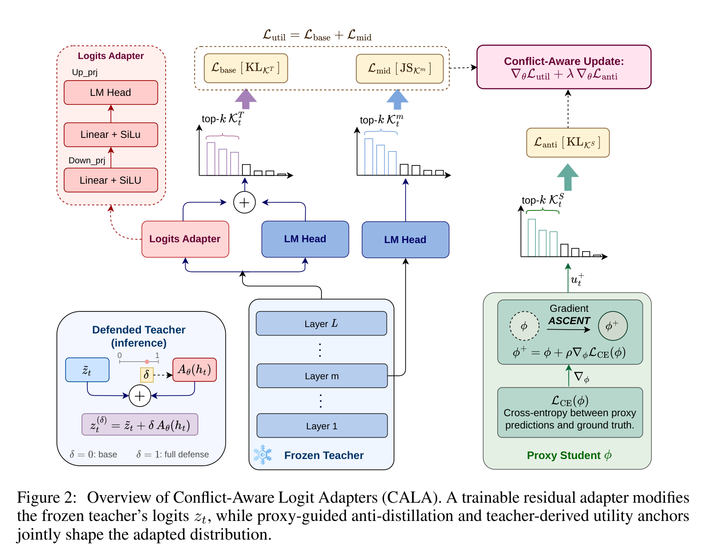
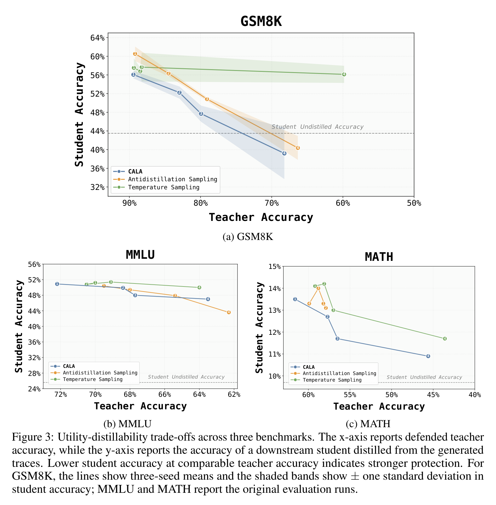
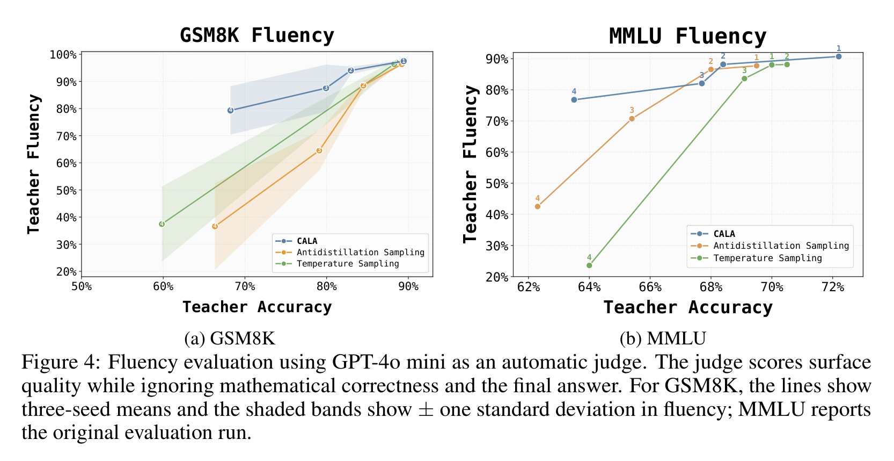
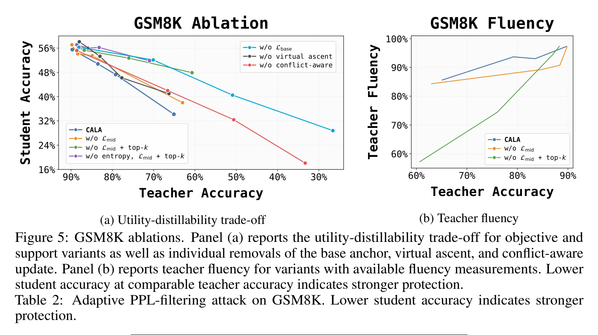

> 一句话：给老师模型挂一个小插件，让它写出来的推理过程还能用、但别人抄去训练小模型时学不到真本事。

## 0. 读之前你需要知道

**术语卡**

- **推理轨迹（reasoning trace）**：模型在给出答案前写的中间思考步骤。生活类比：数学卷子上的草稿，阅卷人能看到你怎么算的。
- **蒸馏（distillation）**：拿大模型的输出当标准答案，去训练一个小模型。生活类比：徒弟把师傅的手稿抄一遍，就学会了师傅的手艺。
- **logits**：模型在选下一个词之前，给词表里每个词打的分。生活类比：点菜前你心里给每道菜打的分，分数高的先夹。
- **top-k 支撑集**：只保留分数最高的 k 个词，其余丢掉再重新归一化。生活类比：菜单上只留前十名，别的菜不看了。
- **KL 散度**：衡量两个概率分布差多少，不对称。生活类比：从家到公司 5 公里、从公司到家 6 公里，方向不同距离不同。
- **JS 散度**：KL 的对称版，两个分布互相看的距离一样。生活类比：两家之间的路，来回都量同一个数。
- **代理学生（proxy student）**：训练时临时拉来当假想攻击者的小模型，不参与最终部署。生活类比：请个临时演员扮演小偷，帮你测试门锁。
- **抗蒸馏（anti-distillation）**：故意让输出变得不好学，同时尽量不降低自己答题的正确率。

**它站在谁肩上**

- Antidistillation Sampling，ADS（2026）：第一次系统处理「输出有用 vs 输出可被蒸馏」这个矛盾，做法是在解码时给 logits 加一项由代理学生算出来的惩罚。不够的地方：每生成一个 token 都要跑一次代理模型，慢；而且会把推理过程搞出乱码、串语言。
- DOGe（2026）：训练时改输出层做对抗，但没有解决「改了输出层，老师自己的答题能力也跟着掉」的问题。

## 1. 动机

想象一家餐厅的招牌菜师傅。他把做菜过程拍成视频发到网上吸引顾客，结果隔壁店照着视频把菜复刻出来，还卖得更便宜。师傅不能不发视频，因为顾客就是冲着视频来的；但他希望视频里有些关键步骤外人看了也学不会。

**以前怎么做**：ADS 在师傅做菜的每一秒都插一个「干扰器」，实时往画面里加噪点。菜品看起来还是那道菜，但录像变得不好学。

**为什么不行**：干扰器要现场运算，出菜速度掉一半；而且噪点加过头，视频里出现中英文混杂的旁白、无意义的碎片，顾客也看不懂了。作者把这种现象叫抗蒸馏作弊（anti-distillation hacking）：答案还是对的，中间过程烂掉——表面上防住了，实际上把产品毁了。

**为什么现在能做**：作者换了个思路，不在出菜时加干扰，而是提前训练师傅养成一种「天然不好复刻」的手法。这件事能成立，靠的是两件现成的东西：一是 PPO/蒸馏这套训练工具链已经很成熟，二是现在有开源的小模型可以随时拉来当假想徒弟做压力测试。

## 2. 贡献

- **把防御从解码时搬到训练时**。证据：推理时不再需要代理模型，生成流程和普通解码完全一致，只多一个缩放系数 δ。
- **给出了一套可落地的训练配方**。证据：代理学生只做一步虚拟梯度上升来定位「最容易被抄的位置」，再在这些位置上做受限扰动。
- **三个维度一起评估**：老师正确率、学生被蒸馏后的正确率、以及轨迹的表层流畅度。证据：GSM8K 上老师正确率约 79–80% 时，学生正确率 ADS 是 50.8%、CALA 是 47.7%；同时 CALA 的流畅度曲线整体高于 ADS。

## 3. 创新点

- **新在哪**：把保护措施做成一个可训练的残差插件，挂在冻结的老师身上。对比对象：ADS 的在线解码扰动、DOGe 的直接改输出层。有用是因为：只动一个小模块，老师的底层表征不变，所以正确率掉得少；而且插件的强度可以用一个标量 δ 连续调，一个模型能给出整条「保护强度—可用性」曲线。
- **新在哪**：用「虚拟上升一步」的代理学生找敏感位置。对比对象：ADS 用真实代理模型的梯度。有用是因为：只算一次梯度方向、不真的更新代理，成本低，且能指出哪些位置的模仿最不稳。
- **新在哪**：冲突感知的梯度配比。对比对象：固定权重的多任务损失。有用是因为：当保真梯度和抗蒸馏梯度同向时自动少加抗蒸馏权重，反向时自动补上，避免保真项把保护信号洗掉。

## 4. 方法

### 4.1 整体流程

一句话解释：老师在左边不动，一个小插件往它输出的打分上加一个修正量；右边三路损失分工是「别跑偏、别变味、别好抄」，最后由一个自适应的 λ 决定往哪边多用力。

### 4.2 模块拆解

**模块一：残差 logit 适配器**

为什么需要：直接微调老师会毁掉它原本的能力，也容易被攻击者用别的数据拉回来。

怎么做：取老师最后一层的隐状态 $h_t$，用一个「线性 + SiLU + 线性」的小网络映射成词表大小的修正量，加到原始打分上，再 softmax。整个过程只有这个小网络的参数在动。

$$
z_t = \tilde{z}_t + A_\theta(h_t), \qquad q_t = \mathrm{softmax}(z_t)
$$

先说这个公式在算什么：把老师的原始打分 $\tilde{z}_t$ 加上一个学出来的偏移，得到真正用于生成的分布。

- $\tilde{z}_t$：冻结的老师在位置 $t$ 的原始 logits，维度是词表大小 $|V|$。
- $A_\theta(h_t)$：适配器输出的修正向量，维度同样是 $|V|$，参数只有 $\theta$。
- $z_t$：修正后的 logits；$q_t$ 是它 softmax 之后的下一词分布。

**模块二：两个保真锚**

为什么需要：只压抗蒸馏，模型会往「语法烂但不好学」的方向跑，出现重复、碎片。

怎么做：一路锚在老师最后一层的 top-k 分布上，用 KL 拉住；另一路锚在某一中间层投影出来的 top-k 分布上，用 JS 拉住。前者管「别答错」，后者管「别写崩」。

$$
\mathcal{L}_{\mathrm{base}} = \frac{1}{N}\sum_t \mathrm{KL}\Big(\Pi_{\mathcal{K}^T_t}(\tilde{z}_t)\,\Big\|\,\Pi_{\mathcal{K}^T_t}(z_t)\Big)
$$

先说这个公式在算什么：在老师最自信的那 k 个词上，要求适配后的分布不要偏离老师太远。

- $N$：一个 batch 里的 token 位置数。
- $\mathcal{K}^T_t$：老师原始 logits 下得分最高的 k 个词构成的集合。
- $\Pi_{\mathcal{K}}(\cdot)$：把分布限制在集合 $\mathcal{K}$ 上再重新归一化的操作。
- 方向是从老师指向适配后，作者的解释是：被老师判为高概率的续写不该被适配器压掉。

$$
\mathcal{L}_{\mathrm{mid}} = \frac{1}{N}\sum_t \mathrm{JS}\Big(\Pi_{\mathcal{K}^m_t}(z_t),\ \Pi_{\mathcal{K}^m_t}(\tilde{z}^{(m)}_t)\Big)
$$

先说这个公式在算什么：要求适配后的分布，跟老师中间层「投影出来」的那个更平滑的分布保持相容。

- $\tilde{z}^{(m)}_t$：第 $m$ 层隐状态过同一个冻结的 LM head 得到的 logits。
- $\mathcal{K}^m_t$：这组 logits 的 top-k 集合。
- JS 对称，因为中间层不是要精确模仿的目标，只是一个「第二视角」。

**模块三：代理引导的抗蒸馏损失**

为什么需要：得知道轨迹里哪些位置最值得动手，而真实的下游学生是未知的。

怎么做：让代理学生先做一步「虚拟上升」——往让它更学不会的方向挪一点点，但不真的更新它；然后拿这个「更学不会的状态」去当对照，要求适配器在这些位置上把分布往那边推。权重按熵给：代理越不确定的位置，权重越大。

$$
\phi^{+} = \phi + \rho\,\frac{\nabla_\phi \mathcal{L}_{\mathrm{CE}}(\phi)}{\lVert \nabla_\phi \mathcal{L}_{\mathrm{CE}}(\phi)\rVert_2}
$$

先说这个公式在算什么：在半径 $\rho$ 的小球里，往让交叉熵变大的方向走一步，得到一个「暂时更笨」的代理。

- $\phi$：代理学生的参数。
- $\rho$：扰动半径，控制这一步走多远。
- $\mathcal{L}_{\mathrm{CE}}(\phi)$：代理学生在老师轨迹上的下一词交叉熵。
- $\phi^{+}$：这个虚拟状态，用完就丢，不回写。

$$
\mathcal{L}_{\mathrm{anti}} = \frac{\sum_t w^S_t\,\mathrm{KL}\big(\Pi_{\mathcal{K}^S_t}(u^+_t)\,\|\,\Pi_{\mathcal{K}^S_t}(z_t)\big)}{\sum_t w^S_t},\qquad w^S_t = \frac{\mathrm{Entropy}(\mathrm{softmax}(u^+_t))}{\log |V|}
$$

先说这个公式在算什么：在被代理判为敏感的那 k 个词上，把适配后的分布往「代理学不会的方向」拉。

- $u^+_t$：虚拟代理在位置 $t$ 的 logits。
- $\mathcal{K}^S_t$：$u^+_t$ 的 top-k 集合，即所谓的敏感支撑集。
- $w^S_t$：归一化熵，取值 0 到 1，越不确定权重越大；$\log|V|$ 是熵的上界。

**模块四：冲突感知更新**

为什么需要：保真项和抗蒸馏项的梯度有时同向、有时打架，固定权重必然在某一头失效。

怎么做：每一步都量一下「保真梯度里已经包含多少抗蒸馏方向」，包含得多就少加，包含得少或反向就多加。

$$
\nabla_\theta \mathcal{L} = \nabla_\theta \mathcal{L}_{\mathrm{util}} + \lambda \nabla_\theta \mathcal{L}_{\mathrm{anti}},\qquad
\lambda = \max\Big(0,\ \kappa - \frac{\langle \nabla_\theta \mathcal{L}_{\mathrm{util}}, \nabla_\theta \mathcal{L}_{\mathrm{anti}}\rangle}{\lVert \nabla_\theta \mathcal{L}_{\mathrm{anti}}\rVert_2^2 + \varepsilon}\Big)
$$

先说这个公式在算什么：把抗蒸馏梯度按一个自适应的系数补进来，保证最终更新在抗蒸馏方向上至少有 $\kappa$ 的投影。

- $\mathcal{L}_{\mathrm{util}} = \mathcal{L}_{\mathrm{base}} + \mathcal{L}_{\mathrm{mid}}$：两个保真锚之和。
- $\kappa$：预设的最小投影余量，越大保护越狠。
- 分式：保真梯度在抗蒸馏方向上的投影长度；同向时为正且大，$\lambda$ 就被压小。
- $\varepsilon$：防止除零的小常数。
- $\lambda$ 不参与求导。

**模块五：推理时的强度旋钮**

为什么需要：不同场景对「好用」和「防抄」的偏好不同，不该为每个偏好重训一次。

怎么做：在部署时用一个 $\delta \in [0,1]$ 在原 logits 和适配后 logits 之间线性插值，$\delta=0$ 就是原老师，$\delta=1$ 是全力防御。

$$
z^{(\delta)}_t = \tilde{z}_t + \delta A_\theta(h_t)
$$

先说这个公式在算什么：把学到的修正量按比例打开。

- $\delta$：防御强度，$[0,1]$ 上的标量。
- 其余符号同上。

### 4.3 关键细节

- 适配器结构：Down-proj → Linear + SiLU → Up-proj → LM Head，参数量级很小，论文把它叫「轻量」。
- top-k 的 k 值、扰动半径 $\rho$、余量 $\kappa$ 的具体数字正文没给，写在附录 B。
- 训练数据是 6,800 条 MetaMathQA，用老师自己生成回答。
- 推理时插值之后仍走标准温度采样和 top-k 采样，不额外加任何模块。

## 5. 实验结果

**实验设置**

- 数据集与切分：训练用 MetaMathQA 的 6,800 条样本；评测用 GSM8K、MATH、MMLU 三个基准，每个基准都用被防御老师生成的轨迹去训一个下游学生，蒸馏流程在所有方法间完全一致。
- 骨干模型：被防御老师 DeepSeek-R1-Distill-Qwen-7B；训练期代理 Qwen2.5-1.5B；下游学生 Llama-3.2-3B。
- 训练预算：只训适配器，老师全程冻结；具体卡数、步数、batch 原文未给（附录 B）。
- 基线：ADS（解码时防御）、温度采样（只调温度、无防御）、以及不带适配器的原始老师。
- 指标：老师正确率（越高越好，衡量可用性）与下游学生正确率（越低越好，衡量保护强度），外加 GPT-4o mini 打分的表层流畅度。
- 推理设置：每种方法取 4 个操作点连成曲线；GSM8K 报三种子均值与标准差，MMLU/MATH 报单次运行；效率测试在单张 H100、batch 64、最长 1024 token 下做。

| 数据集 / 场景 | 指标 | 本文 CALA | 最强基线 ADS | 差异 |
| --- | --- | --- | --- | --- |
| GSM8K，老师约 79–80% | 学生正确率 | 47.7% | 50.8% | −3.1 个点 |
| GSM8K，老师 65.1 / 64.8 | 学生正确率 | 34.2% | 38.6% | −4.4 个点 |
| MMLU，高/中可用区间 | 学生正确率 | 优于温度采样 | ADS 在最强档更低 | 但 ADS 流畅度崩 |
| MATH，高可用区间 | 学生正确率 | 明显下降 | — | 作者称该区间优势最大 |
| 推理开销 | 每 batch 时间 | 31.5 s | 89.2 s | 接近原始老师 25.8 s |
| 推理开销 | 峰值显存 | 20.24 GB | 39.28 GB | 原始老师 20.07 GB |

**原文实验图**

图 1：同一道 GSM8K 题上 ADS 把推理过程写成了中英混杂的碎片，答案还错成 9⅓；CALA 的轨迹干净、答案正确。这张图说明「防住了但产品毁了」是真实存在的失败模式，也是本文要解决的问题之一。

图 2：整体架构。冻结老师的最后一层隐状态进小适配器，加回 logits；左边两个保真锚拉住最后一层和中间层，右边代理学生上升一步给出敏感支撑集，中间由冲突感知更新合成。

图 3：三个基准上的「老师正确率—学生正确率」曲线。GSM8K 上 CALA 的折线整体压在 ADS 下方且更靠右，说明同样保护强度下老师更准；MMLU 上两者咬得很紧，ADS 在最激进档位更低，但对应图 4 的流畅度崩得也最狠；MATH 的学生绝对正确率只有 10–15%，曲线间距看着大，实际是低基数。

图 4：流畅度。老师正确率拉到 90% 附近时，ADS 的流畅度掉到 20–30% 区间，CALA 还能站在 60% 以上；这正是「抗蒸馏作弊」的直接证据——只看正确率会误判 ADS 更安全。

图 5：GSM8K 消融。(a) 里去掉 $\mathcal{L}_{\mathrm{base}}$ 的那条线直接塌到左下角，说明保真锚才是正确率的命脉；去掉中间锚或 top-k 限制的线在低可用区间散得更开。(b) 里去掉中间锚和 top-k 的那条线在强防御档位明显低于完整版。

**消融告诉我们什么**

- 在老师正确率约 65–67% 这个可比点上，完整方法的学生正确率是 34.2%，去掉虚拟上升变成 41.0%，去掉冲突感知更新变成 42.0%。两个「软」组件各贡献 7–8 个点，比预想的大。
- 单独去掉 $\mathcal{L}_{\mathrm{base}}$ 会同时毁掉老师正确率和保护效果——它不是可选项，是地基。
- 换成 3B 代理（同 tokenizer 家族）后曲线形状不变，说明方法对代理尺寸不敏感，但对 tokenizer 不兼容的代理是否会失效，作者明说没测。

**这些实验够不够支撑结论**

结论「训练时防御能在不牺牲可用性的前提下降低可蒸馏性」——GSM8K 上支撑得比较扎实（三种子 + 流畅度 + 效率 + 自适应攻击）。MMLU 上的优势不明显，作者自己也承认只有中高可用区间赢温度采样。真正的短板是攻击面：只测了单轮黑盒蒸馏、加了困惑度过滤的自适应攻击，没测改写攻击和验证器攻击。

## 6. 局限性

**作者自己承认的**

- 只覆盖「黑盒轨迹蒸馏」这一种威胁模型，不能推广到所有模型窃取。
- 效果依赖训练期代理；代理尺寸的研究假设了共享 tokenizer，tokenizer 不匹配的情况没测。
- 改写攻击、验证器攻击、以及更激进的设置（会同时掉正确率和流畅度）都还没评估。
- 推理正确性的盲审里 CALA 36/50、ADS 31/50 严格有效，差异不显著（McNemar p = 0.332），作者明确不宣称自己推理更正确。

**我看出来的**

- 隐形假设：攻击者「只会」用标准下一词预测来蒸馏。如果攻击者先用强模型把轨迹改写成自己的风格再训练，这个防御的前提就没了。
- 边界条件：所有实验都建立在同一个老师（DeepSeek-R1-Distill-Qwen-7B）和数学/知识类基准上，代码、多轮对话、工具调用场景完全没碰。
- 缺的对比：没有和「直接微调老师输出层」的 DOGe 做定量对比，只在相关工作里提了一句。
- 一个没解释的现象：MMLU 上 ADS 在最强档位学生正确率最低，作者归因于表层退化，但没有给出「退化程度—学生正确率」的相关性分析来支撑这个归因。

## 7. 一句话总结

给老师戴一副度数可调的眼镜：它自己看题还清楚，但别人隔着这副眼镜抄，抄到的就是一副糊掉的笔记。

核心公式：

$$
\boxed{\ \nabla_\theta \mathcal{L} = \nabla_\theta \mathcal{L}_{\mathrm{util}} + \max\Big(0,\ \kappa - \frac{\langle \nabla_\theta \mathcal{L}_{\mathrm{util}}, \nabla_\theta \mathcal{L}_{\mathrm{anti}}\rangle}{\lVert \nabla_\theta \mathcal{L}_{\mathrm{anti}}\rVert_2^2 + \varepsilon}\Big)\nabla_\theta \mathcal{L}_{\mathrm{anti}}\ }
$$

## 8. 可复用点

- 如果我要在自己的项目里用：把「保真」和「目标」两路损失做成自适应配比，用梯度投影长度当调度信号，比网格搜权重省事，也不容易在训练后期被保真项吃掉。
- 如果只想要一个轻量改造：把适配器换成 LoRA 挂在输出头前一层，思路一样，参数量更小。
- 评估时先查：只看任务指标会漏掉「输出质量退化」这类失败，至少加一个人工或模型打分的流畅度维度。
- 训练不收敛时先查：$\lambda$ 是否长期贴在 0（说明两路梯度一直同向，抗蒸馏根本没起作用）。

## 9. 我的疑问

- 为什么 $\mathcal{L}_{\mathrm{base}}$ 用 KL 而 $\mathcal{L}_{\mathrm{mid}}$ 用 JS？作者给了「不是精确模仿目标」的解释，但没做 KL/JS 互换的消融。
- δ 从 0 调到 1 的过程中，学生正确率是单调下降还是有拐点？图 3 只画了 4 个离散操作点。
- 如果攻击者知道 CALA 的存在，直接用 δ=0 的输出（比如让老师用另一套提示词）来绕，防御还剩多少？
