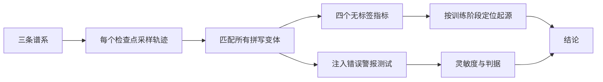
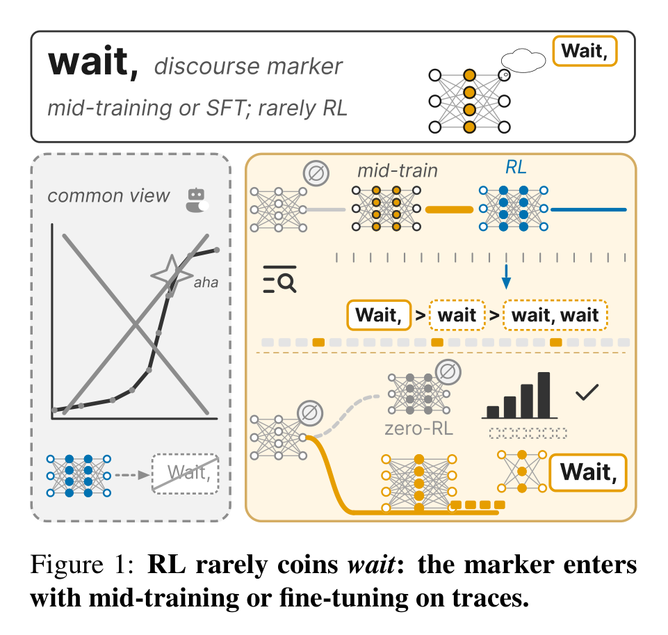
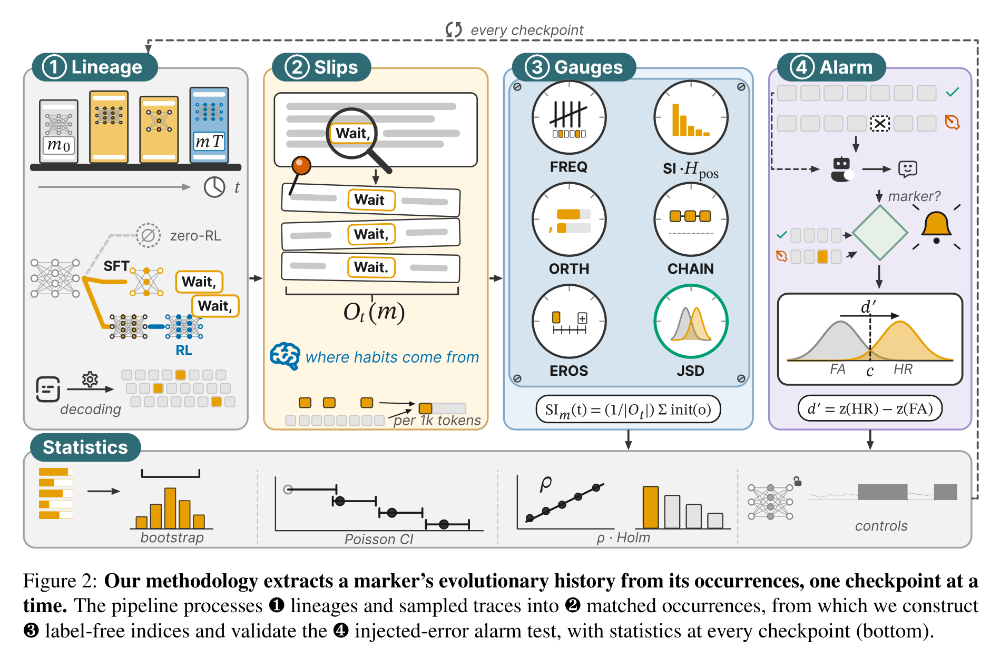
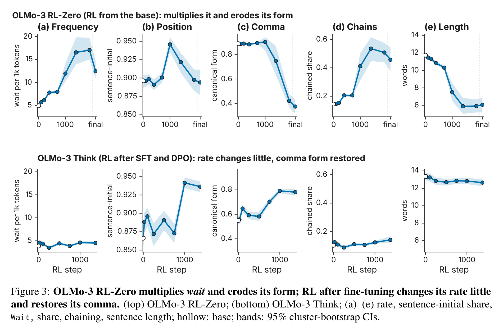
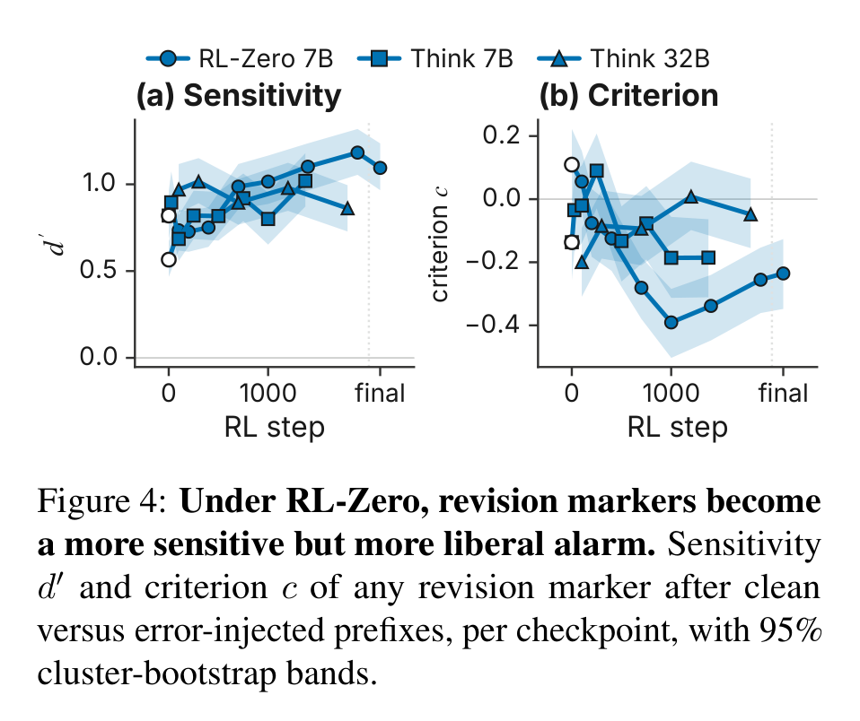

> 一句话：模型爱说的那个 wait，不是强化学习教出来的，是训练数据里本来就有的。

## 0. 读之前你需要知道

**术语卡**

- **推理模型（reasoning model）**：会先写一长段思考再给答案的模型，比如 R1 系列。
- **零 RL（zero-RL）**：直接从基座模型出发做强化学习，中间不经过任何监督微调。生活类比：不让学徒看菜谱，直接让他下厨房试错。
- **GRPO**：一种强化学习算法，同一道题采样一组答案，按组内相对好差分奖励，不训价值网络。
- **KL 惩罚**：限制新策略不要离旧策略太远的一项正则。KL-free 就是把这个限制去掉。
- **SFT（监督微调）**：拿现成的标准答案教模型。
- **mid-training（中期训练）**：预训练之后、正式后训练之前的一段继续训练，常掺入高质量或合成数据。
- **话语标记（discourse marker）**：不承载命题内容、只标记语篇结构的词，wait、well、so 都算。
- **语法化（grammaticalization）**：语言学概念，一个实词慢慢变成语法标记的过程，伴随频率升高、位置固定、形式磨损。本文借它当分析框架。
- **d′（辨别力）**：信号检测论里的灵敏度，越大表示越能区分「有错」和「没错」。
- **c（判据）**：信号检测论里的门槛，越小表示越容易开火。

**它站在谁肩上**

- R1-Zero 报告（DeepSeek，2025）：把 RL 过程中 wait 变多、出现所谓的 aha moment 当成「模型学会了自我反思」的证据。
- 对 aha moment 的质疑（2025）：指出基座模型在 RL 之前就已经有反思行为。不够的地方：只看了终点模型，没有沿训练时间轴定位这个词是哪一步进来的。
- 语法化与用法定量分析（Hopper & Traugott 2003；Hamilton 2016）：提供了一套能直接从文本出现位置算出来的指标，本文把它搬到模型检查点上。

## 1. 动机

一个孩子学会说「等等，我想想」，你会怎么判断这是他真的在思考，还是他从大人那里学来的口头禅？如果只看他考试时的表现，两种解释都说得通。

**以前怎么做**：看 RL 训练曲线，发现 wait 的出现频率随训练上升，就下结论说「RL 教会了模型反思」。这套推理在很多技术报告里都出现过。

**为什么不行**：频率上升只能说明「训练之后更常见」，不能说明「原来是零」。如果基座模型本来就会说这个词，RL 只是在放大，那这条证据链就断了。更麻烦的是，下游一堆工作把 wait 当成「不确定性」的信号来用（思维链监控、置信度启发式），如果这个词的含义在训练中被改变了，这些监控器的读法就全错。

**为什么现在能做**：现在有完整的开源训练谱系——OLMo-3 从预训练、中期训练、基座到 RL 的每个检查点都放出来了，加上 Qwen2.5、Mistral、Qwen3 这些可以自己跑零 RL 的基座。有了「训练前」和「训练后」两端的检查点，才能把「继承」和「发明」分开。

## 2. 贡献

- **零 RL 几乎不会造出这个词**。证据：18 次从「不含 wait 的基座」出发的零 RL 运行，MATH-500 准确率中位数提升 42.9 个点，其中 17 次的 95% 置信上界低于 0.06/千 token。
- **这个词是训练数据带进来的**。证据：14 个在「无标记基座」上用推理轨迹做微调的模型里，13 个采纳了它；OLMo-3 的 wait 在预训练阶段 ≤0.04/千 token，中期训练后跳到 4.03，其中 88.6% 出现在句首。
- **RL 会重塑一个已经存在的标记，而且不同配方改法不同**。证据：两个开源的 RL-Zero 配方（OLMo-3、MiMo）都把它放大了，同样基座的 KL-free GRPO 没有；OLMo-3 的配方把它的形式磨平，让它变成一个更灵敏但也更容易误报的警报。
- **给了一套不需要标签的测量工具**。证据：频率、位置、形式、用法四个指标加一个注入错误测试，全部只依赖采样输出，不需要人工标注、不需要看模型内部。

## 3. 创新点

- **新在哪**：把「一个词从哪来」当成可按训练阶段追溯的历史问题，而不是终点模型的一次性测量。对比对象：只统计最终模型里反思词频的工作。有用是因为：只有沿时间轴走，才能区分「RL 发明」和「数据继承」。
- **新在哪**：把语言学里的语法化参数（频率、位置固定、形式磨损、粘着）直接搬到模型检查点上算。对比对象：靠 LLM 裁判给「是否发生了反思」打标签。有用是因为：这些指标是确定性规则，可复现、可移植，而且不依赖裁判模型的偏好。
- **新在哪**：用一个注入算术错误的对照实验来问「这个词到底在报警什么」。对比对象：把 wait 出现等同于不确定。有用是因为：它能测出标记的灵敏度和门槛，而不只是频率。

## 4. 方法

### 4.1 整体流程

一句话解释：把每个模型当成一个语料库的不同年代版本，用语言学的方式给同一个词做「考古」。

### 4.2 模块拆解

**模块一：三条谱系**

为什么需要：要把「数据带进来」和「RL 改出来」分开，必须有能对照的训练历史。

怎么做：选三类模型历史。(i) 全开放谱系：OLMo-3 7B，从预训练、中期训练、基座一直到 RL-Zero 或 SFT/偏好/RL。(ii) 从「不含该标记的基座」出发的零 RL：作者自己跑的 Qwen2.5-Math GRPO，加上 DAPO、Open-Reasoner-Zero。(iii) 用推理轨迹微调出来的后代：QwQ-32B、R1-Distill、Phi-4、Qwen3、Llama、GLM、MiMo、SmolLM3。总共 120 个模型端点。

**模块二：无标签指标**

为什么需要：不能靠人读、也不能靠裁判模型，否则结论会随标注者漂移。

怎么做：只在「出现」上做四件事——数频率、看句子里的位置、看拼写形式、看它后面接什么。

$$
\mathrm{SI}_m(t) = \frac{1}{|O_t(m)|}\sum_{o \in O_t(m)} \mathrm{init}(o)
$$

先说这个公式在算什么：这个词出现在句首的比例，用来看它的位置有没有被固定住。

- $O_t(m)$：检查点 $\theta_t$ 采样里标记 $m$ 的所有出现。
- $\mathrm{init}(o)$：出现在句首取 1，否则取 0。
- 除频率外还有：位置熵 $H_{\mathrm{pos}}$、标准形式比 ORTH（是否写成 `Wait,`）、复叠链比 CHAIN（是否接成 `Wait, wait`）、磨损 EROS（到下一个数学动作的 token 距离与句长），以及用法漂移 JSD（用固定编码器比较检查点与基座的用法聚类分布）。

**模块三：注入错误警报测试**

为什么需要：频率高不等于有意义，得知道它是不是真的在「报错」。

怎么做：每题构造两个前缀，一个步骤全对，一个悄悄注入一处算术错误，然后让模型接着写，看两句话内是否出现修正标记。统计命中率和误报率，再算信号检测论的两个量。

$$
d'(t) = z(\mathrm{HR}) - z(\mathrm{FA}), \qquad c(t) = -\tfrac{1}{2}\big[z(\mathrm{HR}) + z(\mathrm{FA})\big]
$$

先说这个公式在算什么：$d'$ 衡量这个标记能不能分开「有错」和「没错」，$c$ 衡量它有多爱开火。

- $\mathrm{HR}$：有错误时出现标记的概率（命中率）。
- $\mathrm{FA}$：没错误时也出现标记的概率（误报率）。
- $z(\cdot)$：标准正态的分位数函数，把概率搬到可加减的尺度。
- $d'$ 越大越灵敏；$c$ 越小门槛越低、越容易触发。
- 记号范式不只算 wait，还包括 hmm、actually 等整族修正词。

**模块四：统计设计**

为什么需要：检查点是单次训练的产物，方差不能随便报。

怎么做：出现次数用精确泊松区间；比值类和 $d'$ 用按题目聚类的 bootstrap；趋势用 Spearman 相关并对主要指标做 Holm 校正；多个谱系之间绝不合并统计。近缺失阈值预先登记为 0.05/千 token。

### 4.3 关键细节

- 每个检查点在 MATH-500 上评测，每个系列用固定解码参数，每题采样 2–8 条回答。
- 匹配时先做去 tokenizer 化，覆盖 `Wait,`、`wait`、`Wait.` 等所有拼写变体，避免把大小写差异当成不同词。
- RL 的对照很重要：OLMo-3 的开源 RL-Zero 配方和作者自己的 KL-free GRPO 从同一个基座出发、同样评测，这是「配方决定命运」的关键对照。

## 5. 实验结果

**实验设置**

- 数据集与切分：主评测 MATH-500，另在 AIME24、AIME25、AMC23、GSM8K、MMLU-Pro 上做稳健性检查；没有训练/测试划分问题，因为这里测的是既有模型的行为。
- 骨干模型：9 个 Qwen2.5 / Mistral / Qwen3 基座（0.5B–32B），加上 OLMo-3、MiMo、Qwen3.5、Qwen3.8、Phi-4、DeepScaleR、Light-R1 等，共 120 个端点。
- 训练预算：作者自己跑的 GRPO 是 400 步；开源配方的步数按各自发布。GPU 型号与总卡时原文未给。
- 基线：同一基座的 RL 前后对照，以及「同一基座、不同配方」的横向对照（开源 RL-Zero vs 作者 KL-free GRPO）。
- 指标：wait 每千 token 出现次数、句首占比、$d'$、$c$、MATH-500 准确率；区间为 95% 聚类 bootstrap 或精确泊松区间。
- 推理设置：每个系列固定解码，部分系列另测温度 0.6 与三个采样种子作为敏感性检查；MMLU-Pro 用官方 few-shot 提示。

| 场景 | 指标 | 训练前 | 训练后 | 结论 |
| --- | --- | --- | --- | --- |
| Open-Reasoner-Zero-32B 零 RL | MATH-500 | 10.8% | 91.4% | wait 全程 4 次 / 238 万 token |
| Qwen2.5-Math-7B GRPO | MATH-500 | 16.9% | 76.0% | 末检查点 0 次 |
| R1-Distill-Qwen-32B 轨迹微调 | wait/千 token | <0.01 | 3.25 | 采纳 |
| OLMo-3 中期训练 | wait/千 token | 0.04 | 4.03 | 数据带入 |
| OLMo-3 RL-Zero | wait/千 token | 5.07 | 12.68 | 放大 |
| MiMo-7B RL-Zero | wait/千 token | 4.95 | 6.62 | 放大 |
| 同基座 KL-free GRPO 400 步 | 相对基座比 | — | 0.81× | 不放大 |
| 注入微调后 GRPO 400 步 | wait/千 token | 7.52 | 0 | 被抹掉 |

**原文实验图**

图 1：论文的核心主张一图说完。上排是常见叙事——RL 从左边的空集里长出一个 wait；下排是本文的实测——中期训练就已经把 `Wait,` 装进去了，RL 只是把形式磨成 `wait, wait`，而从无标记基座出发的零 RL 那条线一直趴在底部。

图 2：方法管线。四条腿分别是谱系、出现匹配、四个指标（FREQ、ORTH、SI·Hpos、CHAIN、EROS、JSD）和警报测试，底部是每个检查点都要跑的统计流程。

图 3：OLMo-3 的 RL-Zero 轨迹。(a) 频率从 4.9 爬到 1900 步的峰值 17.0，最后回落到 12.4；(b) 句首占比在 0.85–0.95 之间小幅震荡，位置没有继续被固定；(c) 形式在 `Wait,` → `wait` → `wait, wait` 之间单调右移，这就是「形式磨损」的直接读数。

图 4：警报测试。(a) 灵敏度 $d'$ 沿 RL 从 0.57 升到 1.09；(b) 判据 $c$ 从 0.11 掉到 −0.24。两条线一起看才是重点：它不是「变得更准」，而是「变得更爱开火」——对错误的命中率从 47.1% 升到 73.7%，对正确的误报率同时从 19.9% 升到 25.4%。

**消融告诉我们什么**

- 配方是决定性的。同一基座，开源 RL-Zero 配方把标记放大到 1.58 倍，作者的 KL-free GRPO 只有 0.81 倍，200 步和 400 步处区间不相交。说明「RL 让标记变多」不是 RL 的普遍性质，而是特定配方的副作用。
- 先微调再 RL 几乎不改警报：7B 上 $c$ 从 −0.14 到 −0.19、$d'$ 从 0.82 到 1.02，远小于 RL-Zero 的 0.57→1.09。这条对照把「改变来自 RL-Zero 的初始化方式」和「来自 RL 本身」分开了。
- 移植实验里标记被彻底抹掉：512 条种子轨迹微调后 7.52/千 token，400 步 GRPO 后 0 次（306 万 token 里）。作者自己指出一个混淆项——48.4% 的微调回答撞到 3072 token 上限拿不到奖励，所以 RL 同时也在缩短回答；他们用 64 条轨迹的分支和 8192 上限的对照排除了长度这个解释。

**这些实验够不够支撑结论**

「零 RL 几乎不发明这个词」这一条证据非常硬：18 次运行、9 个基座、跨 5 个基准、还有预注册的复现。相对弱的是「RL 到底做了什么」的解释——不同配方的机制差异只有现象没有机理，作者也承认来源和配方的角色分不开。

## 6. 局限性

**作者自己承认的**

- 谱系证据是观察性的：不同谱系之间数据、配方、训练步数全都不同，标记的差异和这些差异混在一起。
- 零 RL 的结论建立在 18 次运行上；每条开源检查点序列都只是单次训练，区间只覆盖评测采样方差，不覆盖训练方差。
- 所有 RL 都是 0.5B–32B、英文数学、结果奖励。前沿规模、其他领域、其他语言、过程奖励都没测。
- 测的是词的表面形式，不是反思行为本身：模型可以反思而不写 wait，标记清单之外的词也检测不到。
- 警报测试只覆盖注入的算术错误；预注册的若干预测没有成立（见附录 D.2）。

**我看出来的**

- 隐形假设：把「wait 在训练数据里出现」等同于「模型从数据里学到了这个用法」。模型完全可能在预训练里见过大量不相关的 wait（比如对话里的 wait a minute），只是碰巧在推理场景被激活。
- 边界条件：所有分析基于英文数学推理。中文的「等等」「不对」、代码里的注释式反思，这套指标能不能直接搬过去没验证。
- 缺的对比：没有做「控制数据但改变 RL 配方」之外的第三个维度——比如用同一批轨迹、不同比例的 wait 种子，看阈值在哪里被跨过。
- 一个需要小心的地方：表 2 里 General-Reasoner 是唯一反例（0.29/千 token），作者用「标记可能潜伏在该基座的预训练数据里」来解释，但这是推断，没有直接证据。

## 7. 一句话总结

孩子说的那句「等等」，不是他自己发明的，是他从大人嘴里学来的；上学之后他可能改成「等会儿」，也可能干脆不说了。

核心公式：

$$
\boxed{\ d' = z(\mathrm{HR}) - z(\mathrm{FA}),\qquad c = -\tfrac{1}{2}\big[z(\mathrm{HR}) + z(\mathrm{FA})\big]\ }
$$

## 8. 可复用点

- 如果我要在自己的项目里用：判断某个「能力」是不是 RL 训练出来的，先找带检查点前后对照的谱系，再数频率；只有频率从零到有才算证据，从有到多只能算放大。
- 训练不收敛或者想验证某个行为词时先查：这个词在基座里的频率。基座里就有的话，RL 前后的对比就是伪对照。
- 评估时别只信 LLM 裁判：本文的盲审里主裁判在基座上把修订率判成 26.0%，人类共识只有 1.3%，方向都反了。

## 9. 我的疑问

- KL-free GRPO 不放大标记、开源 RL-Zero 放大，差别到底在 KL 项、在数据筛选，还是在 rollout 长度？论文只给了现象。
- 如果 RL 让标记更「爱开火」（$c$ 下降），为什么对错误和正确都升？这是不是意味着它从「不确定信号」退化成了「分句信号」？
- 标注数据里 wait 的密度有没有一个阈值效应？本文是观察性的，没有做剂量实验。
