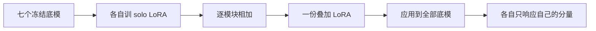
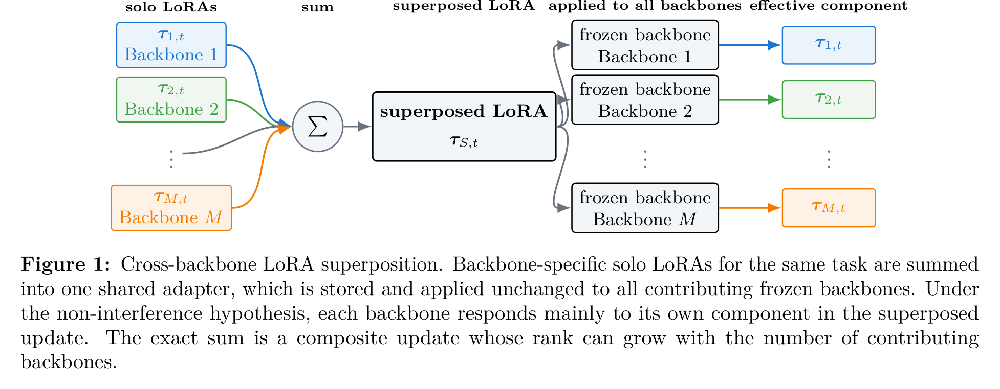
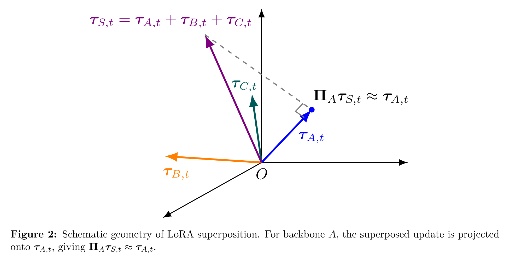
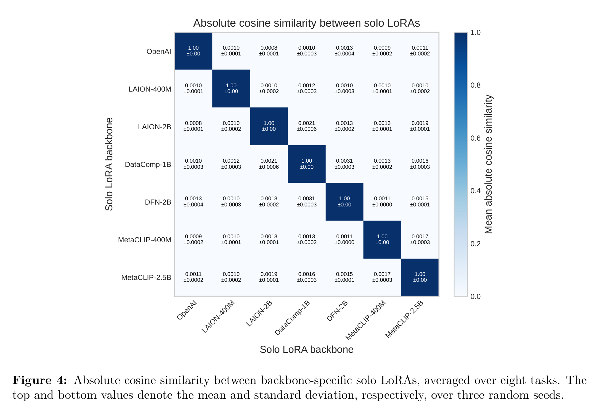
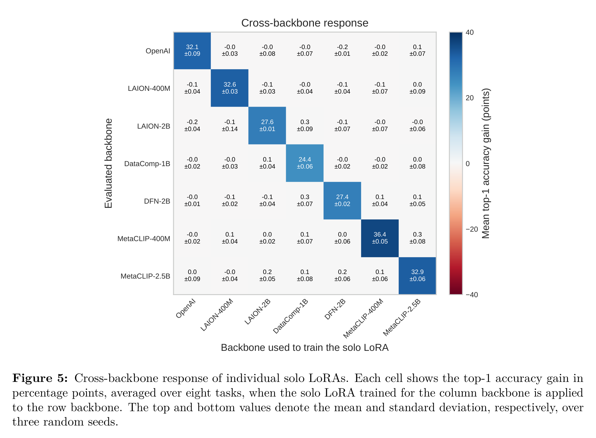

> 一句话：把七个不同底模上学到的同一任务的 LoRA 直接加起来，一份文件喂给七个模型，各自都能用。

## 0. 读之前你需要知道

**术语卡**

- **LoRA（低秩适配）**：不改原模型，只在旁边加一小块可训练的低秩矩阵，用来学新任务。生活类比：不改房子的结构，只在墙上贴一层薄薄的壁纸。
- **backbone（骨干/底模）**：那个被冻结的大模型。这里指七个架构相同、预训练数据不同的 CLIP 图像编码器。
- **solo LoRA**：在单个底模上单独训出来的 LoRA。本文的核心对象。
- **task vector（任务向量）**：把微调前后的权重差当成一个方向向量，可以相加相减。生活类比：把「学会骑车」这件事写成一张位移矢量，可以叠到别的东西上。
- **参数叠加（superposition）**：多个任务的参数放进同一份权重里，靠某种选择机制取用。
- **top-1 准确率**：分类任务里，模型给出的第一名猜对了的比例。

**它站在谁肩上**

- Task Arithmetic（2022）：证明微调产生的权重差可以当向量做加减，为「LoRA 能不能加」提供了合法性。
- TIES-Merging / DARE（2023–2024）：处理多个任务向量叠加时的相互干扰，靠裁剪和随机丢弃。
- 跨模型迁移（2024–2026）：用正交对齐、参数重基、共享子空间把 A 模型上的更新搬到 B 模型上。不够的地方：每一对模型都要单独算变换，还要校准数据。

## 1. 动机

假设你有一支乐队，七个乐手各弹一把不同牌子的吉他。你想让每把吉他都学会同一首新歌，于是分别教了七遍，得到七份「指法改动说明」。现在的问题是：这七份说明能不能直接叠加成一份，交给任何一位乐手，他照着改自己的琴就能弹？

**以前怎么做**：要么给每把吉他单独存一份说明，七份文件；要么先把七把吉他调成一样的音，再共用一份说明（跨模型对齐），但调音本身要额外数据和计算。

**为什么不行**：七份文件意味着存储和分发成本随模型数线性增长；跨模型对齐意味着每加一个新底模就要重新做一次变换，而且变换是「成对」的，七把琴要算二十一对。

**为什么现在能做**：LoRA 的参数空间维度极高（本文里单模块 768×768），而每个 LoRA 只占一个低秩子空间。高维空间里随机两两几乎正交——这个几何事实以前是理论上的观察，现在有了足够多开源同架构底模（OpenCLIP 系列一次能凑七个），才第一次能在真实数据上验证「正交到可以直接相加」。

## 2. 贡献

- **提出了 LoRA 叠加这个构造**。证据：同一任务的七个 solo LoRA 逐模块相加，得到的单个 LoRA 原样应用到全部七个底模，56 个「底模×任务」组合全部比不挂 LoRA 时更好，平均 +30.21 个百分点。
- **证明叠加几乎不损失性能**。证据：叠加版平均 90.06%，单独训练的 solo 平均 90.34%，只差 0.28 个百分点。
- **给出了「组件互不干扰」的证据链**。证据：参数空间余弦相似度（跨底模平均绝对值 1.34×10⁻³）、成对响应矩阵（对角占优）、以及留一模型（LOMO）对照（只比原始底模高 0.06 个百分点）。

## 3. 创新点

- **新在哪**：不做事前对齐、不做路由、不加模型标识，直接把不同底模的 LoRA 相加。对比对象：跨模型迁移（需要成对变换）、参数叠加（需要 context 向量或 mask）、LoRA 合并（假设共享同一底模）。有用是因为：部署时只存一份文件，新底模加入时只要训它自己的 solo LoRA 再累加，历史组件不用重训。
- **新在哪**：把「谁能选中谁」这个问题交给冻结的底模本身。对比对象：SupSup 的 mask、PSP 的 context。有用是因为：省掉了选择器的训练和推理开销。
- **新在哪**：用 LOMO（把目标底模自己的分量剔除）做证伪实验。对比对象：只报「叠加后性能不掉」的常规做法。有用是因为：如果叠加有效是因为「这七个 LoRA 其实学到了同一个通用方向」，那剔除自己的分量后应该照样有效；实测 LOMO 只有 +0.06 个点，说明确实是各管各的。

## 4. 方法

### 4.1 整体流程

一句话解释：先把七份说明分别写出来，再把它们叠印成一张纸，最后每个乐手拿同一张纸，只看自己那一段。

### 4.2 模块拆解

**构造：逐模块求和**

为什么需要：LoRA 是分模块存的（每层每个投影一个矩阵对），合并必须在模块级别对齐，不能把整份参数拍平了乱加。

怎么做：把每个 solo LoRA 的**有效更新** $\Delta W = BA$ 算出来（而不是存 $A$ 和 $B$ 两个因子），逐模块相加，得到一份新的、秩可能更高的更新。

$$
\Delta W_{S,t,j} = \sum_{m \in S} \Delta W_{m,t,j}, \qquad \Delta W_{m,t,j} = B_{m,t,j}A_{m,t,j}
$$

先说这个公式在算什么：把集合 $S$ 里所有底模在模块 $j$ 上的更新加起来，得到叠加后的模块更新。

- $S$：参与叠加的底模集合，本文 $|S| = 7$。
- $t$：任务下标，八个数据集之一。
- $j$：模块下标，本文是 12 层里的 Q、V 投影，共 24 个。
- $B_{m,t,j}, A_{m,t,j}$：第 $m$ 个底模上训出来的 LoRA 两个低秩因子，缩放系数已经吸收进 $B$。
- 为什么用 $BA$ 而不是因子本身：$BA$ 唯一，$A$、$B$ 的分解不唯一，直接加因子没有意义。

**秩的增长**

为什么需要：说明叠加不是「免费的」——文件大小虽然不变，但更新的秩会随底模数量涨。

$$
\mathrm{rank}\Big(\sum_{m\in S}\Delta W_{m,t,j}\Big) \le \sum_{m\in S}\mathrm{rank}(\Delta W_{m,t,j}) \le K r
$$

先说这个公式在算什么：叠加矩阵的秩最多是各分量秩之和。

- $K = |S|$：参与叠加的底模数。
- $r$：单个 solo LoRA 的秩，本文 $r=16$。
- 本文 $K=7$、$r=16$，所以上界是 112。存储维度不变（还是 768×768），但表达容量变大了——这也是后面和「联合训练一个秩 16 的共享 LoRA」比较时要说清的前提。

**互不干扰假设**

为什么需要：解释「为什么一份叠加 LoRA 在七个底模上都能用」这件事。

怎么做：假设每个冻结底模相当于一个隐式投影 $\Pi_i$，它只保留跟自己有效方向对齐的部分，其余投影掉。

$$
\Pi_i\,\tau_{S,t} = \sum_{m\in S}\Pi_i\,\tau_{m,t} \approx \tau_{i,t}, \qquad \Pi_i\,\tau_{m,t} \approx \mathbf{0}\ (m \neq i)
$$

先说这个公式在算什么：底模 $i$ 看叠加更新时，相当于自动筛出属于自己的那一份。

- $\tau_{S,t}$：叠加后的整体更新向量（把所有模块的 $\Delta W$ 向量化拼起来）。
- $\tau_{i,t}$：底模 $i$ 自己的 solo LoRA 向量。
- $\Pi_i$：概念上的投影算子，**方法里并不真的计算它**，只是用来描述底模的响应方式。

这个假设给出两个可测预言：底模 $i$ 挂别人的 LoRA 几乎没提升；挂叠加 LoRA 的效果约等于挂自己的 solo LoRA。

**余弦相似度**

为什么需要：先用参数空间的几何给「近似正交」一个数字。

$$
\cos(\tau_{i,t}, \tau_{m,t}) = \frac{\tau_{i,t}^{\top}\tau_{m,t}}{\lVert\tau_{i,t}\rVert_2\,\lVert\tau_{m,t}\rVert_2}
$$

先说这个公式在算什么：两个 LoRA 更新向量夹角的余弦，0 表示正交、1 表示同向。

- $\tau_{i,t}$、$\tau_{m,t}$：两个不同底模在同一任务上的 solo LoRA 向量。
- 实测跨底模平均绝对值 1.34×10⁻³；作为参照，两个独立各向同性高斯向量在 $D = 24\times768^2$ 维里的期望绝对值约 $\sqrt{2/(\pi D)} = 2.12\times10^{-4}$；而同一底模换随机种子重训的相似度是 0.424。

### 4.3 关键细节

- LoRA 只挂在 12 个注意力块的 Q、V 投影上，共 24 个模块，秩 $r=16$，$\alpha=32$（缩放 $\alpha/r$）。
- 训练：AdamW，学习率 10⁻⁵，权重衰减 0.1，batch 64，约 2,000 步。分类头用冻结的文本编码器做提示集成固定下来，不参与训练。
- 数据划分沿用 Task Arithmetic 的设置，验证集不用于调参或早停——这一条很重要，否则「叠加不用额外数据」的说法会打折扣。
- 对照组 Joint shared：七个底模共享一个秩 16 的 LoRA，每步把七份损失的等权平均反传一次。

## 5. 实验结果

**实验设置**

- 数据集与切分：八个图像分类数据集（Cars、DTD、EuroSAT、GTSRB、MNIST、RESISC45、SUN397、SVHN），划分沿用 Task Arithmetic；验证集不参与任何选择。
- 骨干模型：七个 ViT-B/16 CLIP 底模（OpenAI、LAION-400M、LAION-2B、DataComp-1B、DFN-2B、MetaCLIP-400M、MetaCLIP-2.5B），架构相同、预训练数据不同。
- 训练预算：每个「底模×任务」一个 solo LoRA，约 2,000 步，batch 64；Joint shared 也是约 2,000 步联合优化。卡型号与总 GPU 时原文未给。
- 基线：Backbone（不挂 LoRA）、Solo（各自的 LoRA）、Joint shared（联合训一个共享 LoRA）、LOMO sum（剔除自己分量的叠加，作为证伪对照）。
- 指标：top-1 准确率，三个随机种子取均值与标准差；底模本身不训练，无标准差。
- 推理设置：标准 OpenCLIP 的预处理与评测流程，无额外校准数据、无模型标识。

| 数据集 / 任务 | 指标 | 本文 Exact sum | 最强基线 Solo | 差距 |
| --- | --- | --- | --- | --- |
| 八数据集平均 | top-1 | 90.06% | 90.34% | −0.28 个点 |
| 八数据集平均 | top-1 | 90.06% | Joint shared 89.34% | +0.72 个点 |
| 八数据集平均 | top-1 | 90.06% | Backbone 59.85% | +30.21 个点 |
| 八数据集平均 | top-1 | 90.06% | LOMO 59.91% | +30.15 个点 |
| 单数据集 GTSRB | top-1 | 95.91% | Solo 96.22% | −0.31 个点 |
| 单数据集 SUN397 | top-1 | 78.54% | Solo 79.30% | −0.76 个点 |

**原文实验图**

图 1：构造示意。七个底模各自训出 $\tau_1$ 到 $\tau_7$，逐模块相加成 $\tau_S$，同一份更新原样贴回每一个冻结底模；虚线框表示每个底模实际「读到」的是自己那一段。

图 2：几何直觉。三个底模的更新向量在参数空间里近似正交，叠加向量是被投影回各自方向上的。

图 4：跨底模余弦相似度的热力图，八个任务取平均。对角线是同一个底模内部的相似度（换种子重训），明显亮；非对角几乎全黑，对应 1.34×10⁻³ 这个量级，跟随机高斯向量的 2.12×10⁻⁴ 只差一个数量级。这张图是「近似正交」这个说法最直接的证据。

图 5：成对响应矩阵。行是「挂谁的 LoRA」，列是「在哪个底模上测」，颜色是相对不挂 LoRA 的准确率增益。亮色集中在对角线上，非对角接近零——A 的 LoRA 贴到 B 上几乎没用，这正是式 (8) 的预言。

**消融告诉我们什么**

- LOMO 是这篇文章最关键的对照：把目标底模自己的分量剔掉、只留另外六份，平均只比原始底模高 0.06 个百分点。如果叠加之所以有效是因为七个 LoRA 学到了同一个「模型无关方向」，LOMO 也该有效；它没有，说明效应确实是「各认各的」。
- Joint shared 拿到 89.34%，比 Exact sum 低 0.72 个点但远高于 Backbone，说明「一个更新能给多个底模用」这件事本身成立，只是没叠加那么准。作者提醒这两个比较不对等：Joint shared 秩 16，Exact sum 秩上限 112。
- 单数据集上看，EuroSAT、MNIST 这类简单任务上叠加几乎追平 Solo（98.49 vs 98.55、99.03 vs 99.09），SUN397 和 DTD 这种细粒度任务差得多一些（−0.76、−0.65）。

**这些实验够不够支撑结论**

「同架构不同预训练权重的 LoRA 可以相加」这一条，七底模×八任务的网格加两组独立证据（余弦、成对响应）够扎实。不足在于全部落在 CLIP ViT-B/16 + 图像分类这一个格子里：换架构（比如 LLM 的 LoRA）、换模态、换任务类型都还没验证；另外 $\Pi_i$ 始终是概念工具，没有直接测量底模的「投影」到底长什么样。

## 6. 局限性

**作者自己承认的**

- 近正交本身不足以解释功能上的互不干扰：Joint shared 也能跨底模工作，说明低相似度不是全部原因，真正的机制还没解开。
- 叠加 LoRA 的秩随底模数线性增长，和秩 16 的方法比较时不是等容量比较。
- 只在同架构、同任务的闭集设定下工作；目录里没有的底模（$i \notin S$）应当退化成原始性能，但只作为对照提了一句。

**我看出来的**

- 隐形假设：七个底模共享同一个图像编码器架构和同一个文本侧分类头。如果底模的 tokenizer 或输出空间不同（LLM 场景），「相加」这件事在语义上就不成立了。
- 边界条件：$K$ 变大时秩上界 $Kr$ 会逼近满秩，叠加慢慢退化成「一个大更新」，互不干扰的前提可能失效；论文只做到 $K=7$。
- 缺的对比：没有和「先把 LoRA 用 TIES/DARE 裁剪再相加」比。既然 TIES 就是为减少干扰设计的，不比一下说不清「直接加」到底赢在哪。
- 一个可疑之处：Solo 的 90.34% 是七个底模各自最优的结果，Exact sum 的 90.06% 是同一份更新在七个底模上的平均；这两个数字的可比性依赖「每个底模都恰好被自己那份更新照顾到」，而图 5 的非对角并不严格为零。

## 7. 一句话总结

七个人各自记了一份笔记，把七份笔记叠印到一张纸上，每个人翻开时眼睛只会盯住自己写的那几行。

核心公式：

$$
\boxed{\ \Delta W_{S,t,j} = \sum_{m \in S} B_{m,t,j}A_{m,t,j},\quad \text{同一份}\ \Delta W_{S,t}\ \text{原样用于所有}\ m \in S\ }
$$

## 8. 可复用点

- 如果我要在自己的项目里用：多底模部署时，别再为每个底模存一份适配器；先各自训 solo LoRA，再用 `merge_and_unload` 之外的手工逐模块相加（一定要用 $BA$ 的有效更新，不要加因子）。
- 排查「叠加后掉点」时先看：是不是把缩放系数 $\alpha/r$ 重复应用了；以及是不是在有 BN/统计量的层上做了加法。
- 评估时先查：一定要做 LOMO 对照。只报「叠加有效」很容易把「大家学到了同一个通用方向」误判成「组件互不干扰」。

## 9. 我的疑问

- 如果把 $K$ 加到 20 个底模，秩上界逼近满秩，非对角响应会不会开始抬头？论文没做规模扫描。
- 图 5 的非对角虽小但不为零，这些残余响应是来自底模之间的共享表征，还是来自训练时的随机性？
- 换成 LLM 的 LoRA（不同 tokenizer、不同词表）时，逐模块相加在哪些层还有意义？词嵌入层和输出层大概率不能加。
