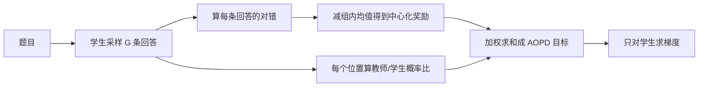
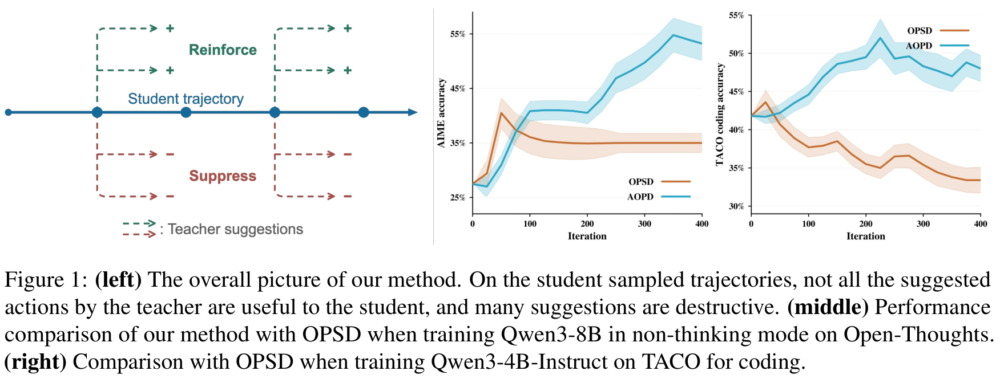
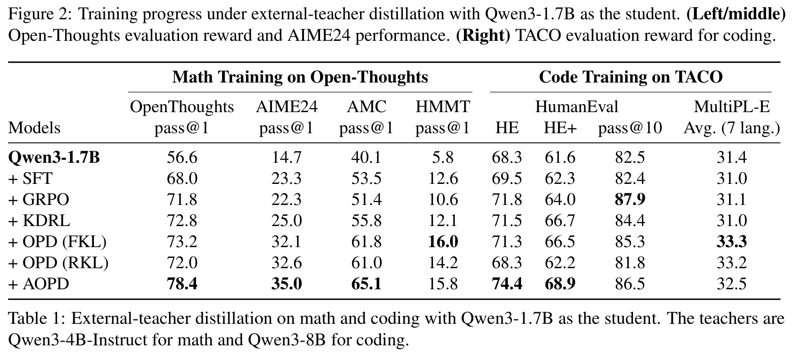
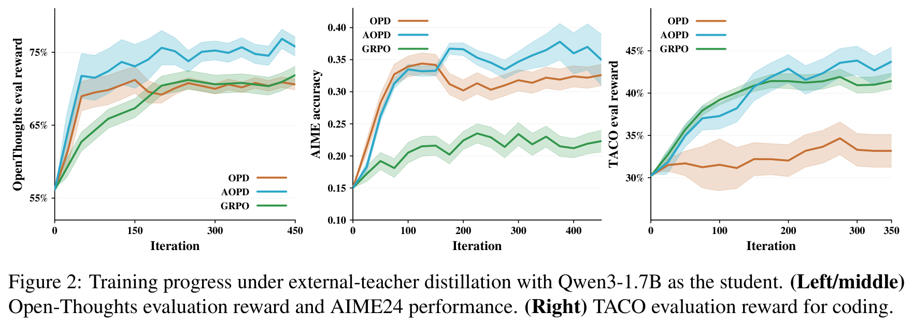
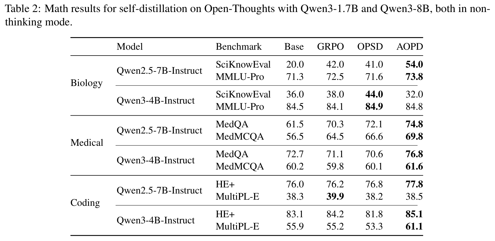
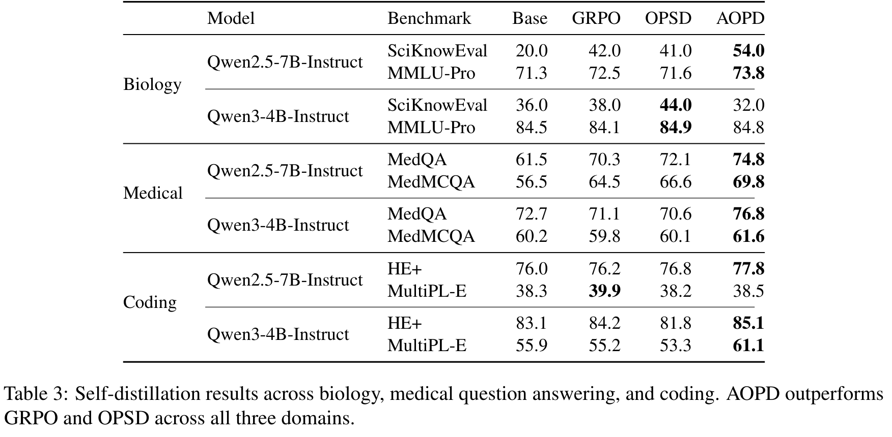
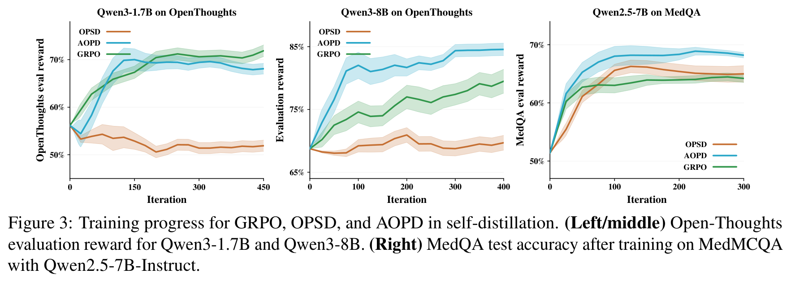
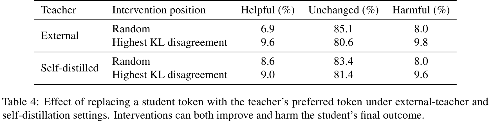

> 一句话：别让教师每句话都算数，只强化那些真能让学生做对题的教师动作。

## 0. 读之前你需要知道

**术语卡**

- **on-policy 蒸馏（OPD）**：学生自己先答，教师沿着学生走过的这条路径逐步给监督。类比：老师跟着学生做题，学生在哪卡住就在哪讲，而不是事先写好一份标准答案让学生背。
- **教师动作（teacher action）**：在某一步的上下文里，教师最想让学生说的那个词。注意它只是一个词，不是一个完整的解题思路。
- **优势（advantage）**：在这步选某个动作、之后按学生自己的水平继续做，比直接按学生自己的习惯做，期望得分高出多少。正数表示这一步是加分动作，负数表示是减分动作。类比：下棋时某个落点让胜率涨了 10%，这个 10% 就是它的优势。
- **重要性权重（importance weight）**：教师给某个词的概率除以学生给它的概率，$T(a|h)/S(a|h)$。作用是把「按学生分布采样」的期望换算成「按教师分布加权」的期望。类比：按实际抽到的样本反推另一群人的平均，需要给每个样本换个权重。
- **前向 KL 与反向 KL**：前向 KL 是让学生去覆盖教师的所有可能动作（模式覆盖），反向 KL 是让学生在教师爱出的动作上集中（模式寻找）。这篇的出发点是前向 KL 目标。
- **OPSD（on-policy self-distillation）**：没有外部教师，把学生自己「偷看标准答案的版本」当教师。

**它站在谁肩上**

- **on-policy 蒸馏（2024）**：解决了离线蒸馏的分布错配问题，但监督是均匀铺满整条轨迹的，不区分哪一步有用。
- **OPSD（2026）**：把教师换成带特权信息的学生自己，成本更低，但同样不做筛选。
- **GRPO（2024）**：只看终端奖励的强化学习，信号稀疏但诚实；这篇想把它和蒸馏的稠密信号接起来。

## 1. 动机

想象你请了一位奥数金牌选手陪练。他站在旁边，你每写一步他都说该怎么写。问题是：他的写法适合他，不一定适合你。有些地方他会用一个你根本推不下去的引理，你照着写，后面全崩。有些地方你本来能算对，他非要你换成他的解法，反而错了。

这就是 on-policy 蒸馏的现状：学生自己走出一条轨迹，教师在每一个位置都要求「我这里会这么说」，然后全体加权。默认假设是**教师的偏好等于学生的收益**，可这两件事不是一回事。

**以前怎么做**：让监督更挑剔一点。有人用教师的熵当不确定度，熵高就少听；有人看教师给的动作在学生分布下有多不可能；有人用额外的奖励模型给教师动作打分；还有人干脆多跑几次「如果教师在这里插手会怎样」的对照实验。

**为什么不行**：这些办法都在找代理信号——熵、似然、外挂模型、额外 rollout。它们能筛掉一部分坏建议，但没有直接问一个更本质的问题：**这个教师动作，究竟让这位学生最后做对的概率变高还是变低**。而且这篇给了一个让人不舒服的结论：即便是更强的教师，前向 KL 蒸馏也可能把学生的奖励降低，理论上不保证提升。

**为什么现在能做**：作者证明，这个「反事实优势」不需要真的去跑反事实轨迹。用学生自己的线聊轨迹、加上教师与学生的概率比，就能得到这个优势的无偏估计。所以额外成本几乎为零——和标准 on-policy 蒸馏一样，只跑一批学生样本。

## 2. 贡献

- **提出 AOPD 这个目标**：把教师动作按它在当前学生下的优势加权，正优势强化、负优势压制，而不是一视同仁。证据：第 3 节给出目标函数，并证明它和「按学生收益筛选」一致。
- **给出只用学生 rollout 的无偏估计**：只用一个终端奖励加重要性权重，就能估出上面那个带反事实的目标，不需要额外轨迹、不需要价值函数、不需要过程奖励模型。证据：Lemma 3.1 与 Algorithm 1。
- **给了奖励提升的理论保证**：在 KL 邻近的单步更新下，AOPD 严格提升期望奖励；并给出反例说明「OPD + RL 目标」这种简单拼接并不保证提升。证据：第 5 节定理与两状态反例。
- **实验上在四个领域验证**：数学、代码、生物、医学问答，外部教师和自蒸馏两种设定下都优于 OPD / OPSD / GRPO。证据：表 1 至表 3。
- **做了一个很有说服力的干预实验**：直接把学生的某个词替换成教师最想说的词，结果**帮了 9.6%、害了 9.8%**——坏建议和好建议一样多。证据：表 4。

## 3. 创新点

- **新在哪**：把「权重」从常数换成当前学生下的优势。对比对象是标准 on-policy 蒸馏（所有位置等权）。有用是因为：同一个教师动作对不同水平的学生价值不同，优势天然带这个条件。
- **新在哪**：反事实优势用重要性采样估计，不加任何 rollout。对比对象是需要干预实验或外挂奖励模型的筛选方法。有用是因为：成本从「多跑几倍轨迹」降到「零」。
- **新在哪**：把「何时该听教师」变成一个有理论保证的优化问题，并证明朴素拼接不成立。对比对象是经验性的筛选启发式。有用是因为：它解释了为什么有些方法在某些模型上有效、换个模型就失效。
- **新在哪**：中心化奖励用组内留一均值做基线，和 GRPO 同源但作用在 token 级的教师监督上。有用是因为：去掉了「这道题本身难不难」这个公共项，只留相对好坏。

## 4. 方法

### 4.1 整体流程

一句话解释：学生先自己作答，答完看对错，再用「教师多想要这个词」当权重、用「这道题相对其他题答得好不好」当系数，去调整学生每个词的概率。

图 1：左图是全文的直觉——同一条学生轨迹上，教师的建议有的加号（该强化）有的减号（该压制），而标准蒸馏把它们一视同仁。中图、右图是自蒸馏场景下与 OPSD 的对照：Qwen3-8B 在 Open-Thoughts 上、Qwen3-4B-Instruct 在 TACO 上，AOPD 的曲线都明显更高更稳。

### 4.2 模块拆解

#### 4.2.1 起点：前向 KL 目标

**为什么需要**：先说清标准做法错在哪。

前向 KL 蒸馏在等价变形后，是一个只关于学生参数的极大化目标：

$$
J_{\mathrm{FKL}}(\theta) = \mathbb{E}_{x,\,y\sim S(\cdot|x)}\left[\frac{1}{H}\sum_{t=0}^{H-1}\mathbb{E}_{a\sim T(\cdot|h_t)}\big[\log S_\theta(a\mid h_t)\big]\right]
$$

先说这个公式在算什么：在学生的轨迹上，让教师爱说的词被学生说得更可能。

- $S$：冻结的采样策略，也就是当前的学生
- $S_\theta$：正在更新的学生
- $T$：教师
- $h_t$：到第 $t$ 步为止的上下文
- $a$：词表里的一个 token
- $H$：回答长度

问题就藏在这一行里：每个教师动作的系数都是 1，不管它对这个学生是好是坏。

#### 4.2.2 目标：按优势加权

**为什么需要**：把系数从 1 换成「这一步值多少钱」。

先定义标准的价值与优势：

$$
Q_S(h_t,a) = \mathbb{E}_{y_{>t}\sim S(\cdot\mid h_t a)}\big[R(x, y_{<t}ay_{>t})\big],\quad A_S(h_t,a) = Q_S(h_t,a) - V_S(h_t)
$$

- $Q_S(h_t,a)$：这一步说 $a$，之后完全按学生自己的水平接着写，期望能拿多少分
- $V_S(h_t)$：不看具体动作、按学生自己的分布走，期望多少分
- $A_S$：两者之差，就是「这一步相对于学生的平均水平，是帮忙还是拖后腿」

于是目标变成：

$$
J_{\mathrm{AOPD}}(\theta) = \mathbb{E}_{x,\,y\sim S(\cdot|x)}\left[\frac{1}{H}\sum_{t=0}^{H-1}\mathbb{E}_{a\sim T(\cdot|h_t)}\big[A_S(h_t,a)\log S_\theta(a\mid h_t)\big]\right]
$$

对比一下就清楚了：系数从 1 变成 $A_S$，别的没动。正优势的教师动作被推上去，负优势的被压下去。

#### 4.2.3 关键：怎么不跑反事实就把优势估出来

**为什么需要**：直接算 $Q_S$ 要在每一步强行换成教师动作再继续生成，成本爆炸。

**怎么做**：只用学生自己采的一条轨迹 $y_S$ 和它的终端奖励 $R_S$。每个位置令 $a_t = y_S^t$（学生实际说的词），并设

$$
w_t = \frac{T(a_t\mid h_t)}{S(a_t\mid h_t)}
$$

这个比值把「按学生分布求期望」换算成「按教师分布加权求期望」。再把奖励中心化：$\tilde R_S = R_S - b$，其中 $b$ 是同一道题其余 $G-1$ 条回答的平均分（留一均值）。

$$
\hat J_{\mathrm{AOPD}}(\theta) = \frac{\tilde R_S}{H}\sum_{t=0}^{H-1}\Big[w_t \log S_\theta(a_t\mid h_t) - \mathbb{E}_{a\sim T}\big[\log S_\theta(a\mid h_t)\big]\Big]
$$

先说这个公式在算什么：括号里两项分别是「学生真的说了这个词」和「教师本来可能说别的词」，两者的差就是优势的估计；外面乘上这道题答得比同组好多少。

- $\tilde R_S$：中心化后的奖励，正数表示这题答得比同组平均好
- $w_t$：教师对这个词有多偏好（相对学生），大于 1 说明教师更想说它
- 第一项：强化学生走过的这条成功路径，教师越认可强化得越狠
- 第二项：压制教师的其他可能动作，因为学生已经走通了
- $\tilde R_S < 0$ 时两项同时反号：压制失败路径，反而去抬高教师的替代动作

**为什么这是无偏的**：Lemma 3.1 说明括号里两项分别估的是 $Q_S - b$ 与 $V_S - b$，相减正好是优势。前提是「教师认为可能的词，学生也认为可能」，即支撑集包含。

#### 4.2.4 截断

**为什么需要**：极少数 token 的概率比会非常大，一条样本就能主导整个梯度。

$$
\tilde w_t = \min\left(\frac{T(a_t\mid h_t)}{S(a_t\mid h_t)},\; c\right),\qquad c = 4
$$

同时对第二项里的教师概率做同口径截断 $\tilde T(a\mid h) = \min\{T(a\mid h),\, cS(a\mid h)\}$，且不重新归一化。作者证明（Corollary 5.3）两边同截断仍保持优势加权形式与提升保证。

#### 4.2.5 为什么要关掉 top-p / top-k

重要性采样要求分母不为零。如果采样时用了 top-p 或 top-k，学生永远说不出的词就无法被估到，估计会有偏。所以 AOPD 的训练采样直接关掉这两个截断，只留温度。

### 4.3 关键细节

- 组大小 $G = 4$（OPD 与 AOPD），GRPO / KDRL 用 $G = 8$；作者说再大对 AOPD 收益很小
- LoRA：$r = 64$，$\alpha = 128$，所有方法同一套，保证对比公平
- 温度：AOPD 用 0.8；OPD / OPSD 按原论文用 1.1 + top-p 0.95 + top-k 20
- 学习率 $2\times10^{-5}$（Qwen3 数学与代码主实验）
- 训练长度：数学 8,192 token，评测 16,192；医学 2,048；生物与代码 4,096
- 迭代：Open-Thoughts 450 步，TACO 350 步，自蒸馏数学 400 步

## 5. 实验结果

**实验设置**

- **数据集与切分**：数学用 Open-Thoughts 训练，评测留出的 Open-Thoughts 题、AIME24、AIMO-Validation-AMC、HMMT；代码用 TACO 的 verified 子集训练，评测 HumanEval / HumanEval+ / MultiPL-E；生物用 SciKnowEval 训练，评测 50 道留出题与 MMLU-Pro 生物子集；医学用 MedMCQA 训练，评测留出 MedMCQA 与 MedQA
- **骨干模型**：外部教师设定下学生是 Qwen3-1.7B，数学教师 Qwen3-4B-Instruct、代码教师 Qwen3-8B；自蒸馏用 Qwen3-1.7B 与 Qwen3-8B（数学），Qwen2.5-7B-Instruct 与 Qwen3-4B-Instruct（生物 / 医学 / 代码）。Qwen3 全部用非思考模式
- **训练预算**：原文未给 GPU 数量与总卡时。给出的是迭代步数、batch 32、LoRA 配置
- **基线**：SFT、OPD 的前向 KL 与反向 KL 两个版本、GRPO、KDRL（OPD + GRPO 拼接）；自蒸馏对比 OPSD 与 GRPO。所有方法迭代数、batch、LoRA 一致
- **指标**：pass@1 为主，代码另报 HumanEval pass@10 与 MultiPL-E 七语言平均；医学与生物报准确率
- **推理设置**：数学训练上限 8,192、评测 16,192 token；代码评测与训练同口径；AOPD 采样温度 0.8 且无 top-p/top-k，OPD 为 1.1 / 0.95 / 20

**主表**（外部教师，学生 Qwen3-1.7B）

| 数据集 / 任务 | 指标 | 本文 | 最强基线 | 提升 |
| --- | --- | --- | --- | --- |
| Open-Thoughts（留出） | pass@1 | **78.4** | 73.2（OPD-FKL） | +5.2 |
| AIME24 | pass@1 | **35.0** | 32.6（OPD-RKL） | +2.4 |
| AMC | pass@1 | **65.1** | 61.8（OPD-FKL） | +3.3 |
| HMMT | pass@1 | 15.8 | 16.0（OPD-FKL） | −0.2 |
| HumanEval | pass@1 | **74.4** | 71.8（GRPO） | +2.6 |
| HumanEval+ | pass@1 | **68.9** | 66.7（KDRL） | +2.2 |
| MultiPL-E（7 语言） | pass@1 | 32.5 | 33.3（OPD-FKL） | −0.8 |

表 1：数学三项领先，代码的 HumanEval 两项领先，但 HMMT 与 MultiPL-E 输了。这说明它不是一个稳赢的方法，而是「在多数基准上更好、个别基准会被专门的强基线压过」。

图 2：训练曲线。左边 Open-Thoughts 上 OPD 快速上升后平台，GRPO 起步慢，AOPD 起步快并且到 450 步还在涨——作者把它归因于权重会随学生变强而动态调整。右边 TACO 上这个差别最明显：OPD 的训练奖励几乎不动，AOPD 一路在 GRPO 之上。

**自蒸馏主表**

| 模型 / 基准 | 指标 | 本文 | 最强基线 | 提升 |
| --- | --- | --- | --- | --- |
| Qwen3-1.7B / AIME24 | pass@1 | **35.0** | 22.3（GRPO） | +12.7 |
| Qwen3-1.7B / AMC | pass@1 | **61.4** | 51.4（GRPO） | +10.0 |
| Qwen3-1.7B / Open-Thoughts | pass@1 | 70.2 | 71.8（GRPO） | −1.6 |
| Qwen3-8B / AIME24 | pass@1 | **52.1** | 41.7（OPSD） | +10.4 |
| Qwen3-8B / Open-Thoughts | pass@1 | **84.6** | 78.5（GRPO） | +6.1 |

表 2：自蒸馏上差距最夸张。1.7B 上 OPSD 几乎学不动（AIME24 只有 15.6），AOPD 却到 35.0。有意思的是 1.7B 的 Open-Thoughts 留出集上 AOPD 比 GRPO 低 1.6 分——训练奖励差不多，基准分数领先，作者没有专门解释这处不一致。

**跨领域**

表 3：生物、医学、代码三块。大多数格子 AOPD 最高，但有两处要诚实指出：Qwen3-4B 在 SciKnowEval 上 AOPD 只有 32.0，低于 OPSD 的 44.0、甚至低于底座的 36.0；Qwen2.5-7B 在 MultiPL-E 上 38.5，低于 GRPO 的 39.9。作者的措辞是「三个领域整体更好」，没有讨论这两处反向结果。

图 3：自蒸馏的训练曲线。1.7B 上 OPSD 基本贴着底座不动，AOPD 稳定爬升；8B 上 OPSD 有改善但 AOPD 更高；右图 MedQA 上 AOPD 的曲线在中段之后明显拉开。

**消融：教师动作真的有用吗**

表 4：单 token 干预实验。把学生的某个词换成教师最想说的词，然后让学生自己写完。挑「教师与学生分歧最大」的位置时，帮到忙的是 9.6%、搞坏的是 9.8%——好坏几乎各半。随机位置上是 6.9% 帮、8.0% 害。还有一条反直觉的发现：自蒸馏的教师（更小的模型 + 特权信息）在随机位置上比外部大模型教师更有用（8.6% 对 6.9%）。

**消融告诉我们什么**

这张表是全文最有力的证据，它直接否掉了「教师总是对的」这个默认假设。也就是说，标准 on-policy 蒸馏有一半的监督在帮倒忙，而它无法区分。

**这些实验够不够支撑结论**

支撑得比较扎实：四个领域、两种教师形态、多个模型尺寸，主表和曲线互相印证，还有干预实验直接验证动机。

要打折扣的地方有三处：第一，方法在某些格子上输给基线（HMMT、MultiPL-E、SciKnowEval 的 4B），论文没有解释这些反向结果，只说「整体更好」；第二，训练成本没有报，只说迭代步数，读者无法判断 AOPD 每步的开销是否和 OPD 相同（理论上要多算一次教师概率，但本来就要求算）；第三，理论部分只覆盖单步 KL 邻近更新，和实际训练几百步之间的差距没有量化。

## 6. 局限性

**作者自己承认的**

- 这是一个单步分析的保证，不覆盖整个训练过程
- 需要能取到教师概率，因此要求词表共享

**我看出来的**

- **隐形假设**：优势的估计依赖「教师的支撑集被学生覆盖」$T(a|h) > 0 \Rightarrow S(a|h) > 0$。这要求训练采样关掉 top-p/top-k，于是**训练时的采样行为和部署时不一致**，学生学到的最优策略是针对一种没人会用的采样方式。
- **边界条件**：方法假设终端奖励可靠。代码任务用的是五个测试用例的部分奖励，这类不完备奖励下的优势估计会把「碰巧过测试」当成好动作。论文在代码上正是这么做的。
- **单条轨迹估优势方差很大**：虽然留一基线压掉了一部分，但整条轨迹只有一个奖励，长回答里每个 token 共享同一个系数，等于默认「这题答对了，每个词都对」。这个近似在长推理里很粗。
- **缺的对比**：没有和「同样是 token 级加权、但用过程奖励模型」的方法比，而过程奖励恰恰是解决上面那个粗粒度的另一条路。

## 7. 一句话总结

教师不该是复读机，而是一个要看人下菜碟的顾问：对当前这位学生真有帮助的建议才强化，其余的一律压下去。

核心公式：

$$
\boxed{\;\hat J_{\mathrm{AOPD}}(\theta) = \frac{\tilde R_S}{H}\sum_{t=0}^{H-1}\Big[\tilde w_t \log S_\theta(a_t\mid h_t) - \sum_{a}\tilde T(a\mid h_t)\log S_\theta(a\mid h_t)\Big]\;}
$$

## 8. 可复用点

- **想给任何稠密监督加「值不值」的权重**：把常数系数换成 $\tilde R \cdot w$ 的形式就行，不需要额外模型。关键是找到能把学生期望换成目标期望的那个比值。
- **小模型蒸馏效果差时先试这个**：1.7B 上 OPSD 几乎学不动，AOPD 把 AIME24 从 15.6 拉到 35.0。当教师和学生水平差距大时，均匀监督的坏处会被放大。
- **上线前先做一次单 token 干预**：随便挑几百条轨迹，把某个位置的词换成教师的首选，看最终对错有没有变。如果「帮」和「害」接近一半，就别再用均匀蒸馏。
- **组内基线用留一均值**：不需要 critic，不需要价值网络，一行代码就能把难度差异消掉。
- **重要性权重一定要截断**，$c=4$ 是个稳妥起点，否则极少数 token 会主导梯度。

## 9. 我的疑问

- 关掉 top-p/top-k 训练、开回来推理，这个不一致在多大程度上影响实际效果？论文没有做这个对照。
- 为什么自蒸馏里更小的教师反而在随机位置更好用（8.6% vs 6.9%）？是因为特权信息带来的分布更贴近学生，还是因为大模型的偏好离学生更远？
- 表 3 里 Qwen3-4B 的 SciKnowEval 从 44.0 掉到 32.0，是训练不稳定还是方法本身在知识密集型任务上不适用？论文没有正面回应。
- 如果奖励是连续值（比如分数而非对错），$\tilde R_S$ 的尺度怎么定？论文只给了 $[0,1]$ 的二值或部分奖励。
