> 一句话：让一句话里的每个词，按它对提高分数真正出的力来分学习力度。

## 0. 读之前你需要知道

**术语卡**

- **奖励模型（reward model, RM）**：给整段回复打一个标量分的模型。生活类比：餐厅的神秘顾客，吃完只在门口贴个总分，不告诉你哪道菜好坏。
- **GRPO（Group Relative Policy Optimization）**：对同一个问题采样一组回复，用组内相对分数算优势，再摊给每个 token。生活类比：老师只批整张卷子给名次，再按名次给每道题同一个系数，不管这道题答对没答对。
- **优势（advantage）$A$**：$A=(r-\bar r)/\sigma$，这条回复的分数减组内平均再除以标准差。$A>0$ 该加强，$A<0$ 该压制。生活类比：一次考试里你比班级平均高几个标准差。
- **token 级信用分配（credit assignment）**：决定一条回复内部每个位置拿多少学习强度。生活类比：项目组拿了奖金，怎么分到每个人头上。
- **直通估计（straight-through, ST）**：前向用真实离散 token，反向假装采样可导，把梯度接到概率上。生活类比：收费站只允许整车通过，但计费器假装能按货物比例分摊过路费。

**它站在谁肩上**

- PPO 式 RLHF（Zhong et al., 2024）：把偏好对齐写成 token 级强化学习，要额外训一个价值网络估每个位置值多少。问题是价值网络难训、占显存，而且它给的是价值不是贡献。
- GRPO（Shao et al., 2024）：去掉价值网络，用组内相对分数当优势。但它把 response 级的一个数摊给所有 token，位置之间毫无区分。
- token 归因两派：RED（Li et al., 2025）用相邻前缀的 RM 分数差重新分奖励，只用分数差这个标量，不含当前策略在选什么词；P2T（Wu et al., 2026）用 RM 输入梯度估替换效应，既没和 GRPO 的采样动作方向对齐，也没处理优势符号。
- 过程奖励与价值估计（Lightman et al., 2024；Kazemnejad et al., 2024；Setlur et al., 2025）：要么要步骤级人工标注，要么要对每个位置额外续采样若干轨迹，成本高。
- 从优化目标导权重（VCORE，Gong et al., 2026；DelTA，Zhang et al., 2026a）：一个做监督微调里的梯度对齐，一个用正负优势的梯度结构调整 RL 更新，都不直接问这一步更新对奖励做了什么功。

## 1. 动机

装修队给业主交房。业主只在验收时打个总分：整体不错，85 分。工钱按人头平摊。

问题是这 85 分背后，有人把墙刷得笔直，有人在承重墙上开了个洞。开洞那个动作不但没加分，还在扣分。但工钱一样，下次他还敢开洞。

GRPO 现在就是这个业主。它对同一个问题采样一组回复，用组内相对分数算出这条回复的优势 $A$，再把 $A$ 乘到回复里**每一个 token** 的策略梯度上。$A>0$ 整体加强，$A<0$ 整体压制。

**以前怎么做**：共享一个 $A$。这在数学上没错——$A$ 只跟整条轨迹的回报有关，与具体 token 无关，是策略梯度的无偏估计。

**为什么不行**：无偏不等于每个位置都有益。一条 $A>0$ 的回复里，可能有一半 token 的更新方向其实在**降低**奖励：编了个不存在的年份、把热带雨林降水写成自来水、把没根据的搜索引擎名字写得理直气壮。这些位置照样拿到正的 $A$ 被加强。反过来，一条 $A<0$ 的回复里也可能有很精彩的一句，却跟着被压制。共享优势只保证沿**采样动作方向**加强或压制，不保证这一步更新在**奖励方向**上做正功。

**为什么现在能做**：三件事凑齐了。开源强奖励模型（Skywork-Reward 系列）本身可微，能做输入梯度反传；actor 和 RM 常同族同分词器，词表能逐 token 对上；一次 RM 输入反传就能拿到整条回复所有位置的梯度，不必为每个位置额外采样，实测只多 5.7%–9.1% 的 GPU 时间。

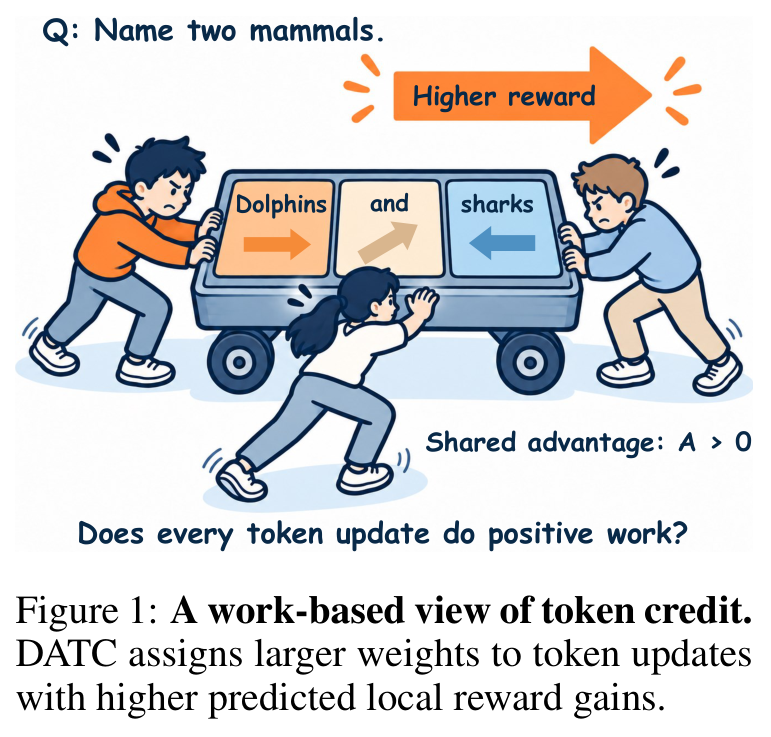

图 1：同一条回复里三个 token 各自被推向不同方向，却共享同一个 $A>0$。这张图就是全文出发点——共享优势为正，并不意味着每个位置的更新都在做正功。

## 2. 贡献

- **提出按做功方向分配 token 信用的 DATC**。证据：Qwen3-14B 与 Llama-3.1-8B 的 Base 与 Instruct 四个设置下，四项指标全部高于 GRPO。
- **给出端到端代理梯度的策略梯度分解**。证据：ST 桥接出的梯度可精确写成 $\sum_{t,b}p_t(b)\frac{C_t(b)}{\sigma}\nabla_\theta\log p_t(b)$，结构与 REINFORCE 一致，$C_t(b)/\sigma$ 是 RM 局部线性模型下候选动作的标准化优势。
- **证明方向信用是这些局部优势沿采样动作方向的聚合**。证据：$d_t=\sum_b p_t(b)\frac{C_t(b)}{\sigma}\langle\nabla\log p_t(b),\nabla\log p_t(a_t)\rangle$，即各候选动作的优势按它与采样动作的方向关系加权。
- **给出 KL 分配下的局部增益保证**。证据：式 (10) 说明最优分配相对原始 GRPO 的一阶预测增益不小于其 KL 代价，且恒非负。
- **消融证明起作用的是方向而非幅度**。证据：去掉夹角项只留模长之积，RM-Reward 从 13.35 掉到 -4.02，AlpacaEval 从 49.57% 掉到 1.53%。

## 3. 创新点

- **把信用看成做功，而不是看成价值**。对比对象：价值网络、过程奖励模型、RED 的前缀分数差。有用是因为功有**符号**——夹角过 90 度就是负功，天然能表达这一步更新在拖后腿，而价值或分数差只能说这里值多少。
- **奖励方向与更新方向放进同一个 logit 空间**。对比对象：P2T 只在 RM 输入空间归因，RED 只在分数空间差分。有用是因为只有同一坐标系内积才有意义，而 logit 空间让改概率和改奖励变成同一个线性代数问题。
- **用 ST 桥把离散采样接进可微路径**。对比对象：Gumbel-Softmax 之类连续松弛（Jang et al., 2016；Maddison et al., 2016）。有用是因为 ST 前向不改分数，只在反向给出可用梯度规则，不会因松弛而偏离真实奖励。
- **把分配写成带 KL 的凸问题，并保住优势的符号与均值**。对比对象：直接乘启发式权重、或对权重归一化。有用是因为解有闭式（softmax）、唯一最优，且 $\mathrm{sign}(\tilde A_t)=\mathrm{sign}(A)$、$\frac1T\sum_t\tilde A_t=A$——只改**分配**不改**方向**，是在 GRPO 上做增量而不是换掉 GRPO。同一套结构里再用 $\lambda$ 把温度变自适应，把多集中这件事从隐藏超参变成一个可解释旋钮（$\lambda=4$ 即单 token 最多拿 4 倍平均份额）。

## 4. 方法

### 4.1 整体流程

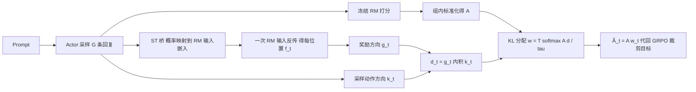

这张图的意思是：正向走一遍采样和打分拿到优势 $A$，反向走一遍 RM 拿到每个位置的奖励方向 $g_t$，再与策略自己的方向 $k_t$ 做内积得到 $d_t$，最后用带 KL 的 softmax 把 $A$ 按 $d_t$ 重新分给各位置。

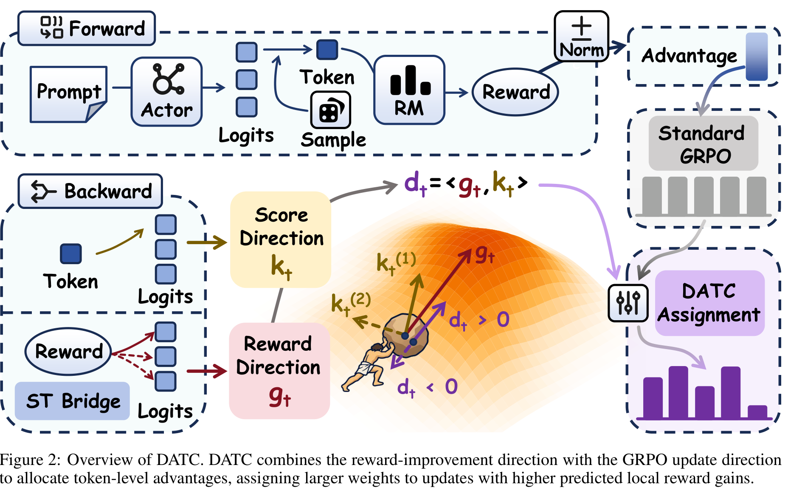

图 2：上半部分是标准 GRPO 的前向链路（采样→打分→标准化→优势→均分权重），下半部分是 DATC 加的两条支路——从 Reward 经 ST 桥反传出奖励方向 $g_t$，从 Logits 得到采样动作方向 $k_t$，二者内积成 $d_t$ 再进分配器算出非均匀权重。

### 4.2 模块拆解

**模块一：ST 桥，把离散采样接进可微路径**

为什么需要：RM 吃具体 token 的嵌入，actor 输出概率分布，从分布到采样是不可导的硬操作，梯度到这里就断了。

怎么做：前向用真实采样 token 的嵌入，反向假装采样等于按概率加权平均，于是嵌入对概率的导数就是 RM 的输入嵌入矩阵。

$$
\tilde e_t = W^\top p_t + \mathrm{sg}\left(e_t - W^\top p_t\right)
$$

先说它在算什么：造一个前向等于真值、反向等于概率分支的嵌入。

- $\tilde e_t$：第 $t$ 个位置喂给 RM 的嵌入，维度 $D$。
- $W\in\mathbb{R}^{V\times D}$：RM 的输入嵌入矩阵，$V$ 是词表大小。
- $p_t$：actor 在第 $t$ 个位置对全部候选 token 的概率向量，长度 $V$，$p_t=\mathrm{softmax}(\ell_t)$；$\ell_t$ 是 softmax 之前的原始打分，即 logits。
- $e_t$：真实采样 token 的嵌入；$\mathrm{sg}(\cdot)$ 是 stop-gradient，前向照算反向不传。

前向 $\tilde e_t=e_t$，所以 RM 打的是真实回复的真实分；反向只有 $W^\top p_t$ 这一支有梯度。

**模块二：奖励方向 $g_t$**

为什么需要：要有一个向量说明把第 $t$ 个位置的 logits 往哪改、改多快，奖励会上升。

怎么做：对负奖励损失 $\mathcal{L}_{e2e}=-R_\phi(x,\tilde E_\theta)$ 在 logit 空间求导取负，再用 GRPO 同一个 $\sigma$ 标准化。

$$
g_t=\sigma^{-1}\hat\nabla_{\ell_t}R=\sigma^{-1}\left(\frac{\partial p_t}{\partial \ell_t}\right)^\top W\nabla_{e_t}R
$$

先说它在算什么：奖励对第 $t$ 个位置 logits 的标准化梯度，指向奖励上升最快的方向。

- $R$：RM 给的原始分数。
- $\hat\nabla$：按式 (2) 的 ST 规则取的代理导数，不是真的对离散采样求导。
- $\sigma$：GRPO 的组内奖励标准差，作用是让 $g_t$ 与优势 $A$ 同一刻度。
- $\partial p_t/\partial\ell_t$：softmax 雅可比 $\mathrm{diag}(p_t)-p_tp_t^\top$，维度 $V\times V$。
- $W\nabla_{e_t}R$：把输入梯度投影到词表每一行的系数，长度 $V$，论文记作 $v_t$。

**模块三：采样动作方向 $k_t$**

为什么需要：GRPO 只通过采样 token 的对数概率改策略，所以力的方向由策略自己的打分函数给出。

$$
k_t=\nabla_{\ell_t}\log p_t(a_t),\qquad k_t(b)=\mathbb{1}\{b=a_t\}-p_t(b)
$$

先说它在算什么：让采样到的那个词概率变大，logits 该怎么改。

- $a_t$：第 $t$ 个位置实际采到的 token。
- $\mathbb{1}\{\cdot\}$：指示函数，采样词那一位取 1、其余 0。
- $p_t(b)$：候选词 $b$ 的当前概率。

这个式子很说明问题：$k_t$ 在采样词上是 $1-p_t(a_t)$，在别的词上是 $-p_t(b)$。提高采样词概率等于同时压低所有竞争者，**竞争关系**被写进了方向里。

**模块四：方向信用 $d_t$ 与预测增量**

为什么需要：力有了、位移方向有了，做功就是内积。

怎么做：把 GRPO 在独立 logit 坐标下的一步 $\delta\ell_t=\eta Ak_t/T$ 代进一阶展开。

$$
d_t=\langle g_t,k_t\rangle,\qquad
\Delta(\widehat{R/\sigma}):=\sum_t g_t^\top\delta\ell_t=\frac{\eta}{T}\sum_t A\underbrace{g_t^\top k_t}_{d_t}
$$

先说它在算什么：这一步更新能让标准化奖励变多少，以及每个位置各自贡献多少。

- $\eta$：学习率／步长；$T$：这条回复里有效 token 数。
- $A d_t$：这个位置的**带符号做功**。$A>0,d_t>0$ 是真加强；$A>0,d_t<0$ 是名义加强实际扣分；$A<0$ 时符号反过来，$d_t$ 越小的位置越该被压制。

$g_t$ 与 $k_t$ 都是每单位 logit 变化的响应量，内积正好落在奖励量纲上，所以 $A d_t$ 可以直接和 $A(r-\bar r)$ 比。

**模块五：KL 分配，从 $d_t$ 到 token 权重**

为什么需要：无约束地按 $Ad_t$ 大小分配，权重会崩到单个 token 上，训练直接不稳。

怎么做：把权重写成份额 $w_t/T$，最大化预测增益，同时用 KL 惩罚偏离均匀分配（均匀就是原始 GRPO 的 $1/T$）。

$$
\max_{w_t\ge 0,\ \sum_t w_t=T}\left\{\frac{A}{T}\sum_t w_t d_t-\frac{\tau}{T}\sum_t w_t\log w_t\right\},\quad \tau>0
$$

先说它在算什么：在多拿份额能多赚预测增益、与偏离 GRPO 太远要付代价之间找平衡。

- $w_t$：第 $t$ 个位置的权重，约束均值 1。
- $\tau$：温度，也就是 KL 强度，越大越保守。
- $\frac1T\sum_t w_t\log w_t$：恰好是份额分布 $w/T$ 与均匀分布 $1/T$ 的 KL。

解是闭式的：

$$
w_t^*(\tau)=T\,\mathrm{softmax}_t\!\left(\frac{Ad}{\tau}\right),\qquad \tilde A_t=A\,w_t^*(\tau)
$$

先说它在算什么：把带符号做功 $Ad_t$ 过 softmax 变成份额，再乘回 $A$ 得到最终 token 级优势。

- $Ad$：所有位置的 $Ad_t$ 摞成的向量；$\mathrm{softmax}_t$ 在这条回复的 $T$ 个位置上做。
- $\tilde A_t$：最终代进 GRPO 裁剪目标的系数。

$A>0$ 时分配偏向 $d_t$ 大的位置（多加强），$A<0$ 时偏向 $d_t$ 小的位置（多压制）。softmax 恒正、均值 1，所以 $\mathrm{sign}(\tilde A_t)=\mathrm{sign}(A)$ 且 $\frac1T\sum_t\tilde A_t=A$——**符号和均值都被保住，只有分配变了**。

**模块六：局部增益保证**

为什么需要：得说明这个分配不是拍脑袋，至少在代理模型里不会更差。

怎么做：原始权重 $w_t\equiv1$ 代回目标函数是可行解，所以最优解的增益不小于它的 KL 代价。

$$
\Delta(\widehat{R/\sigma})(w^*)-\Delta(\widehat{R/\sigma})(\mathbf{1})\ \ge\ \frac{\eta\tau}{T}\sum_t w_t^*\log w_t^*\ \ge\ 0
$$

先说它在算什么：最优分配相对原始 GRPO 的一阶预测增益，下界是它的 KL 代价乘步长。$\mathbf{1}$ 是全 1 权重即原始 GRPO；第一个不等号来自 $w^*$ 是最大值点，第二个来自 $w_t^*\log w_t^*\ge0$。

这个保证有三个前提必须记住：一阶展开、logits 相互独立、固定的采样回复。论文在附录 C.5 用真实共享参数的单步更新做了检验（图 C3），但没证明这个界在共享参数下成立。

**模块七：自适应温度**

为什么需要：不同回复的 $Ad_t$ 量级差几个数量级，固定 $\tau$ 会让有的回复把权重全压在一个 token 上、有的接近均匀，而多集中本身应该可控。

$$
\tau_i=\min\left\{\tau\ge 1:\ \max_t w_{it}^*(\tau)\le\lambda,\ \min_t w_{it}^*(\tau)\ge \frac{1}{\lambda}\right\}
$$

先说它在算什么：为每条回复单独解一个温度，使权重落进 $[1/\lambda,\lambda]$。

- $\lambda$：单个 token 能拿的最大倍数，主实验取 4，即权重上下限 4 和 0.25。
- $\tau_i$：从 1 起倍增找可行上界，再 40 次二分。附录 A.4 证明最大权重随 $\tau$ 单调下降、最小权重单调上升，所以解唯一。

### 4.3 关键细节

- **词表对齐与可分配位置**。actor 和 RM 必须共用同一套 token id 语义：论文检查两个分词器的 token 映射与特殊 token，映射到共享身份，再按回复文本位置对齐，处理两套对话模板的偏移。终止符、纯空白、以及位置映射不可靠的 token 权重固定为 1，其余记为内容位置——格式 token 继续按原 GRPO 系数学，预算只在内容位置上分。词表不齐，方法直接失效。
- **组内标准化**。实现里不直接用 $d_t$，先除以该条回复的 $\max_t|d_t|$ 防溢出，再减均值除标准差（分母加 $10^{-3}$ 的均值绝对值项防除零）得 $\hat d_t$。附录 A.5 证明这一步可吸收进有效温度 $\tau_{\text{eff}}=\kappa\tau$。
- **两阶段缓存与分块归约**。式 (7) 需要 $v_t(b)=\langle W_b,f_t\rangle$ 在整张词表上的加权和，实现按每块 128 个回复位置 × 8192 个候选词算，累积 $\mu_t$、$\sum_b p_t(b)^2v_t(b)$、$\sum_b p_t(b)^2$ 再取采样词那一位，概率与归约量全用 FP32。算出 $\tilde A_t$、修正系数 $c_{it}$、old policy 与 reference 概率后立刻释放 RM 计算图，最后只用这些常数做策略更新，这样 RM 反传与 actor 更新不共享显存峰值。$c_{it}=\mathrm{sg}\left[\pi_{old}/\pi_{sample}\right]$ 用来补 vLLM 采样与训练后端重算概率的差。
- **长度相关塑形**。所有方法共用：8 到 1024 token 保留原始分，更短的按 $P_{short}=0.5\sigma_0[8-L_i]^1_0/8$ 扣，更长的按 $P_{long}=2\sigma_0[(L_i-1024)/1024]^1_0$ 扣；空回复与含 32 个以上连续换行的退化回复拿组内最低分减 1。

## 5. 实验结果

**实验设置**

- **数据集与切分**：训练数据来自 HuggingFaceH4/ultrafeedback_binarized，做完文本规范化、去重、长度过滤后约 59,000 条候选。SFT 用其中固定的 2,500 条指令-回复（数据集的 chosen 回复），RL 用 2,000 条 prompt，按固定顺序、8 条一批跑 250 个 rollout，每条 prompt 采 8 条回复，每个 rollout 后做一次策略更新。RM-Reward 评测用 held-out 的 256 条固定 prompt。
- **骨干模型**：策略 Qwen3-14B（Base 与官方 Instruct）和 Llama-3.1-8B（Base 与 Instruct）；奖励模型分别是 Skywork-Reward-V2-Qwen3-8B 与 Skywork-Reward-Llama-3.1-8B-v0.2，全程冻结。Base 设置先做轻量 SFT（2 epoch、lr $10^{-4}$、最大长度 4096、microbatch 4、梯度累积 8、warmup 0.03）再进 RL；Instruct 设置直接从官方权重进 RL。
- **训练预算**：3 张 H200。AdamW、常数学习率 $5\times10^{-5}$、weight decay 0.01、梯度裁剪 1.0、$\epsilon=0.2$、KL 系数 $\beta=0.03$、更新 minibatch 64 条回复、采样温度 1.0 / top-p 1.0 / top-k 0、prompt 与回复长度上限各 2048，累计 16.0–26.6 GPU-hours。
- **基线**：GRPO（主基线）、P2T（RM 输入梯度做 token 奖励归因）、RED（前缀分数差重分配）；另有 Initial 与 SFT 两个未做 RL 的参考点。消融三项：去掉方向对齐（只留 $\lVert g_t\rVert\lVert k_t\rVert$）、权重在回复内打乱、$\lambda\in\{2,4,8\}$。
- **指标**：RM-Reward 是冻结训练 RM 在 256 条 held-out prompt 上的平均原始分（长度惩罚之前），因量纲不同只做同族配对比较；AlpacaEval 与 Arena-Hard v2.0 都是胜率，裁判同为 GPT-4.1，前者对 GPT-4 Turbo 参考回复，后者对 gpt-4o-mini 参考回复、每对换序判两次、胜/平/负记 1/0.5/0；MT-Bench 是 80 段两轮对话由 GPT-4o 按 1–10 打分再等权平均。四项都是越高越好。
- **推理设置**：训练用 vLLM 单卡张量并行、最大上下文 4096、最多 32 条并发序列、显存利用率参数 0.45，主表用训练结束时的 checkpoint 评测。评测阶段的解码参数（温度、长度上限）原文未给，只说明人类评测里各方法用相同解码设置。

**主表**

| 设置 / 方法 | RM-Reward ↑ | AlpacaEval ↑ | Arena-Hard ↑ | MT-Bench ↑ |
| --- | --- | --- | --- | --- |
| Qwen3-14B-Base · GRPO | 10.87 | 37.39 | 28.49 | 7.70 |
| Qwen3-14B-Base · DATC | 13.35 ± 0.16 | 49.57 ± 1.12 | 39.31 ± 1.79 | 7.99 ± 0.05 |
| Qwen3-14B-Instruct · GRPO | 13.75 | 72.80 | 73.60 | 8.36 |
| Qwen3-14B-Instruct · DATC | 14.43 ± 0.09 | 73.66 ± 1.59 | 74.86 ± 1.43 | 8.41 ± 0.09 |
| Llama-3.1-8B-Base · GRPO | 4.55 | 9.73 | 2.83 | 5.61 |
| Llama-3.1-8B-Base · DATC | 11.80 ± 0.39 | 12.58 ± 0.85 | 5.10 ± 0.48 | 5.78 ± 0.06 |
| Llama-3.1-8B-Instruct · GRPO | 19.61 | 21.61 | 8.41 | 7.13 |
| Llama-3.1-8B-Instruct · DATC | 24.73 ± 1.04 | 27.08 ± 1.25 | 9.35 ± 0.63 | 7.45 ± 0.05 |

最强基线的读法：Base 设置差距最大，Qwen3-14B-Base 的 AlpacaEval 提 12.18 个百分点、Arena-Hard 提 10.82 个百分点；Instruct 设置收窄到 0.86 和 1.26 个百分点。这个收窄很关键——DATC 主要在给还没学会听话的模型补课。

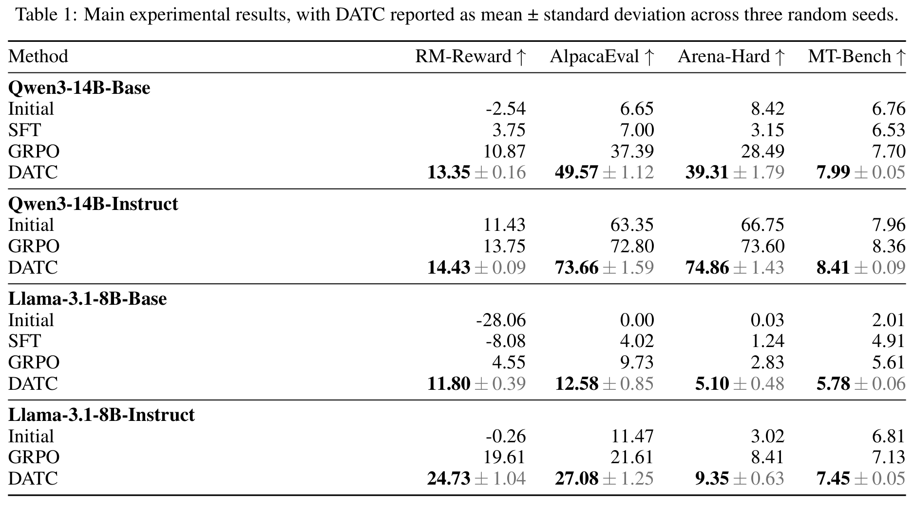

表 1：四个设置、四项指标，DATC 全部高于对应 GRPO；Base 设置的提升幅度远大于 Instruct。

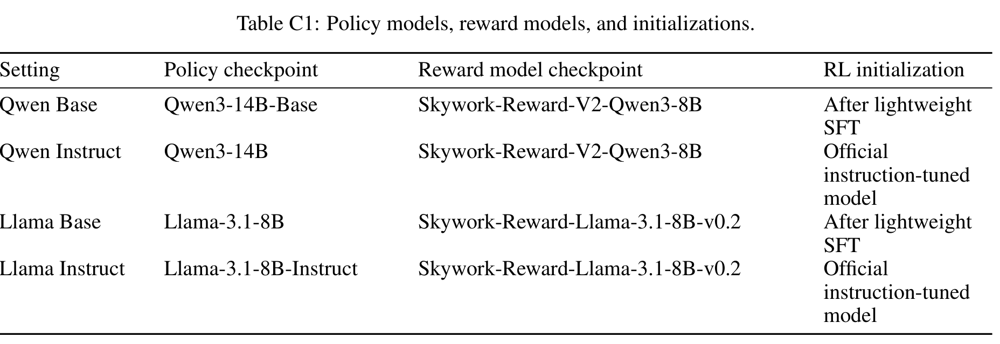

表 C1：四个设置的策略模型、奖励模型与 RL 初始化。这张表点明了方法的硬前提——每个策略都配了同家族、分词器可对齐的奖励模型。

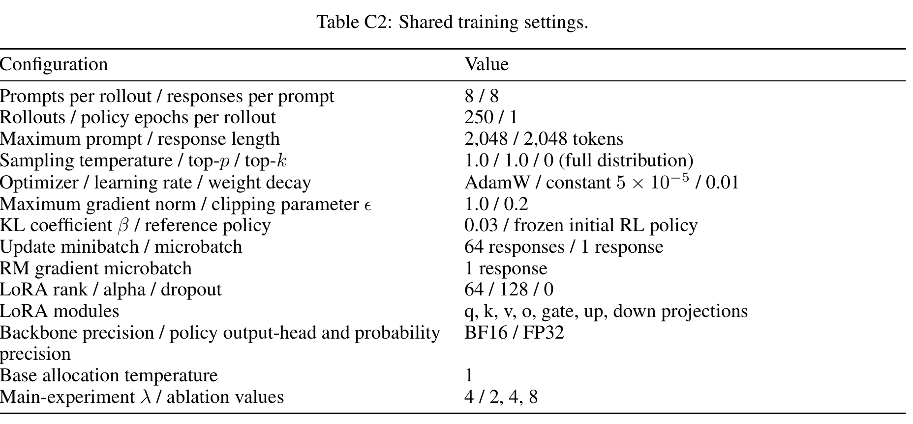

表 C2：所有对比方法共用的训练配置，$\lambda=4$ 是主实验值、2 和 8 是消融值。

**训练曲线**

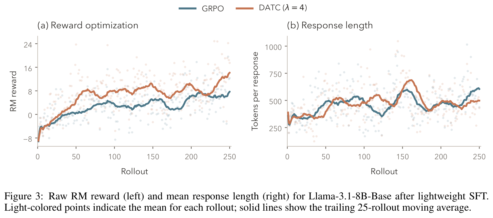

图 3：Llama-3.1-8B-Base 上 DATC 的原始 RM 奖励大部分时间压在 GRPO 上方，最后 25 个 rollout 均值 14.14 对 7.72；回复也更短，497.9 token 对 605.2 token。图形上才看得出的一点：前 25 个 rollout 两条曲线几乎重合，分化从约第 30 个 rollout 才开始，说明方向信号要先积累出一批有区别的 $d_t$ 才起作用。

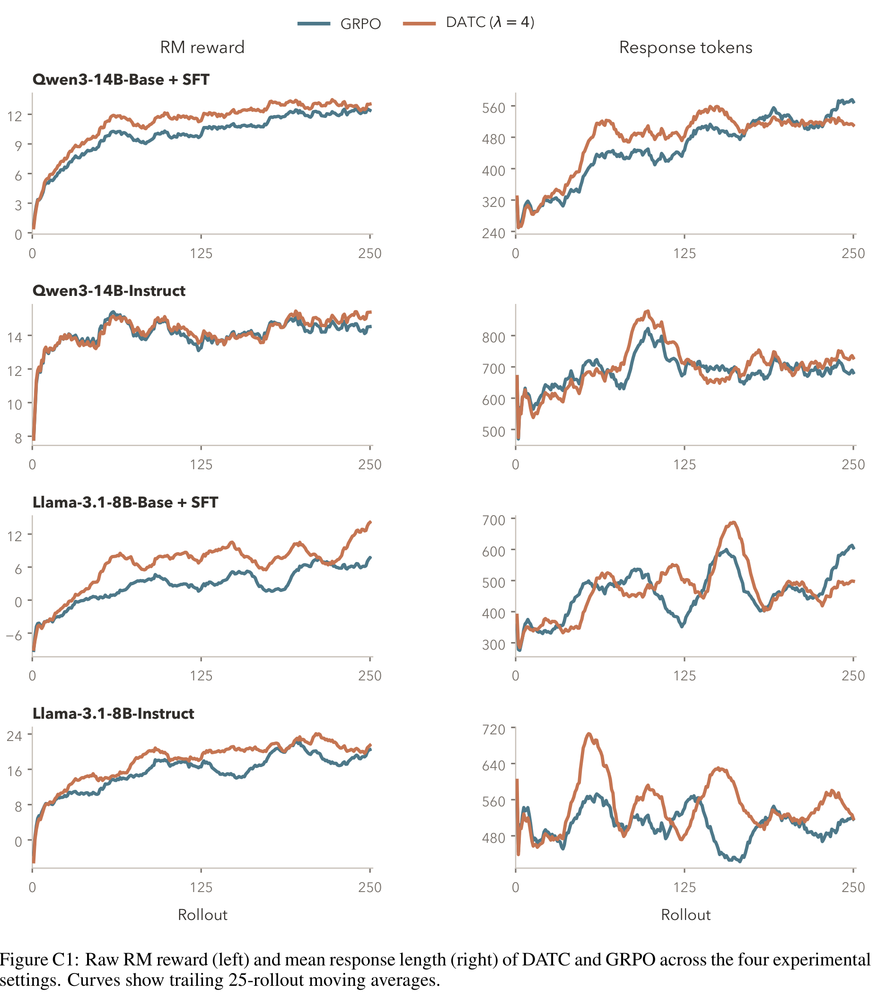

图 C1：四个设置的完整曲线。奖励一列 DATC 全面占优，长度一列并不一致——两个 Base 设置更短，Llama Instruct 基本重合，Qwen Instruct 反而更长。顺带缩短回复不是稳定性质。

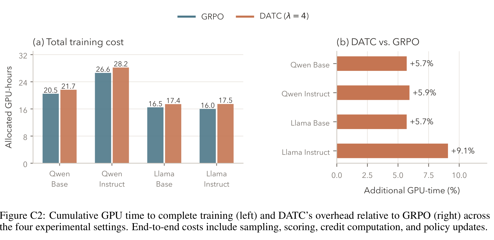

图 C2：DATC 相对 GRPO 的端到端 GPU 时间只多 5.7%–9.1%，Qwen Base 上 5.7% 的代价换来 12.18 个百分点 AlpacaEval 增益。额外开销集中在一次 RM 输入反传和词表归约。

**消融告诉我们什么**

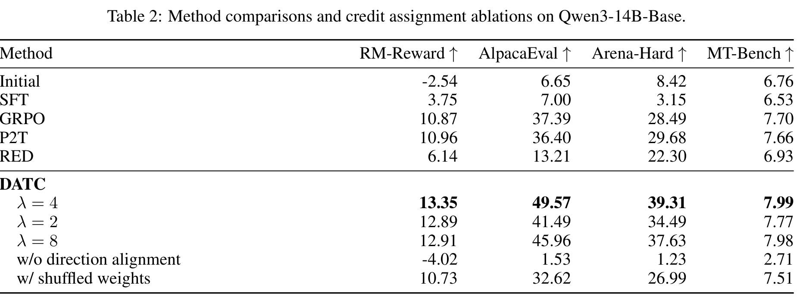

表 2：同一 Qwen3-14B-Base 起点上的方法对比与消融。三行信息量最大：

- **去掉方向对齐**（只留 $\lVert g_t\rVert_2\lVert k_t\rVert_2$）：RM-Reward 掉到 -4.02，比不做 RL 的 SFT 起点 3.75 还低，AlpacaEval 只剩 1.53%。模型不是少赚而是亏——按模长分配等于把最多资源给梯度最大的位置，而那些位置恰恰可能是编造事实时的高置信 token。信号全在夹角里，不在大小里。
- **权重打乱**：保留权重集合、均值、极值，只打乱它们与位置的对应。AlpacaEval 从 49.57% 降到 32.62%、Arena-Hard 从 39.31% 降到 26.99%、MT-Bench 掉 0.48。收益确实来自哪个位置拿多少，而不是权重分布变尖这个副作用。
- **$\lambda$ 扫描**：$\lambda=2$ 太保守（12.89 / 41.49 / 34.49 / 7.77），$\lambda=8$ 太激进（12.91 / 45.96 / 37.63 / 7.98），4 最好，典型倒 U 形。

外部基线：P2T 与 GRPO 几乎打平（RM-Reward 10.96 对 10.87，AlpacaEval 36.40 对 37.39），RED 明显更差（6.14 / 13.21 / 22.30 / 6.93）。同样用 RM 信号做 token 信用，**用不用 GRPO 自己的更新方向**是分水岭。

**token 级权重的定性检查**

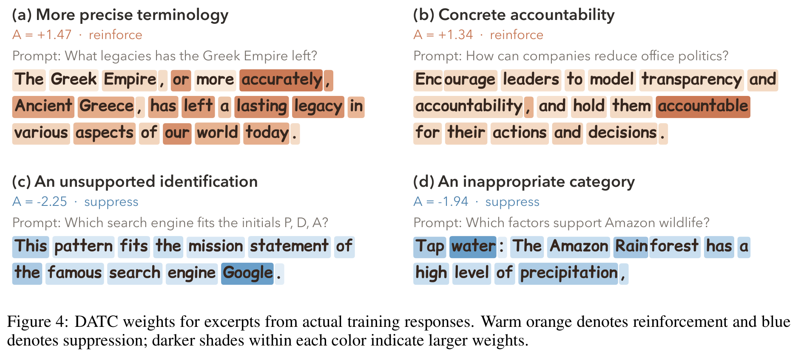

图 4：四个真实训练回复的权重热图。$A>0$ 的两例中，纠正 Greek Empire 为 Ancient Greece 时 accurately 拿到极高权重、把 actionable 建议落到 hold them accountable 时 accountable 拿到极高权重；$A<0$ 的两例中，猜 Google 时 Google 被重点压制、把热带雨林降水写成 Tap water 时 water 被重点压制。权重落在语义承重词而非虚词上。

**人类评测**

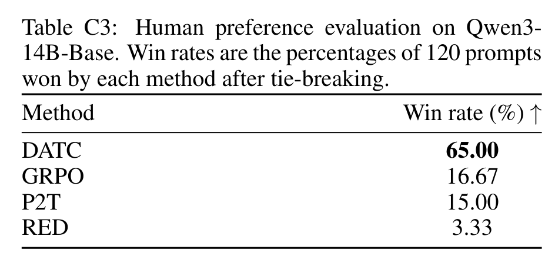

表 C3：Qwen3-14B-Base 上 120 条 held-out prompt 的四路盲评，七位评估者投票。DATC 赢 78 条（65.00%），GRPO 20 条（16.67%），P2T 18 条（15.00%），RED 4 条（3.33%）。自动指标的大幅领先在人类盲评里复现了。

**代理增益与真实参数更新的相关性**

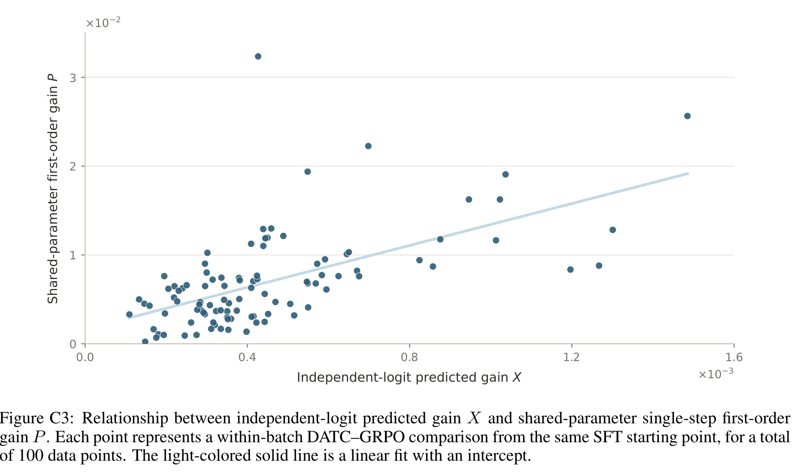

图 C3：100 个 batch 上，独立 logit 模型的预测增益 $X$ 与真实共享参数单步更新的一阶增益 $P$ 正相关（Spearman 0.619、$R^2=0.347$），100 个点全部 $X>0,P>0$。方向没跑偏，但解释不了大部分方差。

**这些实验够不够支撑结论**

支持得比较扎实：四设置 × 四指标全胜、三个种子标准差很小（最大 1.79 个百分点）、消融把方向与位置对应分别摘掉后都大幅退化、人类盲评独立复现。这套组合基本排除了调参调出来的和指标选得巧两种解释。

不够有三处。一是四个设置全在 8B/14B 一个量级，没有更大模型、没有全参数训练，作者在附录 D 自己承认。二是任务全是开放域偏好对齐，没有数学、代码这类有可验证奖励的任务。三是外部基线只有 P2T 和 RED，没和过程奖励模型、VinePPO 这类价值路线比，所以比价值路线好这个结论在这篇里**没有实验支撑**。

## 6. 局限性

**作者自己承认的**

- 只适用于有可微奖励模型的偏好优化。算方向信用需要 RM 的输入梯度与词表对齐；对只返回分数的裁判，方法是空的。作者把跨分词器对齐和只用分数估梯度列为未来工作。
- 实验只用 LoRA、只覆盖 8B/14B 两个模型族、只做通用偏好对齐。作者提出应扩展到全参数训练、更大规模，以及数学推理和代码生成这类有专用奖励模型的任务。

**我看出来的**

- **隐形假设：一阶展开在真实步长下够用**。整个推导建立在沿 logits 的线性展开上，而实际一步 LoRA 更新跨多远、非线性多强，论文只用附录 C.5 的相关性（$R^2=0.347$）侧面回应，没给出近似在哪个步长失效的边界。
- **隐形假设：logits 相互独立**。式 (3) 与式 (10) 的增益保证都在独立 logit 坐标下成立。真实模型所有位置共享参数，附录式 (A16) 明确写出共享参数会通过 $L_tL_u^\top$ 把位置耦合起来，而增益保证没覆盖这一项。
- **边界条件：奖励模型与策略必须同族同分词器**。这锁死了自己训 RM 的场景，跨模型族（如用 Llama 系 RM 评 Qwen 策略）直接不可用。
- **边界条件：只在响应内重分配**。因为强制保留均值与符号，$\frac1T\sum_t\tilde A_t=A$，所以如果 $A$ 本身就错（RM 把烂回复打了高分），DATC 毫无办法，只能把错误分得更细。
- **缺的对比与挑例子**。Related Work 点到的过程奖励模型、VinePPO 都没进实验表；图 4 也只展示四个精心挑的回复，没有权重在全体 token 上的分布统计。

## 7. 一句话总结

GRPO 是把奖金按人头平分的老板；DATC 先问一句你这一锹挖的方向对不对，再按做功的正负和大小分钱。

核心公式：

$$
\boxed{\ \tilde A_t=A\cdot T\,\mathrm{softmax}_t\!\left(\frac{A\langle g_t,k_t\rangle}{\tau}\right),\quad g_t=\sigma^{-1}\hat\nabla_{\ell_t}R,\ \ k_t=\nabla_{\ell_t}\log p_t(a_t)\ }
$$

读法：括号里的 $\langle g_t,k_t\rangle$ 是夹角余弦乘两个模长，衡量这个位置的更新做了多少功；乘 $A$ 得带符号做功；softmax 变成份额；再乘回 $A$ 保证符号与均值不变。

## 8. 可复用点

- **上手第一件事是查分词器，不是改算法**。不是同一分词器就先做词表映射与位置对齐（附录 B.2 的做法：检查 token id 映射与特殊 token，再按回复文本位置对齐，处理两套对话模板的偏移）。
- **把一次 RM 输入反传当固定成本来估**。这个反传是整条回复一次，不是每 token 一次，成本与序列长度线性、与词表无关（靠分块归约，128 位置 × 8192 候选词一块）。显存峰值出现在反传期间，所以务必两阶段缓存：先算权重、释放 RM 图，再做策略更新。
- **训练不收敛时先查权重有没有崩**。看 $\max_t w_t$ 是否贴着 $\lambda$、$\min_t w_t$ 是否贴着 $1/\lambda$；每条回复都贴边界说明 $\lambda$ 太松或标准化尺度 $\kappa$ 不对。再查 $d_t$ 是否几乎全同号——同号会让 softmax 退化成近似均匀分配，方法等于没开。
- **做任何 token 级加权都该加这个消融**：保留权重集合、只打乱位置对应（shuffled weights）。它能干净地把分布变尖的副作用和位置匹配的真实收益分开，成本几乎为零。
- **论证顺序可以借鉴**：先用物理类比钉住直觉，再把两个方向搬到同一坐标空间使内积合法，最后用凸问题把该给多少变成有闭式解的分配问题。

## 9. 我的疑问

- 式 (10) 的增益下界与 $w^*$ 的 KL 代价成正比，越偏离 GRPO 越赚；但偏离太远会崩，$\lambda$ 就是压这个。那 $\lambda=4$ 是不是只对这套超参（lr $5\times10^{-5}$、250 rollout、LoRA r=64）成立？论文没给跨超参敏感性分析。
- 去掉方向对齐后 RM-Reward 掉到 -4.02，比 SFT 起点 3.75 还低。这个幅度反常。我的猜测是模长最大的位置集中在高置信的错误 token 上（模型越确信自己编的对，输入梯度越大），加权等于专门强化幻觉。论文没给这个诊断，属于我的推断。
- 人类评测只有 120 条 prompt、7 位评估者，且 40 条 prompt 分到三个种子之一，每条 prompt 只有该种子的一个 checkpoint 参与比较。65% 的胜率里混了种子方差，论文没报置信区间。
- $\sigma_0$ 四个设置取了四个不同值（3.0323、1.2118、6.2743、5.9262），论文只说预先固定。这些值怎么定的、是否用 held-out 数据调过，原文没交代；而 $\sigma$ 同时进 $A$ 与 $g_t$ 的标准化，对 $d_t$ 量级有直接影响。
- 图 4 的四个例子都是两三句的短回复。长回复（比如 1000 token 的推理链）上权重还落在语义承重词上吗？$T$ 大时份额更细、$\lambda$ 相对更松，可能出现整段都拿不到权重。论文没有长回复上的权重分析。
