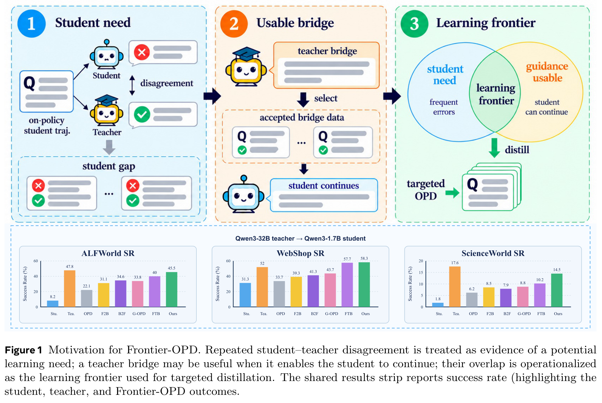
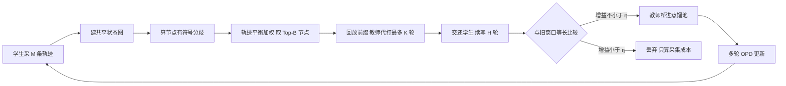
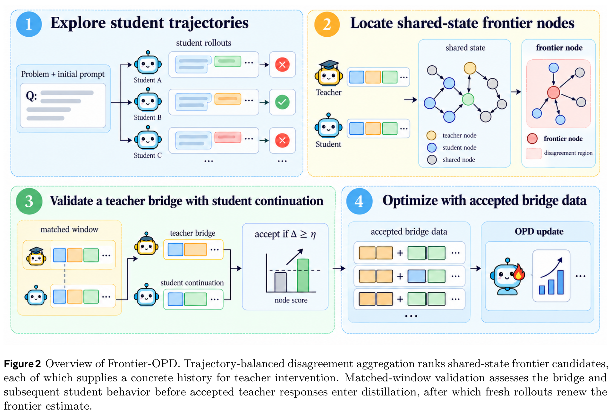
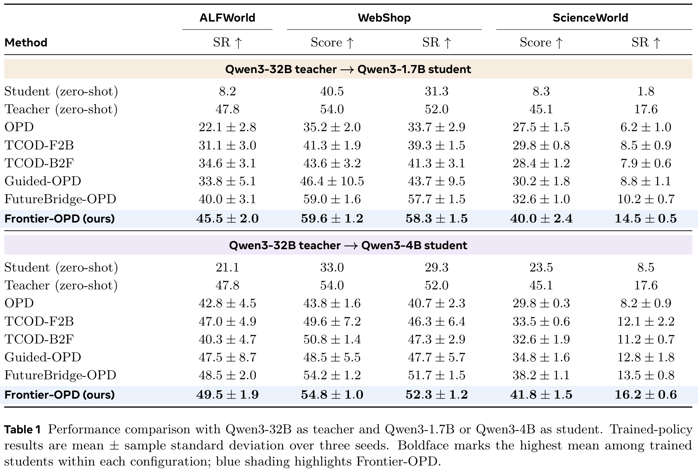
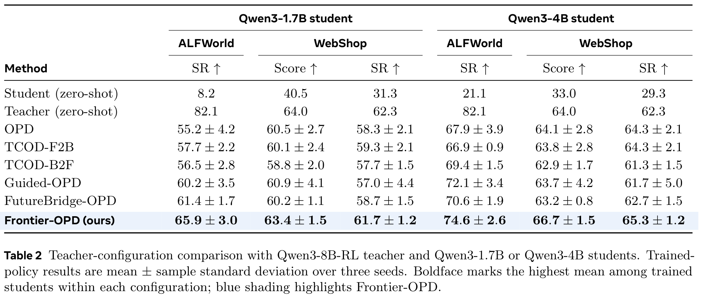
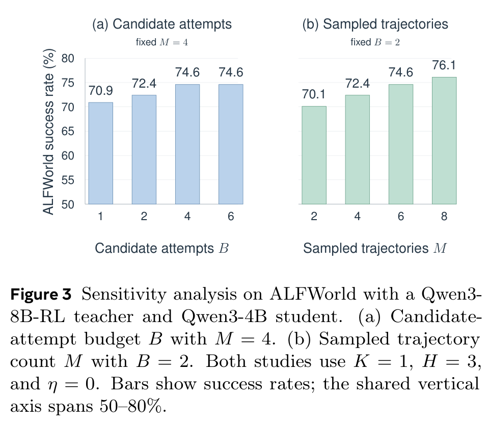
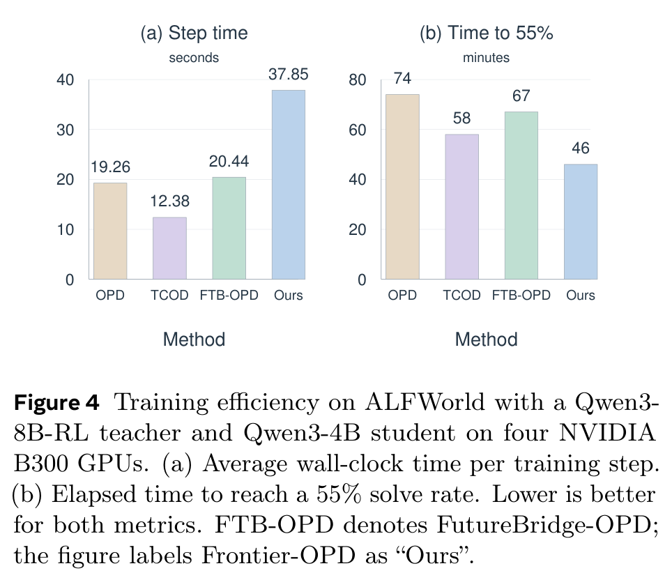
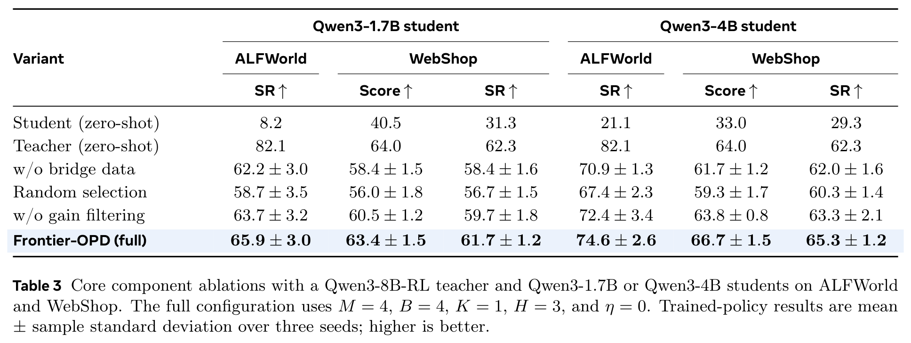
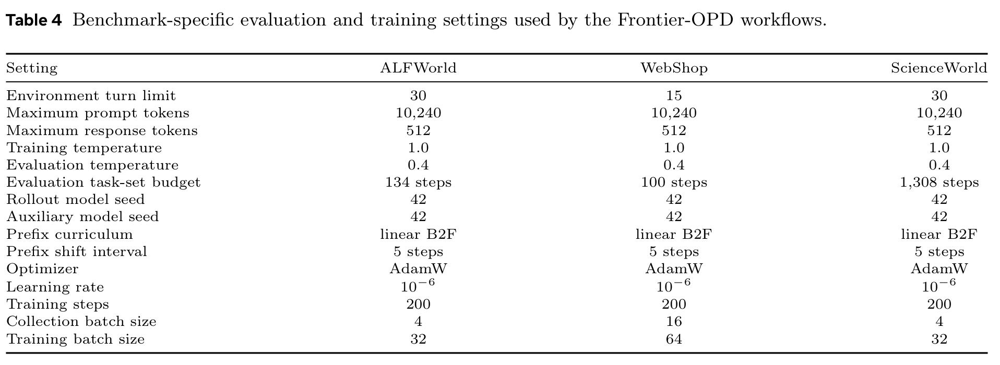

> 一句话：先找出学生踮脚够得着却做不好的那几步，只在那几步请老师替一下，验证能接上才拿去教。

## 0. 读之前你需要知道

**术语卡**

- **多轮 agent（multi-turn agent）**：模型和环境来回很多轮，模型出一句动作，环境回一句观察。类比：打电话办事，说一句听一句才能决定下一句。
- **在线蒸馏（on-policy distillation，OPD）**：监督不取在教师写好的标准轨迹上，而取在学生自己走出来的轨迹上。类比：老师不改标准答案册，坐旁边看你做题，在写错那一行批注。
- **教师桥（teacher bridge）**：在某个决策点让教师接管，最多走 K 轮，然后把方向盘交回学生。类比：代驾只帮你开过这个路口，下一段还是你自己开。
- **学习前沿（learning frontier）**：学生还没稳定掌握、但短暂指导后能自己走下去的决策情境。类比：攀岩时踩一下同伴肩膀就够到、松手也站得稳的那个岩点。
- **状态键（state key）**：把观测和可用动作归一化后哈希出来的字符串，用来判断两次访问是不是同一处境。类比：同一间教室的照片按门牌号归成一个地方。
- **配对窗口（matched window）**：新分支取教师桥加学生续写共 $L+H$ 轮，旧分支取同起点的 $L+H$ 轮，长度相等才比。类比：比成绩得跑同样长的一段。

**它站在谁肩上**

- **DAgger（2011）**：在学生自己跑出来的分布上请教专家，解决模仿的分布漂移，但没回答该在哪些状态问。
- **OPD（Agarwal 等，2024）**：用逐 token 的教师减学生对数概率差当优势做蒸馏，这篇的更新式直接沿用它的多轮版本。
- **TCOD（2026）**：用时间课程调学生能独立走的深度，从专家前缀逐步退到学生自己起步。
- **Guided-OPD（2026）**：给每轮安排教师参与的概率，把介入当成调度问题。
- **FutureBridge-OPD（2026）**：用短桥之后的续写验证指导值不值，这篇往前推一步，连位置一起挑。
- **ThriftyDAgger（2022）**：用新颖度和风险在预算内分配介入，只管何时叫专家，不管叫来后学生接不接得住。

## 1. 动机

学车。教练坐在副驾，全程不碰方向盘，只在你要压线那一瞬间扶一下，然后立刻松手。这一下扶得值不值，不看教练扶得多漂亮，要看你松手之后还能不能把车开直。

**以前怎么做**：多轮 agent 的蒸馏大致三条路。一是拿教师跑一遍完整轨迹让学生照学，属于离轨模仿。二是 OPD，学生自己跑，教师在学生跑过的地方逐 token 打分，这是它比模仿稳的原因。三是在 OPD 之上做配给：TCOD 调学生能独立走多深，Guided-OPD 调教师在哪几轮插手。

**为什么不行**：OPD 把监督对齐到学生的分布上，却没回答下一个问题该问哪里。所有轨迹、所有 token 一视同仁，教师的话被均匀撒在整条轨迹上，可学生的毛病并不均匀。

作者点了两种具体错配。一是分歧大但救不回来：学生某处和教师差得远，可真让教师接手，后面会进入学生完全陌生的流程，交还控制权时它根本走不下去。二是分歧小却确实是盲点：学生对这局面见得多，动作看着熟练，于是对这个错误动作给的概率很高，教师不同意的幅度反而不大。

还有一个更细的坑：一条轨迹能在同一状态上反复访问。按次数累加，一条原地打转的轨迹就能靠次数把这个状态推到候选名单前面，可它实际只代表一个处境。

**为什么现在能做**：三个条件同期成立。教师随时可调且逐 token 对数概率拿得到，分歧不用任何标注就能算；这几个环境可回放，能从任意前缀重置重跑，才能在同一历史下长出新分支去对比；任务层有明确成败判定，学习前沿才有落点。

图 1：三格讲清了因果链。第一格是两个信号源，学生轨迹里反复出现的错误与师生在同一处的分歧。第二格是教师短桥要经过筛选才变成可用数据，依据是学生还能不能接着写。第三格是核心：学生需要（蓝圈）与指导可用（黄圈）求交，交集才叫学习前沿。这张图证明的是整篇的立场，两个条件取交集而不是并集。

## 2. 贡献

- **提出学习前沿这个视角，把该不该教和教了接不接得住绑成一个判据**。证据：第 3 节把它落成节点分数 $s_k(v)$（式 6）与窗口增益 $\Delta_k(c)$（式 9）两个可算的量。
- **给出一套能跑的采集流程**：共享状态图、轨迹平衡聚合、历史特定回放、配对窗口验证，四步串成一轮，并随学生变化重新估计。证据：图 2 与附录 Algorithm 1。
- **三个交互基准、两种学生规模、两种教师配置上，报告的均值都在已训练学生里最高**。证据：表 1 与表 2，两套教师配置下每个指标第一名都是它。
- **多花的采集成本被更短的达成时间抵掉**。证据：图 4，单步耗时最高（37.85 秒），但到 55% 成功率只用 46 分钟，OPD 要 74 分钟。

## 3. 创新点

- **把挑位置从轨迹级降到决策点级**。对比对象：TCOD 按时间调深度、Guided-OPD 按轮次排教师，分配单位都是轨迹或轮次。有用是因为同一个处境可能被反复访问，按轨迹分配会把名额浪费在同一个地方。论文的例子：三条 10 分加一条 0 分，节点分是 5 不是 7.5。
- **用有符号分歧当需要教的信号**。对比对象：FutureBridge-OPD 及其前作主要看分歧的绝对幅度。有用是因为有符号才分得清学生比老师更自信和学生比老师更没底，前者是自信的错误，后者多半只是还没学会怎么说。这一步我从式 2、式 3 的符号设计读出，论文只说数值高意味着学生给的概率更高。
- **验收对象是配对窗口，不是教师那一步本身**。对比对象：直接看教师这一步对不对。教师做对不等于学生接得住，式 9 把桥和续写焊成一个窗口，再和同起点的旧片段等长比较。
- **验证产生的学生续写不进训练池**。对比对象：把 rollout 一股脑塞回训练。拿验证数据训练，下一轮验收就在自己训过的分布上做，验收会失真。

## 4. 方法

### 4.1 整体流程

一句话：学生跑、按状态归并、按轨迹平衡挑、教师代打一小段、拿续写验收、过了才进池，再重跑一遍刷新前沿估计。只有验收那条路留下数据，被拒候选纯花采集成本。

图 2：四步一一对应流程图。第二格最要紧，teacher node 与 student node 落在同一张共享状态图上，红圈标出的 frontier node 就是两者都有话可说的位置。第三格是配对窗口，橙框为桥加续写，蓝框为旧分支同起点片段。第四格是验收通过的数据与普通 rollout 一起进更新。

### 4.2 模块拆解

#### 4.2.1 把经验组织成共享状态图

**为什么需要**：要判断某个位置是不是反复出问题，得能把不同轨迹里的同一处境认出来；但真要回放、真要让教师接手，又必须保留当时完整的历史。这两件事方向相反，一个要合并，一个要区分。

**怎么做**：每个任务单独建一张有向图 $G_k(x)=(V_k,E_k)$。观测加可用动作归一化后哈希成状态键当节点，实际走过的转移当带动作标签的边。同一个键就是同一个节点，不同轨迹在同一处遇到的状态被并到一起；但每次访问 $c=(i,t)$ 都单独保留自己的上下文、响应和回放前缀。

$$
V_k=\bigcup_{i,t}\{v^i_t\},\qquad E_k=\bigcup_{i,t}\{(v^i_t,a^i_t,v^i_{t+1})\}
$$

先说要算什么：把所有轨迹里出现过的状态键和转移并成一张图，节点是处境，边是实际发生过的动作。

- $v^i_t=\phi(o^i_t,A^i_t)$：第 $i$ 条轨迹第 $t$ 步的状态键，一个字符串
- $a^i_t$：该步动作，是边的标签
- 并集：跨轨迹去重，同一个键只留一个节点

状态键决定聚合时怎么分组、以及教师这一步有没有走到见过的状态，图的邻接关系不进入打分规则。这张图不拿来做搜索，只拿来做统计。

#### 4.2.2 有符号分歧：哪里算需要指导

**为什么需要**：需要一个不依赖人工标注的行不行代理量。

**怎么做**：同一上下文下，看学生和教师对同一 token 给的对数概率差：

$$
g_k(h,y,j)=\log \pi_{\theta_k}(y_j\mid h,y_{<j})-\log \pi_T(y_j\mid h,y_{<j})
$$

- $\pi_{\theta_k}$：第 $k$ 轮采集时的学生策略；$\pi_T$：教师策略
- $g_k$：单个 token 上的差，可正可负，单位是 nats

一次访问的分数是把这条响应所有 token 的差取平均：

$$
d_k(c)=\frac{1}{|y^i_t|}\sum_{j=1}^{|y^i_t|} g_k(h^i_t,y^i_t,j)
$$

- $|y^i_t|$：这条响应的 token 数，做长度归一
- $d_k(c)$：访问级统计量，正数表示学生给这条响应的概率比教师给的更高

符号有意义。学生不会、但知道自己不会的地方，给的概率本来就低，这个量偏负；学生自以为对、其实错的地方，概率高，这个量偏正。只挑正的那一端，等于专挑自信的错误。

#### 4.2.3 轨迹平衡加权与候选挑选

**为什么需要**：一条轨迹在某个状态卡住转十圈，按访问次数加权，这个状态就会把名额吃掉，只因为它在一条轨迹里重复出现了很多次。

**怎么做**：先按轨迹分组。对节点 $v$，每条贡献轨迹先在自己的访问上取平均，再对轨迹取平均：

$$
w_k(c,v)=\frac{1}{|I_k(v)|\,|Q^i_k(v)|},\qquad s_k(v)=\sum_{i\in I_k(v)}\sum_{c\in Q^i_k(v)} w_k(c,v)\,d_k(c)
$$

先说这个公式在算什么：一个节点先算每条轨迹在该节点的平均分歧，再对这些轨迹平均，每条轨迹在总权重里只占一份。

- $Q^i_k(v)$：第 $i$ 条轨迹在节点 $v$ 的合格访问集合，$|Q^i_k(v)|$ 是访问次数
- $I_k(v)$：在 $v$ 上有合格访问的轨迹集合，$|I_k(v)|$ 是轨迹条数
- $w_k(c,v)$：单次访问权重，先被轨迹条数除，再被该轨迹在此节点的访问数除
- $s_k(v)$：节点分数

一条轨迹在某节点的访问权重加起来正好是 $1/|I_k(v)|$，全部加起来恒等于 1，所以 $s_k(v)$ 是总权重恒为一的加权平均。附录的例子：一条访问三次、每次 10 分，另一条访问一次、0 分，节点分是 5 不是 7.5。

候选还有一道门。合格访问要满足有合法动作走到候选点、前缀可回放、有状态键、两边 token 分数对齐且非空、$d_k$ 有限，以及从这次访问起至少还有 $K+H$ 轮记录（留出等长参照段）。过了门槛再按 $\delta$ 过滤，取分数最高的 $B$ 个不同节点：

$$
\mathcal F_k=\mathrm{TopB}_{\,s_k}\bigl(\{v\in\mathcal U_k:\ s_k(v)\ge\delta\}\bigr)
$$

每个入选节点只出一个回放代表：在该节点的合格访问里取 $d_k$ 最大的那一次。名额按节点数算不按轨迹算，几个代表可能来自同一条轨迹，但对同一节点的重复访问占不到两个名额。

#### 4.2.4 教师桥与配对窗口验证

**为什么需要**：节点分只能说明这里有缺口，不能说明教师补一句之后学生接得住。

**怎么做**：重置环境，重放原始前缀（课程里含专家前缀，之后是学生自己走的动作），让教师从保存的决策上下文开始生成，最多 $K$ 轮。教师控制权在三种情况下结束：走满 $K$ 轮、走到图外的状态键、或环境终止，实际长度记作 $L_c\le K$。然后交还学生走 $H$ 轮。

验收用的不是有符号分歧，而是绝对分歧的负数：

$$
a_k(h,y)=-\frac{1}{|y|}\sum_{j=1}^{|y|}\bigl|g_k(h,y,j)\bigr|
$$

- $|g_k|$：绝对差，只关心两边离得多远，不关心谁更自信
- 负号：把越接近越好翻成越大越好，和后文增益同向
- 按响应长度归一，避免长响应靠长度占便宜

窗口一致度 $A_k(W)$ 是窗口内各响应轮 $a_k$ 的算术平均，两边模型都在各自上下文下给同一串 token 打分，教师生成的桥也照打。新窗口是教师桥加学生续写，旧窗口是同一起点之后原本记录的 $L_c+H$ 个响应轮。增益是两者之差：

$$
\Delta_k(c)=A_k\bigl(W^{new}_c\bigr)-A_k\bigl(W^{old}_c\bigr)
$$

- $\Delta_k(c)>0$：换成这条新历史后，两边在整段窗口上更像了
- $\Delta_k(c)=0$：没变差，默认 $\eta=0$ 时就被收下
- $\eta$：接受门槛，提高它等于只收明显变好的

有个容易看漏的设计：挑选用有符号分歧，验收用绝对分歧。挑选问的是学生在哪里比老师更自信，验收问的是这一段整体像不像。两处都用同一个量，验收就退化成挑选的复述。$K$ 默认 1，教师只代打一步、学生接着走三步，验的就是一句话够不够。

#### 4.2.5 蒸馏更新与前沿刷新

两类经验拼在一起进同一个更新：

$$
\mathcal D_k=\mathcal D^{stu}_k\ \uplus\ \mathcal D^{br}_k,\qquad \theta_{k+1}=\mathrm{OPDUpdate}(\theta_k;\mathcal D_k)
$$

- $\mathcal D^{stu}_k$：普通学生 rollout，不管桥有没有过验收都全部保留
- $\mathcal D^{br}_k$：验收通过的教师桥响应
- $\uplus$：多重集拼接，重复出现不合并

更新用逐 token 的 OPD 优势：

$$
\hat A_{e,j}=\ell^T_{e,j}-\ell^{stu}_{e,j}
$$

- $\ell^T_{e,j}$：教师对第 $j$ 个 token 的对数概率
- $\ell^{stu}_{e,j}$：行为模型的对数概率。普通 rollout 里是当时采样的学生；教师桥里是教师在采，学生被拿来给这些教师 token 打分

这里没有额外的桥损失，也没有奖励加权，桥响应存的 reward 在多轮 OPD 里根本不用。桥改变的是哪些上下文和 token 进入蒸馏，不是用什么目标函数学，作用点全在数据侧。

### 4.3 关键细节

- **默认配置**：$M=4$（每任务采 4 条轨迹）、$B=4$（4 个不同节点）、$K=1$、$H=3$、$\eta=0$，节点加权固定为轨迹平衡，没有每条轨迹的候选配额。
- **优化器**：AdamW，学习率 $10^{-6}$，$(\beta_1,\beta_2)=(0.9,0.999)$，权重衰减 $10^{-2}$，梯度裁剪 1.0。
- **成本**：$N$ 次访问、$U$ 个合格节点的建图与聚合是 $O(N)$，排序 $O(U\log U)$；验证每任务最多多出 $B(K+H)$ 轮生成，最多 $BK$ 条教师响应进训练。被拒候选照样花采集成本却不贡献监督，两笔账必须分开算。
- **状态键怎么造**：ALFWorld 用可执行命令，WebShop 用搜索可用性和可点击元素，ScienceWorld 用合法动作与物体的组合，都是观测层面的等价，不保证区分每个隐藏环境状态。
- **回放边界**：终局交接直接排除，因为后面需要学生还能动；默认 $K=1$ 时图内图外交接都算数，走出图不是接受条件。

## 5. 实验结果

**实验设置**

- **数据集与切分**：三个文本交互环境，ALFWorld 管家务、WebShop 管网页购物、ScienceWorld 管科学实验。训练用 train split，没有单独验证集；测试在留出实例上顺序评测，从环境初始状态开始，不给教师介入、不重放参考前缀。评测预算原文写 ALFWorld 134 步、WebShop 100 步、ScienceWorld 1308 步；每个基准多少道评测题原文未给。
- **骨干模型**：主实验 Qwen3-32B 当教师，Qwen3-1.7B 与 Qwen3-4B 当学生；另一组用强化学习训过的 Qwen3-8B（记作 Qwen3-8B-RL）当教师，学生规模相同。
- **训练预算**：200 步，checkpoint 固定在第 200 步、测试前定好不再挑。collection batch 三个环境是 4、16、4，training batch 是 32、64、32。效率实验跑在 4 张 NVIDIA B300 上。训练总 rollout 数与 token 数原文未给；8B-RL 教师本身的训练细节，原文只说沿用 FutureBridge-OPD 的设置。
- **基线**：OPD、TCOD-F2B、TCOD-B2F、Guided-OPD、FutureBridge-OPD，外加零样本学生与零样本教师两个参照；消融三条是作者自己加的。
- **指标**：成功率（SR）与任务分数，0 到 100、越高越好，成功率差用百分点表示。已训练策略报三个种子的均值加减样本标准差，作者明确说这三个种子不构成显著性检验。
- **推理设置**：评测温度 0.4、训练与教师重打分 1.0；最大 prompt 10,240 token、最大响应 512 token；回合上限 ALFWorld 30、WebShop 15、ScienceWorld 30；Qwen3 thinking 模式全程关闭；前缀课程线性 B2F，每 5 步前移一次；种子 42。

**主表**（最强基线单列）

| 配置 | 基准与指标 | 本文 | 最强基线 | 提升 |
| --- | --- | --- | --- | --- |
| 32B → 1.7B | ALFWorld SR | **45.5** | 40.0（FutureBridge-OPD） | +5.5 |
| 32B → 1.7B | WebShop 分数 | **40.0** | 32.6（FutureBridge-OPD） | +7.4 |
| 32B → 1.7B | ScienceWorld SR | **14.5** | 10.2（FutureBridge-OPD） | +4.3 |
| 32B → 4B | ALFWorld SR | **49.5** | 48.5（FutureBridge-OPD） | +1.0 |
| 32B → 4B | WebShop 分数 | **41.8** | 38.2（FutureBridge-OPD） | +3.6 |
| 32B → 4B | ScienceWorld SR | **16.2** | 13.5（FutureBridge-OPD） | +2.7 |
| 8B-RL → 1.7B | ALFWorld SR | **65.9** | 61.4（FutureBridge-OPD） | +4.5 |
| 8B-RL → 1.7B | WebShop SR | **61.7** | 59.3（TCOD-F2B） | +2.4 |
| 8B-RL → 4B | ALFWorld SR | **74.6** | 72.1（Guided-OPD） | +2.5 |

**原文实验表**

表 1：主结果。1.7B 那组的差距远大于 4B 那组，说明学生越弱、定向指导的边际收益越大；ALFWorld 上 1.7B 的 45.5 已贴着 32B 教师的 47.8。但 WebShop 的 58.3 对 57.7 只差 0.6 个百分点，标准差是 1.5，读不出结论。

表 2：换教师配置。教师是强化学习训过的 8B，ALFWorld 零样本 82.1，比表 1 的 32B 教师强得多，学生分数整体抬升而名次未变。它也暴露基线排序随学生规模翻动：Guided-OPD 在 1.7B 垫底、在 4B 第二，说明这里基线方差本身不小。

**原文实验图**

图 3：预算敏感性，两个方向相反才值得看。左图候选名额 $B$ 从 1 加到 6，1 到 4 一路涨（70.9 到 74.6），到 6 持平，第 5、第 6 个候选没带来新东西。右图轨迹数 $M$ 从 2 加到 8 一路涨到 76.1。读法是：找更好的位置会饱和，多跑轨迹不会。

图 4：效率对照。左图单步耗时本文最高，37.85 秒，是 TCOD 的三倍、OPD 的近两倍，因为每步要多做采集与验证。右图到 55% 成功率的总时间本文最低，46 分钟。它买的是每次更新更值钱，不是每步更便宜；结论只在这一个阈值与硬件上测过。

**原文实验表**

表 3：消融，三个变体掉的位置很不一样。随机挑位置掉得最多，1.7B 的 ALFWorld 从 65.9 掉到 58.7；去掉桥数据掉到 62.2，说明这批额外监督本身有贡献；去掉增益过滤掉到 63.7，说明全收不如筛一遍。三条都低于完整版且互不替代。

表 4：三个环境的全部推理与训练口径，是复现的唯一依据。另有一处要注意：WebShop 的 collection batch 是 16、training batch 是 64，另两个环境是 4 和 32。

**消融告诉我们什么**

- **挑位置比筛指导更值钱**。随机挑位置掉 7.2 分，去掉增益过滤只掉 2.2 分。位置错了，后面筛得再仔细也补不回来。
- **作者自己提醒的口径问题**：随机挑位置同时改了排序规则和分配单位（按访问还是按节点），所以它证明不了共享状态图本身有用。这是原文写的，不是我加的。

**这些实验够不够支撑结论**

支撑得住：两套教师配置、两个学生规模、三个环境第一名全拿，一致性强于单点胜利。要打折的有三处：三个种子且无显著性检验，WebShop 那 0.6 分在噪声里；基线都属于学生驱动采集加教师介入这一族，没和同等预算的强化学习或教师轨迹微调比；从头到尾没报验收通过率，每轮多少候选、多少被 $\eta$ 挡掉一个数都没有，而这正是判断划不划算的关键。

## 6. 局限性

**作者自己承认的**

- 前沿估计全靠行为代理量，分歧高不一定说明缺技能，一致度不降也不保证真学会了。
- 观测层面的状态抽象会把学习需求不同的历史并到一起，还允许只访问一次的节点进候选。
- 状态键影响排序但图的邻接不进分数，随机挑位置的消融同时改了两件事，隔离不出状态聚合本身的收益。
- 依赖可回放环境与教师逐 token 概率；三个种子不构成显著性；32B 与 8B-RL 同时换了规模与训练历史，读不出单独作用。

**我看出来的**

- **隐形假设**：默认学生比教师更自信的地方就是该教的地方。可多轮失败常是一串小偏差累积成不可恢复的局面，每步分歧都很小，节点分挑不出来。论文没做失败类型的分层统计。
- **边界条件一**：验收比的是师生一致度不是任务成败。一条让两边更像却把任务做砸的桥，$\Delta_k\ge\eta$ 照样通过。作者承认这点，却没给通过率与最终成功率的相关性。
- **边界条件二**：$K=1$ 时教师只代打一步。若缺口真要连续两三步才纠得回来（多步工具调用里第一步就得改），这套设置结构上吃不到。论文没扫 $K>1$。
- **缺的对比**：没和同等采集成本的强化学习比，也没和教师轨迹监督微调比。提升究竟来自前沿选择还是来自多了一批教师数据，表 3 那一行说不干净。
- **一处自相矛盾**：既然验证续写脏到不能进训练池，拿它算的 $\Delta_k$ 有多可信？续写噪声大则 $\Delta_k$ 也噪声大，而 $\eta=0$ 意味着任何正向噪声都被收下。作者没报过它的分布。

## 7. 一句话总结

把该教哪里和教了接不接得住写成两个可算的分，一个用有符号的师生分歧挑位置，一个用等长窗口的师生一致度做验收，只在两者都满足的地方收教师的话，蒸馏就从撒胡椒面变成定点下药。类比：不是把整本教辅塞给学生，而是看他卡在哪一步，只在卡住又不至于彻底放弃的那一步递张小纸条，递完看他能不能接着做。

核心公式：

$$
\boxed{\;s_k(v)=\sum_{i\in I_k(v)}\ \sum_{c\in Q^i_k(v)}\frac{d_k(c)}{|I_k(v)|\,|Q^i_k(v)|}\ ,\qquad \Delta_k(c)\ge\eta\;}
$$

## 8. 可复用点

- **如果我要在自己的项目里用**：先把状态键做出来，观测加可用动作归一化哈希就够，不必追求精确等价。然后按 $M=4$、$B=4$、$K=1$、$H=3$ 起跑，这几个数在原论文里没调过。
- **加权一定要按轨迹平衡**。只要学生会在某个状态反复打转，按次数累加就会让名额被一个处境吃光。实现上先组内平均再跨轨迹平均，比写复杂的重要性权重简单。
- **验收必须等长**。新分支长度要记成实际走完的 $L_c$ 而不是上界 $K$，旧分支也取 $L_c+H$ 轮。不等长的比较会被长响应带着走，很容易写错。
- **训练不收敛时先查**：学生续写别混进训练池。混进去之后下一轮验收就在自己训过的分布上做，会形成自我确认。
- **想省钱**：$B$ 到 4 就饱和，$M$ 加到 8 还在涨（图 3）。预算有限时优先加轨迹数。

## 9. 我的疑问

- 验收通过率到底多少？只有个位数百分比，$B(K+H)$ 轮额外生成基本在烧钱；高达八九成，$\eta=0$ 几乎没筛选作用，表 3 里去掉增益过滤只掉 2 分也说得通。
- 有符号分歧挑出的正端真对应自信的错误吗？也可能主要挑的是措辞习惯和教师不同的位置。验证要看被选中节点上的动作对错，论文没做。
- 共享状态图按单个任务建，同类任务之间的共性完全没利用。换成跨任务共享的图，候选池会大很多，验收成本能摊薄吗？
- $K$ 大于 1 会怎样？若某个缺口的正确修法本来就要连着两步，$K=1$ 会系统性把这类候选判死，而这可能正是多轮 agent 最难的那部分能力。
- 图 3 左的饱和点在 $B=4$，默认值也正好是 4。这个默认值是照这张图定的吗？如果是，那它就不是敏感性分析，而是超参选择的记录。
