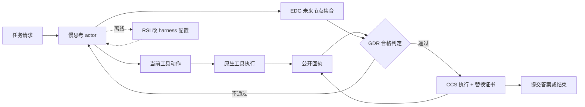
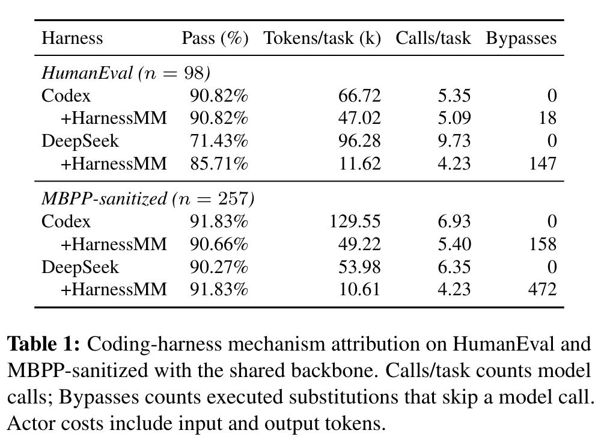
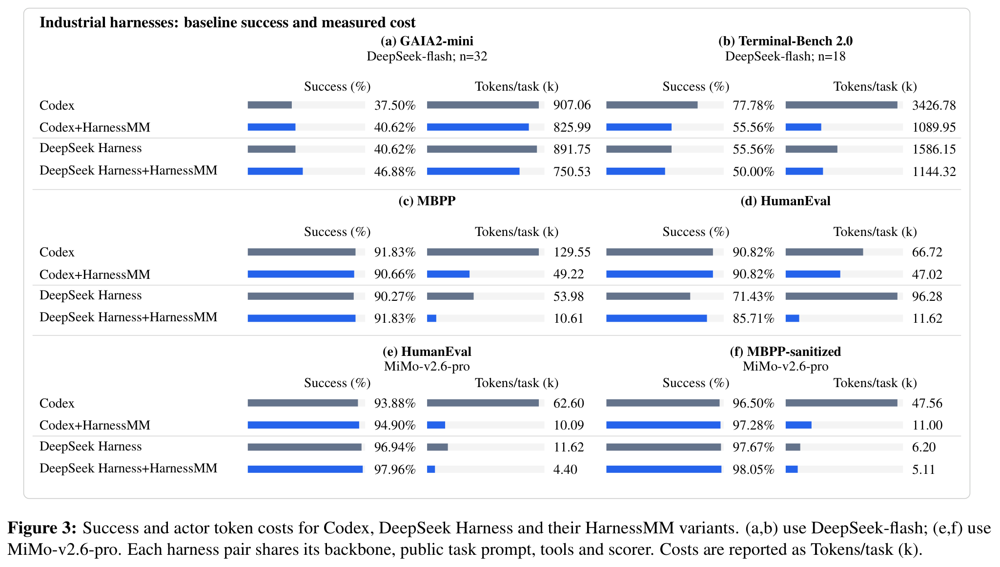
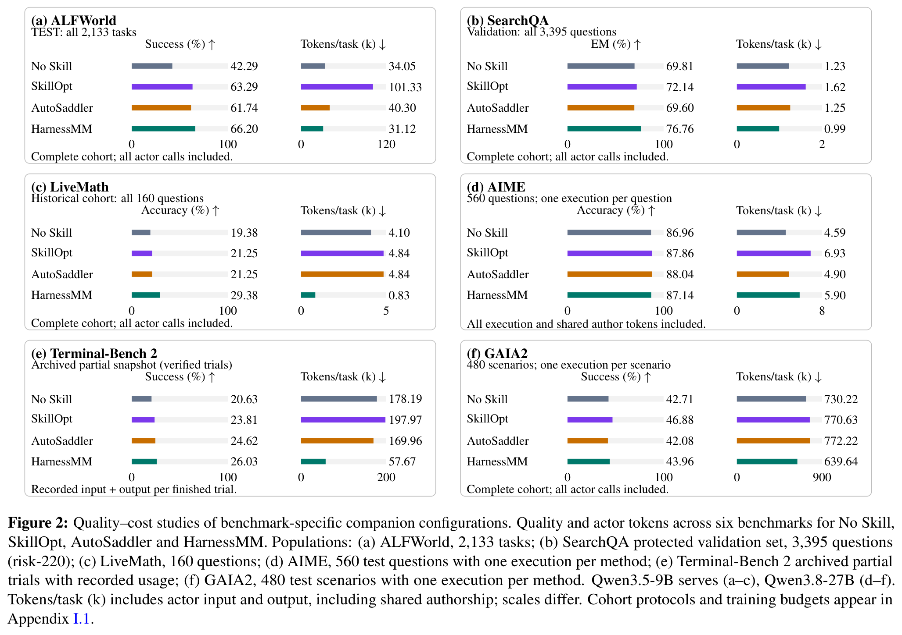
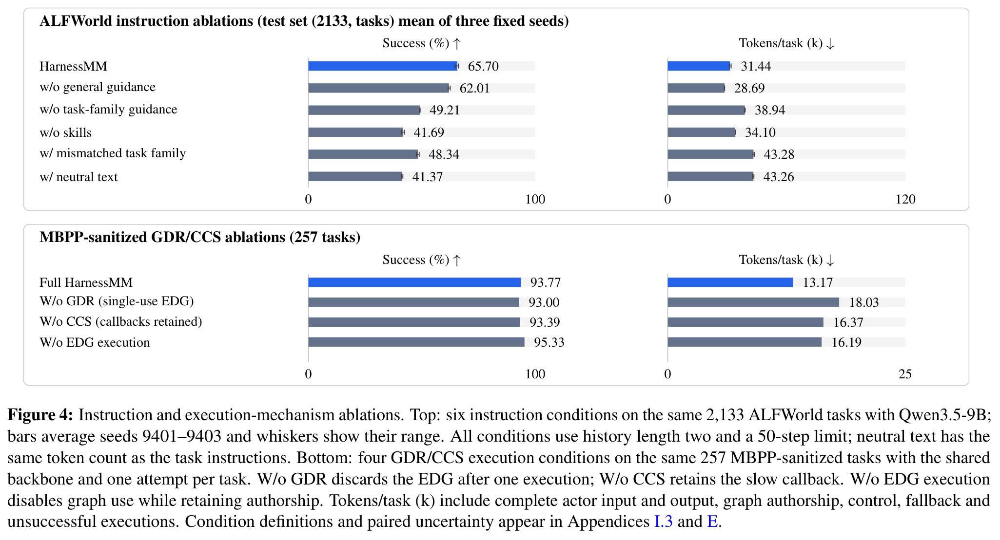
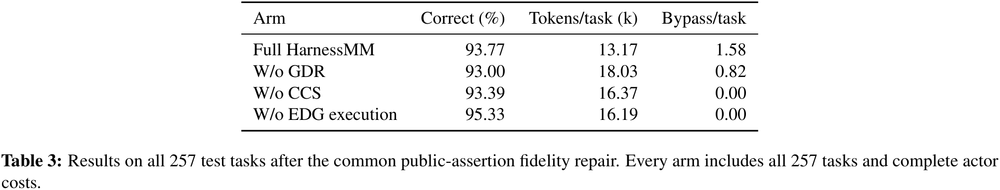
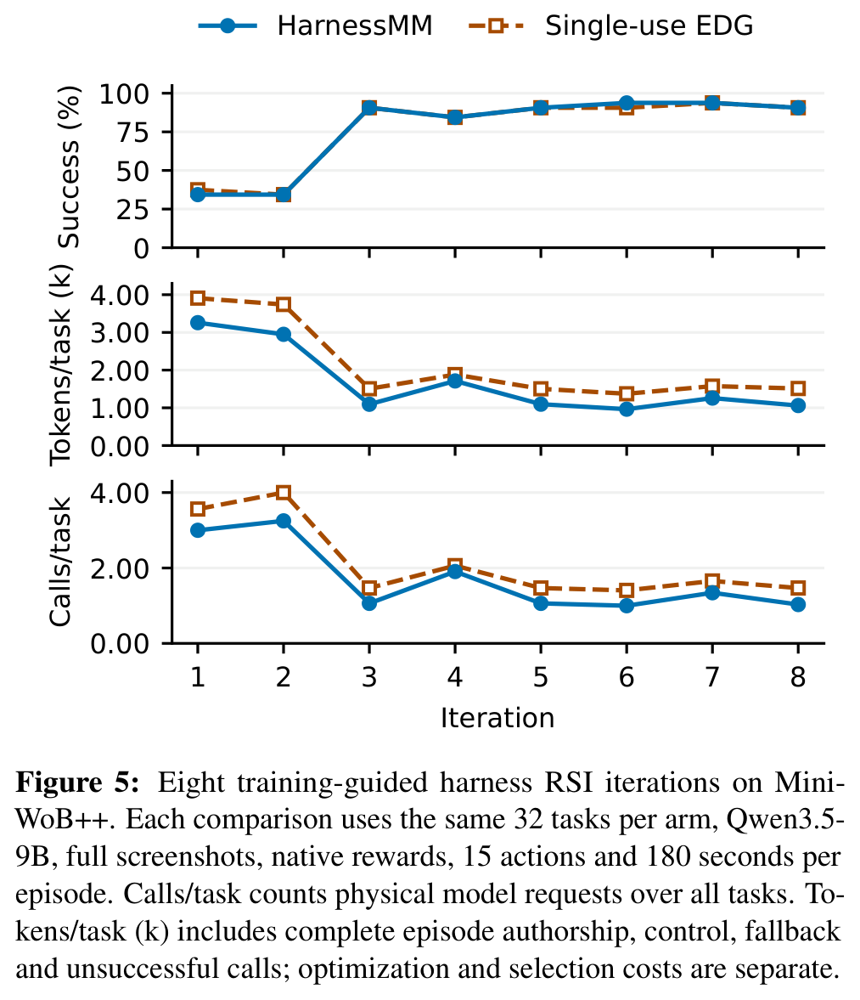
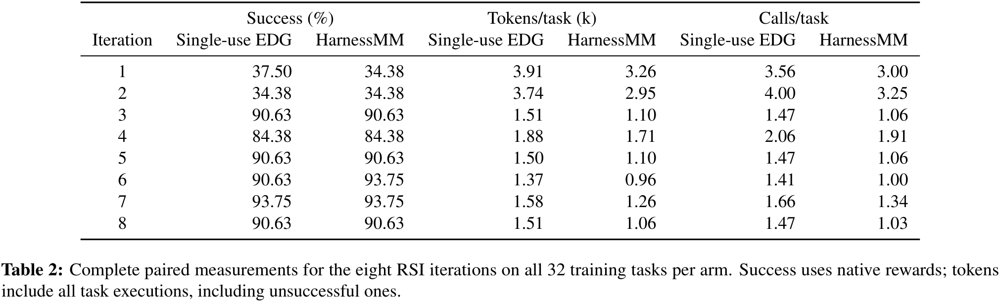

> 一句话：让 agent 别再花钱重想已经想好的下一步，只有没见过的情况才回头问模型。

## 0. 读之前你需要知道

**术语卡**

- **Agent harness（智能体外壳）**：套在大模型外面的一层程序，把模型的思考变成工具调用，再把工具输出塞回模型。类比：餐厅里来回跑的服务员，把客人的话端给厨房，再把菜端回来。
- **Reasoning callback（推理回调）**：harness 每拿到一次工具结果，固定要打给模型的那一次调用。类比：服务员每端回一道菜，都得再跑回客人那儿问一句下一道点什么。
- **EDG（Executable Decision Graph，可执行决策图）**：一次慢思考顺手写下的一张后续动作清单，每个动作带死参数和放行条件。类比：出门前的便条——下雨就打车、堵车就地铁，连目的地和车费都写死了。
- **Guard（守卫）**：一段只看公开信息（工具回执、文件在不在、返回码）的判定函数，决定便条上哪一条现在能执行。类比：便条里的「如果……」。
- **Substitution Paradox（替换悖论）**：加了快通道却没删掉原来的慢通道，账面反而更贵。类比：请了助理回消息，可每条你还得亲自再看一遍。
- **RSI（Recursive Self-Improvement，递归自我改进）**：拿训练集的执行反馈改 harness 配置，改完再跑、再改，一轮轮往上迭。

**它站在谁肩上**

- ReAct（2022）：把思考—动作—观察串成循环，今天所有 harness 的祖型。它定义了循环长什么样，没管循环里哪几步多余。
- LLMLingua / LongLLMLingua（2023–2024）与 Talker–Reasoner（2024–2026）：前者压提示词与历史、后者把快慢模型拆开。一个让单次调用更便宜，一个换谁来想，但慢调用照样在。
- Voyager 与 LLMCompiler（2023–2024）：把技能库、工具依赖编译成可复用程序。复用的是跨任务套路，执行时还得模型补这一步的参数。
- APE / STOP / ADAS / Self-Refine（2022–2025）：用反馈改提示词、改程序、改 agent 配置。改完部署时哪些回调会重复，没人记账。

## 1. 动机

假设你在厨房做一道没做过的菜，菜谱上写着「水开后下盐」。你把火打开，等水开，掀开盖子看一眼——这中间你不需要把菜谱从头再读一遍。可如果有个死板的助手，你每掀一次锅盖，它就要把整页菜谱重新念一遍，只为了告诉你下一句还是「下盐」。不收费的时候这叫啰嗦，按字收费的时候这叫烧钱。

**以前怎么做**：现成的 harness 都是 ReAct 式循环——模型思考、调工具、看结果、再思考。省钱的工作分两路：压缩每次调用的输入，或做路由（这次交给快模型还是慢模型）。两路都默认循环的形状不能改。

**为什么不行**：作者抓的事实很干净：有些思考根本不必发生。写完一个程序，下一条命令编译在执行前就定了；编译返回成功，下一条跑测试也定了。真正未知的只有工具会回什么回执，不是下一步该干什么。于是慢模型被反复叫起来，重新推导一个语义上没变的决定。更糟的是，加快通道也未必省钱——如果快通道只加了一个决策点、却没删掉下游那次慢思考，总账就是原来的成本加新增成本。作者把这个记账错位叫**替换悖论**（Substitution Paradox）。

**为什么现在能做**：其一，harness 有了稳定的公开接口，工具回执、返回码、文件状态都读得到，判断下一步能不能放行不必窥探模型内部。其二，主流 harness 暴露了可注册的 callback 边界，能精确记下这一次慢调用被跳过了，节省变成可审计的证据。其三，评测已按整条 episode 记账，作者化、选择、回退这些新增开销有了地方可写。

## 2. 贡献

- **把已经解决的决定变成可执行对象**。证据：EDG 用一个四元组存下动作、字面参数、前驱、公开守卫（第 4.2 节式 4），让上一次思考能在后面的工具边界上直接执行。
- **给出复用与替换的判定条件**。证据：GDR 的合格集公式（式 5）加上 CCS 的替换证书（式 6、7），证书绑定的是被跳过那个 callback 的 id。
- **在两个真实 harness 上跑完整对比**。证据：HumanEval 全部 98 题，Codex 成功率守住 90.82%、Tokens/task 从 66.72 降到 47.02（省 29.54%）；DeepSeek Harness 成功率从 71.43% 升到 85.71%、96.28 降到 11.62（省 87.93%）。
- **把复用和替换拆开做消融**。证据：MBPP 257 题，去掉 GDR（图只用一次）成本涨 26.91%，去掉 CCS（保留慢回调）成本涨 19.52%（表 3、表 4）。
- **一条 8 轮的 harness RSI 曲线**。证据：MiniWoB++ 32 题训练集，成功率 34.38% 升到 90.63%，Tokens/task 从 3.26 降到 1.06（图 5）。

## 3. 创新点

- **新在哪：复用粒度从「技能」降到「这一步的字面动作」**。对比对象：Voyager 的技能库、LLMCompiler 的工具依赖图。有用是因为：技能是跨任务模板，执行时模型还得决定填什么参数；EDG 的参数执行前就写死了，执行可以整段绕开模型。类比：技能库是「会做红烧肉」，EDG 是「今晚六点、两人份、少糖、用这口锅」——后者才不用再问一次。
- **新在哪：守卫只读公开回执，不读模型的心**。对比对象：各种学出来的 router 与快慢编排。有用是因为：路由解决谁来想，守卫解决要不要想，省的东西不是一回事。
- **新在哪：替换必须留证**。对比对象：所有看起来变快了的工程优化。有用是因为：证书绑定被跳过的 callback id，把省了 token 从自我报告变成可核对的事实，也顺手挡住一种偷换——少调几次不等于答对。
- **新在哪：成本口径定到整条 episode**。对比对象：只报单次调用长度或 fast-path 命中率的工作。有用是因为：作者要求作者化、选择、上下文、回退、失败执行全计费，否则省下的调用会被新增开销吃掉。

## 4. 方法

### 4.1 整体流程

一句话解释这张图：慢思考被叫起来的时候，顺手把未来几步写在一张便条上；之后每次工具回执到了，控制器先看便条能不能撕下来用，能就直接执行，不能才回去叫慢思考。

作者强调一个边界：HarnessMM 只改「什么时候调用推理模型」，模型权重、工具、任务接口一律不动。控制器插在原生决策边界上，通过公开状态适配器、慢调用入口、原生动作分发器三个口子接进去。

### 4.2 模块拆解

**EDG：把未来的动作提前写死**

为什么需要：如果复用只停在一个抽象计划上，执行时还得让模型把参数补齐，那这次慢调用并没有真的省掉。

怎么做：慢思考在第 $i$ 个决策点除了给出当前工具动作，还吐出一张有界的有向无环图。图上每个未来节点是一个四元组，参数必须是字面量，依赖必须闭合。

$$
B_i = \{d_1, \dots, d_m\}, \qquad d_j = (a_j, \mathrm{arg}_j, \mathrm{pred}_j, g_j)
$$

这个公式在说：一张图就是一张便条，便条上每一行有四个格子。

- $B_i$：第 $i$ 次慢思考写下的未来节点集合，节点数有上界。
- $a_j$：原生的工具动作，比如一次文件写入、一条 make 命令。
- $\mathrm{arg}_j$：这一步的完整字面参数，不留占位符，执行前不需要再生成。
- $\mathrm{pred}_j$：前驱节点，决定这一步什么时候才算就绪。
- $g_j$：公开守卫，签名为 $g_j: S_{\text{public}} \to \{\text{true}, \text{false}\}$，只吃公开状态。

**GDR：判断便条上哪一条现在能撕下来用**

为什么需要：图会跨过好几次工具边界一直躺着，得有个东西不停地把「已完成」和「守卫为真」两个事实叠起来，才知道当前能执行哪一条。

怎么做：每来一条回执，就更新前驱完成表和守卫真值表，然后算出合格集合。合格要求三条同时成立：前驱已完成、守卫为真、参数闭合。守卫只吃观测到的回执，绝不吃预测的结果；证据不足、依赖未到、参数需要重新猜的，一律交回慢思考。

$$
\mathrm{eligible}(d_j, s_t) = \mathbb{1}[\mathrm{pred}_j\ \text{completed}] \cdot \mathbb{1}[g_j(s_t) = \text{true}] \cdot \mathbb{1}[\mathrm{arg}_j\ \text{closed}]
$$

这个公式在说：一次动作能不能免掉推理，取决于三个开关是不是同时打开。

- $s_t$：第 $t$ 个工具边界上的公开状态，包含任务请求、已观测到的工具回执、已完成的动作历史。
- $\mathbb{1}[\cdot]$：指示函数，条件成立取 1、不成立取 0，三项相乘等于逻辑与，任何一项为 0 就不合格。
- $\mathrm{arg}_j\ \text{closed}$：参数闭合，指 schema 校验和候选成员检查都通过，没有待绑定的占位符。

合格集里只剩一个节点时走确定性路径，选择器一个 token 都不花；多个时用受 Jev 启发的类型化选择器，只回一个候选 id 或弃权。选择器只挑 id，没有改参数的能力。

**CCS：执行并留下跳过的证据**

为什么需要：光说自己省了不算数。要把「这一次慢调用确实没发生」变成可核对的东西。

怎么做：把合格的节点通过原生工具接口真跑一遍，把结果和原本该被跳过的那个 callback 绑在一起，签发一张替换证书。

$$
\kappa_t = (\text{graph hash},\ \text{decision id},\ \text{predecessor receipt},\ \text{exact args},\ \text{tool receipt},\ \text{bypassed callback id})
$$

这个公式在说：一张证书就是一份六项俱全的回执，把「哪张图、哪一步、上一步回了什么、执行了什么参数、工具回了什么、跳过了谁」全部钉死。

- $\text{graph hash}$：作者化图内容的指纹，改一个字就对不上。
- $\text{decision id}$：被执行的节点编号。
- $\text{predecessor receipt}$ 与 $\text{tool receipt}$：前驱完成证据和本次真实工具结果。
- $\text{bypassed callback id}$：原本注册在这个边界上的慢调用标识，这是整张证书的落点。

审计时除了比对这六项，还要验一条计数不等式：

$$
N^{\text{parent}}_{\text{slow},t} - N^{\text{HarnessMM}}_{\text{slow},t} \ge 1
$$

这个公式在说：在同一个注册边界上，慢调用的次数至少得少一次。

- $N^{\text{parent}}_{\text{slow},t}$：原始 harness 在该边界登记的慢调用计数，作为对照基准。
- $N^{\text{HarnessMM}}_{\text{slow},t}$：加了 HarnessMM 之后同一边界上的慢调用计数。

作者对证书的定位很克制：证书证明执行发生了、指定的慢调用没发生，不证明任务做对，也不估那次没发生的调用本来要花多少 token。任务对不对由原生评分器说话，钱花了多少由整条 episode 的账说话。

**RSI：用反馈改 harness 本身**

为什么需要：核心方法只决定这一次要不要调用推理，而作者提示词、上下文写法、收尾规则本身也影响回调和成本，需要一层外循环去调。

怎么做：当前 harness 在训练集上跑，把结果和 token 消耗当反馈，提出候选配置改动；与训练集不相交的验证集决定留哪个候选；选中的 harness 再提供下一轮训练反馈；测试前冻结。作者给改动设了一道闸门：候选必须真改了 harness、在两个验证切分上都不掉父代的 EM 和 F1、token 不超过原始 harness 的 90%，且至少改善一个质量或成本端点。

**整条 episode 的成本账**

怎么做：把一条 episode 里所有付费调用的输入加输出全加起来。

$$
C_{\text{episode}}(h; x) = \sum_{c \in \mathcal{C}(h,x)} \left( T^{\text{in}}_c + T^{\text{out}}_c \right)
$$

这个公式在说：一条任务的成本，等于它花掉的每一次调用的输入输出之和。

- $\mathcal{C}(h,x)$：harness $h$ 在任务 $x$ 上产生的全部付费调用集合。
- $T^{\text{in}}_c$、$T^{\text{out}}_c$：第 $c$ 次调用的输入和输出 token 数。

账本里明确要点名的：作者化、选择器输入输出、额外上下文、剩余慢调用、回退、恢复、收尾、失败但仍付费的执行；被缓存命中的输入照样计入。确定性守卫和原生工具只烧 CPU，不烧模型 token，所以不许折成 token 记进来。开发成本 $C_{\text{dev}}$ 单独摊：用 $N$ 个部署任务摊，即 $C_N = C_{\text{dev}}/N + \mathbb{E}_x[C_{\text{episode}}]$。

### 4.3 关键细节

- **提交或延后**：每个决策点的规则是 $d_i = \hat{d}_i$（当候选在候选集里且门控 $c_i(\hat{d}_i)=1$），否则 $d_i = H_0(x, I_i, s_i)$ 走原慢路径。空候选集、状态不支持、候选被拒，三条路都回退。
- **参数不可变**：图作者化之后不许改，回执必须忠实，选择器只回节点 id 不回参数，于是复用节点执行的一定是当初写死的字面参数。这是结构保证，与任务是否成功无关。
- **依赖尊重**：每个节点实例最多分发一次，前驱未完成的节点进不了合格集；建图时的无环检查挡住「自己等自己」。
- **守卫不等于正确**：作者把这点写成显式假设 $\mathrm{eligible}(d,s)=1 \Rightarrow \mathrm{valid}(d,s)$，说明实现端只保证左边，右边由原生评测度量。字面闭合是句法限制，一条参数具体的命令照样可能语义上就是错的。
- **盈亏平衡**：设作者化与选择多花 $A$、回退多花 $F$、每个被消除的回调原本花 $c$，同轨迹估算下要 $K > (A+F)/c$ 才开始赚。作者补了一句：这只是覆盖率的依赖关系，不是实测节省的预测，因为被跳过的调用根本没跑，替换后的轨迹也可能不同。

## 5. 实验结果

**实验设置**

- **数据集与切分**：HumanEval 完整 164 题按 33/33/98 切（20/20/60 比例、确定性取整、seed 20261006）；MBPP-sanitized 完整 427 题按 85/85/257 切（seed 20261005）；ALFWorld 710/710/2133；SearchQA 验证 3,395 题；LiveMath 160 题；AIME 186/186/560；GAIA2 480 个场景；MiniWoB++ 训练 32 题。TRAIN 出候选、验证选冻结候选、TEST 只测一次。
- **骨干模型**：正文统一写作 the shared backbone，HumanEval/MBPP 那两对还被称为 Qwen-backed，但**具体型号与参数量全文没有点名**（原文未给）。能确认的是分族：Figure 2 的 (a)–(c) 用 Qwen3.5-9B、(d)–(f) 用 Qwen3.8-27B；Figure 3 的 (a)(b) 用 DeepSeek-flash、(e)(f) 用 MiMo-v2.6-pro；MiniWoB++ 与 ALFWorld 消融用 Qwen3.5-9B。
- **训练预算**：原文没给卡数和卡时（原文未给），给的是每条轨迹的预算——HumanEval/MBPP 每题一次尝试、每臂两个 worker、actor 300 秒与 verifier 30 秒上限；MiniWoB++ 每臂 32 题、15 个动作、每 episode 180 秒；ALFWorld 历史长度 2、步数上限 50；RSI 跑 8 轮；AIME 上 SkillOpt 跑满 3 轮、AutoSaddler 4 轮。开发成本与执行成本分开记账。
- **基线**：主对照是各自的原版 harness（Codex、DeepSeek Harness）；跨方法对照用 No Skill、SkillOpt、AutoSaddler；机制对照是作者自己加的消融——W/o GDR（图只用一次）、W/o CCS（保留慢回调）、W/o EDG execution（禁图但仍付作者费）。所有臂都拿到同一份 token 效率提示词和同一个降低整条 episode token 的目标。
- **指标**：Pass/Success/EM/Accuracy 越高越好，按各基准官方评分器；Tokens/task (k) 是每条任务的平均付费输入加输出 token（千为单位），含失败执行，越低越好；Calls/task 数物理模型请求；Bypasses 数带证书的替换次数。
- **推理设置**：多数设置为 temperature 0、关闭 thinking、单序列、固定 seed（20260905/20261005/20261006/20261007/20261009/20260928 等按实验各自固定）；输出上限分基准不同——QA 草稿 512 token、ALFWorld 单次 512 token、AIME/GAIA2 共 32,768 token 输出容量、LiveMath 256 token 且要求前 20 个 token 内给出答案。裁判就是各基准原生评分器，没有另设 LLM judge。

**主表**（文字提炼版）

| 数据集 / 任务 | 指标 | 本文 | 最强基线 | 提升 |
| --- | --- | --- | --- | --- |
| HumanEval（98）Codex 对 | Tokens/task (k) | 47.02 | 66.72 | −29.54%（原文） |
| HumanEval（98）Codex 对 | Pass (%) | 90.82 | 90.82 | 持平 |
| HumanEval（98）DeepSeek 对 | Tokens/task (k) | 11.62 | 96.28 | −87.93%（原文） |
| HumanEval（98）DeepSeek 对 | Pass (%) | 85.71 | 71.43 | +14.28 pp |
| MBPP（257）DeepSeek 对 | Tokens/task (k) | 10.61 | 53.98 | −80.35%（原文） |
| MBPP（257）DeepSeek 对 | Success (%) | 91.83 | 90.27 | +1.56 pp |
| MBPP（257）Codex 对 | Success (%) | 90.66 | 91.83 | −1.17 pp |
| MiniWoB++（32，第 8 轮） | Tokens/task (k) | 1.06 | 1.51 | −29.83%（原文） |

**原文主结果表**

表 1：加 HarnessMM 之后，模型调用数、Tokens/task 与带证替换次数一起变；DeepSeek 那一对从 954 次调用掉到 415 次、147 次带证替换，是全文最强的单点证据。

**原版 harness 上的四个成功/成本面板**

图 3：工业 harness 的四组配对——HumanEval 与 MBPP 上 DeepSeek Harness 的成功率和成本同时改善，而 Terminal-Bench 2.0 那组在成本降七成的同时成功率也掉了两成多。

这个落差值得单独标出来：Terminal-Bench 2.0（n=18）上 Codex 从 77.78% 掉到 55.56%，DeepSeek Harness 从 55.56% 掉到 50.00%，成本分别从 3426.78 降到 1089.95、从 1586.15 降到 1144.32。作者把这两块标成 development measurement，品质约束没有被满足。

**配套配置的六基准质量—成本**

图 2：六个基准上 HarnessMM 只有 ALFWorld、SearchQA、LiveMath 三块同时拿到更高分和更低 token，AIME 与 GAIA2 是「更便宜但没更强」，Terminal-Bench 那块是「更强也更便宜但样本是归档的部分快照」。

读这张图必须配合作者附录 D.5 的对照表：Figure 2 里绝大多数面板改的是配套配置（指令内容、输入路由、答案优先提示、输出上限），EDG 执行只在 GAIA2 那块真接上。所以这六个面板测的是配套配置，不是核心机制的独立证据；作者写在了 D.5，正文叙述却容易让人误读成机制功劳。

**消融：复用与替换各自值多少**

图 4：上排六个指令条件说明指令内容本身就能拉开 25 个百分点的成功率差距；下排四个执行条件里，全量 HarnessMM 的成功率不是最高的（95.33 的 W/o EDG execution 更高），它赢在成本。

**原文消融表**

表 3：257 题同集对照，全量 93.77% / 13.17，去掉 GDR 变成 93.00% / 18.03，去掉 CCS 变成 93.39% / 16.37，禁掉图执行变成 95.33% / 16.19。

**消融告诉我们什么**

- 持久复用值钱：全量相对单次图省 26.91% 成本，任务配对 bootstrap 区间 [4.01, 45.57]% 不含 0。全量做了 407 次带证替换，其中 201 张图被执行两次以上；单次图只做 212 次就把图扔掉。
- 回调替换也值钱，但证据弱一档：相对保留回调省 19.52%，区间 [−2.07, 38.68]% 含 0；作者写明证书只验证删掉了，证书本身的独立收益没做消融。
- 最扎眼的一行是 W/o EDG execution：95.33% 比全量 93.77% 高 1.56 个百分点，成本 16.19 比 13.17 高。全量少花 18.62% 的钱，代价是少做对 4 道题。区间 [−5.45, +2.33] 不显著，但方向摆在那里——省下的钱里有一部分是拿正确率换的。
- 指令消融给出另一条警示：去掉任务族指令只省 2.75 token 却掉 3.69 个百分点；换成等长中性文本，成本涨到 43.26 还掉 24 个百分点。指令内容在 ALFWorld 上是比执行机制更大的杠杆。

**RSI 那一节**

图 5：八轮里成功率在第 3 轮就跳到 90% 附近然后走平，成本却一路往下走——成功率的跳变两条曲线同时发生，成本的差距才是持久复用带来的。

**RSI 的逐轮数字**

表 2：逐轮配对数——第 3 轮两条曲线同时到 90.63%（成本 1.51 对 1.10），第 6 轮 HarnessMM 是唯一一次成功率更高（93.75 对 90.63），第 8 轮双方都是 29/32 但成本 1.51 对 1.06。

这里要标一个我的推断：成功率从 34.38% 涨到 90.63% 发生在第 3 轮，而两条曲线是同步跳变的，两条臂共用同一套 RSI 外循环、只在图是否持久保留上不同。所以这次跳变是 RSI 改指令与视觉 grounding 的功劳，不是 EDG 的；EDG 的功劳在成本线——第 8 轮双方都做对 29 题，持久复用省 29.83%（1.51 对 1.06，区间 [18.84, 39.00]%），Calls/task 从 1.47 降到 1.03，其中 16 次是图内的第二次及以后执行。

**这些实验够不够支撑结论**

我的判断：核心机制在 HumanEval/MBPP 上够，往外推广不够。

够的部分：同批任务、同骨干、同评分器、整条 episode 记账，还把 GDR 与 CCS 拆开做了消融，这是少见的干净账。DeepSeek 那一对的 McNemar 双侧精确检验 p=0.0161（22 改善 / 8 退化），质量提升不是噪声；Codex 那一对 p=1（5 改善 / 5 退化），作者也只敢说守住。

不够的部分有三处。一是骨干没点名，无法判断这套省法换模型后还剩多少——图 3 的 MiMo 面板里 DeepSeek Harness 的成本已从 11.62 压到 4.40，底子越省、余量越小。二是六个配套配置面板里真正接了 EDG 的只有 GAIA2 一块，其余是指令与上下文改动，混在一张图里容易高估机制。三是样本量，Terminal-Bench 2.0 只有 18 题、GAIA2-mini 只有 32 题。

## 6. 局限性

**作者自己承认的**：节省依赖服务商的输入、缓存、上下文计费口径，也依赖「有已解决的动作可用」这个前提；新的语义决策必须回到慢思考；作者化、选择、恢复的开销可能超过被省下的调用；public-state 适配器是任务专用的，没法自动推出来；开发集小，策略层面的质量差异不确定。

**我看出来的**

- 隐形假设：这套方法要成立，必须默认慢思考在写下便条那一刻，就已经把动作的语义和参数定死了。作者在 D.2 把这条写成假设 $\mathrm{eligible}(d,s)=1 \Rightarrow \mathrm{valid}(d,s)$，并承认实现端只保证左边。守卫通过只说明公开条件满足了，不说明这一步语义上是对的。
- 边界条件：一旦任务里有分支要看输出内容才能决定（测试挂了要读错误信息再改代码），便条就废了，必须回退。收益上限由任务可预测性决定，代码题是它最舒服的场景，开放式网页任务差很多。
- 缺的对比：作者在 D.4 承认没和 ReWOO、LLMCompiler、ActionEngine 这些可执行规划系统做实验对比，只和两个原生 harness 比。所以本文证明的是对这两个 harness 有用，不是比所有可执行规划器都好。
- 账本的软肋：token 少不等于快、不等于省电，作者明确写了延迟和能耗要单独测，本文没测。缓存命中的输入照样计入，但不同服务商缓存计价差异很大，跨厂商比 Tokens/task 说服力有限。
- RSI 那一层很脆：附录 B.2 的一次规则开发试点里，8 个提案有 6 个被字面重叠守卫拦掉，剩下两个有效的三规则改动只加了 0.06 输入 Tokens/task、质量没涨，最后四个臂的最终请求字节完全一样。这段在附录，却是全文对 RSI 最诚实的注脚——外循环经常空转。

## 7. 一句话总结

这篇论文做的事，是把 agent 里「已经想好但还没执行」的决定提前写死，之后只验证条件是否满足就直接执行，从而把一次慢思考的产出摊到好几次工具调用上。

类比：好司机不会每个路口都重新查一次导航。出门前看一眼路线，记住过了这座桥右转、看到加油站就加油，路上只确认路标对不对，不对才重新导航。HarnessMM 就是给 agent 装上这个记住路线、只对路标的习惯，RSI 是回家后复盘哪段路绕远了、下次改路线。

核心式子（这套方法的看家条件，能不能赚就看它）：

$$
\boxed{C_{\text{removed}} > C_{\text{introduced}}}
$$

- $C_{\text{removed}}$：被真正删掉的那些慢调用原本要花的 token，含作者化图里省下的推理。
- $C_{\text{introduced}}$：新加的作者化、选择器、额外上下文、回退与恢复。

## 8. 可复用点

- 如果我要在自己的项目里用：先别急着上模型，先把 harness 日志按工具回执 → 下一次模型调用切对，数一数有多少次调用的动作在回执到来前就已确定。这个比例就是天花板，低于三成不值得做。
- 如果我要在自己的项目里用：放行条件写成只依赖公开回执的纯函数（返回码、文件存在性、字段是否为空），别让它去读模型的自然语言理由。守卫一旦开始解释语义，就从判据退化成了猜测。
- 训练不收敛时先查：先查账本口径，别先调参。作者化、选择、回退三项不计进成本，任何省了的结论都是假的。
- 想做 RSI 时先查：改动必须有闸门。作者的闸门是真改了 harness、两个验证切分不掉 EM/F1、token 不超过原始 90%、至少改善一个端点；没这道闸门，外循环会稳定空转（附录 B.2 的 8 个提案就是例子）。

## 9. 我的疑问

- 骨干到底是谁？正文和附录统一写 the shared backbone，只有 MBPP 那处叫 Qwen-backed，型号与参数量全文没点名。这个缺口让 HumanEval 上 87.93% 的节省没法判断是模型特性还是方法特性。
- Codex 那一对的 29.54% 里，多少来自 EDG 执行、多少来自紧凑公开上下文与 harness 专用收尾？作者在 5.3 节承认总调用数差异不是证书的孤立效应，但没给拆解。
- W/o EDG execution 成功率更高（95.33 对 93.77），这个方向换个基准还成立的话，这套方法在正确率优先的场景里就是负收益。作者用区间含 0 推给不确定性，没做多基准复核。
- Terminal-Bench 2.0 上成功率掉两成多、成本掉七成，这个交换在什么条件下可接受？作者标成 development measurement 就带过了。
- 证书的独立收益没做消融（作者明说），所以留证目前只是可信度收益，不是成本收益。要做这个消融，大概得设计一个「不留证但同样执行」的对照臂。
