> 一句话：让模型照抄自己上一轮写过的答案当草稿，再由它自己审核签字，训练因此变快。

## 0. 读之前你需要知道

这篇论文的问题很具体：RL 训练最慢的一段是模型自己写答案，作者想让它写快，同时保证写出来的东西一个概率都不变。可类比：给一个很会写周报的人配个只会照抄的实习生，按上周稿子拟一份，人只逐段核对。

**术语卡**

- **rollout**：模型对着一个题目写出一整段答案的过程与产物，这里就是它写的那段 SQL 或解题步骤。类比：学生交上来的一份答卷。
- **GRPO**：现在训推理模型最常用的 RL 算法，不训价值网络，把同一道题采样一组答案、按组内名次发奖励。类比：一个班同考一张卷，只按排名发奖，不设绝对分数线。
- **投机解码**：先让一个小东西飞快猜后面几个词，再让大模型一次性核对；对上的直接收，错的位置按大模型分布重采。类比：秘书按模板拟好回信，老板只签字。
- **草稿器（drafter）**：负责猜词的那个东西，可以是小模型、额外解码头或一段缓存，即上面那位秘书。
- **目标模型**：负责核对的大模型，也就是正在被训练的策略本身。
- **接受长度**：一次核对连对几个词。连对越多，一次前向记账越多 token。
- **n-gram**：连续 n 个 token。这里拿它当查表的键——前 n−1 个 token 是键，第 n 个是值。
- **查表（LUT）**：一张字典，键是上下文，值是历史上这个上下文后面跟过哪些 token、各几次。
- **无损（lossless）**：加速前后输出分布数学上相等，不是近似。
- **预取（prefetch）**：趁 GPU 还在算，CPU 提前把下一步要用的东西备好。类比：锅里焖着，先把下一道菜的料切了。
- **TPS**：一次目标模型前向平均记账多少 token，等于 1 加平均接受长度。
- **exposed host time**：CPU 在干活、GPU 只能干等的那段时间。整套系统设计都在削这一段。

**它站在谁肩上**

- 投机采样（Leviathan 等 2023；Chen 等 2023）：证明草稿加验证能在不改分布的前提下加速，本文 Eq. (1) 直接搬这套。
- Medusa（2024）、EAGLE（2024）：把草稿做成解码头或特征级小模型，接受率高但要训练、要占显存，正是本文要绕开的一类。
- Prompt-lookup decoding（PLD，2023）：不训模型，在当前上下文里找重复 n-gram 当草稿，便宜但推理题上几乎没匹配。
- REST（2024）：从固定数据仓库检索续写，仓库是死的而策略是动的。
- SuffixDecoding（2026）：把历史输出存进 CPU 侧后缀树，结构化任务上很强，是本文最直接的对手；它服务固定模型，本文在训练循环里。
- verl（2025）：本文把缓存挂进 verl 的 vLLM rollout worker，不动奖励模型、优化器和策略结构。

## 1. 动机

每周给同一个客户写周报，上周那份改两个数字就行。正常人的做法是复制上周的稿子逐段核对，不会从空白页重写。核对比重写快一个量级，结果还一字不差。

RL 的 rollout 就是这份周报。GRPO 每一步都从同一批题目里重新采样，而权重一步只挪一点点，所以这轮写出来的答案往往和上轮几乎一样。作者量了这个重复：同一道 Spider 题隔一个 epoch 的 rollout，重合片段长达 7 到 23 个 token，只用上一轮那一条建缓存就能覆盖后一条的 48% 到 96%。

**以前怎么做**：加速 rollout 的标准答案是投机解码，找草稿器先猜 16 个 token，大模型一次前向全核对，对上的整段记账。

**为什么不行**：作者列了三条，每条都戳在 RL 的具体处境上。

- **显存已经满了（C1）**：训练时显存被策略权重、优化器状态、梯度和 KV cache 四家分。再加草稿模型或一组解码头，等于往挤爆的房间里再塞一张床；Medusa、EAGLE 还要在 GPU 上做投机计算。
- **目标是动的（C2）**：模型式草稿器默认目标固定。RL 每步都改策略，用某一步快照训出来的草稿器下一步就过期，接受率随训练单调下滑。RL 恰恰是长训练，这个毛病最致命。
- **重复不在上下文里（C3）**：模型式思路是让草稿器学会预测，无模型式思路是让它去抄。抄看着更适合 RL，但 PLD 只在当前提示词和已生成内容里找重复，而推理答案和题目几乎没有字面重叠，找不到可抄的段落。

**为什么现在能做**：GRPO 的采样循环自己制造了这个信号。同一批 prompt 跨 step、跨 epoch 反复出现，策略增量变化，于是上一个 epoch 的 rollout 就是一份免费的、自动跟着策略走的草稿库，不需要额外参数、不需要训练、不占显存。结构化任务把性质放大：text-to-SQL、代码、工具调用有强语法规整性，同一 prompt 的不同 rollout 共享 schema 名、关键字和固定句式，重复成段出现。

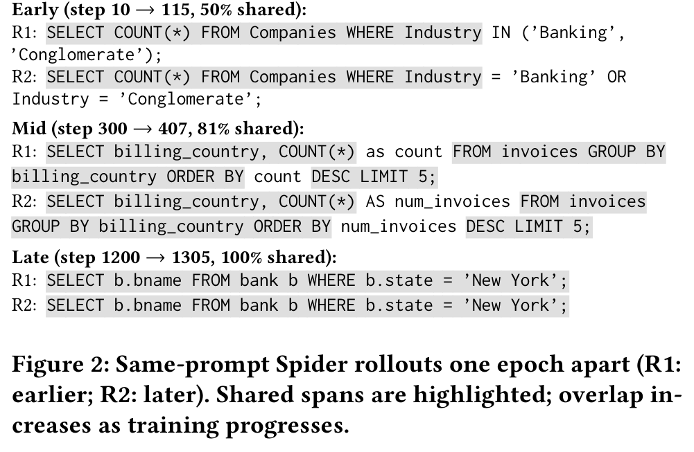

图 2：同一道 Spider 题目隔一个 epoch 的两条 rollout，高亮是重合片段。早期只共享查询骨架（50%），中期 81%，后期整条 SQL 逐字相同（100%）。这就是要榨取的冗余，它随训练自己变强。

## 2. 贡献

- **讲清了 RL rollout 的时序局部性**。证据：相邻 epoch 的 rollout 重合 7 到 23 个 token，单条历史 rollout 覆盖后一条的 48% 到 96%；图 2 按早中晚三段摆出重合率从 50% 涨到 100%。
- **提出 NgramRL：完全由历史 rollout 构建、按 prompt 分桶的自更新 n-gram 草稿器**。证据：不需辅助模型、不需训草稿器、不占常驻显存，有界窗口把 host 内存与策略错配一起压住（表 3）。
- **自适应 fan-out 预取器，把 CPU 侧整条链路藏到 GPU 后面**。证据：覆盖率 96.6%（Qwen3-8B/Spider，N=16）到 99.5%（DeepSeek-7B），实测 rollout 吞吐 1.38×，逼近 1.40× 的重叠上限（图 7b）。
- **两个模型家族、三个任务上的无损加速实测**。证据：热缓存区间每步记账 3.60 到 7.77 个 token，比 SuffixDecoding 最多高 1.99×，比 PLD 最多高 7.0×（表 1）。

这四条像一条产线的四个工位：探明矿在哪、定挖法、解决运输堵塞、最后排产。

## 3. 创新点

- **草稿源从模型或语料换成同一 prompt 的历史 rollout**。对比：Medusa/EAGLE 用小模型或解码头，PLD 用当前上下文，REST 用固定仓库，SuffixDecoding 用全局后缀树。有用是因为这份草稿由策略自己产出，策略变它就变，天然跟踪漂移，没有过期问题。
- **缓存按 prompt 分桶，且只留最近一段历史**。对比：SuffixDecoding 的全局后缀树，以及作者自己做的全局单桶消融。有用是因为同 prompt 的 rollout 之间比不同 prompt 之间更像，分桶把查找空间从全局缩到单题，接受率从 2.41 抬到 3.05（表 2）；把对手缓存扩四倍只到 2.65，说明瓶颈是缺 prompt 条件而非容量。
- **预取对象是验证结果 (j, b)，不是下一个 token**。对比：常规同步查表、以及只把查找做快的优化。有用是因为堵住 GPU 的不是查找耗时，而是同步与调度；只有把下一步的上下文事先算出来，整段主机时间才离开关键路径。
- **预算按因果边际收益分配**。对比：把 N 个候选平均摊给各分支。有用是因为接受长度分布有明确众数，全接受分支的 bonus 又有约 90% 落在头号候选，堆预算比平均摊划算。

## 4. 方法

### 4.1 整体流程

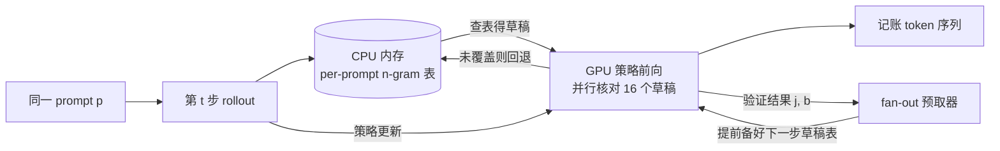

只看两条线：实线向下是正常解码（查表、核对、记账），虚线回路是本文加的预取（核对的同时把下一步的草稿表备好）。下半部分住在 CPU 内存里，所以不占显存。

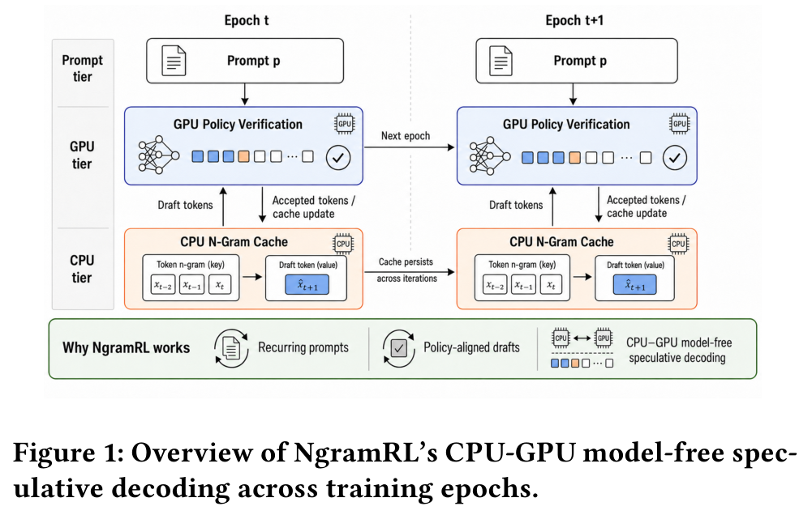

图 1：跨 epoch 的 CPU-GPU 分工。每个 prompt 一张表住在 CPU 侧，GPU 只做策略核对；表跨迭代存活，所以第 t+1 个 epoch 一开始就有草稿可用，这正是它和固定草稿器的根本差别。

### 4.2 模块拆解

**模块一：每题一张 n-gram 表**

为什么需要：要有一个不占显存、不用训练、还能跟着策略变的草稿来源。

怎么做：为每个 prompt 建一张表 $C_p$。第 $t$ 步采完 rollout，把所有长度在 $[n_{\min}, n_{\max}]$ 的 n-gram 切出来，以前 n−1 个 token 为键、第 n 个 token 为值插进表里，值上记出现次数和最后出现的步号。每步做一次自更新：淘汰步号早于 $t-W+1$ 的条目，于是表里只留最近 $W$ 步的历史。

符号：$C_p$ 是第 $p$ 题的表；$n_{\min}$、$n_{\max}$ 是阶数上下界，是显存与草稿质量的取舍；$W$ 是保留的步数窗口；$t$ 是当前步。这里没有任何可学参数，靠的是记下来而不是学会。

**模块二：草稿与验证**

为什么需要：抄历史必须保证抄错时不改变输出分布，否则训练动力学就变了。

怎么做：解码到某位置，拿上下文去 $C_p$ 找最长匹配的 n-gram，把它记录过的续写当草稿；没匹配就退回普通解码。草稿交给策略，一次前向并行核对。

$$
p_{\text{acc}}(x) = \min\!\left(1,\ \frac{\pi_\theta(x \mid c)}{q(x \mid c)}\right)
$$

先说它在算什么：给上下文 $c$ 和草稿给出的 token $x$，算这个草稿该以多大概率被接受。策略越认可（$\pi_\theta$ 越大）越容易收下；草稿自信而策略不认（$q$ 大而 $\pi_\theta$ 小）就越容易被拒。

- $x$：被草稿提出的 token，取自词表。
- $c$：该位置的上下文，即已生成的前缀。
- $\pi_\theta(x \mid c)$：当前策略在 $c$ 下给出 $x$ 的概率，是要保护的目标分布。
- $q(x \mid c)$：草稿给出的概率。
- $p_{\text{acc}}$：接受概率，取值 $[0,1]$。

拒绝时不直接换掉，而是从归一化的正残差 $(\pi_\theta(\cdot \mid c) - q(\cdot \mid c))^+$ 重采。这是标准投机采样修正，保证被接受的 token 服从 $x \sim \pi_\theta(\cdot \mid c)$，与草稿长什么样无关。于是 rollout、奖励、优势、梯度的分布都与非投机训练相同，作者据此声称准确率与收敛不受影响。

**模块三：fan-out 预取器**

为什么需要：表住在 CPU 上，省了显存却把两个处理器串起来。作者实测同步版本每个解码迭代 26.1 ms，GPU 忙 18.6 ms、空等 7.5 ms，空等占 29%；查表在空等里只占很小一块，大头是同步和调度。把查找做快解决不了问题，得把整段主机时间藏起来。

怎么做：难点在于第 $t+1$ 步的查找上下文由第 $t$ 步的验证结果决定，而这个结果是一对 $(j, b)$——接受长度 $j \in \{0,\dots,k\}$ 和第 $j+1$ 个位置目标模型吐出的 bonus token $b$。$j$ 有 $k+1$ 种取值且 CPU 知道；$b$ 是在 GPU 上从整个词表采样出来的，核对结束前谁也不知道。作者的解法是不等 $b$，而是预测 $b$。

于是第 $t$ 步前向进行时，预取器就为第 $t+1$ 步建一张以 $(j,b)$ 为键的草稿表：对每个拿到预算的分支 $j$，从 $C_p$ 取上下文延长 $j$ 个已接受 token 之后频率最高的前 $f_j$ 个候选当 bonus，每个候选发一次查找，拼出对应的 $k$ 个草稿 token，整张表在前向返回前搬到 GPU。核对完得到真实 $(j^*, b^*)$，GPU 用 $O(1)$ 键探测直接取。命中（概率为覆盖率 $c$）时选中的草稿与顺序版本逐字相同，解码没有暴露的主机时间；未命中就丢弃这一条，只有该请求退回顺序查找，不卡住整个 batch。两种情况记账 token 都不变，Eq. (1) 仍成立，最差退化到同步基线。

$$
\max_{\{f_j\}} \sum_{j} \hat{P}(j)\, \hat{c}_j(f_j)
\quad \text{s.t.} \quad \sum_{j} f_j = N
$$

先说它在算什么：把总共 $N$ 个候选名额分给各接受长度分支，让预期覆盖率最大。

- $N$：候选预算总数，$N = \sum_j f_j$。
- $f_j$：分给分支 $j$ 的候选数。
- $\hat{P}(j)$：最近 $W$ 步的接受长度直方图，即走分支 $j$ 的概率。
- $\hat{c}_j(f)$：分支 $j$ 下真实 bonus 排在前 $f$ 个候选内的概率，从历史里估。
- 解法：按边际增益贪心。

效果是预算自动向接受长度的众数聚拢。全接受分支还有个好处：它的 bonus 就是一条已在缓存里的轨迹的下一个 token，约 90% 落在候选第一位，所以只需 $f_j=1$，小预算就能覆盖高接受率任务。

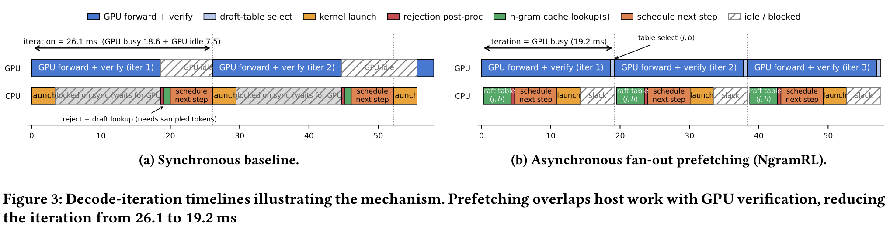

图 3：解码迭代时间线。(a) 同步版本每迭代 26.1 ms，GPU 有 7.5 ms 空等在被斜纹标出的 idle/blocked 区；(b) 预取版本把表选择和调度塞进 GPU 前向的阴影里，迭代塌缩成 GPU 忙碌时间 19.2 ms，CPU 一侧只剩一点 slack。

**模块四：成本模型**

为什么需要：得知道最多能赚多少、什么时候不值得做。

$$
\text{speedup}(c) = \frac{T_{\text{gpu}} + T_{\text{cpu}}}{T_{\text{gpu}} + (1-c)\,T_{\text{cpu}}}
\quad \xrightarrow{c \to 1} \quad 1 + \frac{T_{\text{cpu}}}{T_{\text{gpu}}}
$$

先说它在算什么：给定覆盖率 $c$，一个解码迭代相对同步版本能快多少。命中就把主机链藏掉，未命中就老实付这笔钱，所以分母里只有 $(1-c)$ 那一份暴露出来。

- $T_{\text{gpu}}$：每迭代的设备忙碌时间，由模型大小、batch 大小、草稿长度决定。
- $T_{\text{cpu}}$：必须被藏起来的串行主机时间，含核函数发射、拒绝后处理、查表、调度。
- $c$：预取覆盖率，被覆盖的迭代不付主机时间。
- $T_{\text{cpu}}/T_{\text{gpu}}$：决定天花板的那一个比值。

推论：$T_{\text{gpu}}$ 涨则能藏的比例变小；CPU 更吃紧的场合收益更大。另一条边界是预取链本身约 $N$ 次查找，必须塞进 $T_{\text{gpu}}$，$N$ 超过约 64 就逼近它要藏的时间，所以甜区很小，实测取 $N=8$ 到 $32$。

### 4.3 关键细节

- **n-gram 阶数**：$n_{\max}=6$。GSM8K/Qwen3-8B 上接受率到 6 阶饱和，再往上缓存体积超线性涨（图 6a）。$n_{\min}$ 原文未给，只说 $[n_{\min}, n_{\max}]$ 是显存与质量的取舍。
- **投机长度**：$k=16$，同样是拐点（图 6b），且不影响缓存大小。
- **历史窗口**：$w=4$ 就拿到完整接受率的 79% 到 91%，$w>16$ 后不再涨、GSM8K 上还略降（表 3）。
- **工程集成**：挂进 verl 的 vLLM rollout worker，缓存随 rollout 引擎走，奖励模型、优化器、策略结构一行不改，即插即用。
- **开销**：新增可训练参数为零，常驻 GPU 显存增量为零，代价转移到 host 内存（表 3 里最大 3634 MB）。

## 5. 实验结果

**实验设置**

- **数据集与切分**：GSM8K（自由形式数学）、Spider 1.0（text-to-SQL）、CodeContests（代码），按输出规整度成梯度选。训练/验证怎么切、各多少条、有没有剔子集，原文未给；只给了每步 64 个 prompt、共 15 个 epoch。
- **骨干模型**：Qwen3-8B 与 DeepSeek-LLM-7B，两个家族、都是 8B 级。更大尺寸没测。
- **训练预算**：2 张 NVIDIA A100 80GB，verl 跑 GRPO，rollout 由 vLLM 服务；每步 64 个 prompt、每个采 5 条 completion，训 15 个 epoch；其余按 verl 默认 GRPO 超参，所有基线共用同一套设置。学习率、KL 系数、全局 batch 原文未给。
- **基线**：Prompt-lookup decoding、REST、SuffixDecoding，统一草稿预算 $k=16$；SuffixDecoding 的全局后缀树缓存最近 10k 条回复，后文又扩到 40k 做上限对照。作者自己加的消融对照是同一套缓存改用全局单桶。
- **指标**：TPS，即每次目标前向记账的 token 数，等于 1 加平均接受长度，越高越好；它是标准无损加速代理指标，与 GPU 和 kernel 无关。报两个口径：全程均值、最后 30% 步的均值。另测 wall-clock 加速比与覆盖率 $c$。
- **推理设置**：rollout 由 vLLM 提供，温度、top-p、最大生成长度原文未给（称沿用 verl 默认）。吞吐测量用另一套 rig：单张 RTX PRO 6000（96GB）、32 核 AMD Ryzen Threadripper 9970X 当 host 扛缓存、bf16、batch 64、$k=16$，用 NVIDIA Nsight Systems 把迭代拆成设备忙碌时间与暴露的主机时间。裁判模型不适用（数学、SQL、代码用规则或测试判分），奖励模型的具体形式原文未给。

**主结果**

| 模型 + 任务 | 指标（TPS，末 30%） | 本文 | 最强基线 | 提升 |
| --- | --- | --- | --- | --- |
| Qwen3-8B · GSM8K | 每次前向记账 token | 4.36 | 2.32（SuffixDec） | 1.88× |
| Qwen3-8B · Spider | 同上 | 7.77 | 4.15（SuffixDec） | 1.87× |
| Qwen3-8B · CodeContests | 同上 | 3.60 | 2.96（SuffixDec） | 1.22× |
| DeepSeek-7B · GSM8K | 同上 | 6.81 | 3.64（SuffixDec） | 1.87× |
| DeepSeek-7B · Spider | 同上 | 7.71 | 3.88（SuffixDec） | 1.99× |
| DeepSeek-7B · CodeContests | 同上 | 6.19 | 3.99（SuffixDec） | 1.55× |

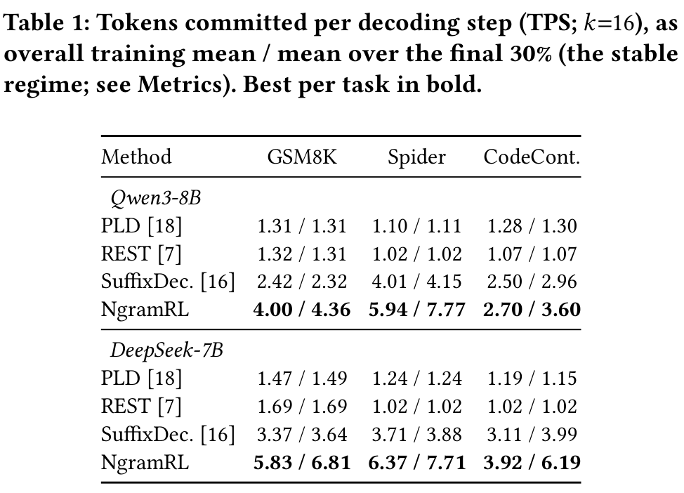

表 1：六个格子全部领先，优势随输出规整度变化，Spider 最猛（1.87× 到 1.99×）、CodeContests 最窄（1.22×）。口径是全程均值 / 末 30% 均值，全程均值含冷启动 epoch，所以每组都更低。

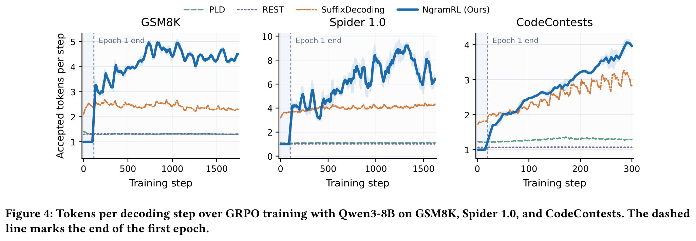

图 4：TPS 怎么长出来的。三条曲线在第一个 epoch 结束前都贴在 1.0（没有草稿被接受），prompt 第二次出现后 NgramRL 陡直拉起；GSM8K 和 CodeContests 全程走强，Spider 中段见顶后回落并大幅震荡，作者归因于 SQL 输出在多样化、旧 rollout 变旧。

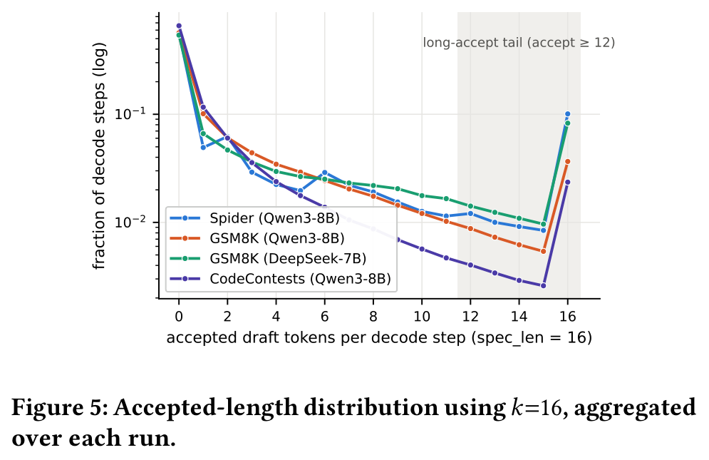

图 5：接受长度分布是重尾的，不集中在均值附近。Spider 有 14.1% 的步接受 12 个以上，最多 10.1% 的步把 16 个草稿全吃下——那是上一轮解法的逐字重放，一次前向记账 17 个 token。小预算（比如 $k=4$）会把这条尾巴整个丢掉，所以 $k=16$ 正是把重尾变成加速的关键。

**消融一：缓存结构**

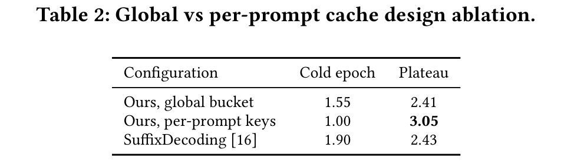

表 2：收益来自按 prompt 分桶这个结构选择，不是数据结构本身。同一套实现换全局单桶，平台期接受率掉到 2.41，几乎等于 SuffixDecoding 的 2.43；换回 per-prompt 键就回到 3.05。把 SuffixDecoding 缓存扩四倍到 40k 条也只从 2.43 抬到 2.65，瓶颈是缺 prompt 条件而非容量。

**消融二：历史窗口**

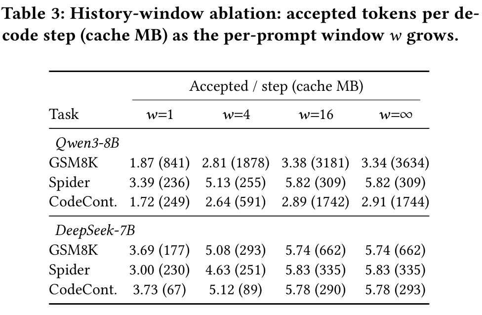

表 3：$w$ 从 1 加到 4 涨得最快，$w=4$ 已拿到满窗口的 79% 到 91%；再往上趋平，GSM8K 上 $w=\infty$ 甚至比 $w=16$ 略低（3.34 对 3.38），因为更旧的历史与当前策略不符。括号里是缓存占用，$w$ 从 1 到 16 内存涨了 3 到 7 倍，这是有界窗口存在的直接理由。

**消融三：超参**

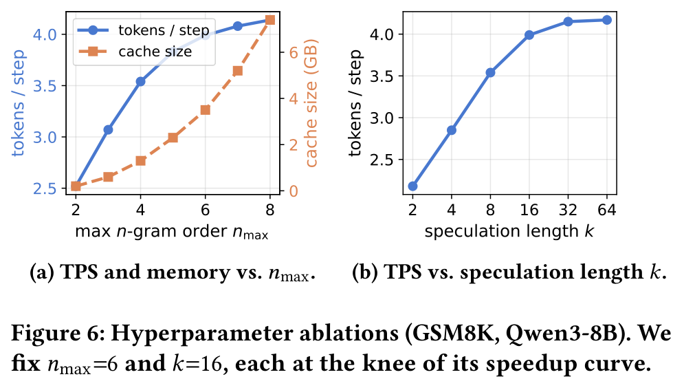

图 6：两个超参都取在拐点。接受率在 $n_{\max}=6$ 附近开始饱和，而缓存体积继续超线性涨，所以取 6；$k$ 到 16 饱和，取 16。这两个值在别的模型和数据集上直接搬用。

**预取器**

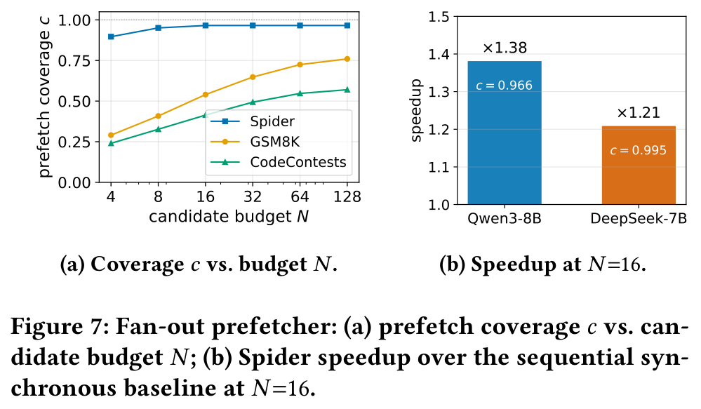

图 7：(a) 覆盖率随预算 $N$ 增长，Spider 只要 $N=8$ 就到 0.95、$N=16$ 到 0.97，GSM8K 与 CodeContests 到 $N=32$ 才 0.65 和 0.49，之后只有对数级增长。(b) 覆盖率换算成实测加速：Qwen3-8B 在 Spider 拿到 1.38×，逼近 1.40× 的重叠上限（$c=0.966$）；DeepSeek-7B 打满 1.21× 上限（$c=0.995$）。高熵任务只有 1.05× 到 1.06×，上限是 1.10× 和 1.14×。

**消融告诉我们什么**：三个消融各否掉一个可能的解释。表 2 否掉收益来自缓存更大——扩四倍追不上，换回分桶立刻追上；表 3 否掉历史越多越好——过 16 不再涨甚至倒退，正对应策略漂移；图 6 否掉阶数和长度随便开大——都在拐点饱和而成本继续涨。三条合起来说明增益来自结构（按 prompt 键控）与时效（近期窗口），不来自容量。

**这些实验够不够支撑结论**：支撑草稿效率更高是够的，六个格子、两个家族、三个任务、口径统一，且无损方法把比较干净地隔离在草稿效率上。支撑 RL 训练真的变快偏薄：全文没有端到端训练总时长，也没有 reward 或准确率曲线，加速只在解码迭代（26.1 到 19.2 ms）和 rollout 吞吐（1.38×）两个层面测到。实验也全停在 8B 级、$k=16$、$N=16$，更大 batch 会摊薄收益只有论断，没有实测。

## 6. 局限性

**作者自己承认的**

- 加速上限被 $T_{\text{cpu}}/T_{\text{gpu}}$ 锁死。模型或 batch 更大时 $T_{\text{gpu}}$ 涨，能藏的主机时间占比变小，收益摊薄。
- 预取链成本随 $N$ 线性涨，必须塞进 $T_{\text{gpu}}$；$N$ 超过约 64 就逼近它要藏的时间，甜区只有 8 到 32。
- Spider 上接受率中途见顶后下降，因为策略的 SQL 输出在多样化、旧 rollout 变旧；表 3 里 $w>16$ 不再涨也是同一个漂移。
- 覆盖率残差是熵限而非数据限，多攒历史也提不上去，高熵任务基本吃不到预取的好处。
- CodeContests 上跨提示模板更值钱，全局缓存早期反而领先，per-prompt 历史要积累起来才反超。

**我看出来的**

- 隐形假设一：同一批 prompt 会被反复采样。这是 GRPO 的常态，但如果训练集大到每个 prompt 一个 epoch 只出现一次，或者数据是流式一次性任务，缓存里永远没历史，方法直接退化成同步基线、加速为零。这个退化场景没测。
- 隐形假设二：host 有富余 CPU 核与内存带宽。测量 rig 是 32 核 Threadripper 配 96GB 显存卡；核少或 CPU 与 GPU 抢资源时，预取链会先撑爆 $T_{\text{gpu}}$ 那个约束。
- 边界条件：覆盖率 $c$ 靠历史统计估，一旦策略跳变（课程换数据、学习率重启），$\hat{P}(j)$ 和 $\hat{c}_j(f)$ 会同时失真，而预算分配没有对失配做检测或回退。
- 缺的对比：没和训练一个小草稿模型并在训练中周期更新的路线比。这是模型式方法最合理的 RL 变体，也是模型式不适合 RL 这一论断最该被直接检验的对手，全文只引了 online speculative decoding 说明漂移会让接受率下降，没有实测。
- 缺的证据：无损性靠 Eq. (1) 的分布论证，但全文没有一条 reward 曲线或验证集准确率曲线实证训练结果不变。数学上成立不等于实现上不会因为 batch 内各请求接受长度不同带来的 padding 而偏。
- 口径可疑：图 4 纵轴标 Accepted tokens per step，末段读数却与表 1 的 TPS 完全一致（GSM8K 4.36），说明它画的其实是 TPS。不影响结论，但会让读者对数字差 1。

## 7. 一句话总结

RL 训练里同一道题被反复采样，所以模型上一轮写的答案就是这一轮最好的草稿；把它存进 CPU 查表、只留最近几步、趁 GPU 核对时把下一步草稿提前备好，于是不用多一个模型、不多占一兆显存，每个前向就多记账三到七个 token。

打个比方：这不是给员工配了个更聪明的助理，而是发现员工每周都在重写同一份周报，于是把上周稿子放在手边，让他改两个字再自己签字。

核心公式（天花板在哪一目了然）：

$$
\boxed{\ \text{speedup}_{\max} = 1 + \frac{T_{\text{cpu}}}{T_{\text{gpu}}}\ }
$$

它说：这套系统最多把本来要等 CPU 的那段时间全赚回来，赚多少取决于主机时间相对设备时间有多长。所以它天生偏向 CPU 重、GPU 轻的场合；反过来模型越大、batch 越大，收益越薄。一句话同时解释了它的强项（8B 级模型、结构化任务）和天花板。

## 8. 可复用点

- **要在自己的 RL 训练里用**：先在日志里统计同一 prompt 跨 epoch 的 rollout 重叠率，低于三成就别上，收益会被冷启动抵消。
- **缓存键一定按 prompt 分桶**，别图省事做全局表。表 2 的 2.41 对 3.05 就是这个决定的价码，而把全局表做大四倍只换来 2.65，方向错了加容量没用。
- **窗口从 $w=4$ 起步**，拿八成收益，再按内存预算加；加到 16 就停。
- **判断值不值得做，先量 $T_{\text{cpu}}/T_{\text{gpu}}$**。小于 0.2 时整套预取最多给 1.2×，工程复杂度不值。
- **别把查找本身当瓶颈**。空等里查表只占很小一块，大头是同步和调度；照这个顺序优化，先降同步次数再谈查表快慢。
- **预取要预测验证结果而不是下一个 token**，因为下一步上下文由接受了几个加 bonus 是什么共同决定，只预测 token 会漏分支。
- **训练不收敛或吞吐莫名下降时先查**：窗口是不是太长导致草稿和当前策略不符、预取预算是不是超过 64 把主机链拖出 $T_{\text{gpu}}$、命中率是不是在某步突然掉档（策略跳变的信号）。

## 9. 我的疑问

- Eq. (1) 里的 $q$ 到底是什么分布？正文说草稿是取最长匹配 n-gram 的续写这一个确定 token，那 $q$ 是点质量还是按频次归一化的经验分布？两者对应完全不同的实现与接受率，论文没写清。
- 验证是贪心比对还是按 Eq. (1) 采样？RL rollout 通常要按温度采样，若按采样走则 $q$ 必须是真分布，无损性才成立。这一点决定能不能复现。
- $n_{\min}$ 原文未给。$n_{\max}=6$ 有消融支撑，下界只能猜；太小键的区分度下降，太大直接没匹配，影响不小。
- Algorithm 1 里的 $W$（按训练步数的窗口）和表 3 里的 $w$（按最近出现次数的窗口）是两个量还是同一个？符号混用，容易读成一回事。
- 端到端到底快多少？全文只给迭代 26.1 到 19.2 ms 和 rollout 吞吐 1.38×，没有完整 GRPO 训练总时长，也没有 reward 曲线。按 rollout 占 70% 粗算，1.38× 的 rollout 加速大约对应整体 1.25×——但这是我的推算，不是原文数字。
