> 一句话：只给几个学科名字，让模型自己出题、自己写参考答案当提示，再照着这个提示给自己上课。

## 0. 读之前你需要知道

**术语卡**

- **大语言模型（Large Language Model, LLM）**：按概率一个词一个词往外吐文本的程序。生活类比：读完整个图书馆的人，知识很厚，但被问一道题时习惯顺着话头往下接。
- **监督微调（Supervised Finetuning, SFT）**：拿人写的问答对让模型模仿。生活类比：抄答案，连笔顺也抄。模型没走过自己的解题路径，上考场就慌，这叫曝光偏差（exposure bias）。
- **在策略（on-policy）**：训练用的句子由模型自己当场生成。生活类比：按自己开车的实际路线复盘，不看别人的录像。
- **在策略蒸馏（On-policy Distillation, OPD）**：学生自己开，教师坐副驾，每到路口就说这一步该怎么打方向。
- **在策略自蒸馏（On-policy Self-Distillation, OPSD）**：副驾和司机是同一个人，只多攥一张小抄。
- **特权信息（Privileged Information, PI）**：只有教师能看到的那张纸。这篇里由模型自己写，内容是推理过程加一个候选答案。
- **自训练（Self-training）**：模型自己出题、作答、筛，再拿筛出来的训自己。
- **指数移动平均（Exponential Moving Average, EMA）**：每走一步把新旧权重按比例混一次。生活类比：长曝光照片，走动的人被抹成影子，站着不动的留下来。
- **KL 散度（KL Divergence）**：衡量两个概率分布差多远，不对称，不是距离。
- **自一致性（self-consistency）**：同一题采样多次看答案一不一致。

**它站在谁肩上**

- OPSD（Zhao et al., 2026a）：教师和学生是同一个模型的两种条件，用已验证的参考答案当特权信息，干掉强外部教师。不够：参考答案还得人给。
- u-OPSD（Li et al., 2026）：参考答案换成自作答多数票，答案监督也去掉了。不够：题目仍是人工题目集。
- R-Zero（Huang et al., 2026）：自生成题目加强化学习，题目答案都不要人给。不够：自生成过程里的推理信息被压成一个标量奖励，白丢了。
- STaR（Zelikman et al., 2022）、Singh et al.（2024）：靠和参考答案比对来筛解。不够：题目和参考答案都得人给。
- 自博弈出题类（Zhao et al., 2025；Chen et al., 2026）：模型自己当出题人。不够：要代码执行器或多数投票当裁判。

## 1. 动机

一个想练口语的人，没有外教没有教材，手上只有一张便签，写着餐厅点菜、机场问路。他能不能只靠这张便签练出来？以前的做法是：先得有一本教材，或者先得有个比你强的人。这篇论文说，便签就够了。

**以前怎么做**。后训练这条线上外部监督一直没消失，只是被搬家了。SFT 要人写的参考解。带可验证奖励的强化学习（Reinforcement Learning with Verifiable Rewards, RLVR）要标准答案。在策略蒸馏要更强的教师。在策略自蒸馏要一份特权上下文，通常是标准答案。到了最近的自训练方法，答案可以不要了，题目还得人来出。作者的原话是：外部监督沿着这条线一路被搬家，一次也没真正被删掉。

**为什么不行**。花钱。给一份数学语料做逐步标注，约要 80 万个人工步骤标签。开源指令数据集靠 1.3 万名志愿者众包。更麻烦的是，人工整理的题目分布决定了模型能学到什么——给什么题就长什么本事，换个任务得重新收一批题。

**为什么现在能做**。作者给的理由不是算力也不是新数据，而是一个关于模型本身的主张：基础模型里已存在大量没被调出来的潜在能力（latent capabilities），不需要从外面灌，只要被合适的上下文激发。前半句有旁证，模型确实能自己出题。后半句是这篇要证明的：把自己写出的答案当上下文喂给同一模型的另一个副本，能让它产出超出这个答案本身的推理。

前提得说清：模型得先知道点什么，不可能凭空长出一门完全没见过的学问。第 6 节回到这一点。

## 2. 贡献

这几条贡献的分量不一样：第一条是拆掉一根承重墙，第二条是发现同一块砖换个放法能承更多力。

- **把监督压到极限，唯一外部输入是主题词**。证据：只给四组学科主题，Gemma 4 E2B 在 MMLU 上从 37.5 到 47.7，涨 10.2 个点。
- **自生成答案当教师上下文，优于当优化目标**。证据：同数据同模型，只把生成答案从损失目标挪到教师条件，平均分就比 SFT 高 5.6（2B）和 1.3（4B）个点（不开 thinking）。
- **两级过滤让纯合成数据真能训**。证据：不过滤涨 5.2，加伪验证涨到 7.9，再加共识闸门涨到 10.2（MMLU，2B）。
- **多域混训不互相打架，还能跨模态搬**。证据：三域一起训域内平均涨 7.6，只比单域低 1.0，但 MATH-500 掉 4.9；只用无标注图片时 VQAv2 从 49.1 到 56.0，涨 6.9。

## 3. 创新点

同样是修车，别人换零件，这篇改的是把零件装在哪一侧。

- **把外部输入降级成主题词**。对比：u-OPSD 仍要人工题目集，R-Zero 自生成题目但压成标量。有用是因为题目分布被解耦，课程能跟着学生当前水平演化。
- **自生成答案从优化目标变成教师条件**。对比：SFT 当监督目标，GRPO 当奖励依据。有用是因为当目标时上限被生成质量锁死；当条件时教师会用先验把它补全、纠偏、重写成更完整的推理。这是全文最关键的一招，附录 A.1 用整页论证。
- **双向过滤，一个往上保质量，一个往下保难度**。对比：STaR 那类只做单向的答案一致性过滤。有用是因为只保质量会剩一堆学生已经会的简单题，白烧算力。
- **EMA 教师同时干三件活**。对比：常规 OPSD 的教师是固定副本。有用是因为这里的教师除给稠密目标，还兼任出题器和裁判，三件事一起随学生变强。
- **给视觉模态换了一套伪验证**。对比：文本靠改写问句检验题目是否病态。有用是因为图像没法改写问句，换成 K 个增强视图上答案是否一致，横向翻转要排除，它会把左右关系的答案反过来。

## 4. 方法

### 4.1 整体流程

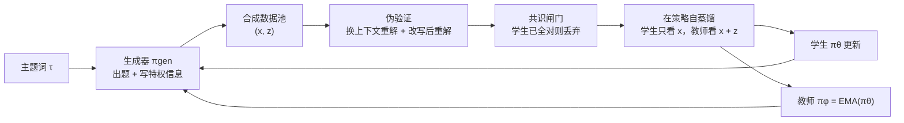

一张图说清这个环：主题词只负责起头，出题、写答案、筛题、训练全由模型自己完成，教师是学生自己的滑动平均，训完再回去出下一轮的题。

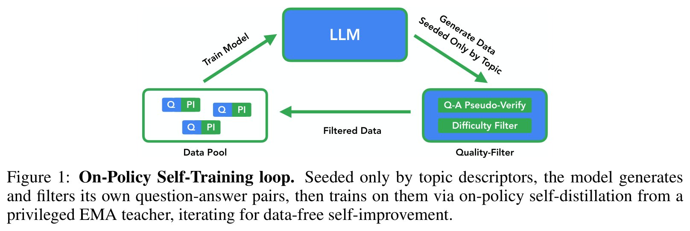

图 1：这条闭环只有四条边。数据池每一格都是 Q 和 PI 拼起来的，说明题目和特权信息成对一起生成，不是先有题库再配答案。

### 4.2 模块拆解

**模块一：数据无关的设定与主题种子生成**

为什么需要：先定义干净到底删了什么。删掉人工题目 $x$ 和标准答案 $y^*$，只留主题词集合 $\mathcal{T}=\{\tau_1,\dots,\tau_K\}$，每个 $\tau_k$ 是宽泛学科名，比如抽象代数。

怎么做：拿主题词去问生成器，让它一次吐出题目和特权信息。

$$
(x,z)\sim\pi_{\text{gen}}(\cdot\mid\tau),\qquad z=(r,a)
$$

这个式子在说：给定主题词，采样出一对题目和它的配套材料。

- $x$：生成的题目，可以是选择题也可以是开放题。
- $z$：特权信息，二元组。
- $r$：生成的推理过程，可能不完整。
- $a$：生成的候选答案，可能部分或完全错误。
- $\pi_{\text{gen}}$：生成器，可以是 EMA 教师，也可以是初始模型的冻结副本。论文说两种都试了，但没给对比数字。

**模块二：伪验证**

为什么需要：人一走，质检也没了。病态的题和错的答案会被直接灌进训练。

怎么做：把出题和解题拆开。一次成型时，题目有歧义也能给出一个自信的答案。伪验证要它在看不到 $z$ 的新上下文里用低温度重解一次，答案得对得上；再把题目改写成 $x'$ 重解一次，答案还得不变。

$$
v(x,z)=\mathbb{I}\big[\hat a(x)=a\big]\cdot\mathbb{I}\big[\hat a(x')=a\big]
$$

这个式子在算一个 0 或 1 的通行证：两次独立重解都得落回原答案。

- $\hat a(x)$：不给特权信息、低温度下重解得来的答案。
- $x'$：题目 $x$ 的同义改写。
- $\mathbb{I}[\cdot]$：条件成立取 1，否则取 0。
- 两项相乘意味着必须同时通过。换措辞答案就变，说明这题有多种读法，直接扔。

**模块三：共识闸门**

为什么需要：题目没毛病，不代表值得训。学生已稳稳会的题，教师看到 $z$ 后的分布和学生的几乎一样，除了烧钱什么也没贡献。

怎么做：让学生采样 $G$ 条推理路径，抽出各自答案，跟候选答案比。

$$
c(x,z)=\frac{1}{G}\sum_{g=1}^{G}\mathbb{I}\big[\hat a_g=a\big]
$$

这个式子在算学生当前对这道题的一致率。

- $G$：采样路径条数，原文未给具体数值。
- $\hat a_g$：第 $g$ 条 rollout 抽出来的答案。
- $c=1$（全对）的样本丢，它已不含新信息。$c=0$ 的留下。

两个过滤方向相反：伪验证往上保可靠，共识闸门往下保难度，夹在中间的样本正好落在能力边界上。门是拿当前学生算的，所以课程难度会随模型变强自动上移。

**模块四：在策略自蒸馏的目标**

为什么需要：要在学生自己走出来的轨迹上，给它逐 token 的稠密监督。

怎么做：学生只看题目，教师额外看特权信息，学生对齐教师的下一词分布，梯度不流经教师。

$$
p_t=\pi_\theta(\cdot\mid x,y_{<t}),\qquad q_t=\pi_\phi(\cdot\mid x,z,y_{<t})
$$

$$
\mathcal{L}_{\text{OPSD}}(\theta)=\mathbb{E}_{(x,z)\sim\mathcal{D},\,y\sim\pi_\theta(\cdot\mid x)}\left[\frac{1}{\sum_t M_t}\sum_{t=1}^{T}M_t\,D(p_t\,\|\,q_t)\right]
$$

这两个式子在说：同一条前缀，两个条件不同的模型各给一个分布，学生把差距缩掉。

- $y=(y_1,\dots,y_T)$：学生自己采样出的回答，长度 $T$。
- $y_{<t}$：第 $t$ 步之前已吐出的部分，两个模型看到同一份。
- $p_t$：学生的下一词分布，$q_t$：教师的，多了一个 $z$ 条件。
- $M_t\in\{0,1\}$：遮挡填充 token 的掩码。
- $D(\cdot\|\cdot)$：两个分布之间的散度，形式见模块五。
- 关键在 $z$ 只进教师那侧，学生永远看不到它，所以它不可能变成被模仿的标签。

**模块五：偏斜的 Jensen–Shannon 散度**

为什么需要：无界 KL 会出事。合成提示里难免有局部瑕疵，某 token 上教师给出接近 0 的概率，KL 就被它拽着跑，整批梯度带歪。

怎么做：先把两个分布按比例插值成混合分布，再分别对混合分布算 KL 加权求和。

$$
\bar q_{i,t}=(1-\alpha)\,q_{i,t}+\alpha\,p_{i,t}
$$

$$
D_\alpha(p_{i,t}\,\|\,q_{i,t})=\alpha\,D_{\mathrm{KL}}(q_{i,t}\,\|\,\bar q_{i,t})+(1-\alpha)\,D_{\mathrm{KL}}(p_{i,t}\,\|\,\bar q_{i,t})
$$

这个式子在算一个有上界、可调倾向的分布差距。

- $\alpha\in(0,1)$：插值系数，本文取 0.8。
- $\bar q_{i,t}$：混合分布，学生占比 $\alpha$，教师占 $1-\alpha$。
- $p_{i,t},q_{i,t}$：样本 $i$ 第 $t$ 步上学生和教师的分布。
- $\alpha\to 0$ 时 $D_\alpha/\alpha$ 退化成 $\mathrm{KL}(q\|p)$，覆盖众数的前向 KL；$\alpha\to 1$ 时 $D_\alpha/(1-\alpha)$ 退化成 $\mathrm{KL}(p\|q)$，寻找众数的反向 KL。本文取 0.8，偏这一侧。
- 有界性：$D_\alpha$ 被二元熵 $H(\alpha)$ 卡住上界，个别 token 的极端概率压不住梯度。

把模块四的 $D$ 换成 $D_\alpha$ 就是最终目标：

$$
\mathcal{L}_{\text{OPST}}(\theta;\mathcal{B})=\frac{1}{B}\sum_{i=1}^{B}\frac{1}{\sum_t M_{i,t}}\sum_{t=1}^{T}M_{i,t}\,D_\alpha(p_{i,t}\,\|\,q_{i,t})
$$

这个式子在算一个 batch 上的平均逐 token 散度，$\mathcal{B}$ 是 batch、大小 $B$。

**模块六：EMA 教师**

为什么需要：教师产出稠密目标，它自己必须稳。若 $\beta=1$，一批噪声就改写后续所有批次的目标，错误自我强化。

怎么做：教师从学生初始化，每走一步梯度按比例混一次。

$$
\phi_k=(1-\beta)\,\phi_{k-1}+\beta\,\theta_k
$$

这个式子在给学生的历史权重做滑动平均。

- $\phi_k$：第 $k$ 步之后的教师权重，$\theta_k$：学生权重。
- $\beta$：更新率，取 0.05，教师记忆跨度约 $1/\beta=20$ 步。
- 初始化 $\phi_0=\theta_0$，所以不需要任何外部教师。
- 平均出来的模型比学生本身更准（Table 6d：47.7 对 45.9），所以最终交付教师。

**模块七：多轮迭代**

为什么需要：单轮信号被初始模型的上限锁住，一轮吃不完。

怎么做：生成、验证、训练重复 $N$ 轮，权重跨轮继承，新数据去掉和前面重复的题。教师同时是三个角色：给目标的教师、出题的生成器、判数据的裁判。三者一起变强，下一轮拿到更准的目标、更好的题、更可靠的判断。又因为教师是许多步的平均，只有跨批次稳定下来的进步才进得了这个循环。

**模块八：视觉扩展**

为什么需要：验证框架是否只对文本成立。

怎么做：输入换成无标注图片集 $\mathcal{I}$ 加视觉主题词（空间关系、物体计数、属性识别）。特权信息有两种：给图片写详细场景描述，或检测物体框、从框心推出接地的空间关系，两者可叠加。验证换成增强视图一致性：

$$
v_{\text{aug}}(I,x,z)=\frac{1}{K}\sum_{k=1}^{K}\mathbb{I}\big[\hat a(A_k(I),x)=a\big]
$$

这个式子在算同一个问题在图片的多个增强版本上答案是否一致。

- $I$：一张无标注图片。
- $A_k(\cdot)$：第 $k$ 种增强，含颜色抖动、缩放、随机裁剪。
- $K$：增强视图数量，原文未给具体数值。
- $\hat a(A_k(I),x)$：第 $k$ 个视图上的作答结果。
- 水平翻转被排除，它会把左右关系的答案反过来。

### 4.3 关键细节

- $\alpha=0.8$，偏寻找众数的反向 KL 一侧。
- $\beta=0.05$，教师记忆跨度约 20 步。这是全方法最敏感的超参，见 Table 6a。
- 每轮 285 条、共 7 轮，默认配置约 2000 条合成样本。
- 生成温度 $T_{\text{gen}}$、共识闸门的 $G$、视觉验证的 $K$，原文未给。
- batch size、学习率、GPU 型号与数量、训练时长，原文未给。
- 教师侧不传梯度；多轮去重；开 thinking 时两侧都加系统提示 `<|think|>`。

## 5. 实验结果

**实验设置**（先讲清这个实验怎么跑的，数字才可信）

- **数据集与切分**：训练侧没有数据集，只有主题词。域内主题覆盖 MMLU、GPQA、GSM8K、HellaSwag 的学科范围；域外评测用 ARC-Challenge、MATH-500、Winogrande，没有主题词指向它们，多域实验里 GPQA 也算域外。各基准样本数与切分原文未给，只说沿用 harness 默认测试集。视觉侧训练用 OpenImages V4 无标注图片，评测用 VQAv2 和 POPE。
- **骨干模型**：Gemma 4 E2B 和 E4B，指令微调版。附录另加 Qwen3-4B-Base，一个没做过指令微调的预训练模型，用来验证不是只有 Gemma 家族才行。
- **训练预算**：每轮 285 条样本、共 7 轮、$\beta=0.05$、$\alpha=0.8$。GPU 型号与数量、batch size、学习率、训练总时长原文未给。
- **基线**：两档。同数据档是 SFT（生成答案当目标）和 GRPO（和生成答案的一致当奖励），数据与 OPST 完全一样，是作者自己加的对照。跨监督档是 Supervised SFT、Supervised OPSD（人工题目加参考解）、u-OPSD（人工题目加自生成答案）、R-Zero（自生成题目加 RL），后两个作者自己重实现。
- **指标**：不开 thinking 时选择题按选项上的对数似然打分，不解析生成文本；开 thinking 时从最后一行 Answer: 解析。GSM8K 用 8-shot 思维链按最终数值精确匹配，MATH-500 用 SymPy 判符号等价。视觉侧 VQAv2 用准确率，POPE 报 F1 与召回。所有解析失败率都是 0%。
- **推理设置**：走 lm-evaluation-harness，MMLU 5-shot，其余选择题 zero-shot，长度归一化按 harness 默认。采样温度、最大生成长度原文未给。

读这张表要像对账单：先确认两边打的是不是同一副牌。最强基线一列取同一监督级别里最高的。

| 模型 / 设置 | 任务 | 本文 OPST | 同级别最强基线 | 提升 |
| --- | --- | --- | --- | --- |
| Gemma 4 E2B，不开 thinking | MMLU | 47.7 | 45.9（u-OPSD） | +1.8 |
| Gemma 4 E2B，不开 thinking | 平均 | 45.6 | 44.6（u-OPSD） | +1.0 |
| Gemma 4 E2B，开 thinking | 平均 | 63.0 | 62.8（人工数据 OPSD） | +0.2 |
| Gemma 4 E4B，不开 thinking | 平均 | 52.2 | 50.9（同数据 SFT） | +1.3 |
| Gemma 4 E4B，开 thinking | 平均 | 76.0 | 75.3（人工数据 OPSD） | +0.7 |
| Qwen3-4B-Base | 平均 | 72.7 | 66.7（基线自身） | +6.0 |
| Gemma 4 E2B，视觉 | VQAv2 | 56.0 | 49.1（基线自身） | +6.9 |

要说清一栏：E2B 不开 thinking 时，人工题目加参考解的 Supervised OPSD 在 MMLU 上到 49.6，高于本文的 47.7。本文定位是无标注这一档里最好，开 thinking 时追平全监督（63.0 对 62.8）。

**原文实验图**

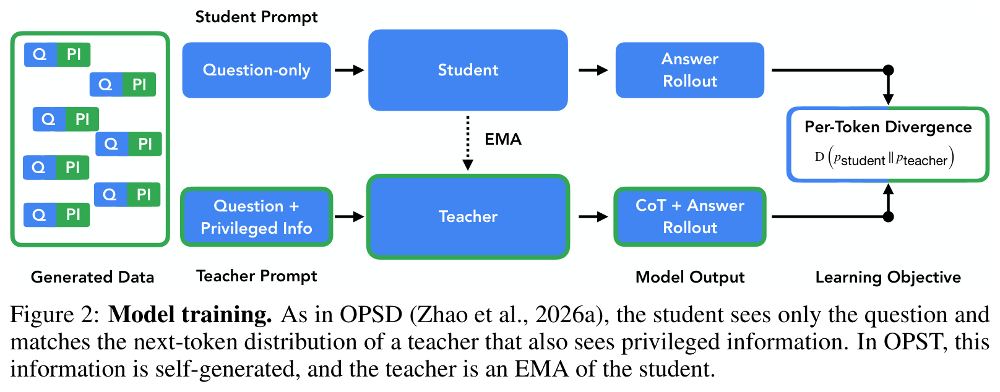

图 2：训练那一侧画清楚了。学生那条路只有 Question-only，教师那条路多一个 Question + Privileged Info，两边各出一条 rollout，在同一 token 位置算逐 token 散度。这解释了答案当条件为什么比当目标值钱：条件加在教师输入上，学生的输出空间没被窄化。

**原文实验表**

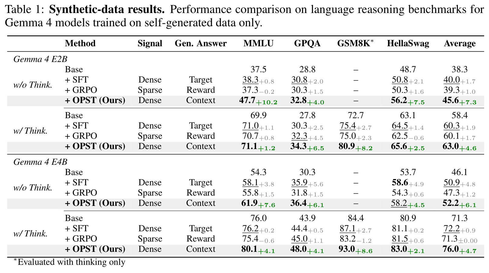

表 1：同数据三方对照。SFT 那行 Signal 写 Dense / Target，OPST 写 Dense / Context，只有这两个词不同，所以平均分那 5.6 和 1.3 个点的差距就把这一个选择隔离出来了。另有一处图形才看得见的：GRPO 在 4B 开 thinking 那行的标准差是 0，平均正好等于基线，说明这个配置下它一步没动。

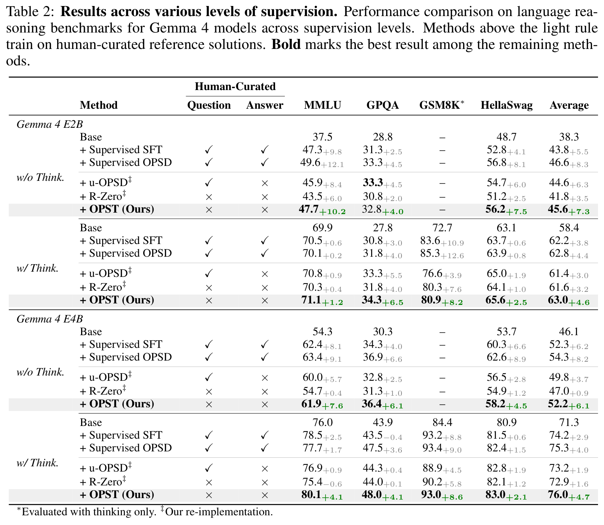

表 2：监督级别阶梯。从无标注到人工题目、再到人工题目加参考解，OPST 在第二档就基本吃满了。2B 不开 thinking 那档回收了全监督增益的 88%；开 thinking 时两个尺寸都追平甚至略超全监督。

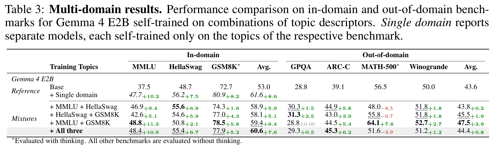

表 3：多域混训。三域一起训与单域只差 1.0，域之间几乎不打架。域外那栏要小心读：平均 +0.8 是正负相抵的结果，MATH-500 明确退化。另有一处值得注意：完全没有 MMLU 主题词的那行，MMLU 还涨了 5.1，说明一部分收益并不来自被播种的域。

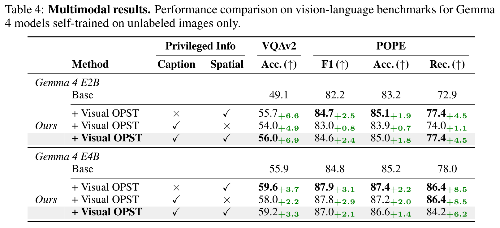

表 4：跨模态。只看无标注图片就能涨。两种特权信息在 2B 上合起来最好，到 4B 反而单独用空间关系最好，说明它们并不稳定互补。POPE 的涨幅几乎全来自召回，也就是模型更敢说有物体了，误报那侧没怎么动。

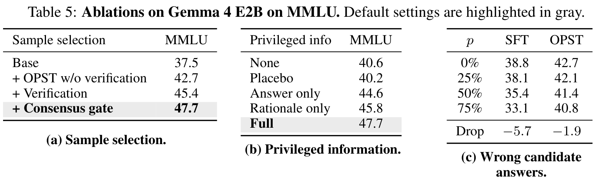

表 5：三组消融并排。(a) 两级过滤逐级加码，每一步都涨。(b) 特权信息拆开看，只给推理略好于只给答案，关键是安慰剂那行——给一道同主题的无关题比什么都不给还低，说明信号必须跟这道题绑定。(c) 人为往候选答案掺错，掺到 75% 时 OPST 仍在基线之上，SFT 已跌到基线以下。

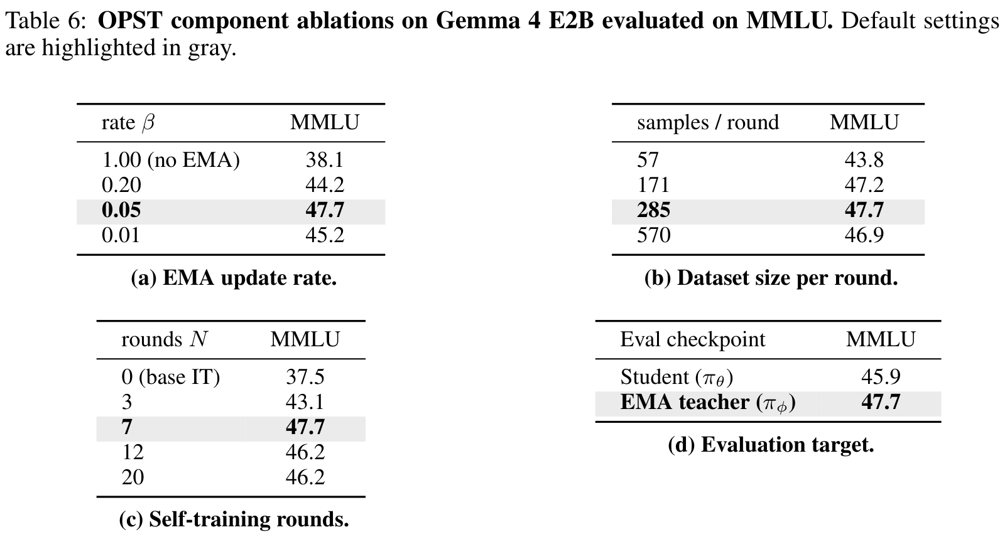

表 6：组件消融。(a) EMA 更新率是全文最关键的一格：不平均（β=1）几乎等于基线，β=0.05 最好，β=0.01 又太慢。(b) 每轮样本量在 285 条到顶，570 条反而回落。(c) 轮数 7 轮最好，12 轮和 20 轮都小幅回落。(d) 交付教师比交付学生高 1.8 个点。

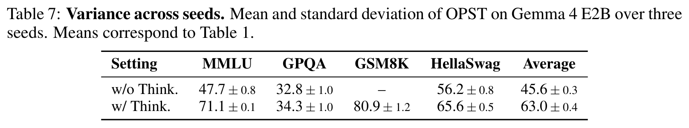

表 7：三个种子的方差。标准差全部不超过 1.2，远小于相对基线的涨幅，增益不是种子运气。开 thinking 时 GPQA 和 GSM8K 方差最大，因为 GPQA Diamond 只有 198 道题。

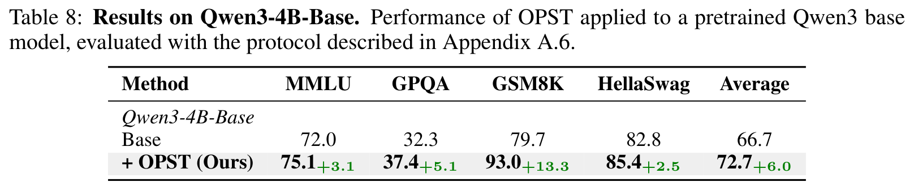

表 8：换模型家族。没做过指令微调的预训练模型上四个基准全涨，GSM8K 涨得最多。因为选择题按对数似然打分，涨幅不可能来自答案格式变好。

**消融告诉我们什么**

第一，整套收益高度依赖 EMA 这一个超参。$\beta=1$ 时几乎不涨，这是全文最刺眼的数字：自生成数据本身几乎不提供信号，信号是教师被平滑之后才出现的。我的推断是，OPST 买到的不是新数据，而是一个稳定的、带信息优势的教师视图。

第二，答案当条件对噪声鲁棒，但不等于免疫。掺 75% 错答案时 OPST 还剩 +3.3，SFT 已经 −4.4。差别在机制：错误进的是条件，教师会拿先验跟它讨价还价，先验反对的那步会保留；进的是目标时，模型只能照抄。

第三，课程确实在演化，但会饱和。7 轮之后不再涨，12 轮和 20 轮还小幅回落。错误累积有上限，不是无界发散，但也不是越训越好。

**这些实验够不够支撑结论**

够的部分：同数据、同模型、只改一个变量的三方对照最硬，把答案当目标还是当上下文这条因果链钉住了。种子方差、跨家族、跨模态三面都补了。

不够的部分：一是深度，只有 2B 到 4B 两个尺寸，没法判断这是小模型专属效应（先验弱、蒸馏收益大）还是普适规律。二是域外保留偏软，平均 +0.8 靠正负相抵，MATH-500 明确退化。三是没有人工题目加 OPST 这一格，拆不开题目自生成和监督形式这两份贡献。

## 6. 局限性

**作者自己承认的**：OPST 只能放大已有知识；伪验证量的是自一致性而非正确性，一致的错误照样进训练；主题描述是人挑的；实验限于小模型。给的方向是无标注的停止准则与工具或检索接地验证。

**我看出来的**

- **隐形假设**：这套方法要成立，必须默认参数里已存着足够多可被激发的正确推理，只是没被调出来。换到模型真正不会的领域（新语言、新符号系统、没进过预训练的前沿知识），伪验证会把一致地错的样本原样保留，循环就在放大错误。作者只在 MMLU 这类通识题上验证，恰好是参数知识最厚的区域。
- **机制边界**：共识闸门只丢 $c=1$ 的样本，$c=0$（学生全错）照样留下。课程里混着够得着和完全够不着的题，论文没分开报告这两类的贡献。这是我的推断。
- **缺的对比**：没有人工题目加 OPST 这一格，有它才能把两份贡献拆开。也缺更大的模型，无从判断增益会随规模收窄还是放大。
- **复现风险**：$\beta$ 从 0.05 挪到 0.01，MMLU 就掉 2.5 个点。方法落在一个较窄的超参窗口里，窗口之外没给调节方法。

## 7. 一句话总结

一个人没有老师也能进步，前提是他自己出的题正好卡在会与不会之间，而且他写下的那份参考答案是拿来当提示、不是拿来当标准答案。

区别就是全部：抄自己的答案，只学会那一份答案；把答案当提示重新推一遍，学到的是自己本来就会、只是没被叫出来的那部分。

核心公式（把自生成答案从目标挪到条件，就是这一处改动）：

$$
\boxed{\;\mathcal{L}_{\text{OPST}}=\mathbb{E}\left[\frac{1}{\sum_t M_t}\sum_{t}M_t\,D_\alpha\big(\pi_\theta(\cdot\mid x,y_{<t})\;\big\|\;\pi_\phi(\cdot\mid x,z,y_{<t})\big)\right]\;}
$$

$z$ 只在右边出现，那一侧是教师，梯度不回流。

## 8. 可复用点

像给食谱换个用法：同样的配料，从成品改成腌料。

- **如果我要在自己的项目里用**：凡是有标准答案的蒸馏或自训练流程，把一个字段从损失函数的目标挪到教师提示的上下文里，代码改动量接近零。只要那个字段不是每一步都必须精确，挪过去大概率涨。
- **如果我要造自生成课程**：难度门要在学生自己的 rollout 一致性上算，不要在教师上算。教师一致率高只说明教师稳，说明不了这题对学生有没有信息量。
- **训练不收敛时先查**：EMA 更新率。不平均几乎不涨，0.05 最好，0.01 太慢。先扫 0.01 到 0.1。
- **蒸馏目标别直接上 KL**：换成偏斜 JS 散度，α 取 0.8 附近偏反向 KL 一侧。上界 $H(\alpha)$ 能挡住少数极端 token 劫持梯度，在合成数据上尤其重要。

## 9. 我的疑问

像验收一栋房子：承重墙验过了，水电还没通。

- 生成器该用 EMA 教师还是初始模型的冻结副本？原文说两种都试了，却没给对比数字。这会直接影响复现结果。
- 共识闸门里 $c=0$ 的样本被保留。这类题学生全错，教师靠一份可能也错的候选答案能给出可靠目标吗？论文没按 $c$ 分层分析。
- 每轮 285 条、共 7 轮，约 2000 条样本。对 2B 模型算多还是少？没给 token 数，也没给训几个 epoch。
- 伪验证的低温度具体是多少？改写用的也是 $\pi_{\text{gen}}$，改写本身可能改变题意，怎么排除这种二次污染？
