> 一句话：按题目现场配一个小组干活，再把老手的经验教给便宜的小模型。

## 0. 读之前你需要知道

**术语卡**

- **LLM 路由（LLM routing）**：一个问题进来，先决定交给谁、怎么组织，再让它回答。类比：医院分诊台，不治病，只决定你去哪个科、要不要叫会诊。
- **多智能体系统（multi-agent system, MAS）**：几个模型各扮一个角色，串行或并行，一起给出答案。类比：装修队，水电木瓦各一个人。
- **MAS 配置（MAS configuration）**：论文里的 $\mathcal{P}$，写清协作模式 $c$、交互轮数 $r$、几个 agent，以及每个 agent 的模型、skill、分到的子任务。类比：一张施工单，谁干什么、干几轮、用什么材料，全写在上面。
- **策略（policy）$\pi_\theta$**：这里就是一个被微调过的 LLM，它先写 `<analysis>` 做任务分析，再写 `<plan>` 出配置单。
- **同策略蒸馏（on-policy distillation, OPD）**：学生先自己走一遍，老师看着学生已经走出来的每一步、逐 token 说这里该往哪偏，学生照着改。类比：篮球教练不给你标准答案，只在你投篮时逐帧纠正手腕角度。和普通蒸馏的差别是：训练数据是学生自己造的，不是老师造的。
- **特权信息（privileged information）**：只在训练时给老师、推理时不给学生的信息。这里是 $z_i=(\mathcal{I},\mathcal{P}_i,o_i,s(\tau_i))$，即 insight 池、这次配置、执行结果、判分。类比：教练手里有你的体检报告，上场比赛时你手上没有。
- **强化学习（RL）里的 group-relative 优势**：同一道题采 $G$ 条轨迹，按组内相对好坏算 $A_{q,i}$，好的加权、坏的降权。类比：同一个班考同一张卷，按班内排名给分，不按绝对分数。
- **relative FLOPs**：浮点数运算次数，这里当作算力账单的计价单位（第 5 节细讲怎么折算）。

**它站在谁肩上**

- RouteLLM（2025）：二分类挑强模型还是弱模型，只选一个模型。
- MasRouter（2025）：级联控制器选协作模式、人数、角色、模型，是 joint MAS configuration 这一路最直接的对手。
- Router-R1（2025）、xRouter（2025）：让路由器在推理过程中多轮调用模型再汇总。
- MAS-Orchestra（2026）、DAAO（2026）：把协作模式或难度当成模块来选。
- MiniLLM（2024）、OPD（Agarwal et al. 2024）：用反向 KL 做同策略蒸馏，这篇把这套手法搬到结构化输出的路由规划上。
- RSI-Router（2026）、Skill-MAS（2026）：不动参数，靠检索或演化 skill 复用执行经验。

第 2 节对上面这些只点到为止，哪一点不够用是我的归类，不是作者逐条批判。

## 1. 动机

请十个朋友吃饭。两个人吃饭，你随手点一份外卖就完了；十个人就得定几荤几素、请不请厨师、叫几个帮手、先炒哪道后炒哪道。人一多，怎么配人这件事本身就变成一道题，而且配错了要么难吃，要么白花钱。

**以前怎么做**：原文把已有路线归成两类。一类是参数化策略优化，用强化学习或带反馈条件的蒸馏，把执行结果直接写进路由器的参数里，让它学会选模型和编排系统。另一类是显式经验演化，把执行记录、路由规则、编排 skill 存成可以检索的东西，下一次决策时翻出来看，不更新参数。

**为什么不行**：两个坎。

第一个坎是配置空间高度耦合。模型、协作模式、agent 数量、交互轮数、skill 五个维度一起选，组合数爆炸，没法穷举评估。更要命的是，一套配置好不好同时取决于题目和周围选择，所以一条只走一种配置的轨迹只说明这一套在这一题上的结果，给不出证据判断哪个决策必要、哪个多余、哪个次优。

第二个坎是奖励太稀疏。只用最终任务成败和总算力当奖励，而一个完整配置包含多个相互耦合的规划决策，终局奖励说不清哪一步有效、哪一步白花钱、单个决策该怎么调。

原文把这两件事收成一个问题，我直接引一句：

> "How can configuration experience be distilled into reusable knowledge of conditional dependencies and internalized in the router's pre-execution planning policy?"

这句话的意思是：执行完之后攒下的经验，怎么变成带条件的可复用知识，又怎么塞进路由器动手之前的规划策略里。

**为什么现在能做**：作者先做了一轮前置实验（第 3.1 节），用池里两类代表模型量出三条规律。有了靶子，蒸馏才不是往黑箱里灌模糊提示。同时 OPD 已经证明能在学生自己生成的序列上做稠密监督，更强的教师模型也随手可得。

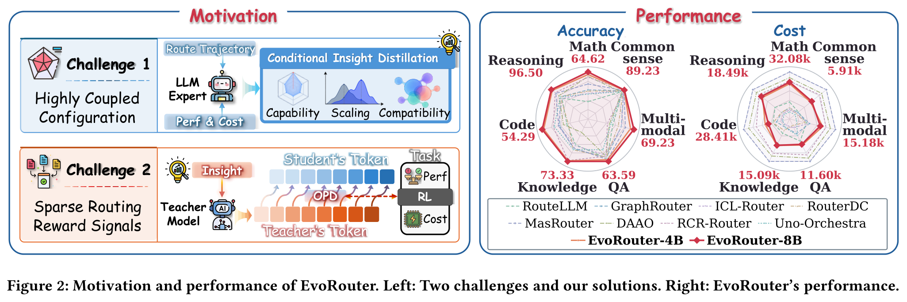

图 2：左边把两个坎和对应解法摆在一起，右边是七维雷达（Accuracy 与 Cost），EvoRouter-4B/8B 在准确率上的多边形整体外扩，在成本上一圈收到中心，一张图说明这套方法同时动了两条边。

## 2. 贡献

类比：老师傅带徒弟，不让徒弟把每种活都试一遍，只给几句口诀。

- **把经验变成带条件规则**。结论：作者把跨轨迹的性能–成本反馈蒸馏成带显式适用条件的 configuration insights，覆盖任务依赖、资源缩放收益递减、配置项互相作用三类。证据：第 3.1 节用两组代表模型量出三条规律，第 4.4 节把它固化成 insight 池 $\mathcal{I}$。
- **用特权教师给出 token 级监督**。结论：提出 EvoRouter，用 OPD 把条件 insight 内化进路由策略，再用 RL 联合优化执行效用。证据：表 3 里 insight-guided OPD 相对纯 RL 的增益是 5.46 和 4.80 个点，而无 insight 的 OPD 只有 1.31 和 1.06 个点。
- **算力更省**。结论：主结果表上平均域内准确率 68.69%（EvoRouter-4B），比最强路由基线高 7.23 个百分点，同时把推理算力降 50.95%。证据：表 2 与第 5.2 节。
- **规模与跨域都撑得住**。结论：21 个场景、七个领域，域外 Code 与 Reasoning 上 74.67% 到 78.93%，比最强基线高 7.74 到 12.00 个百分点。证据：表 2 最右两列。
- **换资源还能用**。结论：把模型池、协作模式池、skill 池同时换掉、路由器不动，仍有域内 73.8%、域外 84.0%。证据：图 9 与第 5.4 节。

## 3. 创新点

类比：老医生查房不只说病情重，还说这种情况该先利尿。

- **新在哪：insight 是带适用条件的知识，不是一堆检索条目**。对比对象：显式经验演化路线（RSI-Router、Skill-MAS 那种存轨迹、存 skill 的做法）。有用是因为：配置的收益依赖题目和周围选择，只有把适用条件一起写下来，下次遇到相似题目才不会错用。
- **新在哪：把 insight 当特权信息喂给教师，做 token 级蒸馏，而不是只给终局奖励**。对比对象：Router-R1、MasRouter 这类 outcome-based RL。有用是因为：一条配置单里十几个决策，终局奖励分不清哪个好坏，逐 token 的分布差能落到具体文字上。
- **新在哪：三路信号合到一个损失里**。对比对象：单独 RL 或单独蒸馏。有用是因为：RL 管全局的准确率–成本权衡，OPD 管局部怎么想，KL 管别跑太远，三者互补。

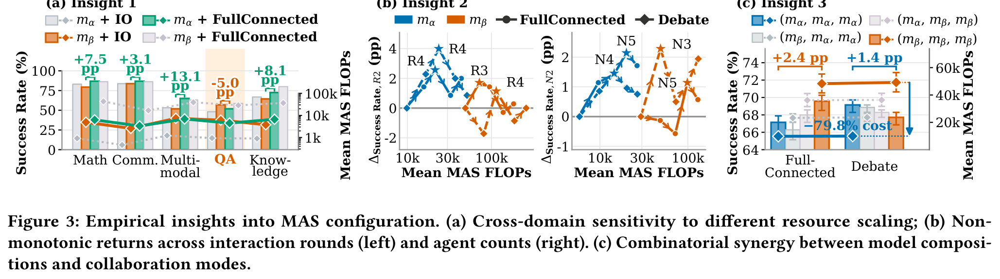

图 3：三条前置实验规律，(a) 换资源带来的收益随任务翻转（Multimodal +13.1 pp，QA −5.0 pp），(b) 加资源不是线性的，交互轮数与 agent 数都有峰值，过了峰值再加钱反而掉点，(c) 同样的模型组合在不同协作模式下排序会颠倒，且 Debate 下 (mα,mα,mα) 比全 mβ 省 79.8% 算力。这张图是整篇方法的地基。

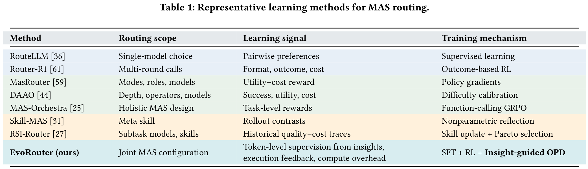

表 1：把六种代表性路由学习方法和自己并排，差别落在最后两列，EvoRouter 的学习信号是 token 级监督加执行反馈加算力开销，训练机制是 SFT + RL + Insight-guided OPD。这张表说明它要同时占住参数化学习和经验复用两条线。

## 4. 方法

### 4.1 整体流程

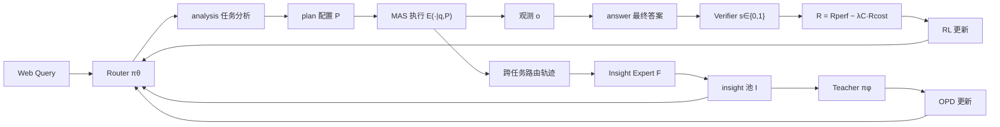

这张图说的是一个闭环：路由器先出配置，配置被执行成结果，结果被判分，判分加上成本变成奖励去更新路由器；同一批轨迹又被专家读成 insight，insight 变成教师的特权信息，再通过 OPD 逐 token 教回路由器。

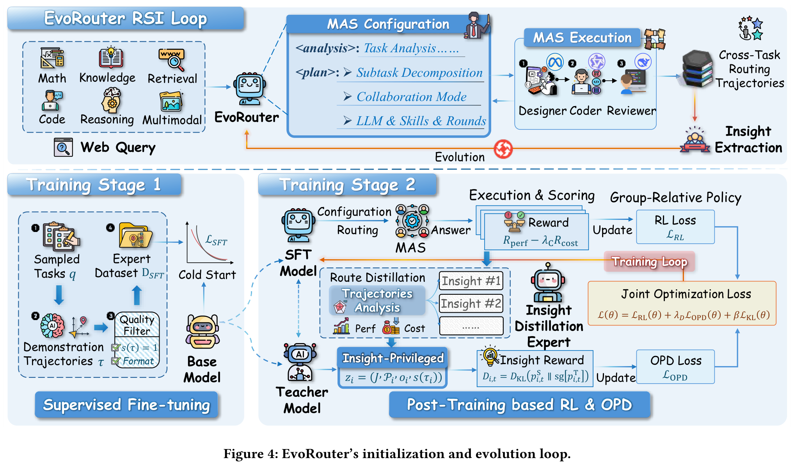

图 4：上半是 RSI（recursive self-improvement，递归自我改进）演化环，下半是两段训练，Stage 1 用专家轨迹做冷启动 SFT，Stage 2 用 RL 与 OPD 联合更新，联合损失 $\mathcal{L}(\theta)=\mathcal{L}_{\mathrm{RL}}+\lambda_D\mathcal{L}_{\mathrm{OPD}}+\beta\mathcal{L}_{\mathrm{KL}}$ 写在方框里。

### 4.2 模块拆解

类比：先定 SOP，再让老员工手把手纠动作。

**配置空间与目标**

为什么需要：先把要决策的东西写清楚，否则说不清路由器在优化什么。

怎么做：路由器把任务 $q$ 映射成一个配置 $\mathcal{P}$，环境拿这个配置实例化 MAS 并执行，返回结果 $o$，路由器再生成最终答案 $\hat{y}$，三段拼成一条轨迹 $\tau$。

公式：

$$
\mathcal{P}=\Big(c,\;r,\;\{(u_j,m_j,s_j,p_j)\}_{j=1}^{n}\Big)
$$

这个式子在描述一张配置单长什么样。

- $c\in\mathcal{C}$：协作模式，取自 IO、CoT、Reflection、Chain、FullConnected、Debate 六种。
- $r$：系统内的交互轮数。
- $n$：agent 个数。
- $u_j,m_j,s_j,p_j$：第 $j$ 个 agent 的标识、模型（$m_j\in\mathcal{M}$）、skill（$s_j\in\mathcal{S}$）、分配到的子任务。

优化目标写成一个期望效用最大化：

$$
\pi^\star\in\arg\max_{\pi}\mathbb{E}_{q\sim\mathcal{Q},\;\tau\sim p_{\pi,\mathcal{E}}(\cdot\mid q,\mathcal{C},\mathcal{S},\mathcal{M})}\Big[U\Big(s(\tau),\frac{C(\tau)}{B(q)};\lambda_C\Big)\Big]
$$

这个式子在说：在所有可能的策略里挑一个，让答对与否和花了多少预算比例的折中最好。

- $s(\tau)\in\{0,1\}$：任务验证器给的对错，0 或 1。
- $C(\tau)\ge 0$：这条轨迹的执行算力。
- $B(q)>0$：这道题的参考预算，成本按它归一化。
- $\lambda_C$：成本惩罚系数，越大越抠门。
- $p_{\pi,\mathcal{E}}$：策略生成和系统执行一起造成的轨迹分布，两边都随机。

**冷启动：SFT**

为什么需要：一个没训过的模型不会写 `<analysis>` 和 `<plan>` 这种格式，先教会格式再谈优化。

怎么做：一个冻结的强模型当 bootstrap router 在训练题上采轨迹，只留格式合法且答案正确的，得到 $\mathcal{D}_{\mathrm{SFT}}$，然后做标准的下一个 token 预测。

公式：

$$
\mathcal{L}_{\mathrm{SFT}}(\theta)=-\sum_{(x,y)\in\mathcal{D}_{\mathrm{SFT}}}\sum_{t\in\mathcal{T}(y)}\log \pi_\theta(y_t\mid x,y_{<t})
$$

这个式子在算照着示范抄的交叉熵。

- $\mathcal{T}(y)$：序列 $y$ 里属于路由器自己要生成的 token 位置集合，提示词和环境反馈的 token 被 mask 掉，不参与损失。
- $y_t$：第 $t$ 步的目标 token。
- $y_{<t}$：它前面的上下文。

训完的策略既当后续演化的起点，也当 KL 正则的冻结参考 $\pi_{\mathrm{ref}}$。

**成本感知 RL**

为什么需要：只有对错信号时，路由器会学会堆资源换分；必须把花销写进奖励。

怎么做：每条轨迹拿到 $R_{\mathrm{perf}}$ 和 $R_{\mathrm{cost}}$，合成一个奖励；同一道题采 $G$ 条，算组内归一化优势，做策略梯度。

公式：

$$
R(\tau)=R_{\mathrm{perf}}-\lambda_C R_{\mathrm{cost}},\qquad R_{\mathrm{cost}}=\log_2\!\Big(1+\frac{C(\tau)}{B(q)}\Big)
$$

这个式子在算一条轨迹到底得几分。

- $R_{\mathrm{perf}}=s(\tau)\in\{0,1\}$：验证器给的对错。
- $R_{\mathrm{cost}}$：对数缩放后的成本惩罚，用 $\log_2$ 是为了压住长尾，成本翻倍只多扣一分。
- $\lambda_C$：成本敏感度。
- $c_{\max}\in[0,1)$：成本惩罚的上限，作者用它保证成功的轨迹至少拿到 $1-c_{\max}>0$，失败的轨迹拿不到正分，两类的奖励区间被硬性隔开。

策略损失是组内加权的负对数似然：

$$
\mathcal{L}_{\mathrm{RL}}(\theta)=-\frac{1}{Z_{\mathrm{RL}}}\sum_{q}\sum_{i=1}^{G}A_{q,i}\sum_{t\in\mathcal{T}_{q,i}}\log \pi_\theta\big(y_{q,i,t}\mid H_{q,i,t}\big)
$$

这个式子在算：比同组平均好的轨迹，把它那些 token 的概率抬上去。

- $G$：每道题采的轨迹条数，训练时取 16。
- $A_{q,i}$：第 $i$ 条轨迹的组内归一化优势。
- $H_{q,i,t}$：到第 $t$ 步为止的交互历史，包含已经执行完的 MAS 结果。
- $Z_{\mathrm{RL}}$：batch 里优势非零的轨迹的 response token 总数，做归一化用。

再加一个 token 级 KL 把策略拴在参考模型附近：

$$
\mathcal{L}_{\mathrm{KL}}(\theta)=\frac{1}{Z_{\mathrm{KL}}}\sum_{q}\sum_{i=1}^{G}\sum_{t\in\mathcal{T}_{q,i}}\big[r_{q,i,t}(\theta)-\log r_{q,i,t}(\theta)-1\big],\qquad r_{q,i,t}(\theta)=\frac{\pi_{\mathrm{ref}}(y_{q,i,t}\mid H_{q,i,t})}{\pi_\theta(y_{q,i,t}\mid H_{q,i,t})}
$$

这个式子在算策略偏离参考模型多远，形式是 $r-\log r-1$，在 $r=1$ 处取最小值 0，两边都涨。

- $r_{q,i,t}(\theta)$：参考模型与当前策略的概率比。
- $Z_{\mathrm{KL}}$：batch 里全部 response token 数，注意它把零优势的轨迹也算进来，和 $Z_{\mathrm{RL}}$ 的口径不一样。

**insight 蒸馏：递归合并**

为什么需要：单条轨迹证明不了什么，但把几十条跨任务轨迹放在一起看，就能看出条件规律。

怎么做：维护一个 insight 池 $\mathcal{I}_0$，一个专家 $\mathcal{F}$（训练时才有，推理时不用）每轮读最近一批 rollout $\mathcal{B}_k$，做三步：规则归纳，对比同类任务里成功与失败、便宜与昂贵的轨迹，得出关于能力匹配、缩放饱和、配置交互的条件规则；前提细化，遇到互相冲突的经验就收紧边界，比如把任务难度和领域写得更细；容量剪枝，合并冗余条目并卡死容量上限，防上下文膨胀。

公式：

$$
\mathcal{I}_{k+1}=\mathcal{F}\big(\mathcal{I}_k,\;\mathcal{B}_k\big)
$$

这个式子在说第 $k$ 次更新后的 insight 池怎么来。

- $\mathcal{I}_k$：第 $k$ 轮的 insight 集合，每条是一句带条件的规则。
- $\mathcal{B}_k$：最近一批执行轨迹。
- $\mathcal{I}_{k+1}$：更新后的池子，容量上限 $|\mathcal{I}|\le 8$，总长度上限 6,144 字符。

**同策略蒸馏（OPD）**

为什么需要：insight 是给人看的句子，路由器要的是在这个位置该写什么字，两者对不上，得靠教师把前者翻译成逐 token 的分布。

怎么做：学生 $\pi_\theta$ 自己采一条轨迹，教师 $\pi_\phi$ 拿到同样的上下文 $x_i$ 和同样的前缀 $y_{i,<t}$，额外多拿特权信息 $z_i$，然后逐位置比两个 next-token 分布。

公式：

$$
D_{i,t}=D_{\mathrm{KL}}\Big(p^{S}_{i,t}\,\Big\|\,\mathrm{sg}\big[p^{T}_{i,t}\big]\Big)=\sum_{a\in\Omega}p^{S}_{i,t}(a)\log\frac{p^{S}_{i,t}(a)}{\mathrm{sg}\big[p^{T}_{i,t}(a)\big]}
$$

这个式子在算学生在第 $t$ 个位置的分布和老师差多少，用的是反向 KL（跟着 MiniLLM 的做法）。

- $p^{S}_{i,t}=\pi_\theta(\cdot\mid x_i,y_{i,<t})$：学生的 next-token 分布。
- $p^{T}_{i,t}=\pi_\phi(\cdot\mid x_i,z_i,y_{i,<t})$：教师带特权信息后的分布。
- $\mathrm{sg}[\cdot]$：stop-gradient，老师那一侧不回传梯度，只当靶子。
- $\Omega$：师生共享的词表。

蒸馏只作用在每条轨迹第一次路由回答上，并且拆成两段加权：

$$
\mathcal{L}_{\mathrm{OPD}}(\theta)=\frac{\sum_i\sum_{t\in\mathcal{T}^{\mathrm{plan}}_i}D_{i,t}}{\sum_i|\mathcal{T}^{\mathrm{plan}}_i|}+\alpha\,\frac{\sum_i\sum_{t\in\mathcal{T}^{\mathrm{ana}}_i}D_{i,t}}{\sum_i|\mathcal{T}^{\mathrm{ana}}_i|}
$$

这个式子在算蒸馏损失，重点是 plan 段的 token 和 analysis 段的 token 分开平均再相加，因为两段长度差很多，混在一起平均会让短的那段被淹没。

- $\mathcal{T}^{\mathrm{plan}}_i$：第 $i$ 条轨迹里 `<plan>` 标签内属于学生生成的 token 位置，去掉格式 token 和环境 token。
- $\mathcal{T}^{\mathrm{ana}}_i$：同样口径的 `<analysis>` 段位置。
- $\alpha$：analysis 段的权重，训练时取 0.25。

总损失把三路信号加起来：

$$
\boxed{\;\mathcal{L}(\theta)=\mathcal{L}_{\mathrm{RL}}(\theta)+\lambda_D\mathcal{L}_{\mathrm{OPD}}(\theta)+\beta\mathcal{L}_{\mathrm{KL}}(\theta)\;}
$$

这个式子是整篇的看家式子：任务成败和成本走 RL，逐 token 该怎么想走 OPD，别跑太远走 KL。

- $\lambda_D$：蒸馏项系数，取 0.03。
- $\beta$：KL 项系数，取 0.001。

### 4.3 关键细节

- **两阶段轨迹**：路由器出现两次，第一次出配置，第二次读执行结果出答案；OPD 只训第一次。
- **协作模式有硬约束**：某些模式不允许某些配置，比如 CoT 最多一个 agent，配成两个 agent 会被直接拒绝并判为错误。这条决定复现时奖励怎么给。
- **教师配置**：Qwen 系骨干用 Qwen3-32B 当教师，Llama 骨干用 Llama-3.1-70B 当教师；DeepSeek-V4-Pro 同时当 insight 蒸馏专家和 SFT 阶段的 bootstrap router，但它不直接监督学生。
- **超参**：batch size 8，每题 16 rollouts，学习率 $3\times10^{-6}$，$\beta=0.001$，$c_{\max}=0.1$，$\lambda_D=0.03$，$\alpha=0.25$。
- **推理时不带特权信息**：训练完的策略只拿角色说明、任务描述、可用资源，专家和教师都不出场，这是它能上线的前提。

## 5. 实验结果

**实验设置**

类比：装修报价单写清几个人几天，不是只报总价。

- **数据集与切分**：域内 19 个数据集、五个领域，数学用 MATH、GSM8K、Omni-MATH-2、Apex Shortlist，常识用 ARC-Challenge、StrategyQA、Social IQA，知识用 MMLU-Pro、GPQA-Diamond、SuperGPQA，检索用 NQ、TriviaQA、HotpotQA、2WikiMultiHopQA、PopQA、MuSiQue，多模态用 ChartQAPro、MMMU、MMMU-Pro。域外两个：代码用 LiveCodeBench（175 题），逻辑推理用 BBH-LD（200 题）。自建数据共 12,800 题，切成 10,500 训练、1,000 开发、1,300 测试，SFT、RL、评测的题集互不重叠。表 2 里检索那列表头写的是 QA，这是我的推断，原文没逐列点名。
- **骨干模型**：路由器骨干三个，Qwen3-4B、Qwen3-8B、Llama-3.1-8B，对应 EvoRouter-4B、EvoRouter-8B、EvoRouter-LLaMa-8B。被路由的 LLM 池五个：Qwen3.5-35B-A3B、Qwen3.5-122B-A10B、Qwen3.5-397B-A17B、DeepSeek-V4-Flash、GLM-5。
- **训练预算**：8 张 NVIDIA A100 80GB。SFT 阶段用 2,000 条过滤后的实例，训 2 个 epoch。后续训练每轮 batch 8、每题 16 rollouts。总训练步数和总卡时原文未给。演化迭代在图上画到第 10 个 iteration version。
- **基线**：五类共 14 个。Vanilla 直接推理五个模型；单 agent 路由 RouteLLM、GraphRouter、ICL-Router、RouterDC；单 agent 多轮路由 Router-R1、ReCal、xRouter；多 agent 路由 MAS-Orchestra、OrchMAS、DAAO、MasRouter、RCR-Router、AgentRouter、Uno-Orchestra。没有原生模型选择能力的基线统一把骨干钉成 GLM-5。
- **指标**：verifier-based accuracy，即验证器判对的比例，越高越好；成本用 relative FLOPs，见下面的公式。主表两个 Average 列是 sample-weighted accuracy。所有结果报三次独立运行的均值，先把答对题数四舍五入到整数再除以总题数。
- **推理设置**：池内所有 LLM 温度 1.0，最大输出 1,024 token，代码任务 4,096 token。多模态任务里不支持图像的模型收到一个固定占位符，声明它看不见图，只能靠文本答。

成本怎么算的，原文在附录 B 给了推导。先数一个 token 的矩阵运算量：

$$
\hat{F}_m=2A_m\,(n^{\mathrm{in}}+n^{\mathrm{out}}),\qquad A_m=P_{\mathrm{sh}}+L\,k\,P_{\mathrm{exp}}
$$

这个式子在估一次模型调用的算力，作者说参数矩阵运算占全部 FLOPs 的 95% 以上，所以把注意力项和其余算子都扔了。

- $A_m$：每 token 的激活参数量。
- $P_{\mathrm{sh}}$：常驻的主干矩阵参数，含注意力投影、router、共享专家。
- $P_{\mathrm{exp}}$：单个路由专家的参数量，$L$ 是层数，$k$ 是每层激活的专家数。
- $n^{\mathrm{in}},n^{\mathrm{out}}$：输入输出长度。

再把一条轨迹的所有调用折算成无量纲的成本：

$$
C(\tau):=\sum_{j\in I_W(\tau)}\frac{A_{m_j}}{A_0}\big(n^{\mathrm{in}}_j+n^{\mathrm{out}}_j\big)
$$

这个式子在算这条轨迹相当于最小模型跑多少个 token。

- $I_W(\tau)$：轨迹 $\tau$ 上所有 worker 调用的下标集合。
- $A_0=3\times10^{9}$：池里最小模型 Qwen3.5-35B-A3B 的激活参数，$2A_0$ 的 FLOPs 定义为 1 个 cost unit。
- $m_j$：第 $j$ 次调用用的模型。

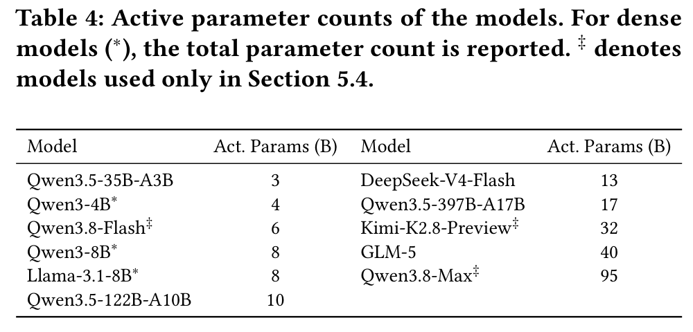

表 4：每个模型的激活参数量，dense 模型（带 ∗）报的是总参数，带 ‡ 的只在第 5.4 节的换资源实验里出现。这张表是所有成本数字的换算基准，没有它上面的成本公式落不了地。

**主表**

| 类别 | 指标 | 本文 | 最强基线 | 提升 |
| --- | --- | --- | --- | --- |
| In-Domain 平均 | accuracy (%) | 68.69（EvoRouter-4B） | 61.46（RCR-Router 与 MasRouter 并列） | +7.23 pp |
| Out-of-Domain 平均 | accuracy (%) | 78.93（EvoRouter-LLaMa-8B） | 66.93（MAS-Orchestra） | +12.00 pp |
| Commonsense | accuracy (%) | 89.23（EvoRouter-8B） | 90.38（RCR-Router、AgentRouter） | −1.15 pp |
| In-Domain 成本 | Mean MAS FLOPs | 15,280.79（EvoRouter-4B） | 原文未给绝对值 | −50.95%（相对 RCR-Router） |
| 总推理成本 | Mean MAS + Router LLM FLOPs | 18.94k（EvoRouter-4B） | 原文未给绝对值 | −76.5% / −39.2%（相对 MasRouter / RCR-Router） |

表 2 里唯一没赢的是 Commonsense，所以原文那句表述是 four of the five in-domain capability categories，不是全部五类。

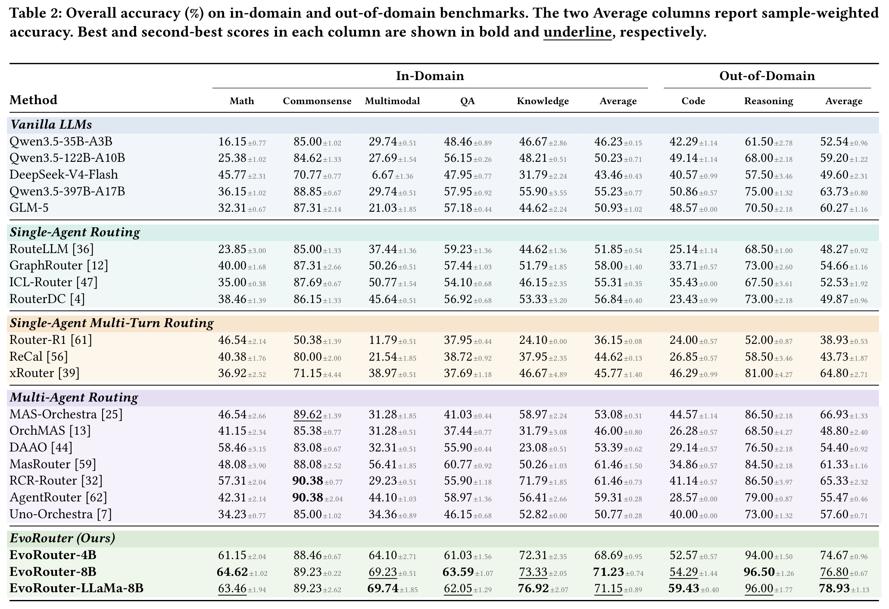

表 2：域内 19 个数据集按五类汇总加域外两类的完整成绩，± 的口径原文没写，我的推断是三次运行的标准差。EvoRouter-LLaMa-8B 在 Math 上 63.46 低于 EvoRouter-8B 的 64.62，但域外 Reasoning 96.00、Code 59.43，域外均值最高，说明换骨干会改变擅长的地方。

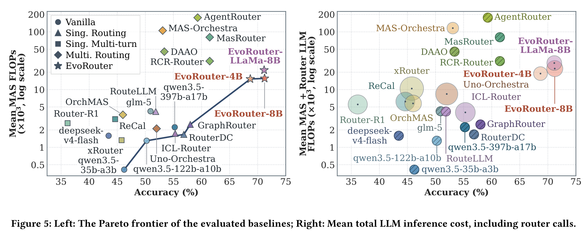

图 5：左图是准确率–成本散点，EvoRouter 的三颗星连成一条线并且落在整条 Pareto 前沿的左上角，说明它不是靠堆算力换分；右图像素面积表示含 router 开销的总成本，EvoRouter-4B 的圆比 MasRouter、AgentRouter 都小。加 router 仍划算，比只看 worker 成本更诚实。

**消融告诉我们什么**

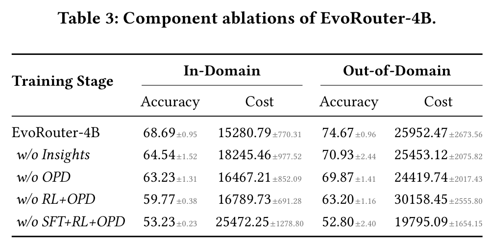

表 3：逐层拆掉组件的结果，四行分别去掉 insight、去掉 OPD、去掉 RL 与 OPD、全去掉。域内准确率从 68.69 一路掉到 53.23，而成本并不是单调变化，w/o SFT+RL+OPD 那行域内成本反而涨到 25,472.25，说明没有训练的路由器既不准也乱花。

最值钱的一组对比：相对纯 RL（w/o OPD，63.23），不带 insight 的 OPD 只多 1.31 个点；把 insight 灌进去（68.69）就多 5.46 个点。域外是 1.06 对 4.80。也就是说，OPD 这个机制本身价值有限，真正起作用的是教师手里有没有 insight。成本侧同向：w/o Insights 的域内成本 18,245.46 比完整模型的 15,280.79 高，省下来的钱也是 insight 带来的。

**训练怎么演化的**

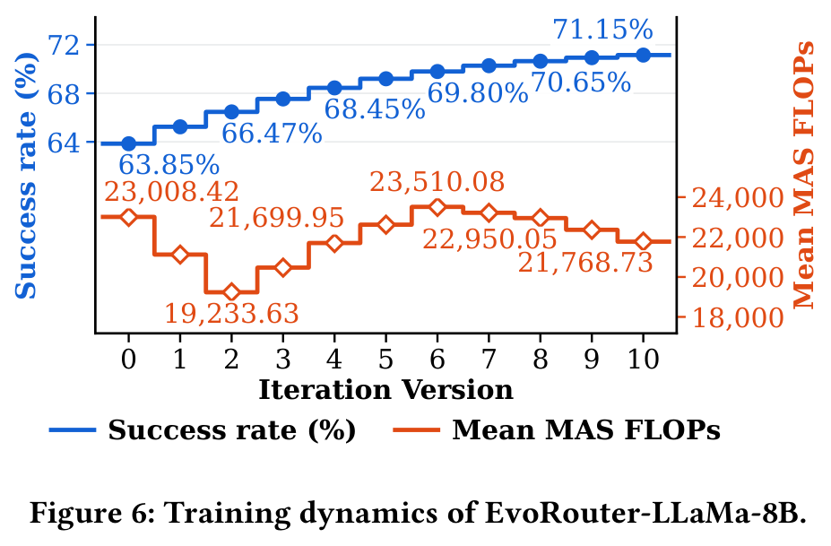

图 6：横轴是演化轮次，蓝线是成功率、橙线是均值算力。前几次更新成功率从 63.85% 抬到 66.47%，同时算力降 16.4%，先学会省钱；中间几轮开始加算力换准确率，算力峰值 23,510.08 时成功率 69.80%；后段再压回 21,768.73 并到 71.15%，又省 7.4%。曲线不是一路上涨，是先省、再买、再省。

**成本系数调多少**

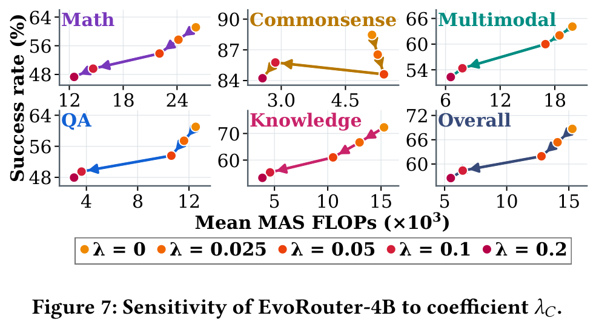

图 7：五个 $\lambda_C$ 值在六个子集上的折线，箭头方向是 $\lambda_C$ 从小到大。整体面板上箭头从右下往左上走，即加成本惩罚就是往便宜的方向滑，但 Math 与 Multimodal 的面板里箭头几乎是往右上，说明这两类题对成本惩罚不敏感，加惩罚也压不下来多少算力。

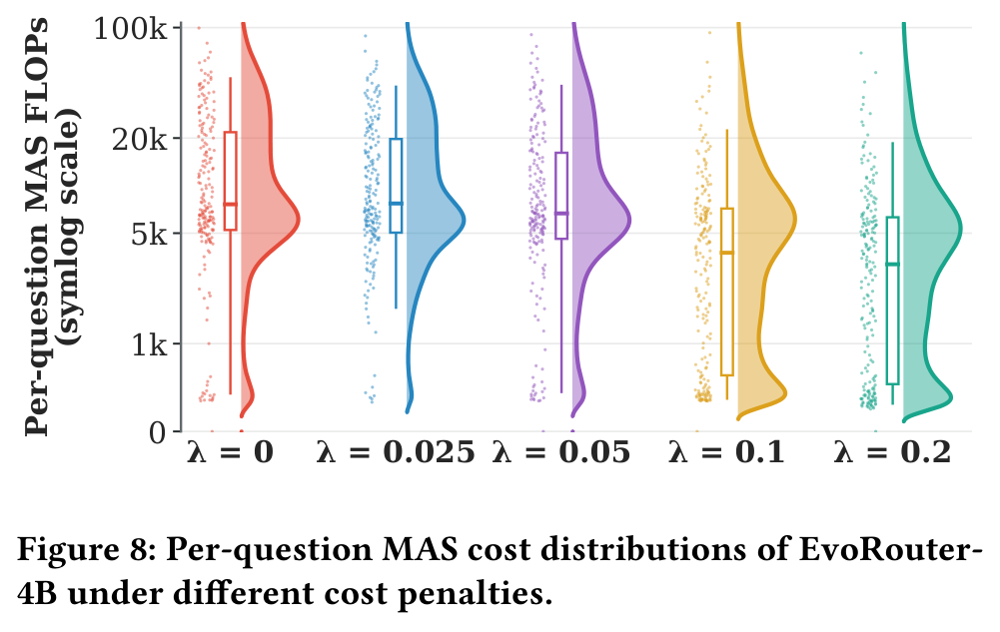

图 8：纵轴是对数尺度的每题算力，五条小提琴加箱线。$\lambda=0$ 上尾拖到 100k，$\lambda=0.2$ 上尾被砍掉、中位数下移。均值看不见长尾，长尾才是账单爆掉的地方。

**换一套资源还灵不灵**

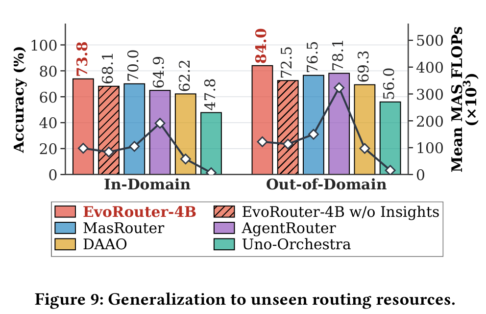

图 9：模型池换成 Qwen3.8-Flash、Kimi-K2.8-Preview、Qwen3.8-Max，协作模式换成 Self-Consistency 与 Hierarchical，skill 池也换成没见过的，路由器一个参数不动。EvoRouter-4B 域内 73.8、域外 84.0，比 MasRouter 高 3.85 与 7.47 个点，比同架构但没 insight 的版本（68.1 / 72.5）高 5.7 与 11.5 个点，域外落差更大，说明 insight 买的主要是迁移能力。

**一个具体例子**

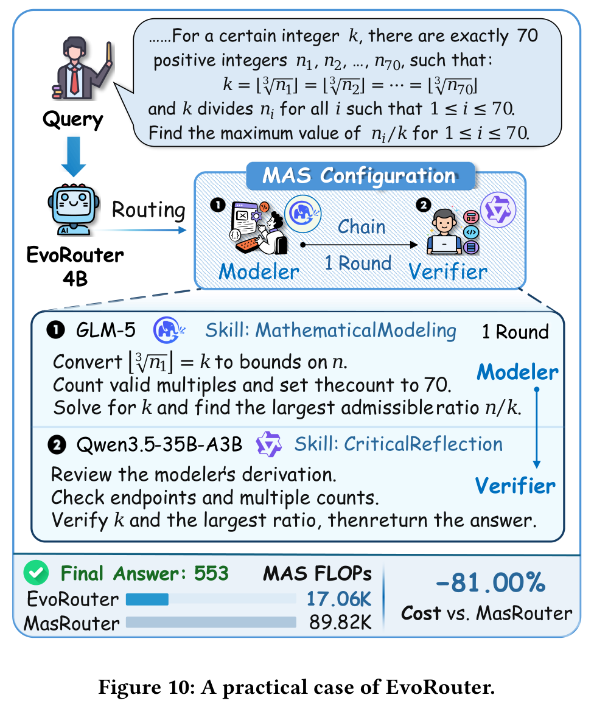

图 10：一道数论题，路由器选了 Chain、1 轮、两个 agent，Modeler 用 GLM-5 配 MathematicalModeling，Verifier 用 Qwen3.5-35B-A3B 配 CriticalReflection，答案 553 正确，算力 17.06K，同题的 MasRouter 花了 89.82K，差 81.00%。这个例子能看出配置单的粒度：不是选一个大模型，而是把建模和验算拆给两个不同尺寸的模型。

**这些实验够不够支撑结论**

准确率、成本、跨域、换资源、敏感性、案例都做了，主结论站得住。不够的地方三处：一次运行的方差只报在表 2 和表 3 的 ± 里，没给显著性检验；消融只做了有/无 insight，没做 insight 条数 1 到 8 的曲线，所以 8 条这个容量上限没被验证；成本是代理量，不是墙钟时间或账单金额，附录 B 自己也说这是 proxy。

## 6. 局限性

类比：一本只有八页的急救手册，遇上罕见病就翻不到。

**作者自己写明的**：

- 框架是为云端 agent 服务设计的，边缘环境要靠未来的云边协同路由。原文结论最后一句：`Our current framework is designed for cloud-based agent services.`
- 多模态任务里不支持图像的模型只拿到一个声明看不见图的占位符，池里有部分模型是半瞎的。
- 某些协作模式有硬约束，配错了整条计划被拒绝并判错，这是方法的代价，作者写在附录 A.1 里。

**我看出来的**：

- 隐形假设：跨任务、跨领域的条件规律能压进 8 条、6,144 字符。真实场景里长尾条件常被容量剪枝切掉，剪掉的规则不会再回来。
- 边界条件：成本单位 $A_0$ 锚在 Qwen3.5-35B-A3B 的 3B 激活参数上，换一个模型池，cost unit 的物理含义就变了，图 5 的横轴不能跨论文比。
- 缺的对比：没有和同样教师、同样特权信息但只做 SFT 不做 OPD 的版本比，分不清 OPD 的增益有多少来自反向 KL 这个形式、有多少来自教师多看了信息。
- 我的推断：表 3 里 w/o Insights 的域外成本 25,453.12 比完整模型的 25,952.47 还低一点，说明 insight 在域外只买准确率不买省钱；原文没讨论。

## 7. 一句话总结

这篇论文干的事，是给每个问题现场配一个施工队，再请一个看过全部工地记录的老师傅，把这类活该配几个人、用什么料逐字教给一个 4B 的分诊员，教完就下班。

核心公式：

$$
\boxed{\;\mathcal{L}(\theta)=\mathcal{L}_{\mathrm{RL}}(\theta)+\lambda_D\mathcal{L}_{\mathrm{OPD}}(\theta)+\beta\mathcal{L}_{\mathrm{KL}}(\theta)\;}
$$

## 8. 可复用点

类比：把大厨菜谱改成少油少盐的食堂版，配方要留、火候要写清。

- 如果我要在自己的项目里用：把终局奖励太稀疏的结构化决策任务（配置、计划、工具链选择）改造成两段轨迹，一段出计划、一段出答案，只在计划段做蒸馏。
- 训练不收敛时先查：$\lambda_C$ 和 $c_{\max}$ 的配合。成本惩罚超过 $1-c_{\max}$ 后，成功与失败的奖励区间不再分开，RL 会学成能省就省。
- 想抄 insight 的写法：让专家输出带适用条件的短句而不是案例原文；给池子设容量和长度上限，否则上下文会吃掉整个窗口。
- 教师侧的实现要点：教师必须和学生看同一个前缀、只多一份特权信息，否则逐 token 的分布差里混进了教师偷看未来造成的噪声。

## 9. 我的疑问

类比：体检报告看完，总还有几个指标想追着医生问。

- 表 2 里 Commonsense 的 89.23 低于 90.38，原文只说 four of five，没解释为什么这一类会输。是常识题本来就不吃 MAS，还是 insight 池在这类题上过拟合？
- 演化只画到第 10 个 version，斜率已变平，再往后会继续涨还是崩？原文没有更长的曲线。
- insight 池每轮被专家重写，专家自己也会出错，错误规则靠什么淘汰？原文只写了 precondition refinement 和 capacity pruning，没说怎么判定一条规则是错的。
- 附录 A.2 说预算 $B(q)$ 是按成功轨迹成本的 25 分位加 15% 余量标定的，这个先验直接决定成本项尺度，换领域要不要重标？原文只给了 math 12,374.00 和 commonsense 5,722.02 两个例子。
- 成本代理量忽略了注意力项和通信开销，而 FullConnected、Debate 这类模式的主要代价恰恰在并发和上下文变长上，成本被低估多少原文没说。
