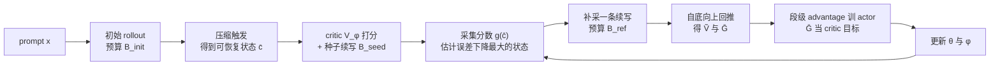
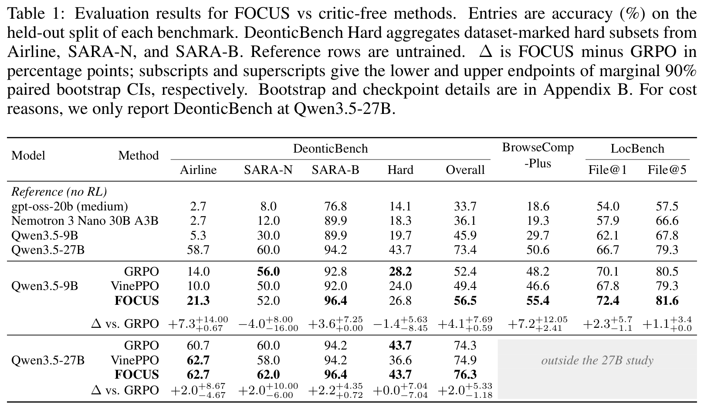
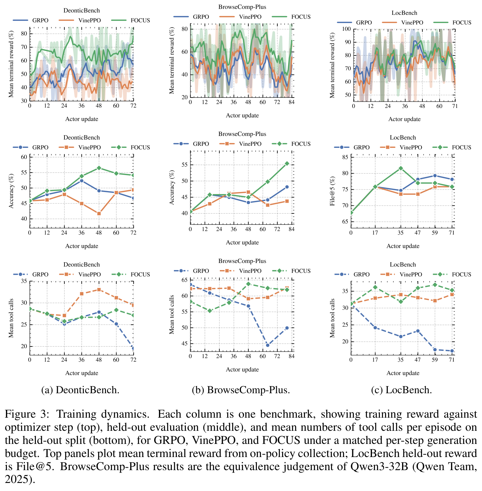
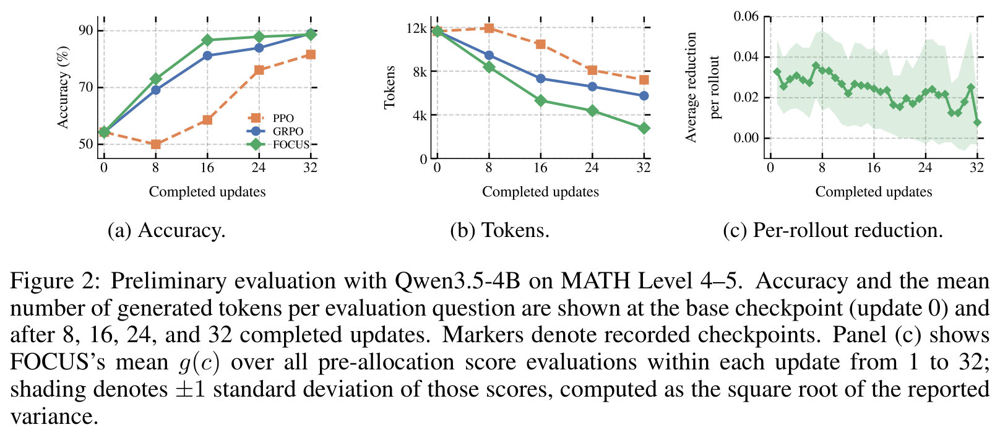
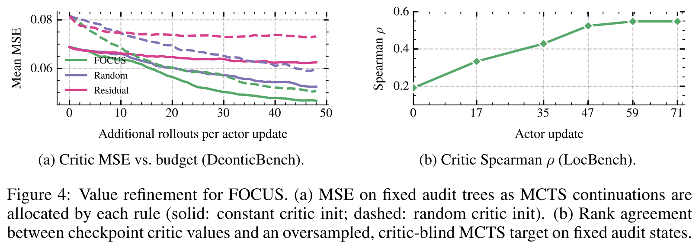
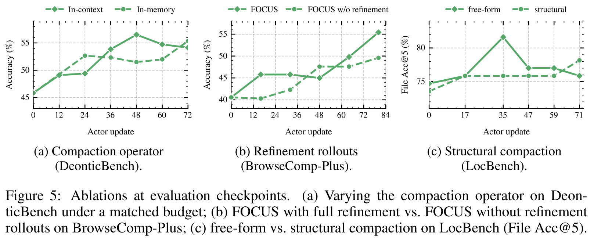
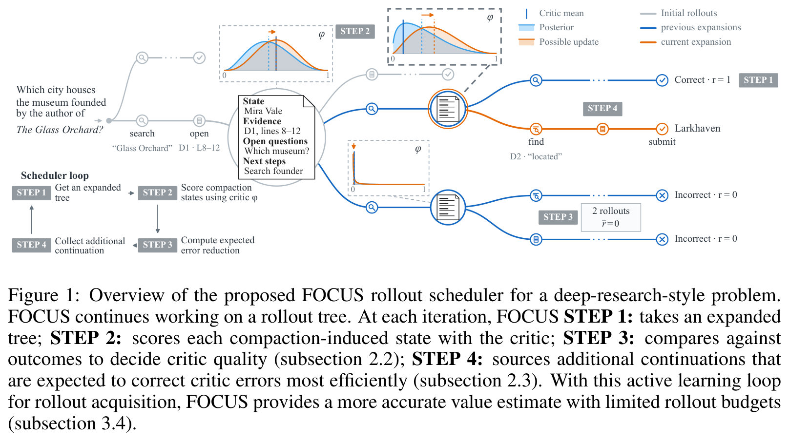
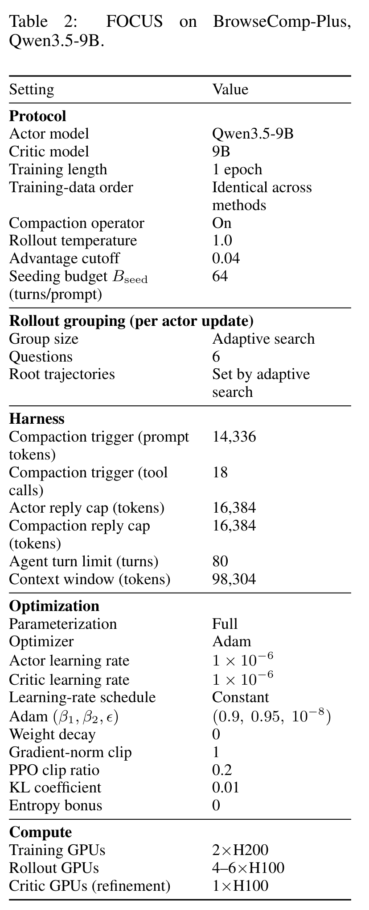

> 一句话：把「多采样几条续写来估中间状态值」当成主动学习，只在教练最可能看走眼的地方花钱。

## 0. 读之前你需要知道

**术语卡**

- **长程智能体（long-horizon agent）**：一个任务要做几十上百步工具调用才算完，比如在真仓库里改 bug、在固定语料上反复搜索再回答。类比：不是做一道填空题，是跑一趟要换十次公交的长途。
- **评论家（critic）**：一个额外的网络，看当前上下文就能猜「从这里继续走下去，最终能拿多少分」。类比：老教练看半场比赛就能估出最终比分。
- **信用分配（credit assignment）**：一局只给一个最终奖励，要决定这分该算在哪些动作头上。类比：全队赢了球，奖金怎么分给 11 个人。
- **上下文压缩（compaction）**：上下文快满了，让模型把自己的历史对话压成一份笔记，然后从笔记继续干活。类比：会议开太久，先写一页纪要，之后只带纪要继续开。
- **续写采样（continuation）**：从某个中间状态重新采一条完整的后续，看它最后成不成功。类比：从第 30 分钟重播这场比赛，看换个踢法能不能赢。
- **采集函数（acquisition function）**：给每个候选状态打一个分，分数表示「在这里多采一条，预计能让评论家更准多少」。类比：体检排号，先给最可能出问题的人做检查。
- **匹配每步生成预算（matched per-step generation budget）**：不同方法在同一个训练步里生成的 token 总量对齐再比分数。类比：同一箱油跑同样的路，比谁跑得远。

**它站在谁肩上**

- GRPO（Shao et al., 2024）：同一道题采一组答案，用组内相对好坏当优势，不需要评论家。问题是一整条轨迹只有一个组内分数，分不到步上。
- VinePPO（Kazemnejad et al., 2025）：在中间步骤重新采样后续，用蒙特卡洛均值替掉价值网络。问题是每个中间状态都采，且不区分哪个状态更值得采。
- TreeRPO（Yang et al., 2025）：本文的递归回推公式直接沿用它的做法，把子节点证据一层层往回带。
- 期望误差下降式主动学习（Roy & McCallum, 2001；Mussmann et al., 2022）：按「预计能降低多少误差」挑样本。本文把这条原则从「挑数据」搬到「挑状态的续写」上。
- 上下文压缩训练（Cursor, 2026；CompactionRL, Li et al., 2026e）：把压缩当成可训练的一环。本文借用压缩点当分段点，但不绑定具体压缩实现。

## 1. 动机

想象你带一个 30 人的接力施工队。整个工程只有两种结局：验收通过，或者不通过。你想知道第 7 棒和第 22 棒谁拖了后腿，但你手上只有一个总结果，没有每一棒的计时。

这就是长程智能体的处境。一整条轨迹几十上百次工具调用，最后只给一个 0 或 1 的奖励。

**以前怎么做**：主流做法是 GRPO 那一路，同一道题采一组轨迹，把组内的相对好坏当成整条轨迹的优势，再平均分给轨迹里每个 token。另一路是训练一个评论家网络，让它对中间状态打分。

**为什么不行**：GRPO 把整条轨迹的分数摊平到每个 token 上，等于告诉接力队「你们 30 个人贡献一样」。原文对这件事的说法是 trajectory-level group credit 会让「刚压缩完就急着交卷」这种行为也一起被强化——他们后来在附录 G 里抓到了实例：GRPO 的后期检查点在 DeonticBench 上第 2 轮就提交，10 次工具调用只用了 1 次。评论家那一路的毛病是估不准，尤其长程任务里中间状态离结局太远。

一个自然的补法是：从中间状态重新续写几条，用实际成败当证据。但每估一次就要多采一条完整续写，成本高得离谱，于是问题变成：**有限的采样预算，该花在哪些状态上**。

**为什么现在能做**：一是压缩式上下文管理成了长程 agent 的标配，压缩点天然就是「可恢复的存档点」，从存档点重开一局很便宜；二是训练框架已把采样、执行、上下文管理拆成模块，不改执行逻辑就能单独改「去哪儿采样」。

## 2. 贡献

- **把「评论家预测 + 续写证据」的配比问题，重述成一个主动学习问题**。证据：原文第 2.2、2.3 节，以及摘要里 "uses selective branching to help the critic network learn its value estimator" 这句定位。
- **提出 FOCUS 这个 rollout 控制器，按「预计能减少多少价值估计误差」分配预算**。证据：`g(c̄)` 的采集函数（式 7）与算法 1 的贪心分配循环。
- **在三个长程基准上打赢 GRPO 与 VinePPO，且每步生成预算对齐**。证据：Qwen3.5-9B 上 BrowseComp-Plus 55.4 对 48.2（+7.2 pp），DeonticBench Overall 56.5 对 52.4（+4.1 pp），LocBench File@1 / File@5 为 72.4 / 81.6，三个基准全部第一。
- **证明了收益不来自某一种压缩实现**。证据：把 in-context 压缩换成带 put / get / scan / delete 的内存工作区，曲线基本重合（图 5a）。
- **给了压缩与信用分配解耦的模块化接口**。证据：算法 1 里上下文管理只以 `G`（压缩触发）和 `C_π`（压缩算子）两个符号出现，换实现不影响分配逻辑。

## 3. 创新点

- **新在哪：把「额外采样」当成给评论家买的训练数据，而不是给策略买的探索**。对比对象：VinePPO 在所有中间状态均匀续写，只为算蒙特卡洛价值。有用是因为：均匀采样会把预算摊薄在评论家已经估得很准的状态上，那里再采一条几乎不带来新信息。
- **新在哪：用「预期误差下降」而不是「不确定性」当采集准则**。对比对象：常见的不确定性采样（挑方差最大的状态）。有用是因为：原文附录 E 推了一个反例——当某个状态还没有任何观测时，式 6 与式 7 给出 `g(c̄) = 0`，即采集分数**不会**退化成不确定性采样。它要求「已经有一条观测、且观测和评论家预测对不上」才给分，这才是真正需要补证据的地方。
- **新在哪：分段而不是分 token、也不是整条轨迹**。对比对象：token 级太细（一个词一个奖励，噪声大），轨迹级太粗（就是 GRPO 的问题）。有用是因为：一次压缩到下一次压缩之间是一个决策单元，长度短到评论家能 bootstrap，又粗到能承载一个有意义的优势值。
- **新在哪：分配时不使用子节点的递归回推值**。对比对象：直接用训练时的 `Ḡ` 当选择依据。有用是因为：原文证明了这样会把同一个「评论家与事实的偏差」沿链条每往上一层衰减 4 倍（κ=1 时），导致最该被修的状态反而分数最低。

## 4. 方法

### 4.1 整体流程

一句话：每一轮先把树长出来，再让评论家给每个压缩点打分，然后用「观测到的成败」去对照评论家的分，专挑对不上的地方补采样，最后用补出来的证据同时修策略和修评论家。

### 4.2 模块拆解

**模块一：树与段（States and rollout segments）**

为什么需要：要把「中间状态」变成一个能寻址、能重开的东西。

怎么做：把一道题的所有 rollout 组织成一棵树 $T_x$。非终端节点是一个状态，边的指向是策略生成的续写加环境跳转。一次压缩把轨迹切成若干段，一段就是一「步」。

公式（段的定义）：

$$
\bar{c}_0 = x,\ \bar{c}_1,\ \dots,\ \bar{c}_M,\ \bar{c}_{M+1}
$$

先说它在算什么：一条完整轨迹被压缩点切成 $M+1$ 条边，节点是从 prompt 到终止的各个存档点。

- $\bar{c}_i$：第 $i$ 个状态的上下文，$i = 1,\dots,M$ 为非终端，$\bar{c}_{M+1}$ 是终止。
- $M$：压缩次数。实验里一次压缩对应一段。
- 边 $e_i = (\bar{c}_{i-1} \to \bar{c}_i)$：这一段里策略生成的 token 加上环境返回。

**模块二：值精修（Refining state values）**

为什么需要：评论家的预测方差大，光信它，优势值就是噪声。

怎么做：把「评论家预测」和「子节点证据」按伪观测个数加权平均。子节点的证据不是它的最终成败，而是它自己已精修过的值，一层一层往回带。

公式（式 1 + 式 2）：

$$
\bar{G}(\bar{c}) = \frac{1}{n(\bar{c})}\sum_{\bar{c}'\in \mathrm{ch}(\bar{c})}\left(R_{\bar{c}\to\bar{c}'} + \gamma^{d_{\bar{c}\to\bar{c}'}}\tilde{V}(\bar{c}')\right),\quad \tilde{V}(\bar{c}')=0 \text{ if terminal}
$$

$$
\tilde{V}(\bar{c}) = \frac{\kappa V_\phi(\bar{c}) + n(\bar{c})\bar{G}(\bar{c})}{\kappa + n(\bar{c})}
$$

先说它们在算什么：式 1 是「子节点证据的平均」，式 2 是「评论家先验与这份证据的加权平均」，权重由证据条数决定。

- $\bar{G}(\bar{c})$：从 $\bar{c}$ 出发的回推目标，二值结果下取值在 $[0,1]$ 区间。
- $\mathrm{ch}(\bar{c})$：直接子节点集合。
- $n(\bar{c})$：直接子节点个数。
- $R_{\bar{c}\to\bar{c}'}$：这一段拿到的奖励。
- $d_{\bar{c}\to\bar{c}'}$：这条边跨越的环境转移步数，用来做折扣指数。
- $\gamma$：折扣因子，实验统一取 1，即不折扣。
- $\tilde{V}(\bar{c})$：精修后的状态值。
- $V_\phi(\bar{c})$：评论家用参数 $\phi$ 给出的原始预测。
- $\kappa$：伪观测权重，固定为 1，等价于「把评论家的预测当成一条假观测」。

原文特意说明为什么不直接对后代成败取平均：分配器自己决定了展开哪些节点，所以 $\bar{c}$ 下面的叶子已不是 on-policy 抽样，取平均在统计上有偏。

**模块三：评论家的训练目标与 actor 的优势（Critic supervision and actor advantages）**

为什么需要：精修出来的值要变成两份东西——一份监督评论家，一份算策略的优势。

公式（式 3、式 4）：

$$
\mathcal{L}_{\text{critic}}(\phi) = \mathbb{E}\Big[\sum_{\bar{c}\in T_x:\, n(\bar{c})>0}\big(V_\phi(\bar{c}) - \bar{G}(\bar{c})\big)^2\Big]
$$

$$
\hat{A}_i = \delta_i = R_i + \gamma^{d_i}\tilde{V}(\bar{c}_i) - \tilde{V}(\bar{c}_{i-1})
$$

先说它们在算什么：式 3 让评论家去拟合回推目标，式 4 是「这一步实际拿到的奖励 + 走到的新状态值 − 出发时的状态值」，即一段的时序差分残差。

- $\mathcal{L}_{\text{critic}}$：只在有子节点的非终端状态上算，其余状态不产生梯度。
- $\hat{A}_i$：第 $i$ 段的优势，整段共用同一个数（段内独立于 token）。
- $\delta_i$：TD 残差。实验里 $\lambda=0$，所以优势就等于它；附录 F.1 给了 $\lambda \neq 0$ 的 TD(λ) 版本。
- $R_i$、$d_i$：第 $i$ 段的奖励与转移步数。

优势只加在策略自己生成的 token 上，环境返回的观测和固定的框架文本被 mask 掉。策略损失是带裁剪的重要性比值形式（式 5），和 PPO 一样，这里不展开。

**模块四：选哪个状态补采样（Selective rollout allocation）**

为什么需要：这是全文的核心。预算有限，必须决定下一条续写给谁。

怎么做：给每个候选状态算一个采集分数 $g(\bar{c})$，然后贪心取最大。分数来自「再加一条观测，评论家的均方误差能降多少」。

公式（式 6 + 式 7）：

$$
\mu_{\text{obs}} = \frac{\kappa v + N\bar{G}_{\text{obs}}}{\kappa + N},\qquad \hat{e}^2 = (v - \mu_{\text{obs}})^2 + \frac{\mu_{\text{obs}}(1-\mu_{\text{obs}})}{\kappa + N + 1}
$$

$$
g(\bar{c}) = \frac{2\kappa^2\hat{e}^2 + (N-\kappa)\hat{\sigma}^2}{(\kappa + N)^3}
$$

先说它们在算什么：式 6 把「评论家的预测 $v$」和「已经看到的 $N$ 条成败的均值」混成一个后验均值 $\mu_{\text{obs}}$，再给出评论家方差的估计 $\hat{e}^2$；式 7 是把这个估计对「再加一条观测」求边际下降，得到的数就是这条续写的预期价值。

- $v = V_\phi(\bar{c})$：评论家在该状态的预测。
- $N(\bar{c})$：**已观测到的**续写结果条数，与式 1 的 $n(\bar{c})$（直接子节点数）不是一回事。
- $\bar{G}_{\text{obs}}(\bar{c})$：这 $N$ 条结果的均值。
- $\mu_{\text{obs}}$：后验均值，二值结果下等价于 Beta 先验（强度 $\kappa$、中心 $v$）的后验均值。
- $\hat{e}^2$：评论家平方误差的后验估计，第二项是二项分布的抽样方差项。
- $\hat{\sigma}^2 = \mu_{\text{obs}}(1-\mu_{\text{obs}})$：下一条结果自身的方差。
- $\kappa$：先验强度，固定 1。
- $g(\bar{c})$：采集分数，单位是「每加一条续写，MSE 预期下降多少」。

「主动」在这里落到实处，可以拆成两句话：

1. **主动挑状态**：不是随机、也不是按层均匀，而是 $\arg\max_{u \in \mathcal{F}} g(u)$，其中可采集合 $\mathcal{F} = \{\bar{c} \in T_x: \bar{c}\ \text{非终端且可恢复},\ g(\bar{c}) > 0\}$。
2. **主动花预算核实**：每条续写跑完才做下一次分配决策，也就是说每次花钱之前都刷新一次「哪里最亏」的判断。同步时用 $N$；异步时把式 7 里的 $N$ 换成 $N_{\text{eff}}(\bar{c}) = N(\bar{c}) + m(\bar{c})$，$m$ 是还在飞的条数——这样不会把同一个状态重复塞满。

预算怎么分配，原文给了三段独立的转移预算（算法 2）：`B_init` 铺初始轨迹，`B_seed` 撒种子续写（实验里 64 turns/prompt），`B_ref` 才是按 $g$ 分配的补采样预算。预算单位是「新增的任务转移数 $d(\xi)$」，一次执行失败记 1 个单位。并发上每个节点最多 $C=2$ 条同时在跑，全局受 worker 容量 $W$ 限制；已经跑完的子节点不占并发位。总分支宽度不设上限，只受预算约束。

**为什么不用递归回推值来选（附录 E）**

这是我觉得全文最漂亮的一处细节。假设一条链上每个状态只有一个子节点、中间没有奖励、$\gamma=1$、评论家在每层都预测同一个 $v$，令 $a = (\kappa+1)^{-1}$，可以推出：

$$
(v - \bar{G}_j)^2 = (v - z)^2 a^{2(j-1)}
$$

先说它在算什么：同一个「评论家与真实结果 $z$ 的偏差」，在离终止第 $j$ 层的状态上，被衰减成原来的 $a^{2(j-1)}$ 倍。

- $z$：终止时的二值结果。
- $j$：离终止还剩几条边。
- $a$：每回推一层引入的收缩系数，$\kappa=1$ 时 $a=1/2$。

$\kappa=1$ 时平方残差每往上一层缩 4 倍。原文举的例子：$v=0.95$、$z=0$ 时，$j=1,2,3,4$ 的平方残差是 0.9025、0.225625、0.05640625、0.0141015625。也就是说，如果拿 $\bar{G}$ 当选择依据，同一个偏差在越靠前的状态上被压得越狠，分数也越低。改用观测到的成败算 $\mu_{\text{obs}}$ 后，同样的例子里每个状态的期望平方误差都是 0.30875，不再被衰减。

### 4.3 关键细节

复现时最容易漏的几处：

- 评论家是**另一个 9B 模型**，不是共享主干的小头。表 2 的 `Critic model` 一栏写的就是 9B。
- $\gamma=1$、$\lambda=0$、$\kappa=1$、$C=2$ 四个值在所有实验里都不变。
- 优势裁剪：`Advantage cutoff` 为 0.04，$|\hat{A}_e| \le 0.04$ 的边会被丢掉。但原文保留了一句例外——格式坏掉的压缩不能丢，否则压缩本身学不到。
- 压缩触发同时看两个条件：prompt token 到 14,336，或者工具调用满 18 次。前者跟上下文窗口（98,304 或 32,768）不是同一个数。
- `B_init` 与 `B_ref` 的具体数值原文未给，附录 A 的表只列了 `B_seed`。
- BrowseComp-Plus 不是直接从基座开训，先做了监督冷启动：从 Qwen3.5-9B 采 200 条成功且未压缩的轨迹，留 20 条做开发集、180 条做模仿学习，每次压缩点用 Qwen3.5-27B 生成摘要当教师。

## 5. 实验结果

**实验设置**

- **数据集与切分**：
  - MATH Level 4–5（预实验）：训练 512 题取自官方训练集（226 道 Level 4、286 道 Level 5），验证 256 题取自官方测试集（123 道 Level 4、133 道 Level 5）。
  - DeonticBench：6,232 题，本文只用 AIRLINE、SARA-NUMERIC、SARA-BINARY 三个子集，按等量分层切成训练与 held-out。held-out 为 338 题（Airline 150、SARA-N 50、SARA-B 138），其中 Hard 71 题与这三个域重叠。
  - BrowseComp-Plus：830 个测试任务随机切成 498 训练 / 83 验证 / 249 held-out。
  - LocBench：560 个真实 GitHub issue，按仓库与 issue 类别分层切成等量两半。
- **骨干模型**：Qwen3.5-9B（actor 与 critic 都是 9B，全参数训练）；Qwen3.5-27B 只跑 DeonticBench，用 LoRA（$r=16$、$\alpha=32$、dropout 0）；预实验用 Qwen3.5-4B。
- **训练预算**：每个方法都训 1 epoch，数据顺序完全相同，每步生成预算对齐（根轨迹数由各方法的分组补齐，FOCUS 用 adaptive search 自己定）。9B 的算力是 2×H200 训练 + 4–6×H100 采样 + 1×H100 跑评论家精修；27B 是 2×H200 + 5×H200 + 1×H200。DeonticBench：GRPO 8×6 = 48 条根轨迹、VinePPO 4×6 = 24、FOCUS 自适应。BrowseComp-Plus：GRPO 8×6 = 48、VinePPO 4×12 = 48、FOCUS 自适应。LocBench：GRPO 8×4 = 32、VinePPO 4×4 = 16。`B_seed` 在 BrowseComp-Plus 与 DeonticBench 上是 64 turns/prompt，LocBench 上是 32。预实验：PPO 每步 64 题，GRPO 与 FOCUS 每步 16 题；GRPO group size 6；FOCUS 每题边预算 64、每条边最多 256 token。
- **基线**：PPO（只在 MATH 预实验里）、GRPO、VinePPO；另有四个未训参考模型 gpt-oss-20b (medium)、Nemotron 3 Nano 30B A3B、Qwen3.5-9B、Qwen3.5-27B。
- **指标**：held-out accuracy（%）；LocBench 报 File@1 与 File@5（file 级 Acc@k，全部 gold 位置进前 k 才算 1）；DeonticBench 报三个子集 + Hard + Overall。诊断部分用 MSE 与 Spearman ρ。$\Delta$ 是 FOCUS 减 GRPO，单位 pp，上下标是 90% 配对 bootstrap 区间的两端。
- **推理设置**：采样温度都是 1.0，advantage cutoff 都是 0.04。压缩触发与上限按基准不同，以 FOCUS 为准：BrowseComp-Plus 是 14,336 prompt token / 18 次工具调用、回复上限 16,384、压缩回复上限 16,384、轮数上限 80、上下文窗口 98,304；DeonticBench 是 14,336 / 18、8,144 / 4,096 / 48 轮 / 32,768；LocBench 是 32,768 / 20、16,384 / 16,384 / 86 轮 / 65,536。优化器 Adam，学习率 $1\times10^{-6}$（9B 全参）或 $3\times10^{-5}$（27B actor LoRA，critic $2\times10^{-5}$ 与 $5\times10^{-6}$ 分基准），PPO clip 0.2，KL 系数 0.01。**BrowseComp-Plus 的判分用的是 Qwen3-32B 的等价判断**。
- **一处口径不齐（我核对附录 A 时发现）**：DeonticBench 上三个方法的 harness 完全一致，但 LocBench 上 FOCUS 用 32,768 / 20 / 65,536 / 86 轮，GRPO 与 VinePPO 用 24,576 / 20 / 98,304 / 80 轮，回复上限也不同。所以 matched per-step generation budget 只对齐了生成量，没有对齐压缩触发与上下文预算。

**主表**

| 数据集 / 任务 | 指标 | 本文（FOCUS） | 最强基线 | 提升 |
| --- | --- | --- | --- | --- |
| BrowseComp-Plus | accuracy (%) | 55.4 | 48.2（GRPO） | +7.2 pp |
| DeonticBench | Overall accuracy (%) | 56.5 | 52.4（GRPO） | +4.1 pp |
| DeonticBench | Hard accuracy (%) | 26.8 | 28.2（GRPO） | −1.4 pp |
| LocBench | File@1 (%) | 72.4 | 70.1（GRPO） | +2.3 pp |
| LocBench | File@5 (%) | 81.6 | 80.5（GRPO） | +1.1 pp |
| DeonticBench（Qwen3.5-27B, LoRA） | Overall accuracy (%) | 76.3 | 74.9（VinePPO） | +1.4 pp |

Hard 是唯一输的一行：26.8 对 GRPO 的 28.2，$\Delta$ 为 $-1.4$，区间 $[-8.45, +5.63]$ 跨零。原文没有解释。

**原文实验表**

表 1：主结果全表。四个未训参考模型一起列出来，才能看出 9B 训完超过了自己 27B 的未训版本（56.5 / 55.4 对 73.4 / 50.6 里 BrowseComp-Plus 已经反超），而 DeonticBench 上 9B 训完仍远低于 27B 未训的 73.4。

**原文实验图**

图 3：训练动力学。三列是三个基准，三行分别是训练奖励、held-out 分数、平均工具调用数。关键在第三行：GRPO 的曲线后段一路下滑（LocBench 从 30 上下掉到约 12），而 VinePPO 与 FOCUS 基本守在起始水平，说明段级优势确实压住了「压缩完就急着交卷」。

图 2：MATH Level 4–5 的预实验。左图 FOCUS 在第 8、16、24 次更新时准确率最高，第 32 次只比 GRPO 少对一个；中图是真正值钱的地方——第 32 次更新时 FOCUS 平均每题只生成 2,782 token，GRPO 是 5,747、PPO 是 7,207；右图是采集分数 $g(c)$ 的均值，从第 1 次到第 32 次下降约 50%，说明评论家越来越准，可修的地方越来越少。

图 4：价值精修的两个诊断。左图固定审计树上，同样多的额外 rollout，FOCUS 的 MSE 降得比随机选和按原始残差选都快，实线（常数评论家初始化）与虚线（随机初始化）两条都是这样——连几乎没有信息的评论家都能救回来；右图 LocBench 上评论家值与 MCTS 目标的 Spearman ρ 从约 0.2 一路升到约 0.55（读图估计），说明评论家自己在变好。

图 5：三组消融。左图把 in-context 压缩换成 in-memory 工作区，两条线基本重合，说明收益不依赖某种压缩器；中图去掉 refinement rollouts（即 §2.3 的补采样）后，FOCUS 在 BrowseComp-Plus 上前 36 次更新明显更慢，第 48 次更新一度被反超（45.0 对 47.5），到第 84 次才重新拉开到 55.5 对 49.8；右图 free-form 压缩峰值更高但不稳，structural 压缩（只接受 State / Evidence / Open questions / Next steps 四段）曲线更平。

**方法总图**

图 1：一个 deep-research 风格题目的调度示意。左边是四步循环（取树 → 评论家打分 → 算预期误差下降 → 补采样），右边画出了同一个压缩状态在「评论家预测分布」和「补采样后可能更新到的分布」之间的移动，$g$ 就是在估这个移动有多大。

**实验设置原表**

表 2：FOCUS 在 BrowseComp-Plus、Qwen3.5-9B 下的完整配置。这张表能核对我上面写的每一个超参口径，也暴露了一个缺口——预算只给了 `B_seed` 的 64，`B_init` 与 `B_ref` 没有数值。

**消融告诉我们什么**

- 模块四（主动分配）是主因。去掉之后曲线早期明显更低，说明「挑状态」这件事贡献了主要增益，而不是评论家本身。
- 压缩实现不是主因。in-context 与 in-memory 打平，说明 FOCUS 更像一个与压缩解耦的分配层。
- 压缩提示词的形状会影响稳定性但不改结论：free-form 峰值高、structural 更稳，两者最终都在 76–78 的 File Acc@5 区间。
- 消融里没有单独去掉「式 7 里的 $\hat{e}^2$ 项」或「把 $\kappa$ 从 1 调大」的实验，所以采集函数内部各个分量各自贡献多少，原文未给。

**这些实验够不够支撑结论**

分三档看：

1. **够**的部分是「同预算下比 GRPO / VinePPO 好」这个主张。三个基准、两个模型规模、每步生成预算对齐、还有配对 bootstrap 区间。
2. **偏弱**的部分是样本量。LocBench held-out 只有 87 个配对 query，File@5 的 $\Delta$ 区间下界已经压到 0（$+1.1_{-0.0}$）；DeonticBench 的 AIRLINE 只有 150 题、Hard 只有 71 题，所以 Hard 输 1.4 pp 说明不了什么，赢的 7.3 pp 也未必稳。
3. **没做**的部分是关键对照：没有和「同样预算、同样评论家、但均匀分配续写」的 VinePPO 变体比，也没有和 TRACE、PaTR 这些同样做「往哪儿分支」的近期方法比。图 5b 的对照最接近，但它比的是 FOCUS 去掉精修，不是「同样多预算但随机挑状态」。

## 6. 局限性

**作者自己承认的**

- 采集分数不是精确的误差下降。原文写 "remains a heuristic for the expected benefit of a continuation"，即它只是启发式，既不是递归训练目标 MSE 的精确下降，也不是 actor 梯度误差的下降。
- $\kappa$ 固定为 1 有代价。附录 E 说在简化模型下最优值是 $\kappa^* = \sigma^2/e^2$，取 1 只在 $e^2 = \sigma^2$ 时最优，而「把评论家当成一条伪观测」这个说法并不能推出这个等式。
- 区间是边际的、没做多重比较校正、且条件在选定检查点上，没覆盖检查点选择与训练种子波动。
- 27B 上的领先幅度缩小，作者自己给的解释是未训 27B 起点已经很高（DeonticBench Overall 73.4）。

**我看出来的**

- **隐形假设**：中间状态必须「可恢复且可从同一上下文重开」。原文把它写成假设（"at least some of the intermediate states are easily forkable"），但真实环境里恢复一个被改过的代码仓库或一个网页会话并不便宜，代价没被算进「预算」里——预算只数任务转移数。
- **边界条件**：段粒度完全由压缩触发条件决定（14,336 token 或 18 次工具调用）。换一个压缩器或换一个触发阈值，段就变长变短，优势的粒度也跟着变。图 5c 已经显示换提示词形状就会改变曲线形状，说明这层依赖不轻。
- **缺的对比**：没有 TRACE、PaTR、Tree-GRPO 这些同样研究「在哪儿分支」的方法；没有把评论家规模当变量（一直是 9B）；没有报告训练种子方差；LocBench 上 FOCUS 与基线的 harness 还不一致（见 §5 末条），所以那 +2.3 / +1.1 pp 更像上界。
- **一处内部张力**：式 6 的二值 Beta 模型假设结果是 0/1。LocBench 的训练信号却是 file-level recall@k（连续值），这时 $\mu_{\text{obs}}(1-\mu_{\text{obs}})$ 的二项方差项不严格成立，原文没有讨论这个失配。

## 7. 一句话总结

**别在每个路口都重开一局，只在教练最可能看走眼的那个路口重开。**

一个类比：考试后老师给全班估分，估完先小测三个人，发现谁的分差得最远，就再抽那个人一道题——抽到分差收敛为止。FOCUS 就是这个「抽人」的规则。

核心公式：

$$
\boxed{g(\bar{c}) = \frac{2\kappa^2\hat{e}^2 + (N-\kappa)\hat{\sigma}^2}{(\kappa + N)^3}}
$$

## 8. 可复用点

- **如果我要在自己的项目里用**：先实现「采集分数 + 贪心分配」这一层，不要一上来就动压缩。它只需要三样东西——可恢复状态列表、每个状态已观测的成败、评论家预测——与 agent 框架无关。
- **先把预算拆成三段**：初始轨迹、种子续写、按分数分配。三段分开记，才看得出增益来自播种还是来自分配。
- **训练不收敛时先查**：`Advantage cutoff` 是不是把压缩段的边全丢了（原文特意保留格式坏掉的压缩边，否则压缩本身没有梯度）；`B_seed` 是不是太小（为 0 时几乎每个状态都还没有观测，采集分数会退化）。
- **想复用这套选择准则时**：它要求结果二值；奖励连续时 $\hat{\sigma}^2$ 那一项要换方差模型，不能照抄式 6。
- **写对比实验时抄这个口径**：`matched per-step generation budget` 加 `90% paired bootstrap CI`，比只报单点分数可信得多。

## 9. 我的疑问

- 式 7 里 $N - \kappa$ 这一项会随着 $N$ 增大由负转正，也就是「观测越多，越倾向于继续采」。这在直觉上有点反——观测多了不是应该更确定、更不该采吗？原文没有解释这个符号变化在什么条件下会真的把预算吸在同一个状态上。
- `B_init` 与 `B_ref` 的数值到底是多少？表 2 只给了 `B_seed` 的 64，没有这两个数就判断不了三段预算的比例是不是关键。
- 评论家是独立的 9B 模型，1×H100 的常驻开销不在预算内。若只能共享主干，增益还剩多少？
- Hard 子集输 1.4 pp，作者完全没提。是样本太小（71 题）还是方法在高难题上确实有短板？
- 图 5b 里 FOCUS w/o refinement 在第 48 次更新一度反超完整版（47.5 对 45.0），到第 84 次才被拉开到 55.5 对 49.8。这是检查点波动，还是精修在前中期确实会短暂拖慢训练？原文只留下一句 "trains more slowly, especially early on" 就带过了。
