> 一句话：给推理链的每一步单独估一个分，既用它训练，也用它挑题。

## 0. 读之前你需要知道

**术语卡**

- **RLVR（reinforcement learning with verifiable rewards，可验证奖励的强化学习）**：题目有唯一答案，程序能自动判对错，奖励只有 $+1$ 和 $-1$ 两档。生活类比：驾考科目二，压线就挂，没有「压了一点线给 0.6 分」这种选项。
- **actor（策略模型）**：真正在写推理的那张网络。
- **critic（评论家）**，也叫 **value model（价值模型）**：另训一个网络，读「题目 + 已经写出的前 $t$ 个 token」，输出一个数，表示照这么写下去最后答对的期望回报。生活类比：老球探只看你出手的姿势，就能预估这球进不进。
- **critic-free**：不训 value model，基线靠同一题采样多条取统计量。GRPO、RLOO、REINFORCE++ 都属于这一类。
- **group rollout / single rollout**：一个 prompt 一次生成 $K$ 条回答叫 group rollout（本文 dense 模型用 $K=16$，MoE 用 $K=8$）；只生成 1 条叫 single rollout（$K=1$）。
- **token-level credit assignment（token 级信用分配）**：把最后那一个总分摊到每个 token 头上，说清哪一步加分、哪一步扣分。
- **prompt-specific baseline（prompt 专属基线）**：对每道题单独估一个「这题大概能拿多少分」，而不是拿整个 batch 或整组回答的平均分当基准。生活类比：判卷按题目难度定及格线，而不是全年级一条线。
- **DAPS（Difficulty-Aware Prompt Sampling，难度感知的提示采样）**：用 critic 的初始价值加历史对错次数估出每道题的成功率，再按成功率决定这题要不要放进训练。生活类比：教练按「赢面几成」排热身赛对手，赢面太大太小的都少排。
- **GAE（generalized advantage estimation，广义优势估计）**：拿相邻两步 value 的差（TD error）做加权和，算出「这一步比预期好多少」。
- **explained variance（EV，解释方差）**：value 预测能解释回报方差的比例，越高说明 critic 越准。
- **value head（价值头）**：接在 backbone 最后 hidden state 上的一个线性层，输出标量价值。

**它站在谁肩上**

- GRPO（Shao et al., 2024）：用组内均值当 baseline，把 critic 砍掉。不够：baseline 是 response 级的，一条回答里每个 token 共享同一个 advantage。
- VC-PPO（Yuan et al., 2025）：预训练 value model，并把 actor 和 critic 的 GAE 参数解耦。不够：预训练只用固定初始策略的轨迹。
- VAPO（Yue et al., 2025b）：给长 CoT 配 length-adaptive GAE，$\lambda$ 随响应长度变化。本文的 actor 侧直接借它。
- SAO（Hou et al., 2026）：把 PPO 搬到大 MoE 的单条 rollout，并强调加大预训练语料。本文借它「冻结 attention」的做法。
- DAPO（Yu et al., 2025）：dynamic sampling，把全对和全错的组丢掉。不够：它是生成完才丢，token 已经花出去了。
- SPO（Xu and Ding, 2026）、PCL（Gao et al., 2026）：都在做难度感知的选题。不够：前者要离线初始化的统计量，后者要单独再训一个 prompt 级 value model。

## 1. 动机

想象一个厨房：六个学徒同时做同一道菜，师傅只在最后尝一口，给「过」或「不过」。这个信号有两个毛病——一是学徒不知道是哪一步错了，切菜切坏了还是火候过了，全算在一条账上；二是师傅要等最慢的那个学徒端上来才能开口，其他五个早就闲着。

**以前怎么做**：主流做法是 critic-free。一种是把同一道题采样 $K$ 条回答，用组内均值当 baseline（GRPO、RLOO、DAPO）；另一种是单条 rollout，用整个 batch 的统计量当 baseline（REINFORCE++、FlashREINFORCE）。

**为什么不行**：两件事。

第一件，难度的感觉没了。原文的说法是「A failure may be expected on a difficult prompt but surprising on an easy one」，意思是同一道题，难题上失败是意料之中，简单题上失败才叫意外，可这两种失败在 batch 统计量眼里一样重。要区分它们，就得有一个 prompt 特有的 baseline。

第二件，token 级的信用分不出来。一条回答只拿一个 advantage，那么答错的时候，中间那些真正有用的推理步骤，会跟带偏方向的步骤拿到同一个负号。原文对此的判断是：这个标量信号无法反映「离正确答案的距离在推理过程中怎么变」。

**为什么现在能做**：critic 本来能一次解决这两件事——它给出 prompt 条件化的 baseline，也给出每个 token 的价值。但长 CoT 上训 critic 一直有两个拦路虎，本文的诊断是：

1. **监督覆盖不够**。初始策略能采到的长而正确的轨迹太少。原文给的数是「among responses longer than 24K tokens, only 5.0% are correct in initial-policy samples, compared with 61.8% for the policy at gradient step 1,600」，即超过 24K token 的长回答里，初始策略只有 5.0% 是答对的，训练到 1,600 步的策略有 61.8%。critic 恰恰最需要学长回答的价值曲线。
2. **梯度被新初始化的价值头吃掉**。critic 的梯度范数远大于 actor，头（head）的梯度直接由 hidden state 决定，而进 backbone 的梯度被很小的头权重缩了一遍；一旦按 head 的量级做全局裁剪，backbone 那部分本来就很小的梯度会被一起压死。

这两条都是可诊断、可修的工程问题，不是原理上的死结。这篇论文做的就是这两个修法，外加把 critic 顺手用来挑题。

## 2. 贡献

- **提出 S3AC 框架，让长 CoT 上的 critic 真的能训起来**。证据：35B 模型上 group rollout 的七基准平均从 GRPO-X 的 76.4 提到 80.5，七个基准全涨。
- **同一套 recipe 扩到 397B**。证据：397B MoE 上五基准平均从 85.1 提到 87.3，五个全涨。
- **single rollout 下训练能撑住**。证据：35B 上 S3AC 到 80.9，REINFORCE++ 只有 70.4，"a 10.5-point gain"；而两个 critic-free 基线都是先涨后跌。
- **提出 DAPS，把 critic 的 $V_\phi(s_0)$ 用来在生成之前挑题**。证据：35B group 79.04 → 80.49，35B single 74.40 → 76.94，且被组过滤丢掉的轨迹变少。
- **给出 critic 训练的两条可复现修法**。证据：value head 初始化标准差取 $1/(H+1)$ 把早期 value loss 从 0.72 压到 0.45；裁剪阈值从 1 提到 10 把被裁剪的更新比例从 99.7% 降到 12.5%。

## 3. 创新点

- **把 critic 的初始化从「一条策略」换成「多条不同强度的策略」**。对比对象：VC-PPO 用固定初始策略的轨迹，SAO 靠加大语料量。有用是因为：长而正确的轨迹在初始策略里几乎采不到（5.0%），必须由更强的策略补上，否则 critic 只见过「错的长的」和「对的短的」。
- **把价值头的初始化和 critic 的裁剪阈值当成一等公民来调**。对比对象：常规做法直接把 actor 的裁剪阈值 1 套给 critic。有用是因为：head 只有 2,048 个参数，却在前 10 次 critic 更新里占了 99% 以上的梯度平方范数，按它的量级裁剪等于让 backbone 学不动。
- **在 group rollout 之上还要加 token 级 advantage**。对比对象：GRPO 系列的组内 baseline 已经解决了 prompt 难度问题，看上去 critic 多余。有用是因为：组均值只抹平 prompt 之间的差异，抹不平一条回答内部的差异，而 critic 的 $V_\phi(s_t)$ 随前缀变化。
- **复用同一个 critic 做 prompt 选择**。对比对象：SPO 要离线初始化的 tracker，PCL 要单独训一个 prompt 级 value model。有用是因为：DAPS 在生成之前就能算分，不必先采样再丢弃，也不再额外养一个模型。

三个 S 分别落在哪：**Stabilized** 指 critic 训练稳（§3.3 的三件套），**Selective** 指 DAPS 挑题（§3.4），**Scalable** 指 1.5B dense 到 397B MoE 同一套 recipe 都成立。这个对应是我按章节内容归的，原文没有逐词给定义。

## 4. 方法

### 4.1 整体流程

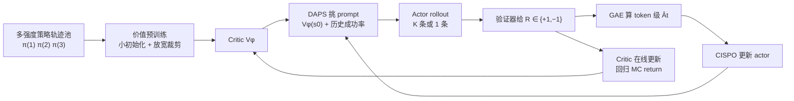

一句话解释这张图：先用多强度的老轨迹把 critic 喂出个像样的初值，之后每个 rollout batch 都用它挑题、算 token 级 advantage，再拿新采到的回报把它自己更新一遍，循环。

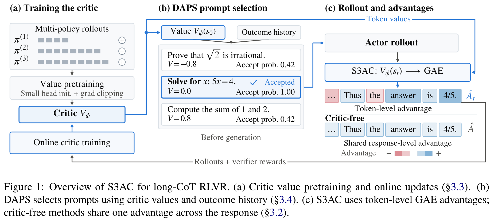

图 1：三块拼图各管一段——(a) critic 怎么训，(b) 生成之前怎么用 $V_\phi(s_0)$ 和历史成绩挑题，(c) 同一条回答上 S3AC 是逐 token 给 $\hat{A}_t$，critic-free 是整条共用一个 $\hat{A}$。（原图 Figure 1）

### 4.2 模块拆解

**模块一：token 级 MDP 与 GAE**

为什么需要：要把一个总分摊到每个 token，先得把「写回答」写成序列决策问题。

怎么做：状态 $s_t$ 是「题目 + 前 $t$ 个 token」，动作 $a_t$ 是下一个 token；验证器只在最后一个 token 上给 $R \in \{-1,+1\}$，折扣因子 $\gamma = 1$。这样 critic 学的是 $V_\phi(s_t) \approx \mathbb{E}_{\pi_\theta}[R \mid s_t]$。

公式（式 1）：

$$
\hat{A}_t = \sum_{l=0}^{T-t-1} \lambda^l \delta_{t+l}, \qquad \delta_t = R_t + V_\phi(s_{t+1}) - V_\phi(s_t)
$$

先说它在算什么：把后面每一步的 TD error 按 $\lambda$ 衰减相加，得到「这一步比预期好多少」。

- $\hat{A}_t$：第 $t$ 个 token 的 advantage，标量。
- $\delta_t$：TD error，标量，就是在 $t$ 这一步的「惊喜程度」。
- $R_t$：只在最后一个 token 等于 $R$，其余位置为 0。
- $V_\phi(s_t)$：critic 给状态 $s_t$ 的价值估计，标量。
- $T$：响应长度；终端价值取 $V_\phi(s_T) = 0$。
- $\lambda$：偏差与方差的旋钮，$\lambda < 1$ 时用后面的价值做 bootstrap。

等价的写法是 $\hat{A}_t = G_t^\lambda - V_\phi(s_t)$，即 $\lambda$-return 减掉基线。生活类比：一个人跑接力，每一棒都单独记「比预期快还是慢」，最后按权重汇总，而不是只看终点名次。

**模块二：actor 的更新目标**

为什么需要：token 级 advantage 算出来了，还得有个稳定的策略梯度目标把它用掉。

怎么做：直接采用 CISPO 的代理目标，把裁剪后的重要性权重和 advantage 都当常数（stop-gradient）处理。

公式（式 2）：

$$
J_{\text{actor}}(\theta) = \hat{\mathbb{E}}_t \left[ \mathrm{sg}(\bar{r}_t \hat{A}_t) \log \pi_\theta(a_t \mid s_t) \right], \qquad \bar{r}_t = \mathrm{clip}(r_t, 1-\epsilon_{\text{low}}, 1+\epsilon_{\text{high}})
$$

先说它在算什么：用裁剪过的概率比当权重，把 log 概率往 advantage 大的方向推。

- $r_t = \pi_\theta(a_t \mid s_t) / \pi_{\theta_{\text{old}}}(a_t \mid s_t)$：重要性比。
- $\bar{r}_t$：裁剪后的比值，本文配置区间 $[0.8, 1.28]$。
- $\mathrm{sg}(\cdot)$：stop-gradient，不让梯度穿过权重和 advantage。
- $\hat{A}_t$：式 1 算出来的 token 级 advantage。

生活类比：给每一步打分之后，打分本身不再变动，只按这个分数调动作——分数是裁判给的，选手不能反过来改裁判。

**模块三：critic 的回归目标**

为什么需要：critic 得跟着策略走，策略一变，旧价值就过期。

怎么做：把 token 级价值往蒙特卡洛回报 $R$ 上回归，用带裁剪的平方误差，避免一次更新跳太远。

公式（式 3）：

$$
\mathcal{L}_{\text{critic}} = \frac{1}{2}\hat{\mathbb{E}}_t \left[ \max\left\{(V_t - R)^2,\ (\bar{V}_t - R)^2\right\} \right]
$$

先说它在算什么：取「原始预测的误差」和「裁剪后预测的误差」里更大的那个，逼价值别一次改太多。

- $V_t = V_\phi(s_t)$：当前价值预测。
- $R$：验证器给的终端回报，$\pm 1$。
- $\bar{V}_t$：把 $V_t$ 裁剪到 $[V_t^{\text{old}} - \epsilon_v,\ V_t^{\text{old}} + \epsilon_v]$，$\epsilon_v$ 控制价值裁剪幅度。
- 期望在有效响应 token 上平均。

生活类比：给温度计校准，一次只允许拧一小格，拧过头的那部分不算数。

**模块四：critic 训练的三件套（Stabilized）**

这是全文最实的部分，三件事分开说。

（1）**Coverage-oriented value pretraining**。为什么需要：初始策略几乎没有「长且对」的轨迹（24K 以上只有 5.0% 正确）。怎么做：把不同强度策略的轨迹汇成一个池子，预训两个 epoch，用 token 平均的 MSE 回归终端回报，按 SAO 的做法冻结 attention 层，另外再冻结 MoE router。生活类比：新教练上任前先看一大批不同水平球员的录像，而不是只看青训队。

（2）**价值头初始化**。为什么需要：梯度分析给得很直接——线性头 $v_t = w^\top h_t$、残差 $e_t = v_t - R$、损失 $\ell_t = \frac{1}{2}e_t^2$，于是 $\nabla_w \ell_t = e_t h_t$、$\nabla_{h_t}\ell_t = e_t w$。头的梯度正比于 hidden state，进 backbone 的梯度被小权重 $w$ 缩了一遍。原文的句子是「The head gradient depends directly on hidden states, whereas the gradient entering the backbone is scaled by the small head weights.」——这句说的就是为什么按 head 的量级做全局裁剪会顺带压死 backbone 的梯度。怎么做：头初始化标准差取 $1/(H+1)$，$H$ 是 hidden size，把初始预测压小。生活类比：新来的助教第一天就把麦克风音量调到最低，先听清再说。

（3）**放宽 critic 的梯度裁剪**。为什么需要：常规 actor 训练用阈值 1，对 critic 太紧。怎么做：critic 的裁剪阈值提到 10。实测被裁剪的更新比例从 99.7% 降到 12.5%，而最终 value loss 基本不变。生活类比：限流阀按整栋楼的水量设，别按一个水龙头设。

**模块五：在线适配（two-timescale）**

为什么需要：critic 要追着策略跑，追太慢价值过期，追太快又跟着噪声抖。

怎么做：critic 学习率是 actor 的 5 倍，每个 rollout batch 训 2 个 critic epoch 对 1 个 actor epoch。actor 和 critic 的 GAE 解耦：critic 直接回归蒙特卡洛回报（$\lambda_{\text{critic}} = 1$），actor 用 VAPO 的 length-adaptive GAE：

$$
\lambda_{\text{actor}} = 1 - \frac{1}{\alpha T}
$$

先说它在算什么：响应越长，$\lambda$ 越接近 1，让长回答的 advantage 更多依赖真实回报而不是价值 bootstrap。

- $T$：响应长度。
- $\alpha = 1.5$：固定系数，本文全篇用这个值。

生活类比：短跑看秒表就行，马拉松得靠中途配速员带——长度不同，信谁的比例也不同。

**模块六：DAPS 挑题（Selective）**

为什么需要：DAPO 式 dynamic sampling 是全对/全错的组直接丢，但丢在生成之后，那批 token 已经花掉了。要在生成之前就避开「太简单」和「太难」。

怎么做：每个 rollout batch 之前，用最新 critic 给候选 prompt 打分，把价值翻译成成功率，再和这道题的历史对错次数做加权平均。

公式（式 4）：

$$
p_c = \mathrm{clip}\left(\frac{V_\phi(s_0)+1}{2},\ 0,\ 1\right), \qquad \hat{p} = \frac{S + n_c p_c}{N + n_c}
$$

先说它在算什么：$+1/-1$ 的回报约定下，成功率 $p$ 对应期望回报 $2p-1$，所以把价值反解成成功率，再用历史计数把它拉回现实。

- $p_c$：从 critic 的价值反解出的成功率，截断到 $[0,1]$。
- $S$、$N$：这道题累计答对次数、累计尝试次数。
- $n_c$：critic 相对历史观测的权重，本文取 3。
- $\hat{p}$：融合后的成功率估计；新题 $S=N=0$ 时退化成 $p_c$，不需要离线 rollout 就能初始化难度。

公式（式 5）：

$$
a = a_{\min} + (1 - a_{\min})\,4\hat{p}(1-\hat{p})
$$

先说它在算什么：接受概率在 $\hat{p}=0.5$ 时最高，往两头走就递减，但不降到 0。

- $a$：这道题被选中的概率。
- $a_{\min}$：下限，给很简单和很难的题留一条活路（$\epsilon$-greedy 的思路），主实验取 0.3，35B single 那组取 0.1。

两个计数随训练进度按 0.99 每个 rollout batch 衰减，避免旧观测拖住已经变强的策略。生活类比：招聘时挑「有点挑战但干得成」的候选人，同时留一点点名额给明显超纲和明显对口的人，免得错过。

**模块七：这里的 critic 和 GRPO 的分组基线差在哪**

这件事值得单独说清，因为两者解决的不是同一个问题。

- **GRPO 那类**：advantage 是 response 级标量，组内均值（GRPO-X 里是 group z-score）负责抹平 prompt 之间的难度差。一条 20K 的回答里，20K 个 token 共享同一个数。
- **S3AC 在 group rollout 下**：组均值继续管 prompt 难度，critic 额外管响应内部的位置差异——所以它是「在组基线之上做增量」，不是替代。
- **S3AC 在 single rollout 下**：组均值没了，critic 同时补上 prompt 级 baseline 和 token 级 advantage，这时候是「一个顶两个」。

差距在数据上也对得上：group rollout 下 35B 涨 4.1 分，single rollout 下对 REINFORCE++ 涨 10.5 分——single 那一档的增量更大，符合「critic 补的是 batch 统计量缺的那块」这个解释。

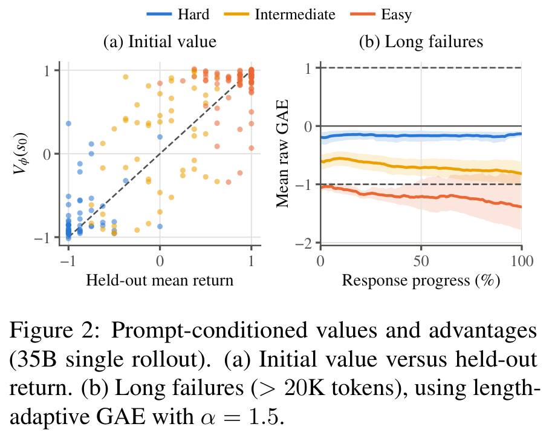

图 2：(a) 初始价值 $V_\phi(s_0)$ 和独立 rollout 的蒙特卡洛回报基本贴着对角线走，说明它能当 prompt 级 baseline；(b) 都是失败的长回答（> 20K token），难题的平均 raw GAE 贴近 0，简单题压到 −1 以下——同样拿 $-1$ 的奖励，惩罚力度按题目难度分开了。（原图 Figure 2）

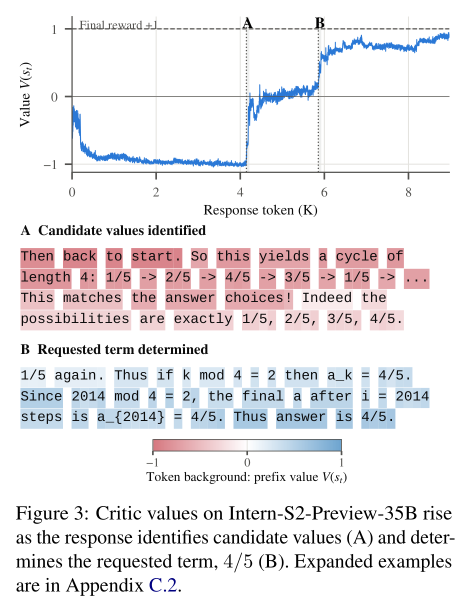

图 3：一条真实响应上的 critic 价值曲线。A 点识别出候选值集合时价值往上跳，B 点确定「要求的项是 4/5」时再跳一次，最后贴着「Final reward +1」的虚线。这张图是 token 级信用分配能成立的直接证据：价值确实在推理推进时变化，而不是一条平线。（原图 Figure 3）

### 4.3 关键细节

这些决定了别人复现得出来还是复现不出来。

| 项目 | 取值 |
| --- | --- |
| actor / critic 学习率 | $1\times10^{-6}$ / $5\times10^{-6}$ |
| actor / critic 梯度裁剪 | 1.0 / 10.0 |
| CISPO 裁剪区间 | $[0.8, 1.28]$ |
| 每个 rollout batch 的 actor 更新 | 8 个 mini-batch，8 步梯度 |
| critic epoch / actor epoch | 2 / 1 |
| $\lambda_{\text{critic}}$ / $\alpha$ | 1 / 1.5 |
| IcePoP token mask 区间 | $[0.5, 5]$ |
| MIS-style sequence mask 区间 | $[0, 5]$ |
| DAPS：$n_c$ / 衰减 / $a_{\min}$ | 3 / 0.99 每 batch / 0.3（35B single 为 0.1） |
| 最大响应长度 | 3,072（Qwen2.5-Math-1.5B）/ 16,384（R1-Distill-1.5B）/ 50K（35B）/ 62K（397B） |

另外两件工程细节：

- 训练–推理不一致用两层遮罩处理：token 级重要性采样配 IcePoP masks，序列级用 MIS-style masking。判据是「一条响应的最大 token 级 log-prob 比值超过阈值就整条丢掉」。
- MoE 的两个模型上还加了 Rollout Routing Replay（R3）和 GEPO entropy control，这两项属于 GRPO-X 与 S3AC 共享的配方，不是本文的贡献。

## 5. 实验结果

**实验设置**

- **数据集与切分**：Qwen2.5-Math-1.5B 在 DAPO-Math 7.5k 这份 7.5k 条的子集上训，R1-Distill-1.5B 在 MATH-1,460 上训，两个 MoE 用 in-house prompt set（覆盖数学、指令跟随、推理、物理、化学）。评测集与训练集不重叠，但 in-house 集的具体构成原文未给。
- **骨干模型**：Qwen2.5-Math-1.5B、R1-Distill-1.5B（dense，1.5B），Intern-S2-Preview-35B、Intern-S2-397B（multimodal MoE）。
- **训练预算**：梯度步数 1,024（两个 1.5B）、1,520（35B group）/ 1,600（35B single）、1,200（397B）。每 batch 的 prompt × $K$：1.5B group 为 $256\times16$、single 为 $4096\times1$；35B group 为 $512\times8$、single 为 $8192\times1$（DAPS 对照实验用 $4096\times1$）；397B group 为 $1024\times8$。卡数和卡型原文未给。
- **基线**：group rollout 对 GRPO-X（现代 GRPO 变体，MoE 上额外配 R3 与 GEPO）；single rollout 对 REINFORCE++ 和 FlashREINFORCE。三个方法的 actor 目标都用 CISPO，只有 FlashREINFORCE 保留它自己的序列级 trust region。同一模型内共享 base checkpoint、训练数据和评测协议。
- **指标**：avg@$k$ 为主（AIME 与 HMMT26 用 avg@16，GPQA-D 与 IMO-AnswerBench 用 avg@4，其余 avg@1；Qwen2.5-Math-1.5B 全用 avg@16，R1-Distill-1.5B 全用 avg@32，DAPS 对照里 R1D 用 avg@64）；critic 质量用 EV 和 value loss 看。
- **推理设置**：Qwen2.5-Math-1.5B 用 temperature 0.7、top-p 0.7，prompt + 响应合计上限 4,096 token；R1-Distill-1.5B 用 temperature 0.8、top-p 0.95、响应上限 16,384；35B 与 397B 用 temperature 0.8、top-p 1.0，响应上限 64K 和 62K。除 Minerva 用 LLM judge 打分（为容纳数值近似和等价符号表达式）外，其余走可验证奖励的规则判分。

主表只挑能说明问题的行，最强基线那一列填的是同一 rollout 设置下最好的对手：

| 模型 | 设置 | 指标 | 本文 | 最强基线 | 提升 |
| --- | --- | --- | --- | --- | --- |
| Qwen2.5-Math-1.5B | group | Avg | 43.3 | GRPO-X 42.7 | +0.6 |
| Qwen2.5-Math-1.5B | single | Avg | 43.0 | REINFORCE++ 40.4 | +2.6 |
| R1-Distill-1.5B | group | Avg | 31.4 | GRPO-X 29.5 | +1.9 |
| R1-Distill-1.5B | single | Avg | 29.8 | FlashREINFORCE 30.4 | −0.6 |
| Intern-S2-Preview-35B | group | Avg(7) | 80.5 | GRPO-X 76.4 | +4.1 |
| Intern-S2-Preview-35B | single | Avg(7) | 80.9 | REINFORCE++ 70.4 | +10.5 |
| Intern-S2-397B | group | Avg(5) | 87.3 | GRPO-X 85.1 | +2.2 |

R1-Distill-1.5B 的 single 那一行是负的，原文没有回避：其表 2 里 S3AC single 29.8 低于 FlashREINFORCE 的 30.4，AIME24 也低（37.2 对 38.0）。原文在正文里只声称 Qwen 和 35B 两个模型上「single rollout 的优势更大」，没把 R1D 算进去。

**原文实验图**

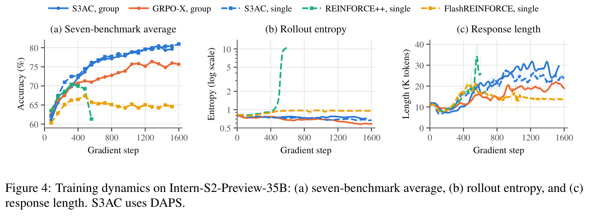

图 4：35B 的训练动态。(a) 里 S3AC 的 group 与 single 两条线一路爬到 80 上下，GRPO-X 停在 76 附近；两个 critic-free 的单条基线一个在 500 步左右熵爆掉（绿虚线直接冲出 log 轴），一个缓慢下滑。(b)(c) 是关键：REINFORCE++ 的 rollout 熵和响应长度同时暴涨，是训练崩掉的样子；FlashREINFORCE 是长度越缩越短、分数跟着掉。同样是单条 rollout，S3AC 的熵和长度都稳在中段。（原图 Figure 4）

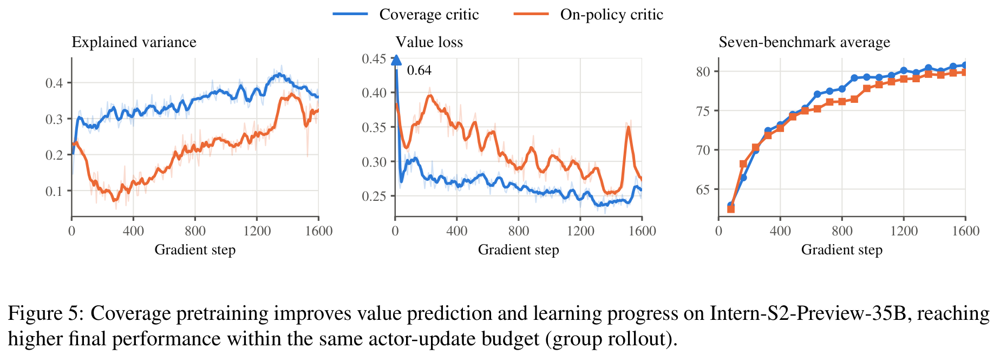

图 5：coverage critic 和 on-policy critic 的对照。左图 EV：coverage 那条起来就稳在 0.3 上方，on-policy 先掉到 0.1 附近，到 1,000 步之后才追到 0.3 上下；中图 value loss 同样是 coverage 更低；右图七基准平均到 1,600 步收在 80.78 对 79.86。差距不大但方向一致：多强度轨迹的预训练让 critic 在早期就更准，且这份早熟最后换成了一点终局分数。（原图 Figure 5）

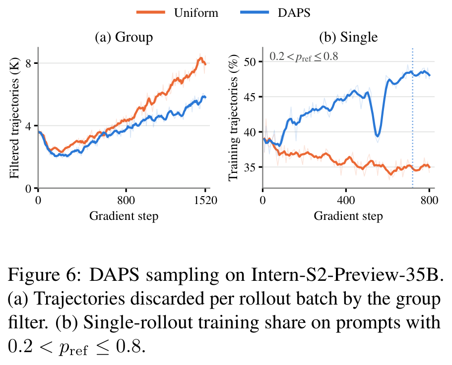

图 6：DAPS 的两个证据。(a) 每个 batch 被组过滤丢掉的轨迹数，DAPS 从 800 步起稳定低于 uniform，后期差距拉到 3K 条以上，说明在生成前挑题确实减少了白花的 rollout；(b) uniform 那条线一路在 35% 附近磨，DAPS 爬到 45% 以上（中途在 550 步左右掉到 39% 又回去），符合式 5 偏好中等难度的设计。（原图 Figure 6）

**原文实验表**

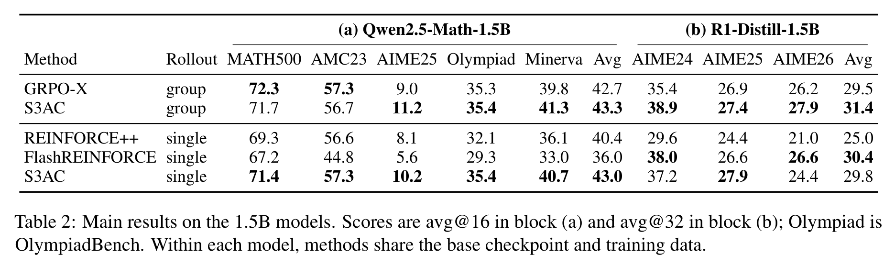

表 2：两个 1.5B 模型的主结果。左块 Qwen2.5-Math-1.5B（avg@16），右块 R1-Distill-1.5B（avg@32）。有意思的是 Qwen 上 S3AC 的 group 版在 MATH500（71.7 对 72.3）和 AMC23（56.7 对 57.3）反而略低，涨分全来自 AIME25（11.2 对 9.0）、Olympiad（35.4 对 35.3）、Minerva（41.3 对 39.8）这些更难的项。（原图 Table 2）

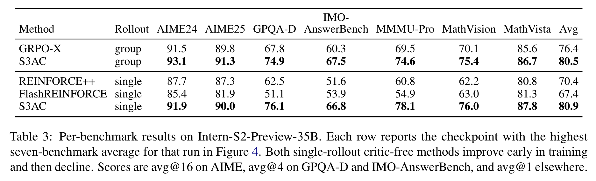

表 3：35B 的逐基准结果。每一行取的是该次训练里七基准平均最高的那个 checkpoint。group 和 single 两种设置下 S3AC 都是八列全胜，single 相对 REINFORCE++ 的落差在 GPQA-D（76.1 对 62.5）和 MMMU-Pro（78.1 对 60.8）最大。（原图 Table 3）

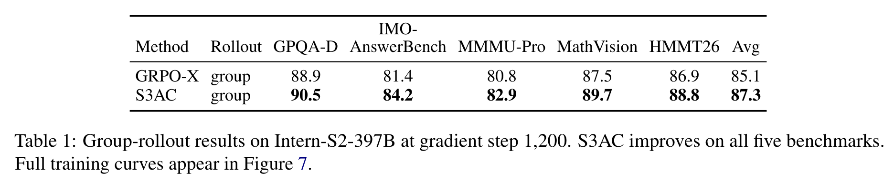

表 1：397B 的 group rollout 结果，第 1,200 步。只有两行，S3AC 在五个基准上全胜，平均 87.3 对 85.1。这是全文规模最大的一个数据点，也是 Scalable 这个词的主要证据。（原图 Table 1）

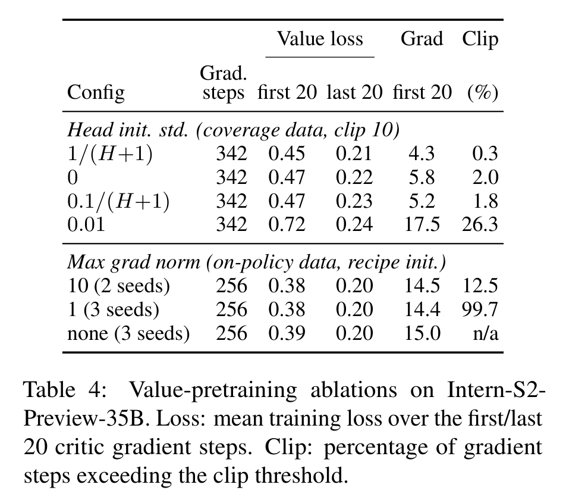

表 4：value 预训练的消融，两段。上段是 head 初始化标准差：取 $1/(H+1)$ 时前 20 步 value loss 0.45（取 0.01 是 0.72），最终 loss 也最低（0.21）；取 0.01 时有 26.3% 的更新被裁剪。下段是裁剪阈值的对照：阈值 1 时有 99.7% 的更新被裁，阈值 10 降到 12.5%，最终 loss 相当（0.20 对 0.20），关掉裁剪也只是 0.20 但没有极端梯度的保护。（原图 Table 4）

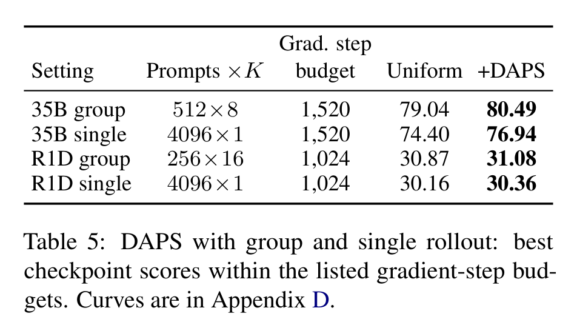

表 5：DAPS 的四组配对对照，同一对里 actor 和 critic 初始化相同、训练 recipe 相同。四组全为正：35B group +1.45，35B single +2.54，R1D group +0.21，R1D single +0.20。R1D 上的增量很小，原文自己也说这几组分数差异要看重复评测的波动。（原图 Table 5）

**消融告诉我们什么**

- critic 的三个修法里，**裁剪阈值**的效应最干净：从 99.7% 被裁到 12.5%，几乎等于从「一直在裁」变成「偶尔裁」，这解释了为什么早期 critic 学不动。
- **head 初始化**的效应是「早期显著、后期收敛」：0.72 → 0.45 的前 20 步差距，到后 20 步只剩 0.24 对 0.21。也就是说它买的是时间，不是上限。
- **coverage 预训练**的效应最小但也最稳：终局 80.78 对 79.86，差 0.92 分，且两组的数据量也不同（327,680 条 / 7.08B token 对 65,536 条 / 0.74B token），所以这不完全是「同一份数据换来源」的干净对照。
- **DAPS** 在 35B 上有效（+1.45 / +2.54），在 R1D 上只有 +0.2 量级，说明「在生成前挑题」的收益跟 prompt 池有多大、rollout batch 有多贵有关。

**这些实验够不够支撑结论**

大体够，但有三处口径要留意。

第一，**没有多种子**。原文自己在 Limitations 里写了「The reported experiments do not systematically assess variability across independent RL training seeds.」——单种子的 0.2 到 0.9 分差距不该被当成结论，本文真正稳的增量是 35B 的 +4.1 和 single 的 +10.5 这一档。

第二，**35B / 397B 报的是「最有 checkpoint」**。表 3 的脚注写明每一行取七基准平均最高的那个 checkpoint，这在 RL 训练曲线上等于给每个方法各挑了一次运气，单条曲线的抖动会被抹掉。原文在 §4.2 里另有一句「retains most of its gains through 1,600 gradient steps」，这句话比表 3 的峰值更能说明稳定性。

第三，**397B 上没做 single rollout**（表 6 里 397B 的 single 一行是「–」）。Scalable 这个词目前在最大规模上只覆盖了 group rollout。

## 6. 局限性

**作者自己承认的**

- 任务范围只到「有可验证奖励的推理任务」——数学、科学、多模态推理。原文说得很直接：「We do not evaluate agentic multi-turn settings, where credit must be assigned across tool calls and environment turns, so whether our findings carry over to agentic RL remains open.」——多轮工具调用场景里信用要跨 turn 分配，这套东西能不能搬过去是开放的。
- 没系统评估多个训练种子的波动。
- 算力开销：「S3AC costs 27–40% more amortized wall time per actor gradient step than GRPO-X」，每个 actor 梯度步摊销下来多 27% 到 40% 的墙钟时间，原因是 critic 既要训又要推理。

**我看出来的**

- **隐形假设**：这套方法默认「一条响应前缀的价值可以被一个标量稳定估计」。二元奖励 + $\gamma = 1$ 意味着价值只能落在 $-1$ 到 $+1$ 之间，而一条 20K 的回答中途的价值变化其实很细（图 3 那段曲线在 B 点之前一直在 0 到 0.2 之间磨）。奖励一旦变成连续分（比如带部分分的判分器），这个假设的张力会变大。
- **边界条件**：DAPS 的难度估计完全寄生在 critic 上。critic 早期不准时，$p_c$ 就是噪声，式 4 靠 $n_c = 3$ 和历史计数兜着；如果 prompt 池子很小、每道题的历史计数起不来，这个兜底会失效。
- **缺的对比**：没有和「同样用 critic、但 critic 不预训练、直接在线学」的最朴素 baseline 比（on-policy critic 那组同时改了数据量，附录 C.1 承认两者 recipe 在数据量上也不同）；也没有和 VinePPO 这类用蒙特卡洛 rollout 改价值估计的方法直接比。
- **算力账没算清**：27–40% 的墙钟开销是相对 GRPO-X 的；但 GRPO-X 在 group rollout 下要等最慢的那条响应，S3AC 省下的等待时间没有单独量化。

## 7. 一句话总结

以前的 RLVR 只在终点举一个「对/错」的牌子，这篇论文在路上装了逐段的测速仪——有了每步的速度，既能算清哪一步拖慢了自己，也能在开跑前就知道哪条赛道值得跑。

**核心公式**

$$
\boxed{\hat{A}_t = \sum_{l=0}^{T-t-1}\lambda^l \delta_{t+l},\qquad \delta_t = R_t + V_\phi(s_{t+1}) - V_\phi(s_t)}
$$

## 8. 可复用点

- 如果我要在自己的项目里用：先别急着上 critic，先在现成的 group rollout 上算一遍「组内 advantage 的方差」和「响应内部 value 估计的方差」，前者远大于后者时才值得为 token 级信用分配付 27–40% 的墙钟代价。
- 训 critic 之前先量一件事：把 value head 的梯度范数和 backbone 的梯度范数分开打点。如果 head 占到 99% 这种量级，先改初始化（$1/(H+1)$ 这类小尺度）再谈别的。
- 裁剪阈值不要从 actor 直接抄给 critic。先用一组小实验扫「被裁剪的更新比例」，落在 10% 量级比落在 99% 量级健康。
- 要给 critic 攒预训练数据，别只用当前策略采。按「策略强度」分层采、把长而正确的轨迹特意补进去，比单纯堆数据量有用——本文的对照里 0.92 分的终局差距主要来自覆盖而非规模。
- 想省 rollout 又不想离线预备统计量，可以直接拿 critic 的 $V_\phi(s_0)$ 反解成功率当难度先验（式 4），再用式 5 的接受概率做加权采样，$a_{\min}$ 留 0.1 到 0.3 保底。

## 9. 我的疑问

- coverage critic 的预训练规模在两处对不上：附录 C.1 说 35B 的 coverage critic 用了 327,680 条轨迹（7.08B response token），附录 C.4 说 35B critic 预训练用了 1.13M 条轨迹（6.24B token）。是两组不同实验，还是口径不同？原文没交代。
- 表 4 上段四行的「Grad. steps」都写 342，但下段三行写 256，两段的更新步数不同，是不是意味着初始化和裁剪是在两个不同规模的预训练上比的？如果是，跨段比较就不成立。
- 35B single 的 DAPS 对照用 $4096\times1$，主结果用 $8192\times1$，附录 D.1 承认了这点。那表 5 里的 +2.54 能否直接搬到主结果的口径上？
- 图 4(b) 里 REINFORCE++ 的熵在 500 步左右冲出了 log 轴的顶端（10 以上），但表 7 里 REINFORCE++ 的统计窗口写的是 536–608 步，并标注「post-collapse」。崩溃之后的窗口拿来算平均，这个数怎么读？
- 397B 的 critic 只在 group rollout 下验证过，single rollout 在 397B 上的行为（尤其是 batch 统计量缺失后 critic 能否补上 baseline）没有数据，而这恰恰是本文在小模型上最强调的卖点。
