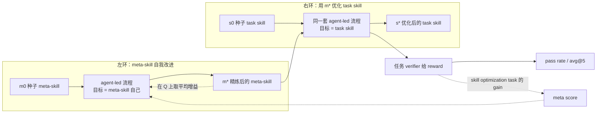
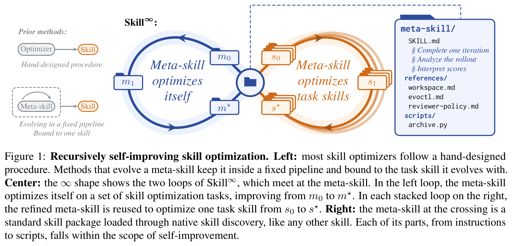
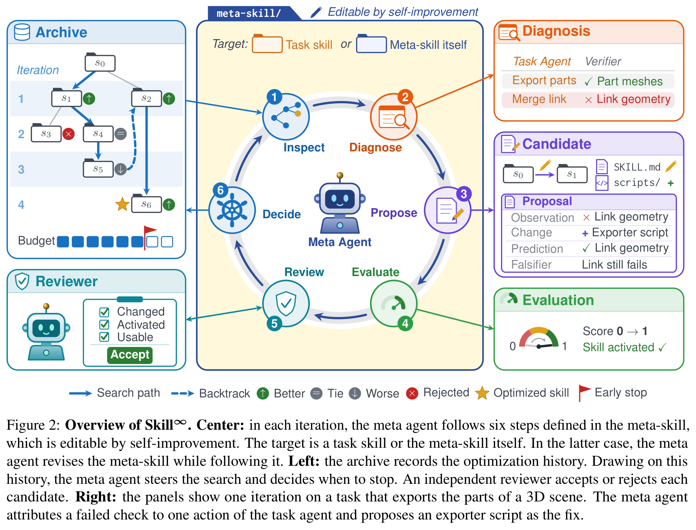
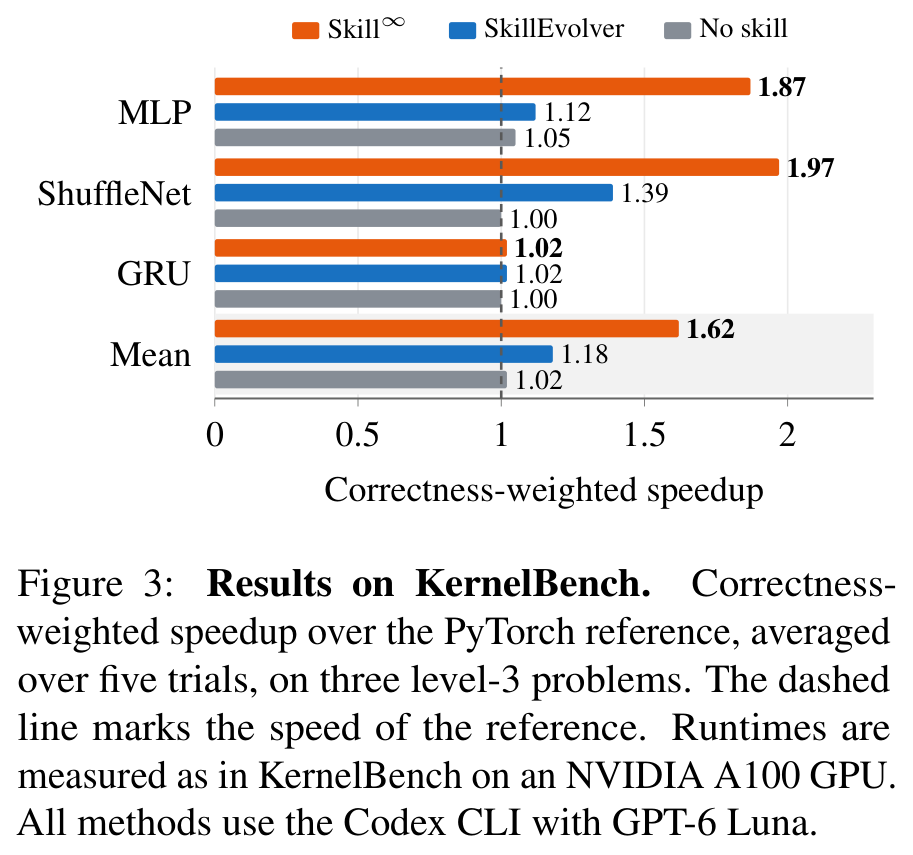
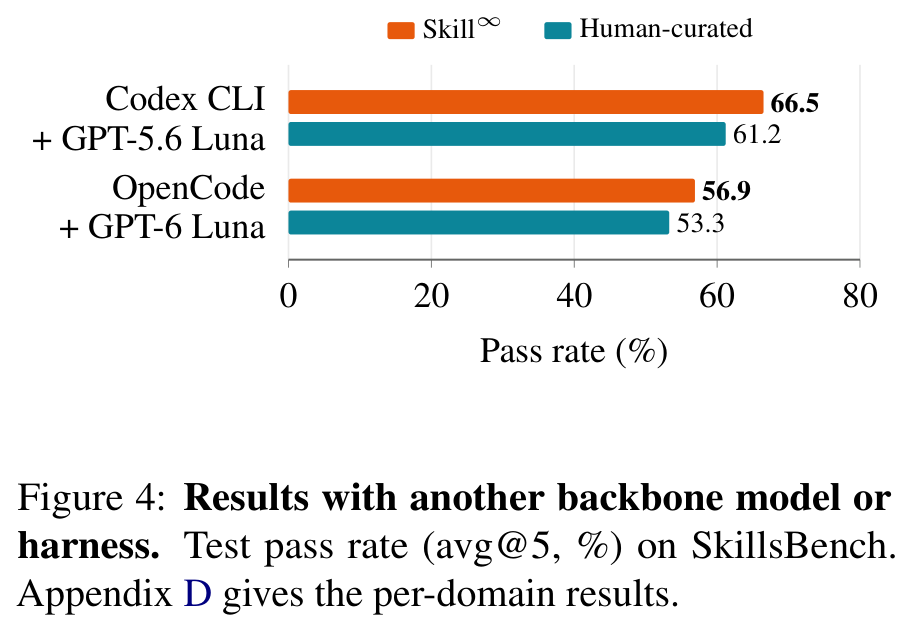
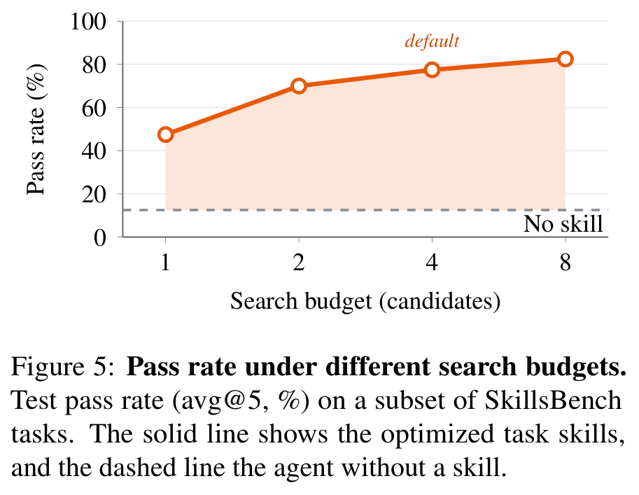
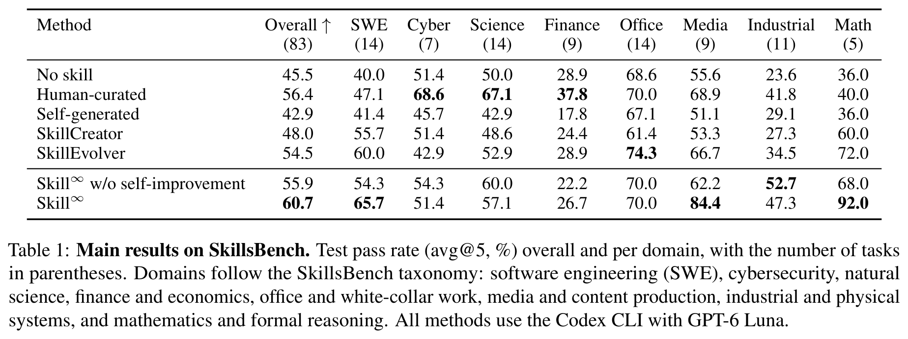
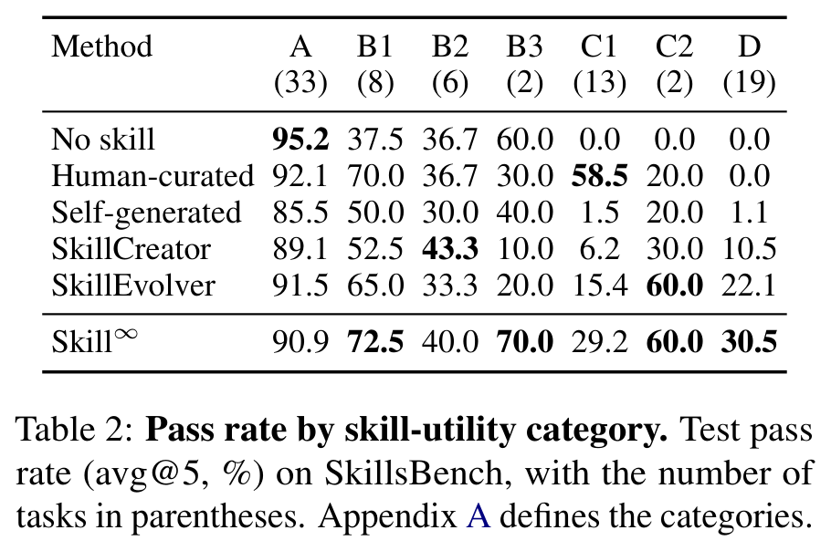
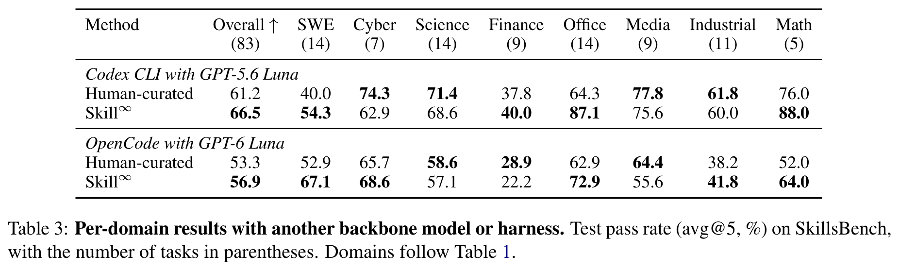
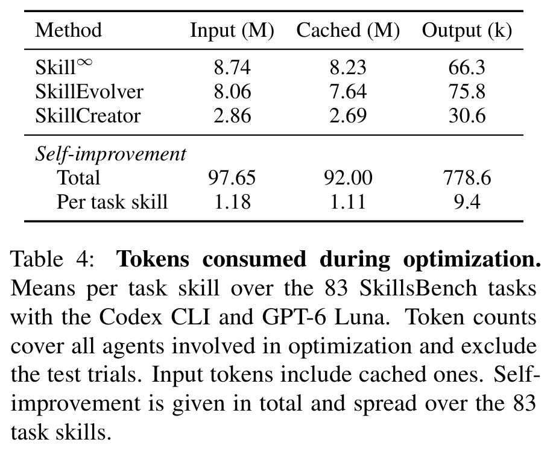

> 一句话：把「怎么改技能」也写成一份技能，于是改进办法自己也能被改进。

## 0. 读之前你需要知道

**术语卡**

- **递归自我改进（Recursive Self-Improvement, RSI）**：不只把事办得更好，还把「怎么变好」的流程也改得更好。生活类比：不只把菜做得更好吃，还顺手把菜谱改得更会教人。
- **技能包（skill package）**：以 `SKILL.md` 为中心的目录，front matter 声明名字和描述，正文放指令，还能捆脚本和参考文件。生活类比：一个工具箱。
- **原生技能发现（native skill discovery）**：agent 先只看见每个技能的名字和描述，判断有用才加载指令与资源，这套「先给摘要再展开」的原则叫渐进披露（progressive disclosure）。生活类比：只看书脊，觉得对路才抽出来翻。
- **元技能（meta-skill）**：一份内容为「怎么优化技能」的技能。它既是被优化的主角，也是执行优化的说明书。
- **元代理（meta agent）**：跑优化这个活的 agent。它的外壳（harness）和 backbone 模型跟任务 agent 完全一样，不是换个更强的模型当裁判。
- **任务技能（task skill）/ 任务 agent（task agent）**：真正干活的技能，和装了它去干活的 agent。
- **技能优化任务（skill optimization task）**：三元组 $q=(s^q_0, T_q, B_q)$——种子任务技能、一组任务、一份搜索预算（以能造几个候选计）。「优化一个技能」被包装成了一道题。
- **元分数（meta score）**：一份元技能在一批技能优化任务上的平均增益。
- **优化档案（archive）**：记录候选、分数、审查结论与决策的仓库。生活类比：版本库。

**它站在谁肩上**

- Good（1966）与 Gödel machine（Schmidhuber, 2003）：把 RSI 说成「能证明改自己有用才改自己代码的程序」。目标很纯，但证明这一步在真实系统里跑不动。
- STOP（2024）：拿改代码的脚手架去改自己的代码，作者自己承认这不算完整 RSI，因为语言模型本身没被改动。
- Darwin Gödel Machine、Gödel Agent（2025–2026）：让 agent 改写自己的逻辑或代码。改的是程序，不是一份人读得懂、能跨外壳搬走的技能。
- MetaSkill-Evolve（2026b）：每个搜索分支带一份 meta-skill 去配置五代理流水线，但流水线角色与接线固定，每份 meta-skill 只绑定它一路在进化的那个 task skill。
- SkillEvolver（2026a）：把优化流程写成固定的 meta-skill，在独立 agent 里审候选，流程本身不自我改进。
- SkillOpt、CoEvoSkills（2026）：从执行反馈优化技能，但实验时把技能注入提示词或提示 agent 去加载，跟部署时不一样。

## 1. 动机

想象你教一个学徒做菜。他做砸了，你去改菜谱：加一句「先热锅」，加一句「盐分两次放」。改完他好一些了。可你改菜谱的办法是从哪来的？老师傅传下来的那套。这套办法要是不更新，你改菜谱的水平就永远停在老师傅那一代。

**以前怎么做**：现有的技能优化器（SkillOpt、CoEvoSkills、SkillEvolver）都从执行反馈里改技能。它们改什么、怎么验证候选各有做法，却共享一个设计选择——优化器走的是一套人写的流程，在优化某一个技能时学到的东西也不会带到下一个技能上。MetaSkill-Evolve 往前走了一步：每个搜索分支带一份 meta-skill，同一套流水线也用来改它，但流水线的角色和接线仍然钉死。

**为什么不行**：作者给的判断很直接：

> "an optimizer that improves skills but not its own procedure will eventually stagnate."

这句话在说：只改技能、不改自己那套改法的优化器，早晚会卡住。因为流程一固定，能改的地方就被框住了——诊断可以变，审查与选择那两步永远动不了。另一处错位是设置：有些方法在优化时注入技能，或直接提示 agent 去加载，于是优化过程从来没检验过「agent 自己会不会想起来加载它」。

**为什么现在能做**：技能这个格式刚刚变成跨外壳的公共载体——Claude Code、Codex、OpenCode 都按同一份 Agent Skills 规范加载，于是「优化技能的流程」这份知识有了可移植的封装。另外两件事也凑齐了：外壳支持起子 agent（审查者能真换一个干净上下文），评测框架（Harbor）能在容器里跑试次、给出可判分的 reward。少任何一件，这套闭环都搭不起来。

## 2. 贡献

四条合起来像装了一条回流管：右边的产出不只是交付物，还会流回去校准左边那把尺子。

- **把优化流程本身做成优化目标，并让一个 agent 管两级**。证据：Algorithm 1 的六步写在 meta-skill 里而不是硬编码，目标既可以是 task skill，也可以是 meta-skill 自己；元代理与任务 agent 用同一个外壳、同一个 backbone，不是靠更强的模型来优化。去掉自改进后 SkillsBench pass rate 从 60.7% 掉到 55.9%（表 1）。
- **元技能与任务技能解耦，把自改进的成本摊薄**。证据：meta-skill 先在一批跨域技能优化任务上从 $m_0$ 精炼成 $m^\star$，再复用到各个 task skill；自改进总共 97.65M input tokens，摊到 83 个技能是每个 1.18M，占单次优化不到 15%（表 4）。
- **两级都用原生技能发现，评测条件对齐部署**。证据：不注入技能、不提示 agent 加载，只看名字和描述；因此描述也进了优化范围。
- **数字上超过人写的技能**。证据：SkillsBench 83 题 pass rate（avg@5）60.7%，Human-curated 56.4%，SkillEvolver 54.5%；KernelBench 三个 level-3 问题 correctness-weighted speedup 均值 1.62，SkillEvolver 1.18，无技能 1.02。

## 3. 创新点

- **新在哪：优化器是一份技能，不是程序，也不是训出来的策略**。对比对象：Gödel Agent、Darwin Gödel Machine 改自己的代码，R2 Flow 训一个策略去编排技能库。有用是因为：技能包是纯文本加脚本，人读得懂（可解释），换外壳能搬走（harness-agnostic），还能被同一套流程改（可递归）。生活类比：别人给你一段编译好的程序，你只能看它跑；这里给你的是一份带批注的操作手册，你能读懂也能动笔。
- **新在哪：自改进能改审查与选择这两步**。对比对象：MetaSkill-Evolve 固定的五代理流水线。有用是因为：流程一钉死，判候选行不行、选谁当父节点这两步就永远是人写的。
- **新在哪：元技能跟任务技能解绑，一次练好到处复用**。对比对象：MetaSkill-Evolve 每份 meta-skill 绑定它正在进化的那个 task skill，每个任务重学一遍。有用是因为：解耦之后自改进的成本能被后续所有优化摊掉，而且元分数在 $Q$ 上取平均，天然偏向「跨域都管用」的改法。
- **新在哪：搜索按诊断走，评分不许自己碰**。对比对象：靠分数排名选父节点的进化式搜索，以及任何允许系统改自己奖励的方案。有用是因为：分数只说变没变好，说不了为什么，一个打平的候选如果正好打中诊断出的失败点就值得留下；而把评分挡在自改进范围外，涨分才只可能来自更好的优化，不可能来自把尺子改软。

## 4. 方法

### 4.1 整体流程

一句话解释这张图：左边那圈拿一批技能优化任务练「怎么优化技能」，练出来的 meta-skill 到右边去优化具体任务技能；右边的成绩反过来成为左边打分的依据。两个环在 meta-skill 上交叉，形状像 ∞。

图 1：左边是前人的两种做法（人写的固定流程、固定流水线里进化一份绑死任务技能的 meta-skill），中间两个环在 meta-skill 处交汇，右边强调 meta-skill 就是一个普通技能包，`SKILL.md`、`references/`、`scripts/` 全在自改进范围内。

### 4.2 模块拆解

**技能包与原生技能发现**

为什么需要：优化器如果是代码，能改的只有代码里的分支；如果是一份技能，指令、参考文件、脚本每一块都能改，换个外壳也照样能用。

怎么做：技能包是以 `SKILL.md` 为中心的目录：front matter 写名字和描述，正文写指令，还能捆脚本和参考文件。agent 按渐进披露加载——先只看名字和描述，判断有用才读指令、再按需打开资源。这个机制叫 native skill discovery，因为它是外壳自带的，也是部署时技能真正被用起来的方式。

公式（分数）。先说清「一个技能有多好」怎么算：一组任务各跑多次，每次拿 verifier 给的 reward，先按任务平均，再跨任务宏平均。

$$
S(s;T)=\frac{1}{|T|}\sum_{\tau\in T}\ \frac{1}{n}\sum_{j=1}^{n} r_j(s,\tau)
$$

- $s$：被评估的技能。
- $T$：任务集合，$|T|$ 是任务数；$\tau$：其中一个任务，含指令、环境、verifier。
- $n$：每个任务跑几次试次（trial）；$r_j(s,\tau)$：装技能 $s$ 时任务 $\tau$ 第 $j$ 次试次的 reward。
- 外层 $1/|T|$ 与内层 $1/n$ 拼成宏平均：每个任务权重相同，不因为某个任务跑得多就占更大比重。

**元技能与一次迭代**

为什么需要：优化这件事本身有步骤，写进一份技能，才有东西可以被改。

怎么做：元代理照着 meta-skill 走六步——Inspect（翻档案）、Diagnose（看执行轨迹找病因）、Propose（造 1 到 2 个候选，每个附一份提案）、Evaluate（在验证集上打分）、Review（交给独立审查者）、Decide（继续还是停，选谁当下一轮的父节点）。

图 2：中间圆环是六步，每一步都写在可被自改进改写的 meta-skill 里；左边档案记着搜索路径（实线前进、虚线回溯、↑ 更好、＝ 平、↓ 更差、× 拒、⭐ 最终技能、🚩 提前停）；右边是 3D 场景导出任务的一轮实战：把链接几何失败归因到某一步，然后补一个 exporter 脚本。

Algorithm 1 里有一行值得停下来看：`Install m for the meta agent, or p if the target is the meta-skill`。目标是任务技能时，元代理装的是炼好的 $m$，被优化的东西在它之外；目标是 meta-skill 时，装的换成父节点 $p$ 自己——元代理一边照着 $p$ 干活，一边把 $p$ 改掉。**这就是递归的字面含义：它在执行一份正在被自己重写的说明书。**

**技能优化任务：把「优化一个技能」也变成一道题**

为什么需要：要改进 meta-skill 就得能给它打分，而 meta-skill 的产出不是答案，是「一份优化过的技能」。

怎么做：定义一个 skill optimization task $q=(s^q_0, T_q, B_q)$——种子任务技能、一组任务、一份搜索预算。元代理照 $m$ 干活，产出 $s^\star_q(m)$；$m$ 在这道题上的 reward 就是「优化后比种子好多少」。

$$
g(m,q)=S\big(s^\star_q(m);T_q\big)-S\big(s^q_0;T_q\big)
$$

- $g(m,q)$：增益（gain），可正可负。
- $s^\star_q(m)$：元代理照着 $m$ 在第 $q$ 题上优化出来的技能。
- $s^q_0$：这道题的种子技能，也就是基线。
- $S(\cdot;T_q)$：上一节的分数公式，在任务集 $T_q$ 上算。

再看元分数：一批技能优化任务上的增益取平均。

$$
S(m;Q)=\frac{1}{|Q|}\sum_{q\in Q} g(m,q)
$$

- $Q$：一批跨域抽取的技能优化任务，$|Q|$ 是题数。
- $S(m;Q)$：meta score，元层的分数，衡量这份 meta-skill 教会了元代理多好的优化手艺。

这两条式子是把递归接上的关键：任务层有 tasks 与 score，元层有 skill optimization tasks 与 meta score，形状完全一样，同一套 agent-led 流程可以直接套在 meta-skill 上。

**搜索即推理（search as reasoning）**

为什么需要：分数是压缩过的信息，它说变好了，不说为什么变好。

怎么做：元代理看档案里的诊断和审查记录，不看排行榜，因此能做三件按分数做不到的事：留一个打平的候选（如果改动正好推进了它要解决的失败）、在增益归因不到改动上时保留父节点、在一条路线走死时回溯。下一步该修哪个失败也由它挑。

> "A score reveals whether a candidate improved but not why"

这句话在说：分数只回答「有没有变好」，不回答「为什么」，因果那一半得靠诊断补。

**独立审查**

为什么需要：元代理对自己的改动天然偏爱，自己给自己打分，噪声会被当成进步。

怎么做：每个候选都要过一个在隔离上下文里跑的审查者，它看不到元代理的思考过程，只看父技能包、候选包、提案和证据。三种候选直接拒：没有实质改动的、从来不会被激活的、照写就不能用的。对 meta-skill 候选还多一条：审查者要确认它的核心职责没被改坏。

**预算自适应与端到端 RSI**

为什么需要：固定排期给每个技能一样多的预算，可每个技能剩下的空间差得远；六步里只要有一半硬编码，自改进就只能改另一半。

怎么做：每轮造几个候选（1 到 2 个，受剩余预算限制）、什么时候停，都由元代理自己定——多造是并行探路，只造一个是深挖。同时 Algorithm 1 的每一步都写在 meta-skill 里，包里任何部分（指令、参考文件、脚本）都开放改写。但有一条硬边界：

> "scoring lies beyond the reach of self-improvement, so gains can arise only from better optimization, never from reward tampering."

这句话在说：评分不在自改进能碰的范围里，涨分只能来自更好的优化，不能来自改尺子。

**解耦与两级原生发现**

为什么需要：每优化一个技能就重练一份 meta-skill，成本永远摊不掉；优化时一旦给特殊照顾（注入技能、提示去加载），增益就可能只在被照顾的条件下成立。

怎么做：先在一批跨域技能优化任务 $Q$ 上把 $m_0$ 炼成 $m^\star$，每个候选 meta-skill 用式（3）打分，分数来自它指导的内层优化（每题各一次，内层预算 $B_q$）；炼好后 $m^\star$ 再指导每个目标任务技能从自己的种子出发。两级技能都装在外壳的标准位置、靠原生技能发现加载，激活与否全看描述写得好不好——描述也因此进了优化范围。

### 4.3 关键细节

- **预算口径**：搜索预算以候选数计。主实验里每个 task skill 上限 4 个候选（"cap it at four per task skill"）；自改进的内层预算（inner budget）是每个 skill optimization task 2 个候选，最多造 4 个 meta-skill 候选（附录 B）。
- **种子技能**：SkillsBench 的种子任务技能都来自附录 F 的同一个模板，描述说明这是什么任务，正文只写通用的检查—执行—验证，不含任务专属知识；KernelBench 的种子类似，正文是 profiling、正确性检查、计时。种子 meta-skill 见附录 G：`SKILL.md` + 三个参考文件（workspace.md、evoctl.md、reviewer-policy.md）+ 一个 `archive.py`。
- **两张工具面**：`evoctl rollout` 在训练集上跑一个节点，返回训练分、技能是否被激活（`Yes`/`No`/`Unknown`）、用时和轨迹链接；`evoctl evaluate` 在验证集上评候选，返回 `validation_score` 与 `skill_activated`（全激活 true、任一未激活 false、未知 null）。
- **审查与留痕**：每个候选起一个新的 Reviewer Subagent，不继承元代理的对话，只给父目录、候选目录、`evaluation.json`、父的 `rollout.md` 和当前 reviewer policy 的绝对路径。每轮写一个 `decision.json`，三个 key——`action`（`continue`/`stop`）、`selected_node_id`、`reason`，`reason` 要写下一步方向或停下的理由。
- **计分口径的两个坑**：`timeout` 的试次按 agent 截止时刻留下的产物计分；没有 verifier reward 的试次（含 `verifier_error`）平均时记 0。建候选就扣一个预算，哪怕从没被评估。

## 5. 实验结果

**实验设置**

- **数据集与切分**：SkillsBench 用来测——优化后的任务技能在它 83 个任务上测，跨 8 个域（软件工程 14、网络安全 7、自然科学 14、金融经济 9、办公 14、媒体 9、工业与物理系统 11、数学与形式推理 5）。训练侧用 SkillEvolver 随论文发布的数据集；每个 task skill 有几个训练任务、训练/验证怎么切，**原文未给**。KernelBench 用 3 个 level-3 问题（参考模型是 deep narrow MLP、ShuffleNet、一个 GRU），三个问题共用一个 task skill。
- **骨干模型**：GPT-6 Luna，high reasoning effort；泛化实验换 GPT-5.6 Luna。
- **训练预算**：不训权重，只花推理。搜索预算以候选计，每个 task skill 上限 4 个；自改进内层每个技能优化任务 2 个候选、最多 4 个 meta-skill 候选。实测成本见表 4：单次任务技能优化 8.74M input / 66.3k output tokens，自改进总共 97.65M / 778.6k。KernelBench 计时在 NVIDIA A100 上跑。
- **基线**：No skill、Human-curated（SkillsBench 自带的人写技能）、Self-generated（让任务 agent 自己写技能）、SkillCreator（Anthropic 的 skill-creator，按 CoEvoSkills 改造成无人交互）、SkillEvolver（用它的 meta-skill，两轮写—部署—修）。作者自加的对照是 **Skill∞ w/o self-improvement**，即把精炼过的 meta-skill 换回种子。
- **指标**：SkillsBench 用 `pass rate`，按 `avg@5` 算——每题 5 次试次里 reward 为正的比例；KernelBench 用 `correctness-weighted speedup`——实现正确才算加速比，不正确记 0。所有结果在 5 次独立运行上平均。
- **推理设置**：外壳 Codex CLI（泛化里换 OpenCode），Harbor 在容器里跑试次。采样温度、长度上限、重试策略**原文未给**。裁判不是 LLM，是任务自带的 verifier。

主表（像体检报告的总分栏，只留能说明问题的行）：

| 数据集 / 任务 | 指标 | 本文 | 最强基线 | 提升 |
| --- | --- | --- | --- | --- |
| SkillsBench（83 题，8 域） | pass rate（avg@5, %） | 60.7 | 56.4（Human-curated） | +4.3 points |
| SkillsBench，去掉自改进 | pass rate（avg@5, %） | 55.9 | 54.5（SkillEvolver） | +1.4 points |
| SkillsBench，GPT-5.6 Luna | pass rate（avg@5, %） | 66.5 | 61.2（Human-curated） | +5.3 points |
| SkillsBench，OpenCode | pass rate（avg@5, %） | 56.9 | 53.3（Human-curated） | +3.6 points |
| KernelBench（3 个 level-3） | correctness-weighted speedup | 1.62 | 1.18（SkillEvolver） | +0.44 |

**原文实验图**

图 3：差距最大的是 MLP（1.87 vs 1.12）和 ShuffleNet（1.97 vs 1.39），GRU 上三种方法并排（1.02 / 1.02 / 1.00）——这套优化对「有明确改写空间」的 kernel 管用，对 PyTorch 已经写紧的不灵。

图 4：换小一号模型带来的增益（66.5 vs 61.2）比换外壳（56.9 vs 53.3）更大，两边都保住对人写技能的领先。

图 5：预算每翻一倍通过率还在涨，1 个候选 47.5%，8 个 82.5%，只给 1 个也远超无技能的 12.5%；读图可见 2 与 4 两档约 70% 与 79%（正文只给了 1 与 8 两档）。

**原文实验表**

表 1：60.7 的整体领先不是每个域都领先——Skill∞ 只在软件工程（65.7）、媒体（84.4）、数学（92.0）拿第一，网络安全（51.4 vs 68.6）、金融（26.7 vs 37.8）输给人写的技能，办公（70.0 vs 74.3）输给 SkillEvolver。

表 2：增益集中在 agent 原本够不着的题上——D 类（人和 agent 都做不出）30.5% vs SkillEvolver 22.1%，C1 类 29.2% vs 15.4%；A 类（无技能就 ≥80%）反而略低于 No skill（90.9 vs 95.2）。

表 3：换模型后的增益主要来自办公（87.1 vs 64.3）与软件工程（54.3 vs 40.0）；换外壳后主要来自软件工程（67.1 vs 52.9）与数学（64.0 vs 52.0），但金融掉到 22.2%。

表 4：单次任务技能优化的 token 量与 SkillEvolver 基本持平（8.74M vs 8.06M input，66.3k vs 75.8k output）——涨点不是靠堆预算换来的。

**消融告诉我们什么**

去掉自改进（表 1 倒数第二行），整体从 60.7% 掉到 55.9%，仍高于 SkillEvolver 的 54.5%——说明 agent-led 流程本身已经能打，自改进再补上最后一段。分域掉得最狠的是数学（68.0 → 92.0，差 24.0 points）、媒体（62.2 → 84.4，22.2 points）和软件工程（54.3 → 65.7，11.4 points）。

作者把这段增益归因到一个具体变化：自改进给 meta-skill 写进了一条更严的证据标准——只有当候选的 rollout 在它瞄准的失败上有实际进展才算修好，光在技能文本里提到不算。附录 C 把线索讲全了：种子 meta-skill 在 3D 场景任务上连收两个候选，verifier 却一直报同一个 link geometry 失败，第二个候选还只是跟父节点打平；元代理把病因定位在「已评估候选的检查与选择」而不是诊断，写出的候选要求「每个打平或更差的候选都要去查它瞄准的失败有没有进展」，meta score 从 0.55 升到 0.83。落到行为上：83 次任务技能优化里，精炼后的 meta-skill 只选了 54% 的打平候选，种子选了 83%。

任务层案例同样具体：每个单独 mesh 都过，合并出的 link 文件却过不了 verifier 的几何检查（Chamfer distance 103.0，阈值 0.0002）；元代理归因到 group ownership 与坐标变换，补 exporter 脚本、把规则写进 `SKILL.md`、改描述，优化后五个测试试次全过。

> "Self-improvement changes the behavior of the meta agent, not merely the text of its instructions."

这句话在说：自改进改的是元代理的做法，不只是指令的措辞——这是判断「真改进」还是「换个说法」的分界线。

**这些实验够不够支撑结论**

- 「自动优化能超过人写的技能」在 83 题单基准上成立，但只领先 4.3 points，8 个域里有 3 个不领先。作者正文也只用「leads in software engineering, media, and mathematics」这种限定说法。
- 泛化只换了一个同家族小一号的模型和一个外壳，跨模型家族能不能保住，原文没测。
- 预算缩放只在「默认预算能大幅提升种子技能」的子集上做，子集是挑出来的，曲线好看有一部分是选择效应。
- 没报置信区间；数学域只有 5 题，24.0 points 折合下来不过一两题；表 2 里 A 类还掉了 4.3 points（90.9 vs 95.2），作者没解释。

## 6. 局限性

**作者自己承认的**（原文 Limitations）：

- 自改进只改技能包，backbone 模型不动，收益被技能包表达力卡住上限。
- 两级优化都依赖自动 verifier（元分数由任务 reward 算出），只适用于能可靠算出 reward 的域。
- agent-led 优化是拿灵活性换强制性：元代理是「照着流程做」而不是「把流程当代码执行」，效果取决于 backbone 模型多可靠地遵守长指令，没有工具强制它——只能靠 meta-skill 自己和独立审查兜。

打个比方：这套改造只能在屋里刷墙、换家具，动不了承重墙和地基。

**我看出来的**：

- **隐形假设**：必须默认「技能包是改进的正确载体」——凡是写不进 SKILL.md 和几个脚本的能力（比如需要新权重的那种），它自动放弃。
- **隐形假设**：审查者与元代理是同一个 backbone 模型，只有上下文被隔离。独立性是流程上的，不是能力上的，同源盲区会一起带进来。
- **边界条件**：任务必须有干净的 verifier；reward 需要人判或判分带噪声时，两级信号同时变脏，而这篇没有针对噪声 reward 的机制。预算以候选数计，只优化几个技能时自改进那 97.65M tokens 就是纯亏。
- **缺的对比**：没跟需要训练的路线比（R2 Flow 那类训策略编排技能库的），「不训练也能 RSI」缺一个同预算的对手；也没跟「人手写一份很好的 meta-skill」比，增益里有多少是「自动」带来的读不出来。

## 7. 一句话总结

它把「怎么改技能」写成一份能被自己改写的说明书，于是改进的办法也开始改进——像一本会自己修订自己的教学手册，教出来的学生又回头帮你改手册。

核心公式：

$$
\boxed{\;S(m;Q)=\frac{1}{|Q|}\sum_{q\in Q}\Big[\,S\big(s^\star_q(m);T_q\big)-S\big(s^q_0;T_q\big)\Big]\;}
$$

这个式子在说：一份 meta-skill 有多好，等于「用它优化出来的技能」比「种子技能」好多少，跨一批跨域任务取平均。它同时是评分标准和优化目标——这正是递归接上的地方。

## 8. 可复用点

- **改用技能包做优化器，并给它划一条线**：把优化器从脚本改成技能包——`SKILL.md` 写步骤，`references/` 放工作区约定和工具接口，`scripts/` 放机械活，改流程就不用改代码；同时把评分代码（verifier、奖励函数）放在包外、明确不许改，否则 RSI 会退化成改尺子。
- **留打平的候选**：候选分数跟父节点一样时不要直接丢，先看它的 rollout 在它瞄准的失败上有没有进展。有进展就留，这是逃出局部最优最便宜的一招。
- **审查要真隔离**：另起一个不继承对话的子 agent，只给它包路径、提案和证据。同一上下文里的「自查」等于没查。
- **预算交给执行者，成本先摊薄**：让跑优化的 agent 自己决定这轮造几个候选、什么时候停；自改进的成本要摊在很多次复用上才划算，先在一批跨域任务上炼一份元技能，别每个技能重炼一遍。生活类比：像搬家前先把最常用的东西装进一个箱子，之后每次开箱都用它。

## 9. 我的疑问

- 83 个测试题之外的训练/验证怎么切、每个 task skill 配几个训练任务，附录 B 只给了候选预算，没给任务数。
- 自改进用的那批 skill optimization task $Q$ 有多少个、覆盖哪些域，原文没给清单；meta score 从 0.55 到 0.83 是在哪套 $Q$ 上算的，无从核对。
- 4.1 说每个 task skill 的预算上限是 4 个候选，附录 B 说内层预算是每个技能优化任务 2 个。外层 $B$ 与内层 $B_q$ 是不是同一套计数，没写清。
- 「5 independent runs」和「avg@5 的 5 次试次」是两套 5，全文没分开报，读不出哪个数字带哪层方差。
- 自改进 97.65M input tokens 摊到 83 个技能是 13.5%，作者说「less than 15%」。复用多少次以下就不划算了？拐点没给——像买车时最想问却没人答的那句：保养费什么时候超过车价。
