> 一句话：在预告片剪辑任务上比三档信用分配，更细的信号只在很长很乱的任务上有用，权重不衰减会把模型练到不肯交片。

## 0. 读之前你需要知道

**术语卡**

- **信用分配（credit assignment）**：把最后算出来的那一个总分，分摊回中间每一步头上。生活类比：球队输了球，教练要判断是哪一次传球出的问题；只丢给全队一句「你不行」，没人知道该改什么。
- **轨迹（trajectory）与回合（turn）**：轨迹是一次完整作答，从第一步走到最后交片，像一整局棋；回合是轨迹里的一次往返（模型发动作、环境回结果），像棋局里的一步。
- **过程奖励（process reward）**：给中间每一步单独打分。类比：驾校教练不只判你有没有停进车位，还逐段纠正你打方向盘的时机。
- **结果奖励（outcome reward）**：只看最后交出来的成品值多少分。类比：只看期末卷面分。
- **特权信息（privileged information）**：老师看得到、学生看不到的答案或提示。类比：家教手里有答案册。
- **在策略自蒸馏（on-policy self-distillation, OPSD）**：学生自己走轨迹，老师在学生走到的状态上给出「我会怎么选」的分布。类比：学生自己做题，家教在同题上示范思路。
- **λ**：论文给过程奖励权重起的名字，原文是 process-reward weight。

**它站在谁肩上**

- Crayotter（Yan et al., 2026a）：用段级（segment）信用训练剪辑 agent，把同一阶段连续事件打包成一段给分。不够：只做了这一个粒度，没和更粗更细的同台比。
- VAGEN（Wang et al., 2025b）：给多轮视觉 agent 密集的回合级监督，报告更细更好。不够：只报正结果。
- GRPO 的隐式过程奖励（Sullivan and Koller, 2025）：论证组相对优化本身隐含过程奖励。不够：理论结论，边界靠实验划。
- OPSD（Zhao et al., 2026b）：在策略自蒸馏的原始形式。不够：没人系统换过特权信息。

## 1. 动机

剪一支两分钟的电影预告片，不是一步到位的活。先挑镜头，再排顺序，再定每个镜头的出入点，最后调节奏和声音。人剪完交给导演，导演只说一句「这条不行」。问题就在这一句话里：是挑错了镜头，是排错了顺序，还是最后一个转场太生硬？

**以前怎么做**：多数视频制作 agent 是「工作流加固定模型」，把流程设计得很细，底下的模型一次都不更新。真去训练剪辑策略的工作是少数，Crayotter 用段级信用，把同一阶段连续的编辑事件打包成一段给分。

**为什么不行**：成片好不好是主观判断；而且反馈只在成片之后才出现，中间几十上百步互相咬合，「哪一步贡献了多少」直接从结果里读不出来。作者原话："Yet it remains unclear when finer-grained credit assignment helps or hurts learning in long-horizon multimodal tasks."，意思是更细的信用分配何时帮忙、何时添乱，此前没有定论。

已有的证据是分裂的。一派报正结果：VAGEN 的回合级监督、TAPO 修补失败轨迹里被错归给工具调用（tool call）的信用、界面 agent 的步骤级进度信号，都赢过纯结果奖励。另一派报负结果：组相对优化配结果奖励已隐含过程奖励，显式加一个显得多余；过程奖励密但有偏、容易被刷。

**为什么现在能做**：剪辑自带一个便宜的标准答案——发布的预告片就是专业剪辑师剪的那条。49 部电影、101.80 小时素材、2.09 小时预告片，把「专业的人会怎么剪」变成可对齐的参考；多模态裁判能对着成片按细则逐项给分。有参考、有裁判，才谈得上在同一套任务上比三种粒度。

## 2. 贡献

- **造了一套四阶段的剪辑任务，并且验证了训练确实涨分**。证据：从 49 部电影生成 2,352 个候选任务，筛后留 797 个：716 个训练（43 部电影）、81 个验证（6 部未参与训练的电影）；四个类型 Content Selection（CS）、Narrative Sequencing（NS）、Rough Cut（RC）、Fine Cut（FC）的未训练平均交互长度从 15.3 到 87.2 回合，基础分从 0.657 到 0.152。outcome-only GRPO 把总体分从 0.284 抬到 0.413。
- **在同一套配置下比了轨迹、回合、token 三档粒度**。证据：同一个骨干 Qwen3.5-9B、同一批 716 个训练任务、同样 50 次更新，只换目标函数。
- **找到「更细反而更差」的具体形态**。证据：GRPO+PRM (fixed λ) 在四个类型里三个都低于 outcome-only GRPO，CS 从 outcome-only GRPO 的 0.821 掉到 0.482；截断的 rollout 从 0.3% 涨到 44.1%（Table 5）。
- **给出一个几乎不花成本的补救**。证据：把 λ 在第 20–30 次更新之间按三次曲线衰减到 0，总体分从 0.334 回到 0.447，FC 从 0.239 升到 0.293（相对 outcome-only GRPO 涨 45.4%），截断率从 44.1% 降到 6.2%。
- **端到端蒸馏的负结果，加上一组能定位原因的诊断量**。证据：OPSD 换成回合级建议作特权信息，总体分从 0.277 掉到 0.044；同一份损失下 teacher–student KL 从 0.0019 涨到 0.0279，梯度范数从 0.084 涨到 1.177。

给这件事一个比喻：不是给人换更清楚的眼镜，是给厨师换一把更锋利的刀——切什么都更快，切到手也更深。

## 3. 创新点

- **把「粒度」当自变量，其余全部按死**。对比对象：Crayotter 只做段级，VAGEN 只做回合级，OPSD 只做 token 级。有用是因为：跨论文比粒度永远比不干净，骨干、任务、预算、裁判全不同；这里三档共用骨干、任务集和更新次数。
- **把过程奖励的权重 λ 做成时间表，而不是常数**。对比对象：多数过程奖励工作把权重当固定超参。有用是因为：如果过程奖励的真实作用是「早期塑形、晚期误导」，常数权重就等于强迫一个会过期的信号一直有效。
- **用任务结构解释「为什么这个任务上无效」**。对比对象：多数信用分配论文只用平均分说话。有用是因为：mixing（0.297 到 0.651）把「长程轨迹里好坏步混在一起」从直觉变成数字，而且训练之前就能从基础模型的 rollout 里算出来。
- **把过程奖励和结果奖励交给两个不同模型**。对比对象：常见做法是同一个裁判既当过程奖励又当结果奖励。有用是因为：这样过程奖励涨、结果分掉，就不能用「裁判自己捧自己」解释——像出题的和阅卷的不是同一个人。

## 4. 方法

### 4.1 整体流程

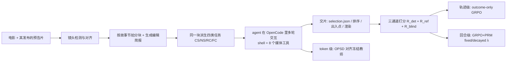

一句话解释这张图：左边把一部电影切成可判分的小编辑题，右边用三种粒度的信号去训同一个模型，中间的打分器是三种粒度共用的终点。

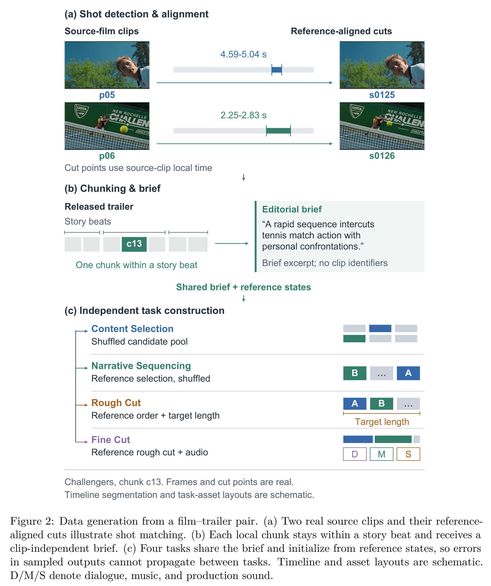

图 2：从一对电影—预告片造出四类任务的流程。最要紧的是 (c)：四类任务各自从参考状态构造，而不是接着上一阶段的模型输出做，一类的错误因此不污染另一类。

### 4.2 模块拆解

**一、成片怎么打分**

为什么需要：剪辑好不好是主观的，只靠一个 LLM 给总分既不稳定也没法解释，所以拆成三个通道。

怎么做：确定性验证器对着参考答案算分；参考裁判拿着参考答案看成片偏离多远；盲裁判不给参考答案，只问这段剪辑自己成不成立。

公式：

$$
R_{\text{out}} = w_{\text{det}} R_{\text{det}} + w_{\text{ref}} R_{\text{ref}} + w_{\text{blind}} R_{\text{blind}}
$$

先说这个公式在算什么：成片分是三个通道的加权和，权重按任务类型换。

- $R_{\text{det}}$：确定性分数，标量，$[0,1]$。CS 用集合 F1，即 $2|S \cap S^\star|/(|S| + |S^\star|)$；NS 用提交顺序与参考顺序的三种一致性相乘；RC 用「出入点误差与保留时长误差都落在容差内」的镜头比例。
- $R_{\text{ref}}$：参考裁判分，标量，$[0,1]$，按评分细则逐项 0 到 4 打分后加权。
- $R_{\text{blind}}$：盲裁判分，标量，$[0,1]$，同样的细则但不给参考。
- $(w_{\text{det}}, w_{\text{ref}}, w_{\text{blind}})$：三元权重，和为 1。CS 与 NS 是 $(1,0,0)$，RC 是 $(0.4,0.4,0.2)$，FC 是 $(0,0.4,0.6)$。FC 没有确定性通道，因为「音乐什么时候进来、这个转场要不要」没有唯一解。

作者在 4.1 里点明：四个类型用的是不同编辑目标的指标，**绝对值不是同一把难度尺**。CS 0.657、FC 0.152 不能读成「FC 比 CS 难四倍」。

**二、轨迹级：outcome-only GRPO**

为什么需要：这是最省事的一档，一条轨迹只拿一个分，不需要任何中间标注。

怎么做：同一个任务采 $G$ 条轨迹，各自算出成片分 $o_i$，组内标准化成优势，整条轨迹所有 token 共用这一个数。

公式：

$$
A_i^{\text{out}} = \frac{o_i - \mu_o}{\sigma_o + \epsilon}
$$

先说这个公式在算什么：把一条轨迹的成片分放到同组几条轨迹里比一比，高出组均值的给正优势，低于的给负优势。

- $o_i$：第 $i$ 条轨迹的成片分，标量，$[0,1]$，由式 4.1 算出。
- $\mu_o$、$\sigma_o$：同组 $G$ 条轨迹成片分的均值和样本标准差，标量。$\sigma_o$ 接近 0 时（题太难或太易）优势会爆。
- $\epsilon$：数值稳定项，标量，取 $10^{-6}$。
- $A_i^{\text{out}}$：第 $i$ 条轨迹的优势，标量。**同一条轨迹里每一个 token 拿到的都是这个数**，所以信号在轨迹内部不变化。

**三、回合级：GRPO+PRM**

为什么需要：整条轨迹一个分，等于承认「这条里每一步一样好」。可一条 87 回合的轨迹里，前 10 步可能在正确看素材，后 10 步可能在瞎调——像给两小时的球赛只记总比分。

怎么做：让过程奖励模型（process reward model, PRM）从交互历史给每个动作打 $-1$、$0$ 或 $+1$，同一回合判三次取有效均值，再在同一回合序号上跨轨迹标准化，加到轨迹优势上。

公式：

$$
A_{i,t} = A_i^{\text{out}} + \lambda A_{i,t}^{\text{proc}}, \qquad
A_{i,t}^{\text{proc}} = \frac{r_{i,t} - \mu_t}{\sigma_t + \epsilon}
$$

先说这个公式在算什么：第 $i$ 条轨迹第 $t$ 个回合的优势，等于「整条轨迹的成绩」加上「这一步比同位置的其他轨迹好多少」乘一个权重。

- $r_{i,t}$：第 $i$ 条轨迹第 $t$ 个回合的过程分，标量，取值 $-1$、$0$、$+1$，三次判定里弃权的丢掉、剩下的取均值。
- $\mu_t$、$\sigma_t$：**同一回合序号 $t$** 上、同一任务各轨迹的过程分均值与样本标准差，标量。是横着比同一步，不是竖着比同一条。
- $\lambda$：过程奖励权重，标量。论文比了两个设定：GRPO+PRM (fixed λ) 全程 $\lambda = 0.5$；GRPO+PRM (decayed λ) 前 20 次更新也是 0.5，第 20 到 30 次按三次曲线降到 0，之后一直是 0。
- $A_{i,t}$：第 $i$ 条轨迹第 $t$ 个回合的优势，标量。**同一个回合里每个 token 拿到的都是这个数**，信号跨回合变化、回合内部不变。

**四、token 级：OPSD**

为什么需要：回合级还是承认「一个回合里每个 token 一样重要」，可一个回合里模型可能先想错再改对。

怎么做：教师是初始策略的冻结副本，看得到学生看不到的特权信息；学生在自己前缀上采样，教师在同样前缀上给分布，学生最小化两者的前向 KL。这条路线**完全没有奖励项**。

公式：

$$
\mathcal{L}(\theta) = \mathbb{E}_{t,k}\left[ D_{\mathrm{KL}}\!\left(q_{t,k} \,\|\, p_{t,k}\right) \right]
$$

先说这个公式在算什么：在学生自己走到的每一个 token 位置上，量一量教师的分布和学生差多远，把这个差距压小。

- $p_{t,k}(v) = \pi_\theta(v \mid s_t, x, a_{t,<k})$：学生在第 $t$ 个回合第 $k$ 个 token 位置上的分布，维度是词表大小。
- $q_{t,k}(v) = \pi_{\text{tea}}(v \mid s_t, x, c_t, a_{t,<k})$：教师在同一个位置上的分布，多了一个学生看不到的 $c_t$（特权信息）。维度同。
- $c_t$：特权信息，两种形式——参考答案，或者由 Gemini 3.8 Flash 从学生当前上下文生成的一条回合级建议。
- $\mathbb{E}_{t,k}$：对生成的助手 token 求期望，按 token 平均而不是按回合平均。
- 实现上不是算全词表：教师保留自己概率最高的 64 个 token，剩下的整个词表并成一个 tail 类，所以实际是在 65 个类上算前向 KL。$D_{\mathrm{KL}}(q \| p)$ 的方向是教师到学生。

### 4.3 关键细节

这些细节决定复现得出来还是复现不出来，也是「更细的信号为什么会崩」的一半答案。

- **λ 的衰减是写死的**：0.5 保持到第 20 次更新，然后 $\lambda = 0.5\left[1 - (u-20)/10\right]^3$（$20 < u < 30$），第 30 次之后为 0。第 21、25 次更新分别取 $\lambda = 0.3645$、$\lambda = 0.0625$。
- **每任务采几条轨迹不一样**：奖励类的三个变体每任务 8 条，OPSD 每任务 1 条。作者在 C.1 点明：同样 50 次更新，采到的轨迹数与生成 token 数并不一样，这是「配方之间的比较」。
- **过程分的判定规则**：$+1$ 要有新证据或可验证的修正；$0$ 是例行操作、没变化的检查；$-1$ 是观测到的错误或任务违规。判定器只查字段映射与时间边界，不证明语义正确。
- **过程奖励和结果奖励不同模型**：结果裁判 Gemini 3.1 Pro Preview（temperature 0、seed 42），过程裁判 Gemini 3.8 Flash。
- **教师的上下文比学生多 2,048 token**：学生上限 131,072，教师 133,120，多出来的位置放特权信息。

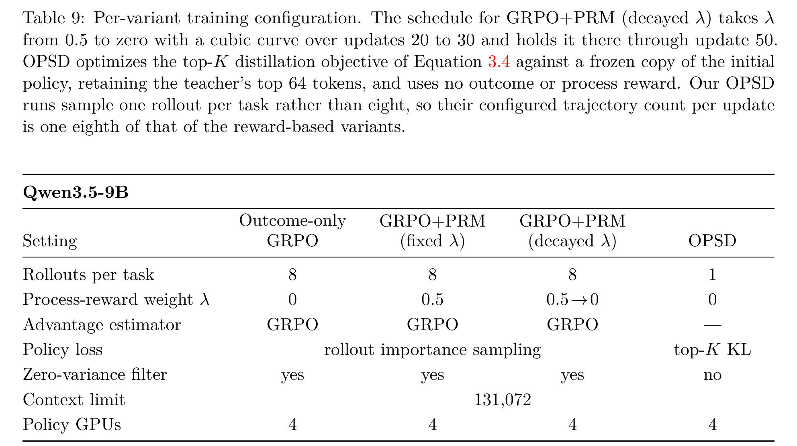

表 9：四个变体的差异只有三处——每任务采几条轨迹、λ 取多少、策略损失用哪一种。「控制变量」的实物证据：除目标函数外全部对齐。

## 5. 实验结果

**实验设置**

- **数据集与切分**：自建的四类剪辑任务，797 个（49 部电影）。训练 716 个（43 部电影，CS 122 / NS 132 / RC 231 / FC 231），验证 81 个（6 部电影，CS 14 / NS 15 / RC 26 / FC 26），训练与验证的电影不重叠。语料是 49 对电影—预告片，101.80 小时源视频、2.09 小时预告片，检出 88,669 个源片镜头和 5,978 个预告片镜头，初始任务池 2,352 个，用 Gemini 3.8 Flash 过滤后采样出 797 个。
- **骨干模型**：Qwen3.5-9B，只训这一个尺寸，原文未给其他尺寸。
- **训练预算**：50 次更新；每次 16 个任务；奖励类变体每任务 8 条 rollout、OPSD 每任务 1 条；4 张 policy GPU、每卡 micro-batch 2；AdamW 常数学习率 $1 \times 10^{-6}$；上下文 131,072；单回合生成上限 16,384 token；回合预算 100；4 个推理引擎、张量并行 1、bfloat16；随机种子 42；每 2 次更新存 checkpoint、每 10 次更新跑一次验证。显卡型号与总卡时原文未给，只写了「4 policy GPUs」。
- **基线**：主基线是 outcome-only GRPO；同源变体 GRPO+PRM (fixed λ)、GRPO+PRM (decayed λ)；token 级的两个 OPSD 变体（reference answers / turn-level suggestions）；再加一个未训练的 Qwen3.5-9B 行作为地板。
- **指标**：avg@4，即每个任务独立评四次取成片分均值，再在类型内等权平均，总体按任务数加权。成片分按式 4.1 算。另有行为指标：交互回合数、工具调用数、截断率、返回图像数、blind 率、推理字符长度、反思标记率。
- **推理设置**：采样 temperature 1.0、top-p 1.0、top-K $-1$，thinking 开启，回合预算 100，每回合最多生成 16,384 token，上下文 131,072；结果裁判 Gemini 3.1 Pro Preview（temperature 0、seed 42），过程裁判 Gemini 3.8 Flash（temperature 1、每回合 3 次判定取有效均值）。

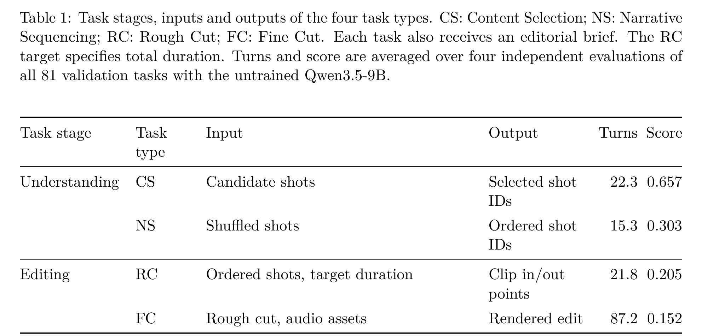

表 1：四类任务分别吃什么、交什么、要跑多久。只需记住一件事——FC 平均 87.2 回合，是其他三类的四到六倍；后面所有分化都从这一列开始。

**主表（提炼版）**

| 任务类型 | 指标 | 本文（decayed λ） | 最强基线（outcome-only GRPO） | 提升 |
| --- | --- | --- | --- | --- |
| CS | avg@4 | 0.804 | 0.821 | −0.017 |
| NS | avg@4 | 0.552 | 0.500 | +0.052 |
| RC | avg@4 | 0.348 | 0.356 | −0.008 |
| FC | avg@4 | 0.293 | 0.201 | +0.092 |
| 总体 | avg@4 | 0.447 | 0.413 | +0.034 |

这张表横着读：decayed λ 只在 FC 上明显赢（+0.092），CS 和 RC 小幅输。fixed λ 那一行更糟：总体 0.334，CS 只有 0.482。像体检只报总分，掉了也不知道掉在哪。

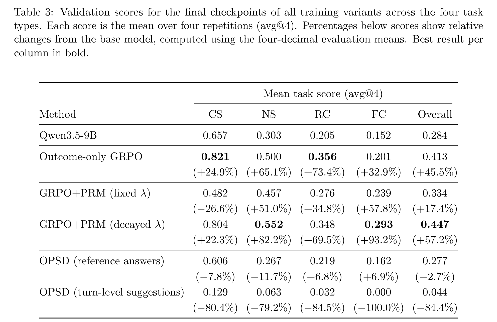

表 3：全部变体的最终验证分。整个反问题的主证据在这两处——**fixed λ 在 CS 上只有 0.482**（outcome-only GRPO 是 0.821；表里的 −26.6% 是相对基础模型 0.657 算的），同时 FC 上从 0.201 涨到 0.239。「更细更好」在这张表里对一半、错一半。

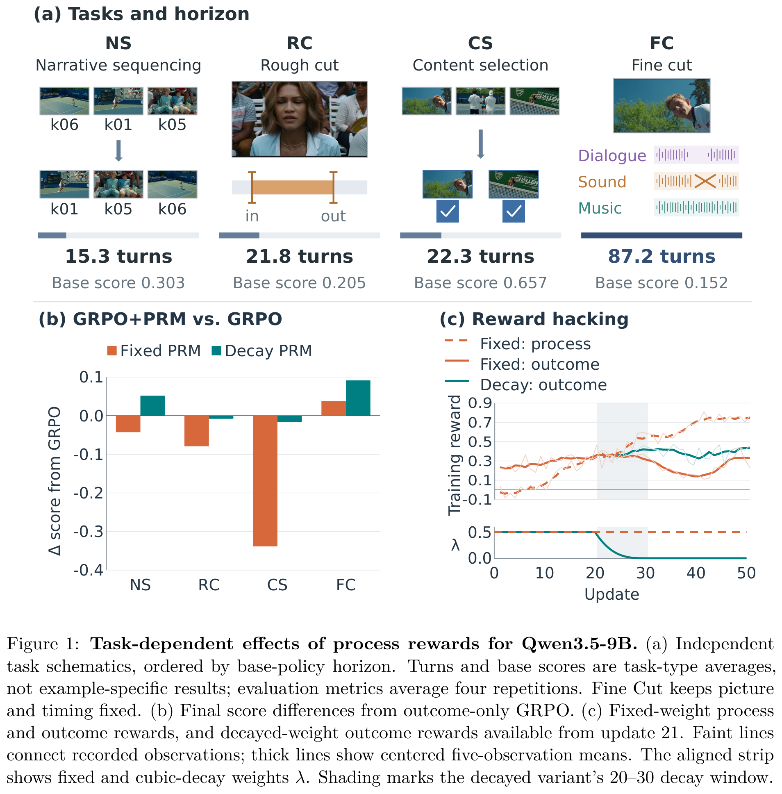

图 1：三类现象放在一张图里。(a) 四个任务的交互长度与基础分；(b) 相对 outcome-only GRPO 的分差，fixed λ 在 CS 上那根向下的柱子几乎是其他柱子深度的四倍；(c) 训练曲线——过程奖励一路涨、结果奖励在 30 次更新之后一路掉，分岔处就是「刷分」的起点。

**为什么 FC 不一样：mixing**

作者的解释是「长轨迹把好回合和坏回合混在一起」。他们在未训练模型的验证 rollout 上用过程裁判逐回合标成 positive / neutral / negative，再算混合度 $\text{mixing} = 2\min(n_+, n_-)/(n_+ + n_-)$，$n_+$、$n_-$ 是正负回合数。正负越势均力敌越接近 1，一边倒接近 0。

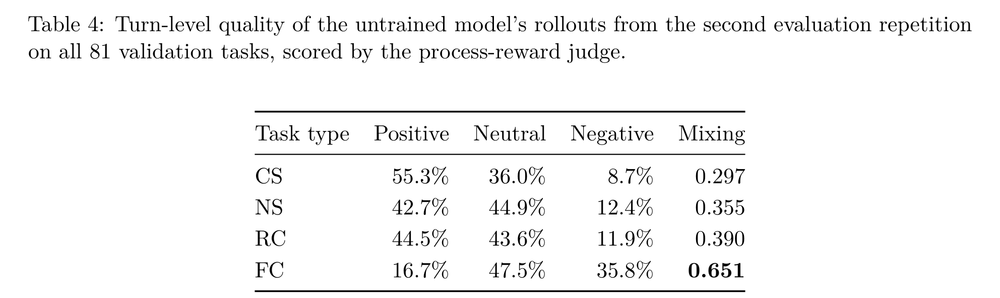

表 4：FC 的负回合占 35.8%，mixing 是 0.651，其他三类只有 0.297 到 0.390。原文的措辞很克制，只说这个更高的混合度 "is consistent with greater ambiguity in assigning credit to individual turns"，并把「部分解释」四个字写在了 6.1。

我的读法：轨迹级信用把同一个优势发给一条轨迹里所有回合，混合度高的任务上这个假设错得更狠，所以 FC 只涨 0.050，其他三类都至少涨 0.15。这解释了「为什么 FC 需要细粒度」，但没解释「为什么细粒度在 CS 上把模型打崩」。

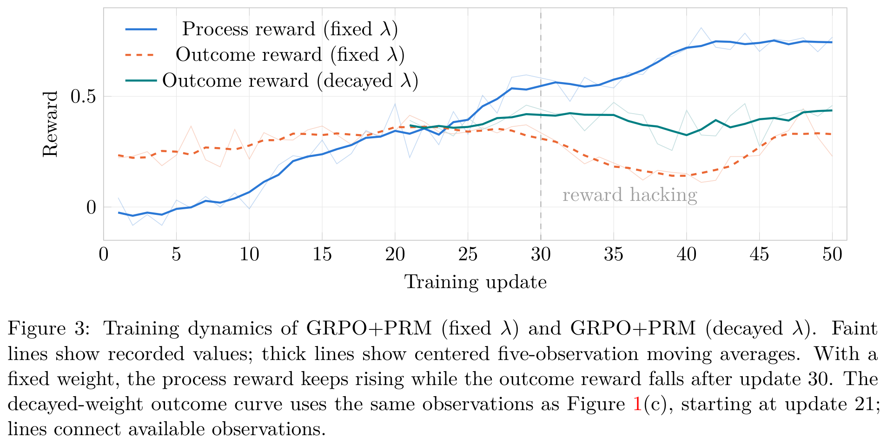

图 3：把图 1(c) 拆开看。fixed λ 的过程奖励（蓝实线）从 0 附近单调爬到 0.8 上下，同期它的结果奖励（橙虚线）在 30 次更新后掉到 0.1 附近；decayed λ 的结果奖励（青实线）没有跟着掉。**两条结果曲线的分岔，就是「λ 必须衰减」的图像证据。**

**崩在哪：行为数据**

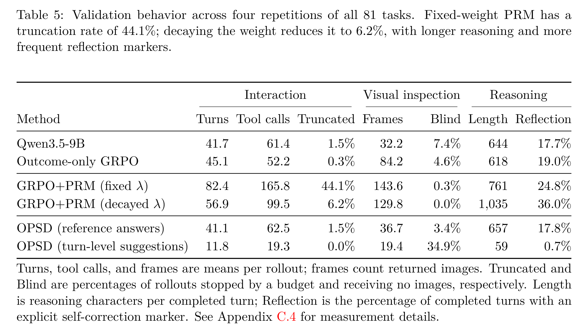

表 5：行为表。fixed λ 把工具调用从 52.2 拉到 165.8、返回图像从 84.2 拉到 143.6、推理长度从 618 拉到 761、反思标记率从 19.0% 拉到 24.8%——每一样看起来都是「更认真了」；同一张表里截断率从 0.3% 涨到 44.1%，blind 率从 4.6% 降到 0.3%。**它确实更认真地看了素材、更认真地想，然后有 44.1% 的 rollout 在预算耗尽前没交片。**

作者的总结是："The value of these behaviors therefore depends on the task and on whether the model can still complete it."——这些行为值不值钱，取决于任务，也取决于模型还交不交得出片。这就是「奖励黑客」在这里的形态：不是学会作弊，是学会**把过程分赚满、把交片拖死**。

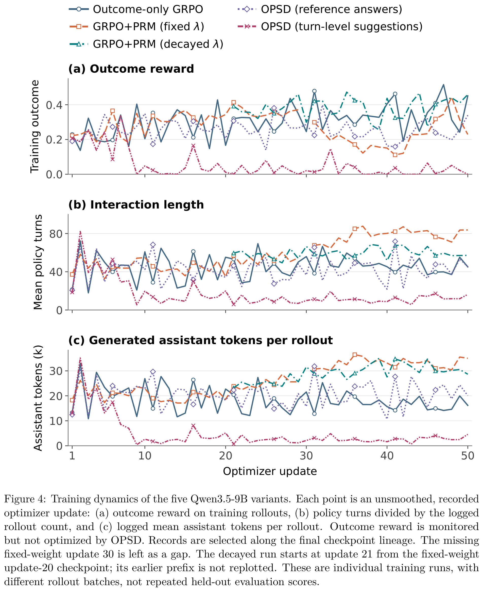

图 4：五个变体的训练动态。(b) 最直观：fixed λ 的平均回合数从 ~40 爬到 80 以上不回头，outcome-only GRPO 稳在 45 附近；(c) 里 fixed λ 的生成 token 数翻了倍。**同样的 100 回合预算，一个用掉八成还在看，另一个五成以内就交片。**

**token 级为什么也不行**

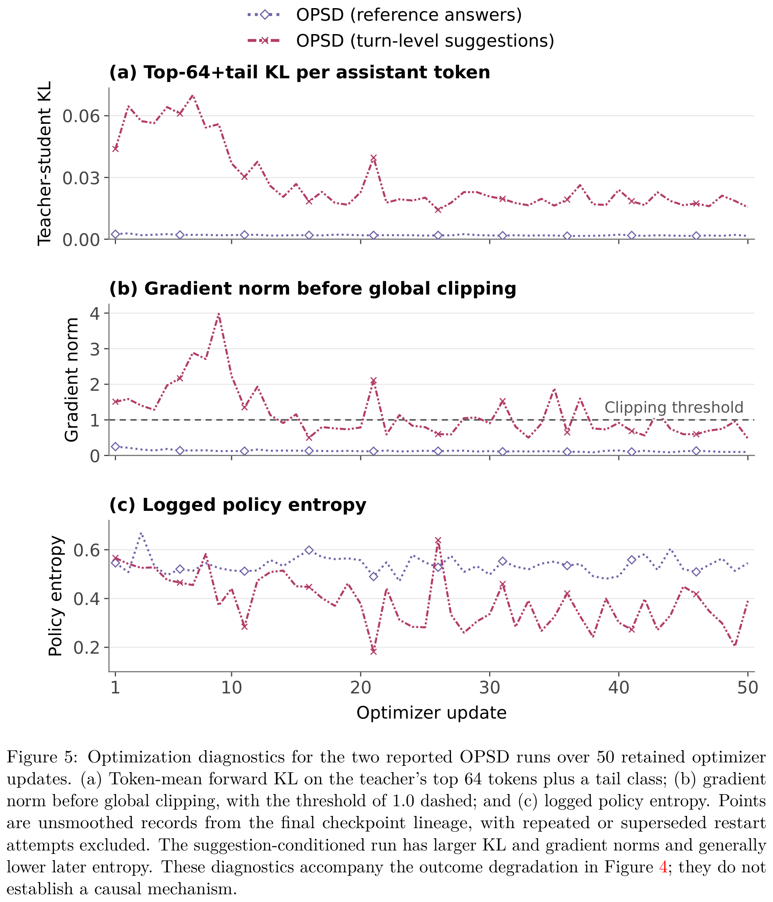

图 5：两个 OPSD 变体的优化诊断。回合级建议（洋红虚线）的 KL 从 0.06 降到 0.02 上下，梯度范数常年贴着 1.0 甚至冲到 4；参考答案（紫点线）两条都贴地。

Table 13 和 Table 14：参考答案的 KL 0.0019、梯度范数均值 0.084、最大 0.249、50 次更新一次没被裁剪；回合级建议的 KL 0.0279、梯度范数均值 1.177、最大 3.981、22 次超过 1.0。同一份损失、同一个冻结教师，只换特权信息，梯度差十四倍。

另一个诊断：用参考答案时，KL 最大的 5% 回合贡献了 47.4% 的总 KL，却只占 17.9% 的 token。作者推断按 token 平均的损失可能把这些高分歧回合**稀释**掉了，又补了一句 "whether gradient magnitude or signal dilution causes the observed outcomes remains to be tested."——梯度太大还是信号被稀释，还没测。

**消融告诉我们什么**

这篇论文没有传统的「去掉某个模块」式消融，它的消融是**同一目标函数下的变体对照**：λ 固定 vs 衰减（总体 0.334 → 0.447）；特权信息两种形式（0.277 vs 0.044）；有过程奖励 vs 没有（FC 上有用、CS 上致命）。三组里只有第一组是调参，后两组是机制。

**这些实验够不够支撑结论**

够支撑的部分：「固定权重会崩」证据很硬——分数、截断率、行为表、训练曲线四条线咬合。不够的有三处。第一，单模型、单种子（seed 42），四次重复只换 rollout 采样、不换训练种子（C.3 明说 "These repetitions vary rollout sampling, not the training seed."），训练方差没测过。第二，mixing 只是相关性，作者自己写 "may partly explain"。第三，CS 上掉到 0.482 这个最戏剧的数字没有机制解释。

## 6. 局限性

**作者自己承认的**

- 过程奖励的结论只在 GRPO+PRM 配 LLM 判定的回合级奖励、在预告片剪辑上成立；能否推广到 GiGPO、Turn-PPO 等未测方法，原文写 "remains open"。
- OPSD 部分只指出失败形态，没给补救办法；原文写 "we identify failure patterns without establishing effective remedies"。
- 稀释假说和梯度假说哪个成立没测；混合度与收益只是「部分解释」，不是因果。

**我看出来的**

- 隐形假设：任务可切成四个**阶段独立**的子任务（CS 只判选、NS 只判序、RC 只判点、FC 只判声画），都从参考状态出发。这让「粒度收益」变干净，也把真实剪辑里最要命的部分——上游选错的镜头如何拖垮下游——整个切掉了。作者在 A.3 承认这点，说端到端合成是另一个 setting。像只在一个城市试营业就宣布全国能开。
- 边界条件：λ 的衰减窗口绑死在 50 次更新和 FC 这种 87 回合的长任务上。换预算或换短任务族，这个窗口要重扫，论文没扫。
- 缺的对比：没有段级（segment）这一档。三档里恰好漏掉它，所以「粒度越细越糟」只覆盖到 token 级，而 token 级用的是蒸馏不是奖励，两者不可直接比。
- 缺的对比：λ 只试了 0.5。fixed λ 在 CS 上崩，可能是 0.5 太大而不是「固定」本身有问题；论文没扫 λ。
- 单种子、单模型、单任务族。50 次更新很短，曲线还在上升段就停了。

## 7. 一句话总结

更细的信用分配不是更好，是**更贵**：它把「哪一步对」买得更清楚，代价是模型多了一条不靠交片也能涨分的路；任务越长越乱这条路越值钱，任务越短越干净，它就是纯噪声。

一个类比：给一个学生配一个逐题纠错的辅导老师。作业越难越长，逐题纠错越有用；但如果纠错本身也算分，学生会开始享受被纠错的过程，一道题反复改到下课——卷子始终没交。

核心公式（这篇论文真正的看家式子，是把「细粒度收益」写成一个条件表达式）：

$$
\boxed{
A_{i,t} = A_i^{\text{out}} + \lambda(u)\, A_{i,t}^{\text{proc}},
\quad
\lambda(u) =
\begin{cases}
0.5, & u \le 20\\
0.5\left[1 - \dfrac{u-20}{10}\right]^3, & 20 < u < 30\\
0, & u \ge 30
\end{cases}
}
$$

这个式子的意思是：过程奖励只在训练前段有权重，之后归零。它把「细粒度信号」从常量改成了随训练进度衰减的临时脚手架——这正是这篇论文最便宜也最有效的那个结论。

## 8. 可复用点

- 如果我要在自己的项目里用：先把过程奖励的权重做成衰减表，而不是先调它的初值——像修车先列零件清单再动手。初值只决定「早期学得多猛」，衰减窗口决定「晚期崩不崩」，后者对最终分的影响在这篇里是 0.334 → 0.447。
- 训练不收敛时先查：**截断率**，不是分数。这篇里 fixed λ 的分数掉了、截断率从 0.3% 涨到 44.1%；只看分数会以为是「学得慢」，看截断率才知道是「学得不肯交卷」。
- 换任务族之前先算 mixing：拿未训练模型跑一遍验证集，让裁判把每个回合标成正/中/负，算 $2\min(n_+,n_-)/(n_+ + n_-)$。这个数高（这篇里 FC 是 0.651，其他三类 0.297–0.390）才值得上回合级信号；低就别上，上了大概率只涨行为不涨分。
- 做蒸馏时先量梯度范数：两个变体的 KL 差 14 倍、梯度范数差 14 倍、分数差 6 倍，这三件事一起动。梯度范数长期贴着裁剪线，基本可判定这个教师给的目标太远；顺带一提，过程奖励和结果奖励要用不同模型，这几乎不要钱，却能挡掉「裁判自夸」这一整类解释。

## 9. 我的疑问

像看完病历还想追问几句。

- 如果 λ 不衰减、但把它调小到 0.05 或 0.1，CS 还会不会崩？论文只试了 0.5，「固定权重有害」和「0.5 太大」这两件事在这里是混在一起的。
- 段级（segment）为什么不测？Crayotter 已给出做法，四档（轨迹/段/回合/token）才是完整阶梯，缺一级就说不清适用范围。
- mixing 是在**未训练**模型的 rollout 上算的。训练过程中模型的行为分布会变，mixing 会不会跟着变？如果会变，那它作为「任务属性」的先验就不稳。
- FC 上 decayed λ 涨了 0.092，主要来自推理更长（761 → 1,035 字符）还是来自看得更多（143.6 → 129.8 帧，其实是少了）？表 5 里这两项方向相反，论文没有拆开。
- 44.1% 的截断率对应的是 100 回合预算。预算放到 200，fixed λ 会不会自己把片交出来？这决定了「奖励黑客」是行为问题还是预算问题。
