> 一句话：借用同路人的后续经历，少把后来的失败错怪给前面的正确动作。

来源：原始 PDF，arXiv v1，19 页，正文及附录 A–H 已核读。PDF 位于项目 `runtime/2026-10-29/refs/avcs/paper.pdf`。本文是论文报告结果的精读，没有本机训练复现。

## 0. 读之前你需要知道

**术语卡**

- **Agent**：会根据环境反馈连续选择动作的模型。例如购物时先搜索，再选颜色和尺码，最后下单。
- **Reinforcement learning（RL）**：用行动结果的奖励改变模型行为。**credit assignment** 则决定一整件事成败后，该奖罚其中哪些动作。
- **return**：后续奖励的折扣累计。**action value** 是在给定历史下，先做某动作、再按当前策略继续的期望 return；一条轨迹的实际 return 只是它的一个样本。
- **advantage**：相对同类选择基准的价值差，正值鼓励、负值抑制。GRPO 把一条轨迹的相对回报用于整段动作；GiGPO 进一步在相同 state anchor 比较动作。
- **visit**：轨迹中某一步对状态的一次访问。同一个表面状态被访问两次，也不是同一个经历。

生活类比是给接力队分功劳：最后一棒摔倒，不等于第一棒跑错了。本文沿 GiGPO 的局部比较框架，改进进入比较的 action-value estimate。

## 1. 动机

同一购物页面里，一条路线正确选了尺码，后来误点而失败；另一条路线重复点颜色，之后侥幸买对。只看各自最终成绩，会奖励重复点击、惩罚补齐尺码。

**以前怎么做**：GiGPO 把到达同一 state anchor 的动作放进一组，以各自轨迹的 discounted return 比较。这比整段统一奖励更细，却仍然把一次后续经历当成动作的价值。

**为什么不够**：局部比较只改变比较对象，没有消除 continuation 的随机性。论文把同一已记录决策同时得到正、负 local credit 的现象称作 credit conflict。

**为什么现在能改**：一批 rollout 本来就有同题的多条轨迹，其中相同转移之后常跟着不同后续。与其再花钱重新采样，可以复用批内已经存在的 continuation evidence。ConCal（Continuation Calibration）把这些证据递归传回更早的动作。

## 2. 贡献

像给接力赛复盘时多看几场同路线比赛，ConCal 的贡献是把动作本身与后来怎么跑适度分开。

- **提出 visit-specific 的共享 continuation estimator**：匹配入向 state-action-state 转移，混合每次访问自己的估计和共享均值，保留个体差异。
- **把共享证据向前递归传播**：直接后继没有跨轨迹匹配的动作，也可能从更后面匹配处获得证据，不额外收集 rollout。
- **区分偏好幅度与排序**：用 Gap-matched 仅缩放 Own-MC 的价值差作为诊断，说明 MSE 改善相当一部分来自缩小过强偏好，不能全部称作找到了更正确的动作排序。
- **给出任务表现与计算分析**：Qwen2.5-1.5B-Instruct 在两个任务上优于 GiGPO 的报告均值；匹配和递归校准开销单独测量，未把额外采样混进收益。

## 3. 创新点

**相对 GiGPO**，新的是 continuation estimation，而不是再发明一次 state grouping。比较的动作组与拿来共享后续证据的池是两种集合：前者按当前状态，后者按入向转移。像同站出发的人可以比较路线，但要借用别人的经验，还需知道他从哪条路来到这里。

**相对 Fully pooled**，ConCal 没把匹配 visit 强行压成一个数，而是保留各自 transition estimate 的一部分。**相对 Single-pass**，它反复向前传播更新后的估计。**相对 GraphGPO**，它不依赖通往成功终点的最短路距离；**相对 SALT**，它先校准 continuation value，再形成 step advantage，而不只是平均 trajectory advantage。

这些边界避免把已有的跨轨迹复用都归为本文首创。附录还讨论并行工作 GRAFT：后者显式建立 trajectory graph，本文直接在 recorded visits 上计算。

## 4. 方法

### 4.1 整体流程

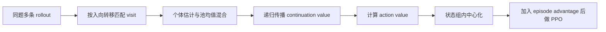

像先收齐同路人的旅行记录，再给每次岔路选择打分；共享的是未来证据，而非把所有人的成绩直接复制给每个动作。

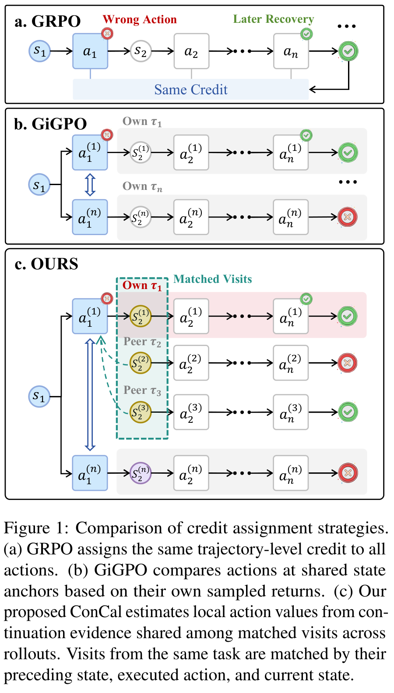

Figure 1：区分轨迹统一 credit、单条 continuation 的局部 credit 和跨轨迹 continuation sharing，问题定位在后续估计。

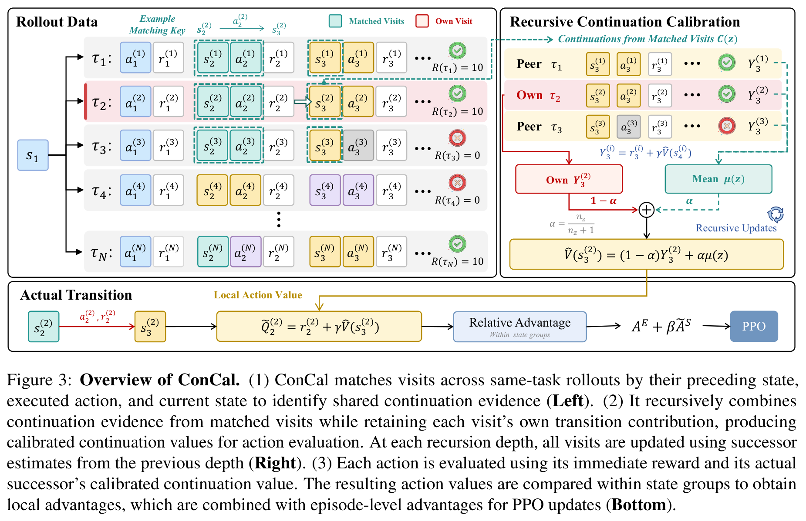

Figure 3：共享发生在动作实际到达的 successor visit；当前动作自身的奖励和真实后继仍保留。

### 4.2 匹配哪些访问

先给一次访问建立键，明确它所属任务及如何进入当前状态：

$$
z_t^{(i)}=(x,s_{t-1}^{(i)},a_{t-1}^{(i)},s_t^{(i)}),\qquad
\mathcal C(z)=\{(j,k):z_k^{(j)}=z\}.
$$

$i,j$ 是轨迹编号，$t,k$ 是交互步，$x$ 是任务，$s$ 是观察状态表示，$a$ 是已执行动作，$z$ 是匹配键，$\mathcal C$ 是 visit 集合；开始位置使用 START 标记。匹配不要求发生在同一时间步，也不要求完整历史相同。评估动作 $a_t^{(i)}$ 时，使用后继的池 $\mathcal C(z_{t+1}^{(i)})$，不是把当前所有可选动作都合并。

### 4.3 递归校准

下面先计算一次访问的即时奖励加折扣后续，再求匹配池的平均：

$$
Y_{t,b}^{(i)}=r_t^{(i)}+\gamma\hat V_{b-1}(s_{t+1}^{(i)}),\qquad
\mu_b(z)=\frac{1}{|\mathcal C(z)|}\sum_{(j,k)\in\mathcal C(z)}Y_{k,b}^{(j)}.
$$

$r$ 是标量奖励，$\gamma$ 为折扣，$b$ 为递归深度，$\hat V$ 是每次 visit 独有的 continuation estimate，$Y$ 为本次 transition estimate，$\mu$ 是池内访问均值。初始估计置零，没有记录的后继也置零，包括采集截断。

下一式把个体估计向共享均值收缩，但不完全替换：

$$
\hat V_b(s_t^{(i)})=(1-\alpha_z)Y_{t,b}^{(i)}+\alpha_z\mu_b(z),\qquad
\alpha_z=\frac{n_z}{n_z+1}.
$$

$n_z$ 是池中不同轨迹数，注意不是 visit 数；$\alpha_z$ 是标量权重。均值本身包含当前 visit。同一池中两次估计之差缩成原差的 $1/(n_z+1)$，同时保留均值。像多人给路线打分后，极端的单次体验往平均靠拢，又不抹掉当事人的具体经历。

所有 visits 在深度 $b$ 同步使用深度 $b-1$ 的后继估计；重复到交互预算 $H$，不是无穷 Bellman 收敛。最终 action value 计算本动作真实奖励和实际后继的校准值：

$$
\tilde Q_t^{(i)}=r_t^{(i)}+\gamma\hat V_{H-t-1}(s_{t+1}^{(i)}),\qquad
\tilde A_t^{S,(i)}=\frac{\tilde Q_t^{(i)}-\tilde Q_{\mathcal S_t^{(i)}}}{\tilde d_{\mathcal B}}.
$$

$H-t-1$ 是剩余递归预算；$\mathcal S$ 是同题、同当前 state anchor 的动作比较组；带组下标的 $\tilde Q$ 是组均值；$\tilde d_{\mathcal B}$ 是整个 batch 共享的尺度。再加 episode-level advantage，送入 PPO clipped objective，优势在优化期间固定。PPO 是限制新策略偏离旧策略过快的一种策略优化方法。

### 4.4 为什么要 batch-wise normalization

若每组都除自己的标准差，刚校准出的小价值差仍可能被放大成很强的动作偏好。ConCal 用 batch 共享尺度保留组与组之间的差异；ALFWorld 的尺度通过参考 GiGPO advantage 的 RMS 对齐，WebShop 直接 mean centering，尺度为一。它不是把所有任务的动作 value 放在一起求共同均值。

## 5. 实验结果

**实验设置六件事**

- 数据集与切分：ALFWorld 从 3553 个 training games 训练，在 140 个 held-out seen games 上评估，含六类任务；不是 unseen split。WebShop 使用 1000-product 环境，goal indices 0–499 为 evaluation pool，其余为 training pool。
- 骨干模型：Qwen2.5-1.5B-Instruct，完整微调；闭源 GPT-4o、Gemini-2.5-Pro 作为 prompting 参照。
- 训练预算：4 张 NVIDIA H100 80 GB；150 updates，每次 16 tasks、每题 8 trajectories；AdamW learning rate $10^{-6}$，weight decay 0.01；PPO epochs per update 为 1，clipping 0.2，KL coefficient 0.01，$\gamma=0.95$、$\beta=1.0$。总 GPU-hour 原文未给。
- 基线：Qwen2.5 prompting、ReAct、Reflexion、PPO、RLOO、GRPO、GiGPO、GraphGPO。Table 1 的基线数字取自先前论文；Table 2 是 Own-MC、Fully pooled、Single-pass 与 ConCal 的同框架消融。
- 指标：ALFWorld per-category/All success rate；WebShop task score 是 match score 均值乘 100，Succ. 只计 match score 为 1 的任务。报告三次训练均值 ± sample standard deviation；另有 centered-value MSE、action-order agreement 和 reuse coverage。
- 推理设置：训练 temperature 1.0，评估 0.4，top-p 1.0；ALFWorld 最多 50 steps、输入 2048 tokens，WebShop 15 steps、输入 5120；每步 response 上限 512，保留最近两轮交互。每 5 updates 评估，最终三个 saved checkpoints 中选 validation success 最好的一个；evaluation batch size 128。

像比较两个购物助手，要区分买到部分要求和全部满足；不能把 WebShop 的 Score 当作成功率。

| 数据集 / 任务 | 指标 | ConCal | 最强外部基线 | 提升 |
| --- | --- | --- | --- | --- |
| ALFWorld All | success rate (%) | 94.27 ± 1.97 | GraphGPO 92.71 ± 1.32 | +1.56 pp |
| WebShop | task score | 90.18 ± 1.27 | GraphGPO 89.29 ± 1.48 | +0.89 |
| WebShop | success rate (%) | 79.69 ± 3.41 | GraphGPO 78.65 ± 3.86 | +1.04 pp |

提升列由原表均值相减；论文强调的 +3.39、+5.86 pp 是相对 GiGPO，不是相对 GraphGPO。这些方差与小均值差不能直接推出统计显著。

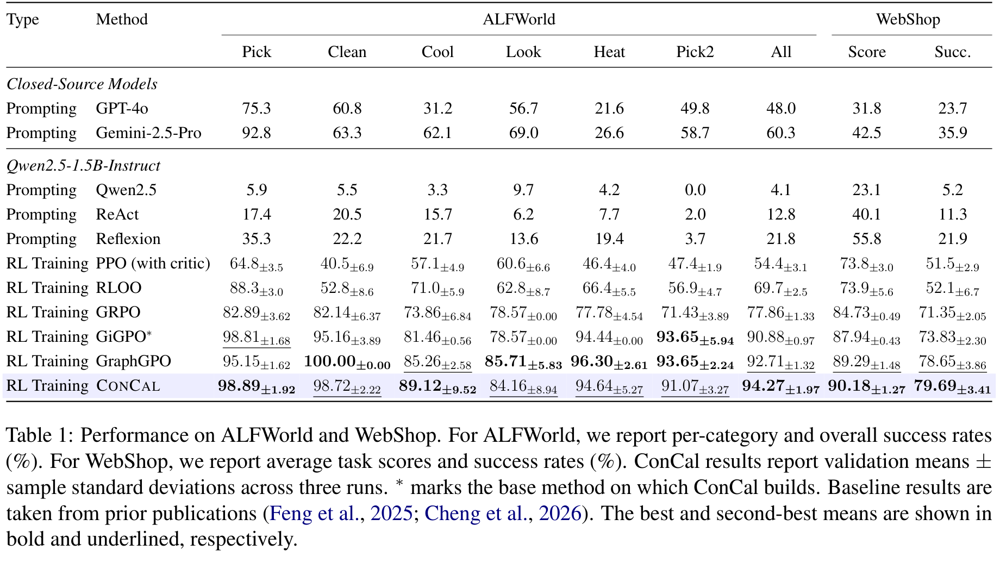

Table 1：总体均值最高不等于六类任务全部第一；部分子类波动明显，且外部基线来自既有发表结果。

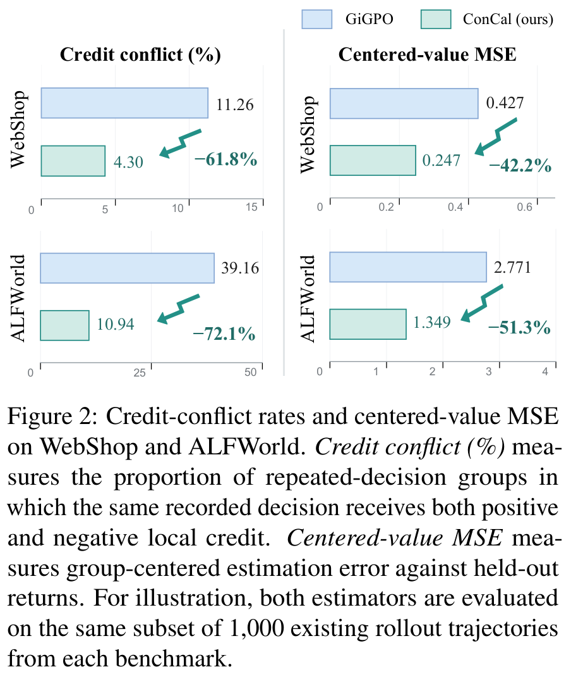

Figure 2：在每任务 1000 条既有轨迹的说明性子集上，credit conflict 和 centered-value MSE 均下降；这是局部诊断，不是任务成功率。

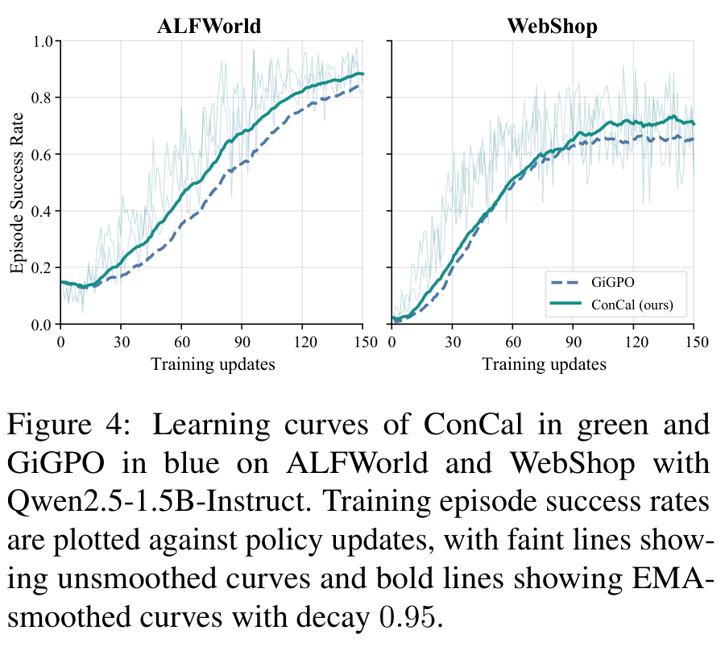

Figure 4：ALFWorld 的改善较早出现，WebShop 的优势主要在较后训练阶段，表明收益随环境结构变化。

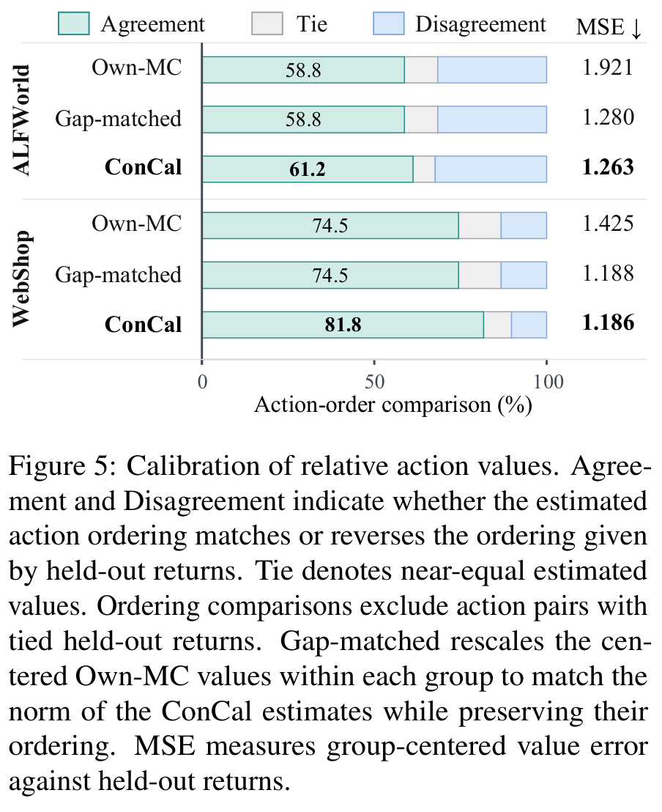

Figure 5：Gap-matched 几乎复现了 MSE 的下降，却保持 Own-MC 排序不变；ConCal 另有排序一致性改善，不能把两类收益混为一谈。

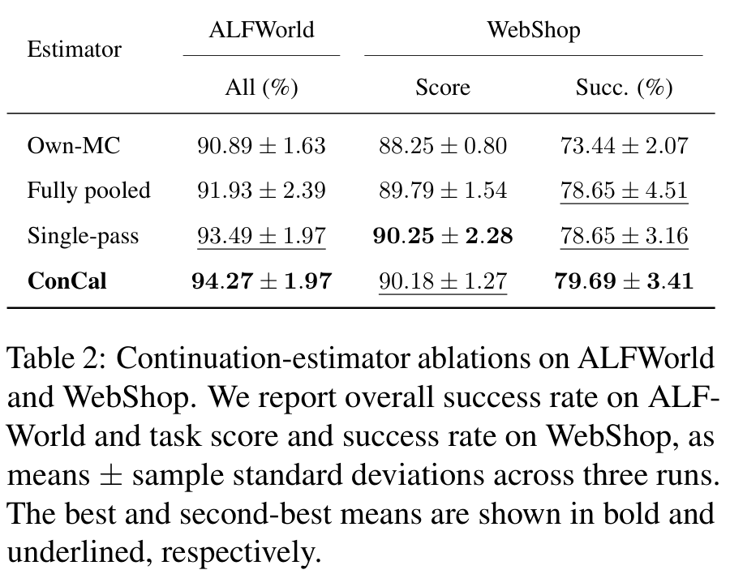

Table 2：递归且保留个体估计的完整方法在两个任务成功率上最好；WebShop task score 则是 Single-pass 略高，所以每个消融指标均最优的说法不成立。

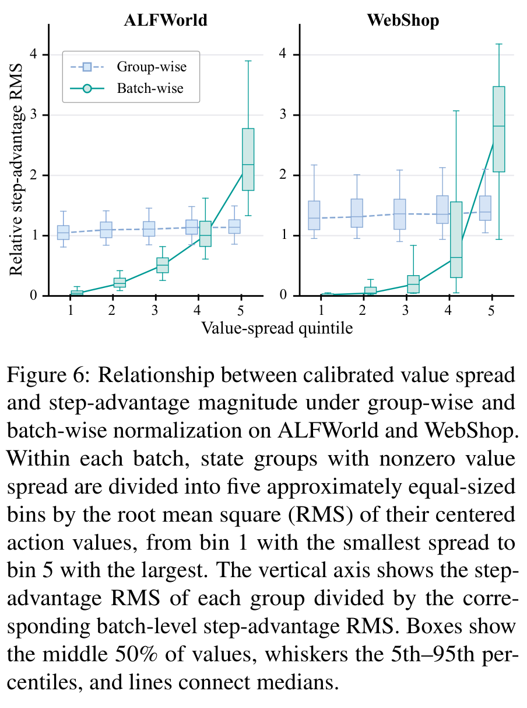

Figure 6：group-wise normalization 让大小价值差的 advantage 幅度趋同，batch-wise normalization 保留了偏好强度；这解释了 estimator 与 normalization 需要配合。

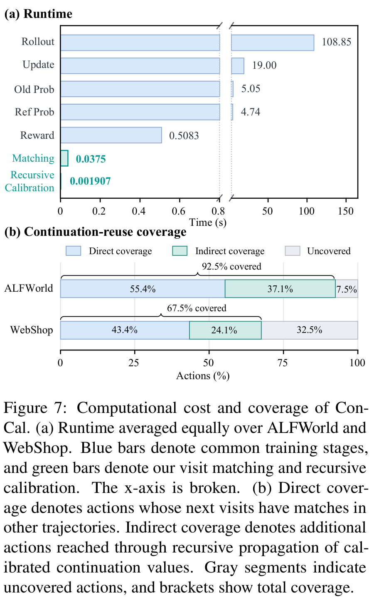

Figure 7：直接加递归覆盖达到 ALFWorld 92.5%、WebShop 67.5%；匹配与校准耗时远小于 rollout，但计时来自独立 frozen-batch replay，应保留测量条件。

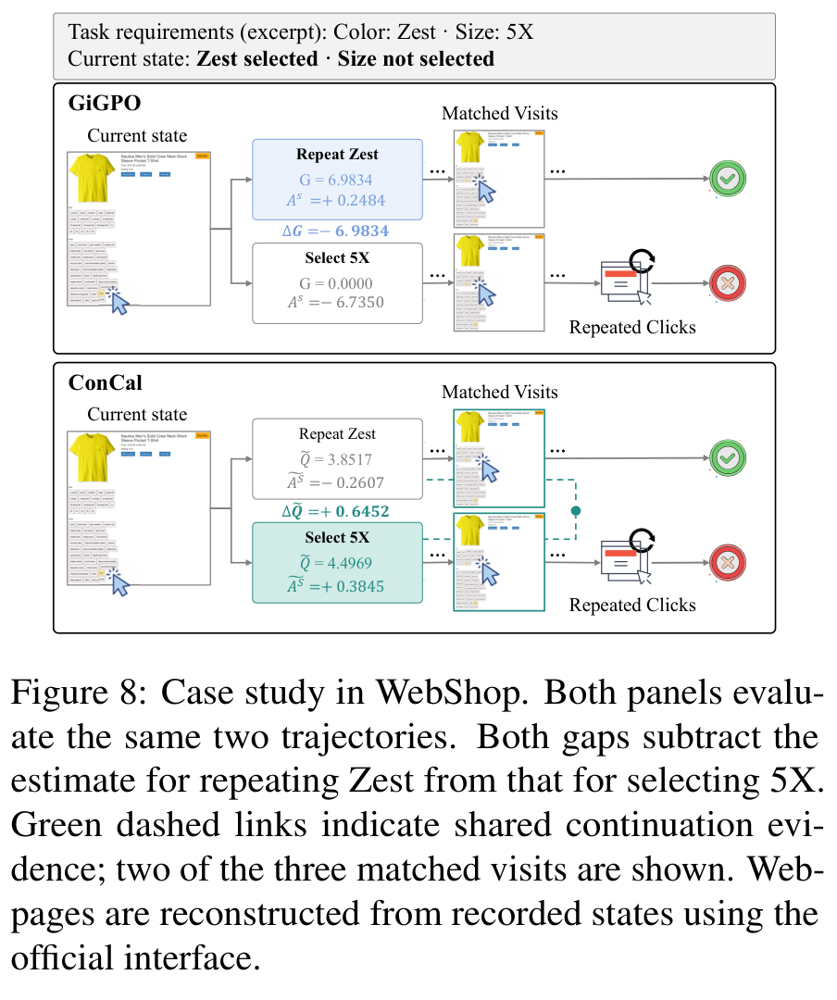

Figure 8：同一对轨迹中，Select 5X 原先因后续失败被惩罚，校准后优于 Repeat Zest，展示了可能纠正的 credit distortion。

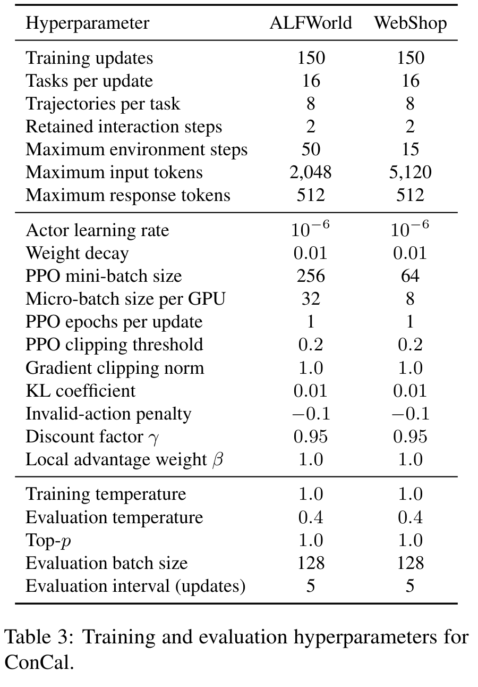

Table 3：两种环境的交互上限、输入长度和 PPO mini-batch 不同，复现不能只复制共同超参数。

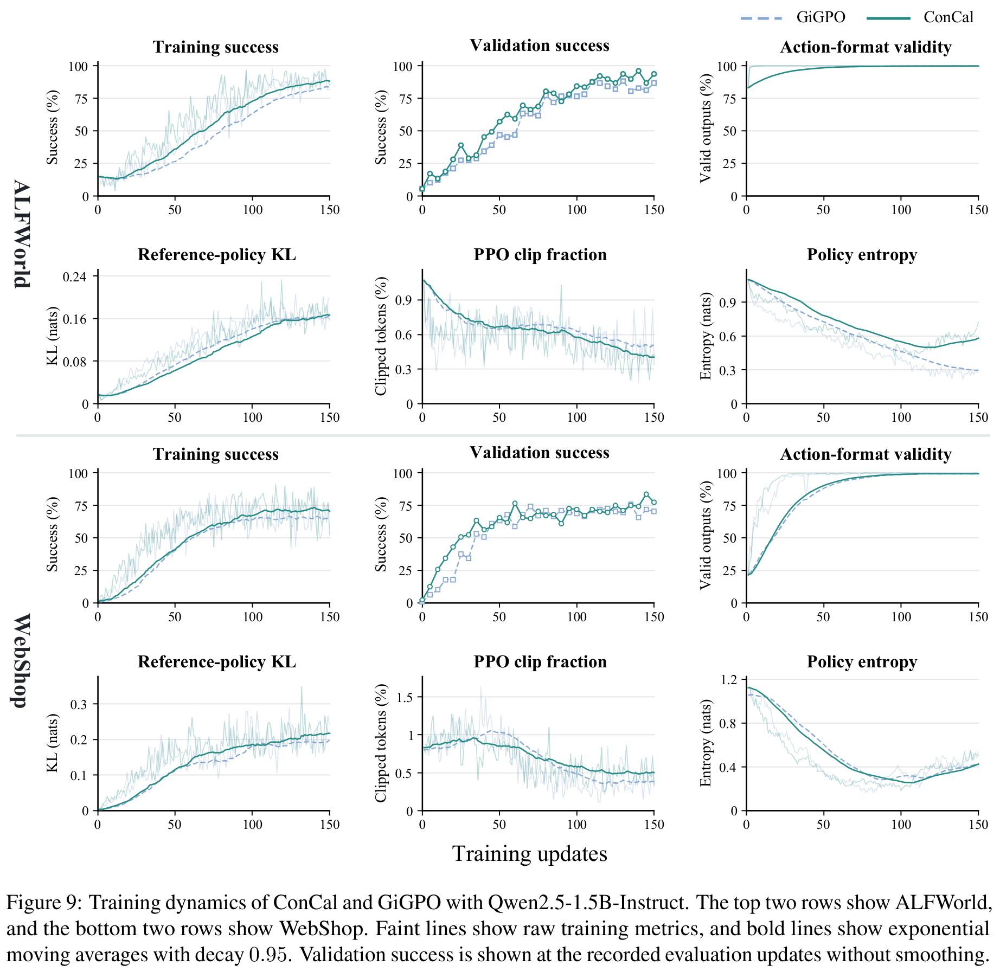

Figure 9：两种方法的 action-format validity 都接近饱和，仍存在成功率差异；WebShop 后期 ConCal 的 KL 与 clipping 也较高，收益伴随策略变化。

held-out 诊断将每题八条 rollout 分成两组，各四条，交换估计集与参考集；比较组额外约束 remaining interaction budget，且只保留两侧都见到的 command。它比同数据自我比较更好，但 reference 仍是有限样本 return，不是真实 $Q^{\pi_0}$。

## 6. 局限性

**作者承认的**：incoming transition 相同不强制完整 interaction history、hidden state 或剩余预算一致，可能引入共享偏差；效果依赖匹配访问是否足够。像两人到同一站，行李和剩余车票不同，后面的路未必能互相参考。

**我的判断**：共享均值按 visits 平均，而混合强度按不同 trajectories 数计算，循环访问多的一条轨迹可能在均值中占更多份额。截断后继置零会把未完成的长程价值压低，再递归传播。$\alpha_z$ 随轨迹数固定增大，没有用证据分歧或历史别名风险决定是否共享；匹配更多并不保证偏差更小。

**实验边界**：目前只在两个文本交互环境、一个 1.5B 模型上测试；ALFWorld 用 held-out seen，不能外推 unseen。主结果依据 validation 选 checkpoint，不能当成完全独立最终 test 评估。与 GraphGPO 的小均值差缺少显著性检验。Figure 2 与 Figure 5 的 MSE 数值对应不同诊断集合，不能混拼成同一改善幅度。

原文的池内差值收缩是代数性质，不是对真实 action value 的无偏性证明。若两个看似匹配的访问具有不同隐藏条件，强行缩小它们的差距也可能抹掉真实差异；因此 credit conflict 下降本身不足以说明信用分配更正确，仍要结合独立参考 return 与最终任务结果判断。

held-out 诊断复用现有轨迹并交换两半，避免为校准额外采样，但两种交换方向也共享同一批任务。比较组内的动作对与不同深度的估计并非完全独立，不能把这些诊断数量直接视为相同数量的独立实验重复。

## 7. 一句话总结

ConCal 像复盘接力赛时借用其他队员走同一路段后的经历，减少一次后续失误对前面动作的误判；但借来的经历是否可比，仍由匹配键和隐藏历史决定。第 4 节的混合式保留自己的 transition estimate，再向共享均值收缩，是最值得记住的机制，而不是简单把同一状态的所有回报取一个平均数。

## 8. 可复用点

在已有多 rollout 的 Agent RL 项目里，先统计入向转移匹配覆盖率、池中 distinct trajectories 数与重复访问次数；像修路先看车流是否真的经过同一路口。覆盖不足时，递归校准不会凭空产生证据。

再用冻结 batch 比较 Own-MC、Single-pass、Fully pooled 和 ConCal，分开测价值差幅度与排序。接入 normalization 时检查小 gap 是否被逐组标准化重新放大；上线前为 history aliasing 和 truncation 单独做诊断。通用做法已抽成 [[../../../30 方法卡片/匹配转移的递归后续校准]]。

## 9. 我的疑问

- 在匹配键里加入 remaining interaction budget 与有限历史，能减少多少 bias，又会损失多少 coverage？像把车票和行李条件加进同路人筛选，会不会最后找不到可参考的人？
- 把池均值改为先每条轨迹平均、再跨轨迹平均，能否抑制循环访问的影响？
- 能否用池内分歧决定共享强度，而不是只看轨迹数？这些是我的研究问题，原文没有给出相应实验。

基准同步：ALFWorld、WebShop、成功率已有条目完全不动；补充 task score、centered-value MSE、action-order agreement 三条指标。Figure 10–13 为提示词模板或截图，按规范不裁入结果图表。
