> 一句话：大家共享的偏好可能比各题自己的判断长得更快，最后所有题都答一样。

来源：原始 PDF，arXiv v1，20 页；正文及理论推导、仿真、Transformer 诊断与设置附录已核读。PDF 位于项目 `runtime/2026-10-29/refs/collapse/paper.pdf`。这里区分可解模型结论、小网络观测和我的判断，未本机复现实验。

## 0. 读之前你需要知道

**RLVR** 通常用可验证的参考答案奖励正确输出；这里的 **Unsupervised RLVR** 不使用题目真标签，而奖励与同题采样多数答案一致的回答。像全班互相按多数意见打分，大家更一致未必更正确。

**sharpening** 指模型越来越确定自己原先偏好的答案；**policy collapse** 指不同题被同一个共同偏好支配。**logit** 是经 sigmoid 或 softmax 转成概率之前的实数分数；**shared coupling** 表示一道题的参数更新也把其他题向同一答案推。

**neural tangent kernel（NTK）** 在本文表示不同题 logit 的参数梯度内积，衡量更新互相影响多强。前序工作发现 label-free RL 会先涨分再坍塌，且数据量较大时更明显；本文用可解多题动力学解释这一现象，不是提出新的大模型训练 recipe。

## 1. 动机

一名学生练一题，只会更坚定自己的初始看法；全班做不同题却共用一条答题习惯时，某个细小偏好可能同时受到所有题支持，最终变成不分题目都回答同一个选项。

**以前解释什么**：单题 self-reinforcement 分析能解释为什么初始多数答案被强化。**解释不了什么**：为什么训练题目增加后，不同题一起被拖向同一个答案。

**为什么要多题建模**：模型共享参数，题目并不独立。局部参数只收到本题被抽到时的更新，共享参数却汇聚所有题的信号。只要模型仍不确定，共享方向的微小扰动就可能被不断放大。本文研究这种集体不稳定窗口，以及它能否在每题变得坚定之前放大到足以翻转答案。

## 2. 贡献

像把全班看作彼此影响的群体，而不是把每个学生分开研究，作者贡献包括三个层次。

- **可解机制**：构造 problem-specific 参数加 shared 参数的模型，给出共同扰动的瞬时增长条件和累计放大量。
- **可检验尺度律**：固定耦合模型中，临界题数随共享耦合约按 $\lambda^{-2}$ 变化，batch size 只经噪声种子对数进入；仿真检验不同 group size、优化器与多答案设置。
- **网络对应与边界**：小 Transformer 上移除均匀共享方向可阻止同答坍塌，补回共享 bias 又恢复坍塌；同时明确初始 kernel 的定量预测失败。
- **修复与反例**：marginal-entropy bonus 可抑制均匀模态，却不能保证准确率，因为其他集体模态仍能接管行为。

最后一项不是已经解决坍塌，而是说明仅看答案分布是否均衡还不够。

## 3. 创新点

**从单题强化变成两种速度的竞争**：每题 sharpening 随题数被稀释，共享模式却不按同一比例变慢。类比是各科老师分别改作业，而全校广播一次影响所有班，学生越多，逐人纠错越难追上广播偏向。

**区分破坏性与保护性耦合**：uniform mode 把所有题朝同答推；prediction-aligned sign mode 让各题更坚定自己的不同答案，提供保护。不能把一切跨题 generalization 都说成有害。

**主动报告预测局限**：初始 kernel surrogate 的排序表现与概率校准分开评估，并与 always-collapse、观测 base rate 等简单基线比较。这个负结果限制了尺度律对真实网络的外推，比只展示符合理论的仿真曲线更有信息量。

## 4. 方法

### 4.1 研究流程

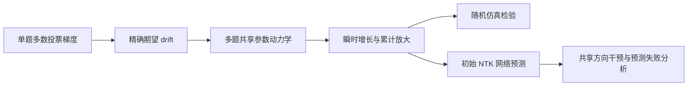

这像先量一人的响应，再研究群体互相影响，最后用受控小网络检查哪些推论还成立。

### 4.2 单题为什么会 sharpening

二元答案为 $+$ 与 $-$，令答 $+$ 的概率为 $p=\sigma(z)$。每题采 $K$ 个答案，以多数结果为 pseudo-label，一致者得奖励。默认 REINFORCE、$K=3$ 时，下面是对采样取期望后的 logit 更新方向：

$$
F(z)=p(1-p)(2p-1),\qquad p=\sigma(z),\qquad \dot z=\eta F(z).
$$

$z$ 为标量 logit，$p\in(0,1)$，$F$ 为平均 drift，$\eta$ 是步长，时间按 optimizer updates 计。$z>0$ 时 $F>0$，原有偏好继续加强；$z<0$ 反之。它只强化初始多数，不知道真实答案。

关键不是只有 $F$ 的正负，而是其斜率：在 $K=3$ 设置中，$|z|<z^*=\ln(2+\sqrt3)\approx1.317$ 时 $F'(z)>0$。共同推力在这段不确定窗口会得到同向放大。窗口外则变成阻尼。换 $K$ 或 estimator 要重算 drift，不能沿用所有数值常数。

### 4.3 多题如何共同失稳

下面给每道题一个局部参数，再加所有题共用的偏好：

$$
z_i=u_i+\lambda v,\qquad
\dot z_i=\frac{\eta}{N}F(z_i)+\eta\lambda^2\langle F\rangle.
$$

$i=1,\ldots,N$ 是训练题，$u_i$ 为本题标量参数，$v$ 为共享标量，$\lambda$ 为耦合强度；尖括号表示跨题平均。第一项只负责本题 sharpening，第二项汇聚公共方向。这个 $1/N$ 来自每步平均 batch 梯度、局部参数被抽到的概率，不是所有训练系统都自然具有同一分解。

假设初始一半题偏 $+$、一半偏 $-$，幅度同为 $a$。完全无噪声且对称时会一直保持平衡；采样噪声或初始不对称提供扰动。令共同偏移为 $w=\lambda\delta v$，线性化到 $1/N$ 的主导阶，有：

$$
\dot w=\eta\lambda^2\langle F'(z(t))\rangle w.
$$

$w$ 是标量共同扰动；$F'$ 是 drift 对 logit 的导数。平均斜率为正表示当时会增长，但这是沿 sharpening 轨迹的瞬时判断，不是固定点稳定性，也不足以保证最终翻转。

### 4.4 累计放大与临界题数

下面把扰动在不稳定窗口内的增长率积起来，比较它与初始噪声种子的大小：

$$
\Lambda=\lambda^2N G(a),\qquad
G(a)=\ln\frac{F^*}{F(a)},\qquad
N_c\simeq\frac{\ln(1/\delta)}{\lambda^2G(a)}.
$$

$F^*=F(z^*)$；$a$ 是窗口内初始置信幅度；$\delta$ 是共享模式的有效噪声种子；$\Lambda$ 是无量纲累计 log-amplification；$N_c$ 是近似临界题数。这一闭式用于均匀初始置信、固定耦合模型。若 $a$ 已在窗口外，不能机械代入对数式；相应小扰动会衰减。仿真的 $\Lambda_c\approx2.6$ 是校准常数，具体拟合为 2.64，具有噪声与设置依赖。

噪声量级随 batch size 和 learning rate 改变，因此 $N_c$ 只对 batch size 呈对数依赖；若 $\eta\propto B$ 线性缩放，模型中的这部分 batch 效应抵消。高置信稳定只是不会改变初始答案，初始答错的题也可能稳定地错下去。

### 4.5 网络为何不完全遵循闭式

对网络以 $K_{ij}=\nabla_\theta z_i\cdot\nabla_\theta z_j$ 定义 kernel。作者保留 self、uniform 与 prediction-aligned 三部分，以 $k_u$ 表示统一推动、$k_s$ 表示朝各题自身偏好推动，$k_d'$ 表示局部自项。结构化近似下，累计放大写为：

$$
\Lambda(N)=G\frac{Nk_u}{k_d'+Nk_s}.
$$

$K$ 为 $N\times N$ 矩阵，$k_u,k_s,k_d'$ 为标量投影量；$G$ 来自初始 logit 分布。$k_s>0$ 时保护项会使放大饱和，增加数据不再必然导致坍塌。真实网络学习特征后 kernel 会变化，且还有这三部分之外的模式，初始投影不是稳定保证。

作者还加入 batch 平均答案概率的 entropy bonus，使边际分布不要全偏一边；默认二元 REINFORCE 模型给出 $\beta_c\le1/2$ 的均匀模态阈值。这像要求全班总体别都选 A，却没有要求每个人在各自题目上选对。

## 5. 实验结果

**实验设置六件事**

- 数据集与切分：可解模型是合成多题任务，初始多数 80% 正确且偏好平衡；不作为通用基准入库。小网络输入六位数字，比较前三位和后三位总和，相等样本排除。固定 unlabeled pool 8192 题取前 $N$ 题做 RL，另 2000 题 held-out；kernel 与 $G$ 分别在 384、2048 个 pool 样本估计。
- 骨干模型：自建小 Transformer，embedding width 64、2 个 pre-LN encoder layers、4 heads、MLP width 256、无 dropout、CLS readout。plain 与 antisymmetric 两种结构；不是预训练 LLM。
- 训练预算：toy 默认 REINFORCE、$K=3$、$B=32$、SGD step 4、300 epochs、24 seeds；部分 sweep 用 16 seeds，长训练可到 3000 epochs。网络先 Adam warm-up，learning rate $10^{-3}$、batch 128；RL 用 plain SGD、$B=16$、$K=3$、100 epochs，步长按 self-kernel 缩放。22 conditions、7 个 $N$、每格 6 seeds，共 924 network runs；单台 Apple M4 Pro 14-core CPU，作者报告 toy 全套少于一小时、网络约 40 分钟。
- 基线：不同 estimator/group size、Adam、无共享方向及补回 bias 的结构对照；预测器比较 bare threshold、deterministic kernel mean-field、kernel-calibrated surrogate、always-collapse、always-stable、观测 base-rate 常数。
- 指标：真实 hidden-label accuracy、majority-vote reward、$\Phi=|\langle\operatorname{sign}z_i\rangle|$，终态 $\Phi>0.5$ 计 collapsed；$P(\mathrm{collapse})$ 为多 seed 比例。另报告 Pearson correlation、sign agreement、AUROC 和 Brier score，低 Brier 更好。
- 推理设置：直接采样答案而非自由文本推理，toy 从 sigmoid/softmax 采样，majority tie 随机打破；plain 温度 $\tau\in\{1,2,3\}$，antisymmetric 用 1、2。无检索、工具轮数或外部 judge；这些不是缺失参数，而是不适用。

像验证投票机制，必须把自评一致率和真正考试成绩分开；一致率升高不能替代准确率。

| 网络预测任务 | 指标 | kernel-calibrated surrogate | 最强简单参照 | 差异 |
| --- | --- | --- | --- | --- |
| 154 condition–size cells | sign agreement | 71% | always-collapse 73% | 低 2 pp |
| 924 runs | Brier score，越低越好 | 0.235 | observed base-rate constant 0.205 | 高 0.030 |
| 924 runs | AUROC | 0.87 | 原文未给对应常数基线 AUROC | 原文未给 |

base-rate constant 用结果拟合，作者明确它偏乐观；surrogate 的 Brier 仍优于 always-collapse 的 0.289。不能只挑 0.87 的 AUROC 宣称预测概率可靠。

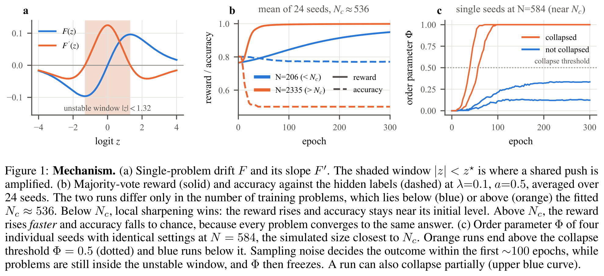

Figure 1：同样算法在临界题数两侧出现不同结局；reward 上升可与 accuracy 跌到 chance 同时发生，近临界的 seeds 受早期噪声影响。

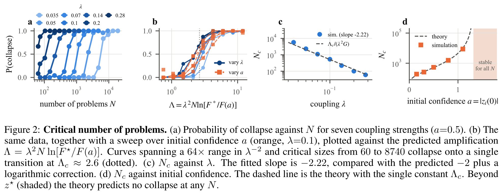

Figure 2：改变耦合与初始置信度的曲线可按 amplification 缩并，支持 toy model 的尺度关系；缩并不使拟合常数成为普遍定理。

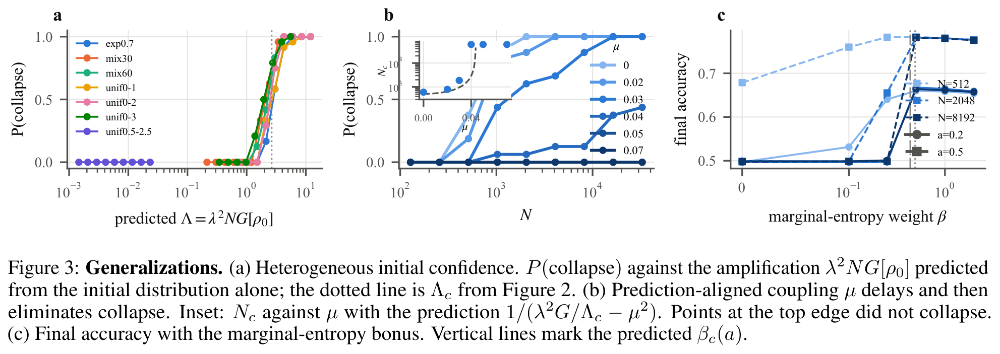

Figure 3：异质初始置信仍可产生阈值，prediction-aligned coupling 提供保护，entropy bonus 在 toy model 中也能有效抑制均匀模式。

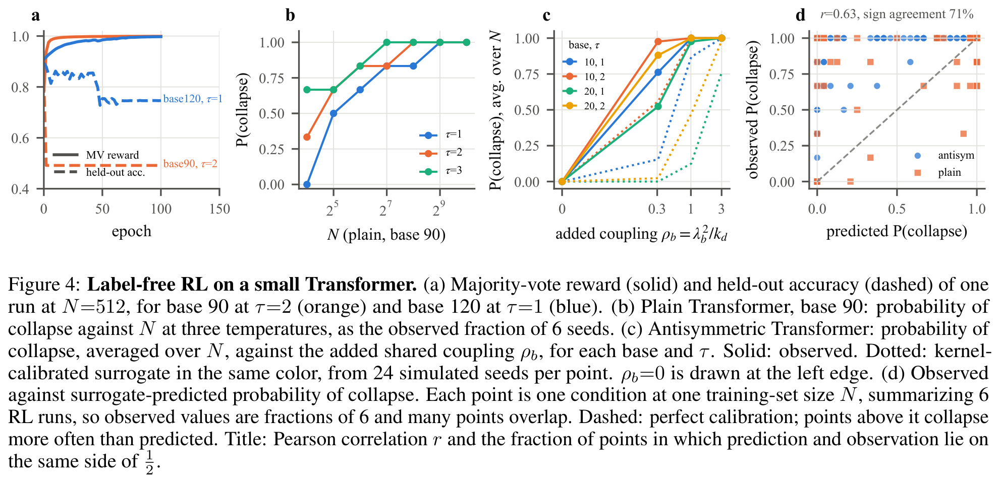

Figure 4：antisymmetric readout 去掉公共方向后没有同答坍塌，加回 bias 逐渐恢复；预测散点多数偏向低估风险，显示 calibration 问题。

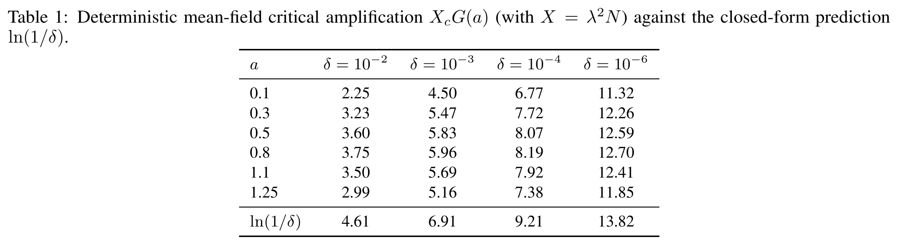

Table 1：确定性 mean-field 阈值与 $\ln(1/\delta)$ 呈相同主导关系，但存在随置信度变化的常数偏移，不是逐项完全相等。

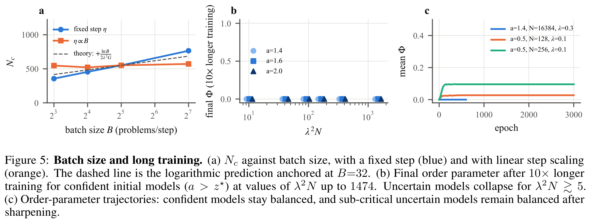

Figure 5：固定步长增大 batch 只温和改变临界题数；线性步长缩放下更平坦，长训练也未把已离开不稳定窗口的 toy 个体重新拖回坍塌。

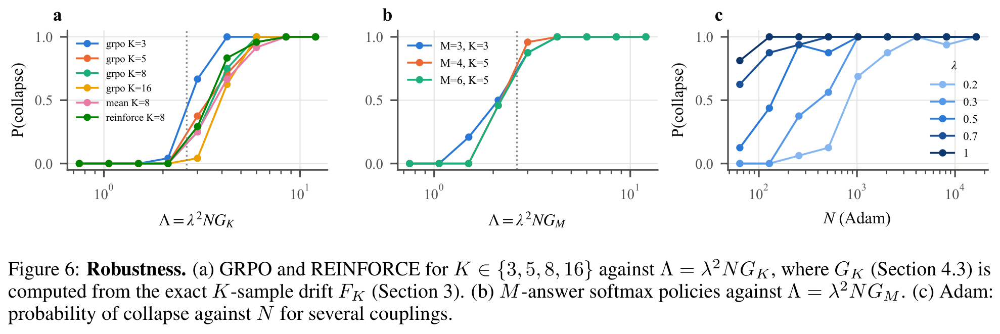

Figure 6：GRPO、较大 group、多答案与 Adam 下仍保留相关尺度趋势，但需要各自 drift 和噪声常数，不是所有曲线都共享精确同一阈值。

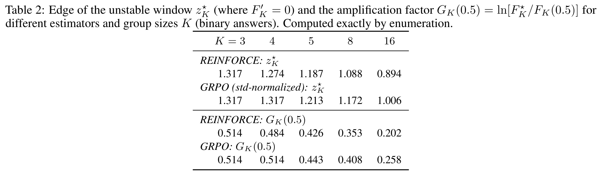

Table 2：增加 $K$ 会改变不稳定窗口和 $G_K$，支持 group size 影响应通过实际 estimator drift 分析，不能只用采样数推断。

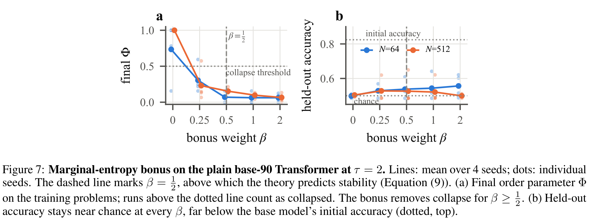

Figure 7：$\beta\ge1/2$ 时同答 order parameter 降低，但 held-out accuracy 仍接近 chance，直接反驳答案均衡即可保住能力的推断。

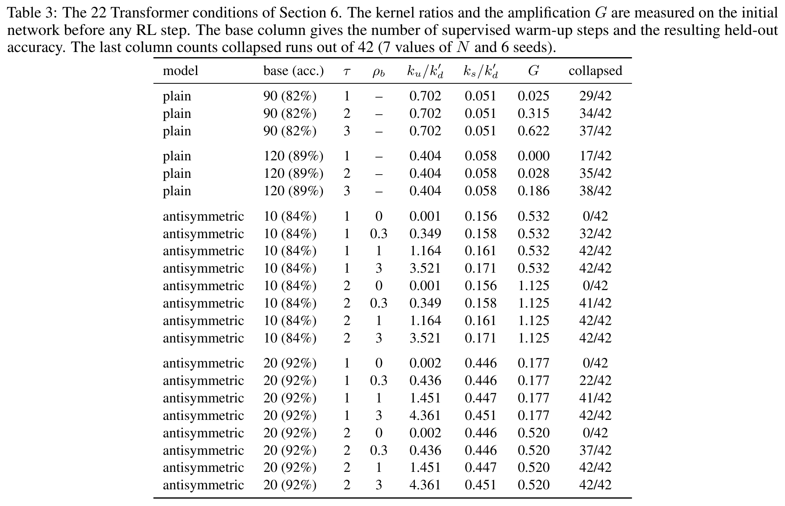

Table 3：plain base-120 在 $\tau=1$ 时初始 $G$ 显示为 0.000，仍有 17/42 runs 坍塌，说明固定 kernel 的稳定边界不能直接用于网络。

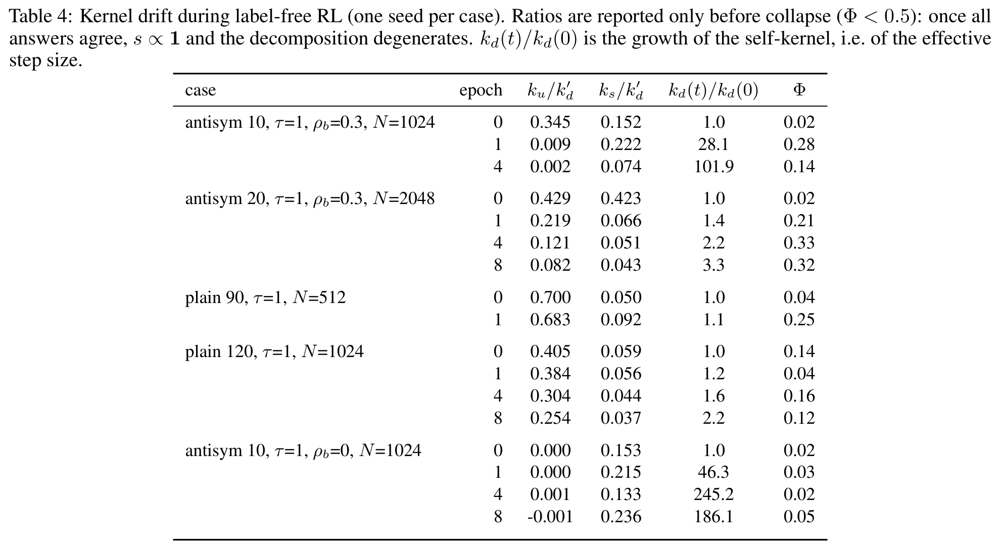

Table 4：某些网络 protective coupling 相对下降，另一些 self-kernel 大幅增长；作者也承认 drift 不能解释全部 plain-network misses。

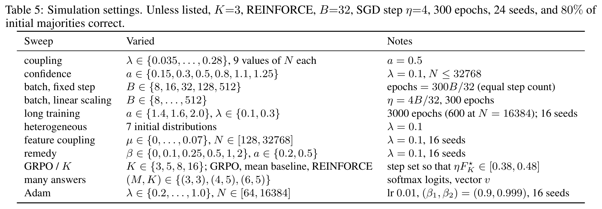

Table 5：不同 sweep 的 epochs、step 与 seeds 不完全一样，读尺度律时要保留这些控制条件。

## 6. 局限性

**作者承认的**：答案级策略、线性化耦合、固定 kernel 都是简化；瞬时 instability 不是 collapse 的充分条件；$\Lambda_c$ 取决于噪声；未测试预训练语言模型。像一张固定的同学关系图不能完整预测大家学习后关系如何变化，初始 kernel 的失准有结构性原因。

**我的判断**：antisymmetric 网络还注入了已知任务对称性，并需要同时处理原输入与交换输入；它不是通用 LLM 可以无条件套用的去偏操作。核的三项投影丢掉其他集体模式，marginal entropy 又只管总体比例，所以可能把同答坍塌换成平衡的错误规则。若真答案本来高度偏斜，强迫 marginal balance 也可能损害正确策略。

**实验边界**：网络非常小且只做合成二分类；sign agreement 受 collapse base rate 支配，同一 condition 的七个 cells 相关。论文给出的 bootstrap 区间与 always-collapse 大幅重叠；AUROC 的主要区分力来自无共享方向的 antisymmetric 情况，不能直接当作同架构内部的精准阈值预测。作者没有把所有 misses 归因于已证实的单一原因。

## 7. 一句话总结

这篇论文像研究全班互相打分时如何形成随大流：每题自己的判断与全体共享偏好在竞速，后者可能先把大家拉向同一个答案。第 4 节的 $\Lambda=\lambda^2NG$ 是受控模型里的核心量，但把它直接移植成真实 LLM 的安全阈值是不成立的；最有价值的警示是奖励一致、答案均衡和真实能力三者必须分开测。

## 8. 可复用点

做无标签 self-reward RL 时，同时画 majority-vote reward、hidden-label held-out accuracy、答案 marginal 和跨题梯度耦合，别只看训练 reward。像检查会议是否有效，不能只统计所有人意见是否一致。

可用小型有标签诊断集筛查共享 output bias、格式偏好和任意规则替代；测试 entropy bonus 时必须检查准确率是否保留。初始 NTK 可作风险排序，不能给出不会坍塌的承诺。分批课程和冻结 output bias 是作者提出的后续方向，本文没有完整验证。诊断思路已抽成 [[../../../30 方法卡片/跨任务公共方向的坍塌诊断]]。

## 9. 我的疑问

- 对真实多 token 推理，什么可观测量能区分同答案偏好、推理模板偏好与真正共享解题能力？像全班都用同一答题格式，不一定都抄同一个答案。
- 能否追踪训练中的主要 kernel modes，而不付出完整 per-example gradient 成本？
- 在具有偏斜标签、部分正确教师或外部验证信号时，保护性 coupling 与错误集体规则如何竞争？这些问题超出本文已验证范围。

基准同步：合成单次任务不新建数据集条目；accuracy 已有正文保持原样。按五行上限补 order parameter、P(collapse)、entropy / marginal entropy、AUROC、Brier score；majority-vote reward 与其余诊断口径在本文解释，不扩充一次性清单。
