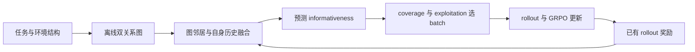
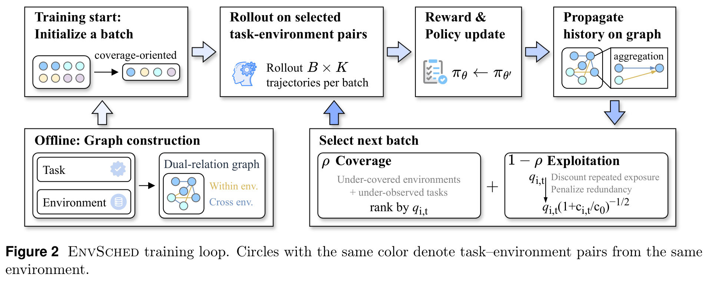
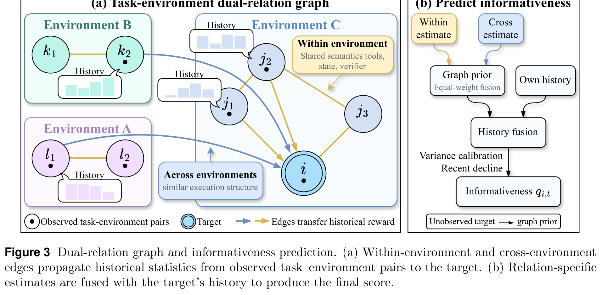
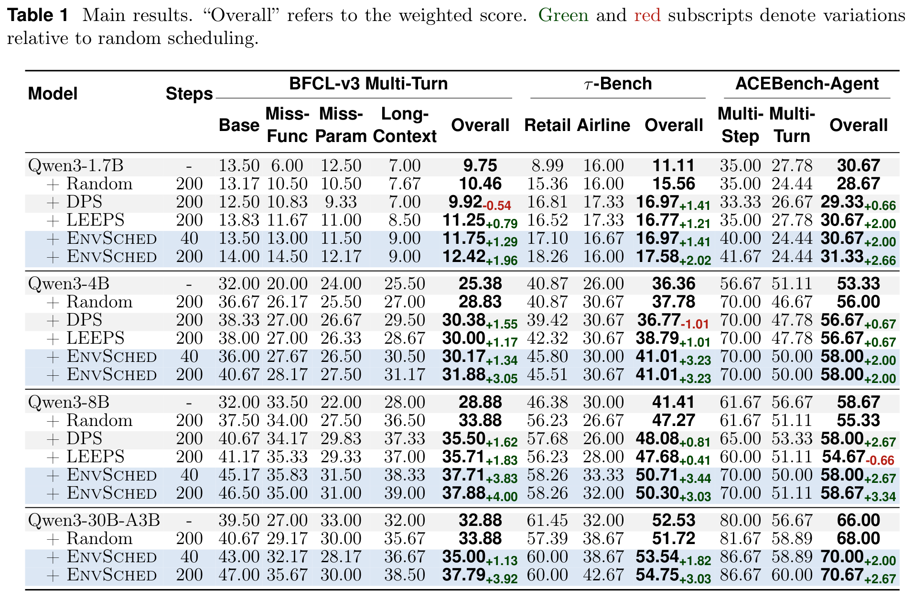
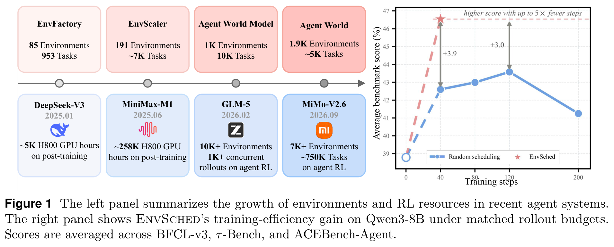
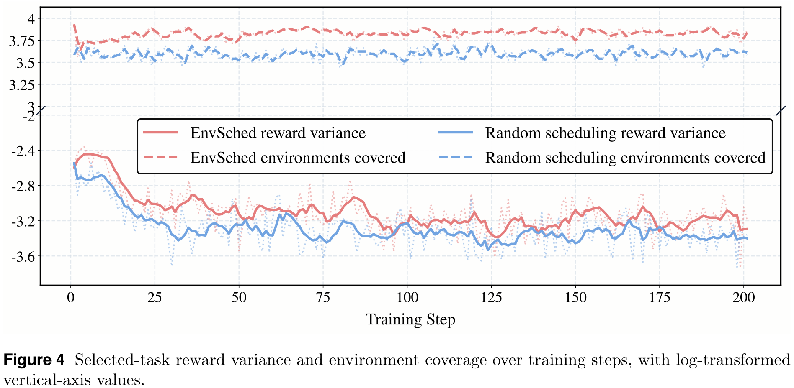
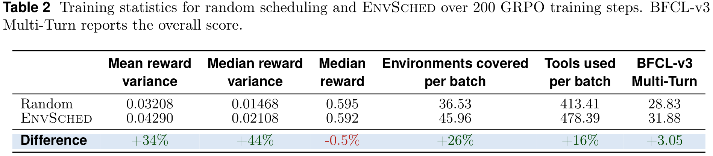
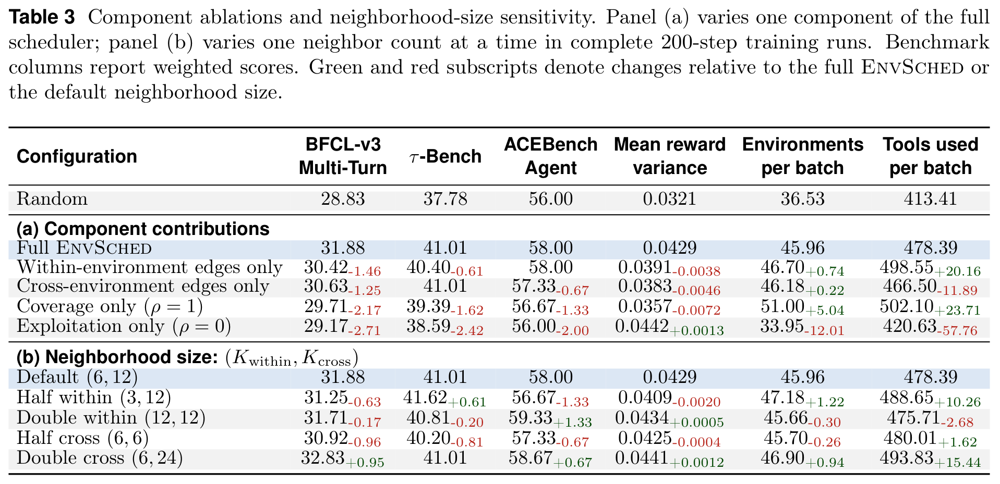
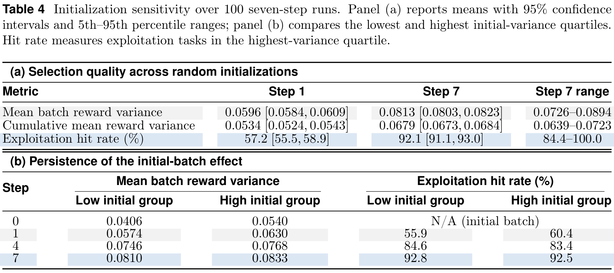

> 一句话：把练什么和在哪练一起安排，用有限次数覆盖更多有用情境。

来源：联网原始 PDF，arXiv v1，27 页；正文、历史估计与调度附录 B–D、结构抽取说明及附录 F 案例已核读。PDF 位于项目 `runtime/2026-10-29/refs/envsched/paper.pdf`。下文是论文报告结果，没有复现训练。

## 0. 读之前你需要知道

**Agentic RL** 是让模型通过多轮调用工具、观察环境、完成任务，再根据奖励学习。**executable environment** 不只是题目文字，它还定义可用工具、数据库状态、动作后的变化和验收规则。像练习预约挂号，同一句请求在不同医院系统里，需要的操作可能完全不同。

**GRPO** 在同一道题的多条 rollout 之间比较奖励，用差异形成学习信号。若八次全成功或全失败，组内几乎没有可用于区分行为的奖励差。**reward variance** 衡量这组结果有多不同；**coverage** 衡量一批训练看到多少环境和交互结构；**exploitation** 倾向挑当前预计有区分度的任务。

前序 DPS 从历史结果预测 prompt 的学习动态，LEEPS 结合表示邻居和探索利用组合。EnvScaler 等系统扩充可执行训练环境，本文则研究已有环境池该怎样使用，不是再生成一批新环境。

## 1. 动机

学生每天只能做有限次实操。如果全练一个熟悉的挂号系统，练习虽有成败差异，却可能一换系统就不会操作；如果把每个系统随便看一遍，又可能没练到能真正纠错的内容。

**以前怎么做**：随机选任务，或依据题目文字、历史难度挑任务。**为什么不足**：选一题同时选中了工具、初始状态、业务约束和 verifier，这些因素没有被单纯 prompt 相似性充分表达。

**为什么现在可做**：训练已经积累每题多 rollout 的奖励历史，环境代码、工具说明、状态和验收条件也可离线提取。EnvSched 把 environment–task pair 作为节点，利用同环境具体结构和跨环境抽象结构转移历史统计，在线决定下一批练什么。它改变采样安排，策略本身仍使用统一 GRPO 更新。

## 2. 贡献

像教务老师同时安排课程内容和实习场地，作者把环境结构纳入 training data scheduling。

- **双关系图**：within-environment edges 表达任务语义、工具、状态和 verifier 相似；cross-environment edges 表达抽象 execution and reward topology 相似。
- **在线预测而非先试跑**：从已有 rollout 历史预测 within-task reward variance，避免额外 pilot model trajectories。
- **组合任务区分度与覆盖**：每批一半 coverage、一半 exploitation，配合环境配额、曝光折扣和相似性惩罚。
- **同预算实证**：四种 Qwen3 尺寸在三个工具交互 benchmark 上相对随机调度改善；消融显示只追求最高 variance 或最广 coverage 都不够。

作者对 environment-level data management 的首创性是其论文定位；这里不把未做全面文献审计的优先权主张当成独立确认事实。

## 3. 创新点

**具体与抽象分开建关系**：同医院任务保留字段与工具名称，不同医院和保险系统则可通过 lookup、eligibility checking、relation replacement 等操作结构连接。类比是同一厨房比较食材和灶具，不同厨房比较先备料再加热的步骤。

**预测和覆盖互补**：不是把图神经网络接进训练模型，而是用固定 TF–IDF similarities 加上动态历史统计，给调度器提供先验。任务没有自己历史时，也能借邻居信息。

**完整调度协议**：除 ranking 外，还包含 progress filter、identifier filter 和 cold start。它们会影响哪些任务能入选，因此效果不能只归于 Eq. 5 的一个评分式。尤其 identifier filter 通过 fixed-action replay 验证可疑得分动作，无新模型采样并不等于没有额外环境执行。

## 4. 方法

### 4.1 整体流程

像训练营每天根据昨天成绩改今天课表，同时保留不同场地的训练机会。

Figure 2：离线构图和在线历史更新分开；每批选的是 task–environment pairs，而不是已经生成好的轨迹。

Figure 3：两种关系各自聚合，再与节点自身历史融合；无历史节点主要依赖 graph prior。

### 4.2 给任务建立两种关系

先用六种具体视图和一个抽象视图计算相似度：

$$
S_{ij}^{\mathrm{full}}=\sum_{a=1}^{6}\alpha_a\cos(h_i^{(a)},h_j^{(a)}),\qquad
S_{ij}^{\mathrm{abs}}=\cos(g_i,g_j).
$$

$i,j$ 是 environment–task 节点；$h_i^{(a)}$ 是第 $a$ 种 TF–IDF 稀疏特征向量，维度由该视图词表决定；$g_i$ 是抽象操作文本向量；$\alpha_a$ 是六个标量权重；$S$ 为标量相似度。六视图包括 instruction words、character fragments、verifier-check text、verifier code structure、initial context 和 operation description。

结构抽取由语言模型离线读取 instruction、initial-state summary、tools、verifier，提取 operations、gates、dependencies、reward groups 与 conflicts。抽象化移除工具名、字段名、标识符和具体值。相似度训练时固定，已观察邻居集合随历史增长；默认取 6 个 within 和 12 个 cross 邻居。

### 4.3 用奖励历史预测区分度

先计算同一任务这次八条 rollout 的均值和总体方差：

$$
m_{i,s}=\frac1K\sum_{k=1}^{K}r_{i,s,k},\qquad
v_{i,s}=\frac1K\sum_{k=1}^{K}(r_{i,s,k}-m_{i,s})^2.
$$

$s$ 是训练步，$K=8$ 是每题 rollout 数，$r\in[0,1]$ 为 verifier reward，$m,v$ 均为标量。这里分母是 $K$，不是样本方差的 $K-1$。附录还记录 mean-corrected dispersion，把方差除以带下限的 $m(1-m)$ 再裁剪，避免均值位置完全主导比较。

历史观测先减去当步全局均值，再平移到当前 global reference；以半衰期衰减，减少策略变化带来的陈旧性。相似度和近期观察量共同决定邻居权重；缺少证据时向 global reference 收缩。

下面把两种关系先验与自己的历史合并：

$$
P_{i,t}^{y}=\tfrac12G_{i,t}^{\mathrm{in},y}+\tfrac12G_{i,t}^{\mathrm{cross},y},\qquad
\hat y_{i,t}=\frac{W_{i,t}\bar y_{i,t}+\lambda_sP_{i,t}^{y}}{W_{i,t}+\lambda_s}.
$$

$y\in\{v,m,d\}$ 分别为 variance、mean、dispersion；$G$ 为关系内带权邻居估计；$P$ 是 graph prior；$W$ 是有效历史权重；$\bar y$ 是自身历史估计；$\lambda_s=2$ 控制先验强度。无自身历史时 $W=0$，完全用先验。

直接预测的 variance 和由 mean、dispersion 重构的 variance 以 percentile rank 按 0.65/0.35 融合，再映回方差尺度。long/short half-life 分别为 8/2 步；近期估计下降会降低优先级，最后得到全池 percentile score $q_{i,t}$。它是排序分数，不是已经证明的学习收益。

### 4.4 组成下一批任务

每批 $B=64$，其中 32 个 coverage slots、32 个 exploitation slots。coverage 先按当前批环境覆盖、累计环境曝光、任务观察次数作字典序筛选，再比 informativeness。exploitation 则打折重复练习的任务。

下一节点按阶段分数减相似性惩罚贪心选择：

$$
i^*=\arg\max_{i\in\mathcal A}
\left[a_{i,t}^{\mathrm{phase}}-\lambda_{\mathrm{sim}}\max_{j\in\mathcal B}S_{ij}^{\mathrm{full}}\right],\qquad
\omega_{i,t}=(1+c_{i,t}/c_0)^{-1/2}.
$$

$\mathcal A$ 是合格候选，$\mathcal B$ 是已选集合；coverage 的 $a=q$，exploitation 的 $a=q\omega$；$c$ 为累计选择次数，$c_0=16$，$\lambda_{\mathrm{sim}}=0.08$。空 batch 的惩罚为零。环境单步 cap 为 4、滚动三步 cap 为 11，连续同任务 cap 为 2。

progress filter 对已有足够记录且估计进步非正的任务暂时停止 exploitation，但保留 coverage 重测。identifier filter 用保存动作 replay，确认可疑标识符动作影响奖励后排除任务。cold start 则选环境代表并补充新颖任务；这些限制像排课时的场地上限，先决定谁能进入，再谈排名。

## 5. 实验结果

**实验设置六件事**

- 数据集与切分：EnvScaler 中 51 个 executable environments、2550 个 task instances 训练；这是本文子池，不等于原 EnvScaler 全量。测试 BFCL-v3 Multi-Turn、τ-Bench Retail/Airline、ACEBench-Agent Multi-Step/Multi-Turn；具体测试题数和排重流程原文未给。
- 骨干模型：Qwen3-Thinking 的 1.7B、4B、8B、30B-A3B；四个尺寸共享 scheduler 与优化超参数。
- 训练预算：200 single-epoch steps，每步 64 tasks、每题 8 rollouts；Adam，learning rate $10^{-6}$，cosine schedule，10 warmup steps，policy-ratio clip 0.2，advantages batch-whitened 后裁到 $[-0.2,0.2]$。4B 的 H100 step 约 25 分钟；GPU 数量、总 GPU-hour 原文未给。
- 基线：Base、Random、DPS、LEEPS；相同 EnvScaler pool、batch、rollout 数和更新程序。30B-A3B 表格仅比较 Base、Random 和 EnvSched，不能声称该尺寸也实测击败 DPS/LEEPS。
- 指标：各 benchmark 的 Overall 为 weighted score；三个 benchmark 之间的平均与各自内部 Overall 是两层口径。另测 mean/median reward variance、environments covered、tools used、调度耗时与 cold-start hit rate；三 random seeds 聚合。
- 推理设置：训练 temperature 0.99、top-p 0.99、top-k 100，最多 40 turns、每 turn 4096 tokens、整序列 32000 tokens；loss 仅覆盖模型生成 token（含 reasoning）。τ-Bench user model 按原文为 GPT-5.6-terra，ACEBench-Agent 为 GPT-4o-2024-08-06；测试 temperature 与 seed 聚合细节原文未给。

像比较两套课表，需要确保上课次数一样，不能把少做题与少花全部计算成本直接画等号。

| 数据集 / 任务 | 指标 | EnvSched（4B，200 steps） | 最强调度基线 | 提升 |
| --- | --- | --- | --- | --- |
| BFCL-v3 Multi-Turn | Overall | 31.88 | DPS 30.38 | +1.50 |
| τ-Bench | Overall | 41.01 | LEEPS 38.79 | +2.22 |
| ACEBench-Agent | Overall | 58.00 | DPS / LEEPS 56.67 | +1.33 |

提升为原表相减；相对 Random 的三项变化另为 +3.05、+3.23、+2.00，不混用不同基线。

Table 1：四种尺寸相对随机调度的 Overall 均改善，但 8B 的 τ-Bench 在 40 steps 已略高于 200 steps，训练更久未必继续涨分。

Figure 1：作者用早期达分曲线展示 rollout efficiency；正文给出 8B 的 40-step 平均 48.81，与 Table 1 三项均值对应，但图中纵轴最高标注为 47，展示口径未解释清楚，不能直接从曲线核出 48.81。

Figure 4：EnvSched 的 variance 和 coverage 曲线多数时候高于 Random；纵轴经过 log transformation，曲线高度不能直接当作原始数值差。

Table 2：mean reward variance 从 0.03208 到 0.04290，环境覆盖从 36.53 到 45.96，而 median reward 近似不变，说明并非单纯挑更容易拿高奖励的题。

Table 3：Exploitation only 的 variance 最高却表现较差，Coverage only 覆盖最广也不最好；两者是互补条件。邻居增大后的某些结果还能超过默认，默认设置不是全局最优证明。

Table 4：100 次七步短运行中初始批次影响逐步减弱，但测的是 selection quality，不等于证明最终 benchmark 的随机种子方差同样小。

在线 selection 平均每步 34.93 秒，作者给出约占 4B step 的 2.3%；这是在线调度开销，不含未单列的离线 LLM 抽取成本。复杂度近似线性还依赖邻居预算、增量候选数固定且没有 boundary-tie fallback scans，不能无条件套到任意大环境池。

附录 F 的病例说明了跨环境信息为何可能有用：修改患者过敏记录、整理情绪记录、处理报销申请，表面领域不同，却都要求先解析记录、核验权限，再执行相互依赖的修改。目标任务尚无自身历史时，邻居的成败差异可以提示这个查找瓶颈。我的解释是，调度器借的是操作依赖的相似性，而非医学或财务知识；如果抽象步骤相同但具体工具行为不同，预测仍可能失准。病例能帮助读懂构图动机，不能替代跨关系边的受控消融。

## 6. 局限性

**作者明确交代的适用条件**：历史 dispersion 使用 $[0,1]$ 奖励尺度；图依赖可读取的环境结构；复杂度结论有固定容量与 tie-scan 条件。原文没有独立 Limitation 小节，不为作者补写一段自认缺陷。

**我的判断**：高 reward variance 可能来自不可控环境噪声或 verifier 漏洞，而非可学习的动作差异。像练习成绩忽高忽低可能是题目有问题，不一定是训练价值最高。静态 TF–IDF 与 LLM 抽象结构相似，也不保证随着策略变化仍具有相近学习动态；历史半衰期只能部分缓解。固定一半覆盖的比例未根据训练阶段调整；黑盒环境看不到 verifier 时，构图流程难以直接迁移。

**实验边界**：训练池较小且来源单一；离线抽取模型身份、调用预算和完整成本没有单列；主表缺少三 seed 的离散度，cold-start 置信区间不能替代它。额外 eligibility filters 缺少单独消融，改进究竟有多少来自过滤而非图排序尚不清楚。Figure 1 的图文刻度差异也应先核对再复用效率倍数。

## 7. 一句话总结

EnvSched 像给训练营安排既有挑战、又覆盖不同场地的课表：用已有成绩预测哪里能产生对比信号，再防止所有人挤在同一类练习上。值得带走的是把任务与可执行环境共同建模的调度单位，而不是把 variance 当成万能难度指标；文中最有说服力的证据恰恰是只追求 variance 的消融表现较差。

## 8. 可复用点

先在现有 GRPO 日志保存每题完整 reward group、环境 ID、工具集合和被选次数，再统计每批环境覆盖与组内方差。像排课前先有出勤表，历史记录不完整时不要急着训练复杂预测器。

可先做固定 coverage 配额加随机其余任务，建立成本对照，再加入 dual-relation prior；分别消融 graph、filters 和曝光折扣，并把离线抽取、fixed-action replay、在线 selection 的费用一起报告。可复用机制已抽成 [[../../../30 方法卡片/环境覆盖与信息性联合调度]]，不能照搬本文计时到不同模型或工具延迟。

## 9. 我的疑问

- 能否把 verifier noise 与行为差异导致的 variance 分开，避免把反复故障的环境当作高价值练习？像先排除考场噪声，再按成绩安排补课。
- 当一个静态相似邻居已被策略掌握，另一个仍有组合依赖难点时，图先验能否及时分开二者？
- 在相同总费用而非相同 rollout 数下，结构抽取与 replay 仍值得吗？这些是我的问题，原文没有完整回答。

基准同步：BFCL 与 τ-bench 母条目完全不动，τ-Bench 与 tau-bench 不新建重复项。按最多五行补 EnvScaler、ACEBench-Agent、reward variance、environment coverage、tool coverage。
