> 一句话：让学生沿着老师能指导的路线练习，减少答完后反复说话。

来源：联网获取原始 PDF，arXiv v1，34 页；正文、实验附录 A–C、理论附录 E–G 和案例附录 H 已核读。原文 PDF 保留在本项目 `runtime/2026-10-29/refs/mpopd/paper.pdf`。下文数字是论文报告结果，没有在本机复现训练。

## 0. 读之前你需要知道

**术语卡**

- **策略（policy）**：给定题目及已经写出的内容，预测下一个 token 的概率分布。token 是模型处理文字的基本片段。
- **轨迹（trajectory）**：从开始到结束的一整段生成过程；**rollout policy** 决定练习时实际走哪条路线。
- **On-policy distillation（OPD）**：学生先自己写，再请教师在这些前缀上提供逐 token 的概率监督。像学生自己解题，老师逐行批改。
- **KL divergence**：衡量两个概率分布的差别，方向交换后含义不同。本文主要使用 reverse KL，即学生分布对教师分布的 KL。
- **proposal policy**：专门负责生成训练轨迹的额外模型，和最后部署的 student 不是同一个角色。

**它站在谁肩上**：标准 OPD 减少了只模仿教师范文造成的训练与使用分布差异；ExOPD、EOPD 和 VETO 进一步改监督目标。本文转向另一个问题：学生交来的作业路线，本身是否适合教师指导？

## 1. 动机

学生做应用题时走进一条很奇怪的解法，老师未必能在每一行都准确续写。若老师没有及时否定其中的重复，学生下一次可能更愿意走这条路，最后学会一直重复答案。

**以前怎么做**：OPD 直接让当前 student 生成训练轨迹，再用 teacher 分布训练 student。这样练习来自学生自己，符合 on-policy 的出发点。

**为什么不行**：作者观察到 compounding teacher–student mismatch。学生采出的某些前缀在 teacher 下难以到达；教师在这种上下文中的监督可能不可靠，这些模式又随训练被重复采样。Figure 1 用教师续写的 semantic similarity 和 PRM score gap 诊断这一现象。PRM 是给推理过程打分的模型，这些诊断支持机制解释，但不是逐个前缀的因果证明。

**为什么现在能做**：训练时已经能查询教师逐 token 概率，可以利用两者的概率比来改采样方向；额外训练 proposal policy，又避免每生成一个 token 都串行调用两个模型。

## 2. 贡献

像重新安排练习路线，而不只是换一支批改作业的红笔，本文做了三件事。

- **明确把 rollout policy 当作优化对象**：在学生附近，提高 teacher 相对更支持的 token 的采样概率，得到 Mixture Proposal On-Policy Distillation（MPOPD）。
- **把理想采样分布变成可运行的训练流程**：用独立 proposal policy 近似 geometric mixture；生成阶段只前向计算 proposal，训练阶段才查询 teacher。
- **给出准确率、长度和算力对照**：Table 1 中 Qwen3-4B-Base 的数学平均准确率为 35.37%，OPD 为 28.46%，VETO 为 31.06%；Table 3 还比较了每轮多更新一次的 OPD，避免把收益简单归因于额外训练。

这些证据说明该采样设计在文中设置下有效；不能把它扩大成任意教师、任务和规模都更优的结论。

## 3. 创新点

**新在采样位置**：VETO 也用 geometric mixture，但把它放在 distillation target；MPOPD 把混合目标用于决定接下来生成什么。类比是改变学生实际去做的练习，而不是给同一份作业换评分标准。

**新在相对支持信号**：不是仅偏向 teacher 高概率 token，还看它相对 student 是否更受支持。student 已经很擅长的内容未必需要继续增加采样。

**新在双模型交替更新**：student 学教师，proposal 学更新后 student 与 teacher 的混合目标。工程上把两路逐 token 联合解码，转成训练时批量计算目标。额外模型和更新仍有成本，所谓 single forward pass 只指 rollout generation，不代表总训练只需一个模型。

## 4. 方法

### 4.1 整体流程

像学生练习、老师批改、教练再安排下一轮练习，三个职责由不同分布承担。

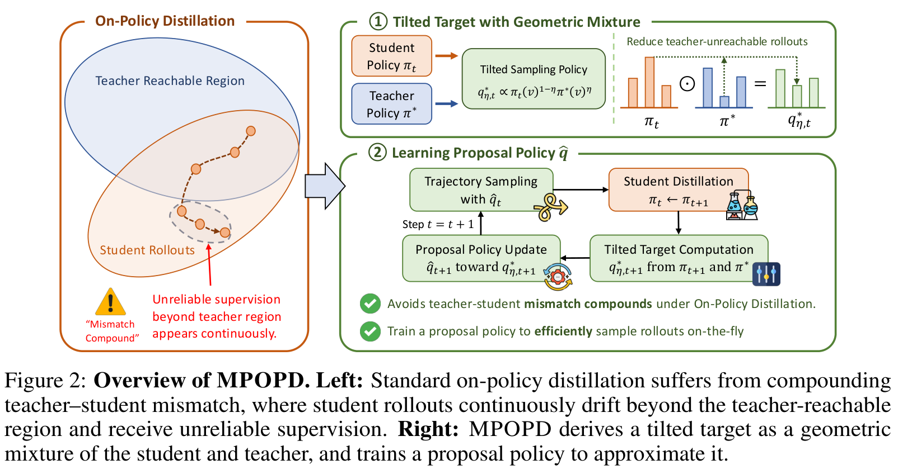

Figure 2：右侧闭环区分了 student update 与 proposal update；混合分布是提案目标，不是直接把最终 student 换成 teacher。

### 4.2 模块拆解

**第一步：找 teacher 相对更支持的 token。** 下面的分数计算同一前缀下教师概率与学生概率的对数比：

$$
s_t(v,x,y_{<j})=\log\pi^\star(v\mid x,y_{<j})-\log\pi_t(v\mid x,y_{<j}).
$$

$x$ 是题目；$y_{<j}$ 是第 $j$ 个 token 之前的前缀；$v\in\mathcal V$ 是候选 token；$\mathcal V$ 是词表；$\pi^\star$ 是固定 teacher，$\pi_t$ 是第 $t$ 轮 student；$s_t$ 是标量。分数大表示 teacher 相对更认可，不等于该 token 在事实层面更正确。

**第二步：限制改动幅度。** 在每个固定前缀上，求期望支持分数尽量大、但离 student 不太远的分布：

$$
\max_q\;\mathbb E_{v\sim q}[s_t(v,x,y_{<j})]
\quad\text{s.t.}\quad \mathrm{KL}(q\Vert\pi_t)\le\delta.
$$

$q$ 是词表上的概率向量，$\delta\ge0$ 是局部 KL 半径，期望值是标量。原文 Proposition 3.1 的解是下面这个归一化 geometric mixture：

$$
q^*_{\eta,t}(v\mid x,y_{<j})=
\frac{\pi_t(v\mid x,y_{<j})^{1-\eta}\pi^\star(v\mid x,y_{<j})^\eta}
{\sum_{v'\in\mathcal V}\pi_t(v'\mid x,y_{<j})^{1-\eta}\pi^\star(v'\mid x,y_{<j})^\eta}.
$$

$\eta$ 是逆拉格朗日乘子；实践将它限制在 $[0,1]$ 并作为固定超参数。$\eta=0$ 回到 student，$\eta=1$ 回到 teacher；分母对词表求和，保证概率总和为一。固定半径理论通常需要前缀相关的 $\eta$，固定全局 $\eta$ 并不让每个前缀具有同一半径。

**第三步：分别训练 student 和 proposal。** 下面的 student 损失在 proposal 采出的轨迹上，累计 teacher 与 student 的逐位置 KL：

$$
\mathcal L_t(\pi)=\mathbb E_{x\sim\mathcal D,\tau\sim\hat q_t}
\left[\sum_{j=1}^{|\tau|}w_{t,j-1}(\tau)
\mathrm{KL}\!\left(\pi(\cdot\mid x,y_{<j})\Vert\pi^\star(\cdot\mid x,y_{<j})\right)\right].
$$

$\mathcal D$ 是训练题目分布，$\tau$ 是 token 序列，$|\tau|$ 为长度，$\hat q_t$ 是学到的 proposal，$\pi$ 是待更新 student，$w_{t,j-1}$ 为前一位置的裁剪单步概率比，且 $w_{t,0}=1$。原文使用 $\mathrm{clip}(\pi_t/\hat q_t,1/C,C)$，$C=5$。它是近似校正，不是整段前缀的精确重要性比。

student 更新后，重新构造 $q^*_{\eta,t+1}$；proposal 最小化自身对这个目标的 reverse KL。每轮先从更新后的 student 重新初始化 proposal，再做一次 inner gradient step。最终部署的是 student。

### 4.3 关键细节

teacher top-16 support 同时用于 distillation KL 和混合目标；每题只生成一条训练 rollout。proposal 是完整模型副本，不是实验中已经验证的 LoRA 版本。敏感性实验中 $\eta=0.20$ 的三项平均最好；主实验逐任务的最终 $\eta$ 未在配置表中单列。理论附录 F 另外假设 teacher target 的梯度噪声条件无偏，且难到达前缀的噪声更大；这些是分析假设，不能当成所有实际教师的性质。

## 5. 实验结果

**实验设置六件事**

- 数据集与切分：数学训练 DAPO-Math-17K full split；知识训练 ARPO-10k full split；医疗训练 M23K 的 5K subset。数学测试 AIME-24/25/26、AMC-23、HMMT 2025 Feb/Nov、Minerva Math、OlympiadBench。知识测试 GPQA-Diamond 全测试集，ARC-Challenge 与 MMLU-Pro 各抽 500 题；医疗为 PubMed、MedQA、Lancet、NEJM、MedX，详细测试题数原文未给。
- 骨干模型：Qwen3-1.7B-Base、Qwen3-4B-Base；teacher 为 Qwen3-4B-Instruct-2507。扩展实验加入 Qwen3-8B-Base 和 Qwen3-30B-A3B-Instruct-2507 teacher。
- 训练预算：2 张 GH200，tensor parallel size 2，learning rate $3\times10^{-6}$，weight decay 0.1；prompt 上限 2048，训练 response 上限 4096。数学 batch 256，医疗 128。知识 batch 在正文为 128、附录 A.1/Table 5 为 256，存在口径冲突。主实验总 epoch/统一总 GPU-hour 原文未给；大模型扩展为 2 epochs。
- 基线：Base、OPD、ExOPD、EOPD、VETO；Table 3 加入 OPD 的 $K=2$ student updates。VETO 多训一个 epoch 以达到其最佳表现，wall-clock 对照要保留这一条件。
- 指标：accuracy（%）及 average generation length。数学通常 avg@32，OlympiadBench 为 avg@8；知识 avg@8；医疗 avg@1。avg@k 是多次采样平均正确率，不能当成至少一次答对的 pass@k。
- 推理设置：数学 temperature 0.8、top-p 0.9、max_tokens 16384；知识同温度与 top-p，GPQA 上限 16384，另两项 8192；MMLU-Pro 使用 validation few-shot，其余知识任务 zero-shot。医疗 temperature 0.0、top-p 1.0、上限 8192。训练采样 temperature 0.8、top-p 1.0。

像比较两名学生，必须同时看卷子、练习时长和交卷规则，不能只抄总分。

| 数据集 / 任务 | 指标 | MPOPD | 最强基线 | 提升 |
| --- | --- | --- | --- | --- |
| 4B 八项数学平均 | accuracy (%) | 35.37 | VETO 31.06 | +4.31 pp |
| 1.7B 八项数学平均 | accuracy (%) | 17.51 | EOPD 16.69 | +0.82 pp |
| 4B Knowledge QA 平均 | accuracy (%) | 66.54 | VETO 65.34 | +1.20 pp |
| 4B Medical Reasoning 平均 | accuracy (%) | 59.17 | ExOPD 58.03 | +1.14 pp |

这里的最强基线按同组平均分选，不把各行不同方法的最大值重新平均。4B 相对 OPD 的 +6.91 pp 与相对 VETO 的 +4.31 pp 是两种比较。

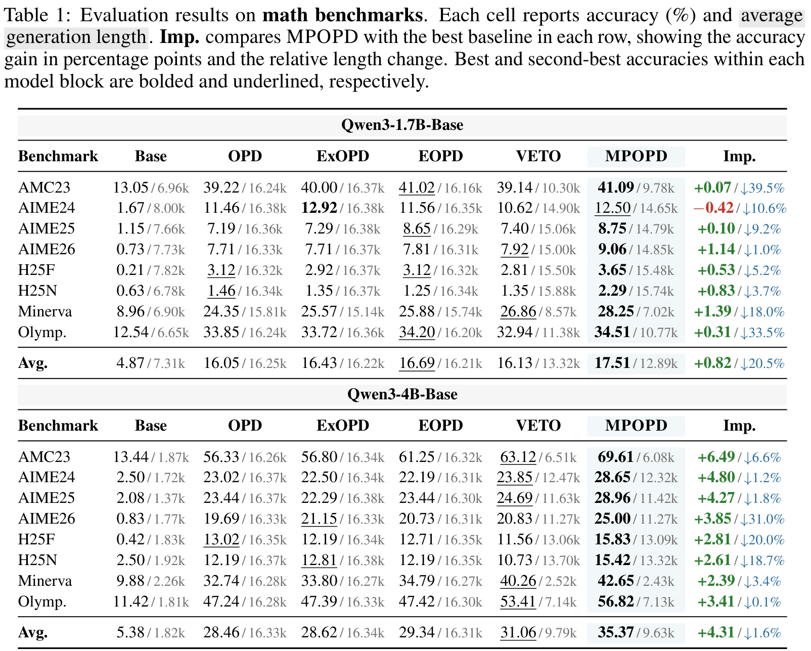

Table 1：4B 的八项测试均领先，1.7B 的 AIME24 仍低于 ExOPD；不能把平均改善写成每项都赢。

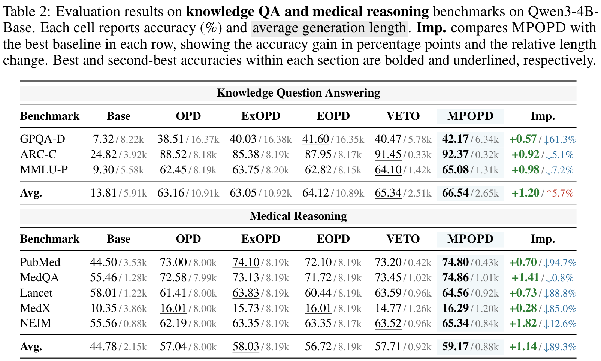

Table 2：知识与医疗也有准确率改善，但知识平均生成长度略高于 VETO，因此更短并非对所有基线都成立。

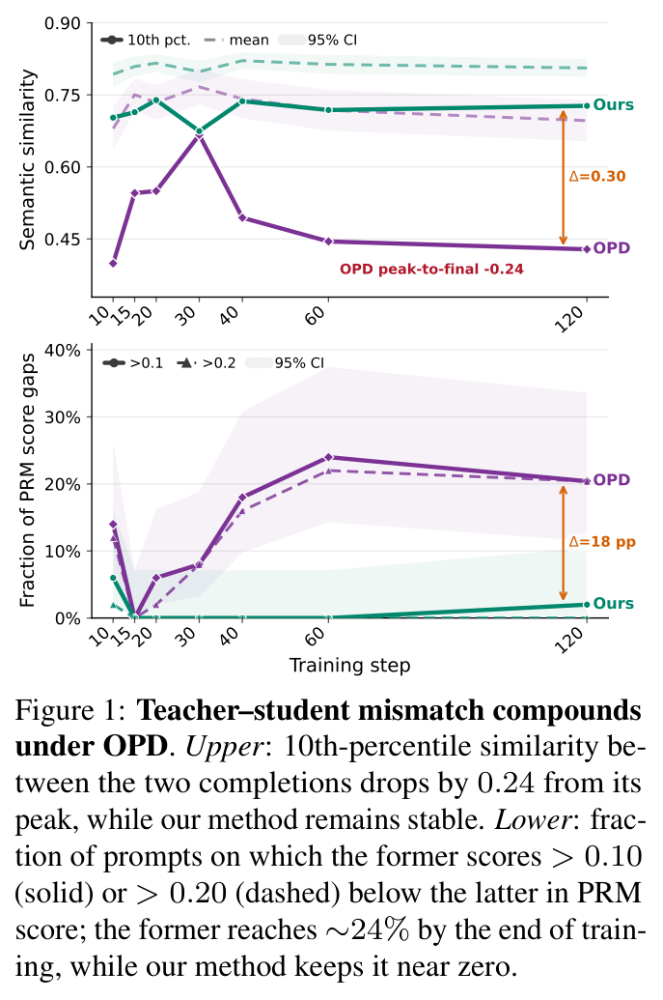

Figure 1：OPD 的低分位 semantic similarity 随训练下降，PRM score gap 比例上升；MPOPD 的对应曲线更稳定，支持 mismatch 累积的解释。

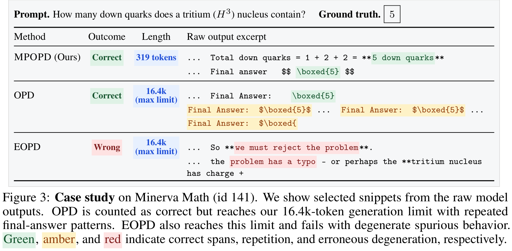

Figure 3：OPD 已给出正确答案仍反复输出，说明长度问题可以发生在解题之后；这张图本身不能证明所有长度收益都来自同一原因。

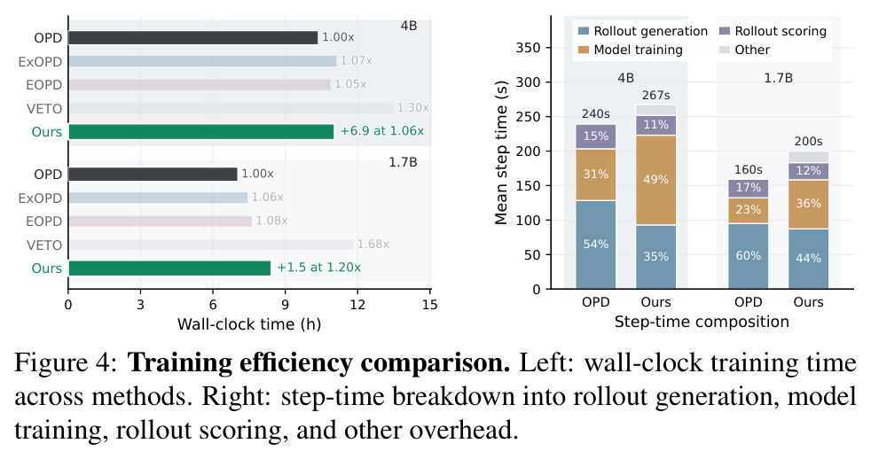

Figure 4：proposal update 增加模型训练耗时，缩短 rollout 抵消其中一部分；作者报告平均 wall-clock 额外约 13%。

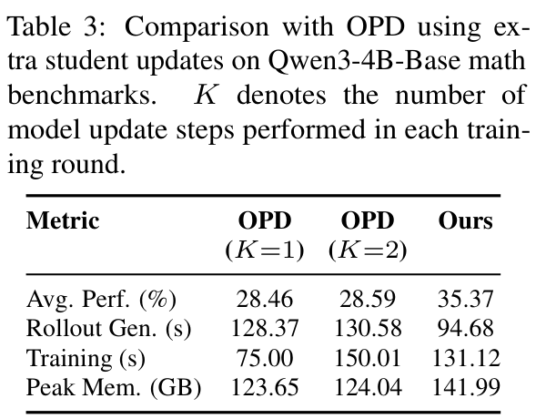

Table 3：OPD 双更新准确率仅由 28.46 到 28.59，MPOPD 为 35.37；但其 peak memory 141.99 GB 高于两种 OPD，不能说额外模型没有资源代价。

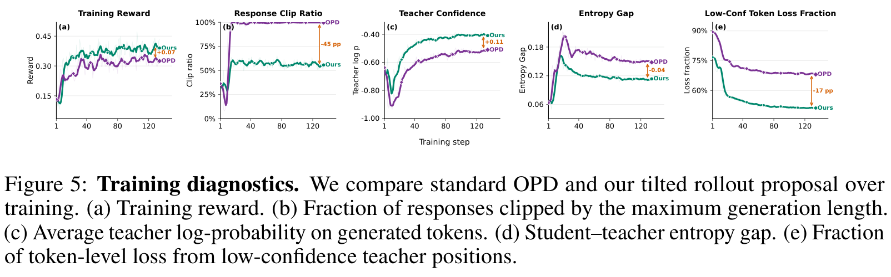

Figure 5：reward 上升与 response clip ratio 下降同时发生，teacher confidence 和 low-confidence token loss fraction 也朝预期方向变化；这组联合诊断比仅报告平均长度更有说服力。

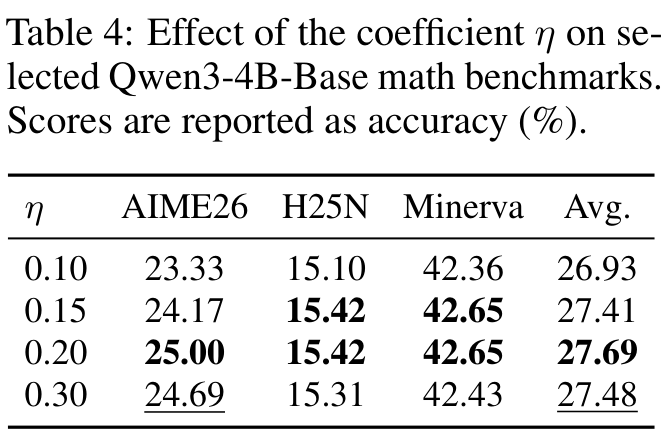

Table 4：所测四个 $\eta$ 中 0.20 的三项平均最好，0.30 略回落，说明增大 teacher 引导并非单调获益。

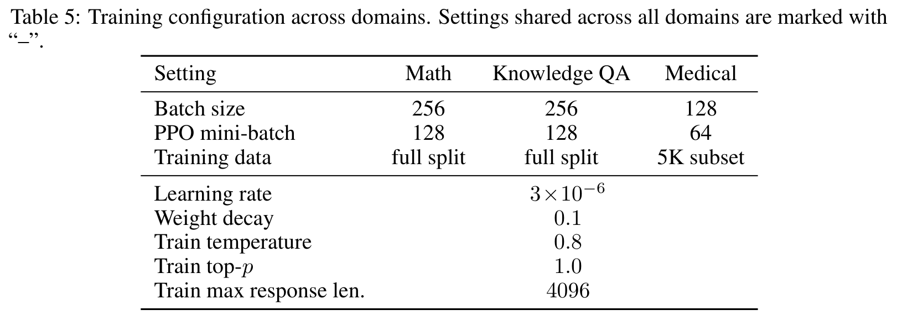

Table 5：不同领域训练预算不同，知识 batch 与正文有冲突，复现应先核对配置。

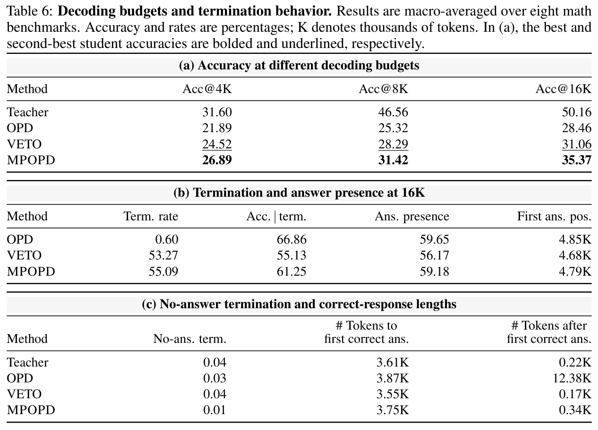

Table 6：4K、8K、16K 都有收益；正确答案之后的冗余生成明显减少，支持收益不只是扩大测试长度得到的结果。

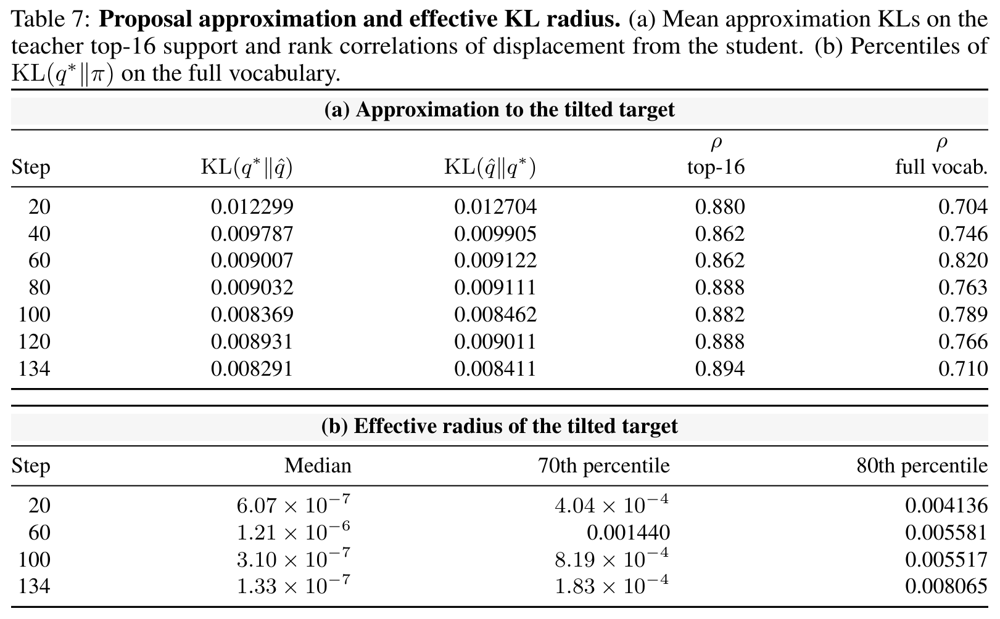

Table 7：proposal 在 teacher top-16 上能较好跟踪目标，但有效 KL 半径存在右尾；平均近似好不等于每个罕见前缀都好。

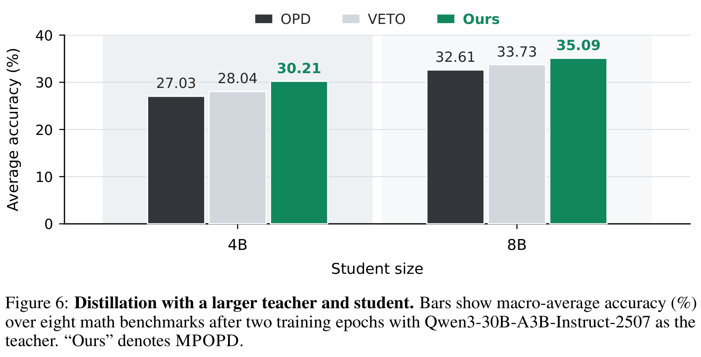

Figure 6：换更大 teacher 后 4B、8B 仍领先 OPD 和 VETO，说明收益没有只停留在最初的小 teacher 设置。

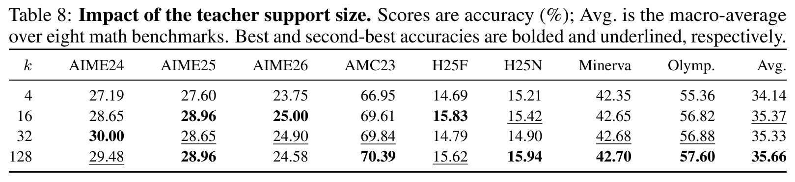

Table 8：top-4 明显不如 top-16，继续增加 support 收益较小且不单调，显示截断范围有实际影响。

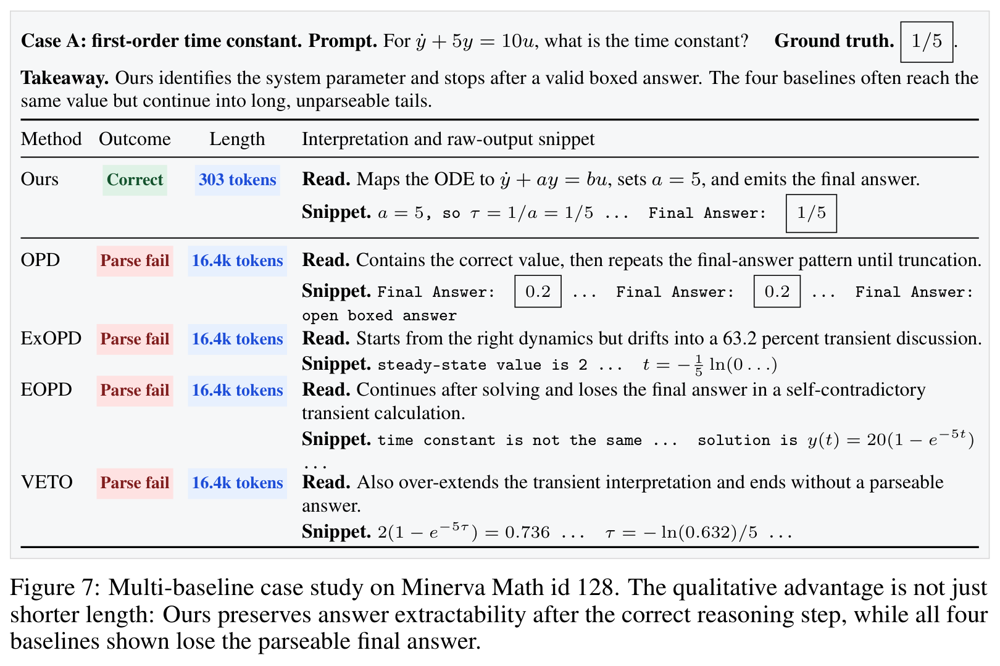

Figure 7：一阶系统案例中，部分基线找到正确值后仍丢失最终可解析答案，揭示输出协议也是得分的一部分。

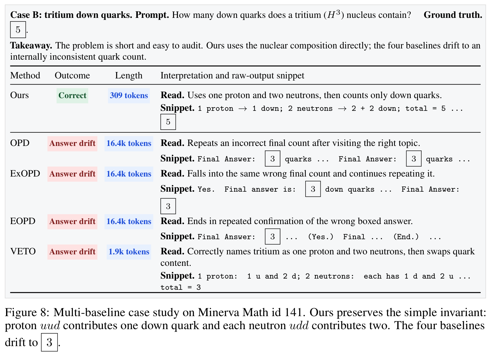

Figure 8：下夸克计数案例说明长输出还可能伴随 answer drift；该图与正文 Figure 3 的同题长度、OPD 判定并不一致，不能视为同一次输出。

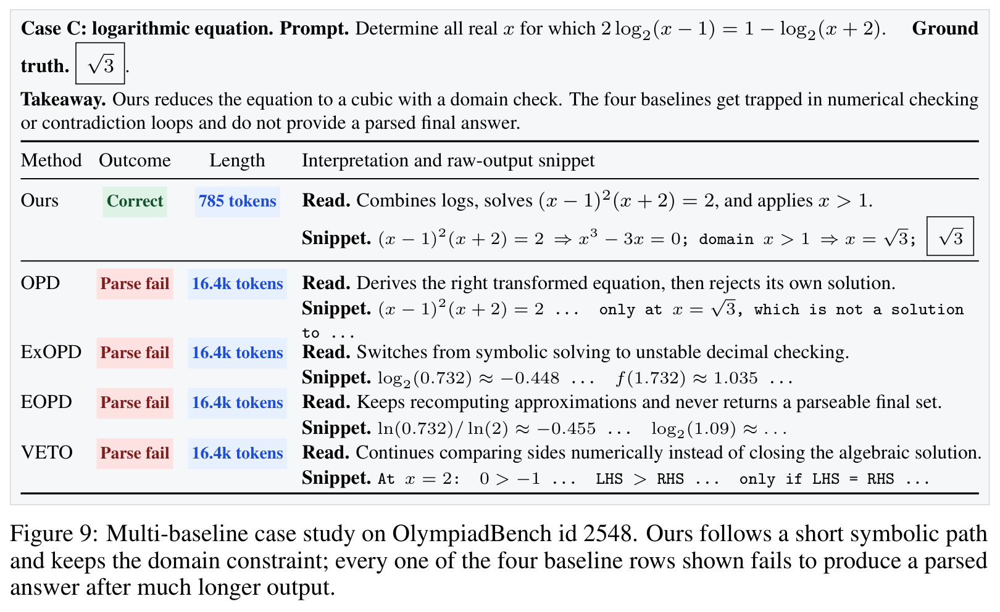

Figure 9：对数方程案例中，MPOPD 保留定义域检查，基线出现反复数值验证；这是案例证据，不是额外独立测试集。

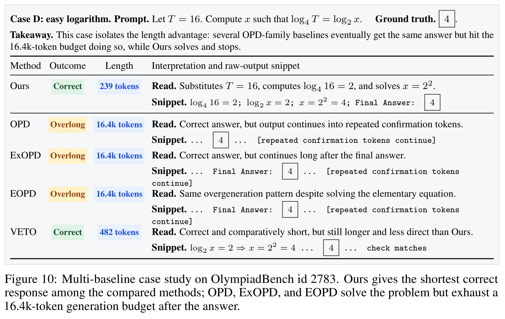

Figure 10：简单对数题中，多种方法都能做对，区别主要在答完后是否停止，提醒读者区分推理能力与终止行为。

**实验能支持什么**：采样分布改造在这些设置下同时改善准确率和输出效率，且额外 student update 不能替代它。**仍不能单独支持什么**：teacher reachability 是唯一原因，或任意 geometry 下 geometric mixture 都占优。

## 6. 局限性

**作者自己承认的**：完整 proposal 增加训练开销；固定 $\eta$ 未自适应；固定 clipping threshold $C$ 的校正仍可改进；模型家族、规模和模态范围有限。像教练兼安排训练和评价，如果教练自己判断错了，更顺从的练习不一定更有价值。

**我的判断**：第一，teacher 相对高概率是可靠监督的代理，teacher 的高置信错误也可能被强化。第二，逐前缀 trust region 的解不自动控制整条长轨迹的 occupancy，更不直接保证固定评测目标下降。附录 F 明确写道 “This is not a guarantee on a fixed evaluation objective.” 第三，Eq. 7 的单步裁剪权重不等于前缀所有概率比的乘积，会保留分布偏差。第四，proposal 只在已有轨迹前缀上训练，对尚未访问的新前缀仍需泛化。

**实验层面的问题**：主文与附录的知识 batch 不一致；同题案例展示不一致；主要表格没有多随机种子方差；训练长度与评测长度不同，虽有 Table 6 控制仍应保留条件。以上实验问题留在正文，不混进 frontmatter 的四条方法局限。

## 7. 一句话总结

MPOPD 像让教练挑选既贴近学生水平、又能被老师有效指导的练习路线，再由学生自己完成；在本文设置下，这比只改变批改规则更有效。它的关键式子是第 4 节的 $q^*_{\eta,t}\propto\pi_t^{1-\eta}(\pi^\star)^\eta$，含义是兼顾双方支持的路线；结果不应被简化成让学生越像老师越好，因为引导过强会削弱 on-policy 性质。

## 8. 可复用点

先在现有 OPD 流程记录 response clip ratio、answer presence、first-answer position 和答后 token 数，区分不会做与做完不停。像修水管先定位漏点，不能只因水表读数大就缩短供水。

确有 teacher–student mismatch 再分离 rollout generator 与部署 student；同时记录 proposal–student KL、裁剪率和 teacher top-k 覆盖，确认 proposal 跟得上目标。若只允许黑盒 teacher 最终答案，本文逐 token geometric mixture 不能直接照搬。通用机制已抽成 [[../../../30 方法卡片/几何混合提案采样]] 方法卡。

## 9. 我的疑问

- 如果 teacher 具有高置信系统性错误，relative teacher support 是否会降低学生自己的正确探索？像老师坚持一条错误解法，教练会不会把所有练习都导向它？
- 换成完整前缀重要性比或显式 occupancy 校正，准确率、方差和计算代价如何变化？
- 能否在相同总 GPU-hour 下，比较 adapter proposal、固定 proposal 和动态 $\eta$？这些是未验证的改进问题，不是本文已经实现的功能。

基准同步：已运行项目 `bench_check.py`；AIME、HMMT、Minerva、OlympiadBench、GPQA、ARC、MMLU-Pro、DAPO 母条目与 avg@k 保持原样。按单次最多五行原则补 ARPO-10k、PubMedQA（原文简称 PubMed）、MedQA、MedX 和 generation length；M23K、Lancet、NEJM 暂不扩展专门条目，使用范围在本笔记保留。
